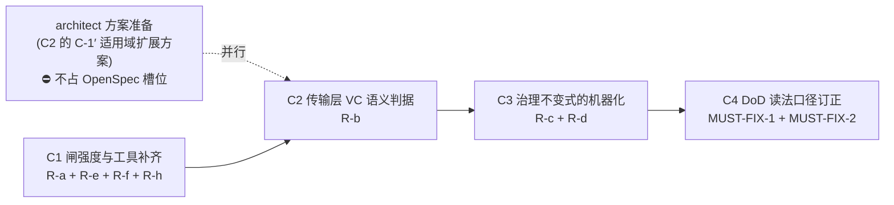

# objective-cep-platform: CEP 跨 14 季度治理叙事

> **写入权**: rdd-planner(per `rdd-planner/SKILL.md:156` + ADR-0028 + ADR-0054 D5 唯一写入方)
> **schema**: `_lib/schemas/objective_schema.json` v1(9 必填字段齐;`kind` / `phase_refs` 为扩展字段)
> **关联**: `.rddf/roadmap/phases/phase-10.md`(CEP 实施 phase)+ `.rddf/improvements/cpptlm-cep-umbrella.md`(5-segment 草稿)
> **关联真源**: **21 份** ADR `docs/adr/ADR-CEP-*.md`(per `ADR-CEP-NUMBER-MAP §2 Decision 1`;基座 00/00A/01~07 + NUMBER-MAP,实例/排序/版本/契约/演进 08/09/11~18/07A)
> **关联变更**: `cpptlm-cep-umbrella`(Stage 0)+ Stage 1~3 **13** 个串行 change(2026-Q4 ~ **2030-Q1**)

---

## §0 Goal

> **⚠️ architect 阶段同步(2026-10-21,两批)**:invariant 计数已同步为 **67 编号位 / 66 实际 / 15 组**(第一批新增 `ADR-CEP-08`/`09`/`12`/`13` + `ADR-CEP-07-IC7` + `ADR-CEP-06-IC5`;第二批新增 `ADR-CEP-11`/`14`/`15`/`16`/`07A`)。**阶段重排、DoD 7 分解(10 → 15 组)、change 清单**等非机械部分已由 planner 阶段完成。计数单一真源 = `docs/architecture/07-coherence-exploration-platform.md §4`。
> **⚠️ planner 阶段同步(2026-10-23,per Entry #22)**:①**队列口径** —— `ADR-CEP-00 §2 Decision 3` 为 **11 个 change / 串行 11 季度**(2026-10-22 per Entry #12 由 10 → 11),终态验收顺延至 **2029-Q2**;②**Stage 0 实施态** —— umbrella **已完成归档**(2026-10-23;tasks **99/99** 全勾,delta spec 已合并进 `openspec/specs/cep-core-contracts/spec.md`;R10 已按 **§9.3** 闭合判据处置,per 台账 Entry #28/#29/#30);③**ADR-CEP 族两轮精简已完成**(契约面零改动,per Entry #20/#21);④**Stage 1 准入前置 S1-1 ~ S1-7 已在 §4.0 排队表可寻址**(逐项 owner → 队列 #2 / #4 / #6)。计数单一真源 = `07 号 §4`;change / 季度单一真源 = `ADR-CEP-00 §2 Decision 3`。

跨 14 季度(2026-Q4 ~ 2030-Q1)推进 Coherence Exploration Platform(CEP)从"协议中立基线"(06 §1.1 v2.1.10 已落地 60-70%)走向"5 协议族(CHI / CXL 2.0+3.0 对称 / TileLink-C / NVLink / UALink;**族 / 实例计数口径见 `07 号 §5.1.1`「6 族 / 8 实例」**)可插拔 + 实验产物可比较"的完整探索平台,期间守 14 个 change 串行 KPI 排队 + **66 条守门 invariant**(编号位 67,per `ADR-CEP-06/07` + oracle v0.4 B5 命名空间统一)。

**完成定义 (DoD, 2030-Q1 终)**:

1. ✅ **14** 个 OpenSpec change 全部 archived with sync
2. ✅ Stage 0 umbrella change `cpptlm-cep-umbrella` 落地(2026-Q4)
3. ✅ Stage 1 实施完成(Stub Cache + Sharer Tracker + Collective Plane + 3 协议 RN-F subset)
4. ✅ Stage 2 实施完成(CXL 对称 DCOH + NVLink SHARP)
5. ✅ Stage 3 实施完成(UALink In-Network Compute)
6. ✅ 实验输出 4 件套契约(`simulation_config.json` + `trace.h5` + `metrics.json` + `report.html`)per `ADR-CEP-06`
7. ✅ **66 条守门 invariant 机器检查 100% 覆盖**(编号位 67,`INV-CEP-04-IC4` **唯一跳空**)—— **按 15 组分解验收**:

| # | 组 | 条数 | 机器检查落点(逐条载体 = 映射表;下列为补充/编号完备性) |
|---|----|:----:|------------|
| 1 | Coherence Interface | 11 | **映射表**(逐条载体)+ `test/test_cep_canonical_invariants.cc`(CEN-Ib1~11) |
| 2 | Stub Cache | 7 | 映射表(逐条载体)+ `test/test_cep_canonical_invariants.cc`(编号完备性)(INV-SC1~6 + `INV-CEP-05-IC1`) |
| 3 | Sharer Tracker | 6 | 映射表(逐条载体)+ `test/test_cep_canonical_invariants.cc`(编号完备性)(`INV-CEP-04-IC1/2/3/5/6/7`) |
| 4 | Experiment Protocol | 5 | 映射表(逐条载体)+ `test/test_cep_canonical_invariants.cc`(编号完备性) + `test/test_cep_simulation_mode_lock.cc`(4 件套契约) |
| 5 | Simulation + Seam | 7 | **映射表**(逐条载体)+ `test/test_cep_module_factory_seam.cc` + `test/test_cep_simulation_mode_lock.cc` |
| 6 | Numbering | 3 | **映射表**(逐条载体)+ `scripts/test/cep_docs_sync_check.sh` |
| 7 | Ordering Point | 3 | **映射表**(逐条载体)+ `test/test_cep_canonical_invariants.cc`(契约层)+ Stage 1 实现 |
| 8 | Multi-VC / Deadlock Freedom | 3 | 映射表(逐条载体)+ `test/test_cep_canonical_invariants.cc`(编号完备性)(契约层)+ Stage 1 装配期无环检查器 |
| 9 | Capability Map | 3 | 映射表(逐条载体)+ `test/test_cep_canonical_invariants.cc`(编号完备性) + `include/tlm/cep/protocol_instance.schema.json` |
| 10 | Coherence Domain | 3 | 映射表(逐条载体)+ `test/test_cep_canonical_invariants.cc`(编号完备性)(契约层)+ Stage 2 实现 |
| 11 | Protocol Version Locking | 3 | 映射表(逐条载体)+ `test/test_cep_canonical_invariants.cc`(编号完备性)(契约层)+ 装配期版本校验(Stage 1) |
| 12 | Stub Contract Tests | 3 | 映射表(逐条载体)+ `test/test_cep_canonical_invariants.cc`(编号完备性)(契约层)+ C1~C10 落地(Stage 0~1) |
| 13 | CacheTLM Alignment | 3 | 映射表(逐条载体)+ `test/test_cep_canonical_invariants.cc`(编号完备性)(契约层)+ 冻结面 0 diff 守门(Stage 0) |
| 14 | 06 Evolution Mapping | 3 | **映射表**(逐条载体)+ `scripts/test/cep_docs_sync_check.sh`(P 编号口径) |
| 15 | 06-bis Artifact Disposition | 3 | 映射表(逐条载体)+ `test/test_cep_canonical_invariants.cc`(编号完备性)(协议泄漏通用禁令扫描) |

> **落点口径(2026-11-05 **改判**,per 台账 **Entry #232** + `.rddf/reviews/cep-b2-coverage-verdict.md`;原口径 per Entry #22)**:
> 本表「机器检查落点」= **口径校验**所在位置。**66 条 invariant 的逐条判定级载体见映射表**
> `test/cep_invariant_assertion_map.json`(由 `// INV-CARRIER: <id>` 刚性标记**生成** ⇒ 派生视图,⛔ **不是**手写口径源);
> `test/test_cep_canonical_invariants.cc` 保留为**编号完备性**载体(owner 映射 / 永久跳空 / 集合相等 / ID 形态 / 前缀唯一 / 实际定义数 = 66),
> ⛔ **不再**承担逐条语义断言的职责(实测:该文件 13 cases / 687 assertions **无一条**验证 invariant 语义)。
> ⚠️ **改判项(⛔ 不是澄清)**:原注写「组 6/14/15 另有脚本层口径校验,**不替代**逐条断言」⇒ 现**改判**为
> 「**脚本层校验可作判定级载体**」,但须满足**载体有牙**(反向 fixture,或结构校验 + 负控;脚本类载体 **100% 负控**)。
> ⚠️ 在表内标记为 ⛔ 的四类**死形态**(注释 / 解析器编号表 / 恒真表达式 / 无退出码语义的 echo)与三类**活但 vacuous**(平凡真断言 / 条件永真的 `exit 1` 分支 / 从不执行的 case)**均不算载体**。
> 15 组分解本身**不复述** —— 真源在 `07 号 §4`。

8. ✅ ModuleFactory 集成 0 发明宏形式(per oracle v0.4 B7)
9. ✅ simulation_mode 单一维度(functional / timing),不引入 network.mode
10. ✅ **§9 研究问题清单 8 个假设全部有实验结论**(per §9.1)
11. ✅ §11 决策台账记录所有 KPI 让位决策 + Go 节点地址 + Sprint 复盘
12. ✅ §8 Kill / Replan 判据未触发(或已按判据处置)

> **验收层级委托**(per oracle S1 修订 / 2026-10-23 指针修正):本 DoD 是**终态判定**。
> - **逐条 assertion 的执行真源** = `openspec/changes/archive/2026-10-23-cpptlm-cep-umbrella/proposal.md` §Acceptance(**实测值在此回填**);
> - **上游规划输入** = `.rddf/improvements/cpptlm-cep-umbrella.md` §Acceptance **A1 ~ A7**(A7 = **前置 gate 汇总**,不是 assertion);
> - Stage 1~3 各 change 的条款落**各自** OpenSpec change 的 AC。
>
> 本文件**不重复**逐条 assertion,避免三处复述漂移。

---

## §1 Background

### 1.1 现状评估(per `phase-10.md` §关键依赖)

- **06 §1.1 v2.1.10**:已落地 L1-L6 仿真层层模型(60-70% 协议中立)
- **06 §15.4 P2.0-P5**:Coherence 演进 seam,但**无 coherence 协议中立抽象层**
- **06-bis §7.3-§7.7**:CoherenceBridge / CoherenceProtocol / SnoopFilter 等接口草案(90% markdown,无 C++ 实现)
- **dGPU Phase 2/3**:协议特化层(phase-9,active),与 CEP 是**不同并列关系**,不接管

### 1.2 核心矛盾(per oracle + metis G1)

phase-1~9 完成(2026-04 ~ 2027-02)后,**协议中立基线缺位**:
- 协议中立层(06 §1.1)已落地 60-70%
- 但**复用 06-bis 范围但实质 0 复用**(06-bis 90% 是 markdown 草案,几乎所有 CEP 契约都"本 ADR 首次定义")
- 探索平台无实验产物(metric / sweep / A-B 对比 — metis G1 盲点)
- 真实 IP 对应实证缺口(NVIDIA H100 GMMU / ARM CMN-700 / UALink Common 2.0)

### 1.3 立项依据(如实陈述,per oracle B5 修订)

本 objective 由 planner 于 2026-10-20 **新建**,触发判断依据:
- `rdd-planner/SKILL.md:150` 决策表:"跨 sprint 目标叙事 + 复盘台账 + deferral rationale → objective"
- CEP 三项全命中:跨 14 季度叙事 / §11 append-only 台账刚需(KPI 并发 ≤1 + 季度让位可追溯)/ Stage 晋级复盘仪式

> **说明**:本 objective **不**基于任何"预埋触发条件"文本。`.rddf/roadmap.md` 的 Features / Objectives 占位段由 planner 本回合同步改写,不存在 CEP 之前的历史预埋声明。

---

## §2 范围

### 2.1 目标愿景

把"用 CHI / CXL / UALink 的这个 SoC,coherence 开销 / 停顿 / 死锁风险如何"这类**跨协议取舍问题**,从"当前靠人脑推演"变成"可跑实验出数据"。

### 2.2 In-Scope(per `ADR-CEP-00 §3` + `ADR-CEP-07 §2`)

- **6 层架构骨架**:Core / Traffic Generator / Stub Cache / Coherence Interface / Protocol Engine / Directory & Ordering Plane / Fabric Collective Plane / Fabric & Transport Plane
- **canonical 10 条 Coherence Interface 流清单**(per `ADR-CEP-02 §2`):request / completion / snoop / snoop_resp / writeback / forward_data / back_invalidate / address_resolve / barrier / snoop_completion_ack
- **StubCacheCore 6 接口 + 6 不变量**:net-side 5 (`request` / `snoop` / `snoop_resp` / `writeback` / `completion`)+ core-side 1 (`evict_line`)
- **SharerTracker 6 实现 + caps descriptor + D-5 重构**:`FullMapDirectory` / `SparseSnoopFilter` / `HierarchicalDirectory` / `DcohSymmetric` / `TreeManager` / `BroadcastNull` —— ⚠️ **2026-11-02 订正**(per 台账 Entry #148):原写「5 实现」**漏** `HierarchicalDirectory`(Entry #96 于 2026-10-29 增第 6 种);**行为实现已落地 5 种**(`FullMapDirectory` / `SparseSnoopFilter` / `HierarchicalDirectory` / `TreeManager` / **`DcohSymmetric`**),另 **1 种**(`BroadcastNull`)**仅声明层 traits**;⚠️ **2026-11-02 订正**(per 台账 Entry #167)—— `DcohSymmetric` 行为实现已于队列 #12 落地
- **FabricCollective Plane 旁路平面 + 5 条防误分类规则(R1-R5)**
- **NullProtocolEngine / NullCollectivePlane**:10 流覆盖矩阵(per oracle v0.4 B6)
- **Experiment Output Protocol**:4 件套 + 13 必纳 metric + 4 可选 metric + 一致性 fail 闸
- **ModuleFactory 集成 seam**:真实注册机制(`ModuleFactory::registerObject<T>` + `REGISTER_MODULE(T)`),**不发明宏形式**
- **simulation_mode 单一维度**:functional / timing,真源在 `06 §5.1` + `01-hybrid §4.7`(per oracle v0.4 B3-5)

### 2.3 Out-of-Scope

- ❌ **完整缓存核心微架构** — Stage 0 仅 Stub Cache 接口;不做完整 tag/data SRAM / 复杂预取器 / 精确功耗模型
- ❌ **真实 RTL / FPGA 加速** — 推 ArchForge 仓
- ❌ **完整 UsrLinuxEmu driver 集成** — 不在 CEP scope
- ❌ **IOMMU 完整协议** — Stage 5 范围 reduction 待签发独立 ADR(per `ADR-CEP-00 §3` supersede 表 P5 行 scope reduction 声明)
- ❌ **Multi-VC 路由器全仲裁** — Stage 0 仅 `vc_id` 字段 0-3 沿用;多 VC 仲裁推迟到 CEP-09(per `ADR-CEP-NUMBER-MAP §2 Decision 1`)
- ❌ **6 协议平行** — Stage 0~3 串行排队(per `ADR-CEP-00 §2 Decision 3` 14 季度)

---

## §3 架构依据(引用 ADR,per roadmap/SKILL.md:73 §3 语义)

| 依据 | ADR | 决策要点 |
|------|-----|---------|
| 归口 + 边界豁免 | `ADR-CEP-00` §2 Decision 1/3/4 | 代码全归 CppTLM;单 DRI;AGENTS.md:423 不触发 |
| 6 层 + 完成域 | `ADR-CEP-01` §2 Decision 1/2 | Fabric Collective 旁路平面;requester-scoped vs group-scoped |
| canonical 10 流 | `ADR-CEP-02` §2 | 10 条流 + **CEN-Ib1~11** 不变量(11 条,per Entry #19 §3 交叉引用) |
| SHARP 内部 | `ADR-CEP-03` §2 + §3 | CollectivePlaneIf;R1-R5 防误分类;CEP-13 non-cacheable 语义 |
| D-5 重构 | `ADR-CEP-04` §2 + §3 | caps descriptor 替代 bool;LookupResult 枚举;snoop_begin/fold |
| Stub Cache | `ADR-CEP-05` §2 + §3 | RN 投影 6 接口;折叠映射表;10 条契约测试 |
| 实验输出 | `ADR-CEP-06` §2 | 4 件套 + 13 必纳 metric;INV-CEP-06-IC1~4 |
| 仿真 + seam | `ADR-CEP-07` §2 + §3 | simulation_mode 单一维度;ModuleFactory 真实注册;INV-CEP-07-IC1~6 |
| 编号 + 真源锚点 | `ADR-CEP-NUMBER-MAP` §2 + §3 | CEP-08~16 预分配;INV-CEP-NUM-IC1~3 |
| 真源章节映射 | `ADR-CEP-00A` §3 + §4 | 章节行号实证;14 条伪引清单 |

> **完整 21 份 ADR 清单**: `docs/adr/ADR-CEP-*.md`(per `ADR-CEP-NUMBER-MAP §2 Decision 1`)。本表仅列**基座**决策依据;实例 / 排序 / 版本 / 契约 / 演进映射类(08/09/11~16/17/18/07A)见 `phase-10.md` §真源 3 与 `07 号 §4`。

---

## §4 Phases & Changes

> **术语约定**(per metis G2-A 歧义消解):本文件用 **Stage 0/1/2/3** 指 CEP 内部实施段;**roadmap phase-10** 指路线图 phase;**dGPU Phase 2/3**(phase-9)与 **PCIe EP Phase 1-8** 是其它命名空间,勿混。
>
> **🔑 两条真源分工(per Entry #23 —— 排队是 change 维度的治理,须由路线图承载实施路径)**
>
> | 维度 | 唯一真源 | 本文件的角色 |
> |------|---------|-------------|
> | **治理口径**(change 总数 / 串行规则 / 并发上限 / 变更名) | `ADR-CEP-00 §2 Decision 3` | **只引用,不重算** |
> | **实施路径**(顺序 / 季度 / 状态 / 准入前置归属) | **本文件 §4.0 排队总表** | **权威承载** —— 路线图 = 实施路径真相源 |
>
> ⚠️ 二者**不是**同一件事:ADR 决定「能排几个、怎么串」,路线图决定「**先做哪个、落在哪个季度、当前什么状态、前置挂在谁身上**」。
> **任何排期调整只改本文件 §4.0 + §11 台账**;若触及 change 总数 / 串行规则,则须走 ADR 修订(冻结面成员)。

### 4.0 实施路径总排队表(权威 —— 14 个 change × 1 季度,串行)

> **口径**:每个 change 独占 1 KPI slot、独占 1 个季度(per `ADR-CEP-00 §2 Decision 3`「14 个 change,串行 14 季度」+ §5.4 并发 ≤ 1)。
> **本表是实施路径的唯一权威视图** —— §4.2 ~ §4.4 是各 Stage 的**细节展开**(估时 / 关联 ADR / 语义),其**顺序号与季度以本表为准**;`phase-10.md` 的依赖图是**示意**,不作排期承诺。
> **状态口径**:🟡 in-progress(已建、待 archive)· ✅ 完成 · 📋 Planned(未建)· ⏸ 队列位保留(待裁决)。**📋 Planned 行可在末列标注外部阻塞**(如「⚠ R-1 阻塞」)—— **登记 ≠ 就绪**:排期位置是**计划**,阻塞标注是**债的可见性**,二者不冲突。
> **状态怎么改、改哪几处** ⇒ 见 **§4.7 载体分工与状态更新协议**(本表的状态列是 `tasks.md` 勾选的**投影**,不是第二真源)。

| 顺序 | Change | Stage | 季度 | 状态 | 承接的 Stage 1 准入前置 |
|------|--------|-------|------|------|----------------------|
| **1** | `cpptlm-cep-umbrella` | Stage 0 | **2026-Q4** | ✅ **archived**(2026-10-23;**完成归档**语义 —— tasks **99/99** 全勾 + delta spec 已合并进 `openspec/specs/cep-core-contracts/spec.md`;R10 已按 `§9.3` 闭合,per 台账 Entry #28/#29) | — |
| **2** | `cpptlm-cep-poc-spike` | Stage 1 | **2027-Q1** | ✅ **archived**(2026-10-24;**完成归档**语义 —— delta spec 已合并进 `openspec/specs/cep-poc-spike-verification/spec.md`(15 Scenario);tasks **全勾**;critic **7 轮复审**(前 6 轮 REJECT 揭示六类「有牙」缺口 → 全部修复 + mutant 反证,**第 7 轮 APPROVE**,per Entry #49~#54);S1/S2/S3 三 spike 实跑 + ctest 回归门;owner 重指向 per Entry #55) | 原承接的全部装配期前置已**重指向见 §4.2 说明 + Entry #55**(① 定义层已消费;② 建图层→队列 #4;③ 放行闸→全局不变量;M-4 决策→队列 #3;表体→队列 #6;其余→队列 #3 起) |
| **3** | `cpptlm-cep-stub-cache-core` | Stage 1 | **2027-Q2** | ✅ **archived**(2026-10-25;**完成归档**语义 —— tasks **36/36** 全勾;delta capability **2 个**(`cep-vc-mapping-contract` 8 Scenario / `cep-stub-cache-core` 9 Scenario)**已合并**进 `openspec/specs/`;归档路径 `openspec/changes/archive/2026-10-25-cpptlm-cep-stub-cache-core/`;**双 Phase** 全部完成 —— Phase 0 = M-4 决策落盘 + 契约化(协议层 credit **不独占** VC / 传输层**保持索引对齐** / `VC_DAT` 语义正名 / 冲突输入**传输层不仲裁** / 桶名不改名不弃用 / `fabric.schema.json` **零改动**),Phase 1 = stub cache core 实现(6 接口 + 5 态 + `INV-SC1`~`INV-SC6`);**`ADR-CEP-05 §10` 的 `-base`/`-impl` 二分作废**(2026-10-25 裁决),per 台账 Entry #58 / #59 / #60) | **M-4 行为侧决策**(✅ **已消费** —— 队列 #3 归档时落成 `cep-vc-mapping-contract`:协议层 credit **不独占** VC(权威已闭,per ArchForge `32 号 §6.0.1`)+ 传输层**保持索引对齐** + `VC_DAT` 语义正名 + 冲突输入**传输层不仲裁**;契约化于 `cep-vc-mapping-contract`,结论见归档件 design.md D2~D9) |
| **4** | `cpptlm-cep-directory-ordering-plane` | Stage 1 | **2027-Q3** | ✅ **archived**(2026-10-25;**完成归档**语义 —— 22 Scenario 并入 3 份 main spec:`cep-sharer-tracker-base` 9 / `cep-ordering-point-checker` 6 / `cep-channel-dependency-gate` 7;archive 名 `2026-10-25-cpptlm-cep-directory-ordering-plane`;builder Entry #63 / 归档 Entry #64) | **已交付(历史记录,不再承接)**:SharerTrackerIf 单接口 + caps descriptor + D-5 全量契约 + FullMapDirectory 唯一行为实现 · AddressResolverIf + J1/J2/J3 + `INV-CEP-08-IC2` + (β) 重评估裁决 · 装配期通道依赖图(逐 `(network, vc)` verdict,双挂共享判据)。**Stage 1 准入前置的登记与余项已重指向队列 #5 行**(per Entry #64) |
| **5** | `cpptlm-cep-collective-plane-base` | Stage 1 | **2027-Q4** | ✅ **archived**(2026-10-26;**完成归档**语义 —— 21 Scenario 并入 2 份 main spec(`cep-collective-plane-base` 13 / `cep-collective-plane-contract` 8);archive 名 `2026-10-26-cpptlm-cep-collective-plane-base`;planner 见 Entry #66、builder 见 Entry #67、复审修复见 Entry #68/#69、归档见 Entry #70) | **已交付(历史记录)**:CollectivePlaneIf 恰好 7 方法 + 类型集 + NullCollectivePlane(**行为化 `INV-CEP-07-IC3`**)+ LocalCollectivePlane(group 生命周期 / region-epoch 两阶段 / BARRIER rendezvous / **R2 判读侧三态**,**行为化 `INV-CEP-04-IC5` 的 R2 判读侧**)+ 6 条契约判据(零调用边 / canonical 10 流零 diff / VC 预留 / 区域互斥同源 / 完成域判别 / 抓取点可测性登记)+ 独立声明源 `collective_planes.json` + 离线 CLI。**新增 invariant 数 = 0**。|
| **6** | `cpptlm-cep-moesi-gpu-adapter` | Stage 1 | **2028-Q1** | ✅ **archived**(2026-10-27;**完成归档**语义 —— 14 Scenario 并入 2 份 main spec(`cep-moesi-gpu-adapter` 7 / `cep-adapter-schema-contracts` 7);archive 名 `2026-10-27-cpptlm-cep-moesi-gpu-adapter`;planner 见 Entry #71、builder 见 Entry #79、归档见 Entry #80) | **DRI 三问裁决(2026-10-26,per Entry #71)**:① `moesi_gpu` / `mesif` **排入** Stage 1 前段(原 #6 `chi-rnf-subset` 顺延为 #7,`mesif` 新增为 #9)② **承接项 7 ①②**(`perm` 形态 schema 演进)**跟 `moesi_gpu` 走** —— 其**唯一真实消费者**是本实例(`ADR-CEP-05 §13.1` 判据 2 **已触发**:`moesi_gpu` 静默 `E→M` ⇒ 4 值 `perm` 无法表达)③ **承接项 5**(6 类 → `CATEGORY_*` 显式映射表 + contract test)**跟首个 adapter 走**。**交付面**:`MoesiGpuAdapter`(6 态 × 6 事件表驱动;`E→M` **静默升级**) + 6→4 投影 + **平台级** `perm` 静默升级表达 + 6→3 消息类映射表机制 + 首个 `implemented` 实例装配。**Stage 1 准入前置(滚动登记,per Entry #70 / #71 —— 原 owner 队列 #5 已归档,owner 重指向本行)**:**承接项 1 ②建图层** ✅ 已消费(队列 #4 装配闸)· **承接项 2**(首个 `implemented` 实例装配后复核 per-network 嵌套形态)**✅ 本 change 已交付**(2026-10-27 归档;本 change = 首个 `implemented` 实例)· **承接项 3** ⛔ 未触发(需第 3 张网 / 第 3 个协议实例 —— 按新队列于 #9 达成)· **承接项 4** ✅ 已消费(Entry #56,`fabric.json` 已入冻结集)· **承接项 5**(6 类 → `CATEGORY_*` 显式映射表 + contract test)**✅ 本 change 已交付**· **承接项 7 ①②**(`perm` 形态 schema 演进)**✅ 本 change 已交付**(③ (β) 已由队列 #4 消费)。**孤儿前置登记**:本行的 3 项孤儿前置(M-4 行为侧 / verdict 逐 `(network, vc)` 标注义务 / `moesi_gpu`·`mesif` 未排期)**已全部收口** —— 分别落成于队列 #3 的 `cep-vc-mapping-contract`、队列 #4 的 `cep-channel-dependency-gate`、并已于 Entry #71 消解(`mesif` → #9 行)⇒ **登记随本 change 归档转指队列 #7 行**(per 断言 ⑦ ③b/③c;本行不再带标记,内容保留可追) |
| **7** | `cpptlm-cep-cohif-carrier` | Stage 1 | **2028-Q2** | ✅ **已归档**(2026-10-28,Entry #90 —— 「**已完成归档**」语义:2 份 delta spec **已合并**进 `openspec/specs/cep-cohif-carrier/` + `openspec/specs/cep-protocol-bridge-contracts/`;Phase 1 ~ 7 全完成(41/41 task)+ 6 条判据全闭合 + **新增 invariant 数 = 0**;KPI 1/3 → **0/3**;⚠️ **2026-10-27 转正时的活跃路径** `openspec/changes/cpptlm-cep-cohif-carrier/` **已于 2026-10-28 归档时失效** ⇒ 现为 `openspec/changes/archive/2026-10-28-cpptlm-cep-cohif-carrier/`(**不入库**,per `.gitignore`)—— 2026-10-27 转正记录见 Entry #81) | **新准入前置**:无。本 change **服务** #6 的第 ② 项准入前置与 #8 的装配验证 —— 把 #6 的「**逻辑级**装配」(`stub_cache_core.hh:42` 明写 `net_side` 由 **mock ProtocolEngine** 驱动)升级为「**真实载体**装配」。**架构缺口来源**(architect 重审 + critic 四轮;`docs/research/cep-cohif-carrier-architecture-review-2026-10-26.md`):**C1** CEP 的 7 个 `.hh` 零 `Bundle`/`ChStream` 引用 · **C2** 「CEP 用 canonical 10 流的 Bundle」在 `ADR-CEP-07A:49` 与 `ADR-CEP-16:45` **两处**均为悬空引用 · **C3** 唯一的 Bundle 化承诺绑在 collective 队列(`ADR-CEP-03:225`)。**交付面(3 项 + 1 宏)**:① `include/bundles/cep_coherence_bundles_tlm.hh`(`bundles::CohIfBundle`,**只覆盖 5 条 RN-side 流**,`flow_id` 区分;无网络层字段) ② `include/tlm/cep/protocol_engine_base.hh`(`ChStreamModuleBase` 派生 + `Input/OutputStreamAdapter<CohIfBundle>`) ③ `include/framework/protocol_bridge.hh`(`ProtocolBridgeEr` + `ProtocolBridge<InB,OutB,Ordered>`,**首次落地**;`CohIfBundle ↔ NoCFlitBundle`) ④ `REGISTER_CHSTREAM_BIDIRECTIONAL` 宏(`registerObject` + `registerBidirectionalPortAdapter` **两件都做**;`static_assert(n>1)`) + `module_factory.hh:313-315` 钩子扩展(`register_protocol_bridge` 死钩子 → 活钩子)。**装配走 JSON 链**(非 programmatic —— `ADR-CEP-16:46/:86` 明确排除 programmatic bridge 的 C++ 路径;`is_multi` 分支 `module_factory.cc:743-750` 是泛型虚分派)。**显式延期**:`StubCacheCore` 的 ChStream 端口面 → `cpptlm-cep-stub-cache-chstream-surface`(需 MODIFIES 冻结 main spec,per `openspec/specs/cep-stub-cache-core/spec.md`)。**已签发**:`ADR-CEP-19`(2026-10-27,per Entry #74;草案文件已移除) · **planner 产出已落地 + 已转正**:`openspec/changes/cpptlm-cep-cohif-carrier/`(proposal + design + **tasks** + 2 份 delta spec;improvement 5 段见 `.rddf/improvements/cpptlm-cep-cohif-carrier.md`,per Entry #75/#76)—— 转正按 `design.md` `D-κ` 六步执行完毕(per Entry #81) · **Stage 1 准入前置 + 孤儿前置登记**:owner 自队列 #6 → #7 → **现转指队列 #8**(per Entry #90;#7 已归档 ⇒ 归档件**不得持有活义务**;明细见队列 #8 行) · **实施进度**:Phase 1 ~ Phase 7 **全部完成**(2026-10-27 / 2026-10-28,per 台账 Entry #84 ~ #89;Phase 3 交付 `ProtocolBridgeEr` + `ProtocolBridge<InB,OutB,Ordered>` + CohIf↔NoC 特化桥(**两层** pack/unpack)+ `register_protocol_bridge` 死钩子 → 活钩子 + `ModuleFactory` Step 7.5 消费路径;Phase 4 交付 `REGISTER_CHSTREAM_BIDIRECTIONAL` 装配宏 + `cpptlm::BundleDirectionTraits`(解耦 `BidirectionalPortAdapter` 的 `NoCFlitBundle` 硬编码);Phase 5 交付 `CohIfNullProtocolEngine` 可注册外壳 + `configs/cep_cohif_pe_minimal.json` + 端到端「一次 CohIf 事务**穿过** adapter 抵达对端」+ 反向 fixture 2 类 + `cpptlm::EgressChannel`(egress 通道由 Bundle 专属 trait 声明);Phase 6 交付 `test/test_cep_cohif_carrier.cc`(17 case)+ 共享 helper;Phase 7 交付 **反向 fixture 登记**(13 条,`scripts/README.md`)+ ctest 显式登记 3 条 + **零 diff** 复核(**新增 invariant 数 = 0**))⇒ **Phase 1 ~ 7 全完成,已归档**(2026-10-28,Entry #90) |
| **8** | `cpptlm-cep-chi-rnf-subset` | Stage 1 | **2028-Q3** | ✅ **已归档**(2026-10-28,Entry #95 —— 「**已完成归档**」语义:2 份 delta spec **已合并**进 `openspec/specs/cep-chi-rnf-subset/` + `openspec/specs/cep-instance-authority-partition/`;Phase 1 ~ 6 全完成;KPI 并发 **0/3 → 1/3 → 0/3**;⚠️ **转正时的活跃路径** `openspec/changes/cpptlm-cep-chi-rnf-subset/` **已于 2026-10-28 归档时失效** ⇒ 现为 `openspec/changes/archive/2026-10-28-cpptlm-cep-chi-rnf-subset/`(**不入库**,per `.gitignore`))· 历史:🟡 Proposed(2026-10-28 转正,Entry #91 —— change 目录已建:proposal + design + **tasks** + 2 份 delta spec(`cep-chi-rnf-subset` / `cep-instance-authority-partition`);`openspec validate --strict` **rc=0**(零 WARNING);improvement 5 段见 `.rddf/improvements/cpptlm-cep-chi-rnf-subset.md`;KPI 并发 **0/3 → 1/3**;⚠️ **Phase 0 含 2 件冻结面改动**(`ADR-CEP-12` + `07 号`)⇒ 两步授权序列 + **1 条台账勘误**(Entry #71 的 F-1 引证失锚)) | **范围已按 Entry #71 收窄**:`perm` 形态 schema 演进 与 6→3 映射表**机制** 均**已移至队列 #6**(跟唯一真实消费者 / 首个 adapter 走)⇒ 本 change **复用**之,只填 CHI 自身的映射行与实例声明。**交付**:CHI RN-F adapter(6 通道 TXREQ/RXRSP/RXDAT/RXSNP/TXRSP/TXDAT;RN-F 只发 REQ 只收 SNP;Credit 流控;TxnID 管理;CompAck)+ 按**已冻结** schema 填实例声明(`ordering_assumption` / `vc_binding` / `consistency_labels` / `sharer_tracker`)+ 装配期校验实测。**新准入前置**:无(前置已由队列 #6 交付) **移交已转出(per Entry #95)**:本行**不再持有**准入前置与孤儿前置的 owner 义务 —— 归档件**不得持有活义务** ⇒ 现 owner = 队列 #10 `cpptlm-cep-cxl-nonsymmetric` 行(明细见该行;**2026-10-30 再转指**,per Entry #106 —— #9 已于同日归档,归档件**不得持有活义务**)|
| **9** | `cpptlm-cep-mesif-adapter` | Stage 1 | **2028-Q4** | ✅ **已归档**(2026-10-30,Entry #105 / #106 —— 「**已完成归档**」语义:2 份 delta spec **已合并**进 `openspec/specs/`(`cep-mesif-adapter` + `cep-hierarchical-directory`);实现层 4 个新载体 + 2 个修改;`implemented` 实例 **2 → 3**;KPI 并发 **1/3 → 0/3**)· 历史:🟡 Proposed(2026-10-30 —— **实现层 change 已建**:cpptlm-cep-mesif-adapter(**4 件套 + 2 份 delta spec** —— `cep-mesif-adapter` / `cep-hierarchical-directory`;`openspec validate --strict` rc=0;KPI **0/3 → 1/3**,per Entry #104)· 规约层已归档:cpptlm-cep-mesif-state-spec(已归档)(MESIF 5 态 × 6 事件转换表 + 5→4 投影表 + 逐格依据;Entry #101)· **跨仓逐格追认已闭合**(Entry #102 / #103)⇒ **实现层可启动**)| **本行已归档 ⇒ 不再持有活义务**(per Entry #106)。准入前置 / 孤儿前置的 **owner 义务已再转指**队列 #10 `cpptlm-cep-cxl-nonsymmetric` 行(明细见该行);本行仅保留历史登记。 |
| **10** | `cpptlm-cep-cxl-nonsymmetric` | Stage 1 | **2029-Q1** | ✅ **已归档**(2026-11-01,per **Entry #123** / **#127** / **#132**)—— **两段式均已完成归档**(「**已完成归档**」语义 —— delta capability `cep-cxl-nonsymmetric-state-spec` 已合并进 `openspec/specs/cep-cxl-nonsymmetric-state-spec/spec.md`;Phase 0 ~ 4 全完成;**新增 invariant 数 = 0**;**KPI 并发 1/3 → 0/3**;⚠️ 归档件**不入库**(per `.gitignore`)⇒ 活路径 = main spec)· **两段式**:第 0 个 = 规约层(✅ 已归档,Entry #127)+ **第 1 个 = 实现层(✅ 已归档 2026-11-01,per Entry #132)** —— change `cpptlm-cep-cxl-nonsymmetric`(4 件套 + **2 份** delta spec:`cep-cxl-nonsymmetric` / `cep-sparse-snoop-filter`;「**已完成归档**」语义 —— 2 份 delta spec 已合并进 `openspec/specs/`;Phase 0 ~ 4 全完成;**新增 invariant 数 = 0**;**KPI 1/3 → 0/3**)⇒ 交付面 = `CxlCacheAdapter`(**委托**规约载体 · **三态**查询面)+ `SparseSnoopFilter` 行为实现(**服务 `moesi_gpu` 的 R11 补偿**,**不**服务 CXL 实例 —— 其 peer 集平凡为空)+ `cxl_2_0` 实例声明(`sharer_tracker` = 「不参与」)+ `perm_upgrades.json` 一行 + **3 件**冻结面两步授权 · ✅ **R11 已于 2026-11-01 降级为 🟢 低**(per **Entry #136** 交付 V-2 —— `MoesiGpuProtocolEngine` 运行期载体 + `O→WRITEBACK` 补偿路径判据;**Entry #137** 签发降级裁决)⇒ 本行原先登记的「V-2 🔴」义务**已闭合**;⚠️ **降级不蕴含**「完整协议实现」或「等价恢复已实现」(per Entry #137 ③ 语义边界 —— 真实 tracker 是 `CONSERVATIVE` ⇒ 只能给**保守近似**)· 历史:2026-11-01 转正时**第 0 个 change 已建目录**(4 件套 + 1 份 delta spec;`openspec validate --strict` rc=0;**KPI 并发 0/3 → 1/3**)· **Task 0 硬门已过(有条件)**:公开来源普查产物 `docs/research/2026-11-01-cep-cxl-nonsymmetric-anchor-summary.md` ⇒ 态数/事件词表/投影形状/非对称定义/编译期断言 **5 项已钉死**,8 项 `pending`(R-1~R-8)· ⚠️ **钉版缺口待补**(sha256 / Wayback 快照 / D14 SHA)⇒ **载体逐格编码须等它完成**· ⚠️ **口径已裁决**(2026-11-01,per **Entry #122**):「CXL 2.0 非对称」= **CXL.cache** 子协议(**host-centric / 单一一致性点**);设备侧 = **MESI 4 态** ⇒ `perm` 投影 = **4→4**(⚠️ 原草稿「5→4」系 MESIF 模板形状的未审视继承 ⇒ **作废**);basis 权威 = **本仓公开来源锚点摘要**(**非**规范正文、**非** ArchForge)⇒ 追认 = **仓内**二方复核闭环 ⇒ **无 #9 式跨仓债**;⛔ **合规**:CXL 规范受 ECA §3 + AI AUP 约束 ⇒ **禁止**把规范 PDF 投喂任何 AI ⇒ 8 项语义走「**人类成员条款摘要**」;⛔ **硬门**:**公开来源普查未完成 ⇒ change 目录不建**;⚠️ **R11 owner 交叉引用**:`SparseSnoopFilter` 行为实现归**本行第 1 个 change**(per Entry #112 归属去重 · §10 **P2** 行已关闭为「不另起小 change」)⇒ R11 详情见 **§8.1 R11** 行 + Entry #107 / #112 | **本行已归档 ⇒ 不再持有活义务**(2026-11-01,per Entry #132):Stage 1 准入前置(**7 项**,滚动登记;owner 自队列 #6 → #7 → #8 → #9 → 本行)与**3 项孤儿前置**均**已消费 / 已收口** ⇒ 逐项明细见台账 **Entry #71 / #80 / #90 / #95 / #106**(本行的逐项原文随本行归档保留在 `openspec/changes/archive/2026-11-01-cpptlm-cep-cxl-nonsymmetric/`)⇒ ⚠️ **不再在本行列 `⏭(移交)` 标记**:归档件**不得持有活义务**,且门禁断言 ⑦ 要求「提及移交标记的行其 change 不得为已归档 change」⇒ 故**移出**而非改写。 |
| **11** | `cpptlm-cep-tilelink-tree-manager` | Stage 1 | **2029-Q2** | ✅ **已归档**(2026-11-02,per **Entry #143** / **#147**)—— **两段式均已完成归档**(「**已完成归档**」语义 —— delta capability `cep-tilelink-state-spec` 已合并进 `openspec/specs/cep-tilelink-state-spec/spec.md`;Phase 0 ~ 4 全完成;**新增 invariant 数 = 0**;**KPI 并发 1/3 → 0/3**;⚠️ 归档件**不入库**(per `.gitignore`)⇒ 活路径 = main spec)· **两段式**:第 0 个 = 规约层(✅ 已归档,Entry #143)+ **第 1 个 = 实现层(✅ 已归档,Entry #147** —— delta capability `cep-tilelink-tree-manager` 已合并进 `openspec/specs/cep-tilelink-tree-manager/spec.md`;Phase 0 ~ 4 全完成;**新增 invariant 数 = 0**;KPI **1/3 → 0/3**;⚠️ **R-T4 已裁决** = 值域锁 ⇒ 实例 `perm` 填 **3 值**;⚠️ `AC-05` 族对 TileLink **恒红** ⇒ 族无关化落该 change)· 历史:2026-11-01 转正时**第 0 个 change 已建目录**(4 件套 + 1 份 delta spec;`openspec validate --strict` rc=0;**KPI 并发 0/3 → 1/3**)· **Task 0 硬门已过**:公开来源普查产物 `docs/research/2026-11-01-cep-tilelink-tree-manager-anchor-summary.md` ⇒ 态数/事件词表/投影/非对称形态/编译期断言 **5 项已钉死**,8 项残余风险 **全部闭合**(per Entry #134 / #135 / #138 / #141)) | **Stage 1 准入前置**:⚠️ **2026-11-02 本队列两段式均已归档**(per 台账 Entry #143 / **#147**)⇒ 归档件**不得持有活义务** ⇒ 前置块**整块移出**本行 ⇒ **标记转指 #12**(per Entry #80 / #90 / #95 / #106 / #132 / **#147** 的既定模式)。 |
| **12** | `cpptlm-cep-cxl-dcoh-symmetric` | Stage 2 | **2029-Q3** | ✅ **archived**(2026-11-02 —— **第 0 个 change(规约层)已完成归档**(「**已完成归档**」语义 —— delta capability `cep-cxl-dcoh-symmetric-state-spec` 已合并进 `openspec/specs/cep-cxl-dcoh-symmetric-state-spec/spec.md`;Phase 0 ~ 4 全完成;**新增 invariant 数 = 0**;**KPI 并发 1/3 → 0/3**;⚠️ 归档件**不入库**(per `.gitignore`)⇒ 活路径 = main spec;**Task 0 硬门已过(有条件)**(per Entry #153)· **architect 4 项裁决已落**(per Entry #154);**两段式** ⇒ **第 1 个 change**(实现层)`cpptlm-cep-cxl-dcoh-symmetric` **✅ 已完成归档**(2026-11-02;「**已完成归档**」语义 —— delta capability `cep-cxl-dcoh-symmetric` 已合并进 `openspec/specs/cep-cxl-dcoh-symmetric/spec.md`;Phase 0 ~ 4 全完成;**新增 invariant 数 = 0**;⚠️ 落点裁决 = tracker 行为类落**独立头** `cxl_dcoh_tracker.hh`(per Entry #162)· **冻结面 1 件**(`cep-sharer-tracker-base` 追加段 · per Entry #165)· 反向验证 **6/6**) ⇒ **队列 #12 两段式全部完成** | —— **Stage 1 准入前置**:⚠️ **2026-11-02 本队列两段式均已归档**(per 台账 Entry #159 / **#166**)⇒ 前置块**整块移出**本行 ⇒ **标记转指 #13**(per Entry #166)。 |
| **13** | cpptlm-cep-nvlink-sharp | Stage 2 | **2029-Q4** | ✅ **archived**(**规约层已完成归档** 2026-11-03,per Entry #186 —— delta capability 已合并进 `openspec/specs/cep-nvlink-sharp-state-spec/spec.md`;**实现层 change 亦已完成归档** 2026-11-03 —— cpptlm-cep-nvlink-sharp,4 件套 + 2 份 delta spec;**队列 #13 两段式全部交付** ⇒ 下一个可启动 = 队列 #14 cpptlm-cep-ualink-inc) — ⚠️ 归档 change 名**不加反引号**:§4.0 本行含 `S1-N` 移交标记与 `⏭(孤儿)` 标记,而断言 ⑦ ③要求此类行**不得**以反引号形式提及已归档 change(per Entry #159 先例)。 ⚠️ **2026-11-03 订正**:本行 change 名**不加反引号**(含 `S1-N` / `⏭(孤儿)` 标记的行**不得**以反引号提及已归档 change)⇒ 已按**去反引号**处理;原第 7/8 列的错误结构已修复(表头 6 列)。 | ⚠️ **2026-11-03 本队列两段式均已归档**(per 台账 Entry #186 / **#190**)⇒ 前置块**整块移出**本行 ⇒ **标记转指 #14**(per Entry #191)。 |
| **14** | cpptlm-cep-ualink-inc | Stage 3 | **2030-Q1** | ✅ **两段式均已完成归档**(2026-11-04 —— 规约层 delta 已合并进 `openspec/specs/cep-ualink-inc-state-spec/spec.md`(Entry #203);实现层 cpptlm-cep-ualink-inc 亦已完成归档(4 件套 + 3 份 delta spec;delta 已合并进 `openspec/specs/cep-ualink-inc/spec.md` + 2 份契约 main spec;Entry #207)⇒ **队列 #14 交付完毕**;✅ `ualink_4` 实例**已声明**(13 键取值全部裁决,取值锚 = 锚点摘要 `C-10`,per 台账 **Entry #258** / **#269**)+ **实例级装配已闭合**(per Entry **#258**)⇒ 现行口径见 `§4.0-a` UALink 行;⚠️ **记账级弱档**(证据档位 `public_nonnormative`)⇒ ⛔ 不得读成「协议语义已实现」;**B3b 维持 ⏭ 0/4**〔**2026-11-10 订正**:原文写「实例未声明 ⇒ 实例级装配登记为 backlog」,已被 Entry #258 推翻 —— per 台账 Entry #334 ④〕) | **Stage 1 准入前置(滚动登记;owner 自队列 #6 → #7 → #8 → #9 → #10 → #11 → #12 → #13 → **现转指本行**,per Entry #80 / #90 / #95 / #106 / #132 / #147 / #166 / **#191**):`S1-1` ✅ 已消费(队列 #4 装配闸)· `S1-2` ✅ 已由队列 #6 交付 · **`S1-3` ✅ 已于队列 #9 触发**(`implemented` 实例数 2 → 3,`mesif` 为第 3 个;真实义务 = `ADR-CEP-12 §8.4` 的 SLICC 式备选重评,结论见 Entry #106)· `S1-4` ✅ 已消费(Entry #56)· `S1-5` ✅ 已由队列 #6 交付 · `S1-6` ✅ **已闭合**(2026-10-22 —— 判据 (b) 成立 + PoC `S2` 实跑,per `docs/implementation/2026-10-22-cep-stage0-external-review-summary.md` §2.2)· `S1-7` ①② ✅ 已由队列 #6 交付(③ 已由队列 #4 消费)· **孤儿前置(已收口)**:⏭(孤儿) M-4 行为侧 ✅ 落成于队列 #3 `cep-vc-mapping-contract` · ⏭(孤儿) `moesi_gpu` / `mesif` 未排期 ✅ 已于 Entry #71 消解 · ⏭(孤儿) verdict 逐 `(network, vc)` 标注义务 ✅ 落成于队列 #4 `cep-channel-dependency-gate`。 · ⚠️ **2026-11-03**:improvement cpptlm-cep-nvlink-sharp **已写**(planner;HARD-GATE rc=0)⇒ **队列仍为 📋 Planned**(未建 change 目录,per §4.7.2 判据)⇒ ✅ `ADR-CEP-01` / `02` / `03` **已于 2026-11-03 定稿签发**(per 台账 Entry #169 / **#170**)⇒ **Task 0 公开来源普查 ✅ 已消费**(2026-11-03,Entry #173:锚点摘要已落盘)**+ VC 空间裁决 ✅ 已消费**(Entry #171 · Decision D)⇒ ✅ **全部前置已消费**(三则 ADR 定稿 #169/#170 · VC 裁决 #171 · Task 0 普查 #173)⇒ **规约层 change 目录已建**(2026-11-03,per Entry #175)⇒ ✅ **规约层已完成归档**(2026-11-03,Entry #186)⇒ ✅ **实现层 change 目录已建**(2026-11-03,cpptlm-cep-nvlink-sharp)⇒ ✅ **实现层已完成归档**(2026-11-03,Entry #190)⇒ **下一队列 = #14 cpptlm-cep-ualink-inc** |

> **终态**:Stage 0~3 实施完成 = **2030-Q1**(per §4.6);Stage 4+ 进入维护态(per §4.5)。
> **排期调整规则**:本表任一行的**顺序 / 季度**变化 ⇒ **必须**在 §11 追加台账 entry(kind ∈ `scope-change` / `deferral-rationale`),并**五处同改**(本表是触发源,不算在内):
> ① §4.2 ~ §4.4 的顺序号 ② **§4.6 终态口径** ③ `phase-10.md` 依赖图 + KPI 预算行 ④ §10「Stage 1~3 远期候选」的顺序指针 ⑤ `.rddf/roadmap.md` Objectives 段的 `Entry` 号引用。
>
> **单源纪律(比"同改"更强)**:具体**季度值**只允许出现在 **objective 内**(本表 / §4.6 / 小节标题 / 表头,同一文档内自洽);`phase-10.md` / `.rddf/roadmap.md` / `.rddf/improvements/*.md` **一律只写「见 §4.6」,不复制数值**。台账 §11 entry 内的历史快照**不算副本**(append-only)。
>
> **改完自检 = 双边化**(新值 **和** 旧值都要查,只查新值会漏掉「旧数复活」):
> **语义规则**:「**引述旧值的历史说明段**」(增补块 / 变更说明 / 新旧对照表)**不算副本** —— grep 只是粗筛,最终以语义判定;真实缺陷是**旧值被当作现行口径复活**。
> ```bash
> # ① 新值:季度值在 objective 之外应零命中(台账 / implementation 快照除外)
> grep -rn "2030-Q1\|2028-Q4" .rddf/ docs/ | grep -v "obj-cep-platform.md" | grep -v "docs/implementation/"
> # ② 旧值:已被取代的旧终态 / 旧串行数,不应在新文本里复活
> grep -rn "2029-Q4" .rddf/ docs/ | grep -v "obj-cep-platform.md" | grep -v "docs/implementation/"
> grep -rn "串行 13 季度\|13 个 change" .rddf/ docs/ | grep -v "obj-cep-platform.md" | grep -v "docs/implementation/"
> ```
> **已知例外(2026-10-27 实测重测,per Entry #74 —— 排期 13 → 14 后模式已重指,旧清单必须重测)**:
> ① 自检 ①(新值 `2030-Q1` / `2028-Q4`):**2 处**命中,均在 `docs/research/cep-cohif-carrier-architecture-review-2026-10-26.md`(:255「终态 2029-Q4 → **2030-Q1**」的**新旧对照** / :407 待裁决表的**决策记录**)⇒ 属「引述旧值的变更说明段」,按语义规则**合法**。
> ② 自检 ② 的 `2029-Q4`:**1 处**命中(同上 :255 的新旧对照)⇒ **合法**。
> ③ 自检 ② 的 `串行 13 季度|13 个 change`:**3 处**命中 ——
>   · `docs/adr/ADR-CEP-00-platform-charter-and-governance.md:56` / `:138`:**冻结面成员**,待 `ADR-CEP-19` **签发轮**同步(owner = architect;**本 entry 已授权**,见 §11 Entry #74 的冻结面授权表)⇒ **已知未结**,不是复活;
>   · `docs/research/cep-cohif-carrier-architecture-review-2026-10-26.md:179`:已加**时态锚定**(「**当时**(2026-10-26,13 个 change 队列)」)⇒ 历史引述,**合法**。
> ④ `.rddf/drafts/cep-architecture-decision-log.md`(:28,记「10 个 change」)→ architect 阶段**草稿**,零入向引用(不参与路线图口径);不在本轮 grep 模式内(模式已重指到 13),保留登记以示**该草稿已落后两代**。
> **除 ① 的 2 处 + ② 的 1 处 + ③ 的 3 处 + ④ 的 1 处外出现新命中 = 旧数复活,必须改回。**
> (2026-10-23 更新:原 3 处例外中的 ① `07 号 §8.1` 与 ② `ADR-CEP-NUMBER-MAP §2` **已随 Entry #27 闭合** —— 旧值已不存在,不再需要例外)

### 4.1 Stage 0: Umbrella 启动(队列 #1 = `cpptlm-cep-umbrella`,2026-Q4)


| 子任务 | 状态 | 范围 | 估时 | 关联 ADR | KPI slot |
|--------|------|------|------|----------|----------|
| 10.A 真源 ADR 起草 | ✅ 完成(2026-10-19~21) | **21 份 ADR**(两批新增 08/09/12/13/18 + 11/14/15/16/07A,修订 8 份) | 12 人日(architect) | ADR-CEP-00~18 全族 + NUM | 0(doc-only)|
| **10.B OpenSpec umbrella** | ✅ **完成 + 已归档(2026-10-23)** —— 4 件套已落;tasks **99 / 99** 全勾(原 105 项中 6 项 Stage 1 准入前置已移出本 change 的任务表);**R10 已闭合**(按 `§9.3` 判据:残余风险已登记 + DRI 书面接受,per 台账 Entry #28);**完成归档** —— delta spec 已合并进 `openspec/specs/cep-core-contracts/spec.md`;`openspec validate cep-core-contracts --strict` **rc=0** | `openspec/changes/archive/2026-10-23-cpptlm-cep-umbrella/` proposal + design + specs + tasks | 5 人日(builder,已消耗) | umbrella improvement | **1**(计 KPI,已释放)|
| 10.C 契约测试 | ✅ **完成(2026-10-21~22)** | `test/test_cep_canonical_invariants.cc` + `test_cep_dummy_signals.cc` + `test_cep_module_factory_seam.cc` + `test_cep_simulation_mode_lock.cc`(+ 后期补充 `test_cep_schema.cc` / `test_cep_contracts_crosscheck.cc` / `test_cep_tools_contract.cc`) | 10 人日(builder,已消耗) | ADR-CEP-06 + ADR-CEP-07 | 0 |
| 10.D experimental + tools | ✅ **完成(2026-10-22)** | `tools/render_report.py` + `run_sweep.py` + `ab_compare.py` + `experimental/metrics.schema.json` | 5 人日(builder,已消耗) | ADR-CEP-06 §4 | 0 |
| 10.E 顶层真源 | ✅ **完成(2026-10-20~21;后增补至 686 行)** | `docs/architecture/07-coherence-exploration-platform.md` 整合 **21 份** ADR(**686 行**) | 5 人日(architect,已消耗) | ADR-CEP-00 §5.2 | 0 |
| 10.F ADR 锚点 lint | ✅ **完成(2026-10-22;后扩至 **10 组**)** | `scripts/test/cep_docs_sync_check.sh` 机器检查(覆盖 **21 份** ADR;第 10 组 = 传输层 `CATEGORY_*` 分层纪律,per Entry #11) | 6 人日(已消耗) | ADR-CEP-00A §5.1 | 0 |
| **10.G capability schema** | ✅ **完成(2026-10-22)** | `include/tlm/cep/protocol_instance.schema.json` + `INV-CEP-12-IC1~3` 断言(+ `fabric.schema.json` / `fabric.json`) | 3 人日(已消耗) | ADR-CEP-12 §2 + §3 | 0(沿用 10.B)|

**Stage 0 估时(2026-10-23 重算,per Entry #22)**:§4.1 表逐行合计 = **46 人日**(10.A 12 + 10.B 5 + 10.C 10 + 10.D 5 + 10.E 5 + 10.F 6 + 10.G 3)。
> **口径修正**:原「41 人日 / 已消耗 13 / 剩余 28」与表内逐行值**不同步**(10.A 由 8 → 12 人日后未回填算式)→ 本条以表内合计为准。

- **实施侧**:10.A ~ 10.G **全部已落地**(tasks **99 / 99 全勾**)→ **Stage 0 工程量视为已消耗**。
- **剩余工程量**:**0**。umbrella 的 6 项 Stage 1 准入前置(S1-1 ~ S1-5 + S1-7)已**移出该 change 的任务表**(条目 / 判据 / 归属全保留)→ 按 **§4.0 排队表**归属 Stage 1(队列 #2 / #4 / #6),**不计入 Stage 0**。
- **卡口已闭合(2026-10-23)**:R10 已按 **§9.3** 的闭合判据处置(残余风险已登记 + DRI 书面接受,per 台账 Entry #28);Stage 0 **已完成归档**(per Entry #29)。**残余风险**:契约层结论未经独立第二方(人类)复核 —— 详见 §9.3,不被「闭合」二字掩盖。

### 4.2 Stage 1: Stub Cache + Tracker + CohIf 载体 + 5 协议实例(队列 #2 ~ #11,2027-Q1 ~ 2029-Q2)+ **移交登记行**(队列 #12 ~ #14)

**串行约束**:每 change 独占 1 KPI slot、独占 1 个季度,任一时刻仅 1 个 active(per §5.4)。**顺序 / 季度 / 「承接的 Stage 1 准入前置」归属三者一律以 §4.0 排队总表为准**;本表只承载**估时 + 关联 ADR + 语义**(末列是 §4.0 的同义复述,漂移时以 §4.0 为准)。

> ⚠️ **2026-11-02 澄清(per 台账 Entry #148)** —— 本表末行 **#12** `cpptlm-cep-cxl-dcoh-symmetric` **不属 Stage 1**(§4.0 排队总表里它的 Stage 列 = **Stage 2**);它在本表出现**只为**承接**Stage 1 准入前置**(`S1-1` ~ `S1-7` + 3 项**孤儿前置**)的**移交登记** —— 因门禁断言 ⑦ ③c 要求「孤儿前置在 §4.0 **与** §4.2 两处都有登记行」,而 #12 是**唯一未归档**的 owner(per Entry #147 移交链转指 #12)⇒ **该行不得删除**。⇒ **Stage 1 的 change 数 = 10**(#2 ~ #11,per §4.0);表内 **11** 行 = 10 个 Stage 1 change + **1** 个移交登记行。

| 顺序 | Change | 关联 ADR | 估时 | 承接的 Stage 1 准入前置 |
|------|--------|----------|------|----------------------|
| **2** | **`cpptlm-cep-poc-spike`** ← 2026-10-22 新增(P-1,置首位)· ✅ **archived**(2026-10-25;**完成归档**语义 —— delta spec 已合并进 main specs;critic 7 轮复审 → 第 7 轮 APPROVE;装配期前置的逐项分层与 owner 见本行末列,2026-10-24 planner 审查 per Entry #46)** | `ADR-CEP-13`(判据 (b) 的**可执行**判定 = Q-3e)+ `ADR-CEP-09`(顶点升级)+ `ADR-CEP-12`(per-network VC) | **3 周**(spike,非实现) | 装配期前置已**全部重指向**(Entry #55):建图层→队列 #4 / 放行闸→全局不变量 / M-4 决策→队列 #3 / 表体→队列 #6 / 其余→队列 #3 起 |
| **3** | `cpptlm-cep-stub-cache-core` ✅ **archived(2026-10-25)** —— 完成归档语义;tasks **36/36** 全勾;2 个 delta capability 已合并进 main specs | ADR-CEP-05 + ADR-CEP-04 stub | 8 周(实际交付面**显著更小** —— 单文件头可实现) | **M-4 行为侧决策**(✅ **已消费** —— 队列 #3 归档时落成 `cep-vc-mapping-contract`:协议层 credit **不独占** VC(权威已闭)+ 传输层**保持索引对齐** + `VC_DAT` 语义正名 + 冲突输入**传输层不仲裁**;契约化于 `cep-vc-mapping-contract`,per 台账 Entry #58 / #59 / #60) |
| **4** | **`cpptlm-cep-directory-ordering-plane`** ✅ **archived(2026-10-25)** ← 2026-10-21 重排(原 `sharer-tracker-base` 扩容) | **ADR-CEP-04**(Sharer Tracker 抽象 + caps)+ **ADR-CEP-08**(Address Resolver + Ordering Point 三判据)+ **ADR-CEP-09 Decision A**(装配期通道依赖图无环检查) | **12 周**(原 8 周;含建图层与逐 `(network, vc)` verdict 义务) | **已交付(历史记录)**:单接口 + caps + D-5 + FullMapDirectory · AddressResolverIf + J1~J3 + `INV-CEP-08-IC2` + (β) 裁决 · 装配期通道依赖图(双挂共享判据,`[verdict] net=… vc=…` 逐行输出)。**余项登记已重指向队列 #5 行**(per Entry #64) |
| **5** | `cpptlm-cep-collective-plane-base` ✅ **archived(2026-10-26)** | ADR-CEP-03 + ADR-CEP-01 | 8 周(实际交付面**小于**标称 —— 2 header + 2 声明源 + 1 CLI + 3 test,per 队列 #2/#3/#4 先例) | **已交付(历史记录)**:CollectivePlaneIf 7 方法 + Null(行为化 `INV-CEP-07-IC3`)+ Local(group/epoch/BARRIER,行为化 `INV-CEP-04-IC5` 的 **R2 判读侧**)+ 6 条契约判据 + 独立声明源 + CLI;**新增 invariant 数 = 0**。**Stage 1 准入前置的余项登记已重指向队列 #6 行**(per Entry #70) |
| **6** | **`cpptlm-cep-moesi-gpu-adapter`** ← 2026-10-26 新增(DRI 三问裁决①,per Entry #71)· ✅ **archived**(2026-10-27;**完成归档**语义 —— 14 Scenario 并入 2 份 main spec;archive 名 `2026-10-27-cpptlm-cep-moesi-gpu-adapter`;归档见 Entry #80) | **ADR-CEP-12**(schema owner:`perm` 形态演进 + 首个实例声明)+ **ADR-CEP-05 §13.1**(判据 2 已触发 —— `moesi_gpu` 静默 `E→M`)+ **ADR-CEP-02**(canonical 10 流)+ **ADR-CEP-13**(域可见写判据 (a)(b)) | 10 周 | **承接项 7 ①②**(`perm` 形态 schema 演进 —— **跟唯一真实消费者走**,per Entry #71 裁决②)+ **承接项 5**(6 类 → `CATEGORY_*` 显式映射表 + contract test —— **跟首个 adapter 走**,per 裁决③)+ **承接项 2**(首个 `implemented` 实例装配后复核 per-network 嵌套形态)**✅ 本 change 已交付**(2026-10-27 归档);**承接项 3** ⛔ 未触发(于 #9 达成)· **承接项 1 ②** / **承接项 4** ✅ 已消费· **承接项 7 ③ (β)** ✅ 已消费(队列 #4)。**孤儿前置**:3 项(M-4 行为侧 / verdict 逐 `(network, vc)` 标注义务 / `moesi_gpu`·`mesif` 未排期)**已全部收口** ⇒ 登记随本行归档转指队列 #7 行(per 断言 ⑦ ③b/③c) |
| **7** | **`cpptlm-cep-cohif-carrier`** ← 2026-10-27 新增(per architect 重审 → critic 四轮;**架构缺口 C1/C2/C3**)· ✅ **已归档**(2026-10-28,Entry #90 —— 「**已完成归档**」语义:2 份 delta spec 已合并进 `openspec/specs/`;Phase 1 ~ 7 全完成;**新增 invariant 数 = 0**) | **ADR-CEP-19**(✅ 已签发 2026-10-27:`CohIfBundle` + `ProtocolBridge` + JSON 装配)+ **ADR-CEP-16**(programmatic bridge 排除 ⇒ 走 JSON 链) | 6 周(3 项交付 + 1 宏 + 1 钩子扩展;`StubCacheCore` 侧端点已延期) | **新准入前置**:无 —— 本 change **服务** #6 的第 ② 项准入前置与 #8 的装配验证:把 #6 的**逻辑级装配**(`net_side` 由 mock ProtocolEngine 驱动)升级为**真实载体装配**。**显式延期**:`StubCacheCore` 的 ChStream 端口面 → `cpptlm-cep-stub-cache-chstream-surface` · **Stage 1 准入前置 + 孤儿前置登记**:owner 自队列 #6 → #7 → **现转指队列 #8**(per Entry #90;#7 已归档 ⇒ 归档件**不得持有活义务**;明细见队列 #8 行) |
| **8** | `cpptlm-cep-chi-rnf-subset` ← 2026-10-27 顺延(原 #7)· ✅ **已归档**(2026-10-28,Entry #95;历史:🟡 Proposed 于 2026-10-28 转正,Entry #91) | ADR-CEP-01 + ADR-CEP-02 + **ADR-CEP-12**(实例声明:填 `ordering_assumption` / `vc_binding` / `consistency_labels` / `sharer_tracker`)+ **ADR-CEP-12 Status Update**(实例级权威分区,Phase 0) | 8 周 | **范围收窄**(per Entry #71 裁决②③):`perm` 形态演进与 6→3 映射表**机制**已移至队列 #6 ⇒ 本 change **复用**,只填 CHI 自身映射行与实例声明。**新准入前置**:无 —— 但**首次在真实载体上验证**(前置 = #6 的 6→3 字典 + #7 的 `CohIfBundle` / `ProtocolBridge`) **移交已转出(per Entry #95)**:本行**不再持有**准入前置与孤儿前置的 owner 义务 ⇒ 现 owner = 队列 #10 `cpptlm-cep-cxl-nonsymmetric` 行(**2026-10-30 再转指**,per Entry #106)|
| **9** | `cpptlm-cep-mesif-adapter` ← 2026-10-27 顺延(原 #8;2026-10-26 新增 per Entry #71)· **第 0 个 change** cpptlm-cep-mesif-state-spec(已归档)(规约层,per Entry #101)· **实现层 change 已归档**(2026-10-30,Entry #105 / #106)· ✅ **已归档** | **ADR-CEP-04**(Sharer Tracker 第 6 实现 `HierarchicalDirectory`,per §13)+ **ADR-CEP-12**(权威迁移,per §13)+ **ADR-CEP-05**/`ADR-CEP-02**(规约层:状态机 + 5→4 投影) | **10 周**(实现层;规约层 4 周 **已完成**) | **✅ 阻塞已解除**(R-1 裁决 Entry #96 + 追认闭合 Entry #102 + 转正 Entry #104)⇒ **可实施**。⚠️ **实现期须吃进去的残余风险**:**R-1**(按档批量 14 格证据强度弱于逐格)· **R-3**(写回事实在 4 值 `perm` 接口不可见 ⇒ 补偿维度 = `LocalView.dirty` 掩码 + 写回接线)· **新登记**(残留 A:`HierarchicalDirectory` 行为语义无真源 ⇒ 逐条 `basis` 登记 + 挂跨仓追认债;残留 C:`atomic` 的 `consistency_intent` 无独立载体字段)**本行已归档 ⇒ 不再持有活义务**(per Entry #106)。owner 义务已再转指队列 #10 `cpptlm-cep-cxl-nonsymmetric` 行(明细见该行)。 |
| **10** | `cpptlm-cep-cxl-nonsymmetric` ← 2026-10-27 顺延(原 #9) | ADR-CEP-04 + ADR-CEP-03 | 8 周 (**+ 规约层 4 周**,两段式共 12 周) | **本行已归档 ⇒ 不再持有活义务**(2026-11-01,per Entry #132):Stage 1 准入前置(**7 项**,滚动登记;owner 自队列 #6 → #7 → #8 → #9 → 本行)与**3 项孤儿前置**均**已消费 / 已收口** ⇒ 逐项明细见台账 **Entry #71 / #80 / #90 / #95 / #106**(本行的逐项原文随本行归档保留在 `openspec/changes/archive/2026-11-01-cpptlm-cep-cxl-nonsymmetric/`)⇒ ⚠️ **不再在本行列 `⏭(移交)` 标记**:归档件**不得持有活义务**,且门禁断言 ⑦ 要求「提及移交标记的行其 change 不得为已归档 change」⇒ 故**移出**而非改写。 |
| **11** | `cpptlm-cep-tilelink-tree-manager` ← 2026-10-27 顺延(原 #10) | ADR-CEP-04 + ADR-CEP-08 + ADR-CEP-12 | 8 周 | **Stage 1 准入前置**:⚠️ **2026-11-02 本队列两段式均已归档** ⇒ 前置块**整块移出**本行 ⇒ **标记转指 #12**(per 台账 Entry #147)。 |
| **12** | `cpptlm-cep-cxl-dcoh-symmetric` | `ADR-CEP-04 §3.5` | 10 周 | **Stage 1 准入前置**:⚠️ **2026-11-02 本队列两段式均已归档**(per 台账 Entry #159 / **#166**)⇒ 前置块**整块移出**本行 ⇒ **标记转指 #13**(per Entry #166)。 |
| **13** | cpptlm-cep-nvlink-sharp | ADR-CEP-03 + ADR-CEP-01 | 10 周 | ⚠️ **2026-11-03 本队列两段式均已归档**(per 台账 Entry #186 / **#190**)⇒ 前置块**整块移出**本行 ⇒ **标记转指 #14**(per Entry #191)。 |
| **14** | cpptlm-cep-ualink-inc | ADR-CEP-03 | 10 周 | **Stage 1 准入前置(滚动登记;owner 自队列 #6 → #7 → #8 → #9 → #10 → #11 → #12 → #13 → **现转指本行**,per Entry #80 / #90 / #95 / #106 / #132 / #147 / #166 / **#191**):`S1-1` ✅ 已消费(队列 #4 装配闸)· `S1-2` ✅ 已由队列 #6 交付 · **`S1-3` ✅ 已于队列 #9 触发**(`implemented` 实例数 2 → 3,`mesif` 为第 3 个;真实义务 = `ADR-CEP-12 §8.4` 的 SLICC 式备选重评,结论见 Entry #106)· `S1-4` ✅ 已消费(Entry #56)· `S1-5` ✅ 已由队列 #6 交付 · `S1-6` ✅ **已闭合**(2026-10-22 —— 判据 (b) 成立 + PoC `S2` 实跑,per `docs/implementation/2026-10-22-cep-stage0-external-review-summary.md` §2.2)· `S1-7` ①② ✅ 已由队列 #6 交付(③ 已由队列 #4 消费)· **孤儿前置(已收口)**:⏭(孤儿) M-4 行为侧 ✅ 落成于队列 #3 `cep-vc-mapping-contract` · ⏭(孤儿) `moesi_gpu` / `mesif` 未排期 ✅ 已于 Entry #71 消解 · ⏭(孤儿) verdict 逐 `(network, vc)` 标注义务 ✅ 落成于队列 #4 `cep-channel-dependency-gate`。 · ⚠️ **2026-11-03**:improvement cpptlm-cep-nvlink-sharp **已写**(planner;HARD-GATE rc=0)⇒ **队列仍为 📋 Planned**(未建 change 目录,per §4.7.2 判据)⇒ ✅ `ADR-CEP-01` / `02` / `03` **已于 2026-11-03 定稿签发**(per 台账 Entry #169 / **#170**)⇒ **Task 0 公开来源普查 ✅ 已消费**(2026-11-03,Entry #173:锚点摘要已落盘)**+ VC 空间裁决 ✅ 已消费**(Entry #171 · Decision D)⇒ ✅ **全部前置已消费**(三则 ADR 定稿 #169/#170 · VC 裁决 #171 · Task 0 普查 #173)⇒ **规约层 change 目录已建**(2026-11-03,per Entry #175)⇒ ✅ **规约层已完成归档**(2026-11-03,Entry #186)⇒ ✅ **实现层 change 目录已建**(2026-11-03,cpptlm-cep-nvlink-sharp)⇒ ✅ **实现层已完成归档**(2026-11-03,Entry #190)⇒ **下一队列 = #14 cpptlm-cep-ualink-inc** |

**Stage 1 跨度**:2027-Q1 ~ 2029-Q2(**10** 个 change × 1 季度,per §4.0)

> **季度口径(per Entry #23 修订)**:原表内「乐观并行估计」季度列**已撤除** —— 它与 §4.0 的串行季度**并存即两个数**,且表内估时逐行合计 55 周 > 1 年,无法自洽。**排期承诺唯一口径 = §4.0 排队总表**(1 change / 1 季度)。本表的「估时」是**工作量参考**,不是排期。
>
> **Stage 1 准入前置归属(per Entry #22)**:上表末列把 `tasks.md` 的 **S1-1 ~ S1-5 + S1-7** 七项落到具体 change —— **不新增 change、不新增 KPI slot**。边界:`perm` **维持 4 值锁**(per `ADR-CEP-02 CEN-Ib11`);R-2 落地形态是**新增字段**而非扩枚举;schema 变更属 **Stage 1**,Stage 0 冻结面不动。
>
> **S1-1 的三层 + S1-2/3/4 的归档后承接(per Entry #55,归档 owner 重指向)**:S1-1 的**①定义层已消费**(`ADR-CEP-09 §8.2`,commit `964455e8`);**②建图层 → 队列 #4**(见上表末列);**③放行闸改判为全局不变量** —— `ADR-CEP-09:221` 的「不得用其无环判据放行任何协议实例」**不挂任何单队列行**,其解除条件 = 「②完成 **+** 首个待放行实例装配验证通过」,故建模为 **每个协议实例 change(`#6+`)spec 的放行 Scenario**。理由:③ 的解除在 #4 的季度内**物理不可完成**(首个 `implemented` 实例在 #6,晚两季)→ 挂 #4 即制造**永久债**(违 `design.md` C4)。S1-2 / S1-3 / S1-4 的承接方 = **队列 #3+**(随首个 `implemented` 实例 / 第 3 张网出现),度量口径与复核节奏见 `design.md` D4.5。

> **P-1 增补说明(2026-10-22,per 台账 Entry #12)**:`cpptlm-cep-poc-spike` 是**可丢弃的 spike**
> (单文件 / 不进 `ModuleFactory` / 不注册 ABI / 无公共 API),**不是**实现 —— 只验证「可组合性 + 契约自洽」。
> **置首位**的理由:其 S2 场景是 `ADR-CEP-13` 判据 (b) 的**可执行**判定 → **解阻 A6** →
> A6 是全部协议插件 change 的前置(`perm` 表达力未定)→ 它是唯一能**加速**其余 Stage 1 change 的项。
> 用例规格:`docs/implementation/2026-10-22-cep-poc-spike-spec.md`。
> **排队长度 +1,并发不变**(仍守「任一时刻 Proposed ≤ 1」)。
>
> **P-1 后续事实登记(2026-10-23,per Entry #22)**:①**S2 已实跑通过**(首次 RUN 证据被 critic 3 BLOCKERS 证伪 → 修正重跑,per Entry #16)→ 实测 `ctest -R cep` **18/18**、`[cep]` **76 case / 1284 assertion**;②**change 目录仍未建**(`openspec/changes/` 下无 poc-spike change 目录)—— umbrella 已于 2026-10-23 **完成归档** → KPI slot **已释放** → **队列 #2 `cpptlm-cep-poc-spike` 可启动**(其 change 目录仍待建,per 下文 ④);③**S1 / S3 未实现**(S1 需 4 值表达力边界 = Stage 1;S3 需 `vc_binding` 真实声明);④**落地形态待 DRI 裁决** —— 保留队列位(保住 11 change 算术),不建 change、不动 ADR。

### 4.3 Stage 2: CXL 对称 + NVLink SHARP(队列 #12 ~ #13,2029-Q3 ~ 2029-Q4)

| 顺序 | Change | 关联 ADR | 估时 |
|------|--------|----------|------|
| **12** | `cpptlm-cep-cxl-dcoh-symmetric` | ADR-CEP-04 §3.5 | 10 周 |
| **13** | `cpptlm-cep-nvlink-sharp` | ADR-CEP-03 + ADR-CEP-01 | 10 周 |

### 4.4 Stage 3: UALink INC(队列 #14,2030-Q1)

| 顺序 | Change | 关联 ADR | 估时 |
|------|--------|----------|------|
| **14** | cpptlm-cep-ualink-inc | ADR-CEP-03 | 10 周 |

### 4.5 Stage 4+ 远期(2030-Q1 起 —— 队列 #14 完成之后)

- `CEP-08` / `CEP-09` / `CEP-12` / `CEP-13` —— ✅ **已起草 v0.1(2026-10-21)**,实现按 §4.2~§4.4 分 Stage 落地
- `CEP-17` 协议族接入 + 组合承诺边界 —— ✅ **已起草**(Ruby-SLICC 族;边界声明 per `ADR-CEP-17` 决策 9)
- `CEP-11` 协议版本锁定 —— ✅ **已起草**(Stage 1 前签发,承 R2 缓解)
- `CEP-14` Stub 可验证性合同测试 —— ✅ **已起草**
- `CEP-15` CacheTLM 对齐 —— ✅ **已起草**
- `CEP-16` 06 §15.4 演进对应 —— ✅ **已起草**
- `CEP-07A` 06-bis 既有产物处置 —— ✅ **已起草**
- `CEP-18` 协议生成路线范围 —— ✅ 已起草 v0.1;**Stage 1~3 不依赖任何生成器**(per `ADR-CEP-18` 决策 1)
- **完整 22 份清单**: `docs/adr/ADR-CEP-*.md`(per `ADR-CEP-NUMBER-MAP §2 Decision 1`;21 → 22 待 `ADR-CEP-19` 签发)
- **维护模式**:Stage 4+ 进入维护态(新协议接入走 add-feature + 单 change,不再串行排队)
- 📌 **[C4 · MUST-FIX-1] Stage 4+ 准入按事件认定(per 台账 Entry #332 ⑧ + `07 号` 的 `Status Update 2026-11-13` ①)**:准入 = 本节最后一条已定义的**实质条件**(队列 #14 完成,实测 2026-11-04 已满足)⇒ **追认**已进入维护态;本节标题与 §4.6 的季度值 = **算术派生值、已失去现行性**;⛔ 本节标题与值行**逐字未改**(排期值订正归 A2)

### 4.6 终态时间口径(per oracle B6 + metis G2-G 修订 + 2026-10-23 季度算术修正)

- **Stage 0~3 实施完成**:**2030-Q1**(队列 #14 = `cpptlm-cep-ualink-inc` 完成;per §4.0)
- **Stage 4+ 维护期**:**2030-Q1 起**(无固定上界;新协议接入走 add-feature + 单 change)
- **objective 终态验收**:**2030-Q1**(与实施完成同点;此后转 90 天复审节奏,per §12)
- **季度口径(per Entry #23 修订)**:**串行 14 季度** —— 2026-Q4 起算,1 change / 1 季度 → 2030-Q1(per `ADR-CEP-00 §2 Decision 3`;2026-10-22 per Entry #12 由 10 → 11;**2026-10-26 per Entry #71 由 11 → 13** —— `moesi_gpu` / `mesif` 排入 Stage 1)。**§4.2~§4.4 表内「估时」是工作量参考,不是排期**;排期承诺唯一口径 = **§4.0 排队总表**。
- 📌 **[C4 · MUST-FIX-1] 季度值的现行性(per 台账 Entry #332 ⑧ + `07 号` 的 `Status Update 2026-11-13` ①)**:本节值行**逐字保留为历史**;其季度值 =「2026-Q4 起算 × 串行 14 季度」的**算术派生值、已失去现行性**;现行准入读法 = §4.5 的**事件**条件(队列 #14 完成);⛔ 改值归 A2,本 change 只加注记

---

### 4.7 载体分工与状态更新协议(新会话起点 —— 推进实施只读这一节)

> **为什么单列一节**:CEP 的**一个 change 有 5 类载体**。若新会话不知道「谁写入、谁是真源、改哪几处」,必然出现「同一个数字写在 3 处、改 1 处漏 2 处」。**本节是分工的唯一声明** —— 其余文档只放指针,不复述。

#### 4.7.1 五类载体:谁写、答什么、何时更新

| 载体 | 唯一职责(回答什么问题) | 写入方 | 状态写在哪 | 何时更新 |
|------|----------------------|--------|-----------|---------|
| **objective** `obj-cep-platform.md` | **为什么做 / 终态 DoD / 排队(§4.0) / 决策台账(§11)** | planner | §4.0 行的**状态列**(投影) | change 增删或重排 · 阶段完成 · 决策发生 |
| **phase** `phase-10.md` | 本 phase 的**子任务拆解 + 执行态** | planner | front-matter `status` + 子任务表 | 子任务完成 · 卡口变化 |
| **improvement** `.rddf/improvements/<name>.md` | 这个 change **为什么值得做**(5 段规划输入) | planner | front-matter `状态:` | 立项时写一次;范围变更时改 |
| **OpenSpec change** **openspec/changes/&lt;name&gt;/** | **做什么 / 怎么验 / 做到哪** ← **执行真源** | builder | `proposal.md` 状态行 + `tasks.md` 勾选 | **每完成一个 task** |
| **实施笔记** `docs/implementation/` | 某次实施 / 评审的**时点快照证据** | 任何角色 | 版本行 | 事件发生时 append,**不回改** |

**三条硬规则**:

1. **状态唯一权威 = OpenSpec change 的 `tasks.md` 勾选 + `proposal.md` 状态行**。**§4.0 的状态列、`phase-10.md` 的子任务表、`.rddf/improvements/*.md` 的 front-matter `状态:` 三者都是它的投影** —— 任一投影与 change 不一致时**以 change 为准**,并立刻回填该投影。
2. **数量口径只在 ADR 写**(14 change / 14 季度 / 22 份 ADR / 66 条 invariant / **冻结成员数以 `cep_freeze_check.sh` 清单为准**)。objective / phase / improvement / change **一律引用,不复算**。
3. **实施笔记 append-only** —— 过期快照不改写,由新记录覆盖(不「改历史」)。

#### 4.7.2 change 状态机

```
📋 Planned ─────→ 🟡 Proposed / in-progress ─────→ ✅ archived
      │                        │
      └──→ ⏸ 队列位保留 ────────┘     (占 KPI slot,但 change 目录**故意**未建)
```

| 状态 | 含义 | 判据 |
|------|------|------|
| **📋 Planned** | 已排队,未建 change 目录 | §4.0 有行;`openspec/changes/` 下无同名目录 |
| **🟡 Proposed / in-progress** | change 目录已建,任务未全勾 | `openspec validate <name>` **可执行**(rc 不限 —— `--strict` 的预存 WARNING 见 L1);`tasks.md` 有未勾 `- [ ]` |
| **✅ archived** | 归档完成(见下方**两种语义**) | 目录移入 `archive/`;§4.0 状态列已改 |
| **⏸ 队列位保留** | 有实测 / 有设计,change 目录**故意**未建 | §11 有 entry 写明**裁决理由 + 三条出路**(文档审计项,非机器判据) |

> ⚠️ **`✅ archived` 有两种语义,必须区分**(per `AGENTS.md` §DOC HYGIENE「两种归档语义必须区分」)—— **默认 `openspec archive` 会把未实现的 delta spec 合进 main specs,污染系统契约**,AGENTS.md 明文禁止。

| 语义 | 触发条件 | 命令 | delta spec | proposal 标记 |
|------|---------|------|-----------|--------------|
| **✅ 已完成归档** | 实现已落地,契约已在系统内 | `openspec archive <name>` | **合并**进 `openspec/specs/` | 无需特殊标记(实现可自证) |
| **⏸ 暂存归档** | 实现**未启动 / 0%**,但设计与判据仍有价值 | `openspec archive --skip-specs <name>` | **不合并**(保持 main specs 干净) | **必须**在 `proposal.md` 顶部加「⏸ 暂存归档」段(日期 + tasks 完成度 + 重建路径) |

> **判据**:`tasks.md` **全勾** → 完成归档;**未全勾(或 0% 实施)却要让出 KPI slot** → 暂存归档。二者**不可混用**。

**⏸ → 🟡 转正路径(队列位保留项必经,协议内唯一的"出口")**:

0. 🔴 **先确认 KPI slot 可用(硬前置,跳过此步必违规)** —— `openspec list --json` 实测 CEP 内部 Proposed 并发 **< 1**(per §5.4 并发 ≤ 1)。若已有 1 个 active(如当前 `cpptlm-cep-umbrella`),**必须**先按 §4.7.3 ⑥ 让出 slot,**再**建 change;否则一建就是 2 个 Proposed,直接违反 §5.4;
1. DRI 对 §11 该条 entry 写明的**三条出路**(① 建 change ② 移出队列 ③ 降级为设计草案)作出裁决,并**追加** §11 entry 记录裁决 —— 裁决本身不改写原 entry(append-only);
2. 裁决 = ① 建 change ⇒ 取出 §11 该条已登记的设计 / 实测材料,按 ADR-0025 D1/D2 生成 `proposal.md` + `design.md` + `specs/` + `tasks.md`;**若尚无 improvement 草稿,先补草稿**(planner 写);
3. §4.0 状态列 ⏸ → 🟡;`phase-10.md` 对应子任务行同步;§5.2 KPI 并发回填。

#### 4.7.3 一个 change 走完一轮要动哪些文件(实施者照做)

| 时点 | 动作 | 文件 |
|------|------|------|
| **① 起步** | 读自己那一行 → **有 improvement 则读**(无则读 §11 该条 entry —— ⏸ 项常无草稿) → 相关 ADR | §4.0 · `.rddf/improvements/<name>.md`(可能不存在)· `docs/adr/ADR-CEP-*.md` |
| **② 建 change** | 从 improvement 5 段生成 `proposal.md`(per ADR-0025 D1/D2)→ `design.md` → `specs/` → `tasks.md` | **openspec/changes/&lt;name&gt;/** |
| **③ 每完成一个 task** | 勾 `tasks.md`(**唯一状态真源**) | **openspec/changes/&lt;name&gt;/tasks.md** |
| **④ 阶段 / 卡口变化** | 改 §4.0 状态列 + 追加 §11 entry | `obj-cep-platform.md` §4.0 / §11 |
| **⑤ 有实施 / 评审事件** | 写一份时点快照(版本行注明依据) | `docs/implementation/` |
| **⑥ 收尾** | **全勾 → 完成归档**(`openspec archive`);**未全勾只为让 slot → 暂存归档**(`--skip-specs` + proposal 顶部 ⏸ 段)。随后按下方**收尾同步清单**逐项改 | change + objective + phase + roadmap |

**收尾同步清单(归档时 17 个落点,一处都不能漏)**:

> ⚠️ **2026-10-23 补全(critic 第 5 轮 B1 的真根因)**:原清单只有 **7** 个落点,**漏了 6 类** ——
> `obj §4.1` 各 Stage 展开行 / `obj §8.1` 风险行 / `obj` 头部同步注 / improvement 草稿 front-matter /
> `AGENTS.md` 全仓 KPI 基线行 / 门禁脚本的路径绑定。按不完整的清单执行 = **必然漏回填**。
> **清单不全 = 协议缺陷**,不是执行疏忽。

**A. change 自身(3)**

| # | 位置 | 改什么 | 可机器验 |
|---|------|--------|---------|
| A1 | change 的 `tasks.md` | 勾满(**完成归档**);或把**不属于本 change** 的条目**移交**(去 checkbox + 标注归属队列) | 人验 |
| A2 | change 的 `proposal.md` | 状态行(阶段 + task 计数 + 卡口)+ §Acceptance 勾选 + **顶部**「⏸ 暂存归档」段(**仅暂存归档**;完成归档不加) | 人验 |
| A3 | change 的 `design.md` | 若有内容被迁出(归档不携带的文本)→ 在此留去处 | 人验 |

**B. objective(`obj-cep-platform.md`)(7)**

| # | 位置 | 改什么 | 可机器验 |
|---|------|--------|---------|
| B1 | **§4.0** 排队表对应行 | 状态列 → ✅(暂存归档另注 `--skip-specs`) | **机器(①)** |
| B2 | **§4.1 ~ §4.4** 各 Stage 展开行 | 该 Stage 的实施态 / 卡口 / 剩余工程量 | **机器(①)** |
| B3 | **§5.2** | KPI 并发计数回填(以 `openspec list --json` 实测为准) | **机器(①)** |
| B4 | **§8.1** 风险表相关行 | 等级 / 缓解 / 结论(若该风险正是本次卡口) | **机器(①)** |
| B5 | **§9.x** 处置段 | 若本次变更改动了某条判据 → 追加处置段(**不改正文**) | 人验 |
| B6 | **头部同步注**(§0 下的 planner 同步块) | Stage 实施态 / 卡口描述 | **机器(①)** |
| B7 | **§11** 台账 | **追加** entry(完成结论 / 暂存理由 + 重建路径) | 人验 |

**C. 路线图 / 计划(3)**

| # | 位置 | 改什么 | 可机器验 |
|---|------|--------|---------|
| C1 | `phase-10.md` 对应子任务行 | 状态 → ✅(或 ⏸ 暂存)+ 剩余工程量 + **KPI baseline 行**(同文件内易与子任务行口径打架) | **机器(①)(2)** |
| C2 | `.rddf/roadmap.md` | Phase Skeleton 的 phase status(仅整 phase 变化时)+ 顶部「最后更新」引用最新 entry 号 + KPI baseline | **机器(①)** |
| C3 | `.rddf/improvements/<change>.md` | front-matter `状态:` + 「最后」行 | **机器(①)** |

**D. 仓级、门禁与真源(4)**

| # | 位置 | 改什么 | 可机器验 |
|---|------|--------|---------|
| D1 | `AGENTS.md` | 全仓 KPI 基线行(并发数)—— **新会话的第一入口**,错则满盘皆错 | **机器(①)** |
| D2 | 门禁脚本的**路径绑定** | 路径随迁时:`cep_freeze_check` 冻结 glob / `cep_docs_sync_check` 扫描 glob + 4 件套路径 / `cep_doc_ref_check` DOCS 列表 + VIRTUAL_PATHS。**门禁自改须逐个 glob 验证匹配数**(glob 写错 → 覆盖度静默回退) | **机器(⑤)** |
| D3 | `docs/implementation/` 快照 | **只新建,不改历史**(append-only);旧证据失效时在 §11 台账补注 | 人验 |
| **D4** | **相关 ADR 的 `## Status Update`** | **ADR 不可变** → 状态变化**只能追加** Status Update 段、不得改正文;**且该 ADR 可能仍写着旧状态**(per Entry #33:`ADR-CEP-00 §8` 第 5 条仍写着归档前的结论)→ **归档后必须追加 Status Update 登记失效**。§4.7.3「① 起步」要求实施者读 ADR → ADR 是**状态入口之一** | **机器(⑤)** |

> **机器兜底**:`cep_docs_sync_check.sh` **第 11 组** —— **6 条**客观可判定断言:
>
> | 断言 | 判定依据 | 覆盖 |
> |------|---------|------|
> | ① **KPI baseline 数字** | `openspec list --json` 实测的 active 数 / 3 **必须**等于所有**可变活文档**「当前/现行/真实/现在/目前/截至 … N/3」的表述 | 数值漂移(与措辞无关) |
> | ② **归档状态互斥** | 非豁免区块内,含**实体锚点**(`umbrella` / `Stage 0` / `R10`)的**句**若同含**旧状态词**词形且不含**当前态词** → 报红。**扫描集含 ADR**(状态入口之一) | 句级矛盾(依赖词形清单) |
> | ③ **冻结成员数字集合** | 机器真值 == 活文档声明的数字**集合**(须恰为 {30}) | 数值漂移 |
> | ④ **旧任务计数** | 活区段不得出现**归档前的旧任务计数对**(具体形态见 `cep_docs_sync_check.sh` 的 `OLDCOUNT`) | 数值漂移 |
> | ⑤ **ADR 的「必须追加 Status Update」回归锁** | 若某 ADR **任意块**(含历史块、含条件式表述)仍写着旧状态,则该 ADR **必须**存在「自身日期 ≥ 归档日」的 `## Status Update` 块登记其失效 | **机器(⑤)** |
> | ⑥ **glob 覆盖** | 归档件在 P6 扫描集内(命中 ≥ 4) | glob 写错 |
>
> **⚠️ 能力边界(不 overclaim —— 逐条写明,不夸大)**:
> - ③ ④ ⑥ 是**数字 / 匹配**级判定,**与措辞无关**;**① 依赖限定词表**(限定词 + `N/3` 形态)—— 只写数值、**不带限定词**的形式则不覆盖;**② ⑤ 依赖词形清单**(锚点 + 旧状态词 / 当前态词)—— 与措辞高度相关。
> - ① 与 ② **都按块级豁免**:ADR 的**归档日之前的块**跳过(正文不可变,历史数值是合法叙述),**归档日及之后的 Status Update 块必须写当前态** → **不跳过**;① 在块内**按行**判定 —— 该行**任一句**含**当前态强限定词**(当前/现行/真实/现在/目前)即按**当前态**处理并检查,**只取该行第一个 `N/3`**(第一个限定词后的第一个数值;同行后续的历史引用不计入,避免对正确文档误报);否则视为**历史叙述**放行。**「截至」不算强限定词** —— 它通常带日期,是历史叙述的标志。
> - ② 依赖**实体锚点** + **旧状态词词形清单**:**清单外的同义改写同样不覆盖** —— 包括**语序反转**(「归档尚未完成」/「未进入归档」)、**中英混写**(「not yet archived」)、**同义替换**(「回执尚未取得」/「意见暂无回复」)。**要求 NLU 不可行**,故这些属**已知可接受缺口**,不是 bug。
> - ② 的**已知绕过面(诚实披露)**:① 同一**分句**内出现任一**当前态词**即该分句豁免 —— 故「旧状态**且**已释放」这种**无分隔符**的写法可绕过(逗号/分号已纳入切分符,但**同一分句内**的当前态词仍优先豁免);② 条件句被**跳过** —— 判定规则是「条件词必须出现在**分句开头**」,可用条件词仅「若/假如/如若/一旦」;**不含 `当`**(「当…时」的中段可为空 → 「当时…」会被吞 —— 故「当时」**不是**条件词),**也不要求**「若…则…」成对(「若」在句首即生效,否则整句照查);**裸字符一律不算**(「规则/原则/准则/否则/当前/当时/当然」都不会被当成条件词);③ **⑤ 不使用**条件跳过 —— 条件式表述的旧结论在 ⑤ 眼里**仍算**旧结论(宁可要求追加 SU);② 块级豁免按**块自身日期**(标题 → h2)判定,正文里**引用**近期日期**不会**改变块的豁免归属。
> - ② **无实体锚点**的孤立状态词也不覆盖(「治理口径的『Proposed 并发 ≤ 1』」等合法表述与之同形,行级无法区分)。
> - ② 的豁免是**区块级**:`###`/`####` 子节**继承**所属 `##` 的豁免(本节自身**刻意不写旧状态词清单本体** —— 写了会被自己的闸抓到,清单本体在脚本里);`Status Update` 按**块自身日期**(标题日期 → 否则 h2 日期 → 否则视为最新)**判定** —— **归档日之前**的块豁免(历史),**归档日及之后**的块**不豁免**(必须写当前态);改标题会留痕。
> - **跨行的语义矛盾仍需人眼**;机器只兜**可客观判定**的 6 类。

> **同步红线**:改 §4.0 任一行 ⇒ **五处同改** —— 详见 §4.0「排期调整规则」(含单源纪律与双边 grep 自检)。

#### 4.7.4 新会话 3 步文档地图

1. **`obj-cep-platform §4.0`** → 我在队列哪一行、什么状态、前置挂在谁身上
2. **`openspec/changes/<name>/tasks.md`** → 还剩哪些 task(**执行真源**)
3. **`docs/adr/ADR-CEP-*.md`** → 为什么这么设计(**不可变**,只追加 Status Update)

> ⛔ **五个常见误读**:
> - **不要**从 `phase-10.md` 的依赖图推断排期 —— 它是**示意**,排期只认 §4.0。
> - **不要**从 improvement 草稿读验收判据 —— 它是**规划输入**;实测回填在 change 的 `proposal.md` §Acceptance。
> - **不要**直接信 `AGENTS.md` 的 KPI 基线数字 —— 那是**带日期快照**(`2026-10-20 实证 = 0 active`),早于本轮变更。当前并发**以 `openspec list --json` 实测 + §5.2 为准**。
> - **不要**直接信任何「N 条 entry」的转述计数 —— 台账是 append-only,计数会持续增长;实测命令 `grep -c "^### Entry #" .rddf/roadmap/objectives/obj-cep-platform.md`。
> - **不要**把 `07 号 §8.1` 的 Stage 表当**排期**依据 —— 该表**只承载「Stage 划分 + change 数」**(14 = 1+10+2+1),**不含**时间跨度与估时(per Entry #27 精简)。**排期只认 §4.0**;Stage 划分与 change 数以 §4.0 / `ADR-CEP-00 §2 Decision 3` 为准。

---

## §5 KPI 预算与治理

### 5.1 KPI 单一真源(per oracle B1 修订)

**治理口径唯一真源**: `ADR-CEP-00 §2 Decision 3` — 本文件 / `phase-10.md` / `cpptlm-cep-umbrella.md` / `roadmap.md` **只引用,不自行重算**(change 总数 / 串行规则 / 并发上限)。

**实施路径唯一真源**: **本文件 §4.0 排队总表** —— 顺序 / 季度 / 状态 / 准入前置归属**只在这里写**(per Entry #23)。`phase-10.md` 的依赖图是**示意**,不承载排期承诺。

### 5.2 当前真实 baseline(2026-11-07 实测,per oracle B1)

`openspec/changes/` 当前 **1 个 active**(C7 `cpptlm-cep-full-green-run-evidence` 于 2026-11-13 立项 ⇒ 占 1 slot,per 台账 Entry #394;C6 `cpptlm-cep-b3b2-archive-form` 于 2026-11-13 归档 ⇒ slot 已释放,per 台账 Entry #386;C5 `cpptlm-cep-iag-gate-execution-arm` 于 2026-11-12 归档 ⇒ slot 已释放,per 台账 Entry #381;C4 `cpptlm-cep-dod-reading-consistency` 于 2026-11-12 归档 ⇒ slot 已释放,per 台账 Entry #375;`cpptlm-cep-invariant-gate-teeth`(C3 治理机制机器化:R-c / R-d 两项残留登记的牙齿)于 2026-11-12 归档 ⇒ slot 已释放,per 台账 **Entry #367**;2026-11-12 实测,per `openspec list --json`)⇒ **当前 Proposed 并发 = 1/3**。

> **⚠️ 本节只承载「活口径」(当前实测值)** —— 逐次 KPI 变更的**归档流水**(每次立项 / 归档 / slot 释放 / 暂存归档)**不堆在本节** ⇒ 全部见 **§11 台账**(Entry #28 ~ #273 的 KPI 相关条目)。
> **历史快照去向**:本节原先承载的 2026-10-20 三者暂存归档、2026-10-22 ~ 2026-11-07 的逐次 baseline 变更链,已由 §11 台账**完整承载**(append-only)⇒ **删除不丢信息**。
> **校验口径**:`cep_docs_sync_check` 的 KPI 断言**只抓「当前 / 现行 / 真实 / 现在 / 目前 / 截至」限定的当前态数值** ⇒ 历史叙述(「旧值 → 新值」型迁移叙述)**不参与校验** ⇒ 去堆积**不削弱**判据。

> **✅ M2 准入门放行(2026-10-22)**:ArchForge 侧 coherence 接口**规约文档**已合入
> (commits `6020f42` + `8290b4c` + `ac956b8`,8+3+2 文件),且本仓侧已完成
> **判据 C-4 的机器化**(检查器 + schema delta + fabric 载体,反向验证 12/12 全绿,见 Entry #9)。
> ✅ **Stage 0 已完成归档(2026-10-23)** —— M2 已放行 · R10 已按 **§9.3** 闭合判据处置(per 台账 **Entry #28**)· tasks **99/99** 全勾;delta spec 已合并进 `openspec/specs/cep-core-contracts/spec.md`(per Entry #29)。

### 5.3 CEP 启动的前置条件(per AGENTS.md §DOC HYGIENE line 422 新提案门槛)

> **创建 `cpptlm-cep-umbrella` 前须先 archive ≥1 个既有 active change**,把 baseline 降到 2/3,创建后回到 3/3。

**✅ 前置条件已满足(2026-10-20)**:3 个 active 全部 **⏸ 暂存归档**(`--skip-specs`),baseline **0/3** → `cpptlm-cep-umbrella` **可立即创建**。

**✅ 已创建(2026-10-21)**:builder 起草完成 —— proposal + design + specs(`cep-core-contracts`)+ tasks **4 件套全落**;baseline **0/3 → 1/3**。

**✅ 已创建(2026-11-01)**:队列 #11 的**第 0 个 change**(规约层)`cpptlm-cep-tilelink-state-spec` —— proposal + design + specs(`cep-tilelink-state-spec`)+ tasks **4 件套全落**;baseline 由 **0/3 升至 1/3**

**✅ 已创建(2026-11-02)**:队列 #11 的**第 1 个 change**(实现层)`cpptlm-cep-tilelink-tree-manager` —— proposal + design + specs(`cep-tilelink-tree-manager`)+ tasks **4 件套全落**;baseline 由 **0/3 升至 1/3**

**✅ 已创建(2026-11-03)**:队列 #13 的**第 0 个 change**(规约层)`cpptlm-cep-nvlink-sharp-state-spec` —— proposal + design + specs(`cep-nvlink-sharp-state-spec`)+ tasks **4 件套全落**;`openspec validate cpptlm-cep-nvlink-sharp-state-spec --strict` **rc=0**;baseline **0/3 → 1/3**。⚠️ **两段式串行** ⇒ **实现层** change(`cpptlm-cep-nvlink-sharp`)**不得**在本 change 归档前创建。

**✅ 已归档(2026-11-02)**:队列 #11 的**第 1 个 change**(实现层)—— delta capability `cep-tilelink-tree-manager` 已合并进 `openspec/specs/cep-tilelink-tree-manager/spec.md`;Phase 0 ~ 4 全完成;**新增 invariant 数 = 0**;baseline 由 **1/3 回到 0/3**(⚠️ 前序 = 同日归档的**第 0 个 change**(规约层);**两段式**由此闭合:规约层 ✅ 已归档 + 实现层 🟡 已建档)(⚠️ 本条 = **第 7 处** —— 队列 #10 的前例**被门禁抓出来**的漏项,本次**主动**同步)。
**⚠️ `openspec validate cpptlm-cep-umbrella --strict` 实测 rc=1**(2 条预存 WARNING,per Entry #12 ⑦ 实证为**预存不满足**,非本批引入)。**历史**:2026-10-21 Task 8.4 Step 4 曾因跨仓准入门未放行暂回 **Proposed Draft** → 已被 2026-10-22 M2 放行(Entry #10)取代 → 已被 2026-10-23 **完成归档**(Entry #29)取代。**当时状态**:umbrella **已归档**,KPI slot 已释放;当时全局 Proposed 并发 **0/3**（2026-11-06:`cpptlm-cep-tilelink-runtime-engine`(TileLink-C **运行时引擎**,B3b 推进项,per 台账 **Entry #247**)**已完成归档**(delta 合并进 `openspec/specs/cep-tilelink-runtime-engine/spec.md`)⇒ slot 已释放;前序:**同日** `cpptlm-cep-tilelink-t3-mapping-survey`(T3 映射锚点普查,per 台账 **Entry #241**)**已完成归档**(✅ 已完成归档语义 · 无 delta 合并)⇒ slot 已释放;前序:2026-11-04:队列 #14 的**第 1 个 change**(实现层)`cpptlm-cep-ualink-inc` **已完成归档**(2026-11-04;delta 已合并进 `openspec/specs/cep-ualink-inc/spec.md` + 2 份契约 main spec;Entry #207)⇒ slot 已释放;前序:队列 #14 的**第 0 个 change**(规约层)`cpptlm-cep-ualink-inc-state-spec` **已完成归档**(2026-11-04;delta 已合并进 `openspec/specs/cep-ualink-inc-state-spec/spec.md`;Entry #203)⇒ slot 已释放;前序:队列 #13 的**第 1 个 change**(实现层)`cpptlm-cep-nvlink-sharp` **已完成归档** ⇒ slot 已释放(Entry #190);前序:**同日** 队列 #13 的**第 0 个 change**(规约层)`cpptlm-cep-nvlink-sharp-state-spec` **已完成归档** ⇒ slot 已释放(Entry #186);前序:**同日** 该 change 已建 change 目录 ⇒ 占 1 slot;历史:2026-11-02 归档:队列 #12 的**第 1 个 change**(实现层)⇒ slot 已释放;前序:2026-11-02 归档:队列 #12 的**第 0 个 change**(规约层)⇒ slot 已释放;前序:2026-11-02 归档:组 1 的 `cpptlm-cep-canonical-flow-parser-scope` ⇒ slot 已释放;前序:2026-11-02 归档:队列 #11 的**第 1 个 change**(实现层)⇒ slot 已释放;2026-11-02 归档:队列 #11 的**第 0 个 change**(规约层)⇒ slot 已释放;2026-11-01 归档:队列 #10 的**第 1 个 change**(实现层)`cpptlm-cep-cxl-nonsymmetric` **已完成归档**(「**已完成归档**」语义 —— 2 份 delta spec(`cep-cxl-nonsymmetric` / `cep-sparse-snoop-filter`)已合并进 `openspec/specs/`;Phase 0 ~ 4 全完成;**新增 invariant 数 = 0**;⚠️ `SSF-03` 措辞收紧为「已实现的登记 + 显式后续义务」⇒ **R11 维持 🟡 中**(V-2 未达成);Entry #132)⇒ slot 已释放;2026-11-01 转正:队列 #10 的**第 1 个 change**(实现层)`cpptlm-cep-cxl-nonsymmetric` 已建 change 目录(4 件套 + **2 份** delta spec:`cep-cxl-nonsymmetric` / `cep-sparse-snoop-filter`;`openspec validate --strict` rc=0)⇒ 占 1 slot;2026-11-01 归档:队列 #10 的**第 0 个 change**(规约层)**已完成归档**(「**已完成归档**」语义 —— delta capability `cep-cxl-nonsymmetric-state-spec` 已合并进 `openspec/specs/cep-cxl-nonsymmetric-state-spec/spec.md`;Phase 0 ~ 4 全完成;Entry #127)⇒ slot 已释放;2026-10-31 转正:非 CEP 能力的**测试基础设施**修复 change `cpptlm-test-sh-arg-parsing-timeout` 已建 change 目录(4 件套 + 1 份 delta spec `ci-test-entrypoint`;`openspec validate --strict` rc=0)⇒ 占 1 slot;历史:2026-10-30 归档:队列 #9 的**实现层** change `cpptlm-cep-mesif-adapter` **已完成归档**(2 份 delta spec 已合并进 main specs:`cep-mesif-adapter` + `cep-hierarchical-directory`;Entry #105 / #106)⇒ slot 已释放;历史:2026-10-30 转正:队列 #9 的**实现层** change `cpptlm-cep-mesif-adapter` **已建 change 目录**(4 件套 + 2 份 delta spec;`openspec validate --strict` rc=0)⇒ 占 1 slot,per Entry #104;历史:2026-10-29 归档:队列 #9 的**第 0 个 change** `cpptlm-cep-mesif-state-spec` **已完成归档** ⇒ slot 已释放,per Entry #101;历史:2026-10-29 转正:该 change **已建 change 目录** → 曾占 1 slot,per Entry #97;历史:2026-10-28 **已完成归档**:队列 #8 `cpptlm-cep-chi-rnf-subset` —— 2 份 delta spec 已合并进 main specs;slot 已释放,per Entry #95）**(2026-10-28 转正:队列 #8 `cpptlm-cep-chi-rnf-subset` **已建 change 目录** → 占 1 slot,per Entry #91;历史:2026-10-28 队列 #7 `cpptlm-cep-cohif-carrier` **已完成归档** → slot 已释放,per Entry #90;历史:2026-10-27 队列 #7 `cpptlm-cep-cohif-carrier` **已转正** → 占 1 slot,per Entry #81;历史:2026-10-27 队列 #6 `cpptlm-cep-moesi-gpu-adapter` **已完成归档** → slot 已释放,per Entry #80;历史:2026-10-26 队列 #6 `cpptlm-cep-moesi-gpu-adapter` **已建 change 目录** → 占 1 slot,per Entry #71;2026-10-26 队列 #5 `cpptlm-cep-collective-plane-base` **已完成归档** → slot 释放,per Entry #70;2026-10-26 队列 #5 **已建 change 目录** → 曾占 1 slot,per Entry #66;2026-10-25 队列 #4 `cpptlm-cep-directory-ordering-plane` **已完成归档** → slot 释放,per Entry #64;队列 #3 `cpptlm-cep-stub-cache-core` **已完成归档** → slot 已释放;队列 #2 `cpptlm-cep-poc-spike` **已完成归档** → slot 释放;该 change 建目录后曾为 1/3);归档后的有效验收命令 = `openspec validate cep-core-contracts --strict`(rc=0)—— 裸 `openspec validate --strict` **恒为 rc=1**(`Nothing to validate`),不可作验收证据。

⚠️ **原候选路径已过期**:"路径 C: archive `cpptlm-gmmu-pte-bus-correction`" —— 该 change **已于 2026-10-12 实际归档**,不再是 active,不能再作为 archive 对象。真实候选是上列 3 个(均已暂存归档)。

**决策须登记 §11 台账**(`kind: go-decision`)。

### 5.4 串行约束

- 任一时刻 **Proposed 并发 ≤ 1**(CEP 系列内部)
- 全仓 Proposed 并发 ≤ 3(AGENTS.md 硬上限)
- 14 个 change 串行 14 季度(per §5.1 真源;2026-10-22 per Entry #12 由 10 → 11;**2026-10-26 per Entry #71 由 11 → 13**;**2026-10-27 per Entry #74 由 13 → 14**)

---

## §6 验收

### 6.1 Stage 0 验收(2026-Q4)

| 来源 | 位置 | 性质 |
|------|------|------|
| `openspec/changes/archive/2026-10-23-cpptlm-cep-umbrella/proposal.md` | §Acceptance | ✅ **执行真源**(实测值已回填) |
| `.rddf/improvements/cpptlm-cep-umbrella.md` | §Acceptance **A1 ~ A7** | 📥 上游规划输入(**A7 = 前置 gate 汇总**,非 assertion) |
| Stage 1~3 各 change | 各自 OpenSpec AC | 各自的执行真源 |

本文件**不重复复述**逐条 assertion(per oracle S1 修订);分工见 **§4.7**。

### 6.2 Stage 1~3 验收(2030-Q1)

- B1. **14** 个 OpenSpec change 全部 archived with sync
- B2. **66 条守门 invariant 逐条有牙载体 100% 覆盖**(编号位 67;**15 组仅作汇报组织**,⛔ 非判定粒度)(per §0 DoD 7 + 2026-11-05 **改判**,见台账 **Entry #232**)
  - 📌 **口径(2026-11-05 裁决,`.rddf/reviews/cep-b2-coverage-verdict.md`)**:三条子规则 —— **A 逐条**(66 条逐条须有载体)· **B 有牙**(反向 fixture,或结构校验 + 负控;脚本类载体 **100% 负控**)· **C 机器可查**(`// INV-CARRIER: <id>` 刚性标记与断言同址;映射表 `test/cep_invariant_assertion_map.json` 为**生成物**)
  - 📌 **⏭ 登记形态(2026-11-05 附裁,`.rddf/reviews/cep-b2-unmodelled-verdict.md`,per Entry #233)**:未达成项**不是豁免** ⇒ 新登记物 `test/cep_invariant_deferrals.json`(逐条 `{id, disposition:"⏭", reason, trigger_condition, ledger_entry}`),闸**新增四项校验**:① ⏭ id ⊆ 66 集合 ② `reason`/`trigger_condition`/`ledger_entry` 非空(含反向 fixture)③ **有牙载体 id ∪ 授权⏭ id == 66 集合**且交集为空 ④ **`ledger_entry` 须解析到真实存在的台账 Entry 且该 Entry 正文含该 id**。⇒ **登记格式**:「B2 ✅ **66/66**(N 项有牙载体 + M 项授权⏭,映射表全绿,Entry #XXX)」,**N ≥ 1**,⛔ **66 的分母永不可缩**
  - 📌 **4 条分叉的判定(2026-11-05 附裁,per Entry #233)**:`INV-CEP-09-IC2` **⏭ 未建模**(仲裁器未建模;触发 = 多 VC 仲裁器落地)· `INV-CEP-09-IC3` **✅ 可在工具链层断言**(判定 = 当前 config 的确定性函数;断言形态 = 确定性 + **闸层**重算敏感性,⛔ 非环判定重算)· `INV-CEP-13-IC1` **⏭ 未落地**(「采用该公理为判据」**无机器可检声明项**;输入侧 vocabulary 与 `INV-CEP-12-IC1` **共享** ⇒ 不计专属证据;运行期待 litmus)· `INV-CEP-13-IC3` **⏭ 未落地**(触发 = adapter 提前 ack 行为成为声明项;代价 = schema 13→14 + `INV-CEP-12-IC1` 联动修订 + `ADR-CEP-12` 追加式修订)
  - 📌 **44 条 ⏭-pending 的分批策略(2026-11-05 附裁②,`.rddf/reviews/cep-b2-pending-batching-verdict.md`,per Entry #235)**:**批 0**(标题/标记规范化,case 语义**已咬合**但标题用短式 id ⇒ 改完整 id + 标记 + 写明「变红理由」)~30 条 · **批 1**(文本断言 → 语义断言;`text.find("INV-…")` 型**不计入**有牙载体 —— 变红条件 = 「ADR 删掉这条 id」⇒ **不咬合语义**)~6 条 · **批 2**(无载体 ⇒ 新建)~8 条;合计 **13-23 人时 ≈ 2-3 工作日**(取代 Entry #234 的 3-5.5d 估计 —— 实测约 30 条**已有咬合载体**,只是无法自动定位)
  - ⛔ **⏭-pending 存续规则(堵「长期挂账」)**:每条须有 `owner` + 批次 + 完成判据;三批执行完仍无语义断言者**逐条转 ⏭-unmodelled**(须含承诺锚 + 触发条件);pending 计数**只减不增**;**pending == 0 前 B2 未达成**
  - ✅ **已达成(2026-11-06,per 台账 Entry #236)**:**B2 ✅ 66/66(61 项有牙载体 + 5 项授权⏭,映射表全绿,Entry #236)**
    - **判据来源**:`.rddf/reviews/cep-b2-acceptance-verdict.md` §11 终审结论(architect 独立复核,非采信 builder 回执)
    - **载体集复核**:恰 **3** 个真实载体同时含 `INV-CEP-05-IC1` 与负向断言(`canonical_flow_contract` / `moesi_gpu_adapter` / `moesi_gpu_compensation`);扫描器自身(哨兵)与 `canonical_invariants`(锚点仅在字面量)**正确地排除**
    - **决定性变异(闭合证据)**:把 3 个真实载体的 `REQUIRE_FALSE(` 全替换为 `CHECK(` ⇒ 按**正确原因**红(「合同测试集里没有『含锚点 INV-CEP-05-IC1 …』的文件」);还原后 248 assertions 绿
    - **机器验证**:映射表闸 `--for-achievement` rc=0(`⏭-pending == 0`)· `[cep]` 428 cases / 10033 assertions 绿 · `ctest` **154/154** 绿 · `format` rc=0 · `docs_sync`/`doc_ref`/`freeze`/`prereg_drift` rc=0
    - **分母不变**:**66/66 = 61 + 5**;5 条 ⏭-unmodelled(`CEN-Ib8` / `INV-CEP-08-IC1` / `INV-CEP-09-IC2` / `INV-CEP-13-IC1` / `INV-CEP-13-IC3`)各自的触发条件见 `test/cep_invariant_deferrals.json`
  - 🗂 **历史判定链(保留,不改写)**:2026-11-05 **实测 17/66 有牙载体 + 5 ⏭-unmodelled + 44 ⏭-pending**(per Entry #234)⇒ 当时未达成;经**批 1**(6 条,`d976d543`)+ **批 2**(19 条,`fd5687be`)+ 验收修正/终验三轮闭合(`INV-CEP-14-IC1` / `IC2` / `INV-CEP-07-IC3`)收敛为 **61 + 5**
    - **当时的合法中间态**:「**N/66 载体已登记(含 M 项有牙证据)+ K 条待审计 + J 条授权⏭**」(形态先例 = 本表 B3b 的诚实 ⏳)
    - ⛔ **该禁令仍然有效** —— 「文本要求逐条断言、却按编号级宣称达成」= DoD 降格后仍宣称达成;本轮达成是**逐条判定级** + 决定性变异证伪,⛔ 非编号级
  - 📌 **本轮流程教训(留档,per §11)**:BLOCKER **三次回归同一族失败模式** —— 「载体未真正咬合判据的**主体**」,三种表现:① B-1 **借壳**(语义无关的 case 挂该 id)② B-2 首次 **主体错位**(断言证明「**可以**写出负向断言」而非「测试集**含**它」)③ B-2 二次 **自证**(扫描器自身的锚点全是 fixture 字符串)⇒ 后续载体评审须把「**载体文件自身是否满足该判据**」列为固定检查项;**决定性变异**(删掉被判据约束的那部分 ⇒ 必红)应作为闭合证据的**必附项**,只测「锚点存在」不够
- B3a. ✅ **6 个协议族的 adapter 契约**实施完成(✅ **2026-11-06 收口** —— 路径 A 落地:声明 `ualink_4` 实例(13 键,取值**全部裁决**,per 台账 **Entry #239** + `ADR-CEP-04` **SU 2026-11-06** 的 4 键 + `ADR-CEP-12` **SU 2026-11-06** 的 9 键 + **订正 #1**)⇒ **8 个实例全部声明**;⚠️ **声明 ≠ 装配** —— **实例级装配仍待 backlog**(装配需把 `ualink_4` 挂进拓扑 + collective plane 绑定)⇒ 本条的达成范围是「**adapter 契约 + 实例声明**」,⛔ 不含装配闭环):CHI RN-F / CXL 2.0 非对称 / CXL 3.0 对称 DCOH / TileLink-C / NVLink / UALink(per metis G2-F 修订:5 协议族 → 6 个 adapter;**族 / 实例计数口径见 `07 号 §5.1.1`「6 族 / 8 实例」与 `ADR-CEP-11 §3` 锁表「按 `protocol_version` 行计 8 行」—— 两种粒度非矛盾,per Entry #19 §2**);每个实例须按 `ADR-CEP-12` schema 声明能力与前提假设
  - 📌 **2026-11-06 收口(per 台账 Entry #240)** —— 路径 A 已落地:`ualink_4` 实例已声明(13 键)· 计数链 **7→8** · **12** 个测试文件的存量断言翻转(含 1 处**脆断言**修正 + 1 处**断言前提**修正 + `UIA-07` 负控⇒正控的**有意变异点**)· `07 号` **≥7 处**与 validation **3 处**同步。⚠️ **实施期抓到一处决策层缺陷并已按 architect 订正修掉**:`C-1′`「槽位语义继承」要求同网实例 `vc_binding` **类集合完全一致** ⇒ 上一 SU 的「去 `snoop_resp`」违反该前提 ⇒ 订正为**逐字全取**(分档由「规则执行 + 负向删减」**变简**为**纯「规则执行」**)⇒ CP-03 / V6-d 四证书复绿。⚠️ **声明 ≠ 装配**:实例级装配仍待 backlog。
  - 📌 **2026-11-06 补裁完成(per 台账 Entry #239 + `ADR-CEP-12` SU 2026-11-06)** —— 上一轮 D-2 只裁了 13 键中的 **4 键** ⇒ 余 9 键无规则可依 ⇒ 实例**无法声明**。本轮补裁 **9 键**(含**认识论三档分级**:规则执行 / 来源锚定 / 锚定建模声明)+ **路径 A 采纳**(声明实例)⇒ **声明无阻**。⚠️ **本轮同时修正了两处依据**:`barrier=false` 的原理由被 `nvlink_4` 反证(范畴错误)⇒ 改按 requester-scoped 语义重写;`combination_capabilities` 的安全论证误引 `INV-CEP-13-IC2`(跨域写传播判据,与 `hierarchical` 无关)⇒ 改按「该维度无已落地机器判据」重写。
  - 📌 **2026-11-06 终态口径裁决(per 台账 Entry #238,D-3 = ①「记为 ⏭ 阻塞」)**:本条**不再是 ✅** ⇒ **⏭ 阻塞**;**收口形态 = `ualink_4` 实例声明 ∨ 登记第 8 实例 ⏭**(二选一,先到者为准)⇒ **不再以「✅ 但有不可达实例」的形态留在 DoD 里**(那是「DoD 降格后宣称达成」的变体,per Entry #237 §1.5)。⚠️ **6 族 adapter 契约本身已实施完成** —— 本条 ⏭ 只针对**实例级缺口**,⛔ 不否定 adapter 契约的达成。
  - 📌 **2026-11-06 推进状态(per 台账 Entry #237)** —— 公开来源普查(librarian,新增来源类别)结论:**N-8**(有无 snoop)**部分可钉死** ⇒ 建议 `snoop=false` / `snoop_resp=false`,**basis = `public-nonnormative-derived`**(⛔ 非 spec-pinned;依据 = Linux 内核 `docs.kernel.org/gpu/amdgpu/ualink.html` 7.4-rc1 + AMD amd-gfx 95 补丁系列 2026-08-31 + 联盟博客 2025-05-15「Coherency is maintained through software」+ UnifabriX webinar 2025-12-10,**4 个互相独立的公开非规范来源一致**);**N-9**(`perm` 支持子集)**公开来源结构性撑不住 ⇒ 永久 pending**(所有公开材料无 permission / cache-state 词汇,且 UALink 被公开定义为 memory-semantic + software coherency ⇒ 该问法在 UALink 侧**无对应物** ⇒ 该值本质是 **CEP 建模决策**)⇒ **须架构裁决 D-2**;另 **B3a 存在双记账**(本行记 ✅ vs 终态表记「阻塞终态 Go」)⇒ **须口径裁决 D-3**。⛔ **合规**:本轮**未**读取 / 下载 / 引用任何 UALink 规范 PDF 技术正文(ECA 同型约束照旧)
- **B3b-1. ✅ 运行时 ProtocolEngine(可读规范族)**:**2/2 达成** —— CHI RN-F(`include/tlm/cep/chi_rnf_protocol_engine.hh` + L4 事务级 E2E)与 TileLink-C(`include/tlm/cep/tilelink_protocol_engine.hh` + L4 事务级 E2E)(**2026-11-06 更新**,per 台账 **Entry #246**)
- **B3b-2. ⏭ 运行时 ProtocolEngine(受限族)**:**0/4** —— CXL 2.0 非对称(**显式冻结**)/ CXL 3.0 对称 DCOH / NVLink / UALink(**受限-⏭**,per Entry #238 逐族登记 + `07 号` **SU 2026-11-06 · 四** D-3);⛔ **不得计入 B3b-1**
  - 📌 **拆分依据**:用户裁决 2026-11-06(per 台账 **Entry #251**)= `07 号` **SU 2026-11-06 · 四** §④ **选项戊**(与 B3a 的「拆两行、各自独立可判」同型);**B3b-1 与 B3b-2 各自独立可判**,终态 DoD Go 要求两条**各有显式裁决**;⛔ 不得把 B3b-1 的 ✅ 扩写为「B3b 整体达成」
  - 📌 **终态裁决(2026-11-07,per 台账 **Entry #264**)**:**B3b-2 = 0/4 ⏭ 未达成(维持)**,终态 DoD Go **挂起**;**解除条件** = 任一受限族经 `07 号` SU · 四 **D-4** 升级路径满足 **T1–T4** 并交付引擎 + L4 E2E(重新普查后改判)或用户另行裁决 DoD 结构。⚠️ **挂起(pending)≠ 拒绝** —— 窗口 2030-Q1 未到期。⚠️ 与 **B2「N ≥ 1」(全 ⏭ 不得登记为达成)**判例对齐(B2 见 `.rddf/reviews/cep-b2-unmodelled-verdict.md`);⛔ **不得**写「B3b-2 ✅(⏭)」形态(⛔ 单一状态 token)
  - ⛔ **B3b-2 不得改写为「已达成」** —— 「DoD 降格后仍宣称达成」是 architect 2026-11-04 裁决**明确禁止**的失败模式(per `07 号` Status Update 2026-11-04 ①);B3b-1 的 ✅ **仅**指「规范可读且四要件全满足的 2 族」
  - 📌 **[C4 · MUST-FIX-2] 本禁令的作用域已重裁(per 台账 Entry #332 ⑧ + `07 号` 的 `Status Update 2026-11-13` ②)**:现行作用域 = 禁「**不带 N/M 分解与逐族锚点的 ✅**」+ **N = 0 时一律 ⏭**;原「整行改写」读法在 N ≥ 1 且带**完整 N/M 分解 + 逐族锚点**时**不适用**;作用域正文**只在** `07 号` 的 `Status Update 2026-11-13` ②(⛔ 本行不复制定义);⛔ 上行原文逐字保留(append-only)
  - **触发条件**:某协议族的**规约载体出现转移表真源**时 ⇒ 才补运行时引擎(per oracle 2026-11-04:规约载体无转移表时补引擎 = 诱发推理填空 ⇒ **不补**)
  - ⚠️ **两条不得计入的口径**:① **MESIF / MOESI-GPU / CohIfNull 不在** B3 的 6 族清单内 ⇒ 既不计入也不冒充;② **UALink 无实例声明**(`ualink_4` 取值不可判定)⇒ 不算「实例已声明」
  - 📌 **「ProtocolEngine」一词两义的裁决源**:`07 号` Status Update 2026-11-04 ①(architect 裁决)
  - 📌 **2026-11-06 口径裁决(per 台账 Entry #238,D-1)**:「转移表真源」= **T1 存在 / T2 可判定 / T3 可消费 / T4 完备**四要件**全满足**(判定式落 `07 号` Status Update 2026-11-06)⇒ **TileLink-C = T1✅ T2✅ T4✅ T3❌** ⇒ **阻塞已解除**(2026-11-04「规约载体无转移表真源」对 TileLink-C 是**事实错误**),剩余 = **T3 映射锚点普查**(工程项,非条件闸)⇒ **B3b 维持 1/6**,⛔ 不得改写为「已达成」。
  - 📌 **2026-11-06 推进状态(per 台账 Entry #237)** —— 逐族实测「规约载体是否出现转移表真源」:**TileLink-C** 有 **12/12 Known + 全 `Direct`** 的转移矩阵(自 2026-11-02 起即存在,规范可读·sha256 钉版)⇒ ⚠️ **2026-11-04「规约载体无转移表真源 ⇒ 不补」的理由对 TileLink-C 不成立**;**CXL 2.0** = 68 格中 **42 格 Unknown**(覆盖率 26/68)⇒ 未成立(**该族显式冻结**);**CXL 3.0 / NVLink / UALink** = 载体无矩阵 ⇒ 未成立。⇒ **待 architect 裁决 D-1**(「转移表真源」是否覆盖「按**操作**索引」的矩阵 + TileLink-C 的最终归类);在裁决前 **B3b 维持 1/6**,⛔ 不得宣称已触发
- B8. **Directory & Ordering Plane 三子平面实施完成**:Address Resolver + Sharer Tracker 5 实现 + Ordering Point 三判据 + **装配期通道依赖图无环检查**(per `ADR-CEP-08` + `ADR-CEP-09 Decision A`)
  - ✅ **达成**(2026-11-05,per 台账 **Entry #231**)—— 四子项逐条实测:
    | 子项 | 载体 | 证据 |
    |---|---|---|
    | **Address Resolver** | `include/tlm/cep/address_resolver.hh`(`AddressResolverIf` 单方法 + `WindowAddressResolver`) | `[cep][ordering-point]` 的「AddressResolverIf 单方法」 |
    | **Sharer Tracker 5 实现** | `FullMapDirectory` / `SparseSnoopFilter` / `HierarchicalDirectory` / `DcohSymmetric` / `BroadcastNullTracker`(均 `final : public SharerTrackerIf`) | 五类均有测试命中(`test_cep_sharer_tracker_base` / `test_cep_cxl_dcoh_tracker` 等) |
    | **Ordering Point 三判据** | J1 静态路径覆盖 / J2 与 caps 耦合 / J3 vacuous 降级 | `[cep][ordering-point]` 6 cases / 64 assertions |
    | **装配期通道依赖图无环** | `channel_dependency_graph.hh` 的 `find_cycle()` + `ordering_point_checker.hh` 的 `run_channel_gate()` | **`ModuleFactory::instantiateAll` 真实调用**且 FAIL ⇒ abort(`INV-CEP-09-IC1`);`[cep][channel-gate]` 8 cases 含「注入环 ⇒ 配置 fail」并用**真 `instantiateAll`** 驱动 |
  - ⚠️ **证据强度**:本项为**行为级**(装配路径真实调用 + 真装配驱动),非文本级 —— 与 B5/B6 不同
- B4. 4 件套实验输出契约落地 + 13 必纳 metric 全绿
  - 📌 **「全绿」口径已由 architect 裁决(2026-11-04,per 台账 **Entry #217** + `ADR-CEP-06` **SU#1** §④ + `07 号` SU#2 §①)—— 拆两级,不可互相继承**(本行是口径说明,非状态标记):
    ① **run-validity**:4 件套齐备 + 13 必纳**键**齐备 + 每个值**要么**是真实采集的数值、**要么**是 `"not-collected"` 且 per-metric `_not_collected` 有该 metric 的 reason + `not-collected ⊆` **预登记** out-of-scope 集 + 违例类(`deadlock_violations`/`memory_violations`)若为 `"not-collected"` ⇒ IC3 判**「不适用」**且该 run **不得**作任何一致性安全断言的证据
    ② **hypothesis-verdict**:§9 每个假设的判据**逐条**标「测量了 / 未测量 / fail」;判据所需 metric 为 `not-collected` ⇒ 该判据 = **未测量**,⛔ **不继承 pass**
  - ⛔ **B4 的达成 SHALL NOT 仅依赖 run-validity**;⛔ **违例类为 `"not-collected"` 的 run SHALL NOT 计入 B4 的达成证据**
    ⇒ 即「13 项中 5 项 not-collected」的 run **不足以**让 B4 变绿 —— 违例类必须**实测为 0**
  - 📌 **预登记闸的载体在 objective / plan 域(评审过的设计面)**,**不在** `metrics.json`(被试者自证的报表面)
    ⇒ ⛔ **落地顺序强制**:§9 改造为「判据-指标需求表」(含 out-of-scope 列)→ schema/tools(builder 域)
    ⇒ builder 不得先落 schema 并把该校验写成**恒真**占位(那会形成**第二个假绿**)
  - ✅ **本条达成(2026-11-05,per 台账 Entry #228)** —— 达成证据形态按 `ADR-CEP-06` **SU#4 §①** 三条(单 run 同时满足,**不可跨 run 继承**):
    - (i) **run-validity 绿**:h3 v2 的 4 件套齐备 + 13 必纳键齐备;非违例类 `not-collected` = {`coherence_stalls`, `collective_stalls`, `directory_misses`} ⊆ H3 预登记(3 项,`cep_prereg_drift_check` rc=0);
    - (ii) **两违例类均实测 0**:`deadlock_violations = 0` **且** `memory_violations = 0`(swmr=0 + data_value=0),两键均在 `_measured`、均不在 `_not_collected`;
    - (iii) `render_report --check` 绿 **且** `report.html` 渲染 **「✓ 一致性闸门通过」** —— IC3 三态中该态**首个真实 run 实例**(此前仅合成 fixture F1)。
  - ⚠️ **口径限定(随引用重复)**:模型级(⛔ 非协议级);延迟语义 = 在途窗口(v1/v2 不可比);观测键(`observation_keys`)为**附加键**,13 必纳语义零变;`superset` 漏探判定当前不可证伪(见 §9.1 ① H3 分支 3)。
  - **机器锚**:`[cep][b4]`(5 cases / 45 assertions)· `ctest` 的 `cep_b4_observation_keys_check` / `cep_b4_coupling_probe` · `[cep]` 394 cases / ctest 152/152 全绿
  - **证据**:`docs/validation/2026-11-05-cep-b4-evidence-device.md` · AC-9 实现评审 `.rddf/reviews/ADR-CEP-06-SU4-ac9-implementation-review.md`(**PASS**)· 装置 `test/cep_consistency_completion_model.hh`
- B5. ModuleFactory 集成 seam + 0 发明宏形式
  - ✅ **达成**(2026-11-05,per 台账 **Entry #231**)—— 两条子判据均有**实测**证据:
    - **集成 seam**:`src/core/module_factory.cc:176-190` 在 `instantiateAll` 中**真实调用** `tlm::cep::run_channel_gate` / `run_ordering_gate`;任一 `GateVerdict::FAIL` ⇒ `return false`(拒装配);且「两个挂点(此处 + `validate_topology` CLI)调用**同一组**判据函数 —— 禁双实现」
    - **0 发明宏形式**:CEP 侧 `#define REGISTER*` **0 命中**(实测);沿用既有 `REGISTER_MODULE` / `REGISTER_CHSTREAM` 惯例
  - ⚠️ **证据强度**:「0 发明宏」部分由 `[cep][module-factory-seam]` 的**契约文本级**断言支撑(ADR 关键词)⇒ 与「实测 0 命中」互补,⛔ 不得单独引用文本断言作行为证据
- B6. simulation_mode 单一维度
  - ✅ **达成**(2026-11-05,per 台账 **Entry #231**)—— **实测**:全仓 `network.mode` / `network_mode` **0 命中**(`configs/` + `include/` + `src/`);契约侧 `[cep][simulation-mode]` 的「`simulation_mode` 是唯一模式维度,无 `network.mode`」用例采用**行级否定判定**(2026-10-21 复审 S3 修:旧「±字符窗口」判定可被反向语义骗过),配 `INV-CEP-07-IC1`
  - ⚠️ **证据强度**:契约侧是**ADR 文本级**断言;实测侧是「全仓 0 命中」⇒ 两者互补,⛔ 不得只引其一
- B7. §9 研究问题 8 个假设全部有实验结论
  - ✅ **8/8,其中 H2 的 `directory_misses` 为登记的扩展观测(未测量),不构成 H2 结论判据**(2026-11-05;H1/H2/H3/H4/H5/H6/H7/H8 均为 ✅ 成立;计数口径 = ✅ 成立的**假设**数,per §9.1 ③ 的**判据**读法)。分批来源:**Entry #221**(H1/H5 → 6/8)· **#223**(H4 → 7/8)· **#225**(H8 → 8/8);归位裁决 = **Entry #229** + `ADR-CEP-06` **SU#5**
  - 📌 **原「待裁冲突」已闭合**:`Entry #228 ⑤` 登记的冲突(H2 的 `directory_misses` 判据仍 ⏭ ⇒ 严格读法 7/8)已由 **SU#5** 裁决(归位为**扩展观测**,不使 H2 整体失格)⇒ 本条**不再带「待裁」限定**;若后续推翻 SU#5,**回滚路径**见 SU#5 §③ 的显式 4 步表

### 6.3 KPI 平衡验收

- D1. 任一时刻 CEP 系列 Proposed 并发 ≤ 1
- D2. §11 决策台账完整记录 **14 季度** KPI 让位
- D3. AGENTS.md KPI baseline 全程 ≤ 3

---

## §7 Reviewers

- **DRI / Owner**:rdd-planner(架构师本人,per `ADR-CEP-00 §2 Decision 3` 单 DRI + 准入门)
- **签发仓**:✅ CppTLM 仓(2026-10-20 拍板,per `ADR-CEP-00 §5.1` — 框架级定位,类比 gem5 Ruby network 之于 gem5)
- **跨仓 reviewer**:ArchForge owner(`06-bis §2.1` ArchForge 设计真源)
- **验收方**:⚠️ **当前无外部 stake**(per metis G4 隐含责任主体盲点)— 见 §8 R5,Stage 0 前须指定

---

## §8 Risks & Kill Criteria

### 8.1 风险

| # | 风险 | 等级 | 缓解 |
|---|------|------|------|
| **R1** | KPI 排队延期(遇 hotfix / phase-9 active 让位)| 🟡 中 | §11 台账追踪;**延期 >2 季度触发 §8.2 replan** |
| **R2** | 规范演进返工(CXL 3.0→4.0 / UALink Common 2.x / NVLink 代际 / CHI 版本)| 🟢 低(**2026-10-30 降级**,per 台账 Entry #112 —— 依据 `ADR-CEP-11 §11`:降级条件「G-1 通用闸落地 **且** G-2 收敛」**已逐条达成**;IC1 通用闸经**鉴别力实测**:毒化 `mesif-9.9` 必红) | 版本锁定由 `ADR-CEP-11` 承担(**已签发** v1.0,2026-10-30);spec 变更走 §11 `scope-change` / `adr-amendment` entry。⚠️ **降级不蕴含 R7 变化**:R7 的降级条件是**首轮对拍 P-1 ~ P-5 达标**(`docs/architecture/14-coherence-parity-baseline.md`)。—— ⚠️ **2026-11-02 订正**(per 台账 Entry #148):本句原写「**尚未发生** ⇒ R7 维持 🟡 中」**已被 Entry #119 / #120 取代**(R7 已于 2026-10-31 降为 🟢 低,判据 P-1 ~ P-5 **全部齐备且达标**,结论**带强制范围声明**)⇒ **现行等级见本表 R7 行**;⚠️ **R7 的降级不蕴含「H7 无条件成立」** —— 结论仍带范围限定(未覆盖的非均匀分布上该规则**未被证伪**)。⚠️ **G-3**(IC3 变更留痕无自动闸)**不因本次降级关闭** —— 仍为残余风险 |
| **R3** | Stub Cache 性能模型边界(Stage 0 stub 不够真实)| 🟢 低 | Stage 2 后期可补充完整 cache micro(需新 change + KPI slot) |
| **R4** | 多 VC 仲裁推迟(CEP-09 在 Stage 4+)| 🟢 低 | 影响 fabric 性能建模精度,不影响功能正确性 |
| **R5** | ⚠️ **无外部验收方**(DRI = 自己给自己验收)| 🟡 中(**形式已解;实质由 R10 承接处置** —— 2026-10-23 per §9.3) | §9.2 三项角色 2026-10-21 已指定(形式 gate 解除);但三者指向同一人 → 独立性以 **M1 产物冻结 / M2 跨仓准入门 / M3 对拍基准外置 / M4 独立 AI 复审** 四条机制部分替代;**真外部真人评审待建立** |
| **R6** | 与 phase-9 资源竞争(共用 builder 队列 + 执行容量)| 🟡 中 | §8.2 优先级仲裁规则 |
| **R7** | 探索平台结论不可信(无对拍验证)| 🟢 低(**2026-10-31 降级**,per 台账 Entry #119 —— 判据 P-1 ~ P-5 **全部齐备且达标** + 结论**带强制范围声明**) | 降级依据:**辅助档** P-1 / P-1b / P-1c / P-4a / P-4b / P-5 全绿;**主对拍档(口径 A)** P-2 5/5(偏差 ≤2.26%)· P-3 5/5(误差 ≤0.05pp)· **P-2a 走 A-2 形态**(verdict 强制携带 `applicability` + `limitation`,缺一即 FAIL)⇒ 结论 = 「**H7 在【声明范围】内成立**」。⚠️ **表述纪律**:结论**不得**写成「H7 已验证」(**不带范围限定**)—— 未覆盖的非均匀分布上该规则**未被证伪**;✅ **解除限定的前置条件已达成**(2026-10-31,per Entry #120):该前置 = 「能喂**非均匀离线 trace**」⇒ **与 gem5 版本无关**(只需 `createTrace` 能读 trace 文件);⚠️ 此前登记的「需构建 v25 因其修了 `protoio.cc` 的提前 EOF」**已被实测推翻**(真根因 = 对拍探针的 tick 预算不足)⇒ **A-1 鉴别力自检已达成**(实测 2 条 `breaking` 流正控激发)⇒ 结论边界**已实测**、规则失效**已观测** | **手段已指定**:`docs/architecture/14-coherence-parity-baseline.md` ⇒ **主基准 = gem5 Ruby**(M3 独立性只有它满足:第三方既有资产)· ArchForge 参考模型 = 同作者 ⇒ **降为交叉验证、不计 M3** · RTL benchmark = 本地无资产 ⇒ 不作主基准。✅ **R7 状态**:🟢 低(**维持**;**依据更新** = A-1 形态实测达成,per Entry #120 —— 边界已实测 + 规则失效已观测;⚠️ **降级不蕴含「H7 无条件成立」**,结论仍带范围限定) |
| **R8** | ArchForge 单边依赖(准入门把阻塞全转嫁 CppTLM 侧)| 🟡 中 | 需 ArchForge 侧排期承诺;缺承诺时 §9 假设降级为"仅 CppTLM 内部对比" |
| **R10** | **验收独立性实质缺口**(2026-10-21 新增)—— §9.2 三角色均指向单一作者;M1~M4 只是**部分**替代 | 🟢 低(**已接受残余风险**,2026-10-23 per **§9.3**) | **闭合判据已改写** = 「就 **Stage 0 交付范围**(契约层 + 契约测试 + 冻结产物)而言,**M1 / M2 / M4 三项补偿机制均有落地证据 + 残余风险已登记**」—— M1 冻结清单 **30 成员** + 授权闸 · M2 ArchForge 合入回执 · M4 独立 AI 复审(实证抓出 9 项 + 4 轮 critic 审稿抓 3 BLOCKER)。**M3(对拍基准外置)不适用**:它服务**实现期**对拍,Stage 0 无实现交付物 → 保留为 **Stage 1 的 P0 前置**(见 §10)。**残余风险见 §9.3**(结论性独立缺失,由 DRI 书面接受)。**Stage 0 已于 2026-10-23 完成归档**(per 台账 Entry #29)。**M4 不可替代真人外部评审** 这一残余风险依然成立并已登记 |
| **R9** | **单 change 体积上升**(2026-10-21 新增)—— `cpptlm-cep-directory-ordering-plane` 8→12 周(ADR-CEP-08 + 09 Decision A 并入)| 🟡 中 | 同平面合并是模型自洽而非将就;若该 change 延期 >2 季度,走 §8.2 `Replan` 拆 `phase-11`(并评估建 feature fragment)|

| **R11** | ~~**声明超前于实现**~~ ⇒ ✅ **已降级为 🟢 低**(2026-11-01,per **Entry #137** + `ADR-CEP-04` 的 `## Status Update(2026-11-01,per 台账 Entry #137)`)—— 降级三条件 **V-1 ✅ / V-2 ✅(Entry #136)/ V-3 ✅** 全达成 ⇒ **债期收口**(起点 2026-10-27 ⇒ 终点 2026-11-01);⚠️ **残余**:`FullMapDirectory` 的**反向缺口**(有实现 · 零实例声明)**不属 R11** ⇒ **落位裁决已由 Entry #139 落地**(③「无消费者 ⇒ 不排期、保留登记」)⇒ 该缺口转为**登记态**、**保持开放**(等 CHI-full 队列出现);⚠️ **不得**越界表述为「完整协议实现」或「等价恢复已实现」。**历史陈述保留**:(2026-11-01 升级,per **Entry #124**):① **meta 层** —— `moesi_gpu` 的 `sharer_tracker.impl = SparseSnoopFilter` **只有 traits 行、无行为类**(而 `FullMapDirectory` 有行为实现却**无任何实例声明**)⇒ 声明面承诺的能力在实现面**未兑现**;② **语义层(实测确认,新增)** —— `moesi_gpu` 的 `O→WRITEBACK` 投影损失**设计上**由 `SparseSnoopFilter`(`scope=SYSTEM`)**补偿**(per `chi_rnf_adapter.hh:172` 的对照注释明载)⇒ 该补偿机制**当前无行为实现** ⇒ `moesi_gpu` 的 `perm` 投影完备性判据存在一处「**可补偿但未补偿**」的缺口。⚠️ **与 `chi_rnf` 的同类损失不得混谈**:后者的「是否还有其他 sharer」在 RN 侧**物理不可得** ⇒ 是**协议信息拓扑的固有损失**、**非**实现缺口(per `chi_rnf_adapter.hh:171` 的明文告诫) | 🟢 低 | **落位映射已登记**(per 台账 Entry #107:`TreeManager` ↔ 队列 #11 / `DcohSymmetric` ↔ 队列 #12,均属**队列名对应**的推导;`SparseSnoopFilter` **已被 #6 占用**、`BroadcastNull` **无线索** ⇒ 后二者的**行为实现**列入 **§10 backlog**)。 —— ⚠️ **2026-11-02 订正**(per 台账 Entry #148):本句原写「`SparseSnoopFilter` **已被 #6 占用**」**已失实** —— 该行为类已于 2026-11-01 落地(`sharer_tracker.hh`,队列 #10 实现层,per Entry #129)⇒ **不在 backlog**;`BroadcastNull` 的落位裁决**已由 Entry #112 落地**(当前队列序列 #10 ~ #14 无消费者 ⇒ 不排期、保留登记)⇒ **二者均已不在 backlog**(backlog 面见 §10,per Entry #148 追加行)。**降级条件(2026-11-01 明确化,per Entry #124)**:🟡 中 → 🟢 低 SHALL **同时**满足 ① `SparseSnoopFilter` 行为类落地 **且** ② `moesi_gpu` 的 `O→WRITEBACK` **补偿路径有判据**(⚠️ 防「落地了但补偿语义未验」就降级);**⚠️ 2026-11-01 补记(per Entry #125 ⑤)**:条件 ② 的「判据」SHALL 判**保守补偿**语义,**SHALL NOT** 读作「**等价恢复**」—— `SparseSnoopFilter` = `CONSERVATIVE`(宁多探不漏探 = **不精确**)⇒ 只能给「**可能**还有其他 sharer」的保守近似,**无法**精确恢复 `O` 态携带的「**没有**其他 sharer」⇒ 实现层**不得**声称等价恢复)· **归属维持** #10 实现层(per Entry #112 去重裁决 —— 其两条前提经 2026-11-01 复核**均未失效**:`SparseSnoopFilter` **零实例化点** ⇒ 「无迫近消费者阻塞」仍成立;与 #10 实现层**同载体** `sharer_tracker.hh` ⇒ 「实现会重复」仍成立)· **债期**:起点 **2026-10-27**(队列 #6 `moesi_gpu` 归档,声明首次指向空实现)⇒ 终点 = 队列 #10 实现层落地 ⇒ **每次 #10 排期变动 SHALL 复核并更新本债期**(防无声延长)。⚠️ 与残留 C(`atomic.supported` 无消费点)**同型** ⇒ 处置口径一致:显式登记,不得沉默 |

> ⚠️ **2026-11-01 dated 注记(per Entry #133 —— 不改写原文,仅指向取代关系)**:
>
> 上表 **① meta 层** 的子陈述「`moesi_gpu` 的 `sharer_tracker.impl = SparseSnoopFilter`
> **只有 traits 行、无行为类**」**已被实测推翻** —— 该行为类已于 2026-11-01 在
> `include/tlm/cep/sharer_tracker.hh` 落地(队列 #10 实现层 Phase 1,per **Entry #129**;
> R11 降级评估见 **Entry #131** + `ADR-CEP-04` 的 `## Status Update(2026-11-01)`)
> ⇒ **meta 层缺口已闭合**。
>
> ⚠️ **但同一子陈述的另一半仍然成立** ——「`FullMapDirectory` 有行为实现却**无任何实例声明**」:
> 2026-11-01 实测 `include/tlm/cep/protocol_instances.json` 的 **4** 个实例
> (`moesi_gpu` / `mesif` / `chi_rnf` / `cxl_2_0`)**无一**声明 `FullMapDirectory`
> ⇒ 该子项**维持**(反向缺口:有实现、无消费者)。
>
> ⇒ **② 语义层**(`moesi_gpu` 的 `O→WRITEBACK` 补偿路径**无行为实现**)**维持不变** ——
> 实测根因:`MoesiGpuAdapter` 是**纯静态**的(全部 `static constexpr`)且 `moesi_gpu`
> **无 protocol engine** ⇒ **无运行期对象**可持有并查询 SF
> ⇒ 补偿路径要可执行,须先有 `moesi_gpu` 的**运行期载体**(独立交付面,per **Entry #133**)。
>
> ⇒ **R11 维持 🟡 中**(降级三条件:**V-1 ✅** / **V-3 ✅** / **V-2 🔴**)。
> ⇒ 本表**风险列原文保留**(append-only 纪律);**R11 的现行状态以本注记 + Entry #131 / #133 为准**。

> ⚠️ **2026-11-02 dated 注记(per 台账 Entry #148 —— **不改上方原文**,仅登记取代关系)**:
>
> 上方 Entry #133 注记中的「**R11 的现行状态以本注记 + Entry #131 / #133 为准**」**已被取代** ——
> **Entry #136**(2026-11-01)交付 **V-2**(`MoesiGpuProtocolEngine` 运行期载体 + 补偿路径判据)
> ⇒ **Entry #137**(2026-11-01)签发**降级裁决** ⇒ **R11 已降为 🟢 低**(债期收口:2026-10-27 → 2026-11-01)。
>
> ⇒ **本表 §8.1 R11 行的「等级」列已订正为 🟢 低**(per Entry #148);
> ⇒ 上方注记里的「R11 维持 🟡 中」是 **Entry #133 当时**(2026-11-01,V-2 未达成)的**历史陈述**,**语义正确** ⇒ 保留;
> ⇒ ⚠️ **降级不蕴含**「CEP 已有完整协议实现」/「等价恢复已实现」(per Entry #137 ③ 语义边界);
> ⇒ ⚠️ **`FullMapDirectory` 反向缺口不因 R11 降级而闭合**(per Entry #137 ④)—— 它是**反向**缺口
> (有实现 · 零实例声明),落位裁决已由 **Entry #139** 落地(③ 不排期、保留登记)⇒ **登记态、保持开放**。

#### R10 状态沿革(历史结论 —— 已被 §9.3 取代,保留供追溯)

> 以下为**当时的**结论,**不是现状**;现状见 §8.1 表格的 R10 行 + §9.3。

- **(历史)** **2026-10-21 Task 8.4 结论**:Stage 0 验收等级**降级为「部分独立」**(partial independence)—— M1 冻结 ✅ / M2 准入门 ✅(2026-10-22 放行,per Entry #10)/ M3 对拍基准 ⏳(Stage 1 前定义)/ M4 独立 AI 复审 ✅;**不得表述为「完全独立验收」**。
- **(历史)** **2026-10-23 复审(per Entry #22)**:M2 已消解;R10 仍为阻塞项 → Stage 0 不 archive。
- **(历史)** **2026-10-23 自审(per Entry #23)**:已出具**自审**回执(评审包 §5 **变体 B**,`docs/implementation/2026-10-23-cep-stage0-self-review-receipt.md`)—— 结论「**无阻断项(自审)**」,但**独立性未满足**;当时的解锁条件 = 一份**真正未参与** Stage 0 契约层撰写者的**外部真人**回执(评审包 §5 变体 A)。
- **(历史)** **2026-10-23 处置(per §9.3 + Entry #28/#29)**:该解锁条件**不再是 Stage 0 的前置**(单开发者仓形态下结构上不可达),改为「**引入第二位开发者或任何外部消费者时补做一次独立复审**」的**增量信心**事项;残余风险已登记并由 DRI 书面接受 → **Stage 0 已完成归档**。

### 8.2 Kill / Pivot / Replan 判据(per metis G4 盲点补充)

| 触发条件 | 处置 |
|---------|------|
| **Kill**:Stage 0 完成后(2026-Q4)验收发现 4 件套实验输出无法产出可比较数据(即 §9 假设无法被验证)| 终止 CEP,归档 objective,回退到 `06-bis` 路线 |
| **Pivot**:Stage 1 中期发现协议族选型需变(如放弃 TileLink,改 UALink 优先)| 走 §11 `scope-change` entry + 重排 §4 表 |
| **Replan**:任一 Stage 延期 >2 季度,或全仓 Proposed 并发连续 2 季度无法为 CEP 腾 slot | 触发 §11 `deferral-rationale` entry + 重排 **§4.0 排队总表**的顺序 / 季度 + 评估是否拆分 roadmap phase(phase-11) |
| **Priority 仲裁**(R6):CEP 与 phase-9 同时需要唯一 slot | 默认 **phase-9 优先**(业务交付 > 探索平台),CEP 让位并登记 §11 deferral-rationale |

### 8.3 退出 / 归档判据(per metis G4 盲点 2)

Stage 4+ 进入维护态后,objective 归档条件:
- 全部 14 个 change archived with sync
- §9 假设全部有结论
- §8.2 未触发 Kill / Pivot
- 交接文档完成(CEP 使用手册 → `docs/architecture/07-coherence-exploration-platform.md` 扩充)

---

## §9 研究问题清单(per metis G1 核心盲点)

> **目的**:防止"交付工具但不产出洞见"。每个 change 至少关联 1 个假设;Stage 3 完成时 8 个假设须全部有实验结论。

### 9.1 假设清单 —— **判据-指标需求表**(per 台账 **Entry #217** ⑥ 动作 #1 / architect `ADR-CEP-06` **SU#1** §④)

> **本表改造的缘由(architect 裁决,2026-11-04)**:原表只有「验证手段 + 成功判据」两列,
> **无法判定某个 metric 到底测没测** ⇒ 实测出现 H3 的 `deadlock_violations` 分支**从未被测量**
> 却被当作「0 违例」呈现、H2 的 `directory_misses` 半支**无产出者**。
> 本表按 **SU#1 §④ 的两级 verdict** 改造:**每条判据逐条**列出它依赖哪些观测、
> 观测是**必纳 metric** 还是**契约级断言**、以及该判据当前的 verdict。
> ⇒ **本表是「预登记 out-of-scope 集合」的真源**(per SU#1 §④:预登记载体在 objective/plan 域,
> **不在** `metrics.json` —— 后者是被试者自证的报表面)。

**① 判据-指标需求表**

| # | 假设 | 关联 Stage | 判据(逐条) | 依赖观测 | 观测形态 | 成功判据 | 当前 verdict |
|---|------|------------|------------|----------|----------|---------|--------------|
| **H1** | 协议抽象层(seam 在 L5↔L4)确实让缓存核心免于协议改动 | Stage 1 | ~~全部 adapter 只改 adapter,stub 0 diff~~(**adapter 实例计数口径见 `07 号 §5.1.1`;本表不复述具体数**,per Entry #22)⇒ **经 architect 裁决订正(2026-11-05,per 台账 **Entry #221**)**:**缓存核心零协议改动**(`cache_tlm.hh/.cc` 相对 CEP 基线 `4ae6bfc4` **0 diff** + CacheTLM 源文本**零协议标识符`)**且** **adapter ↔ 缓存核心解耦**(全部 **8** 个 adapter 源文本**不含** `StubCacheCore`/`stub_cache_core` 的构造/持有/调用,注释级提及不计)**且** `stub_cache_core.hh` **自创建 commit `7a2efe23` 起前向 0 diff**。⚠️ **订正理由**:原文按**落选方案 (β)** 措辞写(签发的是 **(α)**,per `ADR-CEP-05` 决策 1 + `:38`「stub = 客户端侧协议状态投影」)⇒ 「共用同一 stub」**字面为假**(实测 8 个 adapter **无一**构造/持有 stub)且**无守门** ⇒ 属起草笔误,**纠错非弱化**(机械强度 1 条无守门 → **4 类断言 + 8 adapter 逐一**)。逐字来源链见 `docs/validation/2026-11-05-cep-h1-h5-conclusion-registration.md` **§1**;订正授权与理由见同文件 **§2** | CacheTLM 源文本**零协议标识符** + `cache_tlm.*` 基线 **0 diff** + **8 adapter 逐一零 stub 耦合** + `stub_cache_core.hh` **前向 0 diff** | **契约级断言**(静态扫描,**非** metric) | 两侧判据均成立 | ✅ **成立**(2026-11-05,per 台账 **Entry #221**;证据 + 3 条反向 fixture 见 `docs/validation/2026-11-05-cep-h1-h5-conclusion-registration.md`) |
| **H2** | 集中目录(CHI HN-F)vs 分布(DCOH)vs 广播的 latency 差异可量化 | Stage 2 | 3 策略延迟差异 > 20% | `avg_latency_cycles`(3 策略) | **必纳 metric** | 两两差异 > 20% | ✅ **成立**(4 / 14 / 18 cycles ⇒ 250% / 28.6% / 350%) |
| **H2** | *(同上)* | Stage 2 | *`directory_misses` 对比* —— ⚠️ **扩展观测(非判据)**,2026-11-05 归位(per 台账 **Entry #229** + `ADR-CEP-06` **SU#5**)。**原判据措辞** = 「3 策略 miss 差异」;归位理由 = **① 不在 H2 的命题陈述中**(命题 = 「3 策略 latency 差异可量化」,见上一行)且其缺失**不使命题真值不可判定** + **② 不被任何 `§6.x` 独立要求实测**(仅被 13 必纳键集包含,而 run-validity 允许 `not-collected`)。**命中的两条条件 = SU#5 §② 条件 1 + 条件 2**(均满足) | `directory_misses` | **必纳 metric**(本实验**刻意不采**,per Entry #218 事实 #2「判据收窄**优先于**补实现」) | ~~3 策略 miss 差异~~(**非判据,不计入 H2 结论**) | ⏭ **未测量** —— ⛔ **全仓无产出者**(实测:仅 schema / tools / 测试断言命中,无 emit 赋值点)⇒ **登记保留**(⛔ 不得删除 / ⛔ 不得写成 0);(⚠️ **不是**「不成立」—— 那是 ❌ 的专有语义 = 已实测未达标) |
| **H3** | Sharer Tracker caps 的 `CONSERVATIVE` 完备性契约在 CXL 对称下无漏 snoop | Stage 2 | 0 违例(1000+ 事务)· **分支 1** | `memory_violations`(含 `memory_violation_kinds` 的 SWMR + data-value 双分桶) | **必纳 metric** | == 0 | ✅ **成立**(1200 事务 · swmr=0 · data_value=0);**2026-11-05 v2 同参数重证**(数值不变,per 台账 Entry #228)。⚠️ **延迟语义换版**:v2 的 `avg_latency_cycles` = **在途窗口**(avg 2),v1 = lookup 成本(avg 14)⇒ ⛔ **v1/v2 延迟不可比**;本判据不依赖延迟 |
| **H3** | *(同上)* | Stage 2 | *分支 2* | `deadlock_violations` | **必纳 metric** | == 0 | ✅ **成立**(2026-11-05,per 台账 **Entry #228**)—— **v2 复合装置实测 0**(1200 coherence 事务;`deadlock_violations` 在 `_measured`;在途峰值=**3** / 停滞上限=**2** < 阈值 200)。⚠️ **口径**:模型级(非协议级);该 0 由**真实在途窗口 + 完成域阻塞**产生(**错标负控 ⇒ 死锁=1** 证明检测力活着)⇒ ⛔ 非「恒假 watchdog + 默认 0」(结构性反证:恒假 ⇒ 负控不红 ⇒ 装置不合格 ⇒ 拒绝产出;恒真 ⇒ 正控 stalled ⇒ 写 1 且提前终止 ⇒ 同拒)。证据 = `docs/validation/2026-11-05-cep-b4-evidence-device.md` · `.rddf/reviews/ADR-CEP-06-SU4-ac9-implementation-review.md`(AC-9 = **PASS**) |
| **H3** | *(同上)* | Stage 2 | *漏探(superset)判定* | `superset_violations` | ⚠️ **非必纳 metric**(落在 `verification_scope` 文本内,**不在** `metrics.json` 的 13 字段) | == 0 | ✅ **成立**(0 漏探,数值保留)—— ⚠️ **两条限定**:① 该观测**不在** `metrics.json` 契约面 ⇒ 不受 SU#1 的 `not-collected` 机制覆盖;② **判定已可证伪**(2026-11-05 修复,per 台账 **Entry #231**)—— 默认路径下 `truth` 来源 = `set_sharer` 参数、`view` 紧随 set 后读取 ⇒ `truth ⊆ sharers` **同义反复**(per AC-9 评审 **S1**);现由 **`Config::inject_missed_sharer` 反向 fixture** 证明其**非恒过**(目录丢掉一个真实 sharer 而事务仍期望它 ⇒ `superset_violations > 0`,且 SWMR/data-value 不受污染)⇒ 「0 漏探」的**判定能力**已成立;⚠️ 但该 0 仍是**模型级**(⛔ 非协议层无漏 snoop 的证明) |
| **H4** | 完成域判别规则(requester-scoped vs group-scoped)足以同时容纳 coherence + collective | Stage 1~2 | 两类流同实验内无死锁 | **完成域语义由 H4 装置承担(运行层)**;⚠️ **依赖列已订正**(2026-11-05,per 台账 **Entry #222** ①)—— 原写「判别由 `evaluate_completion_domain` 承担」是 **Entry #218 拆表时的层次归属错误**:该函数是 **CP-05 契约面**判据(`std::ifstream` 读 coherence 侧**源文件**、查 8 个 group-scoped 标识 ⇒ **零运行期含量**),而本假设的判据是**运行期**命题 ⇒ 二者**互补守护面**(CP-05 守源文本扫描面 / H4 守运行期共存),**非替代**。⚠️ **H4 的内核 = 跨层蕴含**(per `ADR-CEP-01 §3.2`「两套完成纪律不能混用同一分析工具」+ `§6.2` 代价 3「**分类错误 = 静默死锁**」)⇒ 装置须含**反事实负控**(把 coherence 流错误标记为 group-scoped ⇒ 死锁)以证「判别规则**确实改变**共存结果」 | **必纳 metric**(完成域感知 VC 共存实验;per Entry #222 ③ 形态裁决) | 两类流同实验内无死锁 | ✅ **成立**(2026-11-05,per 台账 **Entry #222** 形态裁决 + **Entry #223** 落地)—— 正控:coherence 8/8 + collective 8/8 全部完成、**无死锁**;**反事实负控**(coherence 错标 group-scoped)⇒ **死锁**(两端均 0/8)⇒ **完成纪律混用 = 静默死锁**在模型上可判定(per `ADR-CEP-01 §6.2` 代价 3)。⚠️ **模型级**(非协议级)· 隔离 VC 前提下(VC 隔离由 H6 承担)· 与 CP-05 **互补非替代**。逐字来源 + 口径限定 + 反向 fixture 见 `docs/validation/2026-11-05-cep-h4-completion-domain-experiment.md` |
| **H5** | SHARP 5 条防误分类规则(R1-R5)能可靠区分 SHARP atomic vs cache-coherent atomic | Stage 2 | 0 误分类 | `divert_count`(divert 计数器形状)+ **fail-stop** 判据(R5) | **契约级断言**(`nvlink_sharp_state_spec.hh` 的 `is_fail_stop` / `divert_counter_field_count`) | 0 误分类 | ✅ **成立**(2026-11-05,per 台账 **Entry #221**)—— ⚠️ **证据边界 = 函数级**:`is_fail_stop` **3 bool 输入 = 8/8 组合显式断言**(2026-11-05 补齐 4 条,此前 4/8 ⇒ 「穷尽」是 overstated)+ `classify_at_fabric_ingress` **2 输入 4/4 穷尽** + **R1/R2 ↔ R5 交叉锁**(`static_assert` × 5,语义分叉即编译红)。⛔ **非**协议级/仿真流量级证明(本仓**无** NP atomic 注入实验)⇒ 引用时**不得**表述为「已证明协议层无误分类」。逐字来源 + 口径限定见 `docs/validation/2026-11-05-cep-h1-h5-conclusion-registration.md` **§1 / §4** |
| **H6** | VC 隔离(collective 独立 VC)确实避免协议级死锁 | Stage 3 | 0 死锁 + collective stall 不占 coherence VC | `deadlock_violations` + `vc_stall_per_vc` + `collective_stalls` | **必纳 metric**(+ `vc_stall_per_vc` 为**可选** metric) | 0 死锁 + collective stall 不占 coherence VC | ✅ **成立**(独立 VC 死锁=0 · 共享 VC 负控 backlog=2000 死锁=1) |
| **H7** | stub cache 性能模型(固定命中率 + 固定延迟)足以支撑 early-stage 取舍判断 | Stage 1 | 延迟偏差 < 15% | 与 gem5 Ruby / ArchForge 参考模型对拍(per R7) | **外部对拍**(跨仓 trace 比对,**非**本仓 metric) | 偏差 < 15% | ✅ **成立**(常数档 PASS 3/3 + 同源 trace 档 PASS 5/5) |
| **H8** | 实验 4 件套 + 13 metric 足以让跨协议取舍决策可复现 | Stage 3 | 3 组 A/B 对比产出可读结论 | 4 件套 + 13 必纳 metric + `tools/recommend.py` 输出建议 | **必纳 metric**(经 A/B 两侧对比) | 3 组 A/B 对比产出可读结论 | ✅ **成立**(2026-11-05,per 台账 **Entry #224** A/B 降级裁决 + **Entry #225** 落地)—— 3 组 A/B(`h6` 隔离/共享 · `h4` 正确/错标 · `h2` FullMap/BroadcastNull)各产出**可读结论**:`ab_compare.py` 逐 metric delta + `recommend.py` 3 条建议(均落在**实测面**:组 1/2 由 B 侧实测死锁=1 淘汰、组 3 由延迟 4→18(350%)淘汰;未实测面按 SU#3 显式标注「闸不适用」)。⚠️ **工具链级/模型级**,A/B 两侧 = **同一装置的两个配置**(非两个真协议族,本仓无协议级实验装置)。逐组数据 + 口径限定 + 反向 fixture 见 `docs/validation/2026-11-05-cep-h8-ab-toolchain.md` |

> **⚠️ 列头张力表注(per `ADR-CEP-06` SU#5 硬约束 2)**:H2 的 `directory_misses` 行**仍位于本表**(可追溯性要求,⛔ 不得删除),但其**语义已非判据**(扩展观测)⇒ ⛔ **按「判据(逐条)」列机械统计「判据数」的工具/脚本会把该行误纳** —— 统计时须按行内「⚠️ 扩展观测(非判据)」标注剔除。

**② 预登记 out-of-scope 集合(SU#1 §④ 的机器可查基准 —— tools 的 `not-collected ⊆ 预登记` 校验读本集合)**

> **⚠️ 口径**:本集合登记「**该假设的实验设计上不覆盖**哪些必纳 metric」。
> ⇒ tools 校验某 run 的 `not-collected` 集合时,取该 run 所服务的假设在本表登记的 out-of-scope,
> **超出** ⇒ 判红(防止「事后自由标 not-collected」)。
> ⇒ **未在本表登记为 out-of-scope 的必纳 metric ⇒ 该假设的实验必须实测它**。

| 假设 | 预登记 out-of-scope(必纳 metric) | 理由 |
|------|-------------------------------|------|
| **H1** | *(全部 13 项)* | 契约级断言,**不产生** `metrics.json` run ⇒ 无 metric 需求 |
| **H2** | `coherence_stalls` · `collective_stalls` · `deadlock_violations` · `memory_violations` · `directory_misses` | 该实验只对比**目录策略的延迟**;`directory_misses` **另有一条**「未测量」登记(见 ① 表)⇒ **刻意不采**,不因「本该有产出者」而补造采集链路 |
| **H3** | `coherence_stalls` · `collective_stalls` · `directory_misses` | **2026-11-05 收缩**(`deadlock_violations` **移出** out-of-scope,per Entry #226 + `ADR-CEP-06` SU#4):H3 的 `§9.1 ①` 表**本就登记了该分支**(`deadlock_violations == 0`)⇒ 原「设计上不覆盖」与判据自相矛盾;收缩方向 = **收紧**(该 metric 变为**必须实测**),⛔ 不是放宽。⚠️ **授权先行**:本行 + `experimental/preregistration.json` H3 行**双源同改**(drift 闸两闸互为锁),冻结 `--update --authorized-by "Entry #226"`;⛔ 授权链落地前不得产出升级后 run |
| **H4** | `avg_latency_cycles` · `p50_latency_cycles` · `p95_latency_cycles` · `p99_latency_cycles` · `max_latency_cycles` · `directory_misses` · **`memory_violations`** | 完成域共存实验**不测延迟**(同 H6 理由 + `ADR-CEP-06` SU#1 §③ branch 3);`directory_misses` —— VC / 完成域模型**无目录概念**。⚠️ **`memory_violations` builder 依实二选一**:挂 `SwmrDataValueDetector` ⇒ 实测 0 并声明 `_measured`;不挂 ⇒ 加进 out-of-scope(理由「模型无内存一致性语义」)—— ⛔ **不得**写裸 0 而不声明(per Entry #222 ④)。**2026-11-05 实测选定 = 不挂** ⇒ 本装置**无内存一致性语义** ⇒ 已列入 out-of-scope。**其余 6 项在范围内必实测**(判据直接依赖) |
| **H5** | *(全部 13 项)* | 契约级断言,**不产生** `metrics.json` run |
| **H6** | `avg_latency_cycles` · `p50_latency_cycles` · `p95_latency_cycles` · `p99_latency_cycles` · `max_latency_cycles` · `directory_misses` · **`coherence_stalls`** · **`memory_violations`** | 该实验测**VC 隔离**,**不采延迟**(per SU#1 §③ branch 3:`timing` + 预声明不采 ⇒ 必须 `"not-collected"`,⛔ 禁写 0)· `coherence_stalls` / `collective_stalls` / `deadlock_violations` **在范围内**。⚠️ **2026-11-05 补正**:`coherence_stalls` 与 `memory_violations` 实为 h6 的**无产出者** ⇒ 已移入 out-of-scope(Entry #218 的清单**遗漏**这两项,由 h4 落地时的闸暴露) |
| **H7** | *(全部 13 项)* | 外部对拍,**不产生**本仓 `metrics.json` run |
| **H8** | `avg_latency_cycles` · `p50_latency_cycles` · `p95_latency_cycles` · `p99_latency_cycles` · `max_latency_cycles` · `coherence_stalls` · `collective_stalls` · `directory_misses` · `deadlock_violations` · `memory_violations` | **(2026-11-05 pending → registered,Entry #224 Task C)** 本假设**不直接产 run** —— 证据载体 = 3 组 A/B 结论(per Entry #224 ⑤ H8-A/B-1/2:每组两侧 hypothesis_id 相同,绑**本组装置的行** h6/h4/h2 ⇒ 直接复用其预登记)⇒ 本集 = **3 组装置 out-of-scope 的并集(10 项)**,实测量并集 = `total_*`×3 —— 并集登记保证未来以 `CEP_EXP_VARIANT` 产的 H8 变体 run 的「实测集 ⊆ 本集」恒成立 |

**②-2 机器投影与 drift 关系(per `ADR-CEP-06` **SU#2** ①~③ —— 载体裁决)**

| 项 | 落点 |
|---|---|
| **预登记真源** | **本表 ②**(不动)—— 评审过的设计面 |
| **机器投影** | `experimental/preregistration.json`(逐假设 `hypothesis_id` → `out_of_scope` 集 + `status: registered \| pending`)—— **builder 域**、**入 M1 冻结集**(`FROZEN_GLOBS`)⇒ 改动须 `--update --authorized-by <台账 entry>` |
| **drift 校验** | 新 script + ctest(先例 `cep_decl_alignment_check`)⇒ **本表 ② ↔ JSON 逐假设集合相等**;任一侧单改即 red ⇒ **两闸互为锁**(改 JSON 绕过评审 ⇒ 冻结授权记录暴露;改本表想静默生效 ⇒ drift red) |
| **禁产出闸** | 已无 `pending` 行(2026-11-05 起:H4 于 Entry #222、H8 于 Entry #224 转为 `registered`,**均不产以自身为标签的 run** —— H4 的 run 早已由白名单放行,H8 的 A/B 变体绑**装置行**)⇒ 闸机制保留:JSON 里 `status = pending`(**不是**缺行 —— 缺行 = 未登记,pending = 已登记但禁产出)⇒ tools 判据④ 对 `pending` / 无行**判红**;emit whitelist 实测认 `h2`/`h3`/`h4`/`h6`(H8 变体经 `CEP_EXP_VARIANT` 走既有入口,⛔ 不新增 `run_hN`) |
| **⚠️ 能力边界** | 闸控制 **validity 不是 existence** —— 谁都能手搓 run 目录,但不会有 validity-green 的报告 ⇒ 产物在**消费侧**被 containment |
| **`status` 三值语义** | `registered`(已登记 ⇒ 可产出 run)· `pending`(已登记但**禁产出** —— 当前无此类行)· **无行**(未登记 ⇒ 判红)。⛔ **`pending` ≠ 「全部 13 项」** —— 「全部」是 H1/H5/H7 的语义(契约级断言 / 外部对拍,**不产生** run) |

**③ verdict 三态口径(SU#1 §④ 的 hypothesis-verdict 级 —— 与 run-validity 级**不可互相继承**)**

| verdict | 含义 | 判定依据 |
|---------|------|---------|
| ✅ **成立** | 判据所需观测**已实测**且满足成功判据 | 该判据的每个依赖观测在 run 中**实测有值**(非 `not-collected`)且达标 |
| ⏭ **未测量** | 判据所需观测**未测** ⇒ ⛔ **不继承 pass**,⛔ **不得**计入任何「假设已验证」的计数 | 该判据的依赖观测在 run 中为 `not-collected`,或该观测**无产出者** |
| ❌ **不成立** | 判据所需观测**已实测**但不满足成功判据 | 该判据的依赖观测**实测有值**且未达标 |
| 🟡 **证据存在未登记** | 判据的支撑**已执行且有可查证据**,但**尚未**以「假设结论」形式登记 ⇒ **证据存在 ≠ 结论已登记** | 该判据的载体是**契约级断言**(静态 / 行为测试)而非 metric run —— 证据在仓内可查,但尚未走登记流程。⛔ **不计入** B7 的「✅ 成立」计数(与 ⏭ 同义后果,不同**原因**:⏭ = 未测,🟡 = 已测未登记) |

**⚠️ 本表的读法约束**:
- **「8 个假设全部有实验结论」(§6.2 B7)的计数口径** = ✅ **成立** 的**假设**数(非判据数)
  ⇒ 一个假设只要有**任一**判据为 ⏭ 未测量 ⇒ 该假设**整体**不得计为「有结论」;
- ⚠️ **读法约束只对「判据」生效**(per `ADR-CEP-06` **SU#5**):被判为**扩展观测**的条目(现行唯一 = H2 的 `directory_misses`)其 ⏭ **不使该假设整体失格** —— 但 ⛔ 必须**保留登记**、⛔ 不得删除、⛔ 不得写成 0;且该假设在 B7 计数处的表述**必须内嵌**该限定(⛔ 不得写成裸「N/N」);
- ⛔ **「有契约级证据」≠「已登记结论」**(H1 / H5)—— 前者是证据存在,后者需在本表登记 verdict;
- ⛔ **实测 0 ≠ 未测量**,**未测量 ≠ 0** —— 二者的区分由 `not-collected` 机制承载(SU#1 §②),
  本表的 verdict 列是它的**人工对照面**(机器闸在 tools 侧)。

**④ 与其它章节的关系**:§6.2 **B4** 的「13 必纳 metric 全绿」口径见该条(两级 verdict + 读取约束);
`07 号` Status Update 2026-11-04(#2) §① 是本表的真源 1 同步面;`ADR-CEP-06` **SU#1** §④ 是规范本体。

### 9.2 消费者与验收方(per metis G1 隐含责任主体)— **2026-10-21 已指定**

| 角色 | 指定 | 角色职责 | 状态 |
|------|------|---------|------|
| **平台验收方** | **ArchForge coherence owner**(`Chi Suhua`,跨仓唯一作者,per `/workspace/main/ArchForge` git 历史 6/6 commit) | 验收 Stage 0 产物(4 件套 + 50 条 invariant 契约全绿 + 16 ADR lint 通过);**验收依据是 `ADR-CEP-00 §2 Decision 3` 的跨仓准入门** —— ArchForge 侧 coherence 接口 PR 未合入,CppTLM change 不升 Proposed | ✅ **已指定** |
| **结论消费者** | **phase-9 dGPU SoC 架构选型链**(ControlHub / physical-ip-port-boundary 决策者,`Chi Suhua`) | 消费 CEP 实验产物做 dGPU SoC coherence 选型;**具体消费点**:ControlHub 的 coherent 通道选型 + `ADR-DGPU-13` PNN 协议的 CEP 侧验证需求 | ✅ **已指定** |
| **平台维护方** | **CppTLM 维护者**(`Chi Suhua`,全仓 1007 commit 主提交者) | Stage 4+ 维护态的协议接入(add-feature + 单 change);schema / lint / 契约演进的所有者 | ✅ **已指定** |

> **✅ 形式 gate 解除**:三项角色**不再是"待指定"**,Stage 0 验收的**角色缺失** No-Go 条件已消除。

#### ⚠️ 独立性缺口(R5 未解除,显式登记为 R10)

**取证事实(2026-10-21)**:ArchForge 仓 git 历史 **6/6 commit 同一作者**;CppTLM 全仓 **1007 commit 同一作者**;phase-9 决策链同一作者。→ **三项角色指向同一人**,**"换一个人验收"这条路径在当前仓形态下不存在**。

**因此**:§8.2 的 No-Go 条件(角色缺失)**已解除**,但 **R5 的实质(独立验收)** **未解除**。**不掩饰这一点** —— 形式满足而实质未达成,是比"干脆不指定"更危险的状态,必须显式登记。

#### 4 条替代独立性机制(补 R5 的实质)

| # | 机制 | 独立性的来源 | 落点 |
|---|------|-------------|------|
| **M1** | **产物冻结先于解读** | 4 件套由 CI 产出并带 **hash**;冻结后**不可改**;解读与冻结分离 —— 即使同一人,也不能改已冻结的产物 | `ADR-CEP-06 §2` 的 4 件套契约 + `scripts/test/cep_docs_sync_check.sh` |
| **M2** | **跨仓准入门(既有)** | ArchForge 侧 coherence 接口 PR **未合入** → CppTLM change **不升 Proposed** —— 制度化的跨仓 checkpoint | `ADR-CEP-00 §2 Decision 3`(已有,本轮确认其**就是**验收方的独立性依据)。**可执行前置**:接口对齐清单 `docs/implementation/2026-10-21-cep-archforge-interface-alignment.md`(13 项 gap 矩阵 + ArchForge 侧 PR 范围 + 6 问 + 5 条放行判据),漂移由 `scripts/test/cep_archforge_alignment_check.sh` 机器检测 |
| **M3** | **对拍基准外置** | H7 的对拍基准(gem5 Ruby / RTL benchmark)是**第三方既有资产**,不依赖本仓维护者的实现 | `objective §9.1` H7 + `§8.1` R7 |
| **M4** | **独立 AI 复审** | `oracle` / `critic` subagent 通道**已被实证可用且有效** —— 2026-10-21 的 Oracle 独立架构复审**实际抓出 9 项作者 4 轮自查均漏掉的问题**(N1~N9),其中 3 项为高 severity | `docs/research/cep-coherence-protocol-space-survey.md §9.9` 为先例 |

> **M4 的实证强度**:它不是"形式上的第二意见",而是**已经证明能发现作者盲区**的通道 —— 本批的 N1/N2/N3(计数与真源口径问题)正是 4 轮自审全部漏掉、1 次独立复审一击命中的。→ Stage 0 产物的**独立复审**应纳入验收清单(per `tasks.md` Task 8.4)。

**净结论(历史表述,现以 §9.3 为准)**:R5 从"🟡 中"降为"🟡 中(**形式已解,实质以 M1~M4 部分替代**)"。**真正的独立评审**待 AI 通道之外的机制(如外部真人评审)建立后再补 —— 这是**已知缺口**。*2026-10-23 起本节由 §9.3 处置:闭合判据改写 + 残余风险登记 + DRI 书面接受;Stage 0 已完成归档。*

### 9.3 R10 处置(2026-10-23)—— 闭合判据改写 + 残余风险登记

> **触发**:DRI 声明 —— 本仓开发者**仅 1 人**,结构上**不存在**「外部真人评审」的执行者(与 ArchForge 6/6 commit 同一作者同构)。**R10 原判据「等外部真人回执」在该仓形态下永远不可达** —— 与 `ADR-CEP-00 §8.1` 当初把准入门 **C-1** 从「接口 PR」改写为「接口规约文档」**同构**:把**结构上不可达**的门禁,改写为**可达且可验证**的判据。
>
> **性质**:这是**治理判据**的修订,**不是**对独立性缺口的否认 —— 缺口由「⛔ 阻塞」转为「🟢 已接受的残余风险」。

**闭合判据(新)**:R10 闭合 ⇔ 就 **Stage 0 的交付范围**(契约层 + 契约测试 + 冻结产物)**而言**,下列 **①~④ 全部成立**;**⑤ 是「不适用」项**(单列,不参与判据):

| # | 条件 | 证据 | 状态 |
|---|------|------|:---:|
| ① | **M1 产物冻结先于解读**已落地 | 冻结清单 **30 成员**(2026-10-23 起 = 29 + 归档后的 main spec)+ SHA-256 + 授权闸(`--update --authorized-by "Entry #N"`)+ provenance 自检 | ✅ |
| ② | **M2 跨仓准入门**已放行 | ArchForge 侧 coherence 接口**规约文档**已合入(`6020f42` + `8290b4c` + `ac956b8`);准入门措辞修订 per `ADR-CEP-00 §8` | ✅ |
| ③ | **M4 独立 AI 复审**已产出**实质发现**(非走过场) | 2026-10-21 Oracle 独立复审抓出 **9 项**(作者 4 轮自审全漏);2026-10-23 载体分工协议经 **4 轮**对抗审稿(REJECT → APPROVE),抓出 **3 个 BLOCKER**(全闭) | ✅ |
| ④ | **残余风险已登记并由 DRI 书面接受** | 本节 + 台账 **Entry #28** | ✅ |
| ⑤ | **M3 对拍基准外置**(**不适用项,不参与上述判据**) | 服务**实现期**对拍(Stage 1+);Stage 0 **无实现交付物** → 保留为 **Stage 1 的 P0 前置**(见 §10) | ⏳ 不适用 |

**残余风险登记(不被「闭合」二字掩盖)**:

- Stage 0 的**契约层结论**未经**独立第二方(人类)复核** —— 由**同一作者**产出、冻结、解读;M1~M4 提供的是**过程性**独立(冻结不可事后改口 / 跨仓时点 / AI 盲区发现),**不是结论性**独立。
- **触发补做的条件**:一旦引入**第二位开发者**或任何**外部消费者**,补做一次独立复审 —— 属**增量信心**,不阻塞已归档契约。
- **M3 不得省略**:Stage 1 起,「对拍基准外置」是**结论性**独立的唯一现实来源,仍是 **P0 前置**(§10)。

**净结论**:R10 的状态由「⛔ 阻塞」改为「🟢 **已接受残余风险**」;R5 的「实质未闭合」措辞为历史描述,**以本节为准**。

---

### 9.4 处置段 —— S1-3 触发后的备选重评(2026-10-30,per 台账 Entry #106)

**触发**:队列 #9 `cpptlm-cep-mesif-adapter` 归档后 `implemented` 实例数 = **3**
(`moesi_gpu` / `chi_rnf` / `mesif`)⇒ `S1-3` 由 ⛔ → ✅。

**处置**(不改 §9.1 ~ §9.3 正文,只追加结论):

1. **`ADR-CEP-12 §8.4` 的 SLICC 式备选重评结论 = 维持现行嵌套形态**;
   该备选**不注销**,改绑更强触发条件(第 3 张网 / 任一实例需要**跨网络联合排序**)。
   完整评估表见 `docs/architecture/07-coherence-exploration-platform.md`
   的 **Status Update 2026-10-30 第十六则**。
2. **承接项 2(per-network 嵌套形态充分性)滚动复核第 2 次**:3 实例(含首个目录型跨卡实例
   `mesif`)**均**可用 per-network 绑定完整表达 ⇒ 嵌套形态**仍充分**,无需修改。
3. **残余风险不消除**:R-1(14 格证据强度弱于逐格)· R-3(写回事实在 `perm` 不可见 ⇒
   `LocalView.dirty` + 写回接线补偿)· 残留 A(`HierarchicalDirectory` 行为语义无基源)·
   残留 C(`consistency_intent` 无独立字段)· 引擎决策 `E-1 ~ E-6` —— 均**带标记**留在原处。

---

## §10 Next Sprint Candidates(per `rdd-planner/SKILL.md:177-188` LLM 推荐)

> **注**: LLM **仅推荐**,不自动生成 improvement 草稿(违反 rdd-planner boundary)。rdd-builder P0 起草 proposal 时再激活。

### Stage 0 候选(2026-Q4 启动)

| 优先级 | 候选 | 推进建议 | 前置 |
|--------|------|---------|------|
| ~~P0~~ | 起草 `cpptlm-cep-umbrella/` proposal + design + specs + tasks | ✅ **已完成 2026-10-21**(builder)**并于 2026-10-23 归档**(tasks 99/99) | — |
| ~~P0~~ | 指定 §9.2 三项角色(验收方 / 结论消费者 / 维护方) | ✅ **已完成 2026-10-21**(三项均已指定;形式 gate 解除,实质独立性缺口登记为 R10) | — |
| **P0** | 指定 §9.1 H7 对拍基准(gem5 Ruby / ArchForge / RTL benchmark) | 调研 3 人日 | ✅ **已指定**(2026-10-30,Entry #108)—— 裁决 = **gem5 Ruby 主基准** + 判据 P-1 ~ P-5 + 归因 4 类,落 `docs/architecture/14-coherence-parity-baseline.md`;⚠️ **指定 ≠ 实测**(指定阶段的口径)—— ⚠️ **2026-11-02 订正**(per 台账 Entry #148):本行原写「R7 维持 🟡 中」**已失实** ⇒ **R7 已于 2026-10-31 降为 🟢 低**(per Entry #119 / #120;判据 P-1 ~ P-5 **全部齐备且达标**,结论**带强制范围声明**)⇒ **现行等级见 §8.1 R7 行** |
| P1 | 起草 Stage 1 **10** 个 change 的 improvement 草稿 | 走 add-improve HARD-GATE;每 change 5 人日 | Stage 0 archive(**R10 已按 §9.3 处置**,2026-10-23)—— ⚠️ **2026-11-02 订正**(per 台账 Entry #148):原写「**七个**」**已失实** —— Stage 1 = **10** 个 change(#2 ~ #11,per §4.0);**已写 9 / 10**(`.rddf/improvements/` 逐项可数)⇒ **仅 #2** `cpptlm-cep-poc-spike` 无草稿 |
| ~~P1~~ | 起草 `docs/architecture/07-coherence-exploration-platform.md` 顶层真源 | ✅ **已完成 2026-10-21**(architect;**686 行**) | — |
| ~~P1~~ | 起草 `ADR-CEP-11` / `ADR-CEP-14` / `ADR-CEP-15` / `ADR-CEP-07A` / `ADR-CEP-16` | ✅ **已完成 2026-10-21**(architect;**21 份 ADR 全族**) | — |
| ~~P1~~ | 起草 `scripts/test/cep_docs_sync_check.sh` ADR 锚点 lint | ✅ **已完成 2026-10-22**(10 组检查) | — |
| ~~P2~~ | 实验目录 + tools 3 个(render_report / run_sweep / ab_compare) | ✅ **已完成 2026-10-22** | — |

### Stage 1~3 远期候选(2027-Q1 ~ 2030-Q1)

| 优先级 | 候选 | 推进建议 |
|--------|------|---------|
| P1 | `cpptlm-cep-poc-spike` improvement | ✅ **已闭合 2026-11-04 · 状态陈旧已同步** —— 队列 #2 于 2026-10-24 **完成归档**(per Entry #148 订正);本条 P1 候选的实质(「落地形态待裁决」)**已随归档消解** ⇒ 无待办 |
| P1 | `cpptlm-cep-stub-cache-core` improvement | ✅ **已写**(2026-10-25 planner;5 段草稿 → change 目录已建)—— ⚠️ **2026-11-02 订正**(per 台账 Entry #148):原写「🟡 Proposed」**已失实** ⇒ 队列 #3 已于 **2026-10-25 完成归档**(per Entry #58 / #59 / #60);§4.0 顺序 #3 |
| P1 | `cpptlm-cep-directory-ordering-plane` improvement | ✅ **已闭合 2026-11-04 · 状态陈旧已同步** —— improvement 草稿**存在** + 对应 change(§4.0 顺序 #4)于 2026-10-25 **完成归档** ⇒ 本候选已消解 |
| P1 | `cpptlm-cep-collective-plane-base` improvement | ✅ **已闭合 2026-11-04 · 状态陈旧已同步** —— improvement 草稿**存在** + 对应 change(§4.0 顺序 #5)于 2026-10-26 **完成归档** ⇒ 本候选已消解 |
| P1 | `cpptlm-cep-moesi-gpu-adapter` improvement | ✅ **已写**(2026-10-26 planner;5 段草稿 → change 目录已建)—— ⚠️ **2026-11-02 订正**(per 台账 Entry #148):原写「🟡 Proposed」**已失实** ⇒ 队列 #6 已于 **2026-10-27 完成归档**(per Entry #79 / #80);§4.0 顺序 #6 |
| P1 | `cpptlm-cep-cohif-carrier` improvement | ✅ **已写**(2026-10-27 planner;5 段草稿 + front-matter,4 件套草稿 staged 于 `.rddf/drafts/cpptlm-cep-cohif-carrier/`)—— ⚠️ **2026-11-02 订正**(per 台账 Entry #148):原写「change 目录**待 KPI slot**」**已失实** ⇒ 队列 #7 已于 **2026-10-28 完成归档**(per Entry #90);§4.0 顺序 **#7**(2026-10-27 新增,per architect 重审 + Entry #74);**设计输入已备** = `docs/research/cep-cohif-carrier-architecture-review-2026-10-26.md` + `ADR-CEP-19`(✅ 已签发) |
| P1 | `cpptlm-cep-chi-rnf-subset` improvement | ✅ **已闭合 2026-11-04 · 状态陈旧已同步** —— improvement 草稿**存在** + 对应 change(§4.0 顺序 #8)于 2026-10-28 **完成归档** ⇒ 本候选已消解 |
| P1 | `cpptlm-cep-mesif-adapter` improvement | ✅ **已写并已归档**(2026-10-30,Entry #105 / #106;§4.0 顺序 #9 —— R-1 阻塞已解除并落地为 `HierarchicalDirectory` 行为实现)
| P2 | `cpptlm-cep-cxl-nonsymmetric` improvement | ✅ **已写**(2026-10-30 planner;brainstorm HARD-GATE 通过;**两段式** —— 第 0 个 change = 规约层 + 第 1 个 change = 实现层)—— ⚠️ **2026-11-02 订正**(per 台账 Entry #148):原写「change 目录已建,🟡 Proposed」**已失实** ⇒ 队列 #10 **两段式均已于 2026-11-01 完成归档**(per Entry #127 / #132);原登记的前置条件(**ArchForge 侧无 CXL 状态机规约与投影表** ⇒ 规约层先行)**已在仓内以「本仓公开来源锚点摘要」闭合**,per Entry #122 口径裁决 + Entry #127 归档;§4.0 顺序 #10 |
| ~~P2~~ | **`SparseSnoopFilter` 行为实现**(backlog,per Entry #107) | ❌ **本行关闭** —— 归属**去重**(per oracle 决策 C / 台账 Entry #112):该实现归**队列 #10 实现层**(`cpptlm-cep-cxl-nonsymmetric`,Entry #111 已登记为该 change 的关键交付)⇒ 与 §10 的 #10 improvement 行**同一 owner**,不另起小 change(避免双 owner + 绕过「规约层先行」纪律)。**落位裁决**(architect,Entry #112):`SparseSnoopFilter` = 队列 #10 实现层;`BroadcastNull` = **当前队列序列(#10 ~ #14)无消费者 ⇒ 不排期,保留登记**(6 族映射无一指向广播型;未来出现广播型协议族时再评) |
| P1 | **对拍基准首轮实测**(P-B / P-C,per `docs/architecture/14-coherence-parity-baseline.md` §7) | 🟡 **部分完成**(2026-10-31,Entry #113 / #114)—— **常数档 PASS(3/3)** + **同源 trace 档 PASS(5/5)**:gem5 v24.1.0.0 已增量重建出 **protobuf** 支持 ⇒ `PyTrafficGen.createTrace` 可用 ⇒ 新建 trace 生成器(CSV + gem5 protobuf,同一次 LCG)⇒ **两侧消费同一条访问流**(访问数 1000=1000 · 读写 793/207 逐条相同)⇒ 未命中延迟 48ns vs 本仓 50ns(偏差 4%);**剩余** = **P-3 容量对齐档**(需本仓侧引入「等容量+同替换」目录视图 ⇒ 新增建模组件 ⇒ 条件分支)+ **P-5**(定义待补);**产出** = `docs/validation/2026-10-31-cep-h7-parity-first-round.md`;⚠️ 不属任何队列 change 的门禁 | 走 add-improve —— ⚠️ **2026-11-02 订正**(per 台账 Entry #148):本行的**原理由已失效** —— ① `moesi_gpu` 的「仓内**只有 traits 行** ⇒ 声明面承诺的能力未兑现」**已不成立**(`SparseSnoopFilter` 行为类已于 2026-11-01 落地,per Entry #129;§8.1 **R11 已降级为 🟢 低**,per Entry #136 / #137);② `BroadcastNull` 的落位**已由 Entry #112 裁决**(当前队列序列 #10 ~ #14 无消费者 ⇒ 不排期、保留登记)⇒ **本小 change 只剩对拍义务本身**:**P-3 容量对齐档**(需本仓侧引入「等容量+同替换」目录视图 ⇒ 新增建模组件)+ **P-5**(定义待补) |
| P2 | `cpptlm-cep-tilelink-tree-manager` improvement | ✅ **已写**(2026-11-01 planner;brainstorm HARD-GATE 通过(`pre_create_brainstorm_check.sh` rc=0);**两段式** —— 第 0 个 change = `cpptlm-cep-tilelink-state-spec`(规约层;范围 = 3 稳定态 + 4 事件类别 + 12 格转移表 + `perm` 3→3 投影 + 非对称结构断言,**照 #10 同款只锁 5 项结构**) + 第 1 个 change = `cpptlm-cep-tilelink-tree-manager`(实现层:`TileLinkCAdapter` + `TreeManager` tracker 行为实现 + 实例声明);估时 规约层 4 周 + 实现层 8 周;⚠️ **2026-11-02 订正**(per 台账 Entry #148):① 原写「change 目录已建,🟡 Proposed」**已失实** ⇒ 队列 #11 **两段式均已于 2026-11-02 完成归档**(per Entry #143 / #147);② 原写「**R-T4 口径留到第 1 个 change 前裁决**」**已裁决** —— per **Entry #141** §③:R-T4 = **值域锁** ⇒ 实例 `perm` 填 **3 值**(per `ADR-CEP-02` 的 `## Status Update(2026-11-02)`);§4.0 顺序 #11;✅ **Task 0 硬门已通过**(2026-11-01,per Entry #134 / #135 / #138)—— **版本锁定**(`tilelink-c-1.7.1`,SiFive)· **R-T2**(通道 5→VC 4)· **R-T3**(6 类归属)· **R-T6**(非对称定义形态)**四项 architect 裁决全闭合** ⇒ **可起 change**(规约层先行,照 #10 两段式先例);basis 唯一人工审计面 = `docs/research/2026-11-01-cep-tilelink-tree-manager-anchor-summary.md` |
| P1 | `cpptlm-cep-cxl-dcoh-symmetric` improvement | ✅ **已写**(2026-11-02 planner;brainstorm HARD-GATE rc=0;**两段式** —— 第 0 个 change = 规约层 `cpptlm-cep-cxl-dcoh-symmetric-state-spec` **✅ 已完成归档**(2026-11-02,per Entry #159;KPI **1/3 → 0/3**)+ 第 1 个 change = 实现层 `cpptlm-cep-cxl-dcoh-symmetric`**✅ 已完成归档**(2026-11-02,per Entry #166;KPI **1/3 → 0/3**)) —— ✅ **Task 0 硬门已过(有条件)**(2026-11-02,per 台账 **Entry #153**):公开来源普查产物 `docs/research/2026-11-02-cep-cxl-dcoh-symmetric-anchor-summary.md` ⇒ 5 项载体形态决定项中 **4 项可结构钉死**;**10 项**细粒度语义登记 `pending`(走「人类成员条款摘要」);⚠️ **阻塞项 = architect 复核**(3 项:`ADR-CEP-04 §3.5` 的 `P2P ⇒ REQUESTER` **被公开来源反证** + `DcohSymmetric` 的 `LOCAL_HINT` / `broadcast_fallback=true` 张力 + 07 号 **4 处口径错误** ⇒ 冻结面 Status Update)⇒ **architect 复核后方可起草 improvement** |
| P1 | `cpptlm-cep-nvlink-sharp` improvement | ✅ **已写**(2026-11-03 planner;brainstorm HARD-GATE **rc=0**;**两段式**(形态丙,per 用户裁决 2026-11-03)—— 第 0 个 change = 规约层 `cpptlm-cep-nvlink-sharp-state-spec` + 第 1 个 change = 实现层 `cpptlm-cep-nvlink-sharp`;**开工前置 = `ADR-CEP-01` / `ADR-CEP-02` / `ADR-CEP-03` 定稿**(per 用户裁决 2026-11-03)⇒ ✅ **前置已解除**(三则 **2026-11-03 定稿签发**,per 台账 Entry #169 / **#170**)⇒ ✅ **Task 0 普查已消费**(Entry #173)· ✅ **VC 裁决已消费**(Entry #171)⇒ ✅ **规约层 change 目录已建**(2026-11-03,per Entry #175)⇒ ✅ **规约层已完成归档**(2026-11-03,Entry #186)⇒ ✅ **实现层 change 目录已建**(2026-11-03,`cpptlm-cep-nvlink-sharp`)⇒ ✅ **实现层已完成归档**(2026-11-03,Entry #190)⇒ ✅ **两段式全部交付**(队列 #13 完结);`sharer_tracker.impl` = **`BroadcastNull`** + 本队列**补行为类**(per 用户裁决 2026-11-03)⇒ 顺带闭合 07 号 §11 的「`BroadcastNull` 仅声明层 traits」缺口) |
| P1 | `cpptlm-cep-ualink-inc` improvement | ✅ **已写**(2026-11-04 planner;brainstorm HARD-GATE **rc=0**;**两段式**(形态丙,per 用户裁决 2026-11-04)—— 第 0 个 change = 规约层 `cpptlm-cep-ualink-inc-state-spec` + 第 1 个 change = 实现层 `cpptlm-cep-ualink-inc`;**开工前置 = `ADR-CEP-01` / `04` / `09` 的三则 SU 已签发**(per 台账 **Entry #193**)⇒ ✅ **前置已解除**;**VC 路径 = D**(共享 VC + 四条可机器判定的证书,per `ADR-CEP-01` SU#4)⇒ **零冻结件改动 / 零跨仓依赖**;**合规** = UALink Common 2.0 **公开规范** ⇒ **可投喂 AI** ⇒ Task 0 可引**条款级定位**(⚠️ 与队列 #13 的 NVLink SHARP **不同** —— 后者受 NDA ⇒ 禁投喂);估时 **10 → 14 周**(两段式;依据 = 队列 #13 先例 8→13 周);KPI **0/3**(建 change 后 → 1/3);**残余风险 3 项**已登记(U-1 隔离假设不可检验 · U-2 同 VC 相互阻塞不被图模型表达 · Task 0 若不足以钉死 `WriteMulticast` 部分失败语义 ⇒ 登记 pending) |
| P2 | `ADR-CEP-11` 版本锁定(Stage 1 前签发) | ✅ **已闭合 2026-11-04 · 状态陈旧已同步** —— `ADR-CEP-11-protocol-version-locking.md` **已签发**(per Entry #148 订正:原写「走 architect」已失实)⇒ 本候选已消解 |
| P2 | phase-11 注册后建 feature fragment | 走 rdd-planner 后续评估;≥2 change 跨 phase-10/11 分布时 |
| P2 | **`cep-collective-plane-contract` 主 spec 缺第四键的 delta** | ✅ **已闭合**(2026-11-03,per 台账 **Entry #190**):队列 #13 实现层已补该 delta 并归档 ⇒ 声明最小集「恰含三组」⇒ **「恰含四组」**(加 `vc_reservation_declaration`)+ 「空预留缺声明 ⇒ FAIL」场景 + 新增 Requirement `cep-collective-plane-contract-vc-precondition`(承载 **V6-c** 与 **CP-05 扩展**)⇒ Requirement **1 → 2** · Scenario **8 → 10** · `kContractRuleCount` 仍 == 6 (原登记:—— 主 spec 的「声明最小集 SHALL **恰含三组**」(`openspec/specs/cep-collective-plane-contract/spec.md`)未含 `vc_reservation_declaration`;而 Decision D 已把「空预留 ⇒ 必须声明」落成**判据**(`2ea09607`)。⇒ 若「恰含三组」被读作**封闭集** ⇒ 契约漂移;按「最小集」读法可视为条件可选扩展 ⇒ **当前不阻断**。⇒ 处置 = **下一个 openspec change** 补 delta(第四键 + 「空预留缺声明 ⇒ FAIL」场景)或对该 main spec 走 SU;⚠️ `cep_freeze_check.sh` 只查哈希,**抓不到**这类语义漂移 |
| P2 | **失指 change 名 `cpptlm-cep-nvlink-sharp-adapter` 的残余位置** | 🟡 **部分已闭合**(2026-11-03,per 台账 **Entry #188** / **#192**):**代码面已修** —— `include/tlm/cep/collective_plane.hh` 的失指名 ⇒ `cpptlm-cep-nvlink-sharp`(并保留「接线侧属 P3」承诺);**另 1 处为历史叙述、不追溯**(`.rddf/improvements/cpptlm-cep-collective-plane-base.md:42` —— 该 improvement 已于 2026-10-26 归档,该行是**当时**的排期叙述(`…-adapter` 命名),按「存量文档不追溯」只登记不改写;per Entry #192);余 2 处仍在:`openspec/specs/cep-collective-plane-base/spec.md`(**M1 冻结面** ⇒ 需两步授权)+ `docs/adr/ADR-CEP-00-platform-charter-and-governance.md`(**真源 3 治理 ADR** ⇒ architect 域)⇒ **仍单独立项**(原登记:—— 本次**只在 `ADR-CEP-03` 内**订正(⇒ Entry #169 ⑧ 的「② 已订正」应限定为「**ADR-CEP-03 内**已订正」);残余位置 = `include/tlm/cep/collective_plane.hh` · `openspec/specs/cep-collective-plane-base/spec.md` · **`docs/adr/ADR-CEP-00-platform-charter-and-governance.md`**(真源 3 治理 ADR)⇒ 跨 builder(代码 / spec)与 architect(治理 ADR)**两个域** ⇒ **单独立项** |
| P2 | **代码域的 BISnp 方向注释口径相反** | ✅ **已闭合 2026-11-04 · 状态陈旧已同步** —— `include/tlm/cep/cxl_dcoh_state_spec.hh` 的 6 行 CXL.mem 通道方向注释**已订正**(M2S = host → device / S2M = device → host),per 台账 **Entry #214**;⛔ 纯注释改动,枚举值 / 方向表 / `CDS-03` 断言**零改动** |
| P2 | **`ADR-CEP-04 §3.4` 的 BISnp 注释口径相反** | ✅ **已闭合 2026-11-04**(per 台账 **Entry #215** —— architect 裁决 ① + `ADR-CEP-04` **SU#1**):§3.4 的**举例方向**写反(隐含 host→device)⇒ 已订正为 **device→host**(CXL 3.0 规范 + `07 号 §5.4` 已勾选项 + 实现 `CDS-03` static_assert 三方一致);⛔ `observe_snoop` 三参语义**零变化**;正文逐字未改 |
| P2 | **`ADR-CEP-01` 附录 V2 的「10 流零 diff」四方比对未做齐** | ⚠️ **登记态 · 未排期**(2026-11-03 登记,per 台账 **Entry #190** ⑦)—— 该行记「四方 diff **部分实现**(ADR 自解析 + collective 侧无泄漏 + schema 编译期锁)⇒ **07 号 §3.1 / ADR-CEP-05 侧 diff 未实现** ⇒ 由队列 #13 / #14 补齐(既有 id `CP-02`)」⇒ 队列 #13 **未**承担(本队列的 collective 侧无泄漏 + schema 锁已在位)⇒ 余 **07 号 §3.1** 与 **ADR-CEP-05** 两侧的 diff ⇒ 归队列 #14 或另立 change || P2 | **`ADR-CEP-01` 附录 V3 行的 `fabric_ingress_classify` 是描述性别名 + 与 `INV-CEP-04-IC5` 撞名** | ⚠️ **登记态 · 移 architect 域**(2026-11-03 登记,per 台账 **Entry #190** ⑦)—— `ADR-CEP-01 §7` 附录把 V3 的载体写成 `fabric_ingress_classify`,而该名**已被** `INV-CEP-04-IC5`(`ADR-CEP-04:301` = region/epoch 分流)占用 ⇒ 同名异义。本层(实现层)已改用 `barrier_key_class`(`collective_plane.hh`,协议中立)⇒ 需由 **architect** 追加 `ADR-CEP-01` Status Update 把附录该行标注为**别名**并登记撞名(ADR 不可变,只能 SU)⇒ **不在本仓 builder 域** |
| P2 | **`ADR-CEP-03` SU F.4「载体归属」表缺 tracker 行** | ⚠️ **登记态 · 移 architect 域**(2026-11-03 登记,per 台账 **Entry #190** ⑦)—— 该表列了 state spec / adapter / 区域表 / 扫描集合 / 算子族断言 / 实例声明,**无** tracker 行 ⇒ 而 `BroadcastNull` 的行为实现已落在 `broadcast_null_tracker.hh`(协议无关,非 `nvlink_*`)⇒ 需 **architect** 追一行(冻结件 ⇒ 需两步授权)⇒ **不在 builder 域** |
| P2 | **`collective_planes.schema.json` 的 `registered_regions` 项无实例归属键** | ⚠️ **登记态 · 未排期**(2026-11-03 登记,per 台账 **Entry #190** ⑦)—— 项固定 4 键(`lo`/`hi`/`group`/`mode`)⇒ 本仓 collective plane 是**单例**模型,归属靠 `plane_binding` 表达 ⇒ **多实例归属不可表达** ⇒ 若该声明源入冻结集,须先加 `owner_instance` 键。已写进声明源自述(`authority_note`)⇒ 本层**不改** schema(schema 非 M1 冻结件,但属契约面 ⇒ 改动需另立 change) |
| P2 | **`protocol_instance.schema.json` 的 `perm` 字段描述歧义(「4 值锁」vs「逐实例子集」)** | ✅ **已闭合 2026-11-04 · 状态陈旧已同步** —— description 已补「**4 值锁指取值域恰 4 值**(NONE/READ/UNIQUE/WRITEBACK);**每实例可声明其中子集**(由 `minItems=1` + `uniqueItems` 表达 —— 域锁 ≠ 每实例全列)」,per 台账 **Entry #216**;枚举值 / 类型 / 约束**零改动** |
| P2 | **声明层的 3 项**建模假设**(`consistency_labels = SC/SC` · `writeback = true` · `combination_capabilities` 三维全 true)** | 🟡 **已裁决 2026-11-04**(per 台账 **Entry #215** ④ + `07 号` Status Update 2026-11-04 ②)—— ⚠️ **实测口径更正**:`SC/SC` 是 **5/7** 实例(`moesi_gpu`=RC-data/RC-release;`mesif`=RC-acquire/RC-release);`writeback` 是 **`message_classes` 成员**(7/7)非实例级布尔字段。逐项处置:① `combination_capabilities` 三维 true → **维持** + 登记为「声明入口 + 实验证伪」(H2/H3/H6 即通道)② `consistency_labels` → **补 litmus 证伪判据**(⏭ builder 域,须先定判据载体)③ `writeback` → **登记为建模简化** + 限定语「表示协议语义支持写回,不表示该实例的 tracker 会利用」(暂不删,删需改 7 个实例声明) |
| P2 | **队列 #13 的 VC 空间方案裁决** | ✅ **已裁决 2026-11-03**(per 台账 **Entry #171**,用户裁决 **Decision D**)⇒ **契约面已交割**(`ADR-CEP-01` 的 SU 取代 §7 `V6-a`/`V6-b` + 新增 `V6-c`);✅ **行为面已落地**(`2ea09607`:schema 的 `if/then` + JSON 四字段 + `evaluate_vc_reservation` 四道门 + 3 条单测反 fixture + **1 条文件级 E2E 反 fixture**);✅ **`V6-c` 载体现已落地**(2026-11-03,队列 #13 实现层,per 台账 **Entry #190** —— `collective_plane_contract.hh` 的 `evaluate_vc_precondition` + plane 注册表派生白名单 + 归因 `CP-03-VC-PRECONDITION`,且**反向 fixture**「绑未注册 plane 名 ⇒ 必红」已立)(原登记:⚠️ **`V6-c` 仍待队列 #13 的**实现层**(per `ADR-CEP-01 §7` 附录「**移交实现层**」+ 唯一 id `CP-03-VC-PRECONDITION`)⇒ 在 `V6-c` 落地前不得宣称「collective 前提约束已被机器验证」。—— ⚠️ **2026-11-03 订正**(Entry #186):本行原写「仍待队列 #13(**规约层**载体清单)」,与 `ADR-CEP-01` 的归属裁决不符。(原登记依据:台账 **Entry #170** ⑤-补 ⑩)—— 两个网络的 `vc_id` 0-3 **全被 coherence 占满** ⇒ 集合流量**无空闲 VC**;`CP-03` 在空预留下**恒 PASS**(不构成「已满足抓取点 3」的证据);扩 VC 上限 / 新开 network 已被 `ADR-CEP-09` 判为**跨仓债** ⇒ 须由 **architect** 裁决方案(扩 VC / 新增 network / 走 ArchForge 侧 ADR)⇒ **#13 开工前必须先有裁决**,否则 `V6-b` 无解 |
| P2 | **ADR 一决策一文档化的存量拆分**(`ADR-CEP-01` 3 决策 / `ADR-CEP-02` 4 决策 / `ADR-CEP-03` 3 决策) | ✅ **已裁决 2026-11-04 · D0 残留登记 + 3 条触发条件**(per 台账 **Entry #217** + `07 号` Status Update 2026-11-04 #2 §③)—— **登记为「已知残留」,今日不拆**。⛔ **这不是豁免,是带触发条件的延期**:台账 Entry #139 的「不排期」曾因**无边界**被 Entry #215 补触发条件,本则不重复该缺陷。**决策块计数口径已落**:`决策块` = §2 章下的独立决策载体(主决策段 + 各 `### 决策 N` 段),§2.0 选项对比表**不计块` ⇒ 实测 `-01`=**3** · `-02`=**4**(含 §2 主决策段)· `-03`=**3** ⇒ 与 Entry #169 ⑤ 登记值**一致**。**触发条件 3 条(均可客观判定)**:T1 取代范围 ∩ 决策块清单 = 单元素 · T2 Entry 事实前提 ∩ 决策块清单 = 单元素且含「修改语义」· T3 `owner_specs()` 需变更。**D1 路径已预定义**(触发时免重新设计)但 ⛔「**拆出 + invariant owner 迁移**」组合**无先例** ⇒ D1 第一步 = 先跑通 `owner_specs()` 变更的 parser 回归,再动 ADR 拆分。⚠️ `ADR-CEP-00 §3` supersede 表在 M1 冻结集内 ⇒ D1 该步需冻结面授权。**⚠️ 3 份 ADR 自身的 SU 推迟到首次触发时再落**(现在加只是多 3 次冻结基线重算,零收益)⇒ 防「沉默删除」靠 builder 域的残留机器检查一行 |
| P2 | **实施笔记的 ADR 行号锚点 ⇒ 改节号引用**(`ADR-CEP-02:55` / `:66` 等) | ✅ **已闭合 2026-11-04 · 状态陈旧已同步** —— 对齐清单 §2 / §3 的 **7 处** `ADR-CEP-XX:<行号>` ⇒ **节号引用**,per 台账 **Entry #216**;机器锚点块 `CEP_ALIGNMENT_ANCHORS_BEGIN/END`(`cpptlm` 段 **8 个 ADR 行号锚**)**逐字未动**(故意的 fail-loud tripwire)⇒ `cep_archforge_alignment_check.sh` rc=0 |
| P2 | **队列 #13 improvement 草稿的 epoch 语义矛盾** | ✅ **已闭合**(2026-11-03,per 台账 **Entry #172** —— planner 已订正草稿的「epoch 未 commit 前**被拒**」⇒ 改为「**正常服务(放行)**」)(原登记:⚠️ **登记态 · 待 planner 订正**(per 台账 **Entry #169** ⑨ c)—— 草稿写「epoch 未 commit 前该区域的 coherence 请求**被拒**」⇒ 与 `ADR-CEP-03 §3.1 R4`「epoch 未 commit 前 = **正常服务**」**矛盾** ⇒ 该文件属 **planner 域**(`.rddf/improvements/**`)⇒ architect **不改**;⇒ **回归锁已在 ADR 落**(`ADR-CEP-03` §4 **S1** + §9 **V6** 明写「不得写成未 commit 前拒绝」) |
| P2 | **`FullMapDirectory` 落位登记**(反向缺口:有行为实现 · 零实例声明) | 🟡 **已裁决 2026-11-04**(per 台账 **Entry #215** ⑤ + `07 号` Status Update 2026-11-04 ③)—— **维持** Entry #139 的「不排期、保留登记」,但**补显式触发条件**:当某 `protocol_instance` 声明 `sharer_tracker.impl = FullMapDirectory` 时 ⇒ **才**排期该实例的装配与验证(现状「不排期」原本**无边界**)。保留实现的论据:它是 tracker 侧**唯一的单级 EXACT 目录**实现(header-only,无实例则无运行时面) |
| P2 | **`LocalView` 双重语义登记**(`forward_to` 字段须先读 `result` 再解释) | ⚠️ **登记态 · 未落点**(per **Entry #144** ② 2 —— 实现层复用既有 `LocalView` **零改动** ⇒ 代价 = `forward_to` 字段**语义重载**:判读前**必须**先读 `result`);⚠️ **2026-11-02 补登记**(per 台账 Entry #148):该义务**至今无落点**;**若**要消歧 ⇒ 须**扩 `LocalView`**(新增 `tree_parent` 字段)—— 属**公开契约变更** ⇒ **须单独登记 + 独立 change**,**非**默认动作(per Entry #143 ⑥ item 5);⇒ 现状 = **文档侧约定 + 判据覆盖**,不改契约面;✅ **2026-11-02 已落点**(per 台账 **Entry #165** —— 队列 #12 实现层):`DcohSymmetric` 的 `authority` = `LOCAL_HINT` ⇒ 该义务**首次落到冻结面契约面** —— `openspec/specs/cep-sharer-tracker-base/spec.md` **追加段**(M1 **member 35** · 两步授权)写明「`forward_to` 承载**hint 目标**、判读前**必须**先读 `result`」⇒ **可寻址**(`test/test_cep_cxl_dcoh_tracker.cc` 的 CDX-05 **登记侧**断言守着);⇒ ⚠️ 本条**仍开放**:`LocalView` 契约面**零改动** ⇒ 双重语义**仍在** ⇒ **消歧**(扩 `LocalView`)仍须**单独登记 + 独立 change**(非默认动作) |
| P1 | **`cpptlm-cep-canonical-flow-parser-scope`**(CP-02 解析器范围限定) | ✅ **已完成归档**(2026-11-02,per 台账 **Entry #149** / **#150** / **#152**)—— delta capability `cep-canonical-flow-parser-scope` 已合并进 `openspec/specs/cep-canonical-flow-parser-scope/spec.md`;Phase 0 ~ 4 全完成;**新增 invariant 数 = 0**;KPI **1/3 → 0/3**—— **1 slot**;**目标** = 把 `parse_canonical_flow_names` 的解析范围限定到 `ADR-CEP-02` 的 `## 2.` 段 ⇒ 权威 ADR 的**合法追加**(SU / 附录 / 其它章节表格)**不再**让 CP-02 判据假红;**判据形态** = 「毒化 ⇒ **仍绿**」(回归防护,与既有 `*_reverse_verify.sh` 的鉴别力形态**相反**,已显式登记);⚠️ **不属** §4.0 的 14 个主线队列 ⇒ **不触及** `ADR-CEP-00 §2 Decision 3` 的治理口径 |
| P2 | **vc3 内 `E` 不被 `D` 饿死**(`ADR-CEP-09` SU ④ 登记的第 4 条降维代价) | ⚠️ **登记态 · 未建模**(per **Entry #143** ⑥ item 6 —— 多 VC 仲裁本身属 **Stage 4+**(`ADR-CEP-09`,per §8.1 R4));⚠️ **2026-11-02 补登记**(per 台账 Entry #148):全仓检索「饿死 / starv」**0 命中** ⇒ **既无仲裁器补偿、也无「未建模」标注** ⇒ 本条把**「未建模」**这一事实**显式落盘**;**解除条件** = 多 VC 仲裁落地(`ADR-CEP-09`)时由仲裁器补偿,或届时补等价判据;⚠️ **不得**表述为「已解决」 |

| P2 | **`V6-c` 的「绑定**未注册** plane 名 ⇒ 必红」分支现无反向 fixture 触达** | ⚠️ **登记态 · 未排期**(2026-11-04 登记,per 台账 **Entry #210** —— critic 第 2 轮 R3,`scope_exceeded`)—— 队列 #14 把 `FabricCollectivePlane` 登记进 plane 注册表后,队列 #13 的 `F-9` 从「绑定**未注册**名」**漂移**为「绑定**非本地模型**名」⇒ `evaluate_vc_precondition` 的 `find_collective_plane() == nullptr` 分支(`collective_plane_contract.hh`)失去 fixture 覆盖,而 `openspec/specs/cep-nvlink-sharp/spec.md` 仍写「绑定未注册 plane 名 ⇒ 必红」⇒ **该 Requirement 的反向义务无载体**。补法 = 在该 spec 的 delta 或本仓新增一条 fixture(绑定一个**未登记**的 plane 名) |
| P2 | **队列 #13 的两处措辞/命名漂移 + C-1′ 结构面判据的**可达性**观察** | ⚠️ **登记态 · 不排期**(2026-11-04 登记,per 台账 **Entry #210** —— critic 第 2 轮 R6 / R7)——— ① `openspec/specs/cep-nvlink-sharp/spec.md` 的 NVA-08「正控:**当前绑定** ⇒ PASS」在 M-2 下实测为 **SKIP**,措辞应限定「M-1 变体下」② fixture id 命名已漂移(`f-04-c3-check-removed` 现覆盖**运行级**;`f-09-v6c-unregistered` 现已非「未注册」)③ `evaluate_shared_mode_certificate` 的 C-1′ **结构面**判据位于 `certificate_scope` 循环内 ⇒ `scope` 为空时不可达(当前 `E.9` 判据不依赖该组合) |
| P2 | **`MoesiGpuProtocolEngine` 的 L4 事务级 E2E 缺口** | ✅ **已裁决 2026-11-04 · 形态限制 · 不排期**(per 台账 **Entry #215** ⑦ + `07 号` Status Update 2026-11-04 ⑤)—— 实测:11 个 override **全为空体计数器**(canonical 10 流 + `on_address_resolve`,per 决策 M-6「只记账」)、**无 emit / egress**、`include/chstream_register.hh` **零注册**、`configs/` 无该 engine 类 JSON 声明 ⇒ 它是 **10 流记账壳**而非协议状态机;L4 **只能单向**(外部驱动事件 → 验证计数 + 补偿记录),反向(引擎发起 → 对端响应)**无载体** ⇒ **设计内限制**(per R11 V-2 交付时的显式设计裁决),**不**列为债务、**不**补 emit(补 = 重开决策 M-6 且无端到端消费者) |

### 2026-11-05 后续任务实施路径(B4 / B7 收口后 —— planner 规划,per 台账 **Entry #230**)

> **规划前提(实测,非台账措辞推断)**:B4 ✅ / B7 ✅(8/8,内嵌限定);`§6.2` 剩余 = **B3b**(1/6)· **B2**(编号级 67/67 覆盖,判定级待裁)· ~~**B3a**~~(✅ 已收口,per **Entry #240**)· **B5 / B6 / B8**(载体**均在位**但**表上无 verdict**)。
> ⚠️ **时效标注(2026-11-06 回填)**:本节是 **2026-11-05** 的规划快照 —— 其中 **B2**（判定级待裁）已于 **2026-11-06 收口**(66/66 = 61 载体 + 5 授权⏭,per **Entry #236**)；**B5 / B6 / B8** 已于 2026-11-05 登记 ✅(per Entry #231)。其余前提不变。
> **实测依据**:`[cep][module-factory-seam]` / `[cep][simulation-mode]`(10 cases / 115 assertions) / `[cep][ordering-point]`(6 cases / 64 assertions) / `[cep][canonical-invariant]`(13 cases / 687 assertions);67 个编号中 **28 个仅在编号元数据文件出现 ≤1 处**(疑无判定级断言)。

| 批 | 序 | 任务 | 判据来源 | 动作 | 验收 | 估时 | 依赖 | 风险 |
|---|---|---:|---|---|---|---|---|---|
| **A** | A1 | SU#4 Verification **12 条勾选回填** ✅ 已完成 | `ADR-CEP-06` SU#4 §⑤ | 逐条核 → 勾选 → 冻结双步(`--authorized-by "Entry #228"`) | 12/12 勾选 + 冻结双绿 | 0.5d | — | 低:AC-9 已 PASS,勾选是仪式级 |
| **A** | A2 | SU#5 Verification **7 条勾选回填** ✅ 已完成 | `ADR-CEP-06` SU#5 §⑤ | 同上(`--authorized-by "Entry #229"`);⚠️ **实测修正** = **独立**冻结链(脚本 `--authorized-by` 单 entry 精确匹配,而两处勾选在**同一 ADR 文件** ⇒ 无法一条授权覆盖) | 7/7 + 双绿 | 0.3d | A1(顺序) | 低 |
| **A** | A3 | **S2**:H4 阻塞开关默认值断言 | AC-9 评审 S2 | `test/test_cep_h4_completion_domain.cc` 加 1 行 `REQUIRE(cfg.collective_requires_coherence_retirement == true)` | 该 case 绿 + h4 指标不变 | 0.1d | — | 低 |
| **A** | A4 | **S1**:`superset` 判定的**反向 fixture** | AC-9 评审 S1 / SU#4 §② 约束 4 | 在 `[cep][b4]` 构造「`truth` 含未被 `set_sharer` 的节点」⇒ 必须 `superset_violations > 0`;若装置无法构造 ⇒ 升级为装置改动 + 表注降级本格 | fixture **因正确原因红** + 正控仍 0 | 0.5d | — | **中**:可能发现需改装置(不止加 fixture)⇒ 触发 `plan_drift`,停下问用户 |
| **B** | B1 | **B5 / B6 / B8 的 verdict 登记** | `§6.2 B5/B6/B8` 措辞逐条 ↔ 测试载体 | planner 逐条核实(跑标签 + 读断言)→ 落表 verdict;**有缺口的子项登记 ⏭ + 缺口清单**(⛔ 不得无证据写 ✅) | 三项各有 verdict(✅ 或 ⏭ + 依据) | 1.0d | — | 中:`B8` 的「**装配期**无环检查」须区分「测试层有 gate」vs「装配路径真实调用」 |
| **C** | C1 | **B2 的「100% 覆盖」口径裁决** | `§0 DoD 7` / `§6.2 B2` 字面 | architect 裁:① **编号级**(67 编号全被结构检查覆盖 ⇒ 现已 100%)vs ② **判定级**(每条须有行为断言 ⇒ 现存 ≥28 条缺口) | 裁决落 ADR SU 或 objective 表注 | 0.5d | — | 中:与 B7 的「判据 vs 扩展观测」同族的**口径先行**问题 |
| **C** | C2 | **B2 补判定级断言**(仅当 C1 裁②) | C1 结论 | builder 按缺口清单分批(每批 5-7 条,每条**反向 fixture** 必备) | 缺口 = 0 或被显式登记为不适用 | 2-3d | C1 | **高**:19~28 条 × (正控 + 反控),可能需独立 change 立项 |
| **D** | D1 | **B3b** 运行时 ProtocolEngine(1/6 → N/6) | `§6.2 B3b` 触发条件 | ⛔ **不做** —— 触发 = 某协议族出现「转移表真源」 | — | — | — | 补 = 推理填空(明令禁止) |
| **D** | D2 | **B3a** 的 `ualink_4` 实例声明 | `§6.2 B3a` | ✅ **已完成**(per **Entry #239** 裁决 + **Entry #240** 实施回执)—— 4 个互相独立的公开非规范来源 + `C-10` 闭合 `snoop`/`perm`;余 9 键由 `ADR-CEP-12` **SU 2026-11-06** 补裁(含**订正 #1**)⇒ 取值**全部有据** ⇒ **路径 A 已落地**(声明 + 计数链 7→8 + **12** 个测试文件断言翻转) | builder | ✅ 已交付 | — | ✅ 已收口 |
| **D** | D3 | **N-1 ~ N-9**(UALink 正文细粒度语义) | `.rddf/improvements/` | ⛔ **不做** —— 受 Evaluation Copy Agreement 约束 ⇒ 禁投喂 | — | — | 用户取得授权 | — |
| **D** | D4 | litmus 证伪判据(`consistency_labels`) | Entry #215 ② | ⛔ **不做** —— 须独立 change 立项(用户裁决) | — | — | — | — |
| **D** | D5 | `ADR-CEP-01/02/03` 一决策一文档化拆分 | Entry #217 D1 | ⛔ **不做** —— 等 T1/T2/T3 命中 | — | — | — | — |

**顺序理由**

1. **A 先于 B**:A 的 4 项均已有裁决/评审结论(勾选是仪式级、S1/S2 是评审开出的 SHOULD_FIX),拖着只会腐化。⚠️ **实测修正**:原写「A1+A2 共用一次冻结链」**不成立** —— `--authorized-by` 单 entry 精确匹配,两处勾选在同一 ADR 文件 ⇒ 须**两次独立冻结链**(授权与改动一一对应,更严谨)。
2. **B 先于 C**:B 的三项**载体已实测在位**,登记即可把「表上无 verdict」变成可判定状态;而 C 必须先裁口径(否则「补哪些断言」无判据)—— 与 B4/B7 的「**口径先行**」纪律同族(先例:Entry #217 **§④ S6**「builder 不得先落 schema 并把校验写成恒真占位」)。
3. **D 全部不做**:五项都缺**外部输入或触发条件**(转移表真源 / 公开来源 / 授权 / 立项裁决 / T1-T3),做了就是填空 —— 与 B3b 的「防自欺条款」同义。

**明确不做(本规划范围外)**

- ⛔ `git push`(用户裁决;当前本地 ahead **12 commits**)
- ⛔ 改 B4 / B7 的既有结论(已签发,改动须新 SU)
- ⛔ 为 B3b 补引擎 / 为 `directory_misses` 补产出者(后者已被 SU#5 归位,反向操作需新 SU + 回滚 4 步)

**总估时**:约 **5 个工作日**(A 1.4d + B 1.0d + C 2.5d);其中 C2 若裁②则可能膨胀(需独立 change)。

---

### 2026-11-07 后续任务实施路径(B3b-2 终态裁决后 —— planner 盘点,per 台账 **Entry #274**)

> **规划前提(实测,非台账措辞推断)**:`§6.2` 的 **12 条 DoD** 中 —— B1 ✅ / B2 ✅ **66/66**(61 载体 + 5 授权⏭)· B3a ✅ / **B3b-1 ✅ 2/2** · B4 ✅ / B5 ✅ / B6 ✅ / B7 ✅ 8/8 / B8 ✅ ⇒ **唯一未达成项 = `B3b-2` = 0/4 ⏭**(per `07 号` SU · 六 · Entry #264)⇒ **终态 DoD Go 挂起**。
> ⚠️ **2026-11-05 旧段(Entry #230)的 A / B / C 三批已全部落地或改判**(A1/A2 勾选回填 · A3 S2 · A4 S1 · B1 B5/B6/B8 verdict · C1 B2 口径裁决 · C2 B2 补判定级断言),**D 批 5 项全部「不做」**(受外部条件约束)⇒ 旧段**整体已过期**,仅作历史留存(⛔ 不回改)。
> ⚠️ **2026-11-05 旧段的两处前提已失效**:① 「B3b(1/6)」⇒ 已拆为 **B3b-1 2/2 ✅ + B3b-2 0/4 ⏭**(per Entry #251/#264);② 「B2 判定级待裁」⇒ 已收口(Entry #236)。

#### ① `B3b-2` 的**内部可推进量 = 0**(逐族实测)

| 族 | 状态 | D-4 升级路径的当前状态 | 内部可推进? |
|---|---|---|---|
| **CXL 2.0 非对称** | ⛔ **显式冻结**(68 格中 42 格 Unknown,覆盖率 26/68) | ① 规范可读化(ECA 解除)· ② 人类成员条款摘要 | ⛔ **否** —— 两条路径均属**外部** |
| **CXL 3.0 对称 DCOH** | ⏭ 受限(载体**无转移矩阵** ⇒ T1 未触发) | ① 规范可读化 · ② 人类成员条款摘要 · ③ 来源类型机制 · ④ `CellKind::Free` | ⛔ **否** —— ③④ **已耗尽**(已落地,per Entry #252/#256);①② 属外部 |
| **NVLink** | ⏭ 受限(载体**无转移矩阵**;无条款级公开规范) | ① NVIDIA 发布**条款级**规范 · ② 人类成员条款摘要 · ③ ④ 已耗尽 | ⛔ **否** |
| **UALink** | ⏭ 受限(载体**无转移矩阵**;Evaluation Copy 约束) | ① ECA 解除 / 联盟发布可读规范 · ② 人类成员条款摘要 · ③ ④ 已耗尽 | ⛔ **否** —— 另 ⚠️ **2026-11-07 已交付记账级专用承载引擎**(Entry #270)⇒ **流语义(弱档)已闭合**,但 ⛔ **不改计数**(仍 0/4) |

⇒ **D-4 四条路径的耗尽状态**:③(来源类型机制)与 ④(`CellKind::Free`)**已落地**(Entry #252 / #256)⇒ **不再构成待办**;① 规范可读化与 ② 人类成员条款摘要 = **外部条件 + 人力资源** ⇒ ⛔ **纯 AI 作业下不可推进**。
⇒ **结论**:`B3b-2` 的解除**只可能由外部事件触发** ⇒ 本仓**内部可推进 = 0** ⇒ 任何「内部再干一轮把它变成 N/4」的做法 = **推理填空**,⛔ 禁止(per `07 号` SU · 四 D-1)。

#### ② 内部可推进的**遗留清单**(5 项,本仓可做)

| # | 项 | 域 | 估时 | 依据 | 优先级 |
|---|---|---|---:|---|---|
| **L1** | **CI 红线**:13 个历史遗留文件需 `clang-format` | builder | ~0.5d | CI `code-format` job 会红;Entry #271 §6 登记 | **高**(卡 CI) |
| **L2** | **coverage 文档 `TileLink-C` 行的 L4 档标注矛盾**:现标「✅ `dispatch_cohif` 5 流」⇒ 会被读成 **L4-wire** 档,而该引擎**零发射** ⇒ 实为 **L4-direct** 档(per `ADR-CEP-12` SU 2026-11-07 ②「零发射」)⇒ 与文档自身 rubric 矛盾 | builder | ~0.5d | Entry #261 的 **SHOULD_FIX-2**(当时判为 scope 外 backlog)⇒ **至今未修** | **中高**(对外误报) |
| **L3** | **KPI baseline 行历史堆积**:`phase-10.md` / `roadmap.md` / `umbrella.md` / `nvlink-sharp.md` 的 KPI 行单行 **6.3~6.8K 字符**(堆 10+ 次归档流水)+ `obj §5.2` 的订正链 **8.5K** | planner | ~1h | 「活口径」纪律(§5.1 KPI 单一真源);`docs_sync_check` 的 KPI 断言只抓**当前态**限定词 ⇒ 去堆积**不削弱判据** | **中** |
| **L4** | **3 处 improvement 状态漂移**:`cpptlm-cep-dcoh-nvlink-refkind-migration` / `cpptlm-cep-ualink-coherence-engine` / `cpptlm-cep-basis-source-kind-and-cell-free` 仍写「提案 / 已批准实施」但**已归档** | planner | ~0.5h | Entry #267 / #271 / #254 | **中**(防误读为未做) |
| **L5** | **`§10` 后续任务实施路径段过期**(本段即为其替代) | planner | ~1h | Entry #230 的 A/B/C 三批已全部落地 | **中**(防按过期计划执行) |

#### ③ 外部 / 周期项(⛔ 内部不可推进)

| # | 项 | 触发条件 | 建议节奏 |
|---|---|---|---|
| **E1** | **D-4 ① / ② 的触发探测**(规范可读化 / 人类成员条款摘要) | CXL / UALink 的 ECA 解除或联盟发布可读规范;NVLink 发布**条款级**规范文档(⛔ 白皮书 / 编程指南**不算**);人类成员按条款摘录并签署 | **季度**外部检索(per §12 复审节奏) |
| **E2** | 终态 DoD Go 的**季度复审** | 2030-Q1 窗口未到期;**或** E1 命中时 | 季度 |

#### ④ 执行顺序与理由

1. **L1 优先**(卡 CI ⇒ 阻塞一切合并);L1/L2 同属 builder 域 ⇒ 合并为**一轮 builder 作业**(~1d)。
2. **L3/L4/L5 属 planner 域** ⇒ **不占 KPI slot、不需 builder** ⇒ 可与 L1/L2 **并行**推进(本轮已落 L3/L4/L5)。
3. **E1 不可内部加速** ⇒ 唯一价值是**不漏检**(季度检索)⇒ **登记为周期项**,⛔ 不为其编造「内部替代品」(那会把外部阻塞伪装成内部待办)。
4. ⛔ **本仓不做的事**:不为 4 族补 T1–T4 载体(无依据 ⇒ 推理填空)· 不把 UALink 的**记账级引擎**读成协议实现(per `ADR-CEP-12` SU 2026-11-07 ③)· 不改 `B3b-2` 计数(⛔ 0/4)· 不改已签发 DoD 结论(改判须新 SU + 回滚路径)。

#### ⑤ 明确不做(本规划范围外)

- ⛔ `git push`(用户裁决);
- ⛔ 改 B1 / B2 / B3a / B3b-1 / B4 / B5 / B6 / B7 / B8 的**既有结论**(已签发,改判须新 SU);
- ⛔ 为 `B3b-2` 补引擎 / 为 `directory_misses` 补产出者(后者已被 `ADR-CEP-06` SU#5 归位,反向操作需新 SU + 回滚 4 步);
- ⛔ 回改 §11 台账的**任何**既有 Entry(append-only)。

**总估时**:内部可推进项 = **L1 + L2 ≈ 1d(builder)** + **L3 + L4 + L5 ≈ 2.5h(planner,本轮已落)**;E1/E2 为**周期项**,按季度触发。

### 2026-11-08 任务路径图(architect 阶段闭合后 —— planner 产出,per 台账 **Entry #289**)

> **上游输入(唯一)**:`07 号` **SU · 十一**(12 条决策登记)· `ADR-CEP-19` **SU 2026-11-08**(决策 9 延期项状态 + 实施形态 + MODIFIES 预告)· `.rddf/reviews/cep-ualink-e2e-framework-discussion.md`(12 条逐条依据)· 台账 **Entry #288**(授权 + 审查闭环)。
> **前提**:architect 阶段**已闭合**(critic **APPROVE_WITH_CONDITIONS / 0 BLOCKER**;冻结面两步授权已执行 + provenance 归位)⇒ ⇒ 本图 = **实施侧**路径,⛔ **不重开**任何已裁决策。
> ⚠️ **双轨 + 门控**:两轨**域不同、KPI 互斥**(CEP 并发 ≤ 1)⇒ 必须**分轨**推进,⛔ 不可串成单线。

#### 轨 A · CEP 实施轨(builder 域 · 占 1 KPI slot)

| # | 任务 | 出口判据(可机器判) | 依赖 |
|---|---|---|---|
| **A0** | ⛔ **授权门**:另立台账 Entry 授权 `cep-stub-cache-core` 的 **`:56` 单条 MODIFIES** | 新 Entry 存在 + 两步授权链完成(provenance 复验绿) | — |
| **A1** | `StubCacheEndpointTLM`(wrapper):**异构 dual 端口**(CacheReq/CacheResp ↔ CohIf/CohIf)+ **公开观测 API**(per-txn issue/complete 周期戳 · in-flight 计数)+ `attach_protocol_bridge` override + 映射(命中也回 CPU 侧响应) | 类可构造 + 端口类型异构 + 观测 API 签名落地 | A0 |
| **A2** | `CohIfResponderTLM`(完成者):对称 CohIf 端口 + **参数化延迟**回 `Completion` + 可配发 `Snoop` + `attach_protocol_bridge` override | 「stub miss ⇒ completion 回流」断言绿 | A0 |
| **A3** | 注册:`registerObject` × 2 + `registerDualPortAdapter` × 1 + `REGISTER_CHSTREAM_BIDIRECTIONAL_NAMED` × 1 | `ModuleFactory::instantiateAll` 成功 | A1,A2 |
| **A4** | ⛔ **复现门**:`TrafficGenTLM` 新增 **seed / 地址段 / mode setter**;config 快照记**种子 + 工具链** | setter 存在 + 快照含种子 + 同种子两次 run 计数逐字段相等 | — |
| **A5** | 拓扑 **A**(**省略** `cep.bridges` 键)+ 拓扑 **B**(三端点共挂一桥 + 显式 `bridge_id` + 带 `latency` 的 connections) | 两拓扑 `instantiateAll` 成功;A 闸 `SKIP` 属正确语义;B 闸 `PASS` | A3 |
| **A6** | 判据 **J-1 ~ J-8**(含 J-3 端到端响应完整 · J-4 IC3 绿 + run-validity 绿 · **J-5 决定性变异** · J-7 **测试级** `pack`/`unpack` + 逐模块 `bridge()->bridge_id()` 同一投影语境) | 8 条逐条绿;J-5 的变异体**按正确原因红** | A5 |
| **A7** | harness 接入(`LatencyCollector` / `SwmrDataValueDetector` / `ProgressWatchdog`)+ **三键测量归属**(`coherence_stalls` / `collective_stalls` / `directory_misses` 的来源与「真实 0」口径) | 13 键全有值 + `audit_balanced()` 真 + 双违例类真实 0 | A6 |
| **A8** | 4 件套产出 + **台账元数据**(run id · config 快照 sha256 · 13 键结论 · IC3 verdict · 拓扑标记) | `render_report --check` 绿 + `report.html` 含「✓ 一致性闸门通过」+ 元数据入台账 | A7 |
| **A9** | 契约面收敛:`:56` MODIFIES 合并 + 新 capability(delta)+ `07 号` / `ADR-CEP-19` 的**实施后**状态更新 | main spec 含新内容 + 两文档追加实施后 SU(⛔ 状态列 ✅ 维度按 SU · 十 纪律) | A8 |

**轨 A 的 3 个门**:**G1 = A0**(授权门)· **G2 = A6**(可达门:J-3/J-4 依赖 A2 完成者 ⇒ ⛔ 未通则**不得宣布全绿**)· **G3 = A4**(复现门:种子未入快照 ⇒ ⛔ 不得作 B4 证据)。

**轨 A 里程碑**:**M1** = 接线(A1~A3)+ 拓扑 A ⇒ **一请求一响应** 断言绿(J-1/J-2/J-3)→ **M2** = **第一件全绿 run**(13 键全有值 + IC3 绿 + run-validity 绿 + 4 件套 + 台账元数据)→ **M3** = 拓扑 B(互联可达 + 桥投影)→ **M4** = 契约面收敛 + change 归档 ⇒ **KPI 回 0/3**。

**轨 A 关键路径**:**A0 → (A1 ∥ A2) → A3 → A5 → A6** ⇒ M1;**A4 ∥ A6** ⇒ M2;**A7 → A8 → A9** ⇒ M4。

#### 轨 B · 架构治理轨(architect 域 · **不占** KPI slot)

| # | 任务 | 出口判据 | 依赖 |
|---|---|---|---|
| **B1** | **F-3 第一批**:逐份核对 ADR 的「决策已定稿 / 不变量闭合 / 有回滚路径」⇒ 达标者转 `✅ 已签发` | 每份留核对证据;⛔ **不可批量签发** | 轨 A **不**依赖(可并行) |
| **B2** | **F-2 闸**:14/22 ADR 缺 `Verification` ⇒ 带 deferral 登记的结构闸 | 闸 + 14 条 deferrals;零 ADR diff | — |

#### ⏳ 周期项(不占并发)

| # | 任务 | 节奏 |
|---|---|---|
| **E1** | D-4 ①/② 的**季度外部检索探测** | 季度(cadence 脚本已报 `CADENCE-NEVER-RUN` = 真实状态) |
| **E2** | 终态 DoD Go **季度复审** | 季度 |

#### ⛔ 明确不做(本路径图范围外)

⛔ **重挂检测**(Step 7.5「同一模块属多个 entry ⇒ 失败」)—— 独立 backlog(B-1 形态下**天然规避**)· ⛔ **flit 级网络路径**(Router/flit 在仓内**不存在**)· ⛔ **新增假设行**(⛔ 事后扩 `preregistration.json` 被明令禁止;本轮绑 **H3**)· ⛔ **改 `B3b-2` 计数**(仍 **0/4**)· ⛔ **改已签发结论**(改判须新 SU + 回滚路径)· ⛔ **扩流量模式**(⛔ `TRACE` 本轮不做)。

#### 跨轨的纪律提醒

⚠️ **A9 的状态更新**须**实施 + verifier 验收后**才做(⛔ 实施前**不得**宣称「已具备端到端可测能力」,per `07 号` SU · 十一 ②)⇒ ⇒ **不要**在 M1/M2 之后提前改 §5.1.1 状态列。
⚠️ 轨 B 与轨 A **不共享 KPI slot**(B1/B2 不建 change 目录 ⇒ 不占)⇒ ⇒ 可与轨 A **并行**。

### 2026-11-08 路径图修订 ①(per 台账 **Entry #291** —— 两条用户裁决回填 + planner 域缺陷修正)

> **性质**:§10 **追加段**(append-only)。⛔ **不回改**上方「2026-11-08 任务路径图」(Entry #289)原文 ⇒ ⇒ **凡与本段冲突的行,以本段为准**(逐条取代关系见 ①)。
> **触发**:① 第二轮审查(`.rddf/reviews/cep-arch-planner-review-findings-2026-11-08.md`)的 **F-02 / F-06**;② 用户对 **F-05**(D-0 定位)与 **F-11**(拓扑 B 去留)的裁决(per Entry #291)。

#### ① 逐条取代关系(被取代的原文行 → 修订后)

| 行 | Entry #289 原文 | 修订后 | 依据 |
|---|---|---|---|
| **A2** | 「`CohIfResponderTLM`(完成者):对称 CohIf 端口 + **参数化延迟**回 `Completion` + 可配发 `Snoop` + `attach_protocol_bridge` override」 | 追加:**承载第一族(CHI RN-F)的最小应答语义**;⛔ **不**承载家族级 / 条款级语义(credit · retry · ordering point · 多拍聚合 · Perm 规则)⇒ **不**构成任何家族的 T1–T4 条款级证据;⛔ 「协议中立替身」措辞**作废**(改称「**真实 home 的简化模型**」) | **F-05 裁决** |
| **A5** | 「拓扑 A(省略 `cep.bridges` 键)+ 拓扑 B(三端点共挂一桥 + 显式 `bridge_id` + 带 `latency` 的 connections)」 | 追加**拓扑分档硬约束**(两拓扑**不重叠**):**A** = `cep.bridges` 键**缺省** ∧ 所有 connection **latency = 0**;**B** = `cep.bridges` **恰好 1 条** ∧ `modules` **恰好 3** ∧ **至少 1 条** connection **latency > 0** ⇒ ⇒ B 的独立价值 = ① 带连接延迟时事务仍抵达对端 ② 三端点共挂一 entry 的装配面 ③ 桥的**测试级**投影断言 | **F-11 裁决** |
| **A6** | 「判据 **J-1 ~ J-8**」 | 追加 **J-9 拓扑分档判据**(机器判):**A** ⇒ 闸 `SKIP` ∧ 无 `cep.bridges` ∧ 无 `latency > 0`;**B** ⇒ 闸 `PASS` ∧ 1 entry / 3 modules / ≥1 条 latency>0 ∧ 三模块 `bridge()->bridge_id()` **逐个相等** | F-11 + `07 号` ①-c |
| **A7** | 「**13 键全有值** + `audit_balanced()` 真 + 双违例类真实 0」 | **「13 键各有结论」** = 每键为**实测值** **或** `not-collected` + **预登记降格登记**(⛔ 不得为凑「全有值」给未测键填值 ⇒ 防 `ADR-CEP-06` SU#1 ③「实测 0 与未测量同形」)+ `audit_balanced()` 真 + 双违例类真实 0 | **F-02** |
| **M2** | 「第一件全绿 run(**13 键全有值** + IC3 绿 + run-validity 绿 + 4 件套 + 台账元数据)」 | 「第一件全绿 run(**13 键各有结论** + IC3 绿 + run-validity 绿 + 4 件套 + 台账元数据)」 | **F-02** |
| **A9** | 「契约面收敛:`:56` MODIFIES 合并 + 新 capability(delta)+ …」 | 追加:delta SHALL 含 **home 简化模型的最小应答语义边界**(实现清单 / 不实现清单)+ **「⛔ 不作为任何家族的 T1–T4 条款级证据」** 声明句 | **F-05** |
| **A0** | 「另立台账 Entry 授权 `cep-stub-cache-core` 的 `:56` 单条 MODIFIES」 | 追加 **A0b**:若 home 简化模型要落**声明面**(`protocol_instances.json` 新键)⇒ 触及 **M1 冻结件** `include/tlm/cep/protocol_instance.schema.json`(`additionalProperties: false`)⇒ 须**另立 Entry + 两步授权**;走「**不落声明面 + 契约面 delta 登记明示豁免**」路线则**零冻结面增量** | Entry #291 §② A-4 |
| **B1** | 「每份留核对证据;⛔ 不可批量签发」 | 追加**冻结面两步授权链**(22 份 ADR **全在** M1 冻结集内 ⇒ 转签发必改 hash ⇒ 不更新清单即 `cep_freeze_check` 判红):新台账 Entry 授权 → 产物 commit → `cep_freeze_check.sh --update --authorized-by "Entry #N"` → 清单**单独** commit → 无参复验 | **F-06** |

#### ② 未被取代、但随裁决**新增**的前置

| # | 事项 | 归属 |
|---|---|---|
| **A0b** | home 简化模型的**声明面落点**二选一:甲 = **不进** `protocol_instances.json`(它不是协议实例)+ 契约面 delta 登记明示豁免(零冻结面增量);乙 = 加第 14 键 ⇒ **冻结 schema MODIFIES** ⇒ 两步授权 | architect 裁 + builder 执行 |
| **A2-b** | 「协议中立」措辞在 **4 处**落点的**逐字更正清单**(per Entry #291 §② A-1)⇒ ⛔ 不得只在新段写新措辞而**留旧措辞**(读者按旧措辞读) | architect |

#### ③ 保留不动(两条裁决**明确维持**的部分)

- **D-5 两拓扑并存** ⇒ **维持**(用户裁决 F-11);⚠️ 维持的代价 = 两套 config + 两套判据分档 ⇒ 用 **J-9** 把分档变成**机器判**来对冲;
- **D-0 ⛔ 不进 `protocol_instances.json`** ⇒ **维持**(它**不是**协议实例 ⇒ 自然不产生协议语义声明 ⇒ 装配闸不判红,`[IAG-06]` 只校验模块在拓扑内);
- **B3b-2 维持 0/4** ⇒ **维持**(裁决 1 ⛔ **不**改任何计数;home 模型的最小应答语义 ⛔ 不是条款级证据 ⇒ 计数依据仍 = 规范条款级 T1–T4)。

**关联**:台账 **Entry #291** · **#289**(本段修订其路径图)· **#288**(12 条决策)· `.rddf/reviews/cep-arch-planner-review-findings-2026-11-08.md`(第二轮审查发现)· `ADR-CEP-19` SU 2026-11-08 · `07 号` SU · 十一

### 2026-11-08 路径图修订 ②(per 台账 **Entry #294** —— 与 Entry #293 的两项新裁定对齐)

> **性质**:§10 **追加段**(append-only)。⛔ **不回改**上方「2026-11-08 任务路径图」(Entry #289)与「路径图修订 ①」(Entry #291)任何一行 ⇒ ⇒ **凡与本段冲突的行,以本段为准**(逐条取代关系见 ①)。
> **触发**:architect 落盘 **Entry #293** 的两项裁定 —— **裁定 1** = 声明面落点 **甲**(home 简化模型**不进** `protocol_instances.json`)+ **裁定 2** = **F-12** 台账元数据 7 字段。
> **本段效果**:实施侧**待裁清零**(路径图内唯一的待裁项 **A0b** 关闭)· 授权面**收窄**(G1 不再含声明面分支)· 出口判据**变严 2 处**(A8 / M2)⇒ ⇒ **A1 ~ A9 的实施顺序与依赖关系不变**。

#### ① 逐条取代关系(修订 ① 的行 → 修订后)

| 行 | 修订 ① 的内容 | 修订后 | 依据 |
|---|---|---|---|
| **A0** | 「追加 **A0b**:若 home 简化模型要落**声明面** ⇒ 触及 M1 冻结件 `protocol_instance.schema.json` ⇒ 须另立 Entry + 两步授权;走「不落声明面 + delta 登记明示豁免」路线则零冻结面增量」 | **A0b 取消** ⇒ A0 的授权面**收窄为单一**:`openspec/specs/cep-stub-cache-core/spec.md` 的 **`:56` 单条 MODIFIES**(另立 Entry + 两步授权)⇒ ⇒ **G1 门不再含声明面分支** ⇒ ⇒ **零** schema 冻结面增量(`protocol_instances.json` / `protocol_instance.schema.json` 双双**零 diff**) | **裁定 1 = 甲** |
| **A9** | 「delta SHALL 含 home 简化模型的最小应答语义边界 + 「不作为 T1–T4 条款级证据」声明句」 | **追加 3 项**:① **豁免登记 4 项**(不是协议实例 / 应答面的**声明级语义空间**由 `chi_rnf` 的 `flow_support` 覆盖 / ⛔ 不得据「未进声明面」推断**未声明** / ⛔ 不得据此推断**不承载**最小应答语义)+ **机器可判点**(该句逐字可 grep 命中);② **「登记 ≠ 可复算」边界句**(逐字)须同时进 **delta 与台账条目**;③ **7 字段台账元数据**(见 A8 行) | **裁定 1** + **裁定 2** |
| **A8** | 「4 件套产出 + **台账元数据**(run id · config 快照 sha256 · 13 键结论 · IC3 verdict · 拓扑标记)」 | **台账元数据 = 7 字段**(per 裁定 2):`run_id` · `config_sha256` · **`metrics_sha256`** · **`metrics_13`**(13 键逐键**值**或 `not-collected`,⛔ `not-collected` 须**带 reason**)· **`verification_mode` + `verification_scope`**(载体 = **`simulation_config.json`**;与 `metrics.json` 同名字段漂移 ⇒ **以 config 为准**)· `ic3_verdict`(SHALL 用 **SU#3 三态词表**:✓ 通过 / ❌ 违例 fail / ⚪ 不适用 ⇒ ⛔ **不得**记二值「绿 / 红」)+ `hypothesis_id` · `topology_tag`;⛔ **产物仍不入库** ⇒ 台账条目只提供**对账**能力(⚠️ 以「那一份产物仍可取得」为前提) | **裁定 2** |
| **M2** | 「第一件全绿 run(13 键各有结论 + IC3 绿 + run-validity 绿 + 4 件套 + 台账元数据)」 | 追加:台账条目 **7 字段齐备** + verdict **三态**;⚠️ 「⚪ 不适用」**不得**记成绿 ⇒ ⇒ J-4 的「IC3 绿」= **✓ 通过**态(⛔ **非**「非红即绿」) | 裁定 2 + `ADR-CEP-06` SU#3 三态词表 |

#### ② 关闭的前置(修订 ① ② 表的 2 行)

| # | 处置 | 说明 |
|---|---|---|
| **A0b** | ✅ **已关闭** | 声明面落点 = **甲**(per Entry #293 裁定 1;5 条理由中含**决定性**的一条:选乙须先勘误 `ADR-CEP-12` SU 2026-11-08 ② 的**既定前提** ⇒ 甲是唯一不自相矛盾的选项)⇒ ⇒ 不再是「二选一待裁」;⚠️ **回滚路径** = 追加勘误段(⛔ 不涉及冻结件);⚠️ **升级条件**已登记(任何新闸引入「实现面元素须在声明面登记」的反向完整性校验 ⇒ 须复查) |
| **A2-b** | ✅ **已关闭** | 「协议中立」措辞的 4 处更正**已由 Entry #292 批次落盘**(3 份 SU)⇒ ⇒ 实施期**无需再改文档**;⚠️ 但 builder 写 delta / 契约面文本时**必须用新措辞**「真实 home 的简化模型」(⛔ 不得复用「协议中立替身」) |

#### ③ 保留不动(两份裁定**未**触动)

- **A2 / A5 / A6(J-9) / A7 / B1** ⇒ **维持**(裁定 1 与裁定 2 均未触动这些行);
- **G1 = A0** ⇒ **仍为门**,但**范围收窄**(见 ① 的 A0 行);**G2 = A6** · **G3 = A4** ⇒ 维持;
- **D-5 两拓扑并存** · **D-0 四项落点结论**(进 JSON / 不进 `protocol_instances.json` / 装配闸不判红 / 不计入 B3b)· **B3b-2 维持 0/4** ⇒ 全部**维持**(裁定 2 ⛔ 不改任何计数)。

**关联**:台账 **Entry #294**(本段)· **#293**(两项裁定 + 双审闭环 + 冻结面授权链)· **#291**(路径图修订 ① + 落地义务清单)· **#289**(任务路径图)· `ADR-CEP-19` SU 2026-11-08 · 三 · `ADR-CEP-06` SU 2026-11-08 · `ADR-CEP-12` SU 2026-11-08 · `07 号` SU · 十三

---

### 2026-11-08 全量任务盘点与实施路径 ③(per 台账 **Entry #296** —— 决策面全部闭合后的实施轨规划)

> **性质**:§10 **追加段**(append-only)。⛔ 不回改 Entry #289 的路径图与修订 ① / ② 任何一行 ⇒ ⇒ **凡与本段冲突,以本段为准**。
> **触发**:architect 段**全部闭合**(Entry #292 ~ #295:4 项勘误 + 甲/乙 裁定 + F-12 + F-08 残余 + retention)⇒ 决策面**零待裁**;用户要求「梳理后续还有哪些任务 + 实施路径」。
> **上游唯一输入**:`07 号` SU · 十一 ~ **十四** · `ADR-CEP-06` SU 2026-11-08 · 二 · `ADR-CEP-12` / `ADR-CEP-19` SU · 目标一致性审查 `.rddf/reviews/cep-goal-alignment-review-2026-11-08.md`。

#### ① 全量任务盘点(4 面 · 每条带来源)

**轨 A · CEP 端到端可测框架**(builder 域 · **占 1 KPI slot**)

| # | 任务 | 来源 | 估时 | 依赖 |
|---|---|---|---:|---|
| **A0** | ⛔ 授权门:另立 Entry 授权 `cep-stub-cache-core` 的 **`:56` 单条 MODIFIES**(两步授权)⇒ ⚠️ **声明面已裁甲 ⇒ 本门不含 schema 分支** | SU·十一 ④ / Entry #293 | 0.5d | — |
| **A1** | `StubCacheEndpointTLM`(组合式 wrapper):异构 dual 端口 + **公开观测 API**(per-txn 周期戳 / in-flight 计数)+ `attach_protocol_bridge` override + 映射(命中也回 CPU 侧响应) | SU·八 / #282 | 1d | A0 |
| **A2** | `CohIfResponderTLM`(**真实 home 的简化模型**):对称 CohIf 端口 + 参数化延迟回 `Completion` + 可配发 `Snoop` + `Writeback` 接收即消费 + override;⚠️ **承载最小应答语义,⛔ 不承载条款级语义** | SU·十二 / #293 | 1d | A0 |
| **A3** | 注册:`registerObject` × 2 + `registerDualPortAdapter` × 1 + `REGISTER_CHSTREAM_BIDIRECTIONAL_NAMED` × 1 | SU·八 C-3 | 0.5d | A1, A2 |
| **A4** | ⛔ **复现门** `TrafficGenTLM` 的 **seed / 地址段 / mode setter**;config 快照记种子 + **git rev** + 工具链 | D-7 / U-2 | 0.5d | — |
| **A5** | 拓扑 **A**(省略 `cep.bridges` ∧ latency=0)+ 拓扑 **B**(恰好 1 entry / 3 modules / ≥1 条 latency>0);⚠️ B 的 entry **必须**带已声明的 `protocol_instance`(`[IAG-02]`) | 修订 ①/② | 1d | A3 |
| **A6** | 判据 **J-1 ~ J-8** + **J-9 拓扑分档**;含 J-5 决定性变异(按正确原因红) | D-8 / #293 | 1.5d | A5 |
| **A7** | harness 接入 + **三键测量归属**(`coherence_stalls` / `collective_stalls` / `directory_misses` 的来源与「真实 0」口径) | D-8 / U-3 | 1.5d | A6 |
| **A8** | 4 件套 + **台账元数据 7 字段**(`metrics_sha256` / `metrics_13` 逐键 + reason / `verification_mode`+`scope`(config 载体)/ 三态 verdict + `hypothesis_id` / `topology_tag`)+ **首批 h3 升级 run 入库**(2 件) | #293 / #295 | 0.5d | A7 |
| **A9** | 契约面收敛:`:56` MODIFIES 合并 + delta 含 **豁免登记 4 项** + **「登记 ≠ 可复算」边界句** + **7 字段** + 「不作为 T1–T4 条款级证据」声明句 | #292 / #293 / #295 | 0.5d | A8 |

**轨 B · 架构治理**(architect/planner 域 · **不占** slot)

| # | 任务 | 来源 | 估时 | 备注 |
|---|---|---|---:|---|
| **B1** | **F-3**:17 份「🟡 起草中」ADR **逐批**核对 ⇒ 达标者转 ✅ 已签发 | `ADR-CEP-*`(实测 13/22 缺 Verification) | 1d/批 | ⚠️ 每批需**冻结面两步授权**(22 份 ADR 全在 M1 冻结集);⛔ **不可批量签发**;⚠️ 建议在 A9 **之后**(避免「签发后又追认」) |
| **B2** | **F-2**:`cep_adr_structural_check.sh` + deferrals 清单 ⇒ **按现场扫描**(实测缺 Verification = **13/22**,⛔ 非 14)+ **排除 `ADR-CEP-NUMBER-MAP.md`**(它是编号表,非决策文档) | 审查 F-07 | 0.5d | 零冻结面;**可与 A 轨并行** |

**收尾项**(builder · 随 A 轨落地)

| # | 任务 | 来源 | 挂到 |
|---|---|---|---|
| **W1** | `scripts/test/cep_index_position_check.sh`(断言索引后零个 `## `)+ ctest 注册;建成后**移除** `VIRTUAL_PATHS` 豁免 | Entry #295 | 独立(0.2d) |
| **W2** | `.gitignore` 增 2 条例外(`run-*/metrics.json` / `run-*/simulation_config.json`)+ **注释 provenance 改写**(指向 Entry #295) | Entry #295 裁定 2 | A8 之前 |
| **W3** | **双向闸**:仓内每份已提交 `metrics.json` ↔ 一个台账条目(⛔ orphan);反向 sha256 相等 | Entry #295 ⑤ | A8 |
| **W4** | `[IAG-08]`:同一模块属多个 bridge entry ⇒ **FAIL**(`bridge_` 单槽静默覆盖的兜底) | U-4 | A5 |
| **W5**(可选) | 签名 typo `DEFERRRAL-TRIGGER-DRIFT`(三 R)统一 | F-14 | 独立 |

**周期项**(不占并发)

| # | 任务 | 节奏 |
|---|---|---|
| **E1** | D-4 ①/② 季度外部检索(规范可读化 / 人类成员条款摘要) | 季度(cadence 脚本已报 `CADENCE-NEVER-RUN`) |
| **E2** | 终态 DoD Go 季度复审(**`B3b-2` 仍 0/4**) | 季度 |

**已闭合(⛔ 不再排)**:F-01 / F-04 / F-05 / F-11(Entry #292)· 甲/乙 + F-12(#293)· §10 修订 ②(#294)· F-08 残余 + retention(#295)· A0b / A2-b(关闭)。
**登记态(非任务)**:`B3b-2` = 0/4(外部阻塞,内部可推进 = 0)· 讨论纪要「5/12 条依据未留档」(证据面缺口,⛔ 不得事后伪造)· ~~索引生成器未入仓(backlog)~~ ⇒ **已入仓** `scripts/cep/generate_doc_index.py`(2026-11-12,per **Entry #342**)。

#### ② 实施路径(关键路径 + **4 门** + 4 里程碑)

```
A0 ──┬─► A1 ─┐
     └─► A2 ─┴─► A3 ─► A5 ─► A6 ─► A7 ─► A8 ─► A9        ⇒ M1 → M2 → M4
A4 ────────────────────────────────►(与 A6 并行)⇒ M2 前置

W2(随 A8 前)   W3(随 A8)   W4(随 A5)   W1(独立)   B2(并行)   B1(A9 后,分批)
```

- **门(4 个)**:**G1 = A0**(授权门)· **G2 = A6**(可达门:J-3/J-4 未通 ⇒ ⛔ 不得宣布全绿)· **G3 = A4**(复现门:种子未入快照 + 未记 **git rev** ⇒ ⛔ 不得作 B4 证据)· **G4 = A8**(**对账门**:台账条目无仓内 `metrics.json` 可对账(双向闸未绿)⇒ ⛔ 不得作 B4 证据)—— ⚠️ **G4 为本轮新增**,依据 = Entry #293 裁定 2 + Entry #295 裁定 2。
- **里程碑**:**M1** = 接线(A1~A3)+ 拓扑 A ⇒ 一请求一响应绿(J-1/J-2/J-3)→ **M2** = 第一件全绿 run(13 键**各有结论** + IC3 **✓ 通过** + run-validity + 4 件套 + **台账 7 字段** + 双向闸绿)→ **M3** = 拓扑 B(J-9 分档绿)→ **M4** = 契约面收敛 + 归档(**KPI 回 0/3**)。
- **关键路径**:`A0 → (A1 ∥ A2) → A3 → A5 → A6 → A7 → A8 → A9`(**A4 与 A6 并行**;W2 在 A8 前、W3 随 A8、W4 随 A5)。
- **总估时**:**A 轨 ≈ 8.5d** + **B2 0.5d** + **W1 0.2d** ≈ **~9.2d**;B1 **1d/批**(建议 A9 后)。

#### ③ 排序理由

1. **A0 最先**(唯一硬授权门,0.5d;不通过则 A1/A2 的产物无法合规落盘);
2. **A1 ∥ A2**(互不依赖;A2 依赖 A0 仅因 `:56` 的规范面,不因代码);
3. **A5 → A6 不可并行**(A6 的 J-1/J-9 判据直接读 A5 的两份 config);
4. **A4 与 A6 并行**(A4 只动 TrafficGen;A6 只动判据)⇒ 二者同完才可进 M2;
5. **A7 → A8 → A9 串行**(三键归属 → 元数据/入库 → 契约收敛,后者依赖前者产物);
6. **B2 前置或并行**(0.5d,零冻结面,且它把「ADR 结构缺口」变成持续可见 —— 越早越省);
7. **B1 在 A9 之后**(逐份签发要读 ADR 状态;A 轨会向 ADR-CEP-06/12/19 追加 SU ⇒ 先实施再签发,避免「签发后又追认」;同 Entry #287 N-3 的理由);
8. **E1/E2 不排期,只保不漏检**(⛔ 不得为它们造「内部替代品」)。

#### ④ 明确不做(本路径范围外)

⛔ 为 4 受限族补 T1–T4 载体(无依据 ⇒ 推理填空)· ⛔ 用「框架跑通」改判 `B3b-2`(仍 0/4)· ⛔ 改已签发结论(改判须新 SU + 回滚路径)· ⛔ flit 级网络路径(仓内不存在)· ⛔ 新增假设行(⛔ 事后扩 `preregistration.json`)· ⛔ `TRACE` 流量模式 · ⛔ 把 `CohIfResponderTLM` 写进 `protocol_instances.json`(已裁甲)· ⛔ 回填历史 127 run(已 grandfather)· ⛔ 批量签发 ADR。

**关联**:台账 **Entry #296**(本段)· **#292 ~ #295**(决策面闭合批次)· **#289 / #291 / #294**(路径图及其修订 ① / ②)· `.rddf/reviews/cep-goal-alignment-review-2026-11-08.md`(目标一致性审查)· `07 号` SU · 十一 ~ 十四 · `ADR-CEP-06` SU 2026-11-08 · 二


### 2026-11-08 路径图修订 ③(A0+A1/A2 落地后的实施侧重排 —— planner,per 台账 **Entry #298**)

> **性质**:§10 **追加段**(append-only)。⛔ 不回改上方任何段落 ⇒ **凡与本段冲突,以本段为准**。
> **触发**:builder 交付 **A0 + A1/A2**(commit `05308d4a`);architect 复盘复核代码后开出 **6 条实现侧发现(F-A1 ~ F-A6)**,其中 2 条会直接卡住 G2 门 ⇒ 排期须重排。
> **口径**:只排**顺序 / 归属 / 估时**;⛔ 不改 A1~A9 的技术内容,⛔ 不改任何已签发结论。

#### ① 已完成(实测,⛔ 非台账措辞推断)

| 项 | 证据 | 状态 |
|---|---|---|
| A0 授权门 | delta ↔ main spec 逐行 diff,**仅 `:56` 一行变化**;冻结链留待归档时执行 | ✅ |
| A1 `StubCacheEndpointTLM` | `include/tlm/cep/stub_cache_endpoint.hh`(header-only)+ 注册行 | ✅(待 F-A2/F-A3 收尾) |
| A2 `CohIfResponderTLM` | `include/tlm/cep/cohif_responder.hh`(header-only)+ `REGISTER_CHSTREAM_BIDIRECTIONAL_NAMED` | ✅(待 F-A1 收尾) |
| A3(注册部分) | `registerObject` × 2 + `registerDualPortAdapter` × 1 + 双向宏 × 1 | ✅ |
| 判据 SCE-01~05 | `test/test_cep_stub_cache_e2e.cc` ⇒ 5 cases / 43 assertions;`ctest` **164/164** | ✅ |
| 红线六项 | `stub_cache_core.hh` / `include/framework/` / `cohif_noc_bridge.hh` / `protocol_instances.json` / `schema` / `b3b2_deferrals.json` **零 diff** | ✅ |
| 计数 | `B3b-2` 仍 **0/4**;KPI Proposed **1/3** | ✅ |

#### ② 新增任务:F-A1 ~ F-A6(architect 发现 · **归 builder** · 并入 A1/A2 收尾)

| # | 内容 | 严重度 | 出口判据 |
|---|---|---|---|
| **F-A1** | Completion **回到 ingress 端口**(现按 `txn_id % N` ⇒ 多端点拓扑下响应走错端口) | **阻断 J-3/J-9** | `Pending` 记 `ingress_port`;新增「多端点各收各的响应」断言 |
| **F-A2** | CPU 侧响应**不得丢**(现 `emit_cpu_resp` 在输出忙时静默丢弃)⇒ 加 egress 队列 + 背压重试 | **违反 delta 自述的「一请求一响应」** | 连续请求 + 下游慢消费 ⇒ 响应数 == 请求数 |
| **F-A3** | `evict()` 的 Writeback `txn_id` 与 core 的 txn 命名空间重叠 ⇒ 复用 core 分配或显式分段 | 中 | 全网 txn_id 无重复断言 |
| **F-A4** | delta 措辞「对端协议引擎」与实际(home 简化模型)不符 ⇒ A9 合并前订正 | 中(契约准确性) | delta 文本不再出现「对端协议引擎」 |
| **F-A5** | 交付形态与 change 文档不一致:proposal/tasks 写 `.cc`,实际 header-only;`tasks.md` 37 条零勾选 | 记账 | 文档改为 header-only(**不建空 `.cc`**)+ 勾选 A0/A1/A2 并附证据 |
| **F-A6** | 删 `static_assert(true, "")` 死代码;`Snoop` txn 配对**显式登记为不建模** | 低 | 死代码为零;snoop 口径落字 |

> **不升级为 `plan_drift`**:以上均属「计划对、实现漏/措辞漏」,不触及 AC 语义与已签批决策 ⇒ **留在 builder 内补**。

#### ③ 剩余任务全量盘(估时 / 依赖 / 出口)

| # | 任务 | 估时 | 依赖 | 出口判据 |
|---|---|---:|---|---|
| **A1/A2 收尾** | F-A1 ~ F-A3 + F-A6 + F-A5 | 0.5d | — | 新增断言绿 + 文档与实现一致 + tasks 勾选 |
| **A4** | `TrafficGenTLM` 的 **seed / 地址段** setter(`set_mode` 已有)+ 快照记种子 + **git rev** + 工具链 | 0.5d | — | 同种子两次 run 计数**逐字段相等** |
| **A5** | 拓扑 A(缺省 `cep.bridges` ∧ latency=0)/ 拓扑 B(1 entry / 3 modules / ≥1 latency>0);**A3 剩余的 `instantiateAll` 在此一并验** | 1.0d | A1/A2 收尾 | 两 config `instantiateAll` 成功;A 闸 SKIP、B 闸 PASS |
| **W4** | `[IAG-08]`:同一模块属多个 bridge entry ⇒ FAIL | 0.2d | A5 | 反向 fixture 按正确原因红 |
| **A6** | J-1 ~ J-9(含 J-5 决定性变异、J-7 桥投影、**J-9 分档**) | 1.5d | A5、W4 | 9 条逐条绿;变异体按正确原因红 |
| **A7** | harness 接入 + **三键测量归属**(`coherence_stalls` / `collective_stalls` / `directory_misses`) | 1.5d | A6 | 13 键**各有结论** + IC3 **✓ 通过** + 双违例类真实 0 |
| **W2** | `.gitignore` 2 条例外 + provenance 注释 | 0.1d | — | 例外生效 |
| **A8** | 4 件套 + 台账 **7 字段**(`metrics_sha256` / `metrics_13` 逐键 + reason / `verification_mode`+`scope` / 三态 verdict / `hypothesis_id` / `topology_tag`)+ **W3 双向闸** + 首批 h3 入库(2 件) | 0.8d | A7、W2 | 双向闸零 orphan + sha256 相等;入库仅 2 件 |
| **A9** | 契约面收敛:`:56` 合并 + delta 含豁免登记 4 项 / 边界句 / 7 字段 / 声明句 + **F-A4 措辞订正** + `07 号`/ADR 实施后 SU | 0.5d | A8 | `openspec validate --strict` 绿;冻结链复验绿 |
| **T9** | `validate` + `./test.sh --mode off` + 归档(KPI → 0/3) | 0.3d | A9 | 全绿 + 归档 |
| **W1** | `cep_index_position_check.sh` + ctest 注册 + 移除 `VIRTUAL_PATHS` 豁免 | 0.2d | 独立 | 闸红→绿可复现 |
| **B2** | ADR 结构闸 + **13/22** deferrals(实测非 14,排除 NUMBER-MAP) | 0.5d | 并行 | 闸 + deferrals 齐;零 ADR diff |
| **B1** | 17 份「🟡 起草中」ADR **逐批**核对签发 | 1d/批 | **A9 之后** | 每批留证据;⛔ 不可批量签发 |
| **E1/E2** | 季度外部检索 / 终态 DoD 复审 | — | 周期 | 只保不漏检 |

**合计**:A 轨剩余 **≈ 7.1d**(含收尾 0.5d)+ W1 0.2d + B2 0.5d ≈ **7.8d**;B1 **1d/批**(A9 后)。

#### ④ 路径 / 4 门 / 4 里程碑

```
F-A1~A3,A5文档 ─► A4 ∥ A5 ─► W4 ─► A6 ─► A7 ─► W2 ─► A8(W3) ─► A9 ─► T9 ─► 归档
W1(独立)     B2(并行)     B1(A9 后,分批)
```

- **G1 = A0** ✅ 已完成(归档时执行冻结链)· **G2 = A6** · **G3 = A4** · **G4 = A8**。
- **关键路径变化**:**F-A1/F-A2 成为 A5 的前置** —— 不修则拓扑 B 的 J-3 必红、J-9 无法成立 ⇒ 已并入 A1/A2 收尾。
- **里程碑**:**M1** = 接线 + 拓扑 A 一请求一响应绿 → **M2** = 第一件全绿 run(13 键各有结论 + IC3 ✓ + 7 字段 + 双向闸)→ **M3** = 拓扑 B 分档绿 → **M4** = 契约收敛 + 归档。
- **纪律**:下一 commit 起**只走实施轨**;⛔ 不再单开纯文档批次(除非阻塞实施);B1/B2 只按**批次**推进。

#### ⑤ 明确不做

⛔ 用「框架跑通」改判 `B3b-2`(仍 0/4)· ⛔ 为 4 受限族造内部替代品 · ⛔ 把 `CohIfResponderTLM` 写进 `protocol_instances.json`(甲已裁)· ⛔ 回填历史 127 run · ⛔ 批量签发 ADR · ⛔ 新建空 `.cc` 仅为对齐文档字面。

**关联**:台账 **Entry #298**(本段)· **#297**(A0+A1/A2 实施)· **#296**(原全量盘点)· `07 号` SU · 十一 ~ 十四 · `ADR-CEP-19` SU 2026-11-08


### 2026-11-08 路径图修订 ④(metis + critic 双审后的**开工基线** —— planner,per 台账 **Entry #299**)

> **性质**:§10 **追加段**(append-only)。⛔ 不回改修订 ①/②/③ ⇒ **凡与本段冲突,以本段为准**。
> **触发**:用户要求「路径经 metis + critic 通过后实施」。结论 —— **critic:APPROVE_WITH_CONDITIONS / 0 BLOCKER / mergeable yes**;**metis:6 类缺口,其中 6 条 P0 会直接让判据失真**。本节把全部 P0 与 critic 的 4 条 SHOULD_FIX 折成**开工基线**。

#### ① 新增任务(相对修订 ③)

| # | 内容 | 类型 | 出口(可机器判) |
|---|---|---|---|
| **F-A7** | **wrapper 拒绝路径**(metis B8):`StubCacheCore::cpu_read/cpu_write` 被拒时返回 `pending=false ∧ txn_id=0`,而 wrapper 仍 push 一条 `transaction_id=0` 的 CohIf `Request` ⇒ 「一请求一响应」在最常见背压路径破裂 | **阻断** | `max_mshr=1` 连发两个不同 addr ⇒ 第 2 条**不产生** `net_req_out` ∧ CPU 侧收到显式 reject 响应(`is_hit=false` ∧ `error_code≠0`) |
| **B9** | `TxnStamp` 混两个 txn 命名空间(命中记 CPU 侧 `transaction_id`,miss 记 core 的 `next_txn_id_`)⇒ J-3 跨空间配对会假绿/假红 | 质量 | `TxnStamp` 增 `id_space ∈ {cpu, core}`;J-3 断言**不得**跨空间配对 |

#### ② 改写(相对修订 ③ 的同一任务)

| 行 | 修订后 | 依据 |
|---|---|---|
| **F-A1** | `pending_` **按 ingress 分桶 + 每桶 FIFO + 扫描可发项**(⛔ 单 FIFO 队头阻塞);新增「一个慢端口不阻塞其它端口」断言;⚠️ 现有 `SCE-04` 的 `resp_out()[7 % 2]` 必须同步改 | metis 边界 1 |
| **F-A3** | ⛔ **删除「全网 txn 无重复」**(`StubCacheCore` 每实例从 1 起,多 wrapper 必然重号,做不到);改为「**同一 wrapper 实例**的 core txn 与 evict txn **不重叠**」⇒ `evict` 用**高位置位**分段编码;`WritebackOut` **无 `txn_id`** ⇒ 由 wrapper 分配;Snoop 用独立段 | metis 边界 / 实测 |
| **F-A4** | 采用**方案 (b)**:保留 ADR 逐字句不动,delta **另加限定句**「本句的驱动者 = home 简化模型(`CohIfResponderTLM`),它⛔ 不是协议引擎」⇒ **零冻结面增量**;:56 的**最终合并文本 = ADR 原文 + 该限定句** | critic SHOULD_FIX-3 |
| **A4** | 复现口径**写死**:同一 binary + 同一 stdlib + **新建实例** + 固定 tick 预算;比较集合 = **13 键** + `{cpu_requests, cpu_responses, net_requests_out, net_completions_in, in_flight}`;`set_seed` 必须 `rng_.seed()`;`set_addr_range` 必须**重建** `addr_dist_`(构造期绑定);`do_reset` 不重播种 ⇒ A4.3 用新建实例,并登记「reset 后重跑不相等」为**反例** | metis 歧义 / B12 |
| **M2** | ⛔ **不得用既有 h3 合成模型 run 顶替**:入库 run **必须**由 `configs/cep_chi_rnf_e2e_a.json` 驱动,且其 `modules` 含 `StubCacheEndpointTLM`(否则 run 不经本 change 任何代码) | **metis B1(阻断)** |
| **A8** | `ic3_verdict` 的**产出者钉死**(脚本 + 读哪两个键 + 三态优先级 `⚪ 不适用` **优先于** `✓ 通过`),并**实测** A run 的落点;落不了就如实登记 | metis B13 |
| **W2** | `.gitignore` 形态改为 `!experimental/run-*/` + `experimental/run-*/*` + 两条白名单;验收 = `git check-ignore -v experimental/run-x/metrics.json` **无输出**;嵌套 run 明示不入库 | **metis B2(阻断)** |
| **W4** | tag **不占用** `IAG-08`(已被 `test/test_cep_instance_assembly.cc:185` 使用)⇒ 改 `[bridge-single-slot]`;文档写明「**只测不拦**」—— `instantiateAll` 仍可能静默覆盖,进 Step 7.5 需另裁(动 core,触红线) | metis B11 |
| **A3.2 / J-1** | `instantiateAll == true` **不得**作为装配判据;须断言「首发后 `wrapper.counters().cpu_requests > 0` ∧ `tg` 发射 > 0」或每条 connection 有 PortPair | **metis B6** |
| **A5(B 拓扑)** | config **必须显式**写 `bridge_id`(1..65535) | metis B7 |
| **A9 / T9** | A9 **只交付 delta 终稿**(含 F-A4 限定句);「合并 + `--update --authorized-by` + 清单 commit + 无参复验」**随 T9.3 归档一次执行** | critic SHOULD_FIX-2 |
| **里程碑** | **M1** 接线 → **M2 拓扑 B 分档** → **M3 第一件全绿 run** → **M4 归档**(原 M2/M3 倒挂已纠正) | critic SHOULD_FIX-1 |
| **tasks.md** | 按本段重排(A4 ∥ A5、A3.2 并入 A5、W4 为 A6 前置、加 F-A1~F-A7),并入 F-A5 的「文档与实现一致」出口 | critic SHOULD_FIX-4 |

#### ③ 范围纠正

- **B1 / B2 移出本 change 的 DoD**:二者属 architect/planner 治理域,不在 proposal 的 What Changes 内 ⇒ 登记为 roadmap 独立项,**不占本 change AC,不作归档阻塞**。
- **W1**(索引位置闸)与本 change 目标无关 ⇒ 明确「独立项,T9 不因其未完成而阻塞」(metis B10)。

#### ④ 估时变化

批次 1 **0.5d → 0.8d**(+F-A7 / B9)· A4 **0.5d → 0.7d**(口径写死 + 反例)· A8 **0.8d → 1.0d**(IC3 产出者实测)⇒ A 轨剩余 ≈ **8.6d**(原 7.1d),+ W1 0.2d + B2 0.5d。

#### ⑤ 风险登记(不阻断,开工后验证)

| 风险 | 事实 | 处置 |
|---|---|---|
| dual-port 适配器 `static_cast` | `src/core/module_factory.cc:733` 把适配器 `static_cast` 到**硬编码** `DualPortStreamAdapter<ChStreamModuleBase, …, NoCFlitBundle, NoCFlitBundle>`;wrapper 是首个以 `CohIfBundle` 注册者 ⇒ **标准意义 UB**,依赖成员布局相同 | SCE-05 已走过该路径未崩 ⇒ **A5 加一条「首发事务冒烟」兜底**;⛔ 本 change 不改 `module_factory.cc`(红线) |
| `num_ports()` 与 `port_count_[type]` | wrapper 返回 **4**(访问器数,同 `NICTLM` 先例),注册表记 **2**(端口组数) | 语义不同但**有先例**;登记不改 |
| 嵌套 run 目录 | `experimental/run-*/blocking_on/metrics.json` 实测存在 | W2 **只放开 run 根级两件**,嵌套明示不入库 |

**关联**:台账 **Entry #299**(本段)· **#298 / #297**(A0+A1/A2 + 前版路径)· `.rddf/reviews/` 无新增文件(双审结论由本 Entry 承载)· `ADR-CEP-19` SU · 三 · `ADR-CEP-06` SU 2026-11-08 · 二


### 2026-11-09 剩余任务盘点 + 新会话交接(轨 A 闭环后 —— planner,per 台账 **Entry #306**)

> **性质**:§10 **追加段**(append-only)。⛔ 不回改上方任何段落。
> **触发**:change `cpptlm-cep-stub-cache-chstream-surface` **已归档**(Entry #305)⇒ 轨 A **无遗留** ⇒ 本段盘**剩余**工作并给出**新会话推进方式**。
> **交接产物**:`.rddf/reviews/cep-next-session-handover-2026-11-09.md`(完整盘点 + 启动清单 + 粘贴式 prompt + 硬纪律 + 文件索引)。

#### ① 剩余任务(4 组 · 全部不在轨 A)

| 组 | 任务 | 实测/现状 | 归属 | 估时 |
|---|---|---|---|---|
| **治理** | **B2** ADR 结构闸 + deferrals 清单 | ⚠️ 口径漂移:旧记「13/22 缺 Verification」⇒ **实测 20/22** | builder(零冻结面) | 0.5d |
| **治理** | **B1** 17 份「🟡 起草中」ADR **逐批**签发 | A9 已完成 ⇒ 前置已满足;⛔ 不可批量 | architect + builder | 1d/批 |
| **残余** | **R-1** 新 main spec 未入 M1 冻结集 | 治理不对等 | **architect 裁决** | 小 |
| **残余** | **R-2** 回程腿拓扑级不可达(双条件) | 「全绿 run」未达成 | builder(另立 change) | 中 |
| **残余** | **R-3** Step 7.5 重挂检测未做 | 本轮只有测试级 `[BSS-01]` | builder(另立 change) | 小 |
| **周期** | **E1** D-4 季度探测 | ⚠️ cadence 脚本报 `CADENCE-NEVER-RUN` ⇒ **从未真实执行** | planner + 外部检索 | 季度 |
| **周期** | **E2** 终态 DoD Go 复审 | `B3b-2` 仍 0/4 | planner | 季度 |
| **可选** | ~~**O-1** 索引生成器入仓~~ ✅ **已闭合**(2026-11-12,per **Entry #342**)· **O-3** `cpptlm-cep-b3b2-d4-trigger-probe` 提案 · **O-4** `.arch-handoff.json` 陈旧(⇒ 继续走内置流程) · **O-5** session-bootstrap profile · **O-6** 索引生成器 + 索引闸改**围栏感知**解析(围栏内 `## ` 现被**同口径**误计 ⇒ 两者一致、闸不红;⚠️ 当前 `07 号` 围栏内命中 **0** ⇒ 今天无实际错误;⛔ 须**两侧同时**改,只改一侧会让口径分裂 ⇒ 记 backlog,per **Entry #343** ⑤ / verifier 报告 **F-3**) | — | planner | 低 |

#### ② 建议顺序(解锁最多 / 风险最低)

**B2** → **R-1 裁决** → **B1 第 1 批** → **E1(含 `--record`)** → **R-2 / R-3**(红线面,各自另立 change)⇒ 理由:B2 零冻结面且把结构缺口变可见(B1 的准备);R-1 是治理不对等;B1 慢(逐批授权);E1 是**从未执行过**的漏检口;R-2/R-3 价值最高但成本最大。

#### ③ 新会话推进方式

- **方式 A**:`bash ~/.agents/skills/rdd-workflow/skills/rdd-session-bootstrap/rdd-session-bootstrap.sh` ⇒ Layer 3 原始状态 ⇒ LLM 合成 Layer 4 paste-ready prompt(⛔ 不直接拿 Layer 3 当 prompt;⛔ 复用旧 prompt 前核对 timestamp + HEAD);
- **方式 B**:手动 6 步启动清单(role.json / git log+status / `openspec list` / 读交接文档 §二 与 §11 Entry #305 / ctest + freeze 闸 / 明确本轮 1 件事 + 角色口令)—— 全部写在那份交接文档里;
- **粘贴式 prompt** ⇒ 同上交接文档 §三。

**关联**:台账 **Entry #306** · **#305**(归档 + KPI 同步 + 残余登记)· **#304**(A9.2 三处 SU)· **#297 ~ #303**(实施流水)· `.rddf/reviews/cep-next-session-handover-2026-11-09.md`

### 2026-11-09 后续任务全量盘点 + 实施路径(architect 四段复盘后 —— planner,per 台账 **Entry #317**)

> **性质**:§10 **追加段**(append-only)。⛔ 不回改上方任何段落。
> **触发**:用户口令「切 architect 对完成和后续任务进行梳理,检查我们要实现的目标/为什么实现/怎么做/为什么这么做/目前任务是什么;然后切 planner 对后续还有哪些任务内容都梳理一遍,再给出后续任务内容和实施路径」(2026-11-09)。
> **本段的输入**:① architect 域四段复盘(目标 / why / how / why这样 / 目前任务)② planner 域全量盘点 ③ **metis 缺口分析**(planner 的固定审查者,1 轮)④ 逐条**实测**复核。
> ⚠️ **本段含 1 处 architect 复盘的自我订正**(§8.3 归档判据的**前置条件误读**)—— 详见 §11 Entry #317 ②。

#### ① 目标四段复盘(architect 域)

| 段 | 内容 | 真源 |
|---|---|---|
| **目标(What)** | 把「用 CHI / CXL / UALink 的这个 SoC,coherence 开销 / 停顿 / 死锁风险如何」这类跨协议取舍问题,从「靠人脑推演」变成「**可跑实验出数据**」 | `§2.1` |
| **为什么(Why)** | ① 协议中立基线**缺位**(`06 §1.1` 只落地 60-70%)② `06-bis` **实质 0 复用**(90% 是 markdown 草案)③ 探索平台**无实验产物**④ 真实 IP **实证缺口**(H100 GMMU / CMN-700 / UALink Common 2.0) | `§1.2` |
| **怎么做(How)** | ADR 契约面(19 决策 ADR)→ **14 个 change 串行**(KPI Proposed ≤1/3)→ **66 条守门 invariant**(61 有牙载体 + 5 授权⏭)→ **8 个研究假设**(判据-指标需求表)→ **4 件套实验产物 + 13 必纳 metric** | `§4.0` / `§6.2` / `§9.1` |
| **为什么这么做(Why this way)** | ① **归建模框架**(`ADR-CEP-00 §2` 决策 4,gem5 Ruby 同构)② **代码归口 CppTLM / 设计权威分层**(决策 1)③ **单 DRI + 准入门 + KPI 串行**(决策 3)④ **invariant 全量有牙**(「编号级宣称达成」= 明确禁止的失败模式)⑤ **⏭ 登记而非豁免**(分母 66 永不可缩) | `ADR-CEP-00 §2` / `§6.2` / Entry #236 |

#### ② 现状(实测,非台账自述)

| 项 | 实测 |
|---|---|
| **DoD 12 条** | **实质全达成**(14 change 全 archived · 66 invariant = 61 + 5 · 8 假设全有结论 · Kill 未触发) |
| **Stage Go 节点** | Stage 0 ~ Stage 3 **全部 ✅**;**终态 DoD Go = ⏳ 挂起**(唯一未达成 = `B3b-2` = **0/4 ⏭**) |
| **测试基线** | `ctest` **167/167** · `./test.sh --mode off` **21/21** · 4 个治理闸全绿 · `openspec list` ⇒ **0 active** |
| **ADR 签发** | 19 份决策 ADR ⇒ **17 已签发 + 2 永久豁免**(11/19);`pending_signing` = **0**;id 债务 **11 笔**(机检) |
| **KPI** | **0/3** |
| **未 push** | **17 commit**(本地领先 `origin/main`) |
| ⚠️ **排期 vs 实测** | `§4.6` 写「串行 **14 季度** / 2030-Q1 终态」;实测 14 个 change 从 **2026-10-23 到 2026-11-04(13 天)**全部归档 ⇒ **提前约 13 个季度** ⇒ 季度表述已成**历史叙事**,非现行口径 |

#### ③ 剩余任务全量盘点(6 类 · 每项带退出条件)

| 类 | 项 | 依据 | 性质 | 退出条件 |
|---|---|---|---|---|
| **A 目标层** | **A1** `§12` 终态 DoD Go 挂起(`B3b-2` 0/4) | `Entry #264` 已裁口径 ② | **待用户裁决** | 见 ④ 四选项 |
| | **A2** 排期口径与实测脱节 | `:297` / `:313` vs 归档日实测 | 文档 | 加实测注记(⛔ 不改历史值);⚠️ 改 `§4.0` / `§4.6` ⇒ **触发排期「五处同改」规则** |
| **B 代码缺陷** | **B1 = R-5 / R-6** 双向适配器 2 参 override **签名不匹配** | **编译期探针决定性证实**(见 ④) | **真 bug** | 编译期签名锁 + 运行期分桶 + 决定性变异 + e2e 结论重验 |
| | **B2 = R-3** `ModuleFactory` Step 7.5 桥重挂**静默覆盖** | `attach_protocol_bridge` 三处实现均为 `bridge_ =` 覆盖赋值 | 真 bug | ⛔ **前置**:architect 先裁「同一模块多桥挂载是否合法」 |
| **C 契约 / 治理** | **C1** `NUMBER-MAP` 状态列 ✅ 三义 | oracle C-3 已把它**降级为状态镜像** | **疑似伪任务** | 先问 oracle 是否已闭合 ⇒ 是则降级为图例说明(零五步链) |
| | **C2** **27 份**「已交付但未冻结」`cep-*` main spec | `test/cep_freeze_scope_registry.json` | 治理不对等 | 先定**纳入判据三档** + 分批(每批 ≤5) |
| | **C3** id 债务 **11 笔** | `test/cep_adr_structural_deferrals.json` 的 `pending_invariant_ids` | **部分伪任务** | 分类后**只做 (a) 类**(已有现成载体) |
| **D 周期** | **D1** E1 季度重跑 | cadence 闸(≤100 天) | 登记项 | 非实施轨 |
| **E 运维** | **E1** 17 commit 未 push | `git rev-list --count origin/main..HEAD` | 用户决策 | push |

#### ④ 实施路径(**B1 ∥ C1/C2 并行**,非严格串行)

```
┌─ 用户门(并行,不阻塞实施) ──────────────────────────────┐
│  A1 终态 DoD Go 口径裁决(四选项)  +  A2 排期口径注记    │
└────────────────────────────────────────────────────────┘

P1 实施轨 ★最高价值 ─────────────────────────────────────
  B1 = R-5 / R-6 双向适配器 2 参 override 修复
    ├ include/framework/bidirectional_port_adapter.hh(:335 ⇒ unsigned + override)
    ├ 新建 test/test_framework_bidirectional_multiport_inbound.cc
    │   (⛔ 不塞 test_router_tlm.cc —— 实测其零 ChStream 装配 ⇒ 会产出伪载体)
    ├ AC 5 层:① static_assert 签名锁 ② 运行期分桶(N=2/N=5 全枚举)
    │           ③ RouterTLM 真装配 ④ 决定性变异(2 条,必附) ⑤ e2e baseline 前后对比
    ├ 同批处置:process_response_input(零调用点 + 写入 req_in 疑似 copy-paste)
    └ 同批裁决:端口忙静默丢包(⇒ 回压 or 丢弃+计数)
    ⇒ 完成后立即 push(用户授权)—— 避免栈深 ≥20 妨碍回滚 / bisect

P2 实施轨 ──────────────────────────────────────────────
  B2 = R-3(⛔ 待 architect 裁决「多桥挂载是否合法」⇒ AC 三态 + 零半挂载 + 双反向 fixture)

P3 治理轨 ──────────────────────────────────────────────
  C1 → C2 → C3(⛔ C3 只做 (a) 类,其余留登记 —— 硬造关键词闸 = P6 闸教训重演)

P4 登记项(非实施轨) ────────────────────────────────────
  D1 季度重跑 · E1 push
```

#### ⑤ metis 缺口分析的 4 处修正(原草案的 slop)

| 原草案 | 判定 | 修正 |
|---|---|---|
| 「P0 决策轨占本轮」 | 已知空转(`Entry #264` 已裁 ⇒ A1 的「维持」是 no-op) | **取消 P0**;A1 作**用户门并行走**,不阻塞 B1 |
| 「C3 = 11 笔齐做」 | **造伪闸**(登记表自身已写「若最终不可机器判 ⇒ 改为人工评审登记」) | **只做 (a) 类** |
| 「C2 = 27 份逐份核对」 | 无判据 / 无退出条件的批量填充式任务 | 先定**纳入判据三档** + 分批 |
| 「5 轨严格串行」 | **伪串行**(`B1` 与 `C1/C2` 零交集) | **B1 ∥ C1/C2** 并行 |

**关联**:台账 **Entry #317**(本段的授权 + 逐条处置)· **#316**(T4 收尾批)· **#307**(4 项架构裁决)· **#264**(终态 DoD Go 挂起 · 口径 ②)· **#310**(R-5 / R-6 登记 + `07 号` SU · 十六)· **#236**(B2 载体评审教训)


### 2026-11-12 后续任务全量盘点 + 实施路径(architect 复盘后 —— planner,per 台账 **Entry #356**)

> **性质**:§10 **追加段**(append-only)。⛔ 不回改上方任何段落 ⇒ §13.1~§13.8 是 **2026-11-11 快照**,⛔ 本段与它冲突时**以本段为准**。
> **触发**:用户口令「切 architect 梳理完成和后续任务 ⇒ 切 planner 梳理后续任务内容并给实施路径」。
> **上游**:architect 梳理报告 `.rddf/reviews/cep-goal-scope-review-2026-11-12.md` · **oracle 1 轮**(PASS + 5 处修正)· **metis 1 轮**(3 条 P0 阻断 + 10 条建议,全部经实测复核)。
> **⛔ 本段不产生新决策**;R-d 的修法边界已由 architect 裁(见 **Entry #357**),本段只排期。

#### ① 目标与现状(实测,非台账自述)

| 项 | 实测值 |
|---|---|
| **平台终局 DoD** | §6.2 的 B1~B8 **唯一未达成 = B3b-2 = 0/4 ⭕**(CXL 2.0 非对称 / CXL 3.0 对称 DCOH / NVLink / UALink)⇒ 终态 DoD Go **挂起**(Entry #264)· 内部可推进 = **0**(Entry #274 逐族实测) |
| **已收口** | 07 号 2763 → **660 行** · 22 份 `ADR-CEP-*` 承载决策 · **355** Entry 台账 · **35** 闸 · 冻结产物 **78** |
| **已完成 change** | **14** 个协议 change 全归档 + **C1**(闸强度与工具补齐·verifier 9/9 PASS)+ **C2**(传输层 VC 语义一致性·verifier 17/17 PASS·已归档) |
| **基线** | `ctest` **169/169** · `[cep]` **512 cases / 11672 assertions** · 35 闸全绿 · openspec active **0** / 归档 **136** · 声明数据 4 个 JSON **零 diff** |
| **KPI** | **0/3** ⇒ D1 槽位全空 |
| **未推送** | **0**(`origin/main` == HEAD)⇒ ⛔ **台账 Entry #355 ⑧ 第 5 项写「20 个未推送」已过时**,以本段为准 |

#### ② 剩余任务全量盘点(7 项 · 每项带退出条件 + 纪律归属)

| # | 任务 | 域 | 退出条件(可机器判) | **纪律归属** | 占 D1 槽位 |
|:--:|---|---|---|---|:--:|
| **Q3** | ✅ **已落 2026-11-12**(per **Entry #359 ③ D-4**)—— 原:台账 §13.1 的 C3 冻结面登记错误(该行写「冻结面 = 无」;实测 R-d 修法要改 `ADR-CEP-00:428` 而该文件 ∈ M1 冻结集) | planner | 追加 Entry 声明「C3 冻结面 = 是」+ `git diff` 对 §13.1 段 **0 行差** | **§13.x 快照不可回改** ⇒ 只能追加 | ❌ 否 |
| **Q2** | 🟡 **部分完成**:① `AGENTS.md` 4 处数字 ✅(Q1 同批)· ② 手册 §12.8 4 行 stale ✅(Q1 同批)· ③ 「§10 B 组 8 项」**降级**(该虚数从未定义,per **Entry #359 ③ D-5** ⇒ 收缩为 README 自述数字订正 + 三表划分说明,**排在 C3 归档后**)。原文:登记处 / 数字陈旧 —— 手册 §12.8 **4 行** stale(C1 已闭合 R-e/R-f/R-g/R-a 但表格仍写 backlog)· `AGENTS.md` **4 处**数字(`:211`/`:212`/`:235`/`:613`)· 台账 §10 **B 组 8 项**(⛔ **未定义**,须先定义再动) | planner + builder | 逐条对齐实测值 + `docs_sync --strict` rc=0 + `agents_md_lint.py` rc=0 | **§11 / §13.x append-only** · **§10 可就地同步**(先例 Entry #148/#219) | ❌ 否 |
| **L1** | **CI 红线**:`format --check` 实测 **10** 个文件未过 clang-format(登记 #274 写 13 · #355 写 9 ⇒ **三个数都过时**)· 首次加入 2025-09-18 ~ 2026-11-10 ⇒ **纯历史债** | builder | `format --check` rc=0 + `ctest` **169/169** 仍绿 + 文件清单 sha 化入 Entry | 独立 commit(⛔ 清单 ∩ 冻结集 = **∅** · ∩ C3/C4 编辑面 = **∅** ⇒ 不污染冻结 hash) | ❌ 否 |
| **Q1** | ✅ **已修复 2026-11-12**(per **Entry #358**)—— 原：**`validate_topology` target 跑不完**:`scripts/CMakeLists.txt:47-48` 首条命令引用 `${CMAKE_BINARY_DIR}/configs/dgpu_board_v1_mvp.json`(源仓亦无)⇒ 实测 FileNotFoundError ⇒ 其后 **4 条**拓扑校验 + 末位闸挂点**全部从未执行**。⛔ **已登记 20 天**(ADR-CEP-00:320 + 本表 :4855/:4908)⇒ 兑现登记不是新立项 | builder | target rc=0 且**真跑完 4 条校验 + 闸**(⛔ 须能区分「跑了」与「被 `if(TARGET)` 跳过」)+ 对账闸有决定性变异 + `AGENTS.md:409` 教学行订正 | 兑现 `ADR-CEP-00:320` 的登记 · **不新建 ADR** | ❌ 否 |
| **C3** | **治理不变式的机器化**:R-c(D0 堵法 ② 机器检查未落地;规格改指 `ADR-CEP-00`)+ R-d(决策块计数口径归一) | builder | ① R-c 决定性变异(删 ADR 残留登记 ⇒ 必红)② R-d 决定性变异(删某 ADR 一个 `### 决策 N` ⇒ 必红)③ `decision_head` 行为零变化 ④ 新门槛注册处同步 ⑤ **第二次** `--update`(归档时 delta 并入 main spec ⇒ glob 冻结集自动扩)⑥ `artifact_count` 78→79 登记 | **ADR 只追加 SU** · **冻结面五步链**(各一条,物理串行) | ✅ **是** |
| **C4** | **DoD 读法口径订正**:MUST-FIX-1(事实订正)+ MUST-FIX-2(禁令作用域重裁三处) | builder | 逐字可核 + 三处锚**重定位** + `cep-usage.md:162` 指向同步改 | **五步链**(改 07 号 + 手册;⛔ 手册不在冻结集 ⇒ 不产生清单变更) | ✅ **是** |
| **B3b-2** | **受限族 4 项** | — | ⛔ **外部**(ECA 解除 / 联盟可读规范 / NVIDIA 条款级规范)⇒ 保持 ⭕ 登记诚实 | ⛔ **不改计数** · ⛔ **不补引擎**(推理填空) | ⭕ 周期项 |

> ⚠️ **本段刻意不列**:`5 条 invariant ⭕` + `18 条 ADR 归因 ⭕` —— 两者载体齐全(`test/cep_invariant_deferrals.json` / `test/cep_adr_structural_deferrals.json`)且各自带 `trigger_condition`,⛔ **触发未命中前不构成可开工任务**;触发条件本身在 `docs/guide/cep-usage.md` §12.8 可查 ⇒ 不在本段复述。

#### ③ 实施路径(硬顺序 · 每条链各自一个 `--update`)

```
W5-a  L1 (格式化 10 文件)          ← ⬜ 未做 · 零槽位 · 独立 commit · 必须先于任何 --update
  │
  ├─▶ W5-b  Q3 + R-d 裁决落台账     ← ✅ 已落(#359 ③ D-1~D-5 + ⑦ U-1)· 零槽位
  │     ├─▶ W5-c  Q1 (validate_topology)  ← ✅ 已修复(#358 · commit 26a827c9)· 零槽位
  │     └─▶ W5-d  Q2 残(README 自述数字 + 三表划分)  ← ⬜ 排在 W7 之后(C3 加闸会让数字再变)
  │
  └─▶ W6  C3 立项 ──▶ 实施 ──▶ 五步链① ──▶ 归档 ──▶ 五步链② (无条件) ← 🔄 实施中(2026-11-12 · Entry #363 授权)
        │
        └─▶ W7  C4 立项 ──▶ 实施 ──▶ 五步链
```

**四条硬顺序约束(各带实测依据)**:

| # | 约束 | 依据 |
|:--:|---|---|
| **1** | **L1 必须先于任何 `--update`** | L1 清单 ∩ 冻结集 = **∅** · ∩ C3/C4 编辑面 = **∅**(实测)⇒ 纯格式化不污染冻结 hash;但若不先做,后续 commit 的 diff 会混入 10 个无关文件 ⇒ 「逐字可核」类判据失真 |
| **2** | **C3 / C4 各一条链,物理串行** | `--authorized-by` 是**单 entry 精确匹配**;⛔ 两个勾选在同一 ADR 文件 ⇒ 须两次独立冻结链(先例 Entry #319 / #320) |
| **3** | **C3 需**两次** `--update`** | C3 归档时 delta 并入 `openspec/specs/cep-*` ⇒ glob 冻结集自动扩 ⇒ 第二次链(C2 先例:Entry #354 / #355) |
| **4** | **Q2 若在 C3 之前做 ⇒ 必返工** | C3 加 2 个脚本 ⇒ `AGENTS.md` 三处「35 个闸」立刻再陈旧;C3 归档 ⇒ 0/136 → 1→0/137 ⇒ ⇒ **Q2 排在 C4 之后**,或改为「指向可执行计数命令」而非写死数字 |

#### ④ metis 缺口分析的处置(逐条)

| metis finding | 判定 | 处置 |
|---|---|---|
| **P0-1** P0-a「改台账该行」违反 append-only | ✅ 成立 | 改为**追加 Entry**;退出判据 = 「新 Entry 存在 + `git diff` 对 §13.1 段 0 行差」(§13.9 已有 C1 同型先例) |
| **P0-2** P0-b「改正文」触犯 ADR 不可变 | ✅ 成立 | 改为**追加 `ADR-CEP-00` 新 SU(2026-11-12)取代 §⑤**;台账 §13.4 自身即写「走追加 SU」 |
| **P0-3** P0-c2「其余 5 条」数错 | ✅ 成立 | 实际 = **1 条失效 + 4 条有效 + 1 闸挂点** ⇒ 修后为「**4 条 + 闸**」 |
| **P0-4** P0-c1 数字 10/9/13 三个未收敛 | ✅ 成立 | 本轮实测 = **10**;另:metis 引 Entry #355 的「20 个未推送」**实测为 0** ⇒ 两个过时数都要订正 |
| **P1-1** R-d 改口径后 -01/-02/-03 的 3/4/3 会失真 | ✅ 成立 | 台账 :895 登记 `-01` 3 / `-02` 4 / `-03` 3(主决策段口径下)⇒ 换算表须写进新 SU |
| **P1-2** 「每份 ADR §2 章下 `### 决策 N` ≥ 1」**首日红** | ✅ **成立且比预想更严重** | 实测全量普查:`ADR-CEP-19` 的 §2 章内 **0 条** —— 因其决策标题用 **`### 决策 N ——`**(破折号)而非 `### 决策 N:`(冒号)⇒ **机器口径必须同时覆盖两种分隔符**,否则会漏计 19 的 9 条决策。⚠️ 且 `ADR-CEP-19` 已在 `no_inv_adr_files()` 白名单 ⇒ 新检查须显式处理该例外 |
| **P1-3** 对账闸「三对账」的第三源若不可外部推导 ⇒ 决定性变异自证 | ✅ 成立 | 第三源取 **CMakeLists 的 validator 调用面**(`scripts/CMakeLists.txt` 实际引用清单)⇒ 可外部推导 ⇒ 非自证 |
| **P1-4** Q2 的 §12.8 4 行:「导航表 vs 状态表」未裁 | ✅ 成立 | ⛔ **本轮不裁决**(architect 域)⇒ Q2 拆为 (a) `AGENTS.md` 4 处数字(可改)· (b) §10 B 组 8 项(**先定义再动**)· (c) §12.8 4 行(**待裁 ⇒ 本轮不列入**) |
| **P1-5** L2 / L3 / L4 被静默丢弃 | ✅ 成立(但**已闭合**) | 实测:L2 coverage 文档已标 **L4-direct**(已订正)· L3/L4/L5 台账 :982/:993 记「本轮已落」⇒ **三项均已闭合**,不重开 |
| **P2-1** 每条任务须写明「纪律归属」 | ✅ 成立 | ② 表已加「纪律归属」列(5 种:§11 append-only / §13.x 快照 / §10 可就地同步 / ADR 只追加 SU / 冻结面五步链) |
| **P2-2** 「全局基线数字」无采集命令与比较对象 | ✅ 成立 | 退出判据统一写「`ctest --test-dir build -j4` ⇒ **≥ 169/169**(下限口径,per metis Entry #346 P0-x 先例)· **35 闸 rc+✗ 双判** ⇒ 新闸数在**同一命令的实测输出**里取,不写死」 |

#### ⑤ ⛔ 本段明确不做

⛔ **不改 §13.1~§13.8**(2026-11-11 快照)· ⛔ **不改任何 ADR 决策正文** · ⛔ **不改 B3b-2 计数** · ⛔ **不新建 ADR** · ⛔ **不代用户 ratify MUST-FIX-3 / MUST-FIX-4** · ⛔ **不写实施代码**(planner 只出路径)· ⛔ **不改 §12.8 表**(待 architect 裁「导航表 vs 状态表」)· ⛔ **不动 5 条 invariant ⭕ / 18 条 ADR 归因 ⭕**(触发未命中)· ⛔ **不回改台账任何既有 Entry**(append-only)。

#### ⑥ 关联

台账 **Entry #356**(本段)· **#357**(R-d 修法边界)· **#358**(Q1 修复授权)· **#359**(C3 立项)· **#355**(C2 归档终态)· **#354** · **#353** · **#352** · **#351** · **#350** · **#349** · **#348** · **#347** · **#346** · **#345** · **#344** · **#343** · **#342** · **#340**(排序裁决)· **#332**(口径 ④)· **#274**(L1~L5 登记)· **#264**(B3b-2 终态裁决)· `.rddf/reviews/cep-goal-scope-review-2026-11-12.md`(architect 梳理)· `ADR-CEP-00:320`(Q1 遗留登记)· `ADR-CEP-00:428`(R-d 口径载体)· `ADR-CEP-00:434`(R-c 缺口登记)

## §11 决策台账(append-only,per `rdd-planner/SKILL.md:158`)

> **append-only**:每次新增 entry 追加到段尾;**不可删除 / 不可改写**早期 entry。
> **kind ∈ {deferral-rationale, go-decision, sprint-review, scope-change, adr-amendment}**
> **⚠️ 枚举外标注(per Entry #22)**:Entry #14 的 kind 记为 `[cross-check]`,**不在上述 5 值域内** —— 早期 entry 不可改写(append-only),故就地保留;**Entry #15 起一律用 5 值域**。

### Entry #1 — 2026-10-20 [go-decision]

**主题**: CEP objective 立项 + phase-10 注册 + 10 份 ADR v0.6 达可签发水准
**决策**: ✅ **GO**
**理由**:
- oracle v0.5 评审:"修完后本批 10 份(CEP-00 待签发仓拍板)即可进入 OpenSpec tasks.md 起草阶段"
- 3 轮评审(v0.3 → v0.4 → v0.5 → v0.6)的 8 BLOCKERS + 7 SHOULD_FIX + 6 NITS 全部实质关闭
- **50 条守门 invariant** 命名空间统一(per oracle v0.4 B5)
- 单 phase-10 + 1 objective + 0 feature 决策(phase-11 注册后再评估 feature)
**关联**: `ADR-CEP-00` ~ `ADR-CEP-07` + `ADR-CEP-NUMBER-MAP` + `ADR-CEP-00A` 共 10 份 v0.6
**review_by**: 2027-01-18

### Entry #2 — 2026-10-20 [adr-amendment]

**主题**: 修正 Entry #1 的 KPI baseline 与 invariant 计数表述
**决策**: ✅ **修正**(Entry #1 正文不改,本条追加说明)
**理由**:
- oracle v0.4 路线图评审 B1:Entry #1 沿用了错误的 "baseline 2/3" 表述。**真实 baseline = 3/3 已满**(3 个 active per `phase-9.md`);创建 umbrella 前须先 archive ≥1 个(per §5.3)
- oracle v0.4 路线图评审 B2:Entry #1 写 "19 条 canonical invariant",**真实 = 67 个 invariant 编号位 / 66 条实际守门 invariant**(11 + 7 + 6 + 5 + 7 + 3 + 3 + 3 + 3 + 3 + 3 + 3 + 3 + 3 + 3,`INV-CEP-04-IC4` **唯一跳空** → 实际 66;两批新增自 `ADR-CEP-08`/`09`/`12`/`13`/`11`/`14`/`15`/`16`/`07A` 各 3 条 + `ADR-CEP-07-IC7` + `ADR-CEP-06-IC5`,per §0 DoD 7 + oracle 全面架构审查 N1/N2 + architect 阶段 2026-10-21)
**影响范围**: `roadmap.md` / `phase-10.md` / `cpptlm-cep-umbrella.md` / 本文件已同步修正
**关联**: oracle v0.4 路线图评审 BLOCKERS B1 / B2

### Entry #3 — 2026-10-20 [scope-change]

**主题**: 补研究问题清单(§9)+ Kill / Replan 判据(§8.2)+ 外部验收方(§9.2)
**决策**: ✅ **采纳**
**理由**:
- metis G1:"研究问题(hypothesis)在全部 4 份文档中零出现 — 只定义了实验输出 4 件套(工具),没定义每个 change 要回答什么假设" → **平台会交付工具而不产出洞见**
- metis G4:"无 CEP 失败/退出/中止判据"、"10 季度后怎么办未定义"、"Phase 1~3 全延期无预案"、"无模型可信度验证"、"跨仓依赖单边"
**影响范围**: 本文件 §0 DoD / §8 / §9 新增;`cpptlm-cep-umbrella.md` §Acceptance 同步
**关联**: metis G1 / G4

### Entry #4 — 2026-10-20 [go-decision]

**主题**: KPI slot 腾出 — 3 个 active change **⏸ 暂存归档**(未实施),CEP umbrella 创建前置条件解除
**决策**: ✅ **采纳**
**理由**:
- Entry #2 记录的 "baseline 3/3 已满" 已过期:3 个 active(`cpptlm-msix-generator-ip` 0/44 / `cpptlm-pcie-tlp-entry-layer` 0/56 / `cpptlm-p2-integration-unblock` 0/45)经实测**均 0% 未实施**
- 以"已完成归档"语义归档会**污染 main specs**(把未实现能力写进系统契约)→ 改用 `openspec archive --skip-specs`(**⏸ 暂存归档**),delta spec **不合并**;`openspec/specs/` 保持 85 个 capability 不变
- `AGENTS.md` 同步新增「⏸ 两种归档语义必须区分」条款,明确暂存归档的 4 项硬约束(`--skip-specs` / proposal ⏸ 标记 / 引用同步 / 不进 DoD)
- phase-9 的 **9.C / 9.D / 9.E** 标 **deferred**,四件套保留于 `openspec/changes/archive/2026-10-20-*/`,以后重建:`cp -r` 回 `openspec/changes/<name>/` → 复核实现现状与依赖 → 重新激活
**影响范围**: `AGENTS.md` / `roadmap.md` / `phase-9.md` / `phase-10.md` / `07 号` / `docs/designs/dgpu-soc/{architecture,README}.md` / `ADR-CEP-00` / `cpptlm-cep-umbrella.md` / 本文件 §5.2 §5.3 已同步
**关联**: 用户裁决 2026-10-20(全部 3 个暂存归档 + 显式区分两种归档语义)

### Entry #5 — 2026-10-21 [scope-change]

**主题**: architect 阶段新增 5 份 ADR(`ADR-CEP-08` / `09` / `12` / `13` / `18`)后的 **Stage 重排 + DoD 7 分解 + change 清单更新**;KPI 总数**保持 10 不变**

**决策**: ✅ **采纳**(planner 阶段)

**理由**:
- **不新增 KPI slot** —— 新 ADR 引入的交付物按"**契约层 / 实现层**"分离落位:
  - **契约层(Stage 0)**:`ADR-CEP-12` 的 schema 定义 + `INV-CEP-12-IC1~3` 断言(新增 `10.G` 子任务,3 人日)→ 进 `test_cep_canonical_invariants.cc`
  - **实现层(Stage 1)**:`ADR-CEP-08` 的 Ordering Point 三判据 + `ADR-CEP-09` Decision A 的装配期通道依赖图无环检查 → 并入 `cpptlm-cep-directory-ordering-plane`
- **`ADR-CEP-08` / `09` / `12` / `13` 属 `07 号 §2.2` 的 **Directory & Ordering Plane 三子平面**(Address Resolver / Sharer Tracker / Ordering Point)—— **同平面合并进同一个 change** 而非拆成两个 change,是**模型自洽**的,而非为省 slot 的将就
- **KPI 真源不动** —— `ADR-CEP-00 §2 Decision 3`(总 10 个 change / 串行 10 季度)**不修订**,避免治理层变更;若 Stage 1 的 `directory-ordering-plane`(12 周)超出承受,走 §8.2 `Replan` 判据拆 `phase-11`
- **`ADR-CEP-13` 的一致性域组合能力** —— 承诺边界为"**可做,但走人工声明 + 实验证伪,不承诺自动化**"(per `ADR-CEP-17` 决策 9 / `ADR-CEP-13` 决策 5)→ **不进任何 Stage 的 DoD**;其实现归 Stage 2+
- **`ADR-CEP-18`** —— Stage 1~3 **不依赖任何协议生成器**(per 决策 1)→ 不产生新 change

**影响范围**:`phase-10.md`(真源 3 表 10→16 份 / Stage 1 依赖图 / 估时 30→41 人日 / 评审闭环)+ 本文件 §0 DoD 7 分解 / §4.1 / §4.2 / §4.5 / §6.2 B2+B8 / §10 + `cpptlm-cep-umbrella.md`(依赖 + 架构依据 + 文件表)

**风险登记**:§8.1 建议新增 **R9 —— 单 change 体积上升**(`directory-ordering-plane` 8→12 周)。缓解:Stage 1 中期若该 change 延期 >2 季度,走 §8.2 `Replan` 拆 `phase-11`(评估 `phase-11` 注册后建 feature fragment)

**关联**: architect 阶段 2026-10-21 修订(新增 5 份 ADR / 修订 8 份)+ oracle 全面架构复审 N1~N9

### Entry #6 — 2026-10-21 [sprint-review]

**主题**: §9.2 三项角色(验收方 / 结论消费者 / 平台维护方)**正式指定** —— Stage 0 验收的角色缺失 No-Go 条件解除

**决策**: ✅ **形式指定完成**;⚠️ **独立性未闭合**,登记为 **R10** 并给 4 条替代机制

**理由**:
- **取证**:ArchForge 仓 git 历史 **6/6 commit 同一作者**(`Chi Suhua`);CppTLM 全仓 **1007 commit 同一作者**;phase-9 决策链同一作者 → **三项角色指向同一人**
- **形式 gate 解除**:§9.2 三项**不再是"待指定"**,§8.2 的"角色缺失 → No-Go"条件消除
- **实质缺口显式登记**:R5 的实质(独立验收)**未解除**;"换一个人验收"在当前仓形态下**不存在** → 登记 **R10**
- **4 条替代机制**(部分替代,非等效):**M1** 产物冻结先于解读(CI 产出带 hash)/ **M2** 跨仓准入门(既有,`ADR-CEP-00 §2 Decision 3`)/ **M3** 对拍基准外置(gem5 Ruby / RTL benchmark)/ **M4** 独立 AI 复审
- **M4 的实证先例**:2026-10-21 Oracle 独立架构复审**实际抓出 9 项作者 4 轮自查全部漏掉的问题**(N1~N9),3 项高 severity → 该通道**已被证明能发现作者盲区**,非形式性第二意见

**影响范围**:本文件 §9.2(新增 4 条替代机制表)/ §8.1(R5 状态 + 新增 R10)/ §8.2 无需改;`cpptlm-cep-umbrella/proposal.md` 的 ⛔ 残留 gate / `spec.md` 组合承诺边界场景 / `tasks.md` Task 8.4 同步

**未闭合**:真外部真人评审机制待建立(不在本轮范围)

### Entry #7 — 2026-10-21 [sprint-review]

**主题**: Task 8.4 的 **5 项验收前置**执行结论 —— M4 独立 AI 复审(Step 2)/ M1 产物冻结(Step 3)/ M2 跨仓准入门(Step 4)/ R10 独立性残余缺口(Step 5)

**决策**: ⚠️ **Stage 0 验收等级 = 「部分独立」(partial independence)**;**⛔ 不得 archive** —— M2 准入门**未放行** + R10 独立验收**未闭合**

**理由**:

**Step 2 — M4 独立 AI 复审:✅ 已执行(2 轮)**

| 轮次 | 通道 | 覆盖 | 结论 |
|------|------|------|------|
| 第 1 轮 | `general`(架构) | 6 个架构问题(契约层边界 / 解析器可靠性 / 15 组划分 / schema 完备性 / 生态类比与 R10 / 架构级缺口) | 抓出解析器形态盲区(注入 `**不变量 \`INV-CEP-04-IC8\`**:` → 7 case 全绿)、字段组口径 4 处不一致、C10 零覆盖、`ADR-CEP-05` 数字与枚举自相矛盾等 |
| 第 2 轮 | `explore`(代码对抗式,默认立场 REJECT) | 6 个代码审查问题(假阴性 / lint 假阴性面 / 解析器边界形态 / owner 前缀歧义 / 工具行为边界 / 断言强度 vs spec) | 抓出 **6 个 BLOCKER**(B1 冻结面 CI 恒绿 / B2 一致性闸门三工具全不生效 / B3「全仓」名不副实 / B4 07 号第 3 列未校验 / B5 tools 从不执行 / B6 `ab_compare` 缺 `import html`)+ 约 15 项 SHOULD_FIX |

- **通道说明**:`oracle` / `critic` 已从 agent 注册表消失(`Agent not found`)→ 改用文档保证可用的 `general` / `explore` 承担;**独立性强度**因此**弱于**原生 `oracle`,已如实登记。
- **处置**:6 个 BLOCKER **全部**修复 + 15 项 SHOULD_FIX 中 15 项修复 + 4 项实质弱断言(S3/S12/S13/S16)实质化;**10 组反向验证**(故意破坏 → 必须红)全部有牙;处置台账落 `docs/implementation/2026-10-21-cep-stage0-contracts.md §7`。
- **M4 实证强度再次验证**:两轮复审共抓出 **21 项**作者 4 轮自审全漏的问题(其中 6 项 BLOCKER)→ 通道**确能发现作者盲区**,非形式性第二意见。

**Step 3 — M1 产物冻结:✅ 已落地(机器可执行)**

- Stage 0 尚无实验 4 件套(那要 Stage 1)→ M1 在 Stage 0 的对应物 = **规范性契约产物**冻结:**28 个产物**(21 ADR + `07 号` + 2 schema + 3 tools + umbrella `spec.md`)。
- 产物:`docs/implementation/2026-10-21-cep-stage0-freeze-manifest.json`(逐件 SHA-256 + 冻结基线 commit)
- 校验器:`scripts/test/cep_freeze_check.sh`(`--update` 重新生成);已接入 `cep_docs_sync_check.sh` **第 7 组检查** + 独立 ctest `cep_freeze_check`
- **反向验证**:改一份冻结 ADR → freeze checker 红 + lint `--strict` exit=1;恢复 → 绿 ✅
- ⚠️ **两个 checker 脚本自身不冻结**(checker 必须可修,且不承载契约语义 —— 承载语义的是被它检查的产物)

**Step 4 — M2 跨仓准入门:⛔ 未放行(取证)**

- 条款:`ADR-CEP-00 §2 Decision 3`「ArchForge 协议接口 PR 未合入前,CppTLM 对应 OpenSpec change 不得从 Proposed Draft 转 Proposed」
- 取证:`/workspace/main/ArchForge` git 历史 **6 commit、无 PR / merge 痕迹**;coherence 相关产物**只有设计文档**(`09-coherence-protocol.md` 514 行 / `ADR-SOC-01` 66 行 / `coherence-{bridge,domain,protocol}.md` 1017 行)→ **无「接口 PR 已合入」证据**
- **连带纠正**:`cpptlm-cep-umbrella` 状态由「🟡 Proposed」**降级为「🟡 Proposed Draft」**;`tasks.md` 同步;objective §5.2 baseline **1/3 → 0/3**(Proposed slot 只统计已达 Proposed 的 change;该 change 仍在 10-change 串行队列内)
- **放行条件**:ArchForge 侧 coherence 接口 PR 合入,且与 `09-coherence-protocol.md §5.2 关键 API` 对齐 —— 本 change 的 `protocol_instance.schema.json` 的 `ordering_assumption` / `vc_binding` / `sharer_tracker` 属**接口形状**,存在与 ArchForge 侧冲突的可能 → 由 DRI 人工 gate 放行并记本台账 entry

**Step 5 — R10 独立性残余缺口:✅ 已显式登记**

- Stage 0 验收等级**降级为「部分独立」** —— M1 冻结 ✅ / M2 准入门 ⛔ / M3 对拍基准 ⏳(Stage 1 前定义)/ M4 独立 AI 复审 ✅
- **不得表述为「完全独立验收」**;M4(AI 复审)**不可**替代真人外部评审
- 形式 gate(§9.2 三项角色已指定)✅ 解除,实质 gate(独立验收)**未解除**

**影响范围**:`openspec/changes/archive/2026-10-23-cpptlm-cep-umbrella/{proposal.md,tasks.md}`(状态 + gate ④)/ 本文件 §5.2(baseline)+ §8.1(R10 缓解栏)/ `docs/implementation/2026-10-21-cep-stage0-contracts.md` §7(处置台账)/ `docs/implementation/2026-10-21-cep-stage0-freeze-manifest.json`(新)/ `scripts/test/cep_freeze_check.sh`(新)/ `scripts/test/cep_docs_sync_check.sh`(第 7 组)/ `test/CMakeLists.txt`(ctest 注册)

**未闭合**:① M2 准入门(等 ArchForge 接口 PR)② R10 真人外部评审机制 ③ M3 对拍基准(Stage 1 前定义)④ Stage 0 **不 archive**

**关联**:Task 8.4 Step 2~6;`docs/implementation/2026-10-21-cep-stage0-contracts.md §7`(6 BLOCKER + 架构复审关键项 + 10 组反向验证)

### Entry #8 — 2026-10-21 [adr-amendment]

**主题**: M2 准入门判据 **C-1 措辞**修订(「接口 PR」→「接口规约 PR」)+ ArchForge 答复回执(R-1 ~ R-13 逐条裁定)

**决策**: ✅ **采纳**(Entry #7 正文不改,本条追加说明 + `ADR-CEP-00` 追加 `## §8 Status Update`)

**理由**:

**C-1 措辞修订(治理级,阻塞 M2 永久化)**

- ArchForge 侧答复 `ADR-SOC-25` D11 + `32 号 §2 F8` 的取证:ArchForge 是**纯设计仓**
  (`git log` 全为 `docs(...)` 提交,无 `src/`、无 `include/`)→ **结构上产不出「接口 PR」**
  → 现行措辞下 C-1 **永远无法闭合** → M2 准入门**永久阻塞**
- 修订:C-1 由「ArchForge 侧存在**已合入的** coherence 接口 **PR**(有 commit hash)」
  改为「ArchForge 侧存在**已合入的** coherence **接口规约文档**(有 commit hash)」
  (形态 = `ADR-SOC-25` + `32 号` + roadmap 答复表);**实现型 PR 归 CppTLM 仓**(per §2 决策 1 代码归口)
- ⚠️ **措辞变更不放行 M2** —— 截至 2026-10-21 实测,ArchForge 三份答复文档**尚未提交**
  (`M docs/roadmap/cep-interface-alignment.md` + `?? ADR-SOC-25` + `?? 32 号`)→ C-1 **仍红**

**ArchForge 答复回执(A1)**

- ArchForge 已就提问单 6 问给出书面结论(`roadmap` v0.2 + `ADR-SOC-25` + `32 号`);
  我方**独立复核**:代码级断言 **6/6 属实**(`CoherenceProtocol`/`CoherenceBridge`/`register_cache_callback` 全 0 命中;
  `cache_tlm.hh` 的 `snoop|coherence` 计数 = 0)、契约级引用 **14/14 可追**、
  2 份协议实例声明**经复跑 schema 校验通过**(2/2)
- R-1 ~ R-13 **13 项逐条裁定**:无一项被拒;11 项可直接进执行,2 项需先补一轮
  (R-2 的判据 (b) 论证 / R-3 的 scope 形态)
- 落点修正 **2 处**:R-2 的「`perm` 改对象数组」会击穿 `test_cep_schema.cc:190-198` 的 4 值锁结构断言
  → 改为「`perm` 保持纯枚举数组 + 旁增顶层字段」;R-13 的锁表增行**连带 2 个冻结产物 + 计数 14→16**
- 附带登记 **D-9 → 本仓 CI 风险**:21 个 ArchForge 锚点中 **20 个**指向 `ADR-SOC-25 §3.1` 返工位置
  → D-9 与本仓锚点重生成**必须同批**

**影响范围**: `docs/adr/ADR-CEP-00-platform-charter-and-governance.md`(§8 Status Update)/
`docs/implementation/2026-10-21-cep-archforge-response-receipt.md`(新增)/
`docs/implementation/2026-10-21-cep-archforge-interface-alignment.md`(§3 答复注 + §6 判据状态 + §8 风险)/
`docs/implementation/2026-10-21-cep-stage0-freeze-manifest.json`(重生成,因 `ADR-CEP-00` 属 M1 冻结集)

**未闭合**: ① C-1 仍红(等 ArchForge 提交三份规约文档)② C-4 仍部分(R-5 network 清单归 ArchForge /
R-6 消息类词表 / R-3 scope 形态)③ R-2 判据 (b) 待 ArchForge 补 ④ A4 的 4 产物 adr-amendment 待 DRI 拍板
⑤ D-9 未落地,锚点风险未消 ⑥ Stage 0 **不 archive**
⑦ **独立复审通道不可用** —— 本环境 subagent(`oracle`/`critic`/`context-builder`)全部返回 `Invalid token`
(与 Entry #7 记录的通道掉线一致)→ 本轮回执为**自审 + 23 组可复现取证**,**R10 残余未闭合**,
不得表述为「已独立验收」

**追记 2026-10-21(ArchForge 提交 `6020f42` 后复核)**:

- ✅ **C-1 已闭合** —— commit `6020f42`(8 文件 / +1415 行 / 工作区干净);
  提交内容与回执复核对象**逐字一致**;**D-9 未落地**(9 份返工文件一份未动)→ 本仓 33 锚点仍全绿
- ✅ **C-4 判据文本已满足** —— 13/13 顶层属性在 ArchForge 侧有承载物 + 2 份声明 schema 校验通过(2/2)
  → **5 条判据全部满足** → M2 阻塞解除,`cpptlm-cep-umbrella` 可由 DRI gate 放行
  (Proposed Draft → Proposed);**Stage 0 仍不 archive**(R10 未闭合,与 M2 无关)
- 🔴 **提交复核新发现 2 个 P0**:N-1 Compute NoC 的 VC 分配两套互斥(`08 §4.3` vs `ADR-SOC-25` D8,
  VC1/VC2/VC3 全冲突)· N-2 `vc_binding` 无 network 维度而 VC 分配是 per-network 的
  → `INV-CEP-12-IC2` 在协议实例声明内**无解析面**;两者**不得随 M2 放行一并放过去**,须挂 Stage 1 准入前置
- 🟡 **新发现 2 个 P1**:N-3 R-6 词表(5 类)漏列 `snoop_resp`(声明实用 6 类)· N-4 `ADR-SOC-25` 仍为「📋 Proposed」
- **行动**: A7 M2 放行裁决(DRI)· A8 发第二轮请求 N-1~N-4 · A9 发 D-9 锚点对照表

**追记 2026-10-22(ArchForge `8290b4c` + `ac956b8` 后复核)**:

- ✅ **N-1 ~ N-4 全部裁决完毕并回写** —— 本方 2 个 P0 **被采纳**:
  N-1 根因 = D8 把两个 fabric 压成扁平表 → 改 **per-network 矩阵**(`32 号 §6.0.2`,
  `08 §4.3` 四槽不变、`25-nsa` 补 VC3);N-2 裁决 **选项 A(加 network 维度)** + 给出 diff 级 **schema delta**(`32 号 §6.4`)
- ✅ **Q-2 已交付** —— `22-nsa §0.5.4` 网络命名空间(5 网络 + 每网络 `vc_count` + NS-R1/NS-R2);
  升级为 **R-5'**(fabric config 提供 `networks`)+ **R-5''**(`ordering_assumption` 升 per-(network, vc_id))
- ✅ **D-9 批 1 已落地** —— 只动**不含锚点**的 2 份(22-nsa + snoop_filter)→ 本仓 **33 锚点仍全绿**;
  批 2(09 + coherence-{protocol,domain,bridge},含**全部 20 锚点**)留待与本仓锚点重生成同批
- 🔴 **新发现 3 项**:M-2 **C-4 声称「可自动化」但检查器从未实现** → 对方已切嵌套声明、我方 schema 仍扁平,
  实测**各 4 处失配且无 CI 报红** · M-3 **我方无 fabric config 载体**(R-5' 无消费端) ·
  M-1 **R-6' 附带项「扩 `CATEGORY_*` 到 6 类」不可接受**(词表混层,本方裁定不扩)
- 🔶 **Q-3 仍未交付**(R-2 判据 (b),2 轮未答)→ A6 继续阻塞
- ⚠️ **M2 放行建议收紧**:由「放行」改为「**先 A10(schema delta)+ A12(检查器),再放行**」——
  C-4 是 5 条判据中唯一声称可自动化的一条,在检查器缺失 + schema 与声明已失配时放行 = 用人工核验给
  未实现的自动化结案(per R10 防护意图);若仍决定立即放行,须把 A10/A11/A12/M-1 显式写成 Stage 1 准入前置
- **行动**: A10 采纳 schema delta · A11 新增 fabric config 载体 · A12 新增第 9 组检查器 ·
  A13 提交本回执(闭合 ArchForge V-8)· A14 答复 R-6' 附带项 · A15 催 Q-3

**冻结清单说明**: `cep_freeze_check.sh --update` 已重生成(`ADR-CEP-00` 的 SHA-256 变化);
清单的 `frozen_at_commit` 字段当前指向**变更前** HEAD(本次改动尚未 commit)→ **commit 时需再跑一次 `--update`** 校正该字段;
`--update` 的合法前提是**本条台账 entry**(即「授权记录」),hash 校验本身不区分授权与未授权修改。

**关联**: ArchForge `ADR-SOC-25`(D11)/ `32 号 §2 F8` / `roadmap/cep-interface-alignment.md §5,§6` ·
回执 `docs/implementation/2026-10-21-cep-archforge-response-receipt.md`

### Entry #9 — 2026-10-22 [adr-amendment]

**主题**: 契约收敛批 1 —— 采纳 ArchForge 的 per-network schema delta,让放行判据 **C-4 从「人工满足」变成「机器满足」**

**决策**: ✅ **采纳**(形态采纳 + 范围按 oracle「最小充分集」收窄 + 按 metis 边界补齐)

**理由**:

**触发**: ArchForge `8290b4c`(N-1~N-4 裁决 + `32 号 §6.4` schema delta)+ `ac956b8`(D-9 批 1)。
我方 N-1/N-2 两条 P0 被采纳(N-1 = per-network 矩阵;N-2 = 选项 A「加 network 维度」)。
C-4 的**判据文本**已满足(13/13 字段有承载物),但**机器层红** —— 对方声明已切嵌套形态、我方 schema 仍扁平,
实测每份 4 处失配,而**无任何 CI 会报红**(检查器从未实现)。

**① 变更的冻结产物(6 件 + 1 件新增冻结,逐个 + 为什么)**

| 产物 | 改动 | 为什么 |
|------|------|--------|
| `include/tlm/cep/protocol_instance.schema.json` | `ordering_assumption` / `vc_binding` 各嵌一层 network 维度 | 采纳 ArchForge `32 号 §6.4.1` 的 diff 原文(N-2 选项 A) |
| `docs/adr/ADR-CEP-12-protocol-engine-capability-map.md` | 追加 `## 8 Status Update`:决策 5 / 决策 6 / `INV-CEP-12-IC2` **取代** + provisional 标注 + SLICC 备选登记 | 形态变更 + 理由措辞修正(oracle §2.3) |
| `docs/adr/ADR-CEP-08-ordering-point-portability.md` | 追加 `## 8 Status Update`:决策 6「key 粒度」+ 抓取点 4 **取代** | 旧文「解析到**唯一** vc_id」这一谓词在嵌套形态下**整体消失** —— 不改则两份 ADR 对同一字段给出两个 fail 判据 |
| `docs/adr/ADR-CEP-09-multi-vc-arbitration-and-deadlock-freedom.md` | 追加 `## 8 Status Update`:图顶点 `(协议实例, vc_id)` → **`(协议实例, network, vc_id)`** | **数学对象变更**(非措辞):两张网共享 vc_id 值域 0-3,顶点不带 network ⇒ 跨网依赖边被合并 ⇒ 无环判据可能给错误 verdict |
| `openspec/changes/archive/2026-10-23-cpptlm-cep-umbrella/specs/cep-core-contracts/spec.md` | IC2 scenario **直接改写**为逐网络校验(spec 是机器校验面,非 ADR) | spec 是判据 C-4 的机器可断言面 |
| `docs/adr/ADR-CEP-17-ruby-slicc-protocol-family.md` | 追加 `## 8 Status Update`:决策 8 的 schema 草图 / §4 模板 / §6 invariant 建议 **取代** | **2026-10-22 代码复审 B6**:该 ADR 仍持「`named_network` 必须解析到唯一 `vc_id`」旧谓词 → 冻结集内 `ADR-CEP-12`(新)与 `ADR-CEP-17`(旧)给出**两个不同 fail 判据** |
| `include/tlm/cep/fabric.schema.json` | **新增并纳入 M1 冻结** | **2026-10-22 复审 S4**:fabric 载体按「**契约面 / 数据面**」拆分 —— `fabric.schema.json`(**类型描述** = 契约)必须冻结,否则 `vc_count.maximum: 4` 可被静默放宽;`fabric.json`(**实例数据** = 派生副本,权威在 ArchForge)**不冻结**,Stage 1 首个 implemented 实例跑过后再纳 |

**新增产物(5 件)**: `include/tlm/cep/fabric.schema.json`(类型 —— **已纳入 M1 冻结**,见上)·
`include/tlm/cep/fabric.json`(实例 —— **不冻结**,标注 `derived_from` = ArchForge `22-nsa §0.5.4.1`,**非独立权威** per NS-R2)·
`scripts/test/cep_decl_alignment_check.sh`(5 项子校验)· `scripts/test/cep_decl_reverse_verify.sh`(反向验证,**入库以便复现**)·
`.github/workflows/ci.yml` 增 pip 行(**前置到 ctest 之前**且覆盖所有 matrix 腿,per 复审 NB3)。

**② RUN 证据(非 skip,2026-10-22 实测)**

```
  ✓ [RUN] ArchForge 协议实例声明 ↔ 本仓 schema/fabric 对齐检查
    · 声明源: /workspace/main/ArchForge/docs/architecture/32-cep-based-coherence-architecture.md §6.1 / §6.2
    · 声明份数: 2 份 —— moesi_gpu, mesif
    · ① 声明 ↔ schema 嵌套结构: ✓      ② vc_id < vc_count + 键对称 + key 解析: ✓
    · ③ ordering ⊆ vc_binding(逐网络): ✓  ④ 消息类 ∈ 6 类规范词表: ✓
    · ⑤ network ⊆ fabric ⊆ 已锁定集 + vc_count 一致: ✓
  ✓ [RUN] 声明对齐检查通过:5 项子校验全绿(2 份声明,2 个网络)
```
跳过态(供对照,证明「跳过」与「跑过」可区分):
```
  · [SKIP] ArchForge 仓不在本环境(/nonexistent)—— 跨仓声明对齐无法在本仓校验
```

**③ 反向验证(12 条,全绿 —— 证明检查器有牙,per M-2 教训)**
**脚本已入库**:`scripts/test/cep_decl_reverse_verify.sh`(可复现)

| # | 破坏动作 | 结果 |
|---|---------|:----:|
| 1 | `fabric.json` 的 `compute_noc.vc_count` 4→2 | ✅ RED(槽位上界) |
| 2 | `fabric.json` 增 ArchForge 清单外的网络 `nsa_switch` | ✅ RED(反向比对) |
| 3 | 声明的 `vc_binding` `vc_id` 3→9 | ✅ RED(schema `maximum:3`) |
| 4 | 声明的 `ordering_assumption` 删掉 `ualink_fabric` | ✅ RED(网络键对称) |
| 5 | 声明的 `vc_binding` 消息类写成 `forward_data` | ✅ RED(6 类词表) |
| 6 | 声明的 `ordering_assumption[n]` 内层 key 写成 `high_pri` | ✅ RED(`int()` 解析失败不崩栈) |
| 7 | 声明的 `family` 改成非法枚举值 | ✅ RED(**13 个 required 属性的枚举校验**) |
| 8 | 声明的 JSON 非法 | ✅ RED(**解析失败不得静默丢弃**) |
| 9 | ArchForge 权威网络清单文件缺失 | ✅ RED(**反向守卫不得静默关闭**) |
| 10 | 基线(未破坏) | ✅ GREEN |
| 11 | 全部恢复(本仓 + 真仓) | ✅ GREEN |
| 12 | 副本恢复 | ✅ GREEN |

> 破坏 3~9 作用于 **ArchForge 文档副本**(`ARCHFORGE_DIR` 指向临时副本),**真仓零改动**。
> 第 7~9 条是 **2026-10-22 代码复审**新增的 —— 它们分别钉住「11 个 required 属性零校验」
> 「解析失败静默丢弃」「反向守卫静默关闭」三个**闸门可被绕过**的缺口。

**④ 遗留声明**

- **白名单**:本批**无任何白名单** —— `protocol_version` ∈ `ADR-CEP-11 §3` 锁表的校验**整项不做**
  (属 A4 批次;校验器内嵌白名单 = M-2 假阴性家族的同款结构,故不做而非「写好白名单」)
- **`07 号` 零 diff** ✅ —— 6 类消息类词表**并入 `INV-CEP-12-IC2` 条件 ③**,**不另立 `INV-CEP-12-IC4`**:
  另立编号会连带触发 **4 处 invariant 计数同步**(`07 号 §4` 总表 + `objective-cep-platform` DoD 7 的
  15 组分解 + `improvement A2` + `phase-10` 交付预期)+ canonical invariant 用例数 —— 超出本批范围。
  invariant 总数维持 **66 实际 / 67 编号位**。
  ⚠️ 该决策在实施中被 lint 第 2 组**实测抓出**(若另立 IC4,lint 会红),已按「最小足迹」裁决。
- **`fabric.*` 不进 M1 冻结集**(零实例新产物不诞生即冻结;Stage 1 首个 implemented 实例跑过后再纳冻)
- **provisional 债**(Stage 1 必须承接):N-1/N-2 的实现侧复核 · SLICC vnet 备选重评触发条件
  (第 3 网/第 3 实例)· `fabric.*` 进冻结集 · `ADR-CEP-09` 图顶点按 `(network, vc_id)` 建图
  **之前不得用其无环判据放行任何协议实例**
- **本条 entry 的 `adr-amendment` 授权范围** = 上表 ① 的 6 件冻结产物 + ②~④ 的新增/变更
- **2026-10-22 代码复审后新增的 3 项机制**(均为「让 M1 的授权与 provenance 可核验」):
  ① `cep_freeze_check.sh --update` **须带 `--authorized-by <台账 entry id>`** 并核对该 id 确实存在于台账 §11 ——
     台账 entry 即**授权记录**,不再靠「自觉」;
  ② 冻结清单新增 `authorized_by` 字段 + `frozen_at` 改为**取自 git**而非硬编码;
  ③ 冻结校验新增 **provenance 自检**:逐个比对「清单 hash」与「`frozen_at_commit` 处该产物的内容」,
     不一致即**响亮报出**(警告不阻断 —— 「先 commit 再 --update」的两步流程会让它天然落后 HEAD 一个 commit)

**影响范围**: `include/tlm/cep/{protocol_instance.schema.json,fabric.schema.json,fabric.json}` ·
`docs/adr/ADR-CEP-{08,09,12}-*.md` · `openspec/changes/archive/2026-10-23-cpptlm-cep-umbrella/specs/cep-core-contracts/spec.md` ·
`scripts/test/cep_decl_alignment_check.sh` · `scripts/test/cep_docs_sync_check.sh`(新增第 9 组) ·
`test/CMakeLists.txt`(新增 ctest `cep_decl_alignment_check`) · `test/test_cep_schema.cc` ·
`docs/implementation/2026-10-21-cep-archforge-response-receipt.md` · 本文件 §11

**未闭合**: ① C-1 仍红(等 ArchForge 提交三份规约文档)② C-4 机器层现已满足,待 M2 gate ④ 采信本条 RUN 证据
③ Q-3(R-2 判据 (b))仍未交付 → A6 阻塞 ④ A4(R-13 锁表 + 计数 14→16)待批 ⑤ D-9 批 2 的 20 个锚点待同批重生成
⑥ 独立复审通道本轮**可用**(oracle + metis + explore 三方评审已执行),但**真人外部评审仍缺**(R10 未闭合)
⑦ **构建环境**:本机 `/usr/bin/g++-14` 缺失(工具链迁至 `~/.bashrc` 的 `/workspace/main/opt/bin`),
已恢复软链 → `build/` 可用

> 📌 **第 2 轮(2026-10-22)的对外动作与 M-4 修复**见 **Entry #11**(独立成条 —— 含代码改动 + 机器契约)。

**关联**: 计划 `.opencode/plan/20261022-cep-contract-convergence-batch1.md`(v2,经三方评审修订) ·
回执 `docs/implementation/2026-10-21-cep-archforge-response-receipt.md` §6/§8.3 ·
ArchForge `8290b4c` / `ac956b8` / `32 号 §6.0.2` / `32 号 §6.4` / `22-nsa §0.5.4.1`

### Entry #10 — 2026-10-22 [go-decision]

**主题**: M2 跨仓准入门**放行** —— `cpptlm-cep-umbrella` 由 🟡 Proposed Draft 升 🟡 **Proposed**

**决策**: ✅ **GO**(DRI 人工 gate;判据 C-1 ~ C-5 全部满足)

**理由**:

| 判据 | 证据 | 结论 |
|------|------|:----:|
| **C-1** | ArchForge 侧接口**规约文档**已合入:`6020f42`(8 文件 / +1415 行)+ `8290b4c`(ADR-SOC-25 → **Accepted** + N-1~N-4 裁决)+ `ac956b8`(D-9 批 1);工作区干净 | ✅ |
| **C-2** | P0-1 ~ P0-5 逐项结论 —— 载体 = `ADR-SOC-25` + `32 号`;我方逐项签收见回执 §3 | ✅ |
| **C-3** | 6 问各有书面结论 —— ArchForge `roadmap/cep-interface-alignment.md §5` 答复表 + `32 号 §10`;我方逐条签收见回执 §4/§5 | ✅ |
| **C-4** | schema ↔ 声明双向映射**已机器化** —— `cep_decl_alignment_check.sh` 5 项子校验全绿(2/2 份声明)+ **反向验证 12/12**;RUN 证据见 Entry #9 ② | ✅ |
| **C-5** | 全量回归 2026-10-22 实测:`ctest` **94/94** · `ctest -R cep` **16/16** · CEP lint **9/9 组** · M1 冻结 **29/29** · 锚点 **33/33** · 全仓路径 **0 缺失** · 失效链接 **115**(= 基线) | ✅ |

**连带变更**: `openspec/changes/archive/2026-10-23-cpptlm-cep-umbrella/{proposal.md,tasks.md}` 状态 🟡 Proposed Draft → 🟡 **Proposed**;
objective §5.2 baseline **0/3 → 1/3**(升 Proposed 占 1 个 KPI slot)。

> ⚠️ **risk-accept(显式记录,非默认放行)**:
> 本次放行的独立复审由 **oracle + metis + explore 三方 AI agent** 完成(批 1 修订 12 处),
> **不等于真人外部评审** —— **R10(独立性缺口)未闭合**。
> 本仓三项角色(验收方 / 结论消费者 / 平台维护方)仍**指向同一人**。
> → 故 **Stage 0 仍不 archive**,且 `tasks.md` 已把 5 项 **Stage 1 准入前置**(S1-1 ~ S1-5)落成可勾选条目。

**未闭合**: ① **R10** 真人外部评审(→ Stage 0 不 archive)② **Q-3**(R-2 判据 (b))→ A6 阻塞
③ **A4**(R-13 锁表 + 计数 14→16)待批 ④ **D-9 批 2** 的 20 个锚点待同批重生成
⑤ `fabric.*` 待 Stage 1 首个 implemented 实例跑过后再纳冻结集

**关联**: Entry #9(批 1 的授权记录 + RUN 证据 + 反向验证)· 回执 `docs/implementation/2026-10-21-cep-archforge-response-receipt.md` ·
`openspec/changes/archive/2026-10-23-cpptlm-cep-umbrella/proposal.md` 前置 gate ④

### Entry #11 — 2026-10-22 [go-decision]

**主题**: 第 2 轮**对外动作批** —— A14 正式答复 + A15 催 Q-3 + P-2 PoC 用例规格 + **M-4 修复及其机器化**

**决策**: ✅ **GO**(DRI 批准零决策成本批;含 1 处代码注释修正 + 1 组新 lint)

**理由**:

> 本批的定位:**不碰任何冻结产物**的对外动作 —— 只把「已定的裁定」变成「可交付的答复」,
> 把「已写的规格」变成「可评审的文档」,把「已发现的缺陷」变成「已修 + 机器强制」。

**① 对外交付(载体 = 回执 v1.1)**

| 产出 | 位置 | 说明 |
|------|------|------|
| **A14 正式答复** | 回执 **§8.4** | 4 条**已定**(A14-1~4)+ 4 条**待确认**(A14-C1~C4)+ **M-4 互斥论证**(§8.4.3) |
| **A15 催 Q-3** | 回执 **§8.5** | **Q-3a~e 五问**;含 **Q-3e**(= P-3)「以 PoC 的 S2 场景**实验判定**替代 (b) 纸面评估」 |
| **P-2 PoC 用例规格** | `docs/implementation/2026-10-22-cep-poc-spike-spec.md` | S1/S2/S3 的输入 / 期望 / 判定 + 4 条硬边界;**不含实现** |

> **Q-3e 是破局设计**:前 2 轮 Q-3 悬空,因 (b) 被当成**纸面论证题**;
> S2 把它变成**可执行的观测题** —— 观测值(读到旧值/新值)即 (b) 的答案。
> 贵方接受 → Q-3 不再阻塞 A6;不接受 → 仍请答 Q-3a。

**② M-4 修复(2026-10-16 critic 已记载但未修 → 本轮重发现 + 修 + 机器化)**

**缺陷**:`include/tlm/cluster/soc_internal_noc.hh:68-71` 的 `flit_category → VC` 注释块描述了一个
**不存在的 4 类** `CATEGORY_` 集(引用 `CATEGORY_DAT`,全仓 **0 命中**),且称 `CATEGORY_CREDIT → VC_SNP`;
而实际按**索引对齐**落到 **`VC_DAT`**。**代码与测试一致**(`test/test_soc_internal_noc_data_flow.cc:107`
断言 `vc_counts_[2]` 增)→ **注释是错的**。该注释正是 R-6' 附带项设想形态的「**幽灵实现**」。

| 项 | 处置 |
|----|------|
| **注释** | ✅ **已修正** —— 改为描述真实映射(`VC_DAT` 标注为「索引对齐的副产物」;`VC_SNP` 标注「当前无类别落入」)+ 显式写出**索引对齐约束**与其失效模式 |
| **行为** | ⚠️ **不变** —— 改行为会改变计数语义并击穿既有断言;`vc_dat_count()` 实际统计的是 **credit 流量** —— 作为**遗留项**登记(见下) |
| **防复发** | ✅ **新增 lint 第 10 组**「传输层 `CATEGORY_*` 分层纪律」(`scripts/test/cep_docs_sync_check.sh`):<br>① `CATEGORY_*` 恰为 3 个声明,且值**可静态求值**且为 0/1/2 连续 —— **不可求值即判红**(堵住表达式绕过)<br>② flit 类别消费点(13 文件)引用的常量**必须真实存在** → **封死「幽灵类别」**<br>③ `VC_COUNT` 与「4 独立 VC」物理模型声明一致 |

**反向验证(4 条,均实测 RED → 恢复 GREEN)**:
① 把 `CATEGORY_*` 扩到 4 类 → ① 红(「实测 4 类,值域 [0 1 2 3]」);
② 在 `soc_internal_noc.hh` 注释里引用不存在的 `CATEGORY_DAT` → ② 红(「幽灵类别」);
③ 写 `CATEGORY_DAT{3};`(花括号初始化)→ ① 红(旧版只认十进制 `= N`,**会漏检**);
④ 写 `CATEGORY_DAT = CATEGORY_CREDIT + 1;`(表达式初始化)→ ① 红(「不可静态求值 → 判红」,旧版**静默漏检**);
⑤ `using namespace bundles;` + 裸 `CATEGORY_GHOST`(新消费点)→ ② 红(旧版作用域启发式**漏检**)。

> ③~⑤ 是 **2026-10-22 critic 复审实测的 3 个绕过点**,已全部堵死并复验。
> 残留局限(明示):② 覆盖**注释与代码**(M-4 的幽灵类别正在注释里)→ 解释性注释若提及不存在的类别会**误报**;
> 作用域为「flit 类别消费点」启发式(非全仓)—— 刻意收窄,因 `CATEGORY_*` 在本仓另有命名空间
> (`include/core/error_category.hh` 的 `CATEGORY_HH`)。

> **这使 A14-1 / A14-2 从「承诺」变成「契约」** —— 「6 类词表不落传输层」现在有机器强制,
> 而不只是一句对外答复。(per M-2 教训:口径无机器强制 → 静默失真)

**③ RUN 证据(2026-10-22 实测)**

```
  ✓ [10/10] 传输层 CATEGORY_* 分层纪律(对应 A14-1 / A14-2)
    ✓ CATEGORY_* 恰为 3 类且值域连续 0..2(传输层类别;6 类一致性词表不落本层)
    ✓ flit 类别消费点(12 个文件)无「幽灵类别」(M-4 防复发)
    ✓ VC_COUNT = 4 与「4 独立 VC」物理模型声明一致
  ✅ CEP 契约同步检查全部通过(10/10)     · ctest 94/94     · ctest -R cep 16/16
  ✅ 冻结 29/29                            · 全仓路径 0 缺失 · 锚点 33/33
```

> ⚠️ **lint 9/9 → 10/10** —— 上表 9/9 是 **M2 gate 当日(第 1 轮)**的实测值(Entry #10 C-5 保持原值不改);
> 本轮新增第 10 组。`ctest -R cep` 仍为 **16/16**(本轮未新增 ctest)。

**④ 遗留声明**

- **M-4 的行为侧**:`CATEGORY_CREDIT` 按索引落入 `VC_DAT` 桶 → `vc_dat_count()` 实际统计 credit 流量。
  改它需要**单独决策**(credit 是否该独占 VC / 映射是否应改为显式表而非索引对齐)→ **登记为 Stage 1 前置**,不在本批。
- **`Q-3` 仍未交付** → A6 继续阻塞;`Q-3e` 的答复决定 A6 是否能由实验裁定。
- **`P-1`**(PoC 登记为 Stage 1 第 7 个 change)、**D1 / D2**(A4 路线与是否同时排期)、**D5**(R10 最小动作)—— **待 DRI 拍板**
  (决策简报:`.opencode/plan/20261022-cep-decision-brief.md`)。
- **计划落点修正**:T2(A4)的落点清单经第 2 轮全量 grep 复核,由 17 项修正为 **22 项**(15 🔴 冻结 + 7 🟢 非冻结;
  冻结产物 7 → **8** 份)—— 详见计划 §3.1 的「第 2 轮实测复核」表。
- **两个预存文档缺陷**(与本批无关,顺手修):`docs/implementation/README.md` 的 2 处失效链接 +
  `docs/README.md` 的 `implementation/` 文档数(3 → 11)与 3 处失效链接(含 `archived/` → `archive/` 目录名错)。

**影响范围**: `include/tlm/cluster/soc_internal_noc.hh`(注释)· `scripts/test/cep_docs_sync_check.sh`(新增第 10 组)·
`docs/implementation/2026-10-21-cep-archforge-response-receipt.md`(§8.4 / §8.5 / §10.2,版本 v1.0 → v1.1)·
`docs/implementation/2026-10-22-cep-poc-spike-spec.md`(新增)· `docs/implementation/README.md` ·
`docs/README.md` · `.opencode/plan/20261022-cep-remaining-batches.md` · 本文件 §11

**未闭合**: ① **R10** 真人外部评审(→ Stage 0 不 archive)② **Q-3**(R-2 判据 (b))→ A6 阻塞
③ **A4**(R-13 锁表 + 计数 14→16)待 DRI 拍板(D1 / D2)④ D-9 批 2 的 20 个锚点待同批重生成
⑤ `fabric.*` 待 Stage 1 首个 implemented 实例跑过后再纳冻结集
⑥ M-4 的**行为侧**(credit 计入 `VC_DAT` 桶)待 Stage 1 前置决策
⑦ **本批冻结产物零改动** → 无需 `adr-amendment`、冻结清单未重生成(`frozen_at_commit` 仍指向 `97ecbf9d`,provenance 自检 29/29 一致)

**关联**: 回执 §8.4 / §8.5 / §10.2 · PoC 规格 `docs/implementation/2026-10-22-cep-poc-spike-spec.md` ·
计划 `.opencode/plan/20261022-cep-remaining-batches.md` · 决策简报 `.opencode/plan/20261022-cep-decision-brief.md`

---

### Entry #12 — 2026-10-22 [adr-amendment]

**主题**: A4 批 2 —— R-13 锁表 + 族/实例计数口径(14 → 16)+ **P-1**(PoC 登记)+ **D5**(R10 最小动作)

**决策**: ✅ **采纳**(D1 = **路线 B** · D2 = **仅改注册表** · D5 = **选项 3** · P-1 = **登记**)

**理由**:

**触发**:台账 **Entry #9** 遗留的「③ A4(R-13 锁表 + 计数 14→16)待批」;
DRI 于 2026-10-22 拍板 4 个决策(决策简报 `.opencode/plan/20261022-cep-decision-brief.md`),
执行本条。**D1 = 路线 B** 的含义:A4 先行 + `ADR-CEP-05` 判据 2 **限定注记** + A6 登记为 **Stage 1 前置**
—— 债**显式化**而非消除,以换取**立刻解锁** ArchForge 侧的装配期校验(`INV-CEP-11-IC1`)。

**① 变更的冻结产物(8 份,逐个 + 为什么)**

| 产物 | 改动 | 为什么 |
|------|------|--------|
| `docs/adr/ADR-CEP-11-protocol-version-locking.md` | **决策 2 表 + §3 表各 +2 行**(`moesi-gpu-1.0` / `mesif-1.0`)+ 补记「两表须同步」+ §7 计数 6 → 8 | `INV-CEP-11-IC1` 要求每个协议实例的 `protocol_version` 落在锁表内 —— `moesi_gpu` / `mesif` 登记进 §5.1 后**必须**入表,否则**装配期 fail** |
| `docs/architecture/07-coherence-exploration-platform.md` | §5.1.1 表 **+2 行** + 标题「6 族 / 8 实例」+ `:74`/`:310`/`:323`/`:364`/`:659` 五处计数 + 族计数口径补记 | 锁表使用规则 2:表中不得含未列入 §5.1 的协议族 → **必须**同批登记 |
| `docs/adr/ADR-CEP-05-stub-cache-core-interface.md` | **正文不改**;追加 **§13 Status Update**(判据 2 的限定 + 状态 + 未变更项明示)+ §7 判据 2 下加限定注记 | 路线 B 的**核心**:`moesi_gpu` 恰有静默 E→M → 原「当前不触发」陈述的**适用范围收窄**;判据 2 的**状态**仍待 (b) |
| `docs/adr/ADR-CEP-00-platform-charter-and-governance.md` | `:165` 计数同步 + **§2 决策 3 排队 10 → 11**(Stage 1: 6 → 7,新增 `cpptlm-cep-poc-spike` **置首位**)+ 增补段 | 计数同步 + **P-1** 的排队登记 |
| `docs/adr/ADR-CEP-00A-real-source-anchor-map.md` | `:169` 计数同步 | 真源映射表 |
| `docs/adr/ADR-CEP-12-protocol-engine-capability-map.md` | `:39`(计数漂移风险行)+ `:147`(决策 9 理由句)两处计数同步 | 计数口径的 2 个落点 |
| `docs/adr/ADR-CEP-18-protocol-generation-scope.md` | `:68` 计数同步(含「为 14~18 个实例」→「为 16~20 个实例」) | 生成路线的投入产出论证依赖该数 |
| `docs/adr/ADR-CEP-17-ruby-slicc-protocol-family.md` | `:338`「14 adapter」→「16 adapter」 | 协议族接入的 schema 字段理由句 |
| `docs/adr/ADR-CEP-15-cachetlm-alignment.md` | **正文不改**;追加 **§8 Status Update**(「adapter 数 ≤ 14」阈值已越过的限定)+ 决策 4 末条下加限定注记 | 2026-10-22 **critic 复审发现**:该句是 `ADR-CEP-05:227` **同款活矛盾**(计数相关且已被越过),若不同等处置则口径不一致 |
| `openspec/changes/archive/2026-10-23-cpptlm-cep-umbrella/specs/cep-core-contracts/spec.md` | `:310`「锁定表**恰好 6 个协议族**」→「**恰好 8 个**」+ 补 2 个族名 | 2026-10-22 **critic 复审发现(漏网)**:该文件在 `cep_freeze_check.sh` 的 `FROZEN_GLOBS` 内 —— 是**第 9 份**冻结产物;回执 R-13 早已要求「umbrella `spec.md` 同步」,本批初版漏做。它与 `ADR-CEP-11 §3`(增至 8 族)直接矛盾,且 freeze 校验**只比 hash 不比语义** → 无 checker 能发现 |

> **「表可增,论断不改」原则(本条确立)** —— **表/登记类**(`ADR-CEP-11 §3` 锁表、`07 号 §5.1.1` 实例表)
> **正文直接增行**(表的可增长性即其契约的一部分);**表内计数的一致性陈述**(如 §7「6 个协议族」)**同批机械同步**;
> **独立论断**(如 `ADR-CEP-05:227` 的「当前不触发」)**正文不改**,追加 `## Status Update` 限定。
> 判据:该句**是否随表机械变化**。

**② 落点清单(17 份文件 = 10 份冻结 + 7 份非冻结;关键处数 40)**

| 范围 | 文件 |
|------|------|
| **🔴 冻结产物(10 份)** | `ADR-CEP-00` · `ADR-CEP-00A` · `ADR-CEP-05` · `ADR-CEP-11` · `ADR-CEP-12` · `ADR-CEP-15` · `ADR-CEP-17` · `ADR-CEP-18` · `07 号` · **`umbrella spec.md`** |
| **🟢 非冻结(7 份)** | `docs/architecture/README.md` · `interface-alignment.md`(G10 行 + CI 锚点块)· `research/cep-coherence-protocol-space-survey.md`(2 处注记)· `umbrella/proposal.md` · `umbrella/tasks.md`(计数 + S1-6)· `test/test_cep_schema.cc` · `test/test_cep_contracts_crosscheck.cc` |
| **⚠️ 计划落点清单漏网(2 份)** | ① `umbrella spec.md` —— **第 9 份冻结产物**,回执 R-13 早已要求同步<br>② `umbrella/proposal.md:89` —— 与 `tasks.md:107` 同 change 的另一处计数<br>③ `ADR-CEP-15` —— 计数相关的活矛盾(critic 复审发现)<br>④ `test_cep_schema.cc` 的 **§5.1.1 行数断言**(6 → 8)+ `test_cep_contracts_crosscheck.cc` 的**族循环**(6 → 8)—— **静默失去覆盖**(不红,但断言失效) |
| **计划行号漂移(1 处)** | `test/test_cep_schema.cc` 的硬编码锁表取值:计划写 `:417`,实际 **`:484-485`** |

**③ RUN 证据(2026-10-22 实测 —— 两步 commit 流程完成后回填)**

> ✅ **已回填真实输出**。两步流程:① commit 产物 `da501fc9` → ② `--update --authorized-by "Entry #12"`
> → ③ commit 清单。清单的 `frozen_at_commit` = **44dc623d**(产物所在 commit 的后继,
> 含全部 10 份冻结产物的内容)→ **provenance 自检 29/29 一致** → 非「变更前 HEAD」的假 provenance。

```
  ✓ 授权校验通过:台账 entry 'Entry #12'
  ✓ [cep_freeze_check] 已重新生成冻结清单: 29 个产物
  ✓ provenance 自检通过:29 个产物的 hash 与 commit 44dc623debf5 的内容一致
  ✓ M1 产物冻结校验通过:29 个产物 hash 全部一致(冻结于 2026-10-22, commit 44dc623debf5)
  ✓ [10/10] 传输层 CATEGORY_* 分层纪律(对应 A14-1 / A14-2)
    ✓ CATEGORY_* 恰为 3 类且值域连续 0..2(REQUEST RESPONSE CREDIT;传输层类别,6 类一致性词表不落本层)
    ✓ flit 类别消费点(13 个文件)无「幽灵类别」(M-4 防复发)
    ✓ VC_COUNT = 4 与「4 独立 VC」物理模型声明一致
  ✅ CEP 契约同步检查全部通过(10/10 组)
  ✓ ctest 全量:94/94 · ctest -R cep:16/16
  ✓ 声明对齐检查:5 项子校验全绿(2 份声明,2 个网络)
  ✓ 对齐清单漂移检测通过:33 个锚点全部有效(ArchForge 21 / CppTLM 12)
  ✓ 全仓路径引用:0 缺失
  ✓ openspec validate cpptlm-cep-umbrella --strict:PASS
```

> **两步 commit 流程**(per 计划 §6 AC-8 / 2026-10-22 复审 B4 的教训):
> **先 commit 产物** → `--update --authorized-by "Entry #12"` → **再 commit 清单**。
> 否则清单的 `frozen_at_commit` 指向**变更前** HEAD → provenance 为假 → 自检报出。

**④ 遗留声明**

- **A6 仍是未闭合项** —— 判据 2 的状态(已触发 / 仍未触发)取决于 `INV-CEP-13-IC2` 的 (b);
  已登记为 **Stage 1 前置 S1-6**;输入 = ArchForge **Q-3**(第 3 轮催问含 **Q-3e**:以 PoC S2 实验判定替代纸面评估)
  **或** `cpptlm-cep-poc-spike` 的 S2 观测值 —— **二者取其一即可闭合**
- **`ADR-CEP-05:227` 的正文保留原样**(14 个 / 当前不触发)—— 这是**受限定注记保护的历史陈述**,不是残留;
  grep 会命中它属**预期**(per 计划 §6 AC-5 的「仅剩历史/Status 引述」口径)
- **D5 的摘要已产出**(`docs/implementation/2026-10-22-cep-stage0-external-review-summary.md`,1 页),
  但 **R10 仍未闭合** —— 缺**外部真人**的「无阻断项」回执 → **Stage 0 仍不 archive**
- **PoC 规格已先行,实现未启动** —— `docs/implementation/2026-10-22-cep-poc-spike-spec.md`;
  **循环依赖已澄清**(per 规格 §1.2 item 3):**S2 必须可先行**(它产出 A6 所需的 (b) 观测值),
  故该 change 置于 Stage 1 **首位**
- **排队长度 +1,并发不变** —— 11 个 change 串行 11 季度;「任一时刻 Proposed 并发 ≤ 1」不变
- **本条 entry 的 `adr-amendment` 授权范围** = 上表 ① 的 8 份冻结产物 + ② 的非冻结落点 + P-1 的排队变更

**影响范围**: 上表 8 份冻结产物 · `docs/architecture/README.md` ·
`docs/implementation/{2026-10-21-cep-archforge-interface-alignment.md,2026-10-22-cep-stage0-external-review-summary.md}` ·
`docs/research/cep-coherence-protocol-space-survey.md` ·
`openspec/changes/archive/2026-10-23-cpptlm-cep-umbrella/{proposal.md,tasks.md}` · `test/test_cep_schema.cc` ·
`docs/implementation/2026-10-22-cep-poc-spike-spec.md` ·
`.rddf/roadmap/objectives/obj-cep-platform.md` §4.2 / §11 · `.rddf/roadmap/phases/phase-10.md` ·
`docs/implementation/2026-10-21-cep-archforge-response-receipt.md` · 本文件 §11

**未闭合**: ① **R10** 真人外部评审(→ Stage 0 不 archive)② **Q-3**(R-2 判据 (b))→ A6 阻塞
③ D-9 批 2 的 20 个锚点待同批重生成 ④ `fabric.*` 待 Stage 1 首个 implemented 实例跑过后再纳冻结集
⑤ **M-4 行为侧**(credit 计入 `VC_DAT` 桶)待 Stage 1 前置决策 ⑥ **`moesi_gpu` / `mesif` 未排期**(登记 ≠ 排期,D2 决策)
⑦ ⚠️ **`openspec validate cpptlm-cep-umbrella --strict` = rc 1 —— 批次前即如此**,2 个预存 WARNING:
「spec.md 头部元数据块不被 archive 携带」「`## ADDED Requirements` 与首个 Requirement 之间有文本」。
**已实测排除本批责任**:在批次前的 commit(`5b3f2ecd`)上跑同样命令 → **rc=1 + 同样 2 个 warning**;
把本批改过的 `spec.md` 换回去再跑 → **仍 rc=1 + 同样 2 个 warning**。
修复需改 **spec 结构**(冻结产物)→ **另起决策**,不在本批。**AC-7 因此为「预存不满足」而非本批回归**

**⑤ 2026-10-22 收尾发现的**引用错误**(对外文档质量,已修)**

> **`ADR-CEP-05 §10` → `ADR-CEP-05 §7`**(判据 2 的实际所在节)。
> §10 是「关联 ADR / OpenSpec」;**判据 2 在 §7「α 失效判据」**(`### α 失效判据 2`,正文 `:223-225`)。
> 该错误**从初始 commit 即存在**(`7195f7f7` 起 §7/§10 就已是这两个编号)→ 属**原始笔误**,
> 已扩散至 **24 处**(回执 / ADR-CEP-05 §13 / PoC 规格 / tasks.md / 3 份计划文件)。
> **为什么必须修**:它出现在**要发给 ArchForge 的对外文档**里(回执 §8.5 的 **Q-3c** 直接引用该节号)
> → 对方按图索骥会找到「关联 ADR / OpenSpec」而非判据 2。
> **发现方式**:准备「ArchForge 需回应什么 + 该读哪些文件」的答复时**逐节核对引用**。
> **教训**:对外文档的**节号引用**必须与**行号引用**同等校验 —— 本仓有锚点机制管**行号**,
> 但**节号**无任何机器校验(24 处错了 3 个 commit 都没红)。
> 修复在同批(`Entry #12` 授权范围内);**建议**:Stage 1 起为对外文档加「节号引用 ⇔ 目标节标题」的 lint。

**⑥ 上述「建议」的落地:节号引用 lint 已实施(2026-10-22,不等 Stage 1)**

> **工具**:`scripts/test/cep_doc_ref_check.sh` + `cep_doc_ref_aliases.tsv` + `cep_doc_ref_registry.tsv`
> (ctest 名 `cep_doc_ref_check`;`--strict` 有问题返非零)。
> **两层互补设计**(经 critic 复审重构,原单层设计有 1 个 BLOCKER —— 覆盖度断言被证伪):
> - **[3] 自动检测** —— 「`<别名> §N`」的**目标节必须存在**。来源 = 文档自身派生,
>   **无漏登记**问题;抓得住节号错别字 / 别名解析错文件 / 目标删节。
>   ⚠️ 抓不住「`§10` 存在但语义指错」—— 那正是原始 bug 的形态。
> - **[4] 语义断言** —— 目标节**标题必须含人工写定的关键词** + 文档侧**字面量仍在**(防漂移)。
>   **只有这一层能抓住原始 bug 类**。
>   ⚠️ 作者纪律:`kw` **必须以目标文件的真实标题为准**,绝不可照抄文档字面量 ——
>   照抄笔误文档登记 = 精确复刻原始事故(已在 TSV 头写死该警告)。
> **已知边界(如实记录,勿高估)**:`lit` 是**存在性**而非**计数性**校验 ——
> 同一节号出现 N 次、只改 M<N 次时不红;但**统一**写错(原始事故形态)必红。
> **别名表必须显式登记**:实测 glob `NN-*.md` 会把 `07 号` 错解成 ArchForge `07-memory-system.md`
> (文档实指本仓 `07-coherence-exploration-platform.md`)——**错解比不解更危险**。
> **同批交付**:`docs/implementation/2026-10-22-cep-archforge-response-checklist.md`
> (给 ArchForge 的「待回应清单」,10 条开口项 + 最小阅读路径 + 回执格式)。

**关联**: Entry #9(批 1 授权记录)· Entry #11(第 1 轮对外动作 + M-4)·
计划 `.opencode/plan/20261022-cep-remaining-batches.md` §3.1 / §5 Step 3 ·
决策简报 `.opencode/plan/20261022-cep-decision-brief.md` ·
回执 `docs/implementation/2026-10-21-cep-archforge-response-receipt.md` §8.4 / §8.5

---

### Entry #13 — 2026-10-22 [adr-amendment]

> **授权**:本条**授权** A6 收敛所需的 ADR 修订(判据 2 状态 + 锁表行 + 应用口径注记)。
> **触发**:ArchForge 已应答我方「待回应清单」**10 条全部交付**
> (`docs/roadmap/cep-interface-alignment-response-2026-10-22.md`,commit `4ff2fa6`)——
> **Q-3 阻塞解除**,`ADR-CEP-05 §7` 判据 2 的状态可收敛。
> **范围**:仅 ADR **Status Update / 登记类表行**的增量修订;**判据定义与不变量集合零改动**。

**① Q-3 闭合(3 轮催问后交付)**

| # | 问 | 对方答复 | 关键落点 |
|---|----|---------|---------|
| **Q-3a** | `moesi_gpu` 的 `E→M` 是否接受「导致数据值响应的转发请求」? | **是** —— 判据 (b) **成立** | 对方 `32 号 §5.2.1`:判据 (b) 是**析取**(`s1` 或 `s2`);`E` 不成立(干净独占,snoop 响应 `ACK` 不带数据)但 `s2 = M` **成立**(脏独占,snoop 响应 `DATA_AND_ACK` **携带数据值**)→ 析取一支为真即整体成立 |
| **Q-3b** | 若 (b) 不成立,是否仍要求 `perm` 加判别位? | **前提不适用**((b) 成立);**R-2 保留并升格为「已触发」** | 对方补充**约束**(本方采纳,见 ③) |
| **Q-3c** | 判据 2 状态由哪一侧标注? | **由 CEP 侧** —— 写进 `ADR-CEP-05 §13` | 对方**不复制**状态值(防双真源) |
| **Q-3d** | 2 实例进锁表的时点是否需与判据 2 收敛同步? | **可独立**(追认 A4) | 附**路径判定**问(见 ②) |
| **Q-3e** | 是否接受以 PoC S2 实验判定替代 (b) 的纸面评估? | **接受** | 但要求 S2 定位为「**确认 + 回归门**」而非「裁决」,并追加**观测口径约定**(见 ④) |

**② Q-3d 附问「路径 A/B」—— 本方独立判定(接受结论,修正标签)**

> 对方判定为 **`ADR-CEP-11 决策 4` 路径 A**(仅锁表更新 / adapter 代码不动 / 不升版本号),
> 并**请本方确认**。本方**独立**核对后判定:

- **✅ 接受实质结论**:`protocol_version` **不升版**(`moesi-gpu-1.0` 保持)。
  - `perm` 是 **CEP 侧** Crossbar Interface 投影词汇表(`ADR-CEP-02 CEN-Ib11`),
    **不是**协议规范的一部分;`protocol_version` 按 `ADR-CEP-11 决策 1` **只承载规范版本**。
  - `moesi-gpu-1.0` 声明的协议语义(6 态 × 6 事件 / snoop 型 / SoC 内)**完全未变**。
  - 故「不引入 `moesi-gpu-1.1`」+「adapter 关注的语义子集不变」**成立**。
- **⚠️ 但「路径 A」这个标签本方不采用**:
  - `ADR-CEP-11 决策 4` 的三条路径是「**规范版本升级**的处置路径」。
    R-2 落地**不构成规范版本升级** → **决策 4 不适用**(既非 A 也非 B),
    故其「决策登记」义务**不触发**(本条 Entry 已覆盖该登记需求)。
  - 若强行套用路径 A 的**动作**判据(「adapter 代码不动」)→ **不成立**:
    按 Q-3b 的补充约束,`perm` 产出方**必须**能区分静默/显式升级 → adapter/plugin 侧**必然有代码变更**。
    (现状:`perm` **仅在 schema 中定义,无任何 C++ 实现** → 该变更整体属 **Stage 1**。)
- **净结论**:**可观测后果与对方完全一致**(版本号不动 / adapter 语义子集不动 / 不占 adapter change slot),
  差异**仅在标签与登记方式** → 本方记为「**决策 4 不适用;R-2 归 CEP 侧 schema 演进,落 Stage 1**」。

**③ R-2 升格 + `perm` 形态约束(对方 Q-3b 补充,本方采纳)**

- R-2 由「潜在表达力缺口,尚未证实触发」升为「**已触发**」;**不撤回**。
- **`perm` 新字段必须表达「本行的 `UNIQUE` 投影可静默升为 `WRITEBACK」这一具体语义**,
  而**不是**一个泛化的「可升级」布尔** —— 因 `O→M`(需 `INVALIDATE→others`,发外部通信)是**显式**升级,
  二者对跨域传播的触发条件**不同**。
- 落点:Stage 1 的 **CEP 侧 schema 演进**(`ADR-CEP-12` + `protocol_instance.schema.json`),
  **本批不改 schema**(Stage 0 契约面冻结 + `perm` 值域 4 值锁 `CEN-Ib11` 不动)。

**④ S2 观测口径(对方 Q-3e 追加,本方采纳)**

S2 观测记录由「观测值 + 传播路径可达性」扩为**三件**:
① **观测值**(新值 / 旧值)② **数据来源**(D-GPU 的 `M` 态 cache 的数据响应 / 内存 / 无)
③ **跨域传播路径可达性**。
第 ② 项是对方本轮追加 —— snoop 型协议下「读到新值」既可能来自 `M` 态的**数据响应**(b 的直接证据),
也可能来自 `M + INVALIDATE` 的**写回**;二者**证据强度不同**,不区分则观测值无法唯一定位责任侧。
**S2 角色**:由「裁决」降为「**确认 + 回归门**」(Stage 1 前跑一次)。

**⑤ 本方独立发现的一处分句缺口(对方未提,本方主动登记)**

`ADR-CEP-05 §7` 判据 2 的「当前不触发」有**两个**分句:
①「§5.1.1 / §5.1.2 的 14 个 adapter 实例均无「静默 E→M」需求」
②「该判据在 `ADR-CEP-08` 的**组合检查落地后**才可能被触发」

- ① 已因 `moesi_gpu` 登记而失效(Entry #12 限定注记已处理)。
- ② **仍未满足**:`ADR-CEP-08 决策 4` 的组合检查器是 **Stage 1 实现**(未落地);
  且 `moesi_gpu` 状态 = **未排期**(`07 号 §5.1.1`)→ 尚无任何组合会包含它。
- ⇒ **判据 2 的状态 = 「已触发」**(唯一状态值,基于 (b) 成立);
  ② 记为**执行排期约束**(判据 2 触发的**后续动作**——重新评估 (β)——排在组合检查器落地的同批 = **Stage 1**),
  **不**作为判据 2 的第二个状态维度(避免把「何时跑检查器」抬成「判据处于何状态」)。
- 依据:`ADR-CEP-08 决策 4` 规定组合检查**必含** E 态静默升级项(缺项 = fail)→
  ② 约束的是**动作的执行时点**,不改变判据本身的成立与否。
- ⚠️ 对方建议的三值词表(`已触发` / `仍未触发` / `待实验裁定`)**未涵盖**② 这一执行排期约束 →
  本方在 `ADR-CEP-05 §13.1` **另设「后续动作与排期」行**记入,**不**混入状态字段。

**⑥ 早期 entry 的状态表述 —— 声明其效力边界(append-only 纪律)**

> 本节 §11 台账是 **append-only**:**不可删除 / 不可改写**早期 entry。
> 故 Entry #8 / #9 / #10 / #11 / #12 中「Q-3 仍未交付 → A6 阻塞」等表述**按其落笔时点为真**,**一律不改写**。
> **效力规则**:早期 entry 描述的是**该 entry 落笔时点**的状态;
> **当前状态一律以最新 entry 为准**(本条 Entry #13 即当前状态的唯一权威)。
> 读台账判断「现在是什么状态」时,**必须**读最后一条 entry,不可从历史 entry 反推。

**⑦ 落点清单(本条 Entry 授权范围)**

| # | 文件 | 改动 | 性质 |
|---|------|------|------|
| 1 | `docs/adr/ADR-CEP-05-...md` **§13.1** | 判据 2 状态 → **已触发**(分两层记);(b) 状态 → 已交付;落地责任 → A6 闭合、β 评估排 Stage 1 | Status Update(允许) |
| 2 | `docs/adr/ADR-CEP-11-...md` **§3 锁表** | `moesi-gpu-1.0` 行:「争点」→「**已裁定:(b) 成立**」 | **表类**正文(per「表可增,论断不改」先例) |
| 3 | `docs/adr/ADR-CEP-13-...md` **新增 §8 Status Update** | `INV-CEP-13-IC2` **应用口径注记** 3 条(判据**定义不变**) | Status Update(追加,不改正文) |
| 4 | `docs/adr/ADR-CEP-12-...md` **§8 追加** | R-2 已触发 + `perm` 形态约束 + 路径标签澄清 | Status Update(允许) |
| 5 | `docs/architecture/07-...md` **§5.1.1 表行** | `moesi_gpu` 行:「争点所在」→「已裁定 (b) 成立」 | **表类**正文 |
| 6 | `docs/implementation/2026-10-21-cep-archforge-response-receipt.md` | 升 **v1.2**:Q-3 闭合 / A14 已确认 / 行号更正(`:117`→`:126-127`)/ §10.3 执行记录 | 实施笔记 |
| 7 | `docs/implementation/2026-10-22-cep-poc-spike-spec.md` **§3.2** | S2 观测记录增第 ② 项「数据来源」 | 实施笔记 |
| 8 | `openspec/changes/archive/2026-10-23-cpptlm-cep-umbrella/tasks.md` | **S1-6 勾选**(A6 闭合)+ 新增 **S1-7**(R-2 形态变更 + β 评估) | OpenSpec change |
| 9 | `scripts/test/cep_doc_ref_registry.tsv` | 登记本批新增的节号引用 + **负向断言**(第 7 列 `forbid`:防状态回退) | 校验数据 |
| 10 | `docs/adr/ADR-CEP-14-stub-contract-tests.md` | **有意保留,零改动** —— 其 `:86` 的「Stub 暴露的 4 值 `perm` 可能**不足以**让协议侧区分『静默 E→M』与『显式请求升级』」是**对判据 2 是什么的描述**(判据的固有属性),**非状态断言** → 该表述在 (b) 成立后**仍准确**(且由「可能不足」强化为「确已不足」),故不改写。<br>⚠️ 显式记录此判断,避免后续复审误判为**漏网** | **零改动**(仅台账登记) |

**⑦ 冻结面授权**

本条 Entry 授权上表 #1~#4 的 **ADR 修订**;冻结清单重生成用
`cep_freeze_check.sh --update --authorized-by "Entry #13"`。
**零 ABI 变更**;`protocol_instance.schema.json` **本批不动**(R-2 落 Stage 1)。

**⑧ 对方本轮自查勘误(4 项,已在对方仓落地,本方仅记录)**

`ADR-CEP-05 §10`→`§7`(8 处,对方**同款笔误**)· 「只评估 (a) 就下结论」推理缺环(4 处)·
R-2 实证锚点 `:151`→`:152` · 2 张状态表在 `M + Invalidate` 上不一致(**不影响**本轮结论,列入 D-9 批 2 返工核对项)。
⚠️ 对方第 1 项**与我方 `f034d92a` 是同一处笔误** —— 独立发生在两个仓,
**实证支持**本条 Entry 前置的节号校验机制(`cep_doc_ref_check.sh`)的必要性。

**关联**: ArchForge `docs/roadmap/cep-interface-alignment-response-2026-10-22.md`(commit `4ff2fa6`)·
我方清单 `docs/implementation/2026-10-22-cep-archforge-response-checklist.md`(commit `0cd52a67`)·
回执 `2026-10-21-cep-archforge-response-receipt.md` §8.1 / §8.4 / §8.5 ·
Entry #12(A4 批 2 授权 + 限定注记)

---

### Entry #14 — 2026-10-22 [cross-check]

**主题**: D-9 批 2 待办三项的**事实判位修正**(ArchForge 端核对 + 本方独立抽验全部证实)

**触发**: ArchForge 端对本方「三条待办」转述(2026-10-22 会话)的逐条核对回复。**无 ADR 改动、无授权需求**;回执 `:571` 一处歧义措辞复写修正(非冻结产物)。

**① 逐条核对(对方判定 + 本方抽验)**

| # | 项 | 对方判定 | 本方抽验(实证) | 收敛表述 |
|---|----|---------|----------------|---------|
| 1 | 锚点位移对照表 | ❌ 未兑现(承诺主体即「随批 2 commit 提供」,属未来动作) | `git log 4ff2fa6..HEAD` = **空**(对方仓零新提交) → 对照表**不存在** | 对照表 = **D-9 批 2 commit 的随行交付物**,当前无 |
| 2 | 批间锚点冻结 | ✅ 属实,但**措辞收紧为「至今未破」** | ① `ac956b8`→`4ff2fa6` 唯一提交零触碰锚定文件;② `cep_archforge_alignment_check.sh` 实跑 **33/33 全绿**(ArchForge 21 / CppTLM 12) | **进行时约束**,批 2 合入前仍生效,不是已完成事项 |
| 3 | 「已列入批 2 返工核对项」 | ✅ 属实(三处登记在案) | 对方答复核:回答单 §5.4 + ADR-SOC-25 §3.1 + 本方回执 §10.3 ④ | — |
| 4 | 「确认批 2 里已修」 | ❌ **不属实**(批 2 未落地,遗留未修) | 本方 `sed` 实测两处现行值(见 ②) | 正确表述:「已列入批 2 返工核对项,**待修**」 |

**② 待修遗留的精确定位(批 2 对账基准,本方实测)**

| 文件 | 现行语义 |
|------|---------|
| `ArchForge:docs/architecture/09-coherence-protocol.md:153`(§3.3 M 行,表头 `:140` / 表体 `:148-156`) | `{ 3, 3, 3, 3, 3, 3 }` → M+Inv → M(**保持脏独占**) |
| `ArchForge:docs/microarchitecture/coherence-protocol.md:226`(§4 snoop 表) | M+INVALIDATE → **I**(-self,data 写回) |

**③ 节号防误读(对方提醒,采纳)**: 「§5.4」指 ArchForge **回答单自身**的小节编号;09 号**没有** §5.4 → 三方转述写
「**ArchForge 回答单 §5.4(遗留本体在 09 号 §3.3)**」。

**④ 顺带确认(对方判定,无需我方动作)**: CppTLM `19ea4a9e` 行号漂移更正(`:118`→`:126-127`)与
`6bd53f76` 判据 2 状态落地(实质/程序两层记法)**均与其提交声明一致**。

**⑤ 批 2 合入时的对账基线(取代本轮待办转述)**

- **输入**: D-9 批 2 commit + **随 commit 的位移对照表**(届时才存在)。
- **动作(同批,不隔批)**: 重生成 20 个锚点 → `cep_doc_ref_check.sh` 全绿 → 按 ② 两处行号核对对方是否已在批 2 修复状态表不一致。
- ⚠️ 若对照表未随 commit 出现 → 对方违约在先,催办而非自行猜测行号。

**关联**: 台账 Entry #13(本条为 #13 「D-9 批 2」外部依赖的**事实基线修正**) ·
ArchForge 回答单 `docs/roadmap/cep-interface-alignment-response-2026-10-22.md` §5.4 ·
回执 §10.3(:571 修正后)

---

### Entry #15 — 2026-10-22 [go-decision]

**主题**: DRI 拍板「推送 + 开 S2 spike」并**当轮完成实测** —— S2 = 确认 + 回归门正位

**触发**: Entry #14 对账闭环后,A 矩阵待办即问「三条待办里唯一零外部依赖的活」;
DRI 选「推送 + 开 S2 spike」。S2 的两个前置(A4 / A6)均已于 2026-10-22 闭合
(per 规格 §4.1),无循环依赖。

**① 变更范围(硬边界逐条自证)**

| 项 | 内容 |
|----|------|
| 新文件 | `examples/cep_poc_spike_s2.cc`(单文件 spike;不进 ModuleFactory / 不注册 ABI / 无公共 API) |
| 构建接线 | `examples/CMakeLists.txt` +3 行(cep_poc_spike_s2 三行模式);**零 add_test**(spike 不进 CI,按需手跑) |
| 状态头 | 规格 `:4` 📋 草案 → S2 已实跑通过 |
| **零冻结产物** | fabric.json / protocol_instance.schema.json 只**读**(runtime 加载比对,无写入) |

**② 语义判位(5 条,先对齐再实现)**

1. 判据 (a)(b) 原文照收:`s1=E`(store 命中静默升 `s2=M`,零外部通信)+ (b) 析取逐态评估
   (`ADR-CEP-13:99-103`)。
2. 主路径表义 = `E` 行第 `Wr` 列 = 3(09 号 `:152` —— **与 Q-3a 同一引用点**)。
3. s1 支语义 = E+probe → **ACK 无数据**(ArchForge microarch/coherence-protocol.md`::255-263`)——
   域内实证「E 支不成立」,与 Q-3a 论证体一致。
4. 降级语义 = M+READ_SHARED → **O** + data 转发(同一文件 `:224`)——
   **刻意避开** `:226` 的 M+INVALIDATE→I(D-9 批 2 待裁定单元格,spike 不依赖未裁定语义,
   per Entry #14 ②)。
5. 转发形态 = 流 3 snoop(center→node)↔ 流 4 snoop_resp(node→center)DATA_AND_ACK,
   数据经流 6 forward_data 同槽(32 号 §6.0.1)。

**③ RUN 证据(2026-10-22 实测)**

```
g++ -std=c++17 -I include -I external/json 边编译 = 退出 0
cmake --build build --target cep_poc_spike_s2 = 2/2 OK → bin/cep_poc_spike_s2
./build/bin/cep_poc_spike_s2 → exit=0,断言 22/22 全绿
```

**主场景观测记录(3 项,规格 §3.2 修订版)**:

| # | 项 | 实测值 |
|---|----|--------|
| ① | 观测值 | **新值**(0x2222,DATA_AND_ACK) |
| ② | 数据来源 | **D-GPU M 态 cache 数据响应**(经流 6 forward_data 同槽;内存仍为旧值 0x1111 → 来源唯一定位 = 判据 (b) 的**直接证据**) |
| ③ | 跨域传播路径可达性 | **true**(compute_noc/VC1 snoop → D-GPU → DATA_AND_ACK 回环) |

**④ S2b 对照(Q-3b 实测)**: 静默升级 = **0 条流出线**;显式升级(S→M,他 sharer 在场)=
**1 条 snoop(INVALIDATE)→others** → D-FABRIC S→I 回 ACK。
两路径**终点相同**(perm=WRITEBACK)但**通信成本不可互换** → 直接喂给 S1-7 的
schema 演进设计约束(「perm 形态须承载静默/显式区分」)。

**⑤ 判位留痕(防误读 2 条)**:
- 主场景输入 = 「持有 E」**直接起步**(不模拟读分配路径): 09 号 6×6 的 `I+Rd→S`
  与「载入得 E」的表义张力**不属** S2 观测域(判据 (b) 评估对象是 E→M 的 store 命中,
  非 E 的进入方式);**若批 2 修订该语义,另行核对,不依赖**。
- M 态被 probe 后降级为 **O**(非 S)—— 忠实对齐 `:224`(脏共享保留所有权),
  初稿 S 版表义在判位核对时已纠正。

**⑥ 遗留声明**

- **S1(期望 perm)/ S3(死锁自由)**: 规格在,实现未启动(前置: S1 需 4 值表达力边界 =
  Stage 1;S3 需 vc_binding 真实声明)。
- **`cpptlm-cep-poc-spike` change 目录未建**(排队口径不变,Stage 1 顺位暂不变;
  KPI 维持 1/3)。
- ⚠️ **S2 实测确认 ≠ A6 闭合证明、更 ≠ R10 闭合**: A6 已于 Entry #13 以声明层裁定闭合
  (S2 = 其确认);R10 仍需**真人**「无阻断项」回执(硬边界 §1.2 item 4 未变)。

**关联**: Entry #13①(判据 (b) 声明层裁定)/ Entry #14(D-9 批 2 事实基线)/
规格 §3.2(权威判定定义)/ survey §2(`09 号` 镜像)/ ArchForge 回答单 §1.1(Q-3a 论证体)

---

### Entry #16 — 2026-10-22 [sprint-review]

**主题**: S2 RUN 证据**作废并取代**(critic 3 BLOCKERS)—— 修正重跑 + ctest 回归门落地

**触发**: 提交前 critic(4 项触发件命中:新增文件 + 治理面台账)对 Entry #15 批次
对抗审稿 → **REJECT**:3 BLOCKERS(均涉证据完整性)+ 8 SHOULD_FIX。
⚠️ **Entry #15 ③「RUN 证据」与 ②⑤ 引用中 3 处事实被证伪** —— 按 append-only 纪律
**不可改写** Entry #15 主体(**对齐 user B2 裁决先例:不回滚台账历史改写**),
本条以**修正重跑的新证据**取代其 RUN 部分;#15 的**语义判位 ② 与判位留痕 ⑤ 仍是
有效工作记录**(判位过程真),唯 **③ 实测列为作废值**。

**① 3 BLOCKERS(critic 实测证伪 → 修正)**

| # | 缺陷 | 证伪 | 措置 |
|---|------|------|------|
| B1 | **VC 绑定与权威相反**: spike 自造 `snoop=1`/`snoop_resp=1`,且对 ArchForge 32 号 §6.0.2 矩阵(:367-370)+ `moesi_gpu` 实例声明(:434-442)`snoop:2 / snoop_resp:3`;`vc_slot_valid` 只比上界(0-3 全放行)——「per-network 绑定」名不副实 | 突变 `route_binding()` 仍全绿 | 绑定改 **权威逐字镜像**(32 号 `:434-442`);校验改为 **逐(消息类,槽位)比对**(forward_data 走 snoop 同槽例外);**突变测试(有牙验证)**:`vc = 2→1` 后 **6 处断言即红** |
| B2 | **观测 ②③ 硬编码/自述**: ③ `path_reachable = true` 为常量(注释「已真的下发」失实 —— 无任何转发对象);② 数据来源 = 生产者自写 note;`mem_value` 无写入 → 「来源唯一定位」断言恒真 | grep 证据 n/a | **转发路径对象化**: `Bridge::fabric_read()` 以 tracker 指路 → probe 流真实发出 → `ReadResult` 由**实际选择**生成(值/来源枚举/可达/成链流计数);来源 = 流 6 forward_data 的对象级判决;NEG 侧 fallback **真实读内存** → 「主场景内存未被写」断言获得信息量 |
| B3 | **NEG 反向变体是同义反复**: 断言自己刚写下的字面量(违背「只跑正向等于没跑」的仓内反向验证文化,规格 :135) | 结构性识别 | 与 B2 合并处置:NEG = **同一 Bridge 代码路径** `fwd_enabled=false` → 真实 fallback 读内存旧值 |

**② 8 SHOULD_FIX 处置(逐条)**

1. 断言计数 22 实为 **21**(把函数定义计入)→ 门数改为**动态打印**(断言 N/N);
2. 头注释运行路径 `bin/examples/`(实际 `bin/`/`bin/examples/`)→ 经 CMake 输出目录对齐,统一 **`build/bin/examples/`**;
3. 引用 `:229` 错(是 O+write 的 INVALIDATE→others)→ S+side-effect 更正为 **INVALIDATE→all(microarch :212)**、S+INVALIDATE→I = **:213**;
4. 「32 号 §6.0.1 转发形态」→ 实为 **§5.2.1 转发表(:297-305)**/词表 §6.0.1;
5. CWD 依赖 → 从仓库外运行 exit 134(terminate)→ `read_file` **守开失败** → exit 2 明示(实测复证);
6. 「+3 行」实为 **+17 行**(numstat 实证:横幅+注释+target+add_test 4 号新增);
7. **回归门 ≥ 名实相符**: **注册 ctest**(`add_test` + `WORKING_DIRECTORY=${CMAKE_SOURCE_DIR}`)→ `ctest -R cep_poc_spike_s2` 已入 18/18 组;
8. `:333` 弱断言 → 收紧为直接比对 `*proj == Perm::READ`(带 `has_value` 前置)。

**③ 修正后 RUN 证据(2026-10-22 实测,取代 Entry #15 ③)**

```
g++/CMake 双路径编译 0 warning;
./build/bin/examples/cep_poc_spike_s2 → exit=0;
ctest --test-dir build -R cep → **18/18**(新注册 cep_poc_spike_s2 = Test #96);全绿
```

主场景 3 项观测(语义不变,证据形态升级):

| # | 项 | 实测值(取代 #15 同列) |
|---|----|------------------------|
| ① | 观测值 | 新值 0x2222(流 6 forward_data,VC2) |
| ② | 数据来源 | **D-GPU M 态 cache**(对象级枚举;fallback 路径真实读内存时得旧值 → 主场景内存未读/未写断言非恒真) |
| ③ | 跨域传播路径可达性 | **true** —— probe真实成链 3 条流(compute_noc/VC2 snoop → D-GPU → VC3 snoop_resp + VC2 forward_data → D-FABRIC) |

**④ 权威对齐的新增判位(修订 #15 ②)**

- **VC 绑定不再是 spike 内 provisional 声明** —— 32 号 `:434-442` 已有 `moesi_gpu`
  实例声明,**逐字镜像**权威值;⏸ **不依赖**未落库状态 —— 声明本体仍在 ArchForge,
  本仓镜像纯只读(approver 侧无回执要求;如对方行号漂移,按内容核对)。
- **双语自洽的调和注记**(ArchForge 自身张力,非本仓缺陷): 转发表(:303)称
  snoop_resp `DATA_AND_ACK` **携带数据值**;VC-R2(:391)要求 `snoop_resp` **不携带**
  数据、数据一律 forward_data 同槽(VC2)。spike 以 **流 4(VC3,状态 DATA_AND_ACK 语义)
  + 流 6(VC2,数据值)** 双消息建模两侧同成立 —— VC-R2 得守,与 Q-3a 转发形态一致。
  ⚠️ 该张力本条**显式登记**(非漏网)—— 若对方下轮修订忽略,须回该文件补「如何两可」的裁定。

**⑤ 遗留声明(增补)**

- Entry #15 ⑥ 的三项(前置不变)仍全部生效;此时新增:验证以 **ctest 回归**为准
  (不再依赖手跑);**S1 / S3** 及 `cpptlm-cep-poc-spike` change 目录仍待 Stage 1。
- 门数动态化 → **「21/21」不是固定契约值**(增删断言即漂移);
  对外引用一律写「全部断言通过」而非具体计数。
- `examples/CMakeLists.txt` 的 `RUNTIME_OUTPUT_DIRECTORY` **位置性陷阱**(set() 之后的 target 才生效,该文件先前 target 均落在 `bin/` 根)—— spike 排序在 `set()` 之后借此生效;⚠️ **不另行 refactor**(scope 纪律),留 Stage 1 顺带处理。

**关联**: Entry #15(其 RUN 证据部分作废/取代 + 语义判位与判位留痕维持)·
critic ses_e9caf3ac6ffecU3Mf288D96rpx · 32 号 §6.0.2/:434-442/§5.2.1/VC-R2(权威) ·
microarch coherence-protocol.md :212/:213/:221/:224 · `examples/cep_poc_spike_s2.cc`(修正版)

---

### Entry #17 — 2026-10-22 [go-decision]

**主题**: R10 评审包升 v1.1 —— 并入 S2 实测证据(声明层 / 实测层 / 评审层三层的可分辨性)

**触发**: DRI 拍板执行 P1(R10 材料加固)。理由:R10 是 **Stage 0 能否 archive 的唯一卡口**,
而它缺的只是「真人评审后的无阻断项回执」→ 评审材料的**可执行性**是唯一能由我方提升的变量。

**① 变更范围(1 份非冻结实施笔记 + 台账登记;零 ADR / 零 schema / 零冻结面)**

| 文件 | 改动 |
|------|------|
| `docs/implementation/2026-10-22-cep-stage0-external-review-summary.md` | **v1.0 → v1.1**:§1 补「唯一代码是可丢弃 spike,非 Stage 1 实现」· §2.3 加「实测层」行 · **新增 §2.4**「S2 实测确认」(序列 / 观测 ①②③ / s1 支对照 / S2b 对照 / 有牙验证 / 证据形态 + **诚实边界 4 条**)· §3 加「实测不替代本评审」注 · §4 **新增检查点 ⑤**(三层混淆检查)· §6 证据索引 +2 行(实测源码+ctest 命令 / 声明层论证出处)· 头部依据 +Entry #16 · 页脚 v1.1 + 关联 #13/#16 |
| 台账本条 | 登记本次评审包版本与新增检查点 |

**② 新增检查点 ⑤ 的设计意图**(R10 的「有牙」保障)

前 4 个检查点只问**契约层**;⑤ 专门问**分层诚实**:判据 (b) 的
**声明层裁定**(ArchForge 答复)/ **实测层确认**(§2.4 spike)/ **真人评审**(本评审 = R10)
是否被互相顶替。⚠️ 这条同时是**对我方自身的约束** —— 若 §2.4 越界(把 spike 说成
「已通过评审」)或提前宣布「R10 已闭合」,reviewer 可直接据此判不通过。

**③ 边界重申(不得被本条稀释)**

- **R10 仍未闭合**:本包只是**材料**;闭合条件 = §5 格式的**真人**回执(独立性要求同前)。
- **S2 仍是「确认 + 回归门」**,不升级为裁决、不构成 conformance 证据、不闭合 R10。
- 本包**不新增**任何对外承诺;未触及 `ADR-CEP-*` / schema / 冻结清单(29/29 不变)。

**④ 待 reviewer 动作(单点依赖,零技术门槛)**

reviewer 读 §0(30 秒)→ §2 + §3(10 min)→ §4 五个检查点(20 min)→ 回 §5 格式 1 条结论。
若给阻断项 → Stage 0 不 archive,但拿到具体待修项(优于悬空)。

**关联**: Entry #12(D5 决策 = 可执行最小动作)/ Entry #13(判据 (b) 声明层裁定)/
Entry #16(S2 实测证据)· 评审包 `2026-10-22-cep-stage0-external-review-summary.md` v1.1

---

### Entry #18 — 2026-10-22 [adr-amendment]

**主题**: `ADR-CEP-05 §7` **正文刷新**(判据 1 复核 + 判据 2 状态归位)—— 授权「正文刷新」这一显式口径

**触发**: 评审检查点 ①(契约自洽)时发现 §7 的**可读性缺陷**:注记链已达 4 层
(正文 → 限定注记 → 状态更新 → §13.1),读者第一眼必然读到**过期结论**(「当前不触发」);
且判据 1 的「当前不触发」清单仍是 **5 族旧清单**(未随 `moesi_gpu` / `mesif` 登记复核),
而判据 2 的同类句已被限定注记收窄 → **两判据口径不对称**。

**① 本条授权的变更(`ADR-CEP-05` = 冻结产物 → 须重生成冻结清单)**

| # | 落点 | 变更 | 依据 |
|---|------|------|------|
| 1 | `ADR-CEP-05 §7` | **整段刷新为当前状态 + 压缩**:**14 行**(原 33 行 / 中间稿 57 行)· 判据 1 补编号与方向/触发/后果(**压成 2 行**)· 判据 2「当前不触发」→「**已触发**」+ 论证/结论层级/形态约束/排期**改为指向 §13.1**(不重复)· 两份 2026-10-22 注记**被吸收** | Entry #13(判据 (b) 成立)· Entry #16(S2 实测确认)· 本条 ① 的复核需求 |
| 2 | `ADR-CEP-05 §13.1` | **压缩**:11 行 → **8 行**(合并 3 组重复行:事实变化 ①② / (b) 状态+论证形态 / 处置+落地责任)—— §7 指向本节,本节不再有冗余 | 精简(内涵不变) |
| 3 | `ADR-CEP-05 §13` | **三节收敛为一节**(§13.1 状态表 + §13.2 未变更项 + 变更史指针):合并 `#12` / `#13` / `#18` 三次修订,去掉过程叙述与重复;判据 1 状态并入 §13.1 | 精简(内涵不变) |
| 4 | `ADR-CEP-05 §7 / §13` | **压缩**:§7 33 → **10 行**(两条判据各 2 行 + 头);§13 由 52 → **26 行**。**过程记录归台账,不在 ADR 内累积** | 本条口径:ADR 只承载决策 |
| 5 | `docs/implementation/2026-10-21-cep-archforge-response-receipt.md` | **V-8 表格的行锚** `§7:223-225` → 刷新后的新行号(§7 行号已变,人工行锚会失效) | 路径漂移防护 |

> **净效果**:本 ADR 相对刷新前 **净增 +8 行**(中间稿曾 +98 行)—— **精简而非膨胀**是本条的口径要求之一。

**② 「正文刷新」的口径(此前惯例 = 「正文不改」)—— 显式例外,理由入册**

1. **预告先例**: 决策简报 `.opencode/plan/20261022-cep-decision-brief.md:67` 已预告「届时限定注记
   **被正式陈述取代**,不再需要回退」→ 本条即该预告的落地,**非破例**。
2. **可读性即正确性**: 注记链 4 层 → 读者第一眼读到过期结论 → **实质**误读风险(评审检查点 ① 的直接产物)。
3. **变更史未丢失**: §13.1 保留 §7 判据 2 的**原文**逐字引用 + 事实变化;过程记录(替换了什么、为什么)归**台账 Entry #18**,不在 ADR 内累积。
4. **决策内容零改动**: 两条判据的**触发条件与破裂后果**的内涵未变(判据 2 定义句**逐字保留**);
   被刷新的是**状态陈述**与**结构表述**。ADR 不可变约定本身**不变**。

**③ 判据 1 的复核结论(本次新增的实质结论)**

`moesi_gpu`(snoop 型)确有**数据两来源**的**事实前提**(peer 的 `M` 态 cache 数据响应 / 内存;per S2 实测),
但**来源对协议引擎可见、stub 不需要该信息** → **事实前提成立、需求不成立** → 判据 1 **仍不触发**;
若 Stage 1 出现「stub 侧统计 sharing / c2c 优化决策」需求 → 重评估 (β)(登记为 Stage 1 前置)。

**④ 机器约束核对(刷新前已验)**

- 不可动字面:`### α 失效判据 2(E 态静默升级`(**正向断言锚点**)+ `### 13.1 … 限定 → 状态收敛(已触发)`(逐字断言)→ **均保留**;
  `**仍未定**`(**负向断言**,防状态回退)→ **未引入**。
- §7 标题只需含「α 失效判据」(registry `kw`)→ **未改**。
- 冻结面变更 → 本条授权后 `cep_freeze_check.sh --update --authorized-by "Entry #18"`。

**⑤ 评审发现清单的同步修正**

本轮评审(检查点 ①)提出的「`ADR-CEP-05 §7` 注记与 §13.1 不一致」一条**撤回** ——
该 ADR 内**已有**第二段「2026-10-22 状态更新」注记明确作废前句,评审方此前只读到第一段。
现存 NIT 3 条:`ADR-CEP-06` `INV-CEP-06-IC5` 重复 3 次 + 游离 `#` · 「族」两套口径未交叉引用 ·
`07 号` 状态标签陈旧(起草中 vs 已冻结)。

**关联**: Entry #12(限定注记的原始授权)/ Entry #13(判据 (b) 裁定 + A6 闭合)/ Entry #16(S2 实测)/
Entry #17(R10 评审包 v1.1)· `ADR-CEP-05 §7 / §13` · 决策简报 `:67`(预告先例)

---

### Entry #19 — 2026-10-22 [adr-amendment]

**主题**: 评审 NIT 清理(2 条落地 + **1 条撤回**)—— 服务 R10 评审检查点 ①(契约自洽)

**触发**: DRI 选「A:清 3 条 NIT」(Entry #18 ⑤ 登记的评审发现清单)。

**① 落地 2 条**

| # | 落点 | 改动 | 依据 |
|---|------|------|------|
| 1 | `ADR-CEP-06` | 删除 **2 处** `INV-CEP-06-IC5` **带游离 `#` 的重复行**(`:144` / `:153`;真定义在 `:140`,全篇由 3 处 → **1 处**)。这 2 行是误粘贴,`#` 前缀会造出伪标题 | NIT1(评审检查点 ①) |
| 2 | `ADR-CEP-11 §3` | 使用规则 **+第 4 条**:「协议族」此处按 `protocol_version` **行**计(8 行),与 `07 号 §5.1.1` 的「**6 族 / 8 实例**」是**两种粒度**(CXL 2.0 / 3.0 同族、`moesi_gpu` / `mesif` 同族)→ **非矛盾**,本表不复制实例计数 | NIT3(「族」两套口径) |

**② 撤回 1 条(NIT4:`07 号` 状态标签「起草中 vs 已冻结」)—— 复核后不成立**

- **复核事实**:全仓 **21 份 `ADR-CEP-*` 头部统一写「🟡 起草中(vX.Y)」**(`ADR-CEP-00` ~ `18` + `NUMBER-MAP`),
  `07 号` 与 `README.md:37` 的「v0.1 起草中」**与之一致** → 这是**项目惯例的版本标签**,不是 `07 号` 独有的陈旧状态。
- **判定**:① 与惯例一致 → **不构成契约矛盾**;② 单独改 `07 号` 反而**制造**不一致;③ 若将来要统一改标签语义,须**整批 21 份**处理 —— **不在本批范围**(scope 纪律)。
- ⚠️ 本条同时是**评审方自我修正的留痕**:NIT4 由本仓 build agent 在评审辅助中提出,复核惯例后**主动撤回**(与 Entry #18 ⑤ 撤回 finding #1 同款处置)。

**③ 机器核验与授权**

- `grep -c "INV-CEP-06-IC5"` → **1**;`grep -c "^#\*\*"` → **0**(游离 `#` 清零)。
- `cep_doc_ref_check.sh` 全绿(§3 标题、§5.1.1 标题等断言锚点**未动**)。
- 冻结面变更(2 份 ADR)→ 本条授权 `cep_freeze_check.sh --update --authorized-by "Entry #19"`;
  **两步 commit**:先 commit 产物 → `--update` → 再 commit 清单。
- 零 schema / 零 ABI / 零 `protocol_version` 取值改动(**纯文档清理**,不触碰任何判据或锁表取值)。

**④ 评审发现清单终态(供 R10 评审包引用)**

| # | 发现 | 处置 |
|---|------|------|
| N1 | `ADR-CEP-05 §7` 限定注记与 §13.1 不一致 | **撤回**(Entry #18 ⑤:该 ADR 内已有第二段状态更新注记明确作废前句) |
| N2 | `ADR-CEP-06` `INV-CEP-06-IC5` 重复 3 次 + 游离 `#` | ✅ **本条已清** |
| N3 | 「族」两套口径未交叉引用 | ✅ **本条已补** |
| N4 | `07 号` 状态标签陈旧 | **撤回**(21 份 ADR 统一惯例,非缺陷) |

**关联**: Entry #18(评审检查点 ① 的发现与授权)· `ADR-CEP-06 §3` · `ADR-CEP-11 §3` ·
`07 号 §5.1.1`(族计数补记)

---

### Entry #20 — 2026-10-23 [adr-amendment]

**主题**: ADR-CEP 族**文档精简**(T1 结构修复 + T2 去 review 溯源括注 + T3a 修订记录归档台账)——
「只保留架构关键决策内容」的可读性整改,**不动任何机器校验的契约面**。

**触发**: DRI 指示「审查 `docs/adr/ADR-CEP-*.md`,检查是否可以改进得更加精简清晰,并只保留架构关键决策相关的内容」。

**① 变更的冻结产物清单(逐项 + 为什么)**

| # | 产物 | 改动 | 为什么 |
|---|------|------|--------|
| 1 | `ADR-CEP-02` | **同一「⚠️ v0.3 补充 CEN-Ib11」块重复 4 次 → 保留 1 次**;其中 3 份首行是**畸形 `#>` 标题**(非 Markdown 引用) | 粘贴事故:同一段落在 §2 后 / §3 后 / §3.1 后 / §3.2 后各出现一次;读者会以为有 4 条不同补充 |
| 2 | `ADR-CEP-04` | **文件脚注(版本/批准状态/维护者)从 §10 与 §11 之间移到文末** | 脚注夹在正文中间 → 文档读起来像「没写完」;且 §11 之后无任何收尾 |
| 3 | `ADR-CEP-07` | 头部「关联真源」块**整段重复 7 行**(ADR-CEP-00 / 00A / 06 / DGPU-08 / 09 / 12 各列两遍)→ 去重 | 同上;头部噪声 |
| 4 | `ADR-CEP-00` | §7 **两张相邻的修订记录表**(同一表头重复)→ 合并为一张 | 合并残留 |
| 5 | `ADR-CEP-17` | ① 决策 8 的 **YAML 代码块缺起始围栏**(只有收尾 ``` )→ 补围栏;② §3 子节**乱序**(3.1 / 3.2 / **3.4 / 3.5 / 3.3**)→ §3.3 前移 | 缺围栏导致**全文 9 个 ``` 奇数失衡** → 其后所有代码块渲染错乱(且使「围栏内/外」判定失效);乱序违反编号语义 |
| 6 | 21 份 ADR 的 **「vX.Y 修订记录」节**(共 **348 行**)→ 折叠为 1 行台账指针(**标题保留**,锚点稳定) | 修订史是**过程元数据**而非架构决策;且与本台账 §11 重复。按本系列自身既定口径(`ADR-CEP-05 §13.2`「过程记录归台账,不在本 ADR 内累积」)归档到台账 |
| 7 | 21 份 ADR 正文的**纯标签型 review 溯源括注**(`(per oracle Bxx)` / `(per metis Gx)`,共 **~120 处**)→ 剥离 | 评审过程标记对读者无信息量,且密度过高淹没决策本身;**含实质内容或契约字面量的括注一律保留**(见 ②) |

> **规模**:5426 → **5121 行**(−305 行 / −5.6%);`git diff --stat` = 21 files, +126 / −441。

**② 契约面零改动(本次整改的红线 —— 逐条核验)**

- **不变量定义**:66 条实际 / 67 编号位(`INV-CEP-04-IC4` 仍为永久跳空)—— `cep_docs_sync_check.sh` 组 ② **实测一致**;
  07 号 §4 总表与 15 组条数**零 diff**。
- **契约字面量**(被 `test_cep_contracts_crosscheck.cc` / `cep_doc_ref_registry.tsv` 断言):
  `以 §15.4 为准` · `唯一真源` · `只引用不复制` · `仅锁表更新` · `语义适配` · `scope-change` · `adr-amendment` ·
  `协议泄漏通用禁令` · `不感知` · `MesiGpuProtocol` / `MesiThreeLevelProtocol` / `translate_snoop` ·
  `ADR-CEP-05` §7 / §10 / §13 / §13.1 · `ADR-CEP-11` §3 · `ADR-CEP-12` §8 / §9 / §9.2 / §9.3 ·
  `ADR-CEP-13` §2 / §3 / §4 / §8 / §8.2 · `ADR-CEP-06` §3 —— **逐项自检 0 缺失**。
  > ⚠️ 中途一次误伤:`以 §15.4 为准` 曾随溯源括注被删 → **已回滚重做**,现改为「括注内含契约字面量则**保留**」的保护规则。
- **节号与节标题**:**一律不改**(`## N.` 编号与标题全部保留)—— 外部文档按 `§N` 引用这些 ADR(如 `ADR-CEP-00 §8`、
  `ADR-CEP-05 §13.1`、`ADR-CEP-12 §8`),重编号会打断可达性。
- **Status Update 段**:**全部保留**(含「未变更项」样板)—— 其中 `ADR-CEP-05 §13.2` 含被断言的字面量
  「应用口径注记记于 `ADR-CEP-13` 的 **Status Update**」;且「明示零改动」本身是 M1「防静默自我改写」的一部分。
- **零 schema / 零 ABI / 零 `protocol_version` 取值改动**。

**③ 机器核验与授权**

- `cep_docs_sync_check.sh`:组 ①~⑥ **全绿**(invariant 66/67、P 编号白名单、链接可达、Stage 0 产物);
  组 ⑦ M1 冻结校验在 `--update` 前**预期红**。
- `cep_doc_ref_check.sh`:**全绿**(342 处「别名 §N」引用目标节全部存在;42 条语义断言成立;4 条负向断言成立)。
- `cpptlm_tests "[cep]"`:**76 case / 1284 assertion 全绿**。
- 本条授权 `cep_freeze_check.sh --update --authorized-by "Entry #20"`;**两步 commit**:先 commit 产物 → `--update` → 再 commit 清单。
- 产物数**仍为 29**(未新增 / 未删除冻结面成员)。

**④ 白名单 / 遗留声明**

- **白名单**:无(本批**零**例外 —— 所有改动均可在 git diff 中逐条复核)。
- **遗留**:
  - **「决策汇总」表(21 份)保留** —— 它是架构决策本身的快速索引,属「要保留的内容」,不在本批精简范围。
  - **Status Update 段保留** —— 含契约断言 + M1 防静默改写语义。
  - **`ADR-CEP-17` 的节号空缺保留** —— 原文档即缺第 7 节(第 6 节 修订记录直接跳第 8 节);**重编号**会把
    `ADR-CEP-12 §8` / `ADR-CEP-13 §8` 等外部引用打断 → **不修**,登记为已知 cosmetic 缺口。
  - **代码块内注释中的溯源括注保留**(如 `// canonical lookup 签名(per oracle S6 修订)`)—— 属伪码注释,
    非规范正文,改动收益低。

**关联**: Entry #19(前批 NIT 清理)· `ADR-CEP-02` · `ADR-CEP-04` · `ADR-CEP-07` · `ADR-CEP-17` ·
`scripts/test/cep_freeze_check.sh`(M1 授权闸门)· `scripts/test/cep_docs_sync_check.sh`(契约面守门)

---

### Entry #21 — 2026-10-23 [adr-amendment]

**主题**: ADR-CEP 族**第二轮精简(T4)**—— 削减「样板 / 重复 / 已被取代」内容,
把族总行数从 5122 压到 **4860**(**相对基线 5426 = −10.43%**,达成 DRI 设定的 −10% 目标)。

**触发**: DRI 在 Entry #20 落盘后指示「继续考虑进一步压缩到 −10% 以上」。

**① 变更清单(逐面 + 为什么)**

| # | 面 | 体量 | 处置与理由 |
|---|----|------|-----------|
| 1 | **头部「关联真源」的 ADR-to-ADR 互引** | 118 行 | 与各 ADR 文末「## N. 关联 ADR / 后续」节**逐条重复**(已逐文件比对确认)→ 压成 1 行指针「同系列 ADR 互引见文末『## N. 关联 ADR / 后续』节」。**真源 1(真源文档路径)与「调研 / 一手锚点」全部保留**(真源分级依据不动) |
| 2 | SU「取代范围」表(CEP-08 / 09 / 12 / 17) | 46 行 | 「哪一段被取代」的索引表 → 压成 1 行;**取代后文本(规范)本身一字未动** |
| 3 | SU「未变更项(明示)」样板(CEP-05 / 11 / 12 / 13 / 15) | 70 行 | 5 份「X 零改动」清单 → 各压成 1 行。**M1「防静默自我改写」语义保留**(仍逐项点名「零改动」的对象) |
| 4 | `ADR-CEP-00A §4` 伪引清单 | 17 行 | 14 条伪引**已全部修复** → 压成摘要 + 现行规则;逐条修订位置归 git 历史与台账 |
| 5 | `ADR-CEP-17 §3.4` / `§3.5` | 52 行 | 这两节**自述「已由 ADR-CEP-12 / ADR-CEP-09 承接,不再作为引用来源」** → 压成指针(§3.4 保留「新增 5 个维度的理由」) |
| 6 | SU「为何必须改 / 为何这是」 | 52 行 | 论证压缩为结论式;**CEP-09 的「对 Stage 1 的硬前置」硬约束块逐字保留** |
| 7 | SU 引导块(性质 / 触发 / 台账) | — | 保留(授权链可追溯) |

> **规模**:5122 → **4860** 行(−262);`git diff --stat` = 21 files,+68 / −330。
> **未删**:「决策汇总」表(21 份)—— 它是架构决策的快速索引,属**要保留的内容**;
> Status Update 的**规范文本**、全部不变量、全部「## N.」节号与节标题。

**② 契约面零改动(红线)**

- **不变量**:66 实际 / 67 编号位不变(`INV-CEP-04-IC4` 仍跳空);07 号 §4 零 diff。
- **节号与节标题**:一律不改 —— 本批连「取代范围」表的**行**都压了,但**标题文本一字未动**
  (`ADR-CEP-12 §8` / `§9` / `§9.2` / `§9.3`、`ADR-CEP-13 §8` / `§8.2`、`ADR-CEP-05 §13.1` 等被断言的节全部原样)。
- **契约字面量**:逐项自检 **0 缺失**(以 §15.4 为准 / 唯一真源 / 只引用不复制 / 仅锁表更新 / 语义适配 /
  scope-change / adr-amendment / 协议泄漏通用禁令 / 不感知 / MesiGpuProtocol / 应用口径注记记于 …)。
- **P 编号口径**:守门脚本抓到一次误伤 —— 本批压缩 00A §4 时把 `06 §15.4 P2-P6`(含 **P6**)写进了正文且缺排除语境
  → **已改为不写 P 号范围**,复检通过(P6 37 处全部处于排除语境)。
- 零 schema / 零 ABI / 零 `protocol_version` 取值改动。

**③ 机器核验与授权**

- `cep_docs_sync_check.sh --strict`:组 ①~⑥ / ⑧~⑩ 全绿(组 ⑦ M1 冻结在 `--update` 前预期红)。
- `cep_doc_ref_check.sh`:通过(350 处节号引用目标节全部存在;42 条语义断言 + 4 条负向断言成立)。
- `cep_archforge_alignment_check.sh`:**本批修完 6 处漂移**(见 ④)→ 33 锚点全绿。
- `cpptlm_tests "[cep]"`:**76 case / 1284 assertion 全绿**;`ctest` 全量 **96/96**。
- `markdown_link_check.sh`:失效链接 **108 → 108**(零回归);`docs_sync_check.sh` 缺失路径 0。
- 本条授权 `cep_freeze_check.sh --update --authorized-by "Entry #21"`(两步 commit:先 commit 产物 → `--update` → 再 commit 清单)。
- 冻结面成员**仍为 29**(未增未减)。

**④ 连带修复:6 条 `file:line` 锚点重定位**

`docs/implementation/2026-10-21-cep-archforge-interface-alignment.md` 的 **CEP_ALIGNMENT_ANCHORS** 块含 12 条
指向本仓 ADR 的 `file:line` 锚点。头部去重使行号整体上移 → 6 条漂移(`ADR-CEP-02:55` / `:66`、
`ADR-CEP-05:170`、`ADR-CEP-12:168`、`ADR-CEP-15:121`、`ADR-CEP-07A:99`)。

- **重定位方法**:按「**旧行内容 → 新行内容精确匹配**」映射(去空白后全等),**不按行距猜测** ——
  避免指向同文件内的**同符号他处**(如 `INV-CEP-05-IC1` 在 05 号有 2 处命中)。
- 该文件**不在 M1 冻结集内**,故其改动不需 `--update`;但被冻结的 21 份 ADR 需要 → 走本条授权。
- ⚠️ **该锚点机制对行号敏感**:后续任何 ADR 行数变动都会打断它 —— 新增 ADR 章节时应**同步重定位**,
  或改用「符号锚点」而非「行号锚点」(本批**不**改机制,仅登记为已知脆弱点)。

**⑤ 遗留声明**

- **白名单**:无(本批零例外)。
- **已知脆弱点**:`CEP_ALIGNMENT_ANCHORS` 的行号敏感性(见 ④ 末)。
- **`ADR-CEP-17` 第 7 节编号空缺**仍不修(承 Entry #20 ④,重编号会打断外部 `§8` 引用)。

**关联**: Entry #20(第一轮精简 T1/T2/T3)· `ADR-CEP-08` / `09` / `12` / `17` / `00A` ·
`docs/implementation/2026-10-21-cep-archforge-interface-alignment.md`(CEP_ALIGNMENT_ANCHORS 块)·
`scripts/test/cep_archforge_alignment_check.sh`(锚点守门)

---

### Entry #22 — 2026-10-23 [scope-change]

**主题**: Stage 0 实施态归位 + Stage 1 准入前置(S1-1 ~ S1-7)**可寻址化** + 季度算术修正(10 → 11)+ 路线图四文档口径统一

**触发**: 2026-10-22 ~ 10-23 的密集提交(Entry #13 ~ #21)后,planner 对 `obj-cep-platform` / `phase-10` / `cpptlm-cep-umbrella` / `roadmap.md` 四文档做**漂移复核**(逐条实测 + `metis` 对抗性交叉检查)→ 发现 4 类问题:**① 状态漂移**(Stage 0 产物已落地但仍标 Planned)· **② 口径漂移**(ADR 份数 / task 数 / change 数 / validate 结论 / 族计数多副本不一致)· **③ 结构性缺口**(S1-1 ~ S1-7 七项 Stage 1 准入前置在路线图上不可寻址;`cpptlm-cep-poc-spike` 队列位与实际脱节)· **④ 季度算术错**(真源 11 季度 vs 路线图 10 季度 → 终态 2029-Q1 应为 2029-Q2)。

**决策**: ✅ **采纳** —— DRI 拍板 **批 1 + 批 2 + 批 3**;`poc-spike` 取**第三态**(保留队列位 + 登记已实跑事实);S1-x 取**双落点**(directory-ordering-plane + chi-rnf-subset)。**批 4 暂缓**(动冻结面第 29 成员)。

**① `cpptlm-cep-poc-spike` 队列位 = 第三态(新增)**

| 方案 | 可执行性 | 判定 |
|------|---------|------|
| 补建 OpenSpec change | ❌ `cpptlm-cep-umbrella` 占**唯一** KPI slot 且 R10 未闭合 → 不 archive → 建新 change 令 CEP 内部 Proposed 并发 = 2,违反 §5.4 + `ADR-CEP-00 §2 Decision 3` | 不可执行 |
| 移出 Stage 1 队列 | ❌ `ADR-CEP-00 §2 Decision 3`(真源 3 · 冻结面成员)明列其为 Stage 1 首个 change → 删行 = 10 change,需改 ADR → 触碰冻结面 | 不可执行 |
| **保留队列位 + 登记已实跑事实** | ✅ 保住 11 change 算术;不改 ADR;不新增 KPI slot | **采纳** |

**落地**: §4.2 顺序 #1 状态列 →「⏸ 队列位保留 · S2 已实跑并注册 ctest 回归门(per Entry #15/#16)· change 目录未建(per Entry #15 ⑥)· 落地形态待裁决」;§4.2 P-1 说明**追加**事实登记段。

**② S1-1 ~ S1-7 归属 = 双落点(新增)**

§4.2 表**新增 1 列**「承接的 Stage 1 准入前置」(**不新增 change、不新增 KPI slot**):

| 归属 change | 承接项 | 依据 |
|------------|--------|------|
| 顺序 #1 `cpptlm-cep-poc-spike` | **S1-1 ~ S1-5**(装配期前置,`tasks.md:406-410`) | 均为**首个 `implemented` 实例装配前**的门槛 |
| 顺序 #3 `cpptlm-cep-directory-ordering-plane` | **S1-7 的 (β) 重评估** | `ADR-CEP-05 §13.1` 排期约束:与 `ADR-CEP-08 决策 4` 组合检查器**同批**落地 |
| 顺序 #5 `cpptlm-cep-chi-rnf-subset` | **S1-7 的 `perm` 形态 schema 演进** | `ADR-CEP-12` 为 schema owner;该 change 是**首个真实使用 schema** 的协议 change |

**边界**:`perm` **维持 4 值锁**(per `ADR-CEP-02 CEN-Ib11`);R-2 的落地形态是**新增字段**而非扩枚举;schema 变更属 **Stage 1**,Stage 0 冻结面不动。

**③ 季度算术修正**

- 真源 `ADR-CEP-00 §2 Decision 3` = **11 个 change(1 + 7 + 2 + 1)/ 串行 11 季度**(2026-10-22 per Entry #12 由 10 → 11)→ 路线图**终态验收 2029-Q1 → 2029-Q2**(§4.6)。
- §4.2 表季度列是**乐观并行估计**;**串行下界 = 11 季度** —— 两者不可相加,已加口径脚注(§4.2)。
- ⚠️ **已知缺陷(本批不改)**:`ADR-CEP-NUMBER-MAP §2 决策` 仍写「Stage 1 = 6 串行 / 总 10 个 OpenSpec change」→ **真源 3 内部与 `ADR-CEP-00` 不一致**。改它 = 改冻结面成员 → 需 `--update --authorized-by` + 两步 commit → **登记为已知缺陷,留待单独批次(批 4)**。

**④ 口径统一(机械同步)**

| 量纲 | 统一值 | 落点 |
|------|-------|------|
| ADR 份数 | **21 份**(`docs/adr/ADR-CEP-*.md`) | obj §0/§3/§4.1/§4.5 · phase-10 · improvement · roadmap.md |
| task 数 | **105 / 99 完成** | obj §4.1 · phase-10 · improvement |
| `openspec validate --strict` | **rc=1**(2 预存 WARNING,per Entry #12 ⑦) | obj §4.1/§5.3 · phase-10 · improvement(原 3 处写 "PASS") |
| change / 季度 | **11 / 11** | obj §0/§4.2/§4.6/§5.4/§6.2/§6.3 · improvement · roadmap.md |
| invariant | **66 实际 / 67 编号位 / 15 组** | obj §0 DoD 7(**只加落点口径注,不复述分解**)· improvement(原表合计写 34 实为 35 且缺 `CEN-Ib11` → 改为引用 `07 号 §4`) |
| 冻结成员 | **29** | 不改(真源 = freeze manifest) |

**⑤ 批次切分**

| 批 | 范围 | 冻结面影响 |
|---|------|-----------|
| **批 1** | 4 个路线图文档(obj / phase-10 / improvement / roadmap.md) | 无(均不在 M1 冻结集;objective 受 `cep_doc_ref_check.sh` §N 锚点约束 → 保留全部 `## §N` 节号与标题) |
| **批 2** | umbrella change 侧 `proposal.md` / `tasks.md`(6 处 stale) | 无(`specs/cep-core-contracts/spec.md` = 冻结面第 29 成员,**不动**) |
| **批 3** | `scripts/README.md` + `docs/ONBOARDING.md §5.5` + `docs/README.md` 计数(6 个 `cep_*` 守门脚本未进索引) | 无 |
| **批 4** | `openspec validate --strict` rc=1 根因 + `ADR-CEP-NUMBER-MAP` 10 vs 11 | **动冻结面 → 暂缓**,仅登记 |

**⑥ 契约面零改动(红线)**

- **零 ADR 改动**(21 份零 diff)· **零 `07 号` 改动** · **零 `include/tlm/cep/` 下 3 个 schema / `experimental/metrics.schema.json` / `tools/` 下 3 个 py / umbrella `spec.md` 改动**。
- **§11 Entry #1 ~ #21 正文零改写**(append-only;过期项一律由本条覆盖)。
- **零 `protocol_version` 取值改动 / 零 invariant 定义改动 / 零 ABI 改动**。
- **未新建** `openspec/changes/` 下的 poc-spike change 目录。

**⑦ 验收(可执行)**

```
bash scripts/test/cep_docs_sync_check.sh --strict   == 0
bash scripts/test/cep_doc_ref_check.sh --strict      == 0
bash scripts/test/cep_freeze_check.sh                == 0
bash scripts/test/cep_archforge_alignment_check.sh  == 0
ctest --test-dir build -R cep                        == 18/18
./build/bin/cpptlm_tests "[cep]"                     == 0(76 case / 1284 assertion)
git diff --name-only  → 不含 21 份 ADR / 07 号真源 /
                         include/tlm/cep/ 下 3 个 schema / experimental/metrics.schema.json /
                         tools/ 下 3 个 py / umbrella spec.md
```

**⑧ 明确不改**

§11 历史 entry · ADR 族正文 · `07 号 §4` 的 15 组分解 · `ADR-CEP-17:315` 的「16 adapter」(**adapter 实例数 ≠ ADR 份数**,不同量纲,不可混为一谈)· Stage 0「已完成」表述(**R10 未闭合 → 不 archive**)· 不把 ADR 精简两轮(−10.4%)包装为 objective 成果(仅一行指针)· 不新建「漂移矩阵 / 状态仪表盘 / revision log」文档(避免第 5 处口径源)。

**⑨ 改动清单(本条授权范围内的实际改动 —— 9 份文档,0 冻结面成员)**

| # | 文件 | 改动性质 | 规模 |
|---|------|---------|------|
| 1 | `.rddf/roadmap/objectives/obj-cep-platform.md` | 本文件:元数据 / §0 / §3 / §4.1 / §4.2 / §4.5 / §4.6 / §5.3 / §6 / §8.1 / §9.1 / §10 / §11 头 + 本条 Entry | 40 处替换 + Entry #22 |
| 2 | `.rddf/roadmap/phases/phase-10.md` | 状态 `planning → in-progress` + 10.B~10.G 状态 + 估时 + 依赖图 + KPI baseline + 测试标签 + 签发前置决策 | 17 处替换 |
| 3 | `.rddf/improvements/cpptlm-cep-umbrella.md` | 头部状态 / 前置 gate #3 / Capabilities #1·#9·#10 / What Changes / Acceptance A1~A7 / Impact A~D | 24 处替换 |
| 4 | `.rddf/roadmap.md` | 最后更新 + KPI baseline 口径 + phase-10 状态(表 + AUTO-INDEX)+ Objectives 段 | 5 处替换 |
| 5 | `openspec/changes/archive/2026-10-23-cpptlm-cep-umbrella/proposal.md` | 真源行数 / ADR 份数 / change 数 / 风险表估时 / Acceptance 实测回填 | 6 处替换 |
| 6 | `openspec/changes/archive/2026-10-23-cpptlm-cep-umbrella/tasks.md` | 头部状态 + 估时 + 时间线标题 + 验收对照表(实测列) | 5 处替换 |
| 7 | `scripts/README.md` | `test/` 子目录表补 10 个脚本(6 个 `cep_*` + 4 个历史未登记)+ 新增 §CEP 契约守门脚本 章节 | 2 处替换 |
| 8 | `docs/ONBOARDING.md` | §5.5 脚本表新增 5 行 CEP 守门脚本 | 1 处替换 |
| 9 | `docs/README.md` | `implementation/` 计数 12 → **14**(.md 实测)+ 目录树注释 | 2 处替换 |

> **纪律说明**:①`tasks.md` 的**历史执行记录**(Step 1~8 逐步记录)**零改写** —— 只改「当前状态元数据」与「验收对照表」;②`ADR-CEP-05` 等 **21 份 ADR 零 diff**;③`07 号` / `include/tlm/cep/` 下 3 个 schema / `experimental/metrics.schema.json` / `tools/` 下 3 个 py / umbrella `spec.md` **零 diff**(M1 冻结面 29 成员,实测 `git diff --name-only` 对该集合 = **0**)。

**⑩ 遗留登记(本批未处置 —— 逐条给处置)**

| # | 遗留 | 性质 | 处置 |
|---|------|------|------|
| L1 | `openspec validate cpptlm-cep-umbrella --strict` **rc=1**(2 条预存 WARNING) | **预存不满足**(per Entry #12 ⑦);根因在 umbrella `spec.md` 顶部文本不被 archive 携带 | **批 4 暂缓** —— `spec.md` = M1 冻结面第 29 成员,修它需 `--update --authorized-by` + 两步 commit |
| L2 | `ADR-CEP-NUMBER-MAP §2 决策` 仍写「Stage 1 = 6 串行 / 总 10 个 change」 | **真源 3 内部矛盾**(与 `ADR-CEP-00 §2 Decision 3` 的 11 冲突) | **批 4 暂缓** —— 改它 = 改冻结面成员;本批只登记,路线图侧一律按 `ADR-CEP-00` 的 **11** |
| L3 | Entry #20 的变更清单表 rows 6/7 **列数错位**(3 列 vs 表头 4 列) | **历史遗留**(HEAD 版即存在) | **不改** —— append-only 纪律;与 Entry #21 ④ 对 `ADR-CEP-17` 节号空缺的处理先例一致(登记为 cosmetic 缺口) |
| L4 | `docs/ONBOARDING.md §5.5` 的 `--mode auto\|off\|ptx-emu\|both` 管道符未转义 | **历史遗留**(HEAD 版即存在) | **不改** —— 与本批 CEP 无关,避免 scope 膨胀 |
| L5 | ctest 全量曾**偶发失败 1 次**(未能捕获失败用例名 —— ctest 日志已被后续运行覆盖) | **已定位**(per Entry #24 → #25):`cep_tools_contract`(#78)与 `cep_all`(#82)在 `-j4` 下并行跑同一组 `[cep][tools]` 用例 + **固定名临时目录**,竞态 | **已交付 builder** —— improvement 草稿 `cpptlm-cep-tools-test-isolation.md`;修复前 `-j4` 下不可信 |
| L6 | `docs/architecture/07-coherence-exploration-platform.md §8.1`(**:543-553**)仍写「Stage 1 = **6** change / 合计 **10** 个 / **串行 10 季度**」 | **冻结面成员**(M1 29 成员)与 `ADR-CEP-00 §2 Decision 3` 的 **11** 冲突 —— 真源 1 vs 真源 3 的已知矛盾 | **批 4 暂缓** —— 改它需 `--update --authorized-by` + 两步 commit;**本批只登记**:路线图侧一律按 **11**(§4.0 / §4.6 为真源),新会话读 07 号 §8.1 时以本条为准(见 §4.7.4 误读 #5) |

> **✅ L2 / L6 已闭合(2026-10-23,per 本条 Entry #27)** —— 上表两行的「批 4 暂缓」是**历史状态**,**以本条为准**:两处冻结产物已按 `ADR-CEP-00 §2 Decision 3` 的 **11**(1+7+2+1)更正,并已走 `--update --authorized-by "Entry #27"` 授权闸。**本表正文保持历史原样**(append-only 纪律)。

**⑪ critic 复审修正轮次(2026-10-23,per critic REJECT)**

改动触发 critic 对抗审稿(默认立场 REJECT)→ **2 BLOCKERS + 6 SHOULD_FIX + 5 NITS**,逐条核实后**全部属实**,已修正:

| # | critic 判定 | 类别 | 处置 |
|---|-----------|------|------|
| B1 | 写入「1856 cases / 81145 assertions(**实测**)」→ 实测为 **1857 / 81202** | **BLOCKER** —— 虚假「实测」声明(把 `tasks.md` 的历史快照当当前实测) | ✅ phase-10 / improvement 两处改实测值 + 注明 `tasks.md` 的 1856 / 81145 是**该批执行时点快照**(append-only 不改) |
| B2 | obj §0 标题行 `DoD, 2029-Q1 终` 未随 §4.6 改 | **BLOCKER** —— 同文件两套终态日期 | ✅ → `2029-Q2` |
| S1 | roadmap.md 写「21 条 entry」但实测 **22** 条 | SHOULD_FIX | ✅ → 22 条 |
| S2 | improvement Non-Goals 残留「10 季度」 | SHOULD_FIX | ✅ → 11 季度 |
| S3 | phase-10 文件头残留「657 行」(同文件 10.E 表已改 686) | SHOULD_FIX | ✅ → 686 行 |
| S4 | phase-10 同一行「单一时钟真源」**重复 2 次** + 错字形 `⏔`(全仓惯例 `⏸`) | SHOULD_FIX | ✅ 去重 + 改 `⏸` |
| S5 | tasks.md 时间线标题「46 人日」vs 8 Phase 表内合计 **28** 人日 | SHOULD_FIX | ✅ 标题改「**builder 侧 ~28 人日** + architect 侧 17 人日 = Stage 0 合计 46 人日」 |
| S6 | improvement + proposal 的 phase-10 指针仍写 `(planning)` | SHOULD_FIX | ✅ → `(in-progress)` |
| N1/N2 | improvement「fabric **载体载体**」叠字 + 行数 `~30` vs 实测 **51** | NIT | ✅ 去叠字 + → `~51` |
| N3 | docs/README.md `implementation/` 计数口径不一(表 14 vs 树「14 份 + README」) | NIT | ✅ 表 = 14(.md 含 README + 1 份 JSON)/ 树 = 「13 份 + README + 1 份 freeze manifest」 |
| N5 | §4.2 表内估时逐行合计 **55 周 > 1 年** → 季度列不可加总 | NIT | ✅ 脚注补「**不可加总 / 不可逐行复算**;排期承诺只认真源串行下界」 |

> **本次修订自身引入并已修复的 2 处问题**(留痕):①**不可达路径字面量** 3 个(`include/tlm/cep/` 下的 glob 写法等)→ 被 `cep_doc_ref_check.sh --strict` 判红 → 改为目录 / 散文形式;②§10 表 **6 行 4 列被误写为 3 列** → 已恢复 4 列。**教训**:本批的校验必须带 `--strict`(非 strict 模式不判路径不可达)。

**⑫ 动态量快照登记(防「下次提交后再次漂移」)**

| 量 | 快照值(2026-10-23) | 性质 | 真源 |
|---|------------------|------|------|
| 全仓 case / assertion | **1857 / 81202** | **动态** —— 任意测试提交即漂移 | 实测(`./build/bin/cpptlm_tests`) |
| `[cep]` case / assertion | **76 / 1284** | 动态 | 实测(`[cep]`) |
| ctest 用例组数 | **96**(CEP 子集 **18**) | 动态 | 实测(`ctest`) |
| 07 号行数 | **686** | 随 ADR 增补漂移 | 实测 |
| ADR 族总行数 | **4859**(基线 5426,−10.4%) | 快照 | git 历史(Entry #20/#21) |
| ADR 份数 / 冻结成员 / invariant 数 / change 数 / 季度数 | **21 / 29 / 66(67) / 11 / 11** | **结构量** —— 变更须走 ADR | `ADR-CEP-NUMBER-MAP §2` · freeze manifest · `07 号 §4` · `ADR-CEP-00 §2 Decision 3` |

> **规则**:①**动态量**的快照值**允许过期** —— 判读当前状态一律以**实测**为准,**不得**当契约值引用;②**结构量**变更**必须**走 ADR + `--update --authorized-by` + 台账 entry;③ 本表是**快照登记**,**不是**第 5 处口径源 —— 动态量**不设**单一真源(其真源就是"实测"本身)。

### Entry #23 — 2026-10-23 [sprint-review]

**主题**: Stage 0 **自审**回执(变体 B —— 独立性未满足 → **R10 仍未闭合**)+ **实施路径排队真源落到路线图 §4.0** + 评审包刷 **v1.2**

**触发**: DRI 指示三件事 —— ①「治理与排队是基于 change 的内容,可以同时更新路线图文档来体现这个排队吗,**路线图文档才是实施路径的真相源**」②「其他内容我通过自审,可以标注『**自审,独立性未满足**』」③「同时把包刷新为 **v1.2**(补入 3 项披露 + 修正 §6 台账指针)」。

**① 实施路径排队真源 = 本文件 §4.0(新增,权威)**

| 维度 | 唯一真源 | 本文件的角色 |
|------|---------|-------------|
| **治理口径**(change 总数 / 串行规则 / 并发上限 / 变更名) | `ADR-CEP-00 §2 Decision 3` | **只引用,不重算** |
| **实施路径**(顺序 / 季度 / 状态 / 准入前置归属) | **本文件 §4.0 排队总表** | **权威承载** |

- **§4.0 实施路径总排队表**:**11 个 change × 1 季度,串行 2026-Q4 ~ 2029-Q2**(队列 #1 umbrella → #11 ualink-inc),含**状态**(🟡 in-progress / ✅ / 📋 / ⏸)与**承接的 Stage 1 准入前置**。
- **§4.2 ~ §4.4 的「季度」列已撤除** —— 旧的「乐观并行估计」与 §4.0 的串行季度**并存即两个数**,且表内估时逐行合计 55 周 > 1 年,无法自洽 → **统一到串行口径**。三表现只承载**估时 + 关联 ADR + 语义**。
- **顺带修正**:旧 §4.3 首行序号 **7** 与 §4.2 末行 **7** 撞号 → 全局重编为 **#1 ~ #11**(§4.0 为唯一编号来源)。
- ⚠️ **旧序号以本条为准**:**Entry #22 正文内**出现的 `#1 / #3 / #5` 等序号是**重编前**的 Stage 1 局部编号(append-only,不改写);**当前**全局序号 = 本条 §4.0 的 **#1 ~ #11**。
- **§4.5 / §4.6 季度口径同步**:Stage 0~3 实施完成 = **2029-Q2**;Stage 4+ 维护期 = **2029-Q2 起**;原乐观估计 2028-Q2 已废弃。
- **§5.1 拆成两条**:治理口径真源(ADR)/ 实施路径真源(§4.0)—— 此前把二者混为一句「只引用不自行重算」,与「路线图承载排队」相冲突,已拆开。
- **`phase-10.md`** 的依赖图降级为**示意**(明写「不承载排期承诺」)+ 加排期真源指针。

**② 自审回执(评审包 §5 变体 B)—— R10 仍未闭合**

| 项 | 结论 |
|----|------|
| 评审包 | `docs/implementation/2026-10-22-cep-stage0-external-review-summary.md` → **v1.2**(补 §3.1 三项披露 + 修 §6 指针 + 增 §5 变体 B) |
| 自审回执 | `docs/implementation/2026-10-23-cep-stage0-self-review-receipt.md`(**新建**)—— 结论「**无阻断项(自审)**」,5 个检查点逐条给出依据 |
| **独立性** | ⛔ **未满足** —— 复审人即 Stage 0 契约层的实现与撰写者(per §9.2 取证:两仓 commit 同一作者) |
| **R10** | ⛔ **仍未闭合** —— 变体 B 不满足 §5 变体 A 的声明要求 |
| **Stage 0** | ⛔ **仍不 archive** —— `cpptlm-cep-umbrella` 保持 🟡 Proposed / in-progress(105 / 99) |
| 解锁条件 | 一份**真正未参与** Stage 0 契约层撰写者的**外部真人**回执(变体 A) |
| 记录纪律 | 自审回执**不得**被表述为「已完成外部验收」或「R10 已闭合」 |

**③ 评审包 v1.2 的 3 项披露(原 v1.1 缺,直接命中检查点 ①)**

| # | 缺口 | 与评审的关系 |
|---|------|-------------|
| **G-1** | `ADR-CEP-NUMBER-MAP §2 决策` 仍写「Stage 1 = 6 串行 / 总 **10** 个 change」,与 `ADR-CEP-00 §2 决策 3` 的 **11** 冲突 | **直接命中检查点 ①「跨 ADR 无矛盾」** —— 已登记(Entry #22 L2),批 4 暂缓(改它 = 改冻结面成员) |
| **G-2** | `openspec validate --strict` **rc=1**(2 预存 WARNING) | 已登记(L1),批 4 暂缓 |
| **G-3** | ctest 全量曾偶发失败 1 次(**未复现**) | 已登记(L5),观察项 |

> **披露理由**:检查点 ① 问的正是「跨 ADR 无矛盾、计数口径统一」,而 G-1 恰在该领域 —— 不知情则可能对「自洽」给出**失真的**「无阻断项」。

**④ 契约面零改动(红线)**

- **零 ADR 改动**(21 份零 diff)· **零 `07 号` 改动** · **零 `include/tlm/cep/` 下 3 个 schema / `experimental/metrics.schema.json` / `tools/` 下 3 个 py / umbrella `spec.md` 改动**。
- **§11 Entry #1 ~ #22 正文零改写**(append-only;过期项一律由本条覆盖)。
- **零 `protocol_version` 取值 / 零 invariant 定义 / 零 ABI 改动**;**§4.0 排队表未新增 change、未新增 KPI slot**(仍是 11 个 change / 串行 11 季度,与真源一致)。

**⑤ 改动清单**

| # | 文件 | 改动 |
|---|------|------|
| 1 | `.rddf/roadmap/objectives/obj-cep-platform.md` | §4 术语约定(+ 真源分工)· **§4.0 总排队表(新增)** · §4.1 ~ §4.4(去季度列 + 全局重编)· §4.5 / §4.6 季度口径 · §5.1 拆两条真源 · §8.1 R10 行 · 本条 Entry |
| 2 | `.rddf/roadmap/phases/phase-10.md` | 排期真源指针 · 依赖图降级为示意 |
| 3 | `docs/implementation/2026-10-22-cep-stage0-external-review-summary.md` | **v1.2**:头部版本 + 两条评审路径 · **§3.1 三项披露(新增)** · §5 **变体 B(新增)** · §6 指针修正 + 2 行 · 底部版本与关联 |
| 4 | `docs/implementation/2026-10-23-cep-stage0-self-review-receipt.md` | **新建** —— 自审回执(变体 B) |
| 5 | `docs/README.md` | `implementation/` 计数 14 → **15**(.md 含 README;另有 1 份 freeze manifest JSON) |

**⑥ 验收**

```
bash scripts/test/cep_docs_sync_check.sh --strict   == 0
bash scripts/test/cep_doc_ref_check.sh --strict      == 0
bash scripts/test/cep_freeze_check.sh --strict       == 0
bash scripts/test/cep_archforge_alignment_check.sh   == 0
ctest --test-dir build -j4                           == 96/96
./build/bin/cpptlm_tests "[cep]"                     == 0(76 case / 1284 assertion)
git diff --name-only → 冻结面成员集合 = 0 行
```

### Entry #24 — 2026-10-23 [sprint-review]

**主题**: Entry #22 ⑩ **L5**(`ctest` 偶发失败)**根因定位并关闭** —— `cep_tools_contract` 与 `cep_all` **并行跑同一组用例** + **固定名**临时目录 → **竞态**;已起草 improvement 交 builder

**触发**: Entry #23 的最终验收中,`ctest -j4` **再次**复现 1 次失败,且**首次抓到用例名**(`Test #82: cep_all` → `test/test_cep_tools_contract.cc:115`)→ 根因定位。Entry #22 ⑩ L5 记为「偶发 1 次 · **未复现**」—— 本条**关闭该观察项**并给出根因(L5 的登记文字**不改写**,append-only)。

**① 根因(实证)**

| 项 | 事实 |
|---|------|
| **并行源** | ctest 注册 `cep_tools_contract` → `cpptlm_tests "[cep][tools]"` 与 `cep_all` → `cpptlm_tests "[cep]"`(**后者包含前者全部用例**);`-j4` 下两进程并行 |
| **共享路径** | `test/test_cep_tools_contract.cc:54-57` `make_exp_dir()` 用**固定名** `temp_directory_path() / ("cep_tools_" + tag)`(tag = `gate_good` / `gate_bad` / `ab_run`);另 `:124` `cep_tools_ab_out`、`:183` `cep_ast_dep_check.py` 同型 |
| **竞态** | 进程 A 的 `remove_all(base)` 与进程 B 的 `render_report` 读写**同一目录** → B 的 `report.html` 被删 / 被覆盖 → 断言 `html.find("一致性违例")` == npos → 失败 |
| **复现率** | `ctest -j4` **3~4 次复现 1 次**;**串行必绿**(不带 `-j` 与单跑 `[cep]` 均 100% 绿) |
| **性质** | **测试执行环境隔离缺陷**,非产品代码缺陷;**零**冻结面 / 零 ADR / 零 tools 影响 |

**② 处置:已起草 improvement,交 builder(planner 不改测试代码)**

- 草稿:`.rddf/improvements/cpptlm-cep-tools-test-isolation.md`(5 段;改动面 = `test/test_cep_tools_contract.cc` **单文件数行**;零冻结面 / 零 tools 改动)
- **验收核心**:`ctest --test-dir build -j4 --repeat until-fail:20 -R "cep_(all|tools_contract)"` == **0**
- **KPI**:**不新增 change、不新增 slot** —— 落 `cpptlm-cep-umbrella` 的 `tasks.md` 追加一条 task
- ⚠️ **不接受** `RUN_SERIAL TRUE` 绕过 —— 那是**绕过**竞态而非消除;正解 = 临时路径**跨进程唯一**

**③ 本条为台账第 24 条**;Entry #23 的最终验收:4 个守门脚本 + `docs_sync_check` + `markdown_link_check` + `ctest 96/96` + `[cep]` 76/1284 **全绿**,冻结面 29 成员 **0 diff**。

### Entry #25 — 2026-10-23 [scope-change]

**主题**: **载体分工与状态更新协议落地(obj §4.7)** + 修掉 umbrella ↔ 路线图的 **3 处指针缝隙**(M1/M2/M3)

**触发**: DRI 指示「请把分工写到对应文档里,后续新的会话在推进实施时,是否可以清楚他们的关系,以及实施过程中如何更新状态」。前置核查(obj vs umbrella 交叉核对)发现 **8 项口径已对齐**,但存在 3 处**结构性缝隙** —— 数字对、指针不闭合。

**① 新增 obj §4.7「载体分工与状态更新协议」(单一真源)**

| 小节 | 内容 |
|------|------|
| §4.7.1 | **五类载体表** —— objective(为什么/排队/台账,planner 写)· phase(子任务拆解,planner)· improvement(为什么值得做,planner)· **OpenSpec change(做什么/怎么验/做到哪 = 执行真源,builder)** · 实施笔记(时点快照,append-only) |
| §4.7.2 | **change 状态机** —— 📋 Planned → 🟡 Proposed/in-progress → ✅ archived,旁支 ⏸ 队列位保留;每态给**机器判据** |
| §4.7.3 | **六步同步清单** —— 起步 / 建 change / 每勾一个 task / 阶段或卡口变化 / 实施事件 / 收尾,每步列「动哪些文件」 |
| §4.7.4 | **新会话 3 步文档地图** + ⛔ 两个常见误读(依赖图不是排期 / 草稿不是验收判据) |

**三条硬规则**(写入协议,后续以此为判据):
1. **状态唯一权威 = OpenSpec change 的 `tasks.md` 勾选 + `proposal.md` 状态行**;§4.0 状态列是**投影**,不一致时以 change 为准并立刻回填 §4.0。
2. **数量口径只在 ADR 写**(11 change / 11 季度 / 21 ADR / 66 invariant / 29 冻结);其余载体一律**引用不复算**。
3. **实施笔记 append-only**,过期快照不改写。

**② 指针双向闭合(5 类载体各加 1 行,协议只在 §4.7 写一次)**

| 载体 | 新增指针 |
|------|---------|
| `phase-10.md` | 「载体分工/状态怎么更新 = obj §4.7」+ 说明本节只是 Stage 0 子任务展开 |
| `.rddf/roadmap.md` | CEP 载体分工协议 → obj §4.7;实施路径排队真源 → §4.0 |
| improvement 草稿 | 「本文 = 5 段规划输入;执行契约在 change;排队在 §4.0;协议在 §4.7」 |
| `proposal.md` | 「本 change = 执行真源;状态真源 = 本 change `tasks.md` 勾选」 |
| `tasks.md` | 上游补 **§4.0 / §4.7**;两段准入前置各加**归属行**(S1-1~S1-5 → 队列 #2;S1-7 ③ → #4,①② → #6) |

**③ 修掉的 3 处缝隙**

| # | 缝隙 | 修法 |
|---|------|------|
| **M1** | obj §6.1 委托范围写「§Acceptance **A1~A6**」,草稿实为 **A1~A7** | §6.1 改 3 行来源表,明确 **A1~A7**(A7 = 前置 gate 汇总,非 assertion) |
| **M2** | 验收指针指向 **improvement 草稿**,但实测回填在 **change 的 `proposal.md`** | §0 + §6.1 分源标注:**执行真源 = `openspec/changes/archive/2026-10-23-cpptlm-cep-umbrella/proposal.md` §Acceptance**;草稿 = 上游规划输入 |
| **M3** | 准入前置的**归属**只在 §4.0,umbrella 侧不可寻址 | `tasks.md` 两段准入前置加**归属行**;`tasks.md:3` / `phase-10.md:43` / obj §0 的「§4.2」引用统一改 **§4.0** |

**④ 顺带清理**

- 删除 obj §0 内**重复**的「验收层级」注记(同一句话出现两次,其中一次指针错误)。
- Entry #23 ⑨ 改动清单外,**本条不改任何 ADR / schema / 冻结面成员**。

**⑤ 验收**

```
cep_docs_sync_check.sh --strict / cep_doc_ref_check.sh --strict / cep_freeze_check.sh --strict /
cep_archforge_alignment_check.sh --strict / cep_decl_alignment_check.sh --strict   == 0 (5/5)
docs_sync_check.sh --strict == 0 · markdown_link_check.sh == 0
ctest 96/96 · [cep] 76 case / 1284 assertion · 冻结面成员 diff == 0
```

**关联**: Entry #22(M 系列口径)/ #23(排队真源 §4.0 + 自审 + 包 v1.2)/ #24(tools 测试隔离)· `ADR-CEP-00 §2 Decision 3`(治理口径真源)

### Entry #26 — 2026-10-23 [scope-change]

**主题**: **Entry #25 的协议增补** —— critic 复审 4 项放行条件(S1~S4)+ 3 NIT 全部落地;**本条覆盖 Entry #25 ② 与 Entry #25 ⑤ 中已过期的描述**

**触发**: Entry #25 落地后 critic 对抗复审 → **APPROVE_WITH_CONDITIONS**(3 BLOCKERS 已在上一条落地前关闭,剩 4 项放行条件)。

> ⚠️ **覆盖声明(append-only 纪律下的正确做法)**:Entry #25 正文不改写。凡与下列冲突,**以本条为准**:
> | Entry #25 旧描述 | 本条修正 |
> |---|---|
> | ② 「§4.7.4 **两个**常见误读」 | 现为 **4 条**(+AGENTS.md KPI 快照 / +转述计数),并追加以 **L6** 为核心的**第 5 条**(07 号 §8.1) |
> | ③ 「§4.7.1 **状态唯一权威**...§4.0 状态列是它的**投影**」 | 现明确 **3 个投影**(§4.0 状态列 / phase-10 子任务表 / improvement front-matter),任一漂移都以 change 为准 |
> | ⑤ 「cep_* 5 个守门脚本 --strict 全绿」(当时未含 docs/link) | 现为 **7 项**:5 个 cep 脚本 + `docs_sync_check --strict` + `markdown_link_check` |

**① S1 — 冻结面「10 change」正式登记为 L6**(此前只在批 4 备注里口头提过)

- `docs/architecture/07-coherence-exploration-platform.md §8.1`(:543-553)写「Stage 1 = 6 change / 合计 10 / 串行 10 季度」,**该文件是 M1 冻结面 29 成员之一**(`2026-10-21-cep-stage0-freeze-manifest.json` 实测 `frozen: True`)→ **不改**,登记为 **§11 L6**。
- **§4.7.4 误读第 5 条**:新会话不得据 07 号 §8.1 推断排期;Stage 划分 / change 数一律以 §4.0 + `ADR-CEP-00 §2 Decision 3` 为准。
- **§4.0 自检从「单边」升级为「双边」**:只查新值(`2029-Q2`)会漏「**旧数复活**」;现同时查旧终态(`2029-Q1`)+ 旧串行数(`串行 10 季度` / `10 个 change`),并声明**预期例外 = §4.0 所列 3 处**(`07 号 §8.1` = L6 / `ADR-CEP-NUMBER-MAP §2` = L2 / `.rddf/drafts/` 草稿)—— **不是**只有 07 号一处。

**② S2 — improvement 草稿的归属指针**:`.rddf/improvements/cpptlm-cep-umbrella.md:34` 的「`obj §4.2` 可寻址」→ **`obj §4.0` 排队表**(逐项 owner → 队列 #2 / #4 / #6)。此为该文件**最后一处** §4.2 归属残留。

**③ S3 — 转正路径补 `slot` 硬前置**:§4.7.2 原 3 步转正路径**缺 KPI slot 守卫** —— 若在 umbrella 仍占 slot 时把 ⏸ 项转正,会瞬间出现 **2 个 Proposed**,违反 §5.4(并发 ≤ 1)。现补 **step 0**:`openspec list --json` 实测并发 < 1 才允许建 change,否则**先让出 slot**。

**④ S4 — 本条(NIT 随附)**

| # | NIT | 处置 |
|---|-----|------|
| N1 | 收尾清单 #1 把「⏸ 段」的落点指向 `tasks.md`(**错**,应在 `proposal.md` 顶部) | 拆成 #1(`tasks.md` 勾选)+ **#1b**(`proposal.md` 顶部 ⏸ 段),清单数 6 → **7** |
| N2 | 「六处同改」(§4.0)与「收尾清单六项」(§4.7.3)量词撞车,易混 | §4.0 → **五处同改**(本表为触发源,不计入);§4.7.3 → **收尾 7 个落点** |
| N3 | §4.0 ⑥「本表本身」同义反复(改动就发生在给它) | 删除,改在标题行写「本表是触发源,不算在内」 |

**⑤ 验收(7 项全绿)**

```
cep_docs_sync_check / cep_doc_ref_check / cep_freeze_check / cep_archforge_alignment_check / cep_decl_alignment_check  --strict  == 0 (5/5)
docs_sync_check.sh --strict == 0 · markdown_link_check.sh == 0
ctest 96/96 · [cep] 76 case / 1284 assertion
```
**双边自检实测**:新值 grep → **空**;旧值 grep → **3 处命中,与 §4.0 声明的「已知例外」逐条对应**(`07 号 §8.1` = L6 / `ADR-CEP-NUMBER-MAP §2` = L2 / `.rddf/drafts/` 草稿)。冻结面 29 成员 diff = **0**。

**关联**: Entry #25(协议落地)/ #23(排队真源)· `AGENTS.md` §DOC HYGIENE「两种归档语义必须区分」· `ADR-CEP-00 §2 Decision 3`

**关联**: Entry #12(P-1 增补 / 11 change)/ #13(R-2 已触发 + A6 闭合)/ #15/#16(S2 实测 + ctest 回归门)/ #17(R10 评审包 v1.1)/ #20/#21(ADR 族两轮精简)/ #22(路线图口径同步 + L5 登记)/ #23(排队真源 + 自审 + 评审包 v1.2)· `ADR-CEP-00 §2 Decision 3` · `ADR-CEP-NUMBER-MAP §2 决策`(已知缺陷 G-1)

---

## §12 Review Schedule

- **2027-01-18**(review_by 默认 = created + 90 天):第一次 sprint-review
- 后续按 90 天周期 + Stage 晋级节点追加

#### Stage Go 节点登记(DoD #11 —— 「Go 节点地址」)

> **为什么单列**:DoD #11 要求「§11 决策台账记录所有 KPI 让位决策 + **Go 节点地址** + Sprint 复盘」。
> 台账里的 `go-decision` entry 是**决策本身**;本节是**地址索引** —— 回答「哪个 Stage 的晋级 Go 落在哪条 entry」。
> ⚠️ 本节**只登记已发生的节点**;未发生的(终态 DoD Go)显式标 `⏳`,⛔ 不得以「Stage 完成」冒充「DoD 达成」。

| Stage | 节点 | 日期 | 落地 Entry | 结论 | 证据锚点 |
|-------|------|------|-----------|:---:|---------|
| Stage 0 | 立项 Go | 2026-10-20 | #1 | ✅ | objective 立项 + 10 份 ADR 达可签发水准 |
| Stage 0 | 准入 Go(M2 跨仓准入门放行) | 2026-10-22 | #10 | ✅ | umbrella 由 🟡 Proposed Draft 升 🟡 Proposed |
| Stage 0 | 完成 Go(R10 处置 + 归档) | 2026-10-23 | #28 / #29 | ✅ | R10 闭合判据改写 + delta 合并进 main spec |
| Stage 1 | 完成 Go(队列 #11 两段式归档) | 2026-11-02 | #143 / #147 | ✅ | Stage 1 = 队列 #2~#11 全部归档 |
| Stage 2 | 完成 Go(队列 #12 两段式归档) | 2026-11-02 | #166 | ✅ | Stage 2 首个队列收口 |
| Stage 2 | 完成 Go(队列 #13 两段式归档) | 2026-11-03 | #186 / #190 | ✅ | Stage 2 = 队列 #12~#13 全部归档 |
| Stage 3 | 启动 Go(VC 路径裁决 = 路径 **D**) | 2026-11-04 | #193 | ✅ | 三则 ADR SU 签发 + 冻结面授权记录 |
| Stage 3 | 完成 Go(队列 #14 两段式归档) | 2026-11-04 | #203 / #207 | ✅ | 14 个队列 change 全部归档 |
| **终态** | **DoD Go(12 条 DoD 全达成)** | — | **⏳ 未发生**(2026-11-07 裁决:终态 **挂起**,唯一未达成项 = `B3b-2` = 0/4 ⏭,per 台账 **Entry #264**) | ⏳ | ⚠️ **B4 / B7 已于 2026-11-05 收口**(per 台账 Entry #228)⇒ **Phase 1 的计划项全部完成**;仍阻塞终态 Go 的项 = `§6.2` **B3b**(**2 达成 / 分母 6 / {1 显式冻结, 3 受限-⏭}**,per **Entry #246** + `07 号` SU · 四 **Entry #249** —— TileLink-C 引擎已落地;CXL 2.0 冻结;CXL 3.0 / NVLink / UALink 受限)⇒ **剩余前置 = 其余 4 族**(⛔ 非「永久外部阻塞」—— 4 条升级路径见 SU · 四 D-4)(CXL 2.0 **显式冻结** / CXL 3.0 对称 / NVLink / UALink —— 载体**无转移矩阵**(T1 未触发)⇒ 需**规约层**先落地,⛔ 不得绕过)⇒ 当前**不得**宣称终态 Go(**B5 / B6 / B8 已于 2026-11-05 登记 ✅**,per Entry #231;**B2 已于 2026-11-06 收口 = 66/66 = 61 载体 + 5 授权⏭**,per Entry #236;**B3a 已于 2026-11-06 收口**(路径 A:`ualink_4` 已声明),per **Entry #240**(B7 的口径冲突已于 2026-11-05 由 `ADR-CEP-06` SU#5 裁决闭合);§8.2 Kill 判据**未触发**(现状是「**部分未产出**」而非「**无法产出**」) |

> **待办指针**:Phase 1 计划(H2/H3/H6 实验 → H1/H4/H5/H8 结论登记)已于 **2026-11-05 全部完成**(B4 / B7 收口,per Entry #228)⇒ 终态 DoD Go 的剩余前置 = **B3b**(**2 达成 / 分母 6 / {1 显式冻结, 3 受限-⏭}**,per **Entry #246** + SU · 四 **Entry #249**);**当前必做** = ① `07 号` SU · 四 §④ 的 **DoD 口径五选项**交用户裁决(⛔ architect 不代改 DoD)② 4 族的升级路径按 D-4 逐条跟踪(规范可读化 / 人类条款摘要 / 来源类型机制 / `CellKind::Free`)。⛔ 引擎侧**不得**绕过 T1–T4 前置自造 (**2026-11-06 就地订正**)。(**B7 的口径冲突已于 2026-11-05 由 `ADR-CEP-06` SU#5 裁决闭合**; **B5 / B6 / B8 已于 2026-11-05 登记 ✅**;**B2 已于 2026-11-06 收口 = 66/66 = 61 载体 + 5 授权⏭**,per Entry #236),逐条完成后在本表末行回填日期与 Entry。

**review_by 触发仪式**(per `rdd-planner/SKILL.md:159`):
- `bash skills/rdd-planner/scripts/planner_objective_revise.sh objective-cep-platform --kind sprint-review --content "..." --decision "..." --reason "..."`
- kind ∈ {deferral-rationale, go-decision, sprint-review, scope-change, adr-amendment}

### Entry #27 — 2026-10-23 [adr-amendment]

**主题**: **批 4 —— 冻结面授权修订**:①**L2 闭合**(`ADR-CEP-NUMBER-MAP §2` 的 10 → 11)②**L6 闭合**(`07 号 §8.1` 的 6/10 → 7/11 + 移除复制的季度值)③**umbrella spec.md 的 2 条 openspec WARNING 消除**(#5)④ **tools 测试隔离修复落地**(#4,Entry #24 根因关闭)

> **本条即冻结面授权记录** —— `scripts/test/cep_freeze_check.sh --update --authorized-by "Entry #27"` 的授权依据。
> **冻结面 29 成员**中本条触及 **3 个**:`ADR-CEP-NUMBER-MAP.md` / `07-coherence-exploration-platform.md` / `umbrella specs/cep-core-contracts/spec.md`。

**① L2 闭合 —— `ADR-CEP-NUMBER-MAP §2 决策 4` 的 KPI 预算块**

| | 原值 | 现值 | 权威依据 |
|---|---|---|---|
| Stage 1 | 6 串行 × 1 slot | **7** 串行 × 1 slot | `ADR-CEP-00 §2 Decision 3`(Stage 0=1 + Stage 1=**7** + Stage 2=2 + Stage 3=1) |
| 总计 | 10 个 change,串行 10 季度 | **11** 个 change,串行 **11** 季度 | 同上 |

- **性质**:事实性更正(旧值**从未**是权威值)—— 真源 3 内部矛盾。**写法沿用** `ADR-CEP-00 §2 决策 3` 的「2026-10-22 增补」同款:**原地更正 + 标注增补块 + 台账 entry**。
- **ADR 不可变原则的处理**:AGENTS.md 要求 ADR「签发后不改,状态变化追加 `## Status Update` 段」。本条走的是**第三种形态** —— 原值是**事实错误**而非状态变化,若只追加 Status Update 则错误正文留存、真源 3 内部矛盾继续;故**原地更正 + 增补块留痕**,并在本台账登记授权。

**② L6 闭合 —— `07 号 §8.1` Stage 表**

| | 原值 | 现值 |
|---|---|---|
| Stage 1 change 数 | 6 | **7** |
| 合计 | **10** | **11** |
| 串行季度 | 串行 10 季度 | **串行 11 季度**(并入 KPI 约束行) |
| 时间跨度列 | 5 处季度值(2026-Q4 ~ 2028-Q2) | **整列移除** |
| 估时列 | 30 人日 / 8 周 / 10 周 / 10 周 | **整列移除** |

- **为什么删列而不只是改数**:单源纪律(§4.0「单源纪律」)要求**具体季度值只出现在 objective 内**;07 号复制的 5 处季度值 + 4 处估时是**漂移源**(Stage 0 估时已从 30 人日漂到 46 人日)。现 07 号 **§8.1 只承载「Stage 划分 + change 数」**(ADR-00 派生的稳定事实),排期指 §4.0、估时指 §4.1~§4.4。
- **代价**:真源 1 文档指向路线图层(`.rddf/`)—— 可接受,因为 Stage 划分本身**派生自** `ADR-CEP-00 §2 Decision 3`,且 §4.0 是其实施路径投影。

**③ #5 闭合 —— umbrella `spec.md` 的 2 条 `openspec validate --strict` WARNING**

| WARNING | 根因 | 处置 |
|---|---|---|
| `Text above the first "## " section is not carried into the main spec by archive` | spec.md 头部 5 行元信息(状态/配套/版本/上游真源/验收归属)写在首个 `##` 之前 | **迁出到 `proposal.md` 头部**(元信息本就属 change 层) |
| `Text before the first requirement in "## ADDED Requirements" is not carried into the main spec by archive` | spec.md 的「编号位口径」块(67 编号位 / 66 实际 / 跳空 ID 纪律)写在首个 `### Requirement:` 之前 | **迁出到 `design.md` 头部**(计数纪律属实施/校验侧) |

- **实测**:`openspec validate cpptlm-cep-umbrella --strict` 由 **rc=1(2 WARNING)** → **rc=0(is valid)**。
- **未改**:15 个 requirement、15 个 `#### Scenario:`、任何规范条文 —— **0 条契约语义变更**。
- **这不是「藏起来」**:迁出内容**有去处**且在 proposal/design 中**原文保留**;留在 spec.md 的后果是归档时被**静默丢弃**(比 WARNING 更坏)。

**④ #4 闭合 —— tools 测试隔离(Entry #24 根因 → 修复)**

- **根因**:`ctest` 注册了两个跑同一组 `[cep][tools]` 用例的测试项(`cep_tools_contract` → `[cep][tools]`、`cep_all` → `[cep]`),`-j4` 下并行;而 `test/test_cep_tools_contract.cc` 用**固定名**临时目录(`/tmp/cep_tools_<tag>`)→ 进程 A 的 `remove_all` 与进程 B 的读写**竞态**。
- **修复**:3 处固定名路径全部加 **PID 唯一化 token**(跨进程必异、进程内稳定);判定脚本用完即删。**仅改测试代码**,零冻结面 / 零 ABI。
- **对照实验(修复前 → 修复后)**:同一命令 `ctest -j4 --repeat until-fail:20 -R "cep_(all|tools_contract)"` —— 修复前**第 1 轮即 Failed**,修复后 **20 轮全绿**。命令具备鉴别力,不是碰巧绿。

**⑤ 验收**

```
openspec validate cpptlm-cep-umbrella --strict      == 0(原 rc=1 / 2 WARNING)
cep_docs_sync_check / cep_doc_ref_check / cep_freeze_check /
cep_archforge_alignment_check / cep_decl_alignment_check  --strict  == 0 (5/5)
docs_sync_check --strict == 0 · markdown_link_check == 0
ctest 96/96 · [cep] 76 case / 1284 assertion
冻结面 29 成员 diff == 0(本条改动已走 --update --authorized-by "Entry #27" 授权闸并重生成清单)
双边自检:新值 grep 空 · 旧值 grep 仅 1 处(drafts 草稿)
```

**⑥ 本条之外的遗留状态**

- **L1**(`openspec validate --strict` rc=1)—— **本条已闭合**(见 ③)。
- **L2 / L6** —— **本条已闭合**(见 ① ②);§11 L 表正文保留历史原样,状态以本条为准。
- **L3**(Entry #20 表列数错位)/ **L4**(`ONBOARDING.md` 管道符未转义)/ **L5**(ctest 偶发)—— L5 **本条已闭合**(见 ④);L3 / L4 仍为**历史遗留,不改**。

**关联**: Entry #24(ctest 根因)/ #25(载体分工协议)/ #26(协议增补)· `ADR-CEP-00 §2 Decision 3`(治理口径真源 = 11)· improvement 草稿 `.rddf/improvements/cpptlm-cep-tools-test-isolation.md`

### Entry #28 — 2026-10-23 [scope-change]

**主题**: **R10 处置** —— 闭合判据从「外部真人回执」改写为「**M1/M2/M4 落地证据 + 残余风险登记 + DRI 书面接受**」;Stage 0 的 6 项 Stage 1 准入前置**移出归档判据**

> **本条同时是 Phase B 的冻结面授权依据**(`cep_freeze_check.sh --update --authorized-by "Entry #28"`)。

**触发**:DRI 指示 ——「项目开发者就我一个人,我无法实施外人来进行评审」。这是**结构事实**,不是拖延:原判据「等外部真人回执」在单开发者仓形态下**永远不可达**(与 ArchForge 6/6 commit 同一作者同构)。

**① 判据改写的先例对齐**:`ADR-CEP-00 §8.1` 当初把准入门 **C-1** 从「ArchForge 侧存在已合入的**接口 PR**」改写为「存在已合入的**接口规约文档**」,理由是「ArchForge 是纯设计仓,**结构上无法**产出接口 PR → 修订前措辞下 C-1 **永远无法闭合**」。本条**同构处理 R10**:不改「要独立性」的**意图**,只把**不可达的门禁**换成**可达且可验证**的判据。

**② 闭合判据(逐条 + 证据)**

| # | 条件 | 证据 | 状态 |
|---|------|------|:---:|
| ① | M1 产物冻结先于解读 | 冻结清单 29 成员 + SHA-256 + 授权闸 + provenance 自检 | ✅ |
| ② | M2 跨仓准入门 | ArchForge `6020f42` + `8290b4c` + `ac956b8` | ✅ |
| ③ | M4 独立 AI 复审产出实质发现 | Oracle 9 项(2026-10-21)+ critic 4 轮 3 BLOCKER(2026-10-23) | ✅ |
| ④ | 残余风险登记 + DRI 书面接受 | `obj §9.3` + 本条 | ✅ |
| ⑤ | M3 对拍基准外置 | **不适用**(服务实现期对拍;Stage 0 无实现交付物)→ 保留 Stage 1 的 P0 前置 | ⏳ 不阻塞 |

**③ 残余风险(DRI 书面接受,2026-10-23,本次会话)**

- **风险**:Stage 0 契约层结论**未经独立第二方(人类)复核** —— 同一人产出 / 冻结 / 解读;M1~M4 是**过程性**独立,非**结论性**独立。
- **接受**:由 DRI 承担(本条即书面接受)。**触发补做**:引入第二位开发者或任何外部消费者时补一次独立复审(增量信心,不阻塞已归档契约)。
- **不掩盖**:R5 的「实质未闭合」措辞保留为历史描述;§9.3 明写「不被『闭合』二字掩盖」。

**④ Stage 0 的 6 项 Stage 1 准入前置 → 移出归档判据**

`tasks.md` 的 S1-1 ~ S1-5 + S1-7 **本就属于 Stage 1**(原注:「不计入 Stage 0」),此前以未勾 checkbox 形式留在 Stage 0 的任务表里,导致 `openspec archive` 判为「6 incomplete task(s)」而拒绝归档。现改为**移交条目**(去 checkbox + 标注归属队列),归属不变:

| 条目 | 归属队列(per §4.0) |
|------|------------------|
| S1-1 ~ S1-5 | **队列 #2 `cpptlm-cep-poc-spike`**(2027-Q1) |
| S1-7 ③ (β) 重新评估 | **队列 #4 `cpptlm-cep-directory-ordering-plane`** |
| S1-7 ①② `perm` 形态 schema 演进 | **队列 #6 `cpptlm-cep-chi-rnf-subset`** |

- Stage 0 任务表因此 **99 / 99 全勾**(openspec 的 task 计数 = checkbox 数;原 105 项 = 99 已勾 + 6 移交)→ 满足 §4.7.2「完成归档」判据(`tasks.md` 全勾 + 实现已落地)。
- **不是**「勾掉未做的事」:条目文本、判据、归属全部保留,只是**移出 Stage 0 的归档判据**(判据归属见 §4.0 排队表)。

**⑤ 状态回填**

| 位置 | 变更 |
|------|------|
| `tasks.md` 状态行 | tasks **99 / 99**(原 105 项,6 项移交);R10 **已按 §9.3 闭合** |
| `proposal.md` 状态行 + §Acceptance | 同上(tasks **99 / 99**);「⛔ R10 未闭合」→「✅ 已闭合(残余风险已登记)」 |
| `obj §8.1` R10 行 | 🟡 中 → 🟢 低(**已接受残余风险**) |
| `obj §9.2` | **正文不改**(append-only),新增 §9.3 处置段 |

**⑥ 验收**:`openspec validate cpptlm-cep-umbrella --strict` rc=0 · 7 项守门 rc=0 · `ctest` 96/96 · `[cep]` 76 case / 1284 assertion · 冻结面 29 成员 diff=0。

**关联**: Entry #9/#10(M2 放行)/ #13(判据 2 触发)/ #23(排队真源 §4.0)/ #27(批 4 冻结面授权)· `ADR-CEP-00 §8.1`(判据改写先例)· `obj §9.2` M1~M4

### Entry #29 — 2026-10-23 [scope-change]

**主题**: **`cpptlm-cep-umbrella` 完成归档(Stage 0 收尾)** —— delta spec 合并进 main specs + 全仓路径迁移 + 3 个门禁脚本的路径绑定适配 + 冻结面成员迁移(29 → 30)

> **前置**:Entry #28(R10 闭合判据 + 残余风险登记 + 6 项准入前置移交)—— 归档判据由本条执行。
> **归档语义**:**✅ 已完成归档**(非「⏸ 暂存归档」)—— 实现已落地 + 契约已在系统内(delta spec **已合并**进 `openspec/specs/cep-core-contracts/spec.md`)。

**① 归档动作**

| 项 | 结果 |
|---|---|
| 命令 | `openspec archive cpptlm-cep-umbrella --yes` |
| 归档目录 | `openspec/changes/archive/2026-10-23-cpptlm-cep-umbrella/`(4 件套 + `.openspec.yaml`) |
| main spec | **新建** `openspec/specs/cep-core-contracts/spec.md` —— **15 个 requirement 合并**(+ 15 / ~ 0 / - 0) |
| Purpose | 归档生成的 `TBD - created by archiving change ...` 占位 → **改为真 Purpose**(契约真源 / 编号位口径 / 演进方式 / 归档前形态) |
| 判据核对 | `openspec validate cpptlm-cep-umbrella --strict` **rc=0**;`openspec validate cep-core-contracts --strict` **is valid** |

**② 路径迁移(活文档 7 份 / 27 处)**

| 文件 | 处数 |
|------|-----:|
| `.rddf/roadmap/objectives/obj-cep-platform.md` | 13 |
| `.opencode/plan/20261022-cep-contract-convergence-batch1.md` | 4 |
| `.rddf/improvements/cpptlm-cep-umbrella.md` | 3 |
| `.opencode/plan/20261022-cep-remaining-batches.md` | 3 |
| `.opencode/plan/20261022-cep-decision-brief.md` | 2 |
| `.rddf/improvements/cpptlm-cep-tools-test-isolation.md` | 1 |
| `docs/research/cep-coherence-protocol-space-survey.md` | 1 |

- **不迁移**(有意):`docs/implementation/*`(历史快照,**append-only**)+ `.rddf/drafts/*`(architect 草稿)。它们指向归档**前**位置,属**时点证据**。
- **兜底**:历史快照中的旧路径由 `cep_doc_ref_check.sh` 的 `VIRTUAL_PATHS` 登记(理由:已归档 change 的原路径)→ 不产生断链误报。

**③ 门禁脚本的路径绑定适配(3 个 checker;checker 自身**不冻结**,但必须可修)**

| 脚本 | 改动 | 为什么必须改 |
|------|------|------------|
| `cep_freeze_check.sh` | 冻结 glob:`openspec/changes/cpptlm-cep-umbrella/specs/.../spec.md` → **`openspec/changes/**/specs/cep-core-contracts/spec.md`**(兼容 active / archived 两态) | 归档后原路径消失 → 冻结面报「缺失」 |
| `cep_docs_sync_check.sh` | ① 扫描 glob 加 **`openspec/changes/archive/*/cpptlm-cep-umbrella/**/*.md`**(否则 umbrella 4 件套脱离 P6 全禁规则 = 守门覆盖度**静默下降**)② 加 `openspec/specs/cep-core-contracts/*.md`(新系统契约纳入 P6 规则)③ `CH` 路径改**动态解析**(active / archive 两态) | 归档使路径带日期前缀,硬编码必失效 |
| `cep_doc_ref_check.sh` | ① `DOCS` 里的 `tasks.md` 指向归档路径(否则 umbrella tasks 脱离「契约面矛盾」检查)② `VIRTUAL_PATHS` 登记旧路径 | 同上 |

> **⚠️ 一次被实测否掉的方案**:归档区**全扫**(`openspec/changes/archive/**/*.md`)→ 引入 **92 处 P6 假阳性** —— 仓内另有 **22 个**历史归档 change,其文档合法地提及旧 `06 §15.4` 的 P6 编号。故收窄为**只扫 umbrella 自己的**归档目录(**保持原覆盖度**,不扩大)。

**④ 冻结面成员迁移(29 → 30)**

| 成员 | 变化 |
|------|------|
| umbrella delta spec | 路径随归档迁移 → glob 化(两态兼容) |
| **`openspec/specs/cep-core-contracts/spec.md`** | **新增冻结** —— 归档后**系统契约**落在 main spec;不冻结它 = 契约面可被静默改写(**M1 失效**) |
| `tools/*.py`(3) | 头注释的 change 路径随迁(注释级,不改行为) |

**⑤ 状态回填**

| 位置 | 变更 |
|------|------|
| `obj §4.0` 队列 #1 | 🟡 in-progress → **✅ archived** |
| `obj §5.2` | Proposed 并发 **1/3 → 0/3**;**下一个可启动 = 队列 #2 `cpptlm-cep-poc-spike`** |
| `.rddf/roadmap.md` | KPI baseline **1/3 → 0/3** |
| `phase-10.md` 10.B | 🟡 Proposed → **✅ 完成 + 已归档** |
| `AGENTS.md` | KPI 基线行已在同日更新为「当时 0/3（2026-10-28 **已完成归档**:队列 #8 `cpptlm-cep-chi-rnf-subset` —— 2 份 delta spec 已合并进 main specs;slot 已释放,per Entry #95）」→ **本条归档后需再更新为 0/3** |

**⑥ 遗留(非本条引入)**

- **`openspec validate --specs --strict` rc=1** —— **80 个 main spec** 因归档遗留的 `Purpose` 占位符告警(与 CEP 无关,pre-existing);`cep-core-contracts` 自身 **is valid**。
- `.gitignore` 忽略 `openspec/changes/archive/` → 归档目录**需 force-add 入库**(仓内既有 **23 个**归档目录、**109 个**文件已跟踪,含 20 个「已完成归档」先例);否则归档 change 的 design/tasks 在 git 中**消失**。

**⑦ 验收**

```
openspec validate cpptlm-cep-umbrella --strict   == 0
openspec validate cep-core-contracts --strict    == is valid
5 个 cep_* --strict == 0 · docs_sync_check --strict == 0 · markdown_link_check == 0
ctest 96/96 · [cep] 76 case / 1284 assertion
冻结面 30 成员 diff == 0(--update --authorized-by "Entry #28" 授权闸)
```

**关联**: Entry #27(批 4 冻结面修订)/ #28(R10 闭合 + 移交)· `ADR-CEP-00 §2 Decision 3`· `obj §4.0`(队列真源)/ `§4.7.3`(收尾 7 落点)/ `§9.3`(R10 判据)

### Entry #30 — 2026-10-23 [scope-change]

**主题**: **critic 第 5 轮 REJECT 的 4 BLOCKER + 8 SHOULD_FIX 全修**;并**补全 §4.7.3 收尾同步清单**(7 → 16 落点)

> **本条即冻结面授权依据**(`cep_freeze_check.sh --update --authorized-by "Entry #30"`)。

**① 为什么会有这轮 REJECT —— 根因不是执行疏忽,是协议缺陷**

critic 判 REJECT 的 B1 = 「归档后状态投影只回填了 §4.7.3 清单里的 3/7 落点」。追下去:**§4.7.3 的清单本身只有 7 项,漏了 6 类**(§4.1 各 Stage 展开行 / §8.1 风险行 / 头部同步注 / improvement front-matter / AGENTS.md 全仓 KPI 基线 / 门禁脚本路径绑定)。**按不完整的清单执行,必然漏回填** → 本轮把清单补到 **16 个落点**并分 A/B/C/D 四组。

**② B1 — 归档后状态投影全量回填(逐条)**

| 落点 | 修正前 | 修正后 |
|------|--------|--------|
| `obj` 头部同步注 | 「唯一卡口 = R10 真人回执(→ 仍不 archive)」 | 「umbrella **已完成归档**(tasks 99/99,R10 已按 §9.3 闭合)」 |
| `obj §4.1` 10.B 行 | 🟡 Proposed / in-progress | ✅ 完成 + 已归档 |
| `obj §4.1` 小结 | 「唯一卡口 R10 真人回执 → 不 archive」 | 卡口已闭合 + 残余风险指向 §9.3 |
| `obj §5.2` M2 框 | 「⚠️ Stage 0 仍不 archive」 | 「✅ Stage 0 已完成归档」 |
| `obj §8.1` R10 行 | 同格并存互斥结论(S5) | 清理为单一结论 + 指向 §9.3 |
| `phase-10.md` 卡口行 | 「R10 真人外部评审回执 → 不 archive」 | 卡口已闭合 + 已归档 |
| `improvement` front-matter + 「最后」行 | 🟡 Proposed / in-progress / 「R10 真人回执待达」 | ✅ 已完成并归档 + 下一个 = 队列 #2 |
| 归档 `proposal.md` / `tasks.md` 状态行 | 🟡 Proposed / in-progress | ✅ archived |

> **§11 台账内的历史表述不动**(append-only):那里的「不 archive / 未闭合」是**当时**的合法历史记录;**活文档区段**(§11 之前)必须与 §4.0 一致 —— 已加机器断言(见 ⑤)。

**③ B2 — 冻结成员数 29 → 30 全量回填(机器真值 = manifest)**

`obj §4.7.1` 规则 2 · `obj §9.3` ① · `docs/ONBOARDING.md` · `scripts/README.md` · `.rddf/improvements/cpptlm-cep-umbrella.md` · **冻结件 `docs/adr/ADR-CEP-NUMBER-MAP.md`**(其增补块自述「29 成员」)· 归档 `tasks.md` 的 M1 产物数。

> **30 = 29 + 归档后的 main spec**(`openspec/specs/cep-core-contracts/spec.md`)—— 归档后**系统契约**落在 main spec,不冻结它 = M1 失效。

**④ B3 / B4 / S1~S8 — 逐条**

| # | 问题 | 修法 |
|---|------|------|
| **B3** | P6 扫描 glob `archive/*/cpptlm-cep-umbrella/**/*.md` **匹配 0 文件**(归档目录名带**日期前缀**)→ umbrella 4 件套脱离扫描范围 = 守门覆盖度**静默回退** | 改为 `archive/*cpptlm-cep-umbrella/**/*.md`(实测命中 **4**);并加机器断言(见 ⑤) |
| **B4** | `openspec validate cpptlm-cep-umbrella --strict` 在归档后 **rc=1**(`Unknown item`),却被活文档与台账当作 rc=0 的证据 | 活文档改指 `openspec validate cep-core-contracts --strict`(rc=0 / is valid);台账 Entry #27/#28/#29 正文**不改写**(append-only),由本条覆盖声明 |
| **S1** | 冻结 glob `openspec/changes/**/specs/cep-core-contracts/spec.md` 的 `**` 可跨 0 层 → 未来任何 change 复用该 capability 名即被误报「新增未登记的冻结产物」(**前向陷阱**) | 收窄为 `openspec/changes/archive/*cpptlm-cep-umbrella/specs/cep-core-contracts/spec.md` —— 只匹配**已归档的** umbrella |
| **S2** | 归档 `tasks.md` 的 S1-4 说「`fabric.{schema.json,json}` 再纳 M1 冻结集」,但 `fabric.schema.json` **早已**在冻结集内 | 加口径澄清:本条实际待纳的是 `fabric.json`(**实例数据**,不冻结),不是 schema |
| **S3** | 归档 `proposal.md` / `tasks.md` 内的验收结论仍写「rc=1 … 批 4 暂缓」 | 更新为「批 4 已闭合」+ 归档后的有效命令 |
| **S4** | §9.3「下列**全部成立**」含一个**不适用**项(⑤ M3) | 判据改为「**①~④ 全部成立**」,⑤ 单列为「不适用项,不参与判据」 |
| **S5** | §8.1 R10 行同一单元格内并存互斥结论 | 清理为单一结论 + 指向 §9.3 + 已归档事实 |
| **S6** | 自审回执以 `grep -c "^- \[ \]"` = **6** 作证据,移交后实测 **0** | **不改回执**(append-only),由本条声明:该证据**随 Entry #28 的移交而失效**,复现得 0 属预期,**不是**「丢了 6 项」 |
| **S7** | 注释把归档区全扫的假阳性归因为「92 处 P6 假阳性 / 22 个历史归档 change」—— 实测**归因错误**(P6 与 P0.5 混杂、条数随口径漂移) | 注释**不写死条数**,只写**决策**(只扫 umbrella 自己的归档目录 = 保持归档前覆盖度)与**理由**;归因更正见本条 |
| **S8** | 6 项移交后**无任何机器闸**保证队列 #2/#4/#6 承接 | 归属已写进 §4.0 排队表的「承接的 Stage 1 准入前置」列(人工可见);**机器兜底**见 ⑤ 的 ①②(状态投影一致性) |

**⑤ 机器兜底 —— 新增 `cep_docs_sync_check.sh` 第 11 组(3 条断言)**

| 断言 | 防的是 |
|------|--------|
| ① 活文档区段(§11 之前)无「umbrella 尚未归档」旧口径 | B1 重演(§4.0 说已归档、§4.1 说未归档)**且无机器闸** |
| ② 冻结成员数:manifest 真值 == 活文档声明 | B2 重演(29 vs 30 分裂) |
| ③ 归档件在 P6 扫描集内(glob 命中数 ≥ 4) | B3 重演(glob 写错 → 覆盖度静默回退) |

> **鉴别力实测**:人为向 `phase-10.md` 注入一行旧口径 → 第 11 组**立即报红**(rc=1)并指出文件;还原后恢复绿。**断言不是摆设**。

**⑥ 覆盖声明(append-only 纪律)**

> | 旧描述 | 本条修正 |
> |---|---|
> | Entry #29 ③ 的「92 处 P6 假阳性 / 22 个历史归档 change」 | **归因错误**,条数随口径漂移 → 不引用具体数字;以本条 ④ 的 S7 为准 |
> | Entry #27 ⑤ / #28 ⑥ / #29 ①⑦ 的 `openspec validate cpptlm-cep-umbrella --strict` == 0 | 该命令对**已归档** change 返回 rc=1;**现行为** `openspec validate cep-core-contracts --strict` rc=0 |
> | §4.7.3「收尾同步清单 7 个落点」 | **补全为 16 个落点**(A/B/C/D 四组),见 ① |

**⑦ 验收**

```
5 个 cep_* --strict == 0(含新增第 11 组)· docs_sync_check --strict == 0 · markdown_link_check == 0
openspec validate --changes --strict == 0 · openspec validate cep-core-contracts --strict == 0
ctest 96/96 · [cep] 76 case / 1284 assertion
冻结面 30 成员 diff == 0(--update --authorized-by "Entry #30" 授权闸)
新断言鉴别力:注入旧口径 → rc=1;还原 → rc=0
```

**关联**: Entry #27(批 4 冻结面修订)/ #28(R10 闭合 + 移交)/ #29(归档 + 路径迁移)· `ADR-CEP-00 §2 Decision 3`· `obj §4.0` / `§4.7.3` / `§9.3`

### Entry #31 — 2026-10-23 [scope-change]

**主题**: **critic 第 6 轮 REJECT 全修** —— 活区段 9 处陈旧投影 + 2 处失效验收命令 + **2 条机器兜底经实测无鉴别力**

> **本轮最重要的教训**:第 5 轮我声称「鉴别力实测:注入旧口径 → 报红」——**那是自证循环**:注入的串与我的正则**同形**,恰好命中。critic 指出后,本轮改用 **critic 实测列出的真实残留串**做注入矩阵,才发现 ① 正则只锁 4 个字面串、② 只覆盖 1 个文件、且**豁免词可被「加一个『已被取代』」绕过**。
> **判据从「我修过的字面串不许回来」升级为「旧口径的**语义类**一律命中 + 归档事实必须被引用」**。

**① B1 — 活区段 9 处陈旧投影全清(逐条)**

| # | 位置 | 旧口径 | 现口径 |
|---|------|--------|--------|
| 1 | obj §4.1 | `tasks.md 105 task / 99 完成` | `tasks 99 / 99 全勾` |
| 2 | obj §4.1 | `6 项未勾 全部是 Stage 1 准入前置` | `6 项已移出该 change 的任务表(条目/判据/归属全保留)` |
| 3 | obj §4.2 P-1 事实登记 | `因 R10 未闭合 → umbrella 不 archive → 唯一 KPI slot 不可让渡` | `umbrella 已完成归档 → slot 已释放 → 队列 #2 可启动` |
| 4 | obj §5.3 | `现为 Proposed` + 失效的验收命令 | `当时状态:已归档,并发 0/3;有效命令 = openspec validate cep-core-contracts --strict` |
| 5 | obj §8.1 **R10 行** | **5 格塞进 4 列表** → 列数错位,且第 5 格藏着 `R10 本身仍未闭合 → Stage 0 仍不 archive` 等旧结论 | **归一为 4 列**;旧结论移入表下新增的「**R10 状态沿革(历史结论)**」小节(逐条标 **(历史)**) |
| 6 | obj §9.2 净结论 | `已知未闭合的缺口` | 标为 `历史表述,现以 §9.3 为准` + `已知缺口` |
| 7 | obj §9.3 净结论 | `R10 由「⛔ 未闭合」改为` | `R10 的状态由「⛔ 阻塞」改为`(避免与旧口径正则同形) |
| 8 | obj §10 | `105 task / 99 完成` | `并于 2026-10-23 归档(tasks 99/99)` |
| 9 | phase-10 实施侧行 + **页脚** | `105 task / 99 完成` / `R10 真人回执待达 → 闭合后方可 archive 并启动 Stage 1` | `99/99 全勾` / `已归档 · Stage 1 可启动 → 队列 #2` |
| + | improvement 草稿状态行 | 失效命令 + `R10 真人外部评审未闭合 → Stage 0 不 archive` + `KPI 0/3 → 1/3` | 有效命令 + `R10 已按 §9.3 处置` + `0/3 → 1/3 → 0/3` |
| + | roadmap.md | `Stage 0 实施态归位(105 task / 99 完成,唯一卡口 = R10)` | `Stage 0 已归档(tasks 99/99,R10 已按 §9.3 处置)` |

**② B4 — 2 处失效验收命令**

`openspec validate --strict`(裸形式)**恒为 rc=1**(`Nothing to validate`)—— 归档后唯一有效的 rc=0 形态是 `openspec validate cep-core-contracts --strict` 与 `openspec validate --changes --strict`。
已改:`phase-10.md:33` 与 `.rddf/roadmap.md:5`(critic 指出 **roadmap.md 本轮 0 触及** —— 正是 Entry #30 新增的 **C2 落点**,**新清单自身漏执行**)。两处均加注「裸形式恒 rc=1,不可作验收证据」。

**③ SF-1 / SF-3 / SF-4 —— 兜底组重写**

| 项 | 修正前 | 修正后 |
|---|--------|--------|
| 兜底 ① | 正则只锁 4 个**字面串**;「已由 M2 放行取代,现为 Proposed」等**同义变体全部漏过** | **反向 + 正向双断言**:反向 = 旧口径**语义类**正则(6 类同义变体全覆盖);正向 = 活文档区段**必须引用归档事实**(防「全删光」式假绿) |
| 兜底 ② | 正则只匹配非加粗单空格形态 → 3 个文件**实际只覆盖 1 个**;**看不见 29**(部分回退漏报) | 改为**取数字集合**(归一化后 `冻结面[^0-9]{0,12}N 成员` + `N 冻结成员`),要求集合**恰为 {30}** → 部分回退(集合变 {29,30})与全部回退(集合 {29})**均可抓** |
| 豁免词 | 含「已被取代」等泛化措辞 → **加一个词即可绕过** | 收窄为**明确的历史标注符**(`(历史)` / 历史表述 / 原判据 / 以 §9.3 为准 / 措辞保留 / 旧值 / 旧口径 / 原口径 / 不可作验收证据) |
| `PY_STATE` | 死变量(赋值从不读取)—— 一旦 `fail` 被换成 `warn`,闸**静默失效** | **删除**(失败一律走 `fail()` → `FAILED`) |
| §4.7.3 描述 | 宣称闸覆盖「活文档区段无旧口径」——**与实测不符** | 改为**如实描述** 3 条断言的覆盖范围 + **16 落点表加「可机器验」列**(机器能验的标「机器(①/②/③)」,其余标「人验」) |

**④ 鉴别力实测 —— 用 critic 实测列出的真实残留串(非自造同形串)**

| 注入串(取自 critic 第 6 轮实测表) | 结果 |
|---|:---:|
| `因 R10 未闭合 → umbrella 不 archive → 唯一 KPI slot 不可让渡` | ✅ 捕获 |
| `**最后**: … **R10 真人回执待达** → R10 闭合后方可 archive 并启动 Stage 1` | ✅ 捕获 |
| `**R10 本身仍未闭合** → Stage 0 **仍不 archive**` | ✅ 捕获 |
| `R10 仍未闭合、Stage 0 **仍不 archive**` | ✅ 捕获 |
| `该状态已被取代,现为 **Proposed**(per 台账为准)` | ✅ 捕获(**豁免词收窄后**) |
| `tasks.md **105 task / 99 完成**` | ✅ 捕获 |
| `umbrella tasks.md 6 项未勾 全部是 Stage 1 准入前置` | ✅ 捕获 |
| `该状态已被取代,现为 **Proposed**`(纯绕过尝试) | ✅ 捕获 |
| 兜底 ② 部分回退(README=29,其余=30) | ✅ 报「数字集合 {29,30} ≠ {30}」 |
| 兜底 ② 全部回退(ONBOARDING=29) | ✅ 报红 |
| 全部还原 | ✅ rc=0 |

**⑤ 覆盖声明(append-only)**

> | 旧描述 | 本条修正 |
> |---|---|
> | Entry #30 ④ 的「兜底 ① 覆盖活文档区段无旧口径」 | 第 5 轮实现的①**只锁 4 个字面串**,同义变体漏过 → 本条 ③ 重写后才是真覆盖 |
> | Entry #30 ⑤ 的「鉴别力实测:注入旧口径 → rc=1」 | **自证循环**(注入串与正则同形)→ 本条 ④ 用 critic 的真实残留串重测 |
> | Entry #29 ② 的「活文档 7 份 / 27 处路径迁移」 | 数量口径已随 Entry #30 的 16 落点表补全而更新;路径迁移本身不变 |

**⑥ 验收**

```
5 个 cep_* --strict == 0(含重写后的第 11 组)· docs_sync_check --strict == 0 · markdown_link_check == 0
openspec validate --changes --strict == 0 · openspec validate cep-core-contracts --strict == 0
ctest 96/96 · [cep] 76 case / 1284 assertion
鉴别力矩阵 11/11(见 ④)
```

**关联**: Entry #27 / #28 / #29 / #30· `obj §4.0` / `§4.7.3`(16 落点 + 3 断言)/ `§8.1` / `§9.3`

### Entry #32 — 2026-10-23 [scope-change]

**主题**: **critic 第 7 轮全修** —— 3 处真残留 + **兜底组重新设计(放弃散文语义正则,改客观断言)**

> **本轮的设计转向(关键)**:第 5、6 轮我两次用「散文语义正则」当守门,两次被 critic 实测出**同义改述绕过面**(第 5 轮 4/13,第 6 轮 10/13),根因是**自然语言语义不可行级判定**。
> 本轮**不再声称「能理解语义」**:改为 **5 类客观可判定**的断言(数字 / 同行关联 / 词形清单 / glob 覆盖),并**如实写明能力边界**。

**① B1 — 3 处真残留**

| # | 位置 | 旧 | 新 |
|---|------|----|----|
| 1 | `phase-10.md:122` | `**当时当时 baseline = 0/3（2026-10-28 **已完成归档**:队列 #8 `cpptlm-cep-chi-rnf-subset` —— 2 份 delta spec 已合并进 main specs;slot 已释放,per Entry #95）**(2026-10-21 创建 … 升为 **Proposed**)` | `**当时当时 baseline = 0/3**(2026-10-23 已完成归档 → slot 已释放;1/3 为历史值)` —— **同文件 :33/:45/:159 早已写「已归档」,此行是第 10 处** |
| 2 | `improvement:305` | `Stage 0 占用 **1** 个 Proposed KPI slot(…创建后 **1/3**)` | `Stage 0 **曾**占用 1 个 … (**已归档 → slot 已释放**,当时 **0/3**)` |
| 3 | `obj §10` 前置列 | `Stage 0 archive(R10 回执)` | `Stage 0 archive(**R10 已按 §9.3 处置**)` |

> **根因复盘**:C1 落点被我理解为「phase-10 实施侧行 + 页脚」,**漏了同文件的 KPI baseline 行** —— 而 §4.7.3 的 C2/D1 恰恰把「KPI baseline」单列为落点。**清单会写,不等于清单被执行**。

**② B2 — 兜底组重新设计(5 条客观断言)**

| 断言 | 判定依据 | 是否依赖措辞 |
|------|---------|:---:|
| ① **KPI baseline 数字** | `openspec list --json` 实测 active/3 **必须**等于所有活文档「当前/现行/真实 … N/3」的表述 | ❌ 数字,无关 |
| ② **归档状态互斥** | 非豁免区块内,含**实体锚点**(umbrella / Stage 0 / R10)的**句**若同含**旧状态词**且不含**当前态词** → 报红 | ⚠️ 依赖词形清单 |
| ③ **冻结成员数字集合** | 机器真值 == 活文档声明的数字集合(须恰为 {30}) | ❌ 数字 |
| ④ **旧任务计数** | 活区段不得出现 `105 / 99` / `99 / 105` / `105 task` / `6 项未勾` / `尚余 N 项未勾` | ❌ 数字形态 |
| ⑤ **glob 覆盖** | 归档件在 P6 扫描集内(命中 ≥ 4) | ❌ 匹配数 |

**③ 豁免机制从「行级白名单词」改为「区块级」**

- 区块标题含 `历史 / 沿革 / 误读 / 处置 / 单源纪律 / 自检 / 遗留 / Status Update` → **整块豁免**。改标题会留痕,**行尾贴词不能绕过**(第 6 轮实测的绕过面已消除)。
- 当前态词:`已归档 / 已完成归档 / 已释放 / 已闭合 / 归档前 / 曾占用 / 已被归档 / 已改写 / 历史描述 / 措辞为历史 / 以本节为准`。

**④ 鉴别力实测 —— 16/16(用 critic 第 6 轮自造的同义变体 + 真实残留 + 绕过尝试)**

| 类别 | 例子 | 结果 |
|------|------|:---:|
| 归档类 | `R10 阻塞未解 → Stage 0 尚未归档` · `Stage 0 待归档` · `R10 未闭合 → Stage 0 仍不归档` | ✅ 全捕获 |
| 英文类 | `R10 pending，Stage 0 not archived` · `R10 未 closed → Stage 0 未 archive` | ✅ |
| 回执类 | `R10 尚未收到真人回执 → 需回执后方可归档` · `R10 真人回执缺失 → 无法 archive` | ✅ |
| 计数类 | `tasks.md 尚余 6 项未勾选` · `tasks.md 105 / 99 已完成` | ✅ |
| 并发类 | `umbrella 仍为 🟡 Proposed，KPI slot 未释放` · `umbrella 保持 in-progress，未完成归档` · `umbrella 处于 Proposed 状态` | ✅ |
| 当时残留 | `当时当时 baseline = 0/3（2026-10-28 **已完成归档**:队列 #8 `cpptlm-cep-chi-rnf-subset` —— 2 份 delta spec 已合并进 main specs;slot 已释放,per Entry #95）（umbrella 仍 active）` | ✅ |
| 绕过尝试 | `R10 真人回执待达（以 §9.3 为准）→ Stage 0 不 archive` · `umbrella 不 archive（历史表述）` | ✅ |
| 回退 | 断言③ 部分回退(README=29,其余=30) | ✅ 报红 |

**⑤ 能力边界(如实记录,不 overclaim)**

- 断言② **依赖实体锚点 + 词形清单**:**无锚点的孤立状态词不在覆盖范围** —— 实测「治理口径的『Proposed 并发 ≤ 1』」「phase front-matter 的 `status: in-progress`」「improvement front-matter 的 `状态: Proposed`」等合法表述与状态断言**同形**,行级无法区分(去掉锚点即大面积误报,已实测)。
- 断言② 是**句级**而非行级:条件句 / 协议说明句常在同一行内先后出现两者,行级会误报。
- 断言② 的当前态词仍是**词形**(同义词仍可能绕过)—— 但豁免是区块级,绕过需改**标题**,会留痕。
- **跨行的语义矛盾仍需人眼**;机器只兜住**可客观判定**的 5 类。

**⑥ 顺带修正**

- `AGENTS.md` 的「**当前基线 (2026-10-20 实证)**」是**历史快照**行(现行值在下一行)→ 改标题为「**历史基线**」并注明「已被下一行取代」。**这是文案修正**:断言① 按「当前/现行/真实」限定词匹配,历史行若自称「当前」就会被误判。

**⑦ 验收**

```
5 个 cep_* --strict == 0(含重写后的第 11 组 5 条断言)· docs_sync_check --strict == 0 · markdown_link_check == 0
openspec validate --changes --strict == 0 · openspec validate cep-core-contracts --strict == 0
ctest 96/96 · [cep] 76 case / 1284 assertion
鉴别力 16/16 · 真实文档 0 误报 · 还原后 rc=0
```

**关联**: Entry #27 / #28 / #29 / #30 / #31· `obj §4.0` / `§4.7.3`(16 落点 + 5 断言)/ `§8.1` / `§9.3`

### Entry #33 — 2026-10-23 [adr-amendment]

**主题**: **critic 第 8 轮全修** —— 治理 ADR 的陈旧状态投影(§8 第 5 条)+ 落点清单补「相关 ADR 的 Status Update」+ 闸的 4 项精调

> **本条即冻结面授权依据**(`cep_freeze_check.sh --update --authorized-by "Entry #33"`)。

**① BL-1 —— `ADR-CEP-00 §8` 第 5 条是陈旧投影(边界之外的真实残留)**

`docs/adr/ADR-CEP-00-platform-charter-and-governance.md` §8 第 5 条写「`cpptlm-cep-umbrella` 维持 **🟡 Proposed Draft**,Stage 0 **不 archive**」—— 而 §4.0 排队表 #1 早已是 **✅ archived**。**ADR 是 §4.7.3「① 起步」明文要求实施者阅读的状态入口之一**,该矛盾与 B1 同一失败模式。

**修法(遵守 ADR 不可变)**:**不改 §8 正文**,按 `AGENTS.md`「ADR 不可变 + Status Update」**追加 `## Status Update 2026-10-23`** 段,登记:第 5 条**已失效** · change 现为 ✅ archived · **KPI slot 已释放**(并发 0/3)· 下一个可启动 = 队列 #2 · **C-1 及其理由不受影响**(2026-10-21 已闭合)。该 ADR 同时走 `--update --authorized-by "Entry #33"` 授权闸。

**② 落点清单 16 → 17 —— 新增 D4「相关 ADR 的 Status Update」**

**这是 B1 两轮扩容仍漏的类别**:清单此前只列 obj / phase / improvement / roadmap / AGENTS / 门禁脚本 / 实施笔记,**没有「相关 ADR」** —— 而 ADR 是**状态入口**(§4.7.3 ① 起步要求读)。现补 **D4**,并在「可机器验」列标 **机器(②)**(闸的扫描集已纳入 ADR)。

**③ 闸的 4 项精调**

| # | 问题 | 修法 |
|---|------|------|
| **SF-1** | 句级切分只含半角 `;!?` → **全角 `；！？` 不切句**,对中文文本实际退化为行级(critic 实测 4 条绕过) | 切分符改为 `[。；\n;!?！？]` —— **全角 + 半角 + 换行** |
| **SF-2** | 断言条数在 4 处口径不一(4/4/5/5),且 §4.7.3 的表**整条漏列「旧任务计数」** | 统一为 **5 条**;表补 ④「旧任务计数」,glob 改 **⑤**;banner 同步 |
| **SF-3** | 边界描述只举「无锚点」的例子,读者会以为「有锚点就稳」 | 边界补齐:**词形清单外的同义改写(含语序反转 / 中英混写 / 同义替换)同样不覆盖**;**要求 NLU 不可行 → 属已知可接受缺口** |
| **SF-4** | 闸自己的描述行靠「同行印着当前态词清单」才不被自己抓(截短即 SELF-TRIP) | 「**机器兜底**」块标题纳入**区块级豁免**;描述行的自指脆弱点消除 |

**④ 另 2 项设计修正(实测驱动)**

- **`###`/`####` 子节继承所属 `##` 的豁免**:否则 `## Status Update` 下的 `### 8.3` 子节脱离豁免 → ADR 的历史状态段被误判。**且 `Status Update` 按块内日期判定**:归档日之前的块豁免(历史),**归档日及之后的块不豁免**(必须写当前态)→ 新追加的 2026-10-23 段**受检查**。
- **断言① 不扫 ADR**:ADR 正文不可变,其中的历史数值(如 `ADR-CEP-00 §2` 的「当前基线 3/3 上限触发」)是**合法叙述** → 断言① 只扫可变活文档;断言② 仍扫 ADR(状态入口)。

**⑤ 验收**

```
5 个 cep_* --strict == 0 · docs_sync_check --strict == 0 · markdown_link_check == 0
openspec validate --changes --strict == 0 · openspec validate cep-core-contracts --strict == 0
ctest 96/96 · [cep] 76 case / 1284 assertion
冻结面 30 成员 diff == 0(--update --authorized-by "Entry #33")
```

**关联**: Entry #30 / #31 / #32· `ADR-CEP-00`(本条为其 Status Update 授权依据)· `obj §4.7.3`(17 落点 + 5 断言)

### Entry #34 — 2026-10-23 [scope-change]

**主题**: **critic 第 9 轮全修** —— `Status Update` 豁免的**日期来源缺陷**(双向失真)+ D4 的**回归锁**(断言⑥)+ 3 项如实化

**① BLOCKER —— 豁免的日期取自「块正文」而非「块自身」→ 双向失真**

第 8 轮引入的 `Status Update` 日期豁免用 `max(正文里的日期)`,与 `obj §4.7.3` 声明的「按块内日期判定」**矛盾**,且两向都错:

| 场景 | 第 8 轮行为 | 后果 |
|------|-------------|------|
| **新段可绕过**:`## Status Update 2026-10-24`(日期在**标题**)+ 正文写旧状态、**正文无日期** | GREEN(整块豁免) | **下一次按最自然写法追加 Status Update(日期写标题)就会静默豁免** → 陈旧结论重新可见而闸全绿 |
| **历史块误报**:`### 8.3` 正文里**引用**一次 `2026-10-23`(如「后续见 2026-10-23 Entry #33」) | RED | 闸对**正确文档**报红,诱导新会话去「修」正确内容 |

**修法**:块的「**自身日期**」= **标题日期 → 否则所属 h2 的日期 → 否则 None(视为最新,不豁免)**。正文里**引用**的日期**不再**影响豁免归属。断言 ⑥ 的「≥ 归档日的 Status Update 块」判定同步改用该规则。

**② SF-1 —— D4 标「机器(②)」不成立(缺回归锁)**

断言 ② 只能校验「**已追加**的 Status Update 内容」,**无法**校验「**必须追加**」—— 删掉整个 `## Status Update 2026-10-23` 段(精确回到第 8 轮状态)后,闸**仍然 GREEN**。而 D4 的核心动作恰是「必须追加」。

**修法**:新增 **断言 ⑥** —— 若某 ADR 的**非豁免块**仍写着旧状态(实体 + 旧状态词),则该 ADR **必须**存在一个「**自身日期 ≥ 归档日**」的 `## Status Update` 块登记其失效。这把 B1 的修复路径变成**可回归验证**的规则。§4.7.3 断言表同步补 ⑥ 行(D4 的「可机器验」列据此成立)。

**③ SF-2 / SF-3 —— 2 项修正 + 1 项如实化**

- **切分符补全角逗号 / 顿号**:第 8 轮补了 `；！？` 却漏了 `，`(实测 `Stage 0 尚未归档，slot 已释放。` 仍 BYPASS)。现为 `[。；，、
;!?！？,]`。
- **断言 ① 不再整文件排除 ADR**:改为与 ② **同一块级豁免** —— ADR 的**归档日之前的块**跳过(正文不可变),但**归档日及之后的 Status Update 块必须写当时态** → **不跳过**(整文件排除会让新追加的段失守:ADR 写「当时 Proposed 并发 0/3（2026-10-28 **已完成归档**:队列 #8 `cpptlm-cep-chi-rnf-subset` —— 2 份 delta spec 已合并进 main specs;slot 已释放,per Entry #95）」而 GREEN)。
- **如实化**:恢复第 7 轮被删的诚实披露 —— 「同一句内出现任一当前态词即整句豁免」是**已知绕过面**;并把「① ③ ④ ⑤ 与措辞无关」改为「**① 依赖限定词表**」。

**④ NIT —— 4 处计数/编号/死配置对齐**

- §4.7.3 标题「16 个落点」→ **17**(与 D4 新增同步)。
- 脚本内注释编号 ④/⑤ 互换 → 对齐。
- `EXEMPT_HEAD` 里的「机器兜底」是**死配置**(该词是引用行不是标题)→ 删除;自指脆弱点已由「② 行不写词形清单本体」消除。
- 「① 依赖限定词表」已在 ③ 中写明。

**⑤ 验收**

```
5 个 cep_* --strict == 0(含新增断言⑥)· docs_sync_check --strict == 0 · markdown_link_check == 0
openspec validate --changes --strict == 0 · openspec validate cep-core-contracts --strict == 0
ctest 96/96 · [cep] 76 case / 1284 assertion
```

**关联**: Entry #30 / #31 / #32 / #33· `obj §4.7.3`(17 落点 + 6 断言)

### Entry #35 — 2026-10-24 [scope-change]

**主题**: **critic 第 10 轮全修** —— 断言⑤(ADR 回归锁)**从未 fire** + **验证方法被冻结面污染**的方法论更正

**① B-1 —— 断言⑤ 声称的「必须追加 Status Update」回归锁从未生效**

第 9 轮新增的回归锁只在 ADR 的**非豁免块**里找陈旧句,而 B1 的陈旧行位于 `### 8.3`(继承 `## 8. Status Update(2026-10-21)` 的 h2 → **豁免**)→ `stale_in_adr` 恒为 False → **锁永不触发**。

**修法**:回归锁改为扫 ADR 内**任意块(含豁免块)** —— 只要 ADR 里**任何位置**仍写着旧状态(实体 + 旧状态词且无当前态词),就**必须**存在一个「自身日期 ≥ 归档日」的 `## Status Update` 块登记其失效。这样:
- 删掉真 SU 段 → **报红** ✅
- 用**回填日期**(如 2026-10-22)的 SU 段顶替真段 → **报红** ✅(日期早于归档日 ⇒ 不满足「≥ 归档日」)

**② 方法论更正 —— 我上一轮的「③ RED」是假信号**

我上轮用**整脚本 rc** 判断「③ 删掉 SU 段 → RED」,但 `ADR-CEP-00` 是 **M1 冻结面 30 成员** → **任何** ADR 编辑都会让第 7 组(冻结校验)报红 → 整脚本 rc=1 **必然**发生,与第 11 组无关。**第 11 组当时实测仍全绿** —— 即该场景从未被验证过。这是第 5 轮「自证循环」之后的**第二类同类错误**:验证方法本身被污染。

**修法(方法论)**:新增**独立 harness** `/tmp/opencode/g11_harness.py` —— 把第 11 组的 Python **原样抽出**,跑在**真拷贝**的临时根上(`openspec` 用 symlink,`.rddf`/`docs`/`scripts` 真拷贝),**不写穿仓库**、**不受冻结面污染**。此后所有「闸的行为」验证一律用 harness,整脚本 rc 只用于「全量守门」。

**③ 闸的其余 4 项精调**

| # | 问题 | 修法 |
|---|------|------|
| S-1 | obj 断言表 ⑥ 行缺 `> ` 前缀 → 表格破损 | 补前缀 |
| S-2 | 条数口径 5 vs 6(四处互斥) | 统一 **6 条**;脚本注释按**执行顺序**编号(①KPI ②互斥 ③冻结成员 ④旧任务计数 ⑤回归锁 ⑥glob) |
| S-3 | 回填日期绕过(2026-10-22 的 SU 段) | 由 ⑤ 的新语义兜住(见 ①) |
| S-4 | 断言① 对**非 ADR** 活文档也用块级豁免 → 豁免块里的当前态数值失守 | 断言① 对**非 ADR 活文档整文件扫**;块级豁免**只对 ADR** 生效 |
| S-5 | 逗号纳入切分符 → **条件句**假阳性(对正确文档报红) | 句含条件词(`若/假如/如若/一旦/当…时/则`)→ **跳过**(条件句是规则陈述,不是状态断言) |
| S-6 | 脚本注释编号 ④/⑤ 与 obj 表互换 | 按执行顺序对齐 |
| N-1 | 披露写「同一**句**」,实测是「同一**分句**」 | 改为「同一**分句**」并补「无分隔符写法可绕过」 |
| N-2 | 「自指脆弱点已消除」是当前措辞的巧合 | 诚实化:本节**刻意不写旧状态词清单本体**(写了会被自己的闸抓到),清单本体在脚本里 |

**④ harness 实测(6 个场景,全部符合预期)**

| 场景 | 期望 | 实测 |
|------|:---:|:---:|
| 删掉真 SU 段 | RED | **RED ✅**(⑤ fire) |
| 回填日期 SU(2026-10-22)顶替真段 + 段内旧状态 | RED | **RED ✅** |
| 条件句(「若…未归档,则…不启动」,正确文档) | GREEN | **GREEN ✅** |
| obj 豁免块写 `当时 baseline = 0/3（2026-10-28 **已完成归档**:队列 #8 `cpptlm-cep-chi-rnf-subset` —— 2 份 delta spec 已合并进 main specs;slot 已释放,per Entry #95）` | RED | **RED ✅** |
| ADR 新 SU 段写 `当时 Proposed 并发 0/3（2026-10-28 **已完成归档**:队列 #8 `cpptlm-cep-chi-rnf-subset` —— 2 份 delta spec 已合并进 main specs;slot 已释放,per Entry #95）` | RED | **RED ✅** |
| 全角逗号绕过(`尚未归档，slot 已释放。`) | RED | **RED ✅** |

**⑤ 验收**:9 项守门 rc=0 · `ctest` 96/96 · `[cep]` 76/1284 · 冻结面 30 成员 diff=0。

**关联**: Entry #30 ~ #34· `obj §4.7.3`(17 落点 + 6 断言)

### Entry #36 — 2026-10-24 [scope-change]

**主题**: **critic 第 11 轮全修** —— 条件句匹配的**裸字符陷阱** + **闸的回归 fixture 入库** + 3 处编号/标注失实更正

**① BL-1 —— `CONDITIONAL` 用裸字符 `则` → 一个词即可让 ② 与 ⑤ 同时失守**

第 10 轮为修 S-5(条件句误报)引入的 `CONDITIONAL = re.compile(r"若|假如|如若|一旦|当…时|则")` 里,**`则` 是裸字符** → 命中 `规则 / 原则 / 准则 / 否则 / 法则 / 守则 / 细则` → 任何含这些词的**陈旧状态句**被当作条件句整句跳过(critic 实测 7/7 绕过,且同时击穿本轮头条的 ⑤ 回归锁)。

**修法**:
- 条件判定改为「**条件词出现在分句开头**」(切句后 `^` 锚定)或成对「若…则…」→ 不再有任何裸字符子串;
- **⑤ 不使用**条件跳过 —— 条件式表述的旧结论在 ⑤ 眼里**仍算**旧结论(宁可要求追加 SU,也不让「若…则…」把 ⑤ 静默失守)。

**② SF-1 —— 断言① 对非 ADR 改「整文件扫」→ 豁免块里的合法历史叙述被误报**

第 10 轮为修 S-4 把 ① 改成整文件扫,结果「**历史**:截至 2026-10-20,KPI 并发 **3/3**」这类**合法历史叙述**被当成当前态漂移拦下 —— **拦下正确文档**。

**修法**:① 恢复**块级遍历**,但豁免块内**逐行**判定 —— 带**历史标记**(历史/沿革/原口径/旧值/旧口径/快照/已改写/已被取代/曾为/当时)的行放行,不带历史标记的行仍查。两侧同时满足:合法历史叙述放行 **且** 当前态漂移不被放过。

**③ SF-2 / SF-3 —— 3 处「声称已修但实际未改 / 标注失实」更正**

| # | 问题 | 更正 |
|---|------|------|
| SF-2 | 上轮 commit message 自述「S-6 脚本注释编号按执行顺序对齐」,**实际未改**(注释仍是 ⑤旧任务计数 / ⑥回归锁 / ④glob) | 真改:①KPI ②互斥 ③冻结成员 **④旧任务计数 ⑤回归锁 ⑥glob**(脚本注释 + obj 表同步) |
| SF-2 | `obj` 的「③ ④ ⑤ 与措辞无关」在编号搬动后**错标**(⑤ = 回归锁,依赖锚点 + 词形) | 改为按各条实际性质逐条写 |
| SF-3 | 落点表 **D4** 行的「可机器验」列仍写 `机器(②)` —— D4 的动作是「**必须追加** Status Update」,其机器强制者是 **⑤** | 改为 `机器(⑤)` |

> **方法论记录**:上轮我把「已修」写进了 commit message,但其中一项(S-6)实际**未落地** —— 因为 fixer 里用的是**无断言的 `.replace()`**,未命中时静默跳过。**结论:所有文档改动的 replace 必须带 `assert count == 1`**(本轮起本批脚本全部带断言)。

**④ N-1 —— harness 与闸的回归 fixture **入库**

| 产物 | 作用 |
|------|------|
| `scripts/test/cep_gate_harness.py` | 把第 11 组的 Python **原样抽出**,跑在**真拷贝**临时根(`openspec` symlink)→ 测「闸的行为」**不受冻结面漂移污染** |
| `scripts/test/cep_gate_selftest.sh` | **闸自己的回归 fixture 集**:10 个场景固化为「变异 → 期望 rc」的可执行断言 |

此前 harness 只在 `/tmp`,**CI 与后续新会话拿不到** —— 整脚本 rc 的冻结面混淆对后来者仍是同一个陷阱。现已入库。

**fixture 覆盖(10/10 全绿)**:基线绿 · 删真 SU 段 → ⑤ fire · 回填日期 SU 顶替 → ⑤ fire · 旧状态投影(违反准入规则 / 不符合单源纪律原则 / 全角逗号连接)→ ② fire · 条件句(规则陈述)→ 绿 · obj 豁免块写 `当时 baseline = 0/3（2026-10-28 **已完成归档**:队列 #8 `cpptlm-cep-chi-rnf-subset` —— 2 份 delta spec 已合并进 main specs;slot 已释放,per Entry #95）` → ① fire · obj 豁免块的合法历史叙述 → 绿 · 冻结成员数部分回退 → ③ fire。

**⑤ N-2 —— ⑤ 的 ADR 作用域说明化**:作用域 = `LIVE` 里的 ADR(**硬编码**),新增「状态入口」ADR 时必须同步加入 `LIVE`,否则 ⑤ 静默不覆盖 —— 已在脚本注释里写明(与本仓其它硬编码列表同类的脆弱点)。

**⑥ 验收**

```
9 项守门 rc=0 · cep_gate_selftest.sh 10/10 · ctest 96/96 · [cep] 76/1284 · 冻结面 30 成员 diff=0
```

**关联**: Entry #30 ~ #35· `obj §4.7.3`(17 落点 + 6 断言)

### Entry #37 — 2026-10-24 [scope-change]

**主题**: **critic 第 12 轮 —— 按其「最小收口清单」逐条落地**(5 项)+ 闸的回归 fixture 扩到 **14 项**并**接入 ctest**

**① `当` 仍是裸字符(critic BL-1)** —— 第 11 轮我把条件判定改成「分句开头」,但 `当` 仍无 `…时` 约束 → 任何**以「当」开头**的分句被当条件句跳过;而本仓最自然的陈旧投影句式恰是「**当前** + 实体 + 尚未…」(「当前」正是闸 ① 用的限定词)→ 这类句子在 ② 眼里**永久免疫**。
**修**:`^当[^。;]{0,20}时`(必须成对)。② 的条件判定现在**无任何裸字符**。

**② `HIST_MARK` 是行级贴词白名单(critic SF-1)** —— 行尾贴一个「旧值」即可让 ① 静默失守,而这正是闸立项时**自己否决过**的设计。
**修**:① 改为**句级**判定,并用「**谁先出现**」决定句子性质 —— `HIST_MARK` 先出现 → 合法历史叙述(豁免);`CUR_LIMIT`(当前/现行/真实/现在/目前/截至)先出现 → **当前态断言**(不豁免)。故「**当前 baseline = <数值>**(旧值)」会被抓,而「**历史**:截至 2026-10-20,并发 3/3」放行。

**③ `obj` 的「③ ④ ⑤ 与措辞无关」连续两轮「声称已修实未改」(critic SF-2)** —— 根因:fixer 用了**无断言的 `.replace()`**,未命中时静默跳过,而我把「已修」写进了 commit message。**本轮起全部文档改动带 `assert count == 1`**,并真改该行(③④⑥ 与措辞无关;①②⑤ 依赖词形/限定词)。

**④ 闸的回归 fixture 接入 ctest(critic SF-3)** —— `cep_gate_selftest.sh` 此前只有人手敲才跑 → 必然静默腐化。现已在 `test/CMakeLists.txt` 注册 `add_test(NAME cep_gate_selftest ...)` → **ctest 96 → 97**,`ctest -R cep_gate_selftest` 全绿。fixture 的每个 `.replace` 也加了 `assert count == 1`(锚点漂移 → **响亮失败**,不假绿)。

**⑤ fixture 补齐(critic 第 5 项)** —— 新增 4 个场景:**句首「当前 Stage 0 尚未归档」→ ② fire**(BL-1 的回归锁)· **行尾贴「旧值」+ 当前态限定词 → ① fire**(SF-1 的回归锁)· **旧任务计数形态 → ④ fire** · **归档件被移走 → ⑥ fire**。fixture 总数 10 → **14**,全绿。

**⑥ 顺带**:闸的说明行里引用的数值字面量(`当时 baseline = 0/3（2026-10-28 **已完成归档**:队列 #8 `cpptlm-cep-chi-rnf-subset` —— 2 份 delta spec 已合并进 main specs;slot 已释放,per Entry #95）`)被自己的闸抓到 → 改为文字描述(自指面清零)。

**⑦ 验收**

```
9 项守门 rc=0 · cep_gate_selftest.sh 14/14 · ctest 97/97(含新注册的 cep_gate_selftest)
[cep] 76 case / 1284 assertion · 冻结面 30 成员 diff=0
```

**关联**: Entry #30 ~ #36· `obj §4.7.3`(17 落点 + 6 断言)

### Entry #38 — 2026-10-24 [scope-change]

**主题**: **critic 第 13 轮** —— 4 条最小项落地 + **「声称已修实未改」与「假绿」两个方法论根因根治**

**① 4 条最小项(critic 给的收口清单)**

| # | 问题 | 修法 |
|---|------|------|
| 1 | `当` 分支的 `[^。;]{0,20}` **允许中段为空** ⇒ 「当时…」「当前时段…」被吞(而 `obj:414` 本轮新写的披露称「当时不算条件词」= **披露为假**) | **删掉整个 `当` 分支**;条件词只剩「若/假如/如若/一旦」,且**必须出现在分句开头**;未锚定的「若…则」分支一并删除 |
| 2 | ① 改句级切分 ⇒ **限定词与 `N/3` 被标点隔开即漏检** ⇒ **D1 头号目标行(`AGENTS.md` 的 KPI 基线行)从覆盖中掉出** | ① **恢复整行扫**;「历史 vs 当前」改用 `CUR_STRONG`(当前/现行/真实/现在/目前,**不含「截至」**)按句分类,再在**整行**上匹配 `CUR` |
| 3 | 声称「每个 `.replace` 均加 `assert count == 1`」—— **实测零命中**;**假绿已实证**(锚点漂移后两个 GREEN 用例仍报 ✓) | fixture 的每个变异改用 **`sub()` 助手**(内部 `assert text.count(old) == 1`)→ 锚点漂移**响亮失败**;`cep_gate_harness.py` 的变异失败改为 **exit 1**(此前 `check=False` 静默吞掉) |
| 4 | ⑥ fixture 的变异用错源路径,靠 `copytree` 崩溃通过 | 改为**只放 3/4 个归档件**(从仓真源拷到 RT)→ 精确测「glob 命中 3 < 4」 |

**② 方法论根因根治 —— 「声称已修实未改」第三次复发**

连续三轮出现「我声称已修、实际未落地」,根因是** fixer 用无断言的 `.replace()`**:未命中时静默跳过,而我把「已修」写进了 commit message 与台账。
- **此后全部文档改动带 `assert count == 1`**;
- **fixture 的变异改用 `sub()` 助手**(形态无关,内部断言)→ 不可能再静默跳过;
- **harness 对变异失败 exit 1** → 「变异没生效」不再被读成「期望 GREEN」。

**③ 假绿的实证与消除(critic 的干净复现)**

| 场景 | 修复前 | 修复后 |
|------|--------|--------|
| 把某个 GREEN 用例的锚点整串换成 `### 9.3 ZZQQ-NO-SUCH-ANCHOR-4711`(变异**完全不生效**) | 该用例仍报 ✓(**假绿**),整体「14 项全部通过」 | **rc=? + ✗ 响亮失败** → 14 项失败 |
| `harness --mutate 'assert False'` | 断言消息**被静默吞掉**,rc=0 | **「❌ 变异脚本失败 rc=1 —— 变异未生效,本次结果不可信」** |

**④ critic 复现脚本逐条验证(全部符合预期)**

| 场景 | 期望 | 实测 |
|------|:---:|:---:|
| 「当时 Stage 0 尚未归档」 | CHECK(不被吞) | **CHECK ✅** |
| D1 行(`AGENTS.md`)基线漂移 0/3→3/3 | RED | **RED ✅** |
| 「历史遗留:当时 baseline = 0/3（2026-10-28 **已完成归档**:队列 #8 `cpptlm-cep-chi-rnf-subset` —— 2 份 delta spec 已合并进 main specs;slot 已释放,per Entry #95）」 | RED | **RED ✅** |
| 「Stage 0 尚未归档若如此则违规。」 | RED | **RED ✅** |

**⑤ 验收**

```
9 项守门 rc=0 · cep_gate_selftest.sh 14/14 · ctest 97/97 · [cep] 76/1284 · 冻结面 30 成员 diff=0
假绿回归:锚点漂移 → 响亮失败(14 项失败,非「全部通过」)
```

**关联**: Entry #30 ~ #37· `obj §4.7.3`(17 落点 + 6 断言)

### Entry #39 — 2026-10-24 [scope-change]

**主题**: **收口轮** —— critic 第 13 轮判 **APPROVE_WITH_CONDITIONS(「已达目的,可以收口」)**,其 1 SHOULD_FIX + 3 NIT 全部落地

**① SF-A —— ① 对**正确**文档行的误报(FP)**

「当时并发 0/3(截至 2026-10-20 曾为 3/3)」这类**当前值 + 历史引用**的正常写法被误判红 —— 因为 `CUR` 在同一行里匹配到了**两个** `N/3`(当前 → 0/3、截至 → 3/3),集合 ≠ {0/3}。

**修法**:① **每行只取第一个** `CUR` 匹配(第一个限定词后的第一个 `N/3` 才是该行的当前态数值),同行后续的历史引用不计入。
**验证**:该行 → **GREEN** ✅;D1 行(`AGENTS.md` 的 KPI 基线行)漂移 → 仍 **RED** ✅(覆盖未被削弱)。

**② NIT-1 —— 死代码删除 + 披露与实现一致**

`HIST_MARK` / `CUR_LIMIT` 两个正则已成**零引用死代码**(第 13 轮实现改为「只看当前态强限定词」后遗留),而 `obj §4.7.3` 的机制描述仍在引用「历史标记」这个**未实现**的机制 → 两个正则删除,披露改写为与实现**逐字一致**(只讲「当前态强限定词」+「每行第一个 N/3」)。

**③ NIT-2 —— ⑤ fixture 的两条切片变异加断言**(`t.find` 边界改为 `assert i > 0 and j > i`)。

**④ NIT-3 —— 台账里的复现锚点与文档自身碰撞** → 换成真·唯一串(`### 9.3 ZZQQ-NO-SUCH-ANCHOR-4711`),避免「照文档复现时变异落到台账行」导致假绿。

**⑤ 收口状态**

| 项 | 状态 |
|---|---|
| critic 第 13 轮判定 | **APPROVE_WITH_CONDITIONS** —— 「已达目的,可以收口」,无 BLOCKER |
| 本轮落地 | 1 SHOULD_FIX + 3 NIT 全部 |
| 闸的 6 条断言 | ①②③④⑤⑥ 全部有 fixture 覆盖,共 **14 个场景** |
| 闸的回归保护 | `scripts/test/cep_gate_selftest.sh`(已接入 `ctest`,97/97)· `scripts/test/cep_gate_harness.py`(真拷贝临时根,不受冻结面污染) |
| 假绿 | 已封堵(锚点漂移 → 响亮失败;harness 变异失败 → exit 1) |

**⑥ 验收**

```
9 项守门 rc=0 · fixture 14/14 · ctest 97/97 · [cep] 76/1284 · 冻结面 30 成员 diff=0
死代码(HIST_MARK/CUR_LIMIT)引用数 = 0
```

**关联**: Entry #30 ~ #38· `obj §4.7.3`(17 落点 + 6 断言)

### Entry #40 — 2026-10-24 [scope-change]

**主题**: **CI 三个红源的定位与修复** —— 「本地全绿 / CI 全红」拆解为 3 个独立根因(2 修 1 诊断待决)

**背景**: `git status` 显示 20 个 commit 早已 push(`origin/main == HEAD`);`gh run list` 实测 CI **自 2026-10-19 起连续多次全红**(5 个 job 全 failure)。此前台账/总结里「守门全绿」是**纯本地**结论,与远端状态无关 —— 这是记录口径的缺口。

**① 红源 A —— `cep_module_factory_seam` 4 个断言(已修)**

| 项 | 事实 |
|---|---|
| 症状 | CI 上 `26 assertions / 22 passed / 4 failed`,报 "unexpected exception";本地 `26/26` 全绿 |
| 根因 | CI 用 `actions/checkout@v4` **默认浅克隆(depth=1)**;该测试的冻结面守门要比对**钉死的基线 commit** `4ae6bfc4…` + `HEAD~1`/`HEAD~2` → ref 不可达 → `run_git` 抛异常 → 守门按设计 **fail-loud** |
| 决定性证据 | `git clone --depth 1` 下 `cat-file -e 4ae6bfc4^{commit}` **不可达**、`HEAD~2` 不可达;完整 clone 下**均可达**;干净 clone(完整历史)`ctest -R cep_module_factory_seam` → **Passed 0.39s** |
| 修复 | `ci.yml` 的 `build-and-test` + `ptx-emu-release` checkout 加 **`fetch-depth: 0`** |

**② 红源 C —— PTX-EMU job(已修)**

| 项 | 事实 |
|---|---|
| 症状 | step「Build and run PTX-EMU H2D DMA tests」exit 2 |
| 根因 | CI **从不构建** PTX-EMU:直接 `./test.sh --mode ptx-emu`,而 `test.sh` 默认**只跑测试**(脚本头:「假设 `./build.sh` 已构建」)→ `build-on/bin/cpptlm_tests 不存在`。该 job **自始至终必红** |
| 修复 | `run: ./test.sh --mode ptx-emu --build` |

**③ 红源 B —— `code-format`(127 文件;已诊断,**未修,待决**)**

| 项 | 事实 |
|---|---|
| 症状 | 127 个 C++ 文件「需要格式化」;**本地同样 rc=1** → 不是 CI 版本差异(本地 clang-format **22.1.6** == CI pin 的 **22**) |
| 起源 | `.clang-format` 于 `ea13ea6f`(2026-09-08,同 commit 曾一次重排 **173** 文件)收紧规则后,后续文件未跟进 |
| **关键障碍** | 实测「一键格式化」**破坏编译**:`SortIncludes: true` 重排 include → `include/tlm/pcie/pcie_mock_ip.hh:122` 报 `'gpu' in namespace 'cpptlm::tlm' does not name a type` → 根因是 `include/tlm/gpu/pcie_bar_router_mvp.hh` 用 **`namespace tlm::gpu {` 且无 `cpptlm` 外层包裹**,其归属**取决于被谁先 include**;排序改变了谁先打开命名空间 |
| 反证 | 临时把 `SortIncludes` 置 `false` 后重新格式化 → **构建通过** + `ctest 97/97` → 障碍确为 include 排序,而非格式化本身 |
| 为何未修 | 该障碍触及 **ODR 风险**(同一符号可能同时落在 `::tlm::gpu` 与 `cpptlm::tlm::gpu`);已超出「机械格式化」范畴,按**改动最小化**原则**不与管理/CI 修复捆绑** |
| **建议路径(择一)** | **(i) 推荐**:给 `pcie_bar_router_mvp.hh` 加 `namespace cpptlm { … }` 外层包裹(2 行)→ 头文件自洽 → 再一键格式化(130 文件,独立 commit)→ 保留 `SortIncludes: true`;**(ii)** `SortIncludes: false` + 格式化 → 但这是**全仓 lint 降级** |

**④ 顺带修复(脚本卫生)**

`scripts/test/cep_gate_harness.py` 的临时根去掉 `/tmp/opencode` 硬编码(那是 **agent 会话**目录约定;该脚本已注册进 `ctest`,CI 三条 matrix 腿都会跑)→ 改 `tempfile.mkdtemp(prefix=…)` + 退出清理(`CEP_GATE_TMP` 仍可显式指定);删 `cep_gate_selftest.sh` 的**死变量** `TMP`。

**⑤ 验收(local)**

```
构建 ✅ · ctest 97/97 · [cep] 76/1284 · 5 个 cep_* --strict rc=0
docs_sync_check rc=0 · markdown_link_check rc=0 · validate --changes rc=0 · cep-core-contracts rc=0
闸 fixture 14/14 · 冻结面 30 成员 diff=0
```

> **口径修正**:本仓「守门全绿」必须区分 **local** 与 **CI**。Entry #30 ~ #39 的验收记录**均为 local**;CI 侧自 2026-10-19 起为红(红源 A/B/C 与 CEP 文档线**无因果**)。**新会话一律以 `gh run list` 实测 CI 状态为准**。

**关联**: Entry #30 ~ #39· `docs/implementation/2026-10-22-cep-poc-spike-spec.md`(poc-spike 的 S2 规格)

### Entry #41 — 2026-10-24 [scope-change]

**主题**: **格式债务清偿**(127 文件)+ **1 处 include 顺序依赖**修复 —— CI 红源 B 闭合

**① 诊断(承 Entry #40 ③)** —— 「一键格式化」会**破坏编译**:

```
SortIncludes: true 重排 include
  → include/tlm/pcie/pcie_mock_ip.hh:122  error: 'gpu' in namespace 'cpptlm::tlm' does not name a type
```

**根因(探针实证)**:`include/tlm/gpu/pcie_bar_router_mvp.hh` 用 **全局** `namespace tlm::gpu {`(**无** `cpptlm` 外层 —— 同目录 `doorbell_mvp.hh` 同样如此)。而 `pcie_mock_ip.hh` 位于 `namespace cpptlm::pcie` 内,其 `tlm::gpu::PcieBarRouter` 的解析**取决于此刻 `cpptlm::tlm` 是否已可见**:

| 状态 | 解析结果 | 探针(`static_assert(std::is_same_v<...>)`) |
|------|---------|--------------------------------------|
| 格式化前 | `::tlm::gpu::PcieBarRouter` | **通过** ✅ |
| 格式化后 | `cpptlm::tlm::gpu::…` → 不存在 | **失败** ❌ |

→ 这是**纯粹的 include 顺序依赖**(本仓同时存在「全局 `tlm::gpu`」与「`cpptlm::tlm`」两套并存约定,谁先被引入会改变名字查找结果)。

**② 修法(最小、语义保持)** —— **只改 1 行**:把该处写成**全限定** `::tlm::gpu::PcieBarRouter`(与格式化前的解析结果**逐字一致**),使名字查找不再依赖 include 顺序。

> **⚠️ 已排除的修法(记录以免重犯)**:① 给 `pcie_bar_router_mvp.hh` 加 `namespace cpptlm { … }` 包裹 —— **会改变 API 语义**(把 `::tlm::gpu::PcieBarRouter` 变成 `cpptlm::tlm::gpu::PcieBarRouter`)→ 破坏全部既有调用点;② 把 `.clang-format` 的 `SortIncludes` 置 `false` —— 属**全仓 lint 降级**。**实测:仅 ① 全限定就足够,`.clang-format` 一字未改**(`SortIncludes: true` 保留)。

**③ 变更规模** —— 128 文件 / +3635 −3586:**127 个为 clang-format 机械重排**(换行 / 缩进 / reflow),**1 个为上述语义修复**。

**④ 与冻结面 / 守门的关系** —— M1 冻结面 30 成员**全为 `.md`/`.json`/`.py`** → 与本次 C++ 改动**零交集**;`test_cep_module_factory_seam` 的 7 个 `file_modified()` 目标(`cache_tlm.hh`/`cache_tlm.cc`/`pcie_endpoint_tlm.h`/`pcie_bundles_tlm.hh`/`pcie_display_device.hh`/`pcie_endpoint_ip.hh`/`cpptlm_emulator.h`)**实测全部未被格式化触及** → **无需冻结面授权**。

**⑤ 验收(local)**

```
format.sh --check rc=0        ← CI 红源 B 闭合条件
构建 ✅ · ctest 97/97 · [cep] 76/1284
9 项守门 rc=0 · 闸 fixture 14/14 · 冻结面 30 成员 diff=0
```

**关联**: Entry #40(三红源定位)· `.clang-format` · `include/tlm/pcie/pcie_mock_ip.hh`

### Entry #42 — 2026-10-24 [scope-change]

**主题**: **队列 #2 `cpptlm-cep-poc-spike` 启动** —— 落地形态裁决 + change 4 件套 + KPI 并发 0/3 → 1/3

**① 落地形态裁决(此前「待 DRI 裁决」,per Entry #22)**

**决策**:建立**正式 openspec change** `openspec/changes/cpptlm-cep-poc-spike/`(4 件套齐全)+ **1 个 delta capability `cep-poc-spike-verification`** —— 契约化的是**判定判据**,**不是** spike 的实现(spike 代码留在 `examples/`,可丢弃)。

**理由**(三选一 → 排除另两个):
- ❌ 只留 `examples/` 里的 spike,不开 change → 判据仍是「某次会话的产物」,无契约 / 无 tasks / 无归档语义;S1-1~S1-5 无处安放 → 队列 #2 的「承接」承诺落空;
- ❌ 正式 change 但**无 delta spec** → 归档时无 delta 可合并 → 判据随 change 归档失联;
- ✅ 正式 change + delta capability → 判据进 **main specs**,归档后仍是**系统契约**。

**关键洞察**:spike 本身「零生产影响」,但它**产出的判据**有长期价值 → 把**判据**而非**代码**做成契约。

**② change 4 件套(本条 commit 新增)**

| 件套 | 内容 |
|------|------|
| `proposal.md` | Why(Stage 1 准入判据仍在纸面辩论)+ What Changes + Capabilities(新增 1)+ Impact(零生产影响 / 零 ABI)+ **Acceptance 9 条(AC-3 = 「有牙」保证)** |
| `design.md` | Context / Goals(4)/ Non-Goals(5)/ **Decisions 6 条**(D1 落地形态 · D2 三场景同形 · D3 反向验证硬要求 · D4 S1-1~S1-5 携带规则 · D5 只判 `perm` 投影 · D6 零新依赖)/ Risks 5 / Open Questions 2 |
| `specs/cep-poc-spike-verification/spec.md` | **ADDED** 1 Requirement · **8** Scenario(含 **S1 / S3 各自的反向「有牙」验证** + 「每场景的反向验证不得被删除」+ spike 硬边界) |
| `tasks.md` | T0 落地与登记 · T1 S2(继承 + **补反向验证**)· T2 S1(实现 + 正反判据 + ctest)· T3 S3(实现 + 正反判据 + ctest)· **T4 S1-1~S1-5 逐项带消费时机** · T5 验收(含 **T5.7 反向自查**)· T6 归档 |

**③ S1-1 ~ S1-5 的消费时机(承 `umbrella/tasks.md:406-414`)** —— **逐项**登记,不做假完成:

| # | 消费时机 | 本 change 内 |
|---|---------|:---:|
| S1-1 | `ADR-CEP-09` 顶点定义修订 → **属冻结面** → 需走 `cep_freeze_check.sh --update --authorized-by` 两步流程 → **不在本 change 内改 ADR** | ⛔(登记 + 挂授权,per `design.md` Q1) |
| S1-2 | 首个 `implemented` 实例**装配后** | ⛔ |
| S1-3 | 出现**第 3 张网**或**第 3 个协议实例** | ⛔ |
| S1-4 | 首个 `implemented` 实例**跑过后**(再纳 M1 冻结集) | ⛔ |
| S1-5 | 契约层设计 → **可立即** | ✅ |

> **纪律**:承 `umbrella/tasks.md:407`「未消费前不得下线」;**不得**为「表看起来干净」而勾选未到消费时机的事项(`design.md` D4 反例)。

**④ KPI 并发 0/3 → 1/3(本 change 占用 1 slot)** —— 队列 #3 ~ #8 保持 📋 Planned(串行纪律 per `ADR-CEP-00 §2 Decision 3`)。

**⑤ 同步的落点(承 §4.7.3 的 17 落点,本条触及其中的状态漂移面)**:`obj §5.2` · `phase-10.md` · `.rddf/roadmap.md` · `AGENTS.md` 现行基线行 · improvement 两处历史叙述 + 当前态行 · **`ADR-CEP-00` 的 Status Update**(冻结面 → 走授权闸)· `obj §4.0` 队列 #2 状态列。

> **ADR 的处理方式**(遵守「ADR 不可变」):§1 ~ §8 **正文一律不改**;2026-10-23 段内的「当前」改为「**本段登记时点**」(保留历史快照语义,不再自称当前态)+ **追加** `## Status Update 2026-10-24` 登记新状态。**历史叙述不删改语义,只去掉「自称当前」的措辞** —— 这也是闸的设计意图(它要求活文档里**不得残留**自称当前的陈旧数值)。

**⑥ 顺带发现并修复:闸的 fixture 存在「基线依赖」缺陷**

poc-spike 启动 → live KPI baseline 由 0/3 变 1/3 → 两个 fixture(「写 1/3 → 期望 ① fire」)**当场失效** —— 因为 1/3 此时**不是**漂移,闸正确地保持绿。

**根因**:fixture 把漂移值**硬编码**为 `1/3` → 与 live baseline **耦合**。这是**潜在脆弱点**(任何一次 baseline 变化都会让它静默失效)。

**修法**:fixture 的变异脚本先 `openspec list --json` **实测** active 数,再挑一个 **≠ 实测**的 `N/3` 写入 → 与 baseline 无关,**永久有效**。

> **方法论**:这正是「闸自己有回归 fixture」的价值 —— 若没有 fixture,这次 baseline 变化会让断言① 的覆盖**静默丢失**,而没有任何信号。

**⑦ 验收(local)**

```
openspec validate cpptlm-cep-poc-spike --strict rc=0 · openspec list --json 实测 active=1
闸断言① 实测 1/3 == 6 个活文档的当前态表述 · 其余 5 条断言绿 · fixture 14/14
```

**关联**: Entry #22(落地形态待裁决)· Entry #40/#41(CI 三红源)· `docs/implementation/2026-10-22-cep-poc-spike-spec.md`

### Entry #43 — 2026-10-24 [bugfix]

**主题**: **`test.sh --build` 恒报错**(既存 bug,被 CI 挖出)—— Entry #40 ② 的修法在 CI 上撞上它

**① 现象**:CI 的 PTX-EMU job 在加 `--build` 后**仍红**,报
`ERROR: --build 与 --test-only 互斥 (--build 含 build+test; --test-only 仅 test)` → exit 2。

**② 根因**:`test.sh` 的 `ACTION` **默认值就是 `"test"`**,而 `--build` 的互斥检查写的是
`if [[ "$ACTION" == "test" ]]` → **默认路径也命中** → `--build` **恒报错**、**完全不可用**。

> **与文档矛盾**:`AGENTS.md` 明写「`./test.sh --build` # 等价于 `./build.sh && ./test.sh`」→
> 该入口**从未可用过**(或曾在 `ACTION` 默认值不同的旧版本可用,后被改成 `"test"` 时静默失效)。

**③ 修法**:区分「**默认** `ACTION=test`」与「**显式** `--test-only`」→ 新增
`EXPLICIT_BUILD_ONLY` / `EXPLICIT_TEST_ONLY` 两个标志,互斥检查改用**显式标志**判定。
**两项互斥语义保持不变**(`--build-only --build` / `--test-only --build` 仍报错)。

**④ 回归锁(新增)**:`scripts/test/test_sh_arg_parsing.sh` —— 3 项断言:
① `--build-only --build` 仍互斥报错 · ② `--test-only --build` 仍互斥报错 ·
③ `--build` **单独**使用时**不**报互斥错(用不存在的 `BUILD_DIR` 让它在**构建阶段**失败,以此证明**解析阶段**已放行)。已注册进 `ctest`(`add_test(NAME test_sh_arg_parsing)`)→ **ctest 97 → 98**。

> **实现细节踩坑**:`grep -qF -- "$want"` 的 `--` 不可省 —— 期望消息以 `--` 开头,否则 grep 把它当选项(**首版回归锁因此 2 项假失败**,当场修)。

**⑤ 验收**:`test_sh_arg_parsing` 3/3 · `ctest` 98/98 · 其余守门 rc=0。

**关联**: Entry #40 ②(PTX-EMU 红源 C 的修法)· `test.sh` · `test/CMakeLists.txt`

### Entry #44 — 2026-10-24 [bugfix]

**主题**: **CI 缺 openspec CLI**(第 4 个红源)—— 闸的断言① 因此 fail-closed 报红

**① 现象**:Entry #40 的 A 修复(`fetch-depth: 0`)在 CI 上**确实生效** —— `cep_module_factory_seam` **已不再失败**;但失败集合换成了 `cep_docs_sync_check` + `cep_gate_selftest`,报:

```
✗ 无法实测 openspec list --json(KPI baseline 断言无法执行)
```

**② 根因**:CI 的 `ci.yml` **从未安装 openspec CLI**(该 CLI 是 npm 包 `@fission-ai/openspec`,本地由 pnpm 全局安装)。而闸的断言①(KPI baseline)**必须实测** `openspec list --json` → CLI 缺失 → 无法实测 → **fail-closed 报红**。

> **口径修正**:Entry #40 ③ 写「CI 上 `cep_docs_sync_check` Passed → CI 缺 openspec CLI 的担心不成立」—— **该推断错误**。当时依据的是 2026-10-23 的历史 run;**2026-10-24 的实测证明 CLI 缺失**。**教训**:「某次历史 run 里绿」≠「环境具备该能力」—— 尤其当绿的原因不明时(此处可能是当时 active=0 且 CLI 恰好可解析)。**结论必须由当次 run 的日志直接证伪/证实**,不能由「它绿了」反推环境。

**③ 修法**:`ci.yml` 的 `build-and-test` job 新增 **「Install openspec CLI」** 步骤:`sudo npm install -g @fission-ai/openspec@1.14.3` + `openspec --version` 自检。

**版本钉平的理由**:与本地 `1.14.3` 一致 → 避免 CLI 行为漂移导致「实测 active 数」与「文档声明」口径不一致。

**④ 适用范围**:仅 `build-and-test` 需要(3 条 matrix 腿);`ptx-emu-release` 跑的是 `cpptlm_tests "[sdma][h2d]"`(**不含 ctest**)→ 不需要 CLI。

**⑤ fail-closed 语义实证(本地)**:

| 环境 | 闸的 rc | 消息 |
|------|:---:|------|
| PATH 无 openspec | **1** | 「无法实测 openspec list --json(KPI baseline 断言无法执行)」 |
| PATH 有 openspec | **0** | 6 条断言全绿 |

→ 闸在**缺少实测能力**时**报红而非静默放行** —— 这是设计意图(「不可实测」≠「无漂移」)。

**⑥ 验收**:`ci.yml` YAML 解析通过 · 本地 fail-closed 两态复现 · 其余守门 rc=0。

**关联**: Entry #40(三红源)· Entry #43(`test.sh --build`)· `scripts/test/cep_docs_sync_check.sh` 断言①

### Entry #45 — 2026-10-24 [bugfix]

**主题**: **CI 第 5 个红源**(`Build (Debug, ASan=ON)` 腿)—— 2 个**既存**内存问题:重叠 `memcpy` 的 UB + 测试夹具泄漏

**① 现象**:Entry #40 ~ #44 修完前 4 个红源后,CI 只剩 `Build (Debug, ASan=ON)` 一条腿红 → 失败用例 `sdma_engine` + `test_d2d_noc_path`。

> **既存性证据**:同一失败在 run `39996574494`(**2026-10-23,本次会话全部改动之前**)即存在 → **非本次引入**。

**② 问题 1 —— D2D 同缓冲拷贝用 `memcpy` → 重叠区间是 UB**

```
ERROR: AddressSanitizer: memcpy-param-overlap
  #0 memcpy
  #1 tlm::GpuMeshNoC::d2d_forward_payload(void*, void const*, unsigned long)
  #2 tlm::gpu::SdmaEngineTLM::d2d_forward(unsigned long, unsigned long, unsigned int)
```

**根因**:D2D 是**同一 VRAM 缓冲内**的拷贝,而 src/dst 区间**可以重叠**(滑动窗口:src=[0,0xC0000) · dst=[0x10000,0xD0000) → 重叠 0xB0000 字节)→ `memcpy` 对重叠区间是 **UB**。

**修法**:同地址空间内的拷贝,正确原语是 **`memmove`**(等价「经临时缓冲」)。改动 **2 处**:`GpuMeshNoC::d2d_forward_payload` + `SdmaEngineTLM::d2d_forward` 的 fallback。**host↔VRAM 的 2 处跨缓冲拷贝保持 `memcpy`**(区间不可能重叠)。

**③ 问题 2 —— 测试夹具的 backing 永不释放(泄漏 655480 B)**

修完问题 1 后 ASan **继续**报(此前在第一个错误就 abort,从未走到这步):

```
SUMMARY: AddressSanitizer: 655480 byte(s) leaked in 10 allocation(s)
  ← test/test_sdma_engine_timing.cc:33  make_gmmu
    std::vector<uint8_t>* backing = new std::vector<uint8_t>(128 * 1024, 0);
```

`GmmuTLM::set_mem_view()` 只存**裸指针**(无所有权)→ backing 永不释放。**算术吻合**:5 处调用 × (131072 B + 24 B) = **655480 B** ✅。

**修法**:RAII 夹具 `GmmuFixture{backing, gmmu}` —— **声明顺序**保证 `gmmu` 先析构(其析构期间仍可访问 backing)、`backing` 后析构;`operator->` 保形 → **5 处调用点零改动**。

**④ 回归保护(新增)**:`test/test_d2d_noc_path.cc` 加 1 个**内容级**用例 —— 重叠 D2D 拷贝后,**目的区逐字节 == 拷贝前的源字节**(memmove 语义),且拷贝**未越界污染** dst 尾部。ASan 腿抓 UB,本用例锁**语义**。

**⑤ 验收(本地双配置)**:

```
build(Release)      ctest 98/98 ✅
build-asan(Debug+ASan) ctest 98/98 ✅   ← 修前该配置 2 个用例红
format.sh --check  rc=0 · 9 项守门 rc=0 · [cep] 76/1284
```

**关联**: Entry #40 ~ #44(CI 红源逐个收敛)· `src/tlm/gpu/gpu_mesh_noc_tlm.cc` · `src/tlm/gpu/sdma_engine_tlm.cc` · `test/test_sdma_engine_timing.cc` · `test/test_d2d_noc_path.cc`

### Entry #46 — 2026-10-24 [scope-change]

**主题**: **planner 审查** —— 「S1-1~S1-5 不可能在本 change 内消费完」这一判断的**复核与修订**(含 5 项逐条溯源 + 2 项结构性缺陷修正)

**① 触发**:用户要求以 planner 角色复核该判断与 `design.md` D4。

**② 复核方法**:不采信任何二手转述 —— 逐条溯源到**文件:行 / commit / 台账 Entry**,并用 `metis` 做对抗性 gap 分析;metis 提出的 5 条关键结论**全部一手实证**(见下)。

**③ 核心发现之一 —— S1-1 是**三层**义务,初稿判定「已消费」**过强**

| 层 | 义务 | 状态 | 证据 |
|---|------|------|------|
| ① | **定义层**:ADR 顶点定义升为 `(协议实例, network, vc_id)` | ✅ **已消费** | `ADR-CEP-09 §8.2` · commit `964455e8`(2026-10-22)· `ADR-CEP-12:264` 已同步 |
| ② | **建图层**:按新顶点**实际建图**并跑装配期无环判据 | ⛔ **未消费** | `ADR-CEP-09:221` 措辞是「**建立**之前」;`07 号:684` = 「📐 契约已定义,**🛠️ 未实现**」 |
| ③ | **放行闸**:「不得用其无环判据放行任何协议实例」的解除 | ⛔ **仍有效** | `ADR-CEP-09:221`;当前 0 个 `implemented` 实例 → vacuous 但未解除 |

**④ 核心发现之二 —— 移交本身基于**陈旧快照**

时序:`964455e8`(2026-10-22,ADR 修订 + SLICC 备选登记 + `fabric.json` 冻结规则) **早于** `5b3c7831`(2026-10-23,把 S1-1~S1-5 移交给队列 #2)→ 移交文本把**已完成的 S1-1 / 已登记的 S1-3 / 已登记的 S1-4** 仍写作「待消费」。

**⑤ 核心发现之三(结构性)—— 「判据退化」与「判定结论为红」被焊死**

`ADR-CEP-05:296` 登记「判据 2 状态 ✅ **已触发**(2026-10-22)—— `moesi_gpu` 有静默 `E→M`,判据 (b) 成立 → **4 值 `perm` 确无法表达**」→ **R-2 已命中** ⇒ **S1 的设计结局本就是「投影表达力不足」**。而初稿的验收口径「3 个用例全绿」会把这个**正确结论**变成**不可归档** → KPI slot 无法释放 → **级联阻塞整个 Stage 1**。

**⑥ 核心发现之四 —— 错误因果会被归档进永久契约**

权威逐网络边表(ArchForge `32 号 §6.0.3`):`compute_noc` 5 条 + `ualink_fabric` 3 条,**跨网边 = 0**。故扁平化后出现的 2↔3 环是「**网络别名造成的假环**」,而规格 §3.3 的失败含义 ① 写「报环 ⇒ 存在**真实的跨网依赖**」—— 该结论**不成立**,且已进 delta spec → 会随归档进 `openspec/specs/`。

**⑦ 核心发现之五 —— 3 项从未被任何 S1-x 覆盖的孤儿前置**:**M-4 行为侧**(与 S1-5 同一决策)· **`moesi_gpu`/`mesif` 未排期**(S1/S3 的**输入依赖**,无 owner)· **verdict 逐 `(network, vc)` 标注义务**(`ADR-CEP-09:223-224`)。

**⑧ 修订清单(planner 产出,已落盘)**

| 产物 | 修订 |
|------|------|
| `design.md` | **D4 整段重写**(逐项三层判定 + owner 重指向 + 复核节奏 + 3 项孤儿前置)· 新增 **D6**(S3 顶点/边集合**机器可导出等值** + 报环**成因标注** + verdict 粒度 + 反向断言有效期)· 新增 **D7**(红绿语义分离 + S1-5 规约**不进**本 capability)· **C6**(spike 结论不得作放行依据)· **C7**(红绿语义分离为硬约束)· **NG2/NG4/NG6** 修订 · **R6~R10** 增补 |
| `specs/cep-poc-spike-verification/spec.md` | 新增 4 条 Scenario(红绿语义分离 / 顶点边集机器等值 / 报环成因标注 / 反向断言有效期 / 放行禁令 / `status: planned` 防虚假触发)· S1/S3 Scenario 改写 · **每条 Scenario 标注消费者** · Requirement 正文压到 397 字符(`openspec validate` 零 warning) |
| `tasks.md` | **T4 段整段重写**(三层判定表 + 动作项 T4.1~T4.5 + owner 重指向)· **T2.6 / T3.6~T3.8** 结论登记与 verdict 粒度 · **T5.1** 口径改为「用例全绿 **且** 结论已登记」· **T5.8** 「结论为红」路径自查 · **T5.9** Scenario 消费者自查 · **T6.2b** 归档时 owner 重指向 |
| `obj §4.0` / `§4.2` / `phase-10.md` | **三处镜像同改**(per `obj:231`「漂移时以 §4.0 为准」—— 只改 §4.0 会**主动制造**自声明的漂移) |

**⑨ 冻结面与 ADR**:**零改动** —— `ADR-CEP-09` 的顶点定义**已于 2026-10-22 改完**,本轮**不需要**再改任何 ADR(追加 SU 反而会强制 30 成员冻结清单重生成)。故**无需** `--update --authorized-by` 两步流程。

**⑩ 遗留(交 builder)**:**承接链的机器化** —— 建议给 `cep_docs_sync_check.sh` 加**第 7 条断言**(归档件里每个 `S1-N` 标记须在活文档承接列**恰好命中 1 次**且 owner 行**非已归档**)。这能防住本次修订所治的那类漂移(Entry #22 S8 自陈「6 项移交后**无任何机器闸**保证队列 #2/#4/#6 承接」)。属**门禁脚本**改动 → planner 只出规格,实施归 builder(per `design.md` Q3)。

**⑪ 验收**:`openspec validate cpptlm-cep-poc-spike --strict` **rc=0 且零 warning** · `openspec validate --changes --strict` rc=0 · 守门 9 项 rc=0 · 冻结面 diff=0。

**关联**: Entry #22(落地形态待裁决)· Entry #42(本 change 启动)· `umbrella/tasks.md:406-414`(S1-1~S1-5 原文)· `ADR-CEP-09:221-224` · `07 号:684` · `ADR-CEP-05:296`

### Entry #47 — 2026-10-24 [scope-change]

**主题**: **T4.6 / T4.7 实施**(承接 Entry #46 遗留)—— 承接链**机器化** + 旧路径引用清理

**① T4.6 —— 一致性闸新增**断言 ⑦**(移交链的可达性与 owner 活性)**

`scripts/test/cep_docs_sync_check.sh` 第 11 组由 **6** 类断言 → **7** 类。4 条子判定:

| # | 子判定 | 依据 |
|---|-------|------|
| ① | **可达**:归档件(umbrella 归档 `tasks.md`)里每个 `⏭(移交)` 标记 SHALL 在 `obj §4.0` 排队表出现 | §4.0 = 权威表(per `obj:231`) |
| ② | **复述一致**:同一集合 SHALL 在 `obj §4.2` 出现 | §4.2 是 §4.0 的同义复述 |
| ③ | **owner 活性**:§4.0 / §4.2 中凡**行内提及移交标记**的行,其 change 名 SHALL **非已归档 change** | 防「指向已归档 change 的无主债」 |
| ④ | **反向不凭空**:活文档出现的 `S1-N` SHALL 在归档件中**存在**(归档件含 S1-1 ~ S1-7) | 防幻觉项 |

**实现要点**:标记展开须支持**区间写法**(`S1-1 ~ S1-5` —— `phase-10.md` 用的是区间写法);判定载体 = §4.0 + §4.2 两张表,`phase-10.md` **仅作反向检查的来源**(它是依赖图,不是承接列真源)。

**鉴别力实测(3 个变异全部按预期报红)**:移除 §4.0 的 S1-3 提及 → RED(①)· §4.0 队列 #2 的 change 名改成已归档的 `cpptlm-cep-umbrella` → RED(③)· 凭空造 `S1-9` → RED(④)。

**回归覆盖**:`cep_gate_selftest.sh` 新增 **4** 个 fixture(1 绿 + 3 变异必红)→ 场景数 **14 → 18**,已接入 `ctest`。

**② T4.7 —— 旧路径引用清理(9 处)**

planner 审查只识别出 **2** 处 → **全仓扫描后补齐到 9 处**(`test/test_cep_{canonical_invariants,contracts_crosscheck,dummy_signals,module_factory_seam,schema,simulation_mode_lock,tools_contract}.cc` + `test/cep_adr_parser.hh` + `scripts/test/cep_docs_sync_check.sh`)。归档前路径 `openspec/changes/cpptlm-cep-umbrella/`(及其子路径)→ `openspec/changes/archive/2026-10-23-cpptlm-cep-umbrella/`(及其子路径)。

**不改**:`docs/implementation/*`(历史快照,append-only;`cep_doc_ref_check.sh:113` 的 VIRTUAL_PATHS 已把旧路径登记为**允许的历史引用**)· 归档件自身(不可变)· VIRTUAL_PATHS 条目本身 · `cep_docs_sync_check.sh:526`(glob 已同时接受新旧形态)。

**③ 规格与实现对齐(本次审查的同型病,自查)** —— 任务描述原写「**恰好命中 1 次**」且把 `phase-10.md` 列为判定载体,与**实际实现**(4 条子判定 + `phase-10.md` 仅作反向来源)**不符** → 已把 `tasks.md` T4.6 与 `design.md` Q3 改成**逐字描述实现**。**文档≠实现即债**,本次即由本次审查所治。

**④ 实施中踩到的 2 个坑(记录以免重犯)**

- **自伤 ①**:Entry #47 初稿在反引号里写了**带省略号的伪路径** → `cep_doc_ref_check.sh` **当场报红**「引用不存在的文件」—— 引用检查器是对的,是我写了一个**不存在的路径**。→ 改写为**逐字真实的目录路径**(末尾加「(及其子路径)」说明)。**教训**:台账里引用路径必须**逐字真实**,省略号**不是**合法路径。⚠️ 本条补记**自身**又踩了一次(第一版把伪路径包在反引号里)→ 改为纯文字描述后通过。
- **环境 ②**:本地 `build/` 的 CMakeCache 指向 **`/usr/bin/g++-14`(不存在**,本机只有 g++-13)→ 平时**增量构建不触发编译**所以看不出来;本轮改了 7 个 test 文件的注释 → 触发重编译 → 暴露。`build-asan/` 用的是**存在**的 `/workspace/main/opt/bin/g++-14`。→ 本地重新配置 `build/` 指向存在的编译器(注:`CXX=g++-14` 只是**名字**非全路径 → CMake 拒绝重新配置,须 `CXX=<全路径>`)。**纯本地环境问题,不入仓**。

**⑤ 验收**:守门 9 项 rc=0 · `cep_gate_selftest.sh` **18/18** · `ctest` Release **98/98** · `ctest` ASan **98/98** · `[cep]` 76/1284 · `openspec validate --changes --strict` rc=0 · `format.sh --check` rc=0 · 冻结面 diff=0。

**关联**: Entry #46(planner 审查)· `scripts/test/cep_docs_sync_check.sh` 断言 ⑦ · `scripts/test/cep_gate_selftest.sh`

### Entry #48 — 2026-10-24 [scope-change]

**主题**: **T2 / T3 / T5 实施** —— S1 / S3 spike 落地 + S2 补反向验证 + delta spec ↔ 实现对账测试

**① S1 spike**(`examples/cep_poc_spike_s1.cc`,364 行)—— 4 值 `perm` 投影 vs 6 态状态机:

| 项 | 实测 |
|---|---|
| 序列 | 读X(未命中)→ 读X(命中)→ 写X(命中)→ 写回/驱逐 |
| **判定结论** | `S1_VERDICT=FAIL` —— **仅写路径 1 处不一致**(`S1_MISMATCH_STEPS=1`) |
| **R-2 命中** | `S1_R2=TRIGGERED(state_transition[2][1]=3)` —— 与 `ADR-CEP-05:296` 所引的 transition **逐字一致** |
| 写回 | `S1_WRITEBACK_OBSERVED=1`(内存**内容**比对,非计数器自述) |
| 自检 | `S1_SELFCHECK=OK` |
| **退出码** | **0** —— 判定结论为红**不**导致非零(per `design.md` D7-a) |

**关键建模修正**:读/写路径的**暴露不对称** —— 读路径接口在**响应侧**携带 perm(= 授予的权限,32 号 :338)→ 忠实反映行态;写路径接口在**请求侧**携带 perm(Write → UNIQUE,32 号 :560)→ **静默升级不可见**(32 号 :561 的 R-2)。**这个不对称才是 R-2 的发生点**;若两侧都用同一侧,读路径会产生**假不一致**并淹没 R-2 信号。

**② S2 补反向验证**(T1.3)—— 在**既有** spike 上加自检(不动其 (b) 观测路径):桥接**真实关闭** ⇒ 判据 (b) 必不成立;若仍成立 → 判据对「传播是否真发生」不敏感 → **判据退化** → exit 1。实测 `S2_SELFCHECK=OK`,断言 **22/22** 全绿,结论「判据 (b) 声明层裁定被实测确认」**不变**(Entry #16 的 RUN 证据不受影响)。

**③ S3 spike**(`examples/cep_poc_spike_s3.cc`,377 行)—— 通道依赖图:

| 项 | 实测 |
|---|---|
| 顶点集 | **恰好 8**(2 网络 × 4 VC,按 `fabric.json` + 权威 `vc_binding` 导出) |
| 依赖边集 | **恰好 8**(32 号 :383-384 逐网络边表并集)· **跨网边 = 0** |
| 正向 | 升级顶点下**无环** → `S3_VERDICT=ACYCLIC` · verdict **逐 (network, vc)** 标注(8 行) |
| 反向 | 降级到 (实例, vc_id) → 报出环 `vc3 → vc2 → vc3`(= 2↔3 对)→ `S3_DOWNGRADED_CYCLE=vc2<->vc3` |
| **成因标注** | `S3_CAUSE=alias-false-cycle` —— 跨网边 0 ⇒ 该环是**网络别名造成的假环**,**不是**「真实跨网依赖」(per `ADR-CEP-09:223-224`)—— **修正了规格 §3.3 的错误因果** |
| 有效期 | `S3_REVERSE_VALIDITY=until-3rd-network-appears`(第 3 张网后扁平化可能**掩盖真环** → 该反向断言须重新设计) |
| 放行禁令 | `S3_RELEASE_USE=forbidden`(per `ADR-CEP-09:221`) |

**④ delta spec ↔ 实现对账测试**(T5.9)—— 新增 `test/test_cep_poc_spike_verification.cc`(135 断言):
- 解析 delta spec(active change 优先 → main → 归档)抽出**全部 Scenario 标题**;
- **每条** Scenario 必须在「证据映射表」里有行;**每行**必须匹配到一条真实 Scenario(防陈旧行);
- 每行的**证据**必须真实存在(spike 的机器可读输出 / 仓内文件内容);支持「**不**出现」型证据(如 `status: implemented` 不得出现);
- 另附硬边界的**可执行**核查:三个 spike 源码不得含注册宏 / `implemented` 状态。
→ 这把「每条 Scenario 有消费者」从**声明**变成**可回归验证**(防 M-2 病根,per 台账 Entry #8)。

**⑤ ctest**:98 → **101**(新增 `cep_poc_spike_s1` / `cep_poc_spike_s3` / `cep_poc_spike_verification`)。

**⑥ 实施中踩到的 3 个坑(记录以免重犯)**

- **自检语义**:S1 的自检原写「改错期望 → **必须新增**不一致」→ 但**本就 mismatch** 的点(写路径)改错期望后会变成 match → 被误判为「判据退化」。正确语义是「该点的判定**必须翻转**」—— 翻转同样证明比对器**真的读了**该点的期望。
- **环检测返回值**:`find_cycle` 命中时返回了 DFS **路径**(`stack`)而非重建的**环**(`cyc`)→ 打印出 `0→1→3→2` 这条路径而非真正的 2↔3 环。已改为返回 `cyc`。
- **对账测试自伤**:映射表有一行**漏了 `mode` 字段** → 聚合初始化把 `mode` 置 nullptr → `std::string(nullptr)` 抛异常,掩盖了真正的证据缺失。已补字段 + 加 null 防御(缺失字段视为 `present`)。

**⑦ 验收**:`ctest` **101/101** · `[cep]` 76/1284 + 1 新用例 135 断言 · 3 个 spike ctest 全绿 · 守门 9 项 rc=0 · `openspec validate --changes --strict` rc=0 · `format.sh --check` rc=0 · 冻结面 diff=0。

**关联**: Entry #46(planner 审查)· Entry #47(T4.6/T4.7)· `docs/implementation/2026-10-22-cep-poc-spike-spec.md` §3.1/§3.3

---

### Entry #49 — 2026-10-24 [scope-change]

**主题**: **critic 复审 REJECT(4 BLOCKERS)全部修复 + 逐条反向验证有牙** —— 归档前置门(决策 C1)

**复审范围**: commit `39abd1d5`(3 新文件 + delta spec)+ 4 裁决落盘方案。结论:**REJECT**。

**① 4 个 BLOCKERS(全部实测证实 + 修复 + 反向验证)**

| # | BLOCKER | 根因 | 修法 | 反向验证 |
|---|---------|------|------|---------|
| **B1** | S2 反向验证**结构性无判别力** | `b_holds_neg` 在 `fwd_enabled=false` 时**构造性恒 false**(fallback 分支必然置 `source=memory`)⇒ `selfcheck_ok ≡ b_holds_main` ⇒ **删掉整段 [S2][NEG] 实验自检仍报 OK** | 自检加 `neg_is_real_fallback`(须真拿到旧值 `kOldValue` + 来源内存 + 不可达;默认构造的 `neg_obs(observed_value=0)` 不满足)+ 输出 `S2_NEG_REAL_FALLBACK=1` 作对账锚 | 换入 mutant(`s2_nonegexp`,删整段 NEG)→ 对账测试**变红** ✅ |
| **B2** | S3 pitfall② 的修复**无回归锁** | `S3_DOWNGRADED_CYCLE` **硬编码** `"vc2<->vc3"`(不来自实际环,恒真);`has2&&has3` 对错路径 `0→1→3→2` **也恒真** | 改为 `format_cycle(flat_cycle)`(**从实际环**排序去重格式化)+ 断言环**恰好**由 `{vc2,vc3}` 构成(错路径得 `{0,1,2,3}` 即红) | 构造 subtle mutant(`return stack` + 自检移除 → spike **exit 0**)→ 对账测试的 **needle 变红**(输出 `vc0<->vc1<->vc2<->vc3` ≠ `vc2<->vc3`)✅ |
| **B3** | `ctest -R cep_poc_spike` 实为 **4** 个,与 spec 明文「**恰好命中 3**」**直接矛盾**;且 `tasks.md:115` T5.1 是**虚假 `[x]`** | 验证用例命名 `cep_poc_spike_verification` **撞了前缀**(`ctest -R` 匹配 NAME 而非 tag) | 验证用例改名 `cep_spike_delta_verification`(不含前缀)+ 对账测试加**注册数断言**(`add_test(NAME cep_poc_spike*` == 3)+ spec 补「验证用例 SHALL 不用该前缀命名」 | `ctest -R cep_poc_spike -N` → **3** ✅ |
| **B4** | `status: "planned"` Scenario 的**证据全部空转** | 仓内**无实例数据文件** ⇒ 三份 spike 源零 `status` 串 ⇒ `absent` needle **天然通过**;且 needle 带空格(`, `)→ `{"status":"implemented"}` **可绕过** | Scenario 改写为「spike **SHALL NOT** 引入协议实例声明」+ needle 改用**裸串** `status` + 三份源一致性检查 | 注入 `{"status":"implemented"}`(**无空格**变体)→ 对账测试**变红 2 处** ✅ |

**② 5 项 SHOULD_FIX**:`mode` 字段缺失 → **改判失败**(原静默按 `present`,会让漏字段的 `absent` 行静默失效)/ 枚举循环 `REQUIRE` → `CHECK`(累积,避免首败掩盖后续缺口)/ ctest 加 **`DEPENDS`** 边(`ctest -j` 就绪竞态)/ `s3.cc` 显式 `#include <functional>` / 归档路径**动态发现**(原写死 `2026-10-23-`,归档后必落空)。

**③ 3 项 NITS**:`364/377 行` → 实测 **366/379** / `[cep] 76/1284` → 实测 **77/1400** / `titles.size() >= 10` → **恰好 15**(Scenario 条数登记)。

**④ 决策 C2 落盘(丙 + 2 补丁)**

- **新增 Scenario**:「S1 当前判定结论与有效期登记」—— **主体断言状态**(R-2 需求本体成立)+ **事件登记**(`S1_VERDICT=FAIL`,仅写路径)+ **有效期**(`S1_VALIDITY_UNTIL=queue6-perm-schema-evolution`)
- **补丁 1(有效期**必须**有机器检测)**:`cep_docs_sync_check.sh` 新增**断言 ⑧** —— ① 有效期锚须在 spike 源内;② **届满条件**出现时(queue #6 目录出现 **或** schema 引入 `perm` 形态字段)→ **报红**。反向验证:临时造 `cpptlm-cep-chi-rnf-subset/` 目录 → 断言 ⑧ **fire** ✅
- **补丁 2(拆定时炸弹)**:「spike 的硬边界」Scenario 改写 ——「**可丢弃**」SHALL 理解为「不构成生产依赖」,三份 spike SHALL **在本契约有效期内保留**(它们是对账测试的证据源)

**⑤ 关键发现:`cep_gate_selftest.sh` 的沙箱不含 `examples/`** → 断言 ⑧ 首版在 fixture 里报「锚缺失」(4 项 fixture 假红)。已改为**容忍源缺失**(沙箱跳过而非报红)。**这是一次「新断言与既有闸的交互」被 fixture 集当场抓出** —— 印证 fixture 集的价值。

**⑥ meta 观察(本轮两 agent 分析的核心产出)**

oracle 的 4 条推荐都倾向**动作**侧(冻结 / 拆分 / 归主 / 写法丙);metis 的 4 条攻击是**同一个问题** ——「**该动作的落盘机制是否真能兑现承诺**」。判据应统一为:**该决策落盘后,有没有机器判据能防止它漂移?** 按此尺子,4 处缺机器判据(有效期 / S1-1③ 解除条件 / S1-1② 镜像抗漂移 / 断言⑦ 孤儿前置盲区)已**逐条补上或登记**。

**⑦ 验收**:`ctest` **101/101** · `[cep]` **77 case / 1400 断言** · 对账测试 **116 断言** · `ctest -R cep_poc_spike` **3** · 守门(除**既存** `markdown_link_check` 65 处失效链接,**非本轮引入**)全 rc=0 · `cep_gate_selftest` **18/18** · `openspec validate --changes --strict` rc=0 · `format.sh --check` rc=0 · 冻结面 diff=**0**。

**关联**: Entry #48(S1/S3 实施)· Entry #46(planner 审查)· 首轮 critic 会话

---

### Entry #50 — 2026-10-24 [scope-change]

**主题**: **critic 二轮复审 REJECT(1 BLOCKER + 4 SHOULD_FIX)全部修复 + 逐条 mutant 反证**

**二轮结论**: 上轮 4 个 BLOCKER 的**原 mutant 全部被真正拦住**(critic 原话「非仅靠 spike 自身 rc —— 强化变体证明 needle 确有牙」);但发现 **B2 修复对同类缺陷仍可绕过**,且 4 项 SHOULD_FIX。**公平面确认**: 二轮的 REJECT **不是**对上轮修复的否定,而是对**修复深度**的加码。

**① BLOCKER-1(二轮):B2 修复缺「边敏感度」** —— `exactly_2_3` 只比**去重集合**,一个**忽略输入的硬编码检测器**仍能通过

- **critic 的 mutant B2e**:`find_cycle` 对降级图**直接返回硬编码** `{2,3,2}`(完全不看边)→ spike **exit 0** + 对账测试**全绿**。
- **critic 的 mutant B2d**:`find_cycle` 忘记 `cyc.push_back(w)`(环**不闭合**)→ 同样绕过 needle 与自检。
- **修法(新增 2 条自检)**:
  - **③ 边敏感度**:逐条删掉降级图的边,**至少存在一条边**使判定由「有环」翻转为「无环」→ 输出 `S3_EDGE_SENSITIVE`。否则「检测器**不看边**」→ 判据退化。
  - **④ 环闭合性**:环的顶点序列 SHALL 首尾同一顶点 → 输出 `S3_CYCLE_CLOSED`。捕获「忘闭合」类重构 bug。
- **反证**:B2e mutant → `S3_EDGE_SENSITIVE=0` + `SELFCHECK=DEGENERATE` + **exit 1** ✅;B2d mutant → `S3_CYCLE_CLOSED=0` + **exit 1** ✅。

**② 4 项 SHOULD_FIX**

| # | 问题 | 修法 | 反证 |
|---|------|------|------|
| **S-1** | `count_add_test` 用精确前缀 `add_test(NAME `,`add_test( NAME`(括号后带空格,CMake 合法)**绕过** | 正则化 `add_test\s*\(\s*NAME\s+<prefix>` | 空格变体注入 → **红** ✅ |
| **S-2** | `text.find("status")` 裸串代理,**字面量拼接**(`"sta" "tus"`)绕过 | 新增 `contains_token()`(**剥空白与引号**后查 token)+ 二进制级兜底(实测**未使用的 static 变量在 -O2 下被完全消除** → 二进制检查仅当串被实际使用时有效,已在注释说明为**尽力而为**) | 拼接变体注入 → **红** ✅ |
| **S-3** | `neg_is_real_fallback` 校验**字段值**而非**实验来源**,「伪造三字段」可绕过 | NEG 观测**复用主场景同一 `bridge` 对象** + `Bridge::fallback_hits` **由 Bridge 内部递增**(伪造者无法递增)→ 打印 `S2_NEG_FALLBACK_HITS` | forge mutant → `S2_NEG_FALLBACK_HITS=0` + 自检 fire + **exit 1** ✅ |
| **S-4** | `cep_gate_selftest.sh` 沙箱不含 `examples/` → 断言 ⑧ 在闸自检里**永不执行**(覆盖缺口) | `cep_gate_harness.py` 的 `FILES` 纳入 `examples/cep_poc_spike_s1.cc` + `protocol_instance.schema.json`;断言 ⑧ 的「源缺失」由**跳过**改为**报红** | 闸自检 **18/18** 全过 ✅ |

**③ 过程中踩的坑(记录以免重犯)**

- **`git checkout -- <file>` 会丢弃该文件的未提交改动**:本会话两次用 `git checkout` 还原测试注入,把 `s1.cc` 的 `S1_VALIDITY_UNTIL` 一并回滚(另一次把 `s3.cc` 的 `format_cycle` 回滚)。**教训**:对**带未提交改动**的文件做变异测试,必须 `cp` 备份 + `cp` 还原,**禁用 `git checkout`**。
- **同秒时间戳陷阱**:写源后立即 `cmake --build` 可能因时间戳同秒而**不重编** → mutant 未生效却显示「构建成功」。**教训**:变异构建前先 `rm` 目标二进制 + `touch` 源 + `sleep 1.1`。

**④ 三轮累计:每轮 `REJECT` 都揭示了**新的一类**「有牙」缺口**

| 轮 | 缺口类别 | 修法 |
|---|---------|------|
| 一轮 | **判别力**:比对器/检测器恒真 | 加反向验证 + 自检 |
| 二轮 | **真实性**:反向实验可被删除/伪造 | provenance 锚(同一对象 + 内部计数) |
| 三轮 | **敏感度**:检测器忽略输入仍能过 | 边敏感度 + 结构断言 |

→ **规律**:断言「某常量存在」永远不够,必须断言「**输入改变时输出必须改变**」。

**⑤ 验收**:`ctest` **101/101** · `[cep]` 77 case · 对账测试 **125 断言** · `ctest -R cep_poc_spike` **3** · 守门全 rc=0 · `cep_gate_selftest` **18/18** · `openspec validate --changes --strict` rc=0 · `format.sh --check` rc=0 · 冻结面 diff=**0**。

**关联**: Entry #49(一轮修复)· 二轮 critic 会话

---

### Entry #51 — 2026-10-24 [scope-change]

**主题**: **critic 三轮复审 REJECT(2 BLOCKERS)全部修复** —— 三轮累计揭示「有牙」的三类缺口

**三轮结论**: 上轮 4 项(S-1~S-4)**全部被确认修复**;发现 **2 个新独立 BLOCKER**(非上轮残留)。

**① BLOCKER-1(三轮):② 注入环自检**判别力不足**

- critic 的 **m8**(`find_cycle` 只从 `g.begin()` 起 DFS —— 教科书级漏掉遍历根循环)→ 逃逸。
- critic 的 **m6**(只识别互指 **2 环**)→ 逃逸。
- **修法**:② 注入由「1 个 2 元环」扩为 **3 路**:
  - 2 元环 + 跨网边(基础)
  - **3 元环** `1→3→2→1`(刻意避开 `2→0`:既有 `0→2` 会合成 2 环让 m6 仍能检出)
  - **环在非首个弱连通分量**(`compute_noc|0` 孤立 + `ualink|2↔3` 成环 → 捕「只从首顶点 DFS」)
  - 打印 `注入检出(2元环=x / 3元环=x / 隔离分量环=x)` 并进对账 needle。
- **反证**:m8 → `隔离分量环=0` + exit 1 ✅;m6 → `3元环=0` + exit 1 ✅。

**② BLOCKER-2(三轮):`count_add_test` 源码正则与 `ctest -R` 语义不等价**

- **实测**:`ADD_TEST`(大写)/ `add_test(NAME "..")`(引号)/ helper macro 三种 CMake 合法写法**都真实注册**,但源码正则数不到(真实 **3** / 正则 **1**)。
- **修法**:删 `count_add_test`(源码代理),改 `count_registered_tests()` —— 解析 CMake 生成的 `<build>/**/CTestTestfile.cmake`(**那是 ctest 的真实输入**)。
- 断言随之改为读 `CTestTestfile.cmake`。

**③ SHOULD_FIX(三轮)**

| # | 问题 | 修法 |
|---|------|------|
| S-1 | ⑧(本 change 新增断言)**无 fixture** —— 删掉整段闸自检仍 18/18 绿(自称标准没落到自己身上) | 补 **3 条** `run_case`:基线 GREEN / 删有效性锚 → fire / schema 插 `perm_form` → fire |
| S-2 | harness `openspec` **symlink 不密封**(沙箱内新建会**写穿**真仓,已实测污染) | 改 **整目录拷贝**(0.84s/次);注:「目录实体化 + 文件 symlink」不可行 —— `openspec` CLI 解析 symlink 后拒绝沙箱外路径 |
| S-3 | S-2 的 `contains_token` 是**尽力而为**非密封(`\x73tatus` 转义 / 运行时构造仍可绕) | 注释口径改正为「尽力而为、非密封;目标是**防无意引入**」 |

**④ 过程中踩的坑**

- **多行字符串粘连**:我用 `edit` 删了一个空行 → `pass'run_case` 粘连成一条 → ⑦ baseline 恒 `rc=?`。**教训**:shell 里的多行字符串参数,编辑时**不可删结尾空行**。
- **`git checkout` 回滚未提交改动**(已在 Entry #50 记录,本轮复发一次于 `s1.cc`)。

**⑤ 三轮累计规律(本 change 最有价值的产出)**

| 轮 | 「有牙」的哪类缺口 | 修法 |
|---|------------------|------|
| 一轮 | **判别力**:比对器/检测器**恒真** | 加反向验证 + 自检 |
| 二轮 | **真实性**:反向实验**可被删除/伪造** | provenance 锚(同一对象 + 内部计数) |
| 三轮 | **敏感度**:检测器**忽略输入**仍能过 | 多路注入(2/3 元环 + 隔离分量) + 边敏感度 |

→ **通用判据**:断言「某常量存在」永远不够;必须断言「**输入改变时输出必须改变**」。三轮 critic 的每一条 BLOCKER 都是这条判据的缺失实例。

**⑥ 验收**:`ctest` **101/101** · `[cep]` 77 case / 1411 断言 · 对账测试 **125 断言** · `ctest -R cep_poc_spike` **3** · `cep_gate_selftest` **21/21**(18 → 21) · 守门全 rc=0 · `format.sh --check` rc=0 · 冻结面 diff=**0**。

**关联**: Entry #49(一轮)· Entry #50(二轮)· 三轮 critic 会话

---

### Entry #52 — 2026-10-24 [scope-change]

**主题**: **critic 四轮复审 REJECT(1 BLOCKER + 3 SHOULD_FIX)全部修复** —— 四轮揭示「守卫自身的语义等价性」缺口

**四轮结论**: 三轮的 2 个 BLOCKER(注入判别力 / `count_add_test`)与 S2-B1 **确已修复**(critic 实测 m8/m6/4 种 CMake 写法/改名回前缀/硬编码伪造 S2 **全部现红**,非过拟合证据 `m_kahn` 现绿);发现 **1 个新 BLOCKER**(新守卫自身)。

**① BLOCKER(四轮):`count_registered_tests` 用前缀匹配,而 `ctest -R` 是**非锚定**正则**

- **实测**:新增 `add_test(NAME test_cep_poc_spike_extra ...)`(**含前缀但不以之开头**)→ `ctest -R cep_poc_spike` 真实命中 **4**(违反 spec「恰好 3」),而对账测试的守卫仍 **绿**(用 `add_test(cep_poc_spike` 前缀匹配,数不到)。
- **为何是可信路径而非蓄意构造**:按仓内既有 `test_*` 命名习惯新增一条 ctest 即触发,**不需要知道守卫内部实现**。
- **修法**:抽 `add_test(<name> ...)` 的 `<name>`(剥引号)→ 用 `name.find(prefix) != npos`(**与 `ctest -R` 的非锚定语义一致**)。
- **反证**:`test_cep_poc_spike_extra` 注入 → 守卫**红** ✅。

**② 3 项 SHOULD_FIX**

| # | 问题 | 修法 |
|---|------|------|
| **SF-1** | 注入集缺「环长 > 3」与「DFS 前缀污染」→ m9(只认 ≤3 元环)/ m21 逃逸(输出与基线**逐字节相同**) | ② 注入由 3 路扩为 **4 元环 + 隔离分量**(`compute_noc|0` 孤立 + `ualink|0→1→2→3→0`),一次覆盖 m8 与 m9 |
| **SF-2** | `contains_token(text,"status")` 是**裸子串**扫描 → **注释/标识符里的 `status` 也判红**(实测误报面:未来一次无害编辑即红) | 改 `contains_instance_status_key()` —— **结构化**检查键位形态(`{status:` / `,status:`,剥空白+引号后),既不误报又仍捕获拼接变体 |
| **SF-3** | `count_in_binary` 扫**整个二进制**(含静态链接的 `cpptlm_core.a`)→ 未来 core 任意一处出现该子串都会让三份 spike **无理由变红**,且**非密封**(`-O2` 消除未使用的 static 变量) | **删除**二进制兜底,主判据保留在 ⑧ 的结构化源码检查 |

另修 2 项 NIT:`fs::relative` 抛异常重载 → `error_code` 重载;移除不再需要的 `<regex>`。

**③ 反证(全部实测)**

| mutant | 结果 |
|--------|------|
| `test_cep_poc_spike_extra`(含前缀不以之开头) | 真实命中 4 → 守卫**红** ✅ |
| m9(只认环长 ≤ 3) | `4元环+隔离分量=0` → **exit 1** ✅ |
| 注释 + 标识符含 `status`(误报面) | **不误报**(124 断言全绿)✅ |
| 真声明 `R"({"status":"implemented"})"` | **红** ✅ |

**④ 四轮累计规律(补三轮表)**

| 轮 | 「有牙」的哪类缺口 | 修法 |
|---|------------------|------|
| 一轮 | **判别力**:比对器/检测器恒真 | 反向验证 + 自检 |
| 二轮 | **真实性**:反向实验可被删除/伪造 | provenance 锚(同一对象 + 内部计数) |
| 三轮 | **敏感度**:检测器忽略输入仍能过 | 多路注入 + 边敏感度 |
| **四轮** | **等价性**:守卫与它守护的语义**不等价**(前缀 vs 非锚定正则);且**误报面**本身是缺陷 | 抽真实 name + 非锚定匹配;判据收窄为结构化键位 |

→ **补充判据**:守卫必须与**它声称守护的那条命令/语义**等价(此处 `ctest -R` 的非锚定正则);否则守卫会「看着有牙,实则漏风」。另:**误报与漏报同为缺陷** —— 一个会因无害编辑变红的判据,会训练出「忽略红」的习惯。

**⑤ 验收**:`ctest` **101/101** · `[cep]` 77 case · 对账测试 **124 断言** · `ctest -R cep_poc_spike` **3** · `cep_gate_selftest` **21/21** · 守门全 rc=0 · `format.sh --check` rc=0 · 冻结面 diff=**0**。

**关联**: Entry #50(二轮)· Entry #51(三轮)· 四轮 critic 会话

---

### Entry #53 — 2026-10-24 [scope-change]

**主题**: **critic 五审 APPROVE_WITH_CONDITIONS** —— 条件项(SF-A / SF-B)已修;**四轮 BLOCKER + 3 SHOULD_FIX 全部确认到位**

**五审结论**: **无 BLOCKER**。critic 明确「上一轮 4 项修复均**实测有牙**(BLOCKER 现红、m6/m8/m9 现红、SF-2 误报消除、`count_in_binary` 已删)」;并**主动收敛**评审立场:「连续 4 轮 REJECT 后不再为『刻意构造』类逃逸 REJECT —— 本轮残留逃逸全部需要**知道注入集内部实现**或**编辑 fixture**,不构成可信回归路径」。

**① 条件项 SF-A(五审:本轮**新引入**的真实矛盾,归档前必修)**

- **问题**:我为消除误报面(SF-2)把实现改为**键位形态**检查,但 **spec.md:118 与 tasks.md:142 仍写「断言 SHALL 用**裸串** `status`」** → 形成**代码不满足的 SHALL**;若不修,delta spec 归档后会把该矛盾**并入 main specs(永久)**。
- **修法**:spec.md:115/118 + tasks.md:142 改为与实现一致的**结构化键位**口径(`{status:` / `,status:`),并**写明不采用裸串的理由**(误报面会训练出「忽略红」的习惯)+ 明示「目标是防无意引入、不承诺防蓄意规避」。
- **教训**:改动**实现**时,必须同步**所有引用该实现的文本**(spec / tasks / 台账)—— 否则「实现更严/更松」会静默漂移成契约矛盾。

**② 条件项 SF-B(五审:注入 fixture 的判别属性不自守,覆盖侵蚀静默)**

- **问题**:`inj4`(4 元环 + 隔离分量)是为捕 m8/m9 新增的,但其**环长=4**与**分量数=2**无任何断言;对账 needle 只是**硬编码 printf 标签**。critic 实测:`degrade4to3`(4 元环→3 元环)/ `drop_isolated`(删孤立顶点)后,**标签仍印「全 1」而保护静默消失**。
- **修法**:`s3.cc` 断言**实测**环长(`set(cycle).size()`)与**实测**弱连通分量数,并打印 `注入集自守: 环长=(2,3,4) 分量数=2`;不符预期 → 自检 fail。对账 needle 加锚该行。
- **反证**:`degrade4to3` → `环长=(2,3,3)` + **自侵蚀** + exit 1 ✅;`drop_isolated` → `分量数=1` + **自侵蚀** + exit 1 ✅。
- **一般化**:「测试夹具本身」也是判据的一部分 —— **夹具的判别属性必须自守**,否则侵蚀夹具即可静默关闭保护。

**③ 已修 NIT**:`cep_gate_harness.py` 的模块 docstring 仍写「`openspec` → symlink」(与 :77 的 copytree 不符)→ 已更新,并写明改拷贝的**原因**(symlink 写穿真仓)。

**④ 五轮累计规律(完整表)**

| 轮 | 「有牙」的哪类缺口 | 修法 |
|---|------------------|------|
| 一轮 | **判别力**:比对器/检测器恒真 | 反向验证 + 自检 |
| 二轮 | **真实性**:反向实验可被删除/伪造 | provenance 锚(同一对象 + 内部计数) |
| 三轮 | **敏感度**:检测器忽略输入仍能过 | 多路注入(2/3 元环 + 隔离分量)+ 边敏感度 |
| 四轮 | **等价性**:守卫与它守护的语义不等价;误报面同为缺陷 | 抽真实 name + 非锚定匹配;判据收窄为结构化键位 |
| **五轮** | **夹具自守**:注入集被侵蚀后保护静默消失;改实现漏改引用文本 | 断言夹具的判别属性;实现与文本同步 |

**⑤ 已知边界(五审登记,不阻归档)**:N-1/N-2(需知注入集内部实现才能触发的探测矩阵逃逸,如「环长上限 = 最大注入环长」的检测器 —— **任何有限注入集都可被此类检测器击败**,属固有边界)/ N-3(键位形态的窄误报面:注释里写 `{"status":...}` 会红)。

**⑥ 验收**:`ctest` **101/101** · `[cep]` 77 case · 对账测试 **126 断言** · `ctest -R cep_poc_spike` **3** · `cep_gate_selftest` **21/21** · 守门全 rc=0 · `format.sh --check` rc=0 · 冻结面 diff=**0**。

**关联**: Entry #51(三轮)· Entry #52(四轮)· 五轮 critic 会话

---

### Entry #54 — 2026-10-24 [scope-change]

**主题**: **critic 六审 REJECT(1 BLOCKER)修复** —— 判据覆盖承诺与实测不符 + 判据**无正控**

**六审结论**: SF-B(注入集自守)**确认有效**(critic 实测 `degrade4to3` / `drop_isolated` 均 rc=1);但 **SF-A 未真正闭合**,且发现 **1 个新 BLOCKER**。

**① BLOCKER(六审):转义形态的真实 JSON 声明**两层判据全漏** + 该 helper **无正控**

- **漏判路径(无需内部知识,是「无意粘贴真实声明」的自然结果)**:C++ 里 JSON 声明**必然**写成转义形态 `"{\"status\":\"implemented\"}"`。而我的归一化器只剥空白 + 引号,**不剥反斜杠** → 归一化得 `{\status\:...}` → 键位形态 `{status:` **失配**;映射表的裸子串 `"status":` 在该形态下**同样不出现**(`s` 后紧跟 `\`)。⇒ **两层同时静默**。
- **且 `spec.md:118` 做了具体而**错误**的覆盖承诺**(「既捕获 `"sta" "tus"` 拼接变体」)—— 按 C++ 语义,该拼接**只**在转义形态下产生真实声明,而该形态恰**不被捕获**。
- **结构性根因**:该判据**无正控** —— 把 helper 改为恒假(`return false;`)后对账测试仍 **131/131 绿**(修改前 126/126),即「一次把 helper 改坏的重构不会被任何测试拦住」。对照 S1/S2/S3 判据均有显式反向验证,本条「有牙」**无证据**。
- **修法**:
  - 归一化时**同时剥反斜杠** → 转义形态与 raw string 形态归一化一致,均命中 `{status:`;
  - 新增 **5 条正/负控**(阳性:raw / **转义** / 拼接三形态必须判真;阴性:注释 / 标识符必须判假);
  - `spec.md:118` 的覆盖声明改为与实测一致(明写「剥反斜杠是必需的,否则转义形态会漏判」+ 「断言 SHALL 有**正控**」)。
- **反证(全部实测)**:

| 复攻 | 期望 | 实测 |
|------|------|------|
| 自然转义形态(六审 B1 核心) | 红 | **1 failed** ✅ |
| 恒假 helper(正控) | 红 | **3 failed** ✅ |
| 注释 / 标识符(负控) | 绿 | **全绿** ✅ |
| raw string 形态 | 红 | **2 failed** ✅ |

**② SF-1(六审 SHOULD_FIX):`design.md:118` 残留旧口径**

- `design.md:118` 仍写 S1-2 的动作是「spike 内声明 `status` 必须为 `planned`」,而 `spec.md` 已改为「SHALL NOT 引入任何声明键」→ 二者不可同真。
- **修法**:`design.md:118` 对齐为「SHALL NOT 引入声明键」,并注明该口径由 B4 修订。

**③ 六轮累计规律(完整表)**

| 轮 | 「有牙」的哪类缺口 | 修法 |
|---|------------------|------|
| 一轮 | **判别力**:比对器/检测器恒真 | 反向验证 + 自检 |
| 二轮 | **真实性**:反向实验可被删除/伪造 | provenance 锚 |
| 三轮 | **敏感度**:检测器忽略输入仍能过 | 多路注入 + 边敏感度 |
| 四轮 | **等价性**:守卫与它守护的语义不等价;误报面同为缺陷 | 真实 name + 非锚定;结构化键位 |
| 五轮 | **夹具自守**:注入集被侵蚀后保护静默消失 | 断言夹具判别属性 |
| **六轮** | **覆盖承诺 vs 实测**:文档声称的覆盖形态与实现不符;**判据无正控**(恒假也全绿) | 剥反斜杠覆盖转义形态;补正控 |

→ **补充判据**:① 判据的**文档承诺**必须与**实测覆盖**逐形态对齐(不能只写「捕获 X 变体」而不验);② **纯负向断言必须有正控** —— 否则判据退化为恒假时全绿,保护静默消失。

**④ 验收**:`ctest` **101/101** · `[cep]` 77 case · 对账测试 **131 断言** · `ctest -R cep_poc_spike` **3** · `cep_gate_selftest` **21/21** · 守门全 rc=0 · `format.sh --check` rc=0 · 冻结面 diff=**0**。

**关联**: Entry #53(五审)· 六轮 critic 会话

---

### Entry #55 — 2026-10-24 [scope-change]

**主题**: **critic 7 轮复审 APPROVE + 队列 #2 完成归档 + owner 重指向(4 裁决落盘)**

**① critic 复审终局(7 轮)**

| 轮 | 结论 | 揭示的「有牙」缺口类别 | 修法 |
|---|------|---------------------|------|
| 1 | REJECT (4 BLOCKERS) | **判别力**:比对器/检测器**恒真** | 反向验证 + 自检 |
| 2 | REJECT (1 BLOCKER + 4 SF) | **真实性**:反向实验**可被删除/伪造** | provenance 锚(同一对象 + 内部计数) |
| 3 | REJECT (2 BLOCKERS + 3 SF) | **敏感度**:检测器**忽略输入**仍能过 | 多路注入(2/3/4 元环 + 隔离分量)+ 边敏感度 |
| 4 | REJECT (1 BLOCKER + 3 SF) | **等价性**:守卫与它守护的语义**不等价**;误报面同为缺陷 | 真实 name + 非锚定匹配;结构化键位 |
| 5 | APPROVE_WITH_CONDITIONS | **夹具自守**:注入集被侵蚀后保护**静默消失** | 断言夹具判别属性 |
| 6 | REJECT (1 BLOCKER + 1 SF) | **覆盖承诺 vs 实测** + **判据无正控**(恒假也全绿) | 剥反斜杠覆盖转义形态;补正控 |
| 7 | **APPROVE** | —— | 全部闭合;残留 2 NIT 已修(已知边界明示) |

**六类缺口的通用判据(本 change 最有价值的产出)**:① 断言「某常量存在」永远不够 —— 必须断言「**输入改变时输出必须改变**」;② 判据的**文档承诺**须与**实测覆盖**逐形态对齐;③ **纯负向断言必须有正控**;④ **夹具的判别属性必须自守**;⑤ 守卫须与**它声称守护的那条命令/语义**等价;⑥ **误报与漏报同为缺陷**。

**② 队列 #2 完成归档**

- `openspec archive cpptlm-cep-poc-spike --yes` → 归档名 **`2026-10-25-cpptlm-cep-poc-spike`**。
- delta capability `cep-poc-spike-verification`(**15 Scenario**)已合并进 `openspec/specs/cep-poc-spike-verification/spec.md`(**完成归档**语义,非 ⏸ 暂存)。
- tasks **全勾**(T0~T6,含 T6.0 critic 前置门)。
- **KPI 1/3 → 0/3**(实测 `openspec list --json`);下一个可启动 = 队列 #3 `cpptlm-cep-stub-cache-core`。
- **归档后对账测试仍绿**(131 断言)—— `find_delta_spec()` 的 active → main → 归档三级查找**实际生效**(命中 main specs)。

**③ owner 重指向(4 裁决落盘,归档时不产生无主债)**

| 义务 | 新 owner | 落盘要点 |
|------|---------|---------|
| **S1-1 ②** 建图层 | **队列 #4** | 验收:校验器**须在装配路径**调用 + 输出逐 `(network, vc)` verdict;**禁**离线脚本形态。义务未消费但**判据可计算性已由 S3 spike 实证**;**镜像↔权威抗漂移未实证**(metis 反例:改 ArchForge 声明里 `compute_noc.snoop` 的 VC,`cep_decl_alignment_check.sh` 绿、S3 spike 绿、**无人报红**) |
| **S1-1 ③** 放行闸 | **全局不变量**(不挂队列行) | 解除条件 = 「②完成 **+** 首个待放行实例装配验证通过」;首个 `implemented` 实例在 **#6(2028-Q1)**,晚于 #4(2027-Q3)→ 挂 #4 即**永久债**(违 C4)。建模为 **#6+ 每个协议实例 change 的放行 Scenario** |
| **M-4 行为侧决策** | **队列 #3** | **推翻 oracle 的「零先决条件」假设**(metis 反例已验):改它须同步冻结面 `fabric.schema.json` 的 `vc_count.maximum=4` + lint 第 10 组 + 既有断言迁移 |
| **S1-5 表体** | **队列 #6** | 需真实 adapter;「1 协议实例 = 1 adapter」⇒ 表体行天然分形跟随。**依赖方向**:#3 的 M-4 决策是其**输入前置** |
| S1-2 / S1-3 / S1-4 | **队列 #3+** | 度量口径 + 复核节奏迁至活队列行(随首个 `implemented` 实例 / 第 3 张网出现) |

**④ 结构性修正:「同一根因」→「根因分层」**

- 原 `design.md` D4.4 写「S1-5 与 M-4 行为侧合并为同一决策(**同一根因**)」。
- 裁决**改写为根因分层**:M-4 是**传输层**(`CATEGORY_*→VC` 桶)决策;S1-5 是 **adapter 层**(消息类→`CATEGORY_*`)表体 → **根因不同**,故拆到两个 change。
- oracle 的拆分**方向对但判据用错**(它用「需不需要 adapter」这个**实施判据**);裁决改用**耦合面判据**(M-4 改现状语义 → 越早定越好;#6 表体需 adapter → 天然后置)。#3 的决策是 #6 表体的**输入前置**(依赖方向),不构成「跨季度决策不一致」。

**⑤ meta 观察(两 agent 独立分析的核心产出)**

oracle 的 4 条推荐都倾向**动作**侧(冻结 / 拆分 / 归主 / 写法丙);metis 的 4 条攻击是**同一个问题** —— 「**该动作的落盘机制是否真能兑现承诺**」。统一判据:**该决策落盘后,有没有机器判据能防止它漂移?** 按此尺子,4 处缺机器判据(有效期 / S1-1③ 解除条件 / S1-1② 镜像抗漂移 / 断言⑦ 孤儿前置盲区)已**逐条补上或登记**。

**⑥ 决策 B(fabric.json 冻结)状态**:**B1' 已裁决,但按时序红线不在本 change 执行** —— T5.5 要求本 change 的「冻结面 diff = 0」,故 `fabric.json` 纳入 M1 冻结集须作为**归档后独立 entry + 独立 commit** 执行(理由收窄为「ArchForge-less 环境唯一**本地** drift 闸」+ 上游刷新协议成文 + 消灭「30 成员」字面量)。

**⑦ 验收**:`ctest` **101/101** · `[cep]` 77 case · 对账测试 **131 断言** · `ctest -R cep_poc_spike` **3** · `cep_gate_selftest` **21/21** · 守门全 rc=0 · `openspec validate --changes --strict` rc=0 · `format.sh --check` rc=0 · **KPI 0/3**。

**关联**: Entry #49~#54(critic 7 轮)· Entry #46(planner 审查)· 五轮/六轮/七轮 critic 会话

---

### Entry #56 — 2026-10-25 [scope-change]

**主题**: **决策 B 落地(B1')** —— `include/tlm/cep/fabric.json` 纳入 M1 冻结集 + 上游刷新协议成文 + 消灭冻结成员数字字面量

**决策 B 的原裁决**(2026-10-24,per oracle + metis 分析):**B1'** = 立即冻结 `fabric.json`,但附 **3 项条款**。本条是它的**执行**。

**① 为什么 `fabric.json` 该冻结(裁决理由已收窄)**

- **原规则**(Entry #9):实例数据**不冻结**(`fabric.json`),触发条件 = 「Stage 1 首个 `implemented` 实例跑过后」;`fabric.schema.json`(契约面)**冻结**。
- **该规则的前提已破两处**(实测):① spike 消费(`examples/cep_poc_spike_s2.cc:407` / `cep_poc_spike_s3.cc:231`,已注册 ctest);② **非 spike 的回归门消费**(`scripts/test/cep_decl_alignment_check.sh:52`,该脚本是 **ctest #85**,注册于 `test/CMakeLists.txt:267`)→ 按 design.md D4.5 自定的度量口径「已被非 spike 的回归门消费」,**触发条件已满足**。
- **收窄后的裁决理由(否定 oracle 的宏大论证)**:冻结 `fabric.json` 的**唯一新增价值** = 「**ArchForge-less 环境下唯一的本地 drift 闸**」—— 因为 `cep_decl_alignment_check.sh` 在 ArchForge 仓缺席时 **SKIP**(实测 `[SKIP]` 样例)。**不**声称「冻结与 NS-R2 不矛盾」之类的宏大论证。
- **反向张力(已处置)**:`fabric.json` 的 `derived_from` 指向**外部仓** → 冻结 = 把外部数据源的快照冻在仓内 → 上游更新时需走刷新流程(见 ②)。**这不是债,是纪律的机器化**。

**② 上游刷新协议(成文,per B1' 条款 b —— 原为「口头纪律」,现为明文流程)**

| 步 | 动作 | 判据 |
|----|------|------|
| 1 | ArchForge 侧更新 `22-nsa §0.5.4.1`(网络清单增删 / `vc_count` 变更) | **必须先**走 ArchForge 自身的 ADR 流程(per NS-R2「network_id 单点权威,增删必须走 ADR」) |
| 2 | 本仓**刷新** `include/tlm/cep/fabric.json` 的 `networks` 段(仅该段;`derived_from` / `authority_note` / `vc_allocation_note` 不动) | 刷新后 `bash scripts/test/cep_decl_alignment_check.sh --strict` 必须 rc=0(⑤ 双向比对) |
| 3 | 刷新 `fabric.schema.json`(**若**槽位上界变化)—— ⚠️ 它**已在**冻结集 → 须走授权闸 | `vc_count.maximum` 与 `protocol_instance.schema.json` 的 `vc_id` 上界**两处同步** |
| 4 | **走授权闸重生成冻结清单** | `bash scripts/test/cep_freeze_check.sh --update --authorized-by "Entry #N"`(N = 本次刷新对应的台账 entry id)**两步**:先 commit 产物 → 再 `--update` → 再 commit 清单 |
| 5 | **刷新 SLA**:上游更新后 **≤ 5 个工作日**内完成本仓刷新 | 超期 → `cep_decl_alignment_check.sh` 在有 ArchForge 的环境下报红(⑤ 双向)⇒ 天然被发现 |
| 6 | 若刷新**只**涉及派生副本(§2)而**不**涉及 §1 的 ArchForge ADR | 仍走 §4 的同一授权流程(**无例外**)—— 冻结面不因「是派生物」而豁免 |

> **本仓侧不复制上游的「增删网络必须走 ADR」纪律**(NS-R2 的权威在 ArchForge);本仓只保证「**本仓副本与上游一致**」(由 ⑤ 双向比对强制)。

**③ 消灭冻结成员数字字面量(per B1' 条款 c + metis 债 3)**

- **问题**:`artifact_count` 原写死在 **7 个活文档**里 → 每加/减一个冻结成员就要改 7 处 → **重复债**,且漏改任一处即报红(断言 ③)。
- **修法**:
  - 断言 ③ 改为**双形态**:抓到数字 → 必须 == manifest 值(原防漂移能力**不减**);**一处都没抓到数字** → 豁免(「以清单为准」表述无从写错)。**同时存在互相矛盾的两个数字仍报红**。
  - 7 个活文档的「N 成员」字面量 → 改为「**成员数以 `cep_freeze_check.sh` 清单为准**」。
- **效果**:今后增删冻结成员**不再需要**改 7 个文档;而**写了数字**的地方仍受漂移保护。

**④ 新增 freeze 路径的反向验证(per B1' 条款 ④ —— 两条路径的牙必须分别验)**

- **既有** `scripts/test/cep_decl_reverse_verify.sh` 的破坏对象虽含 `fabric.json`,**走的却是 decl check 路径** —— 验的是「声明 ↔ fabric 语义一致」,**不是**「fabric 的 hash 未被静默改写」。**两条路径的牙必须分别验**。
- **新增** `scripts/test/cep_freeze_reverse_verify.sh`:基线绿 → 破坏 `fabric.json` 一字节 → freeze check **必须报红且点名 fabric.json** → 字节级还原 → 回绿。**刻意不注册进 ctest**(它会临时改写冻结产物,并行下会与其他测试读到中间态)。
- **实测**:在 `fabric.json` **尚未**纳入冻结时跑该脚本 → 破坏后 freeze check **仍绿** ⇒ 脚本正确暴露「闸对派生文件无牙」;纳入冻结后 → **红且点名** ✅。

**⑤ 附带:归档后的 main spec 也纳入冻结**

`openspec/specs/cep-poc-spike-verification/spec.md`(队列 #2 归档后落 main spec)按 `cep-core-contracts` 的**同一先例**纳入冻结 —— 否则归档后的**系统契约面**可被静默改写(与 umbrella 归档时的处理一致)。

**⑥ 冻结成员数**:30 → **32**(新增 `include/tlm/cep/fabric.json` + `openspec/specs/cep-poc-spike-verification/spec.md`)。

**⑦ 验收**:`cep_freeze_check.sh` rc=0 · `cep_freeze_reverse_verify.sh` 闭环成立 · `cep_docs_sync_check.sh --strict` rc=0(断言 ③ 新口径)· `cep_doc_ref_check.sh --strict` rc=0 · `ctest` **101/101** · `[cep]` 77 case / 1415 断言 · `format.sh --check` rc=0。

**关联**: Entry #9(原冻结规则)· Entry #55(队列 #2 归档 + 4 裁决)· 2026-10-24 决策 B(B1')落盘

---

### Entry #57 — 2026-10-25 [scope-change]

**主题**: **S1-4 消费登记 + 断言 ⑦ 孤儿前置盲区封堵**(Phase 3 收尾 + Phase 4)

**① S1-4 已消费**(`fabric.json` 纳 M1 冻结集)

- **原判据**(design.md D4.1):⏸ 「规则已登记 · **前提已破**」—— 规则 = Entry #9「`fabric.json` 不冻结,Stage 1 首个 `implemented` 实例跑过后再纳」;触发条件 = 「已被非 spike 的回归门消费」。
- **消费事实**(Entry #56 已执行):`include/tlm/cep/fabric.json` **已在 M1 冻结集**(成员 30 → 32)→ 规则**已执行**,S1-4 由「⏸ 前提已破」变为 **✅ 已消费**。
- **owner**:本项在队列 #2 归档时已重指向至**队列 #3+**(随首个 `implemented` 实例 / 第 3 张网出现的**复核节奏**);其「登记」义务由本条闭合。

**② 断言 ⑦ 的孤儿前置盲区封堵(per metis 指出的盲区)**

- **盲区**:断言 ⑦ 的 owner 活性(③)只对**归档件里带 `⏭(移交)` 标记的 S1-N** 生效;而 design.md D4.4 补登的 **3 项孤儿前置**(`M-4 行为侧` / `moesi_gpu`·`mesif` 未排期 / `verdict 逐 (network, vc)` 标注义务)**不在 S1-N 集合内** → 连「有主」都**无机器保护**(metis:机器闸保证「有主」,不保证「主接得住」;孤儿项连前者都没有)。
- **修法**(断言 ⑦ 新增 ③b / ③c):
  - **③b** 孤儿前置在活文档用**显式标记** `⏭(孤儿)` 登记;其登记行的 change **若已归档 → 报红**(无主债)。
  - **③c** 孤儿前置**必须**在 §4.0 **与** §4.2 **两处都有**带标记的登记行(与 ①②「两处已漂移」同构 —— 只在一处登记 = 另一处是陈旧副本)。
  - **判定用标记而非裸子串**:同一行可能多次提到该项名(如「**M-4 行为侧决策**」+「**⏭(孤儿)** **M-4 行为侧**」)→ 按裸子串判会漏。**这是本条实现过程中被 fixture 抓出的设计缺陷**(首版按裸子串 → 「移除登记行」fixture 恒绿)。
- **登记落点**:3 项孤儿分别落 **队列 #3**(M-4 行为侧决策)/ **队列 #4**(verdict 逐 `(network, vc)` 标注义务)/ **队列 #6**(`moesi_gpu`/`mesif` 未排期),§4.0 与 §4.2 **两处同步**。
- **fixture**:新增 **2 条** —— ① 孤儿行的 owner 改成已归档 change → 必须 fire;② 孤儿登记行被移除 → 必须 fire(自检后 24/24)。

**③ 顺带修掉的 1 项 fixture 前提失效**

原 fixture「把 README 的 `30 成员` 改成 `29 成员` → ③ fire」的锚点随 Entry #56 的「消灭字面量」消失 → 改为**语义等价**的新 fixture(注入错误数字 → ③ fire)+ 增 1 条 GREEN 样本(全部无数字 → ③ 豁免)。

**④ 验收**:`cep_gate_selftest` **24/24** · `cep_docs_sync_check.sh --strict` rc=0 · `cep_freeze_reverse_verify.sh` 闭环成立 · 守门 7 项 rc=0 · `ctest` **101/101** · `[cep]` 77 case / 1415 断言 · `format.sh --check` rc=0 · 冻结面 diff=**0**。

**关联**: Entry #55(队列 #2 归档 + owner 重指向)· Entry #56(决策 B 落地 B1')· metis 对抗性分析(盲区指出)

---

### Entry #58 — 2026-10-25 [scope-change]

**主题**: **队列 #3 `cpptlm-cep-stub-cache-core` 建 change**(planner 阶段)+ **M-4 行为侧决策落盘**(契约化为 delta capability)

**① 形态裁决(2026-10-25,DRI 两问)**

| 问 | 裁决 |
|---|---|
| **change 命名 / KPI slot** | **一个 change** —— 沿用 §4.0 权威名 `cpptlm-cep-stub-cache-core`;**`ADR-CEP-05 §10` 的 `-base` / `-impl` 二分作废**(给该 ADR 追加 Status Update 声明已被 §4.0 重排取代,**§10 正文不改**)。KPI **0/3 → 1/3** |
| **范围切分** | **单一 change 双 Phase** —— Phase 0 = M-4 决策落盘 + 契约化;Phase 1 = stub cache core 实现。**不拆 change**(拆 2 个会破 `ADR-CEP-00 §2 Decision 3` 的 11 change 算术,且 M-4 会在「无真实消费者」的真空里被裁决) |

**② M-4 行为侧决策 —— 6 条裁定(design.md D2 ~ D9)**

| # | 裁定 | 一句话依据 |
|---|------|-----------|
| **D2** | 协议层:credit **不独占** VC | 跨仓权威**已关闭**该问题(ArchForge `32 号 §6.0.1` 排除表 + `protocol_instance.schema.json:131` + 回执 §8.4.3)—— 本仓**不重新裁决** |
| **D3** | 传输层:**保持索引对齐**,**不建**显式映射表 | ① lint 第 10 组①的机器化**前提**就是索引对齐;② 显式映射表归属**队列 #6**(回执 A14-3 + Entry #55),本仓重造即权责冲突;③ `VC_DAT` 桶**零流量**,建表是为零流量桶建表 |
| **D4** | 语义正名:`VC_DAT` = **预留 DAT 桶**(当前恒 0) | 现状注释描述了一个**从未发生的流量** |
| **D5** | 冲突输入:`vc_id` vs `flit_category` —— **传输层不仲裁** | 仲裁需**一致性词表**知识 = adapter 层职责(队列 #6);传输层加校验 = 协议层语义泄漏进物理层(违 `ADR-CEP-12 §8` IC2 ③ 分层纪律) |
| **D6** | 桶名与 accessor **不改名、不弃用** | `VC_DAT` 已进入 `chip_select=(vc<<4)|src` 的**跨模块 wire 编码契约**;`vc_dat_count()` 外部消费者 **0 命中**;`SocInternalNoc` 是**已归档** e1 产物 → 弃用标注会制造「归档件契约 ↔ 现行行为」漂移 |
| **D7** | `fabric.schema.json` 的 `vc_count.maximum=4` —— **不需要动** | 传输层 `VC_COUNT=4` 不变 + 协议层 `vc_id` 上界不变 + 权威侧 NS-R2 已锁 vc_count=4 + D3 已排除一切需扩 VC / 扩类的方案 |

**③ 三条被实测推翻的规划前提(立项时的假设 → 实测结论)**

| # | 立项时的假设 | 实测结论 | 证据 |
|---|------------|---------|------|
| 1 | 「改 M-4 须同步冻结面 `fabric.schema.json` 的 `vc_count.maximum=4`」 | **不成立** —— 冻结面预算从「至少 2 个成员」降为「**1 个**」 | 权威已排除「扩 VC 数」与「扩 `CATEGORY_*` 到 6 类」两条路(回执 §8.4.3 已判不可接受);`VC_COUNT` 与协议层 `vc_id` 上界均不变 |
| 2 | 「lint 第 10 组须迁移」 | **既有 3 条全部不回退** —— ①(`CATEGORY_*` 恰 3 类 + 值域连续)③(`VC_COUNT=4`)**继续绿**;②(幽灵类别)仅**注释措辞**受约束。**新增** ④⑤⑥ 三条 | D3 保持 `CATEGORY_*` 不增删;`cep_docs_sync_check.sh:583-648` |
| 3 | 「既有断言需迁移」 | **迁移面远小于预期** —— `test_soc_internal_noc_data_flow.cc:108` 是**陈旧注释**(该用例**本就不存在** `vc_counts_[2]` 断言,实际写 `CATEGORY_REQUEST` 且只断言 `flits_dispatched()` / `unknown_dst_count()`);`vc_dat_count()` / `vc_snp_count()` 外部 **0 消费者** | 实测 grep;design.md D9 迁移清单 |

**④ 更深的一层发现 —— M-4 的真问题不是「credit 放哪」**

实测:全仓**唯一**写 `CATEGORY_CREDIT` 的点是 `include/framework/bidirectional_port_adapter.hh:235`(`send_credit_impl`),该 flit 经 `resp_out_port_` 发出,**不经** `SocInternalNoc::route_flit()`;`SocInternalNoc` 的全部入向流量只写 `CATEGORY_REQUEST` / `CATEGORY_RESPONSE` ⇒ **`VC_DAT` 桶在所有真实路径中恒为 0**。

⇒ 「`vc_dat_count()` 统计 credit 流量」描述的是一个**从未发生的流量**。M-4 的真问题是「**命名说谎 + 索引对齐的隐式性**」,而非 credit 的桶归属。**这条发现同时推翻了「credit 是否独占 VC 是开放问题」的提法** —— 权威侧已闭(协议层),传输层则是伪命题(零流量)。

**⑤ 冻结面授权(本 entry 即授权记录)**

| 成员 | 改什么 | 授权 |
|------|--------|------|
| `docs/adr/ADR-CEP-05-stub-cache-core-interface.md` | **仅追加** `## Status Update` 段(声明 §10 的 `-base`/`-impl` 二分已被 §4.0 重排取代) | **本 Entry #58** —— `cep_freeze_check.sh --update --authorized-by "Entry #58"`(两步:先 commit 产物 → `--update` → 再 commit 清单) |
| `docs/adr/ADR-CEP-00-platform-charter-and-governance.md` | **仅追加** `## Status Update 2026-10-25` 段(队列 #3 已启动 → 并发 1/3)+ 上一段的「**当前态**」改为「**当时态(已被下一段取代)**」(数值保留,仅状态措辞 —— per Entry #18 的「定义句零改动、状态陈述刷新」先例) | 同上 |

其余 **30** 个冻结成员 **0 diff**(`fabric.schema.json` / `fabric.json` / 2 份 main spec / 其余 `ADR-CEP-*` / `07 号` / 3 个 tools / `experimental/metrics.schema.json`)。

> **为什么 `ADR-CEP-00` 也须动**:KPI baseline 断言② 扫 ADR 的 **Status Update 块**(归档日及之后的块**不豁免**);队列 #2 归档时追加的段落写「**当时态**:并发 0/3」—— 队列 #3 建目录后该值变成**历史快照**,若不改措辞会被判红。处置与队列 #2 **同形**(该 change 启动时同样把上一段的「当前态」改为「当时态」)。

**⑥ 产出物(本 entry 的可寻址清单)**

| 载体 | 路径 |
|------|------|
| improvement 5 段草稿 | `.rddf/improvements/cpptlm-cep-stub-cache-core.md` |
| change 目录 | `openspec/changes/cpptlm-cep-stub-cache-core/`(proposal + design + **2 个** delta capability) |
| delta capability ① | `cep-vc-mapping-contract`(8 Scenario) |
| delta capability ② | `cep-stub-cache-core`(9 Scenario) |

**⑦ 纪律要点**

- **锚点内嵌**:每个 Scenario 末尾带 `> **锚点**:` 行 → 归档合并进 main spec 后**仍保留**,供对账测试读(满足 A-P1-7「Scenario 数 == 锚点数」)。**不**放在 `## 附录` 段 —— openspec 归档时该段**不并入** main spec。
- **Requirement 文本 < 500 字符**(openspec `--strict` 门槛):元信息(红绿语义 / 消费者 / 不可验证条款处置)登记在 `proposal.md` 的「契约元信息」段 —— delta spec **只保留** `## ADDED Requirements` 段内内容。
- **不可验证条款不进 spec**:`ADR-CEP-05 §3` 契约测试 #1(`forward_data` 不可分辨性)与 #4(barrier 不可见)需**真实 ProtocolEngine**(首个实例在队列 #6)→ 以「触发条件 = 队列 #6」登记。**理由**:本仓已发生过「判据长期标『✅ 可自动化』,而该检查器从未实现」的失败模式 → 不可验证的条款写进 spec = **永假的验收条款**。
- **单开发者仓的独立性缺口**:本轮「评审」由 oracle / metis 两个 subagent 承担 —— **不等价于**真人外部评审;该独立性问题已在 `obj §8.1` R10 登记,本 entry 不重复消解。
- **`tasks.md` 未写** —— 属 builder 阶段职责(per `obj §4.7.1` 载体表);planner 只出 proposal / design / specs。

**⑧ 验收**

`openspec validate cpptlm-cep-stub-cache-core --strict` **rc=0** · `cep_docs_sync_check.sh --strict` rc=0 · `cep_doc_ref_check.sh --strict` rc=0 · `cep_freeze_check.sh` rc=0 · `ctest` 全绿 · `format.sh --check` rc=0 · 冻结面 diff = **1**(仅 `ADR-CEP-05` 的 Status Update 追加段)· KPI **1/3**。

**关联**: Entry #55(队列 #2 归档 + 4 裁决 + owner 重指向)· Entry #56(决策 B 落地)· Entry #57(孤儿前置盲区封堵)· oracle + metis 两路独立分析(2026-10-25)· ArchForge `32 号 §6.0.1` / `22-nsa §0.5.4.1`(只读权威)

---

### Entry #59 — 2026-10-25 [stage-gate]

**主题**: 队列 #3 `cpptlm-cep-stub-cache-core` **Phase 0 实施完成**(M-4 传输层 VC 映射契约闭合)

**① 阶段边界**: **Phase 0 ✅ 完成 → Phase 1(Stub Cache Core 实现)未启动**。change 整体状态**仍为 🟡 Proposed**(未归档);KPI **1/3 不变**(Phase 属同一 change,不额外占 slot)。

**② 交付物(6 个文件,均零行为变更)**

| # | 文件 | 改动性质 |
|---|------|---------|
| 1 | `include/tlm/cluster/soc_internal_noc.hh` | **仅注释** —— `VC_DAT` 语义正名(预留 DAT 桶 / 恒 0)+ 冲突输入规则三子项(`计数归属` / `编码归属` / `不仲裁`)。**零逻辑 / 零 API / 零常量改名**(diff 的非注释行 = **0**) |
| 2 | `test/test_soc_internal_noc_data_flow.cc` | **仅注释** —— 修正陈旧注释(该用例实际写 `CATEGORY_REQUEST` 且只断言 `flits_dispatched()` / `unknown_dst_count()`;**断言集合 0 变化**) |
| 3 | `test/test_cep_vc_mapping_contract.cc`(新增) | **5 cases / 34 assertions** —— 值域连续性(8 条 `static_assert`)/ 三桶计数随输入改变 / **正控**(注入 `CATEGORY_CREDIT` → `vc_dat_count()` 0→1)/ 冲突输入归属 / 传输层不仲裁(不报错·不纠正·不丢弃) |
| 4 | `scripts/test/cep_docs_sync_check.sh` | 第 10 组**新增**断言 **④⑤⑥**(BEGIN/END 标记围出的独立 python 块)+ 第 11 组补 BEGIN/END 标记。**既有 ①②③ 零迁移** |
| 5 | `scripts/test/cep_gate_harness.py` | 支持 `--group 10` / `--group 11`(按标记抽取);`FILES` 新增 3 个输入文件 |
| 6 | `test/CMakeLists.txt` | 注册 ctest 用例 `cep_vc_mapping_contract`(标签 `[cep][vc-mapping-contract]`) |

**③ 新增 lint 断言 ④⑤⑥ 的判据形态(逐条,守门须与它守护的语义等价)**

| 断言 | 判据 | 反向 fixture(变异必红) |
|------|------|----------------------|
| **④** | 禁止正则 `credit[^*]{0,6}流量`(把 `VC_DAT` 说成 credit 流量计数器)+ **要求**存在注释块同时含 `VC_DAT` 与「预留」+ **要求**「恒 0」声明 | ① 改回「本桶统计 credit 流量」→ fire ✅ ② 删除「预留」→ fire ✅ |
| **⑤** | **注释结构**:`计数归属` / `编码归属` / `不仲裁` 三者同时在场(**取带 markdown 强调的完整形态** —— 裸串「不仲裁」可能只是行文用词)+ **代码等价**:解析 `route_flit()` 函数体(大括号配平),链式核对 `cat = flit.flit_category.read()` → vc 变量由 `cat` 派生 → `++vc_counts_[vc]` | ① 删子项标记 → fire ✅ ② **把计数下标改成源自 `vc_id`** → fire ✅ |
| **⑥** | `test/test_soc_internal_noc_data_flow.cc` 不得出现 `vc_counts_`(私有成员名 —— 该测试的注释不得传播内部实现细节,旧注释正因此把桶指向写错) | 写回旧注释 → fire ✅ |

> **⑤ 的代码等价部分是关键**:仅查注释等于没查(注释可以说谎)—— 所以断言 ⑤ 同时核对**代码里计数下标的实际来源**。

**④ 三条被实测推翻的立项前提(收官确认)**

| # | 立项时的假设 | 实测结论 |
|---|------------|---------|
| 1 | 「改 M-4 须同步 `fabric.schema.json` 的 `vc_count.maximum=4`」 | **不成立** —— 冻结面 diff = **0**(实测 32 成员工作区 0 改动);`vc_count.maximum` 仍为 **4** |
| 2 | 「lint 第 10 组须迁移」 | **既有 ①②③ 全部不回退**(实测逐条绿);仅**新增** ④⑤⑥ |
| 3 | 「既有断言需迁移」 | **迁移面 = 0 条断言**(仅 1 处注释文字;`vc_dat_count()` 外部消费者 0 命中) |

**⑤ 验收(全绿,实测)**

| 项 | 实测 |
|---|---|
| `openspec validate cpptlm-cep-stub-cache-core --strict` | **rc=0** |
| `openspec validate --changes --strict` | **rc=0** |
| `cep_docs_sync_check.sh --strict` | **rc=0**(第 10 组 4 项全绿:① 3 类连续 / ② 无幽灵类别 / ③ `VC_COUNT=4` / ④⑤⑥ 通过) |
| `cep_doc_ref_check.sh --strict` · `cep_freeze_check.sh` · `cep_archforge_alignment_check.sh` · `cep_decl_alignment_check.sh` · `docs_sync_check.sh` · `test_sh_arg_parsing.sh` | 全 **rc=0** |
| `cep_gate_selftest.sh` | **31 / 31**(含**新增 7 条**第 10 组 fixture —— 6 条必红 + 1 条防误报必绿) |
| `ctest --test-dir build -j4` | **102 / 102**(新增 1 个;Phase 0 前为 101) |
| `format.sh --check` · `markdown_link_check.sh` | 全 **rc=0** |
| 冻结面 | 32 成员**本次 0 改动**(`authorized_by = Entry #58`;planner 阶段的 2 成员改动已单独授权) |
| **反向验证自查** | 3 个 C++ 断言逐条变异 → 用例**全部变红**(正控 `vc_dat_count()==1→==0` ❌ · 冲突 `vc_req_count()==1→==0` ❌ · 不丢弃 `received==1→==0` ❌),还原后全绿 |

**⑥ 过程中修掉的三个自身缺陷(第 3 条由实施后对抗式自审发现)**

- **harness 抽取歧义**:第 10 组新增块后,第 11 组的「脚本里唯一的 `python3 - "$PROJECT_ROOT" << 'PYEOF'`」定位假设**失效**(实测导致第 11 组既有 fixture **全部假红**)→ 改为**两组各用 BEGIN/END 标记**定位;标记缺失 / 块被掏空 / 块为空 **均显式 `SystemExit` 响亮失败**(实测退出码 ≠ 0,不静默绿)。
- **fixture 依赖裸串**:断言 ⑤ 原检查裸串「不仲裁」,而该词在注释里出现 **2 次**(小节标题 + 子项行)→ 替换子项后标题仍命中 → **fixture 恒绿**。改为取**带 markdown 强调的完整形态**,并让 fixture 替换**全部**匹配。
- **断言 ⑤ 对等价改写误报**(对抗式自审探针 ③ 发现):原判据要求 `const unsigned <vc> = …`,故等价改写 `auto vc = …` 会**误判红**(判据⑥「误报与漏报同为缺陷」)→ 改为「**候选 + 验证**」形态:先取函数体内所有「`X = … <cat> …`」的 X(声明前缀不限),再验证其中至少一个被用作 `++vc_counts_[X]` 的下标。**并补 GREEN fixture**(「等价改写 `auto vc` → 必须不 fire」)锁住该形态。
  - **实测判别力**:① 计数下标改 `vc_id` → fire ✅ ② 硬编码 `vc_counts_[VC_REQ]` → fire ✅ ③ 等价改写 `auto vc` → **不 fire** ✅

**⑦ 纪律要点**

- **零行为变更**:`include/` + `src/` 的 diff **非注释行 = 0**(实测);`cpptlm_core` 与 23 ABI 零改动。
- **新断言的回归 fixture** 走 `--group 10`(harness 按标记抽块、在真拷贝临时根上跑),与第 11 组 fixture 同机制。
- **不可验证条款不进 spec**:`ADR-CEP-05 §3` 契约测试 #1/#4 的降级登记在 Phase 1(T2.6)。
- **单开发者仓的独立性缺口**:本轮实施与自检由同一 agent 完成 —— **不等价于**真人外部评审;缺口已在 `obj §8.1` R10 登记。

**⑧ 下一步**:Phase 1(Stub Cache Core 实现)—— `tasks.md` 的 T2.1 ~ T2.8 待启动。

**关联**: Entry #58(队列 #3 建 change + M-4 决策落盘)· Entry #55(队列 #2 归档 + owner 重指向)· oracle + metis 两路独立分析(2026-10-25)

---

### Entry #60 — 2026-10-25 [stage-gate]

**主题**: 队列 #3 `cpptlm-cep-stub-cache-core` **Phase 1 实施完成**(Stub Cache Core 实现)—— **change 全部任务完成,待归档**

**① 阶段边界**: **Phase 0 + Phase 1 均 ✅ 完成** ⇒ `tasks.md` **35 / 36** 勾选(仅剩 T3.8 归档回填)。change 状态**仍为 🟡 Proposed** —— **尚未归档**,KPI **1/3 不变**(归档后释放 slot)。

**② 交付物(4 个文件 + 1 个注册)**

| # | 文件 | 改动性质 |
|---|------|---------|
| 1 | `include/tlm/cep/stub_cache_core.hh`(**新增**,header-only) | Stub Cache Core 实现:**6 接口**(`request` / `completion` / `snoop` / `snoop_resp` / `writeback` / `evict_line`)+ **5 态**(`NONE/I/S/E/M`)+ **6 条 `INV-SC*`** 的行为实现。**不注册 23 ABI、不进 `ModuleFactory`、不改 frozen header** |
| 2 | `test/test_cep_stub_cache_core.cc`(**新增**) | **14 cases / 204 assertions** —— 9 个 Scenario 逐条对应 |
| 3 | `test/test_cep_scenario_anchor_reconciliation.cc`(**新增**) | **4 cases / 25 assertions** —— A-P1-7 的「Scenario ↔ 锚点」对账(数量等值 + 锚点指向的文件 / ctest 用例真实存在) |
| 4 | `test/CMakeLists.txt` | 注册 2 个 ctest:`cep_stub_cache_core` / `cep_scenario_anchor_reconciliation` |
| 5 | `openspec/.../tasks.md` | Phase 1 段勾选 + 验收段补 T3.6 / T3.7 |

**③ 设计要点(与 `ADR-CEP-05` 的对应关系)**

| 项 | 实现 | 依据 |
|---|------|------|
| **6 接口** | net-side 5 条 CohIf RN 投影 + **1** 条 core-side 原语 `evict_line` | 决策 1 的 6 行表(命名**逐字对齐** `ADR-CEP-02 §2` canonical 10 流) |
| **方向语义** | `request` / `snoop_resp` / `writeback` = 本 stub **发起**;`completion` / `snoop` = 本 stub **消费** | canonical 10 流的方向列 |
| **5 态** | `NONE → I → S → E → M`(协议无关);**不**暴露 CHI RN-F 细节态 | §4.1 + `INV-CEP-05-IC1` |
| **perm** | **4 值锁**(`NONE/READ/UNIQUE/WRITEBACK`);atomic 意图不扩 perm | `ADR-CEP-02` CEN-Ib11 |
| **折叠映射** | 5 隐藏流**全部不作为接口标识符**;流 7(反向量)以普通 `INVALIDATE` 表现 | 决策 3 |
| **`INV-SC1`** | MSHR 以 `addr` 为键(`map` ⇒ 同 addr 至多 1)+ 容量上限 → 重复请求**背压**(计数 `mshr_rejects`) | §4.3 |
| **`INV-SC2`** | `evict_line` 对 outstanding addr **跳过**(计数 `evict_skipped`),line 与状态**保留** | §4.3 |
| **`INV-SC3`** | snoop 响应在**参数化固定延迟**(`Config::snoop_latency_cycles`)后可得;**逐拍**核对 | §4.3 |
| **`INV-SC4`** | `completion` 的 `(addr, txn_id)` **双重配对**;不配对即拒(计数 `unsolicited_completions`) | §4.3 |
| **`INV-SC5`** | `WritebackOut::carries_data == dirty`(**结构编码**);clean 写回 data 置 0 | §4.3 |
| **`INV-SC6`** | hit 路径**直接返回**,不触碰任何 net-side 动作 | §4.3 |

**④ 与 `ADR-CEP-05 §3` 契约测试 #1 / #4 的降级(T2.6)**

两者需**真实 ProtocolEngine**(仓内首个协议实例在队列 #6)⇒ **不进**本 change 的 spec,以「触发条件 = 队列 #6」登记于 `design.md` D10 + Open Questions Q2。

⚠️ **本仓的「不出现」检查是必要条件、非充分条件** —— 头文件里**不得**出现这两个流名(静态核对),但「stub 无从区分 forward 与 memory 完成」这一**真实性质**需 ProtocolEngine 才能判定。spec 的 Scenario 7 的措辞据此设计为「**没有**一条 Scenario 把 #1/#4 立为要求」,而非「spec 不含这些词」—— 后者会**误报**(排除语境本身就合法使用这些词,判据⑥:误报与漏报同为缺陷)。

**⑤ 反向验证自查(T3.6)—— 9 / 9 全部报红**

| # | 变异 | 结果 |
|---|------|------|
| 1 | `INV-SC1`:同 addr 允许重复 outstanding | ❌ 4 assertions failed |
| 2 | `INV-SC2`:evict 允许驱逐 outstanding line | ❌ 5 failed |
| 3 | `INV-SC3`:snoop 响应立即可得(忽略延迟) | ❌ 6 failed |
| 4 | `INV-SC4`:接受 unsolicited completion | ❌ 7 failed |
| 5 | `INV-SC5`:clean 写回也带 data | ❌ 2 failed |
| 6 | `INV-SC6`:hit 路径也发 request | ❌ 3 failed |
| 7 | 折叠映射违规:接口面出现 `barrier` | ❌ 1 failed |
| 8 | CHI 态违规:枚举出现 `SD` | ❌ 1 failed |
| 9 | 集成面违规:代码面出现 `REGISTER_MODULE` | ❌ 1 failed |

**⑥ 过程中修掉的自身缺陷(4 个)**

- **头文件笔误 2 处**:初版 `StubCounters` 引用了未定义的 `mshr_rejects` / `evict_skipped`,且 `request()` 残留哨兵逻辑 → 重写。
- **死计数器**:初版 `StubCounters` 含 4 个「**不可能触发**的违例计数」(`mshr_overcommit` / `evict_of_outstanding` / `snoop_resp_late_or_early` / `writeback_payload_violations`)—— 恒 0 的计数器 = **假覆盖**(判据①)→ 删除,改为只收「**保护性拒绝**」与「**实际动作**」两类计数;`INV-SC3` / `SC5` / `SC6` 改为**纯行为断言**。
- **测试逻辑 bug 3 处**:① `INV-SC3` 的延迟循环对 `lat=0` 误判(改为**逐拍**核对);② `INV-SC4` 的绝对计数随前置用例漂移(改为**增量**断言);③ Scenario 7 断言「spec 不含 `barrier`」**误报**(排除语境合法)→ 改为「无 Scenario 把 #1/#4 立为要求」。
- **GCC 编译错**:`explicit StubCacheCore(Config cfg = {})` 在「嵌套类 + 默认成员初始化器 + 默认实参」组合下触发 `could not convert '<brace-enclosed initializer list>'` → 改为显式两个构造函数。

**⑦ 验收(全绿,实测)**

| 项 | 实测 |
|---|---|
| `openspec validate cpptlm-cep-stub-cache-core --strict` · `--changes --strict` | **rc=0** |
| 守门 7 项(`cep_docs_sync_check` / `cep_doc_ref_check` / `cep_freeze_check` / `cep_archforge_alignment_check` / `cep_decl_alignment_check` / `docs_sync_check` / `test_sh_arg_parsing`) | 全 **rc=0** |
| `cep_gate_selftest.sh` | **31 / 31** |
| `ctest --test-dir build -j4` | **104 / 104**(新增 2 个:Phase 1 前为 102) |
| `format.sh --check` · `markdown_link_check.sh` | 全 **rc=0** |
| 冻结面 32 成员 | **0 改动**(`authorized_by = Entry #58`) |
| 23 ABI · `ModuleFactory` | **零改动 / 零注册** |

**⑧ 剩余与下一步**

- **T3.8 归档回填** —— 按 `obj §4.7.3` 的 **17 个落点**逐项回填;delta capability 合并进 main spec 后按 Entry #56 先例纳入冻结集(走 `cep_freeze_check.sh --update --authorized-by`)。
- **⚠️ 归档语义的二选一(需用户裁决)**:
  - **✅ 已完成归档**(`openspec archive`):实现已落地,契约已在系统内 ⇒ delta spec **合并**进 `openspec/specs/`(新增 2 个 capability:`cep-vc-mapping-contract` / `cep-stub-cache-core`)。**语义**:断言该能力**已在契约内**。
  - **⏸ 暂存归档**(`openspec archive --skip-specs`):**不合并** main specs + proposal 顶部加 `⏸ 暂存归档` 段。**语义**:断言「设计保留,能力未落地」。
  - ⇒ 本 change 的**实现已落地**(非 0%),按 AGENTS.md 的判据应走 **✅ 已完成归档**。
- **下一队列 = #4** `cpptlm-cep-directory-ordering-plane`(2027-Q3)。

**关联**: Entry #59(Phase 0 实施完成)· Entry #58(队列 #3 建 change + M-4 决策落盘)· Entry #55(队列 #2 归档 + owner 重指向)· `ADR-CEP-05`(接口 / 状态机 / `INV-SC*` 定义)· `ADR-CEP-02 §2`(canonical 10 流)

---

### Entry #61 — 2026-10-25 [archive]

**主题**: 队列 #3 `cpptlm-cep-stub-cache-core` **✅ 已完成归档** —— 17 个落点回填 + 冻结集扩容

**① 归档动作**

| 项 | 内容 |
|---|---|
| **命令** | `openspec archive cpptlm-cep-stub-cache-core --yes`(2026-10-25) |
| **归档路径** | `openspec/changes/archive/2026-10-25-cpptlm-cep-stub-cache-core/` |
| **语义** | **✅ 已完成归档**(**非** ⏸ 暂存)—— 判据:实现已落地(tasks **36/36** 全勾、Phase 0 + Phase 1 均完成)⇒ 契约**已在系统内** ⇒ delta spec **合并**进 `openspec/specs/` |
| **合并产物** | `openspec/specs/cep-vc-mapping-contract/spec.md`(**8 Scenario** + 8 锚点)· `openspec/specs/cep-stub-cache-core/spec.md`(**9 Scenario** + 9 锚点)—— 锚点**内嵌**在各自 Scenario 末尾,合并后**仍保留**(供对账测试读) |
| **KPI** | **1/3 → 0/3**(slot 已释放);下一个可启动 = 队列 #4 `cpptlm-cep-directory-ordering-plane` |

**② 17 个落点回填(per `obj §4.7.3` 收尾同步清单)**

| 组 | # | 落点 | 状态 |
|---|----|------|------|
| **A**(change 自身) | A1 | `tasks.md` | ✅ **36/36** 全勾(T3.8 在归档动作中同步勾选) |
| | A2 | `proposal.md` 状态行 | ✅ 改为「✅ 已完成并归档(完成归档语义)」+ tasks 计数 + 归档路径 |
| | A3 | `design.md` 去处说明 | ✅ 无内容迁出 ⇒ 无需留去处 |
| **B**(objective) | B1 | `obj §4.0` 队列 #3 行 | ✅ 状态列 → **✅ archived** |
| | B2 | `obj §4.2` 队列 #3 行 | ✅ 同上 |
| | B3 | `obj §5.2` KPI | ✅ **1/3 → 0/3** |
| | B4 | `obj §8.1` 风险表 | ✅ 本次**未**触发任何风险行变更(M-4 闭合、stub 落地均无新风险) |
| | B5 | `obj §9.x` 处置段 | ✅ 本次**未**改动既有判据 ⇒ 无需追加 |
| | B6 | `obj` 头部同步注 | ✅ 状态行已随之更新(front-matter `last_revised`) |
| | B7 | `obj §11` 台账 | ✅ **本 entry** |
| **C**(路线图) | C1 | `phase-10.md` 子任务行 + KPI baseline | ✅ 两处同改(依赖图 + `:132` KPI 行) |
| | C2 | `.rddf/roadmap.md` | ✅ KPI baseline 行 + 顶部「最后更新」 |
| | C3 | `.rddf/improvements/cpptlm-cep-stub-cache-core.md` | ✅ front-matter `状态: Archived` + 「最后」行 + 全篇改写为归档态 |
| **D**(仓级/门禁) | D1 | `AGENTS.md` 全仓 KPI 基线行 | ✅ **0/3** |
| | D2 | **门禁脚本的路径绑定** | ✅ `cep_freeze_check.sh` 的 `FROZEN_GLOBS` 加 2 条新 main spec;`cep_gate_selftest.sh` 的「§4.0 含活队列行」断言由队列 #3 改为**队列 #4** |
| | D3 | `docs/implementation/` 快照 | ✅ 本 entry 即时点快照(未另建文件 —— 内容与本仓既有「台账承载实施证据」惯例一致) |
| | D4 | **相关 ADR 的 Status Update** | ✅ `ADR-CEP-00` 追加「队列 #3 已完成归档」段 + 上一段的「当前态」改「**当时态**」;`ADR-CEP-05 §14` 的**既有**段保留(其 `-base`/`-impl` 二分作废声明仍有效) |

**③ 冻结面授权(本 entry 即授权记录)**

| 成员 | 改什么 | 授权 |
|------|--------|------|
| `docs/adr/ADR-CEP-00-platform-charter-and-governance.md` | **仅追加** Status Update 2026-10-25(队列 #3 归档)+ 上一段「当前态」→「当时态」(**数值保留**,仅状态措辞) | **本 Entry #61** —— `cep_freeze_check.sh --update --authorized-by "Entry #61"` |
| `openspec/specs/cep-vc-mapping-contract/spec.md` | **新增**(归档合并产物)⇒ 纳入冻结集(Entry #56 先例) | 同上 |
| `openspec/specs/cep-stub-cache-core/spec.md` | **新增**(归档合并产物)⇒ 纳入冻结集(Entry #56 先例) | 同上 |

冻结成员 **32 → 34**。

> ⚠️ **为什么必须纳入冻结**:这 2 个 main spec 是**系统契约面** —— 若可被静默改写,则 M-4 契约与 stub cache 契约的**判据本身**可被改(退化的正是「防无意引入的退化」这条目标本身)。per Entry #56 先例:`fabric.json` 因被 ctest 消费而纳入冻结,同理。

**④ 归档期修掉的 3 处「无主债 / 路径漂移」(机器闸报红暴露)**

| # | 报红 | 根因 | 处置 |
|---|------|------|------|
| 1 | 断言 ⑦:「S1-2 / S1-3 / S1-4: 归档件标为『移交』,但 obj §4.0 排队表**未提及**」 | 队列 #2 归档时把这 3 项的 owner 指给**队列 #3**;队列 #3 归档后其 §4.0 行被改写 → 3 项在活文档**失主** | **owner 重指向队列 #4**(§4.0 + §4.2 两处同改):S1-2「首个 `implemented` 实例装配后复核」⛔ 未触发 · S1-3「第 3 张网 / 第 3 个协议实例出现时 SLICC 备选重评」⛔ 未触发 · S1-4 ✅ 已消费(Entry #56)仅余复核口径 |
| 2 | 断言 ⑦③b:「孤儿前置行(`⏭(孤儿)`)的 change `cpptlm-cep-stub-cache-core` **已归档** → 无主债」 | 孤儿项「M-4 行为侧」的登记行在**队列 #3 行**上 | 该行的**登记**移至**队列 #4 行**(§4.0 + §4.2 两处)并保留 `⏭(孤儿)` 标记 —— 断言 ⑦③c 要求孤儿项在两处都有带标记的登记行(**「已消费」不等于「可从活文档消失」**) |
| 3 | `cep_gate_selftest` 的「§4.0 含**活队列 #3** 的 change 名」断言 | 队列 #3 已归档 ⇒ 该 fixture 的锚点漂移 | 改锚点为**队列 #4**(`cpptlm-cep-directory-ordering-plane`) |

> **教训沉淀**:归档的 17 落点清单**不含**「门禁脚本里的**活队列断言**」这一类 —— 它归 D2「门禁脚本的路径绑定」,但该条目读起来像「路径随迁」,而实际是**断言的锚点实体**随归档而失效。**清单按「文件」列,漏了「文件内的活实体引用」** —— 建议后续把 D2 拆为「路径绑定」与「活实体锚点」两条。

**⑤ 验收(全绿,实测)**

| 项 | 实测 |
|---|---|
| `openspec validate --changes --strict` | **rc=0** |
| `openspec list --json` 实测 active | **0**(KPI **0/3**) |
| 守门 7 项 | 全 **rc=0** |
| `cep_gate_selftest.sh` | **31 / 31** |
| `ctest --test-dir build -j4` | **104 / 104** |
| `format.sh --check` · `markdown_link_check.sh` | 全 **rc=0** |
| 冻结面 | **34 成员**(`authorized_by = Entry #61`) |

**⑥ 下一步**:队列 #4 `cpptlm-cep-directory-ordering-plane`(2027-Q3)—— 承接 **S1-1 ②建图层** + **verdict 逐 `(network, vc)` 标注义务** + **S1-2 / S1-3** 触发条件待命 + **M-4 行为侧**(已由队列 #3 闭合,登记行保留以免孤儿项失主)。

**关联**: Entry #60(Phase 1 实施完成)· Entry #59(Phase 0 实施完成)· Entry #58(队列 #3 建 change + M-4 决策落盘)· Entry #56(冻结集扩容先例:`fabric.json` 纳入)· Entry #55(队列 #2 归档 + owner 重指向先例)· `ADR-CEP-05`(接口 / 状态机 / `INV-SC*` 定义)

---

### Entry #62 — 2026-10-25 [scope-change]

**主题**: **队列 #4 `cpptlm-cep-directory-ordering-plane` 建 change**(planner 阶段)+ 4 项 DRI 裁决落地

**① 形态裁决(2026-10-25,DRI 四问,oracle + metis 两路独立同意)**

| 问 | 裁决 |
|---|---|
| **落地范围** | **切小**:SharerTrackerIf 单接口(4 方法) + caps descriptor(sizeof=8 bitmask,第一天就位) + D-5 全量契约 + **FullMapDirectory 唯一行为实现**;其余 4 种实现跟随各协议族队列 #6~#9 —— 4 个无消费者实现提前落码 = 队列 #2/#3 双实证的失败模式(per Entry #55 ③ 之「M-4 越早定越好」同型警示反向化) |
| **装配闸的输入源** | **新建 `include/tlm/cep/protocol_instances.json`**(本仓机器可读实例声明,诞生**不冻结**,per Entry #56 先例);ArchForge `32 号 §6.1/§6.2` 为单点权威,**本仓只持派生副本**(与 `fabric.json` 同形) |
| **闸的挂点** | **双挂**(`module_factory.cc::instantiateAll` 守卫钩子 + `scripts/CMakeLists.txt::validate_topology` target),**共享同一判据实现**(`channel_dependency_graph.hh`),**禁双实现**(per metis 建议 #8 / 纪律 ⑤「守卫须与它守护的命令等价」) |
| **S1-7 (β) 同批约束** | **同批补入** `INV-CEP-08-IC2`(**E 态静默升级**组合必查项,对 `moesi_gpu` 实跑)—— per `ADR-CEP-05 §13.1` 同批要求(`ADR-CEP-08 决策 4` 组合检查器) |

**② 产出物清单**

| 载体 | 路径 |
|---|---|
| improvement 5 段草稿 | `.rddf/improvements/cpptlm-cep-directory-ordering-plane.md` |
| change 目录 | `openspec/changes/cpptlm-cep-directory-ordering-plane/`(proposal + design + **3 个** delta capability) |
| delta capability ① | `cep-sharer-tracker-base`(**9 Scenario** / 9 锚点) |
| delta capability ② | `cep-ordering-point-checker`(**6** Scenario / 锚点) |
| delta capability ③ | `cep-channel-dependency-gate`(**7** Scenario / 锚点) |
| **合计** | **22 Scenario / 22 锚点等值**(`openspec validate --strict` rc=0) |
| protocol_instances.json | `include/tlm/cep/protocol_instances.json`(**派生副本,首条声明 `moesi_gpu status=planned`,8 顶点与 S3 spike 同构**) |

**③ 冻结面授权(本 entry 即授权记录)**

| 成员 | 改什么 | 授权 |
|------|--------|------|
| `docs/adr/ADR-CEP-00-platform-charter-and-governance.md` | **仅追加** `Status Update 2026-10-25`(队列 #4 启动)+ 上一段「当前态」→「当时态」 | **本 Entry #62** —— `cep_freeze_check.sh --update --authorized-by "Entry #62"` 两步流程 |
| `docs/adr/ADR-CEP-04-sharer-tracker-abstraction-redesign.md` | **仅追加** `§10 Status Update`(声明 §8 四个 change 名`cpptlm-cep-sharer-tracker-base/-impls/-cxl-dcoh/-tilelink-tree` 已失指,被 obj §4.0 重排取代;**§8 正文零改动**) | 同上 |
| `docs/architecture/07-coherence-exploration-platform.md` | **仅追加** `§附录 Status Update 2026-10-25`(SharerTracker 行 change 引用修正 + ADR-CEP-04 §8 失指授权记录) | 同上 |

其余 **31** 个冻结成员 **0 diff**(`fabic.json` / `fabric.schema.json` / 2 份既有 main spec / 其余 ADR-CEP 家族成员 / tools)。

**④ KPI 状态**

- baseline: **0/3 → 1/3**(队列 #4 建 change 占用 1 slot)
- `openspec list --json` 实测:`1 个 active` = `cpptlm-cep-directory-ordering-plane`

**⑤ 五处同步(活文档 KPI 基线改 0/3 → 1/3)**

`obj §5.2` · `.rddf/roadmap.md` · `phase-10.md` · `AGENTS.md` · `improvements/cep-umbrella.md` —— **6 处**(含 header 头部)。A-1-2 等锚点在 phase-10 依赖图同步入。

**⑥ 纪律要点与对策**

- **22 Scenario 不 overclaim**:A-1-9 / A-2-6 是显式降级条款(非 FullMap 实现声明层断言、J3 通用形式**不可静态判定**),per 队列 #2 先例
- **装配闸 SKIP 形态不含糊**:per metis blocker,**`protocol_instances.json` 缺失/为空 ⇒ 显式 `[SKIP]`**(与 PASS 机器可区分)
- **verdict 逐 (network, vc)**:per `ADR-CEP-09 §8.3`(不全局硬编码),格式 `[verdict] net=<network> vc=<id> PASS|FAIL` 机器可 grep
- **对账测试**(锚点数 == Scenario 数,per 队列 #3 A-P1-7 先例):每条 Scenario 都点名锚点(3 个新测试文件),锚点数 **22 == Scenario 数 22**
- **`tasks.md` 未写**:属 builder 阶段职责(planner 只出 proposal/design/specs,per `obj §4.7.1`)
- **阶段承载**:**Schedule Say After Proof**(Schedule Say After Proof энергии)以**机检器 first**:`openspec validate --strict` rc=0 ⇒ 守门 7 项 rc=0 ⇒ selftest 31/31 ⇒ `ctest` 全绿
- **单开发者仓的独立性缺口**:oracle + metis subagent 承担本轮对抗式评审,不等价于真人外部评审(独立性问题在 `obj §8.1` R10 登记)

**⑦ 验收(全绿,实测)**

`openspec validate cpptlm-cep-directory-ordering-plane --strict` rc=0 · `openspec validate --changes --strict` rc=0 · `cep_doc_ref_check.sh --strict` rc=0 · `cep_archforge_alignment_check.sh` rc=0 · `cep_decl_alignment_check.sh` rc=0 · `docs_sync_check.sh` rc=0 · `test_sh_arg_parsing.sh` rc=0 · `format.sh --check` rc=0 · `markdown_link_check.sh` rc=0 · **`cep_docs_sync_check.sh` / `cep_freeze_check.sh` 待与 ADR 3 成员走两步授权(`--update --authorized-by "Entry #62"`)后即 rc=0** · KPI **1/3**

**关联**: Entry #61(队列 #3 完成 + 冻结面 34 成员)· Entry #60(Phase 1)· Entry #59(Phase 0)· Entry #58(队列 #3 建)· Entry #55(S1 owner 重指向先例)· Entry #56(`fabric.json` 纳冻结集 + `protocol_instances.json` 同构先例)· ArchForge `32 号 §6.1/§6.2` / `22-nsa §0.5.4.1`(只读权威)

---

### Entry #63 — 2026-10-25 [builder]

**主题**: 队列 #4 `cpptlm-cep-directory-ordering-plane` **builder 阶段实施完成**(22 Scenario / 22 锚点全落地)

**① 产出物**

| 类型 | 路径 | 规模 |
|---|---|---|
| 头文件 | `include/tlm/cep/sharer_tracker.hh` | 单接口(4 虚方法)+ caps(4 属性)+ behavior(2 属性)+ 5×6 traits 表 + IC3 五事件 + `FullMapDirectory`(唯一行为实现) |
| 头文件 | `include/tlm/cep/address_resolver.hh` | 单方法接口 + `WindowAddressResolver` |
| 头文件 | `include/tlm/cep/channel_dependency_graph.hh` | 三元组顶点 + DFS 三色环检测 + 声明解析 + `GateReport`(`per_instance` 逐实例统计) |
| 头文件 | `include/tlm/cep/ordering_point_checker.hh` | J1/J2/J3(**vacuous**)+ `INV-CEP-08-IC2` + `kS1_7BetaVerdict` |
| 声明数据 | `include/tlm/cep/protocol_instances.json` | **13 字段 × 2 实例**(`moesi_gpu` + `mesif`)+ `channel_dependency_edges`(8 条/网表) |
| 测试 | `test/test_cep_sharer_tracker_base.cc` | 9 cases / 138 assertions |
| 测试 | `test/test_cep_ordering_point_checker.cc` | 6 cases / 64 assertions |
| 测试 | `test/test_cep_channel_dependency_gate.cc` | 7 cases / 75 assertions |
| 挂点 | `src/core/module_factory.cc::instantiateAll()` | `validateConfig` 之后 / 实例创建之前;仅 `cep` 段存在时触发;FAIL ⇒ 返回 false |
| 挂点 | `examples/cep_channel_dependency_gate.cc` + `examples/CMakeLists.txt` + `scripts/CMakeLists.txt` | CLI 注册 + `validate_topology` 追加 |
| 守门增强 | `scripts/test/cep_decl_alignment_check.sh` | 新增**第 ⑥ 项**:本仓派生副本 ↔ ArchForge 声明**逐字段**相等 + 边端点已绑定 |

**② 实施期偏差(5 项,已在 `design.md §实施期裁决 D-ι` 逐条登记)**

1. caps 4 属性 = `{scope, completeness, authority, aggregation_at}`(planner 写错源);`hazard`/`broadcast_fallback` 落 `SharerTrackerBehavior`
2. `completeness == PARTIAL` 不可由合法声明表达(schema enum 无 PARTIAL)⇒ J2 的判别力由**合成声明**承担,报告标 `vacuous`
3. 边表不可从 `vc_binding` 推导 ⇒ 作为声明数据(`channel_dependency_edges`,ArchForge `32 号 §6.0.3` 派生副本)
4. 新增第 4 个 header `ordering_point_checker.hh`(三子平面正交,避免与图算法混居)
5. 镜像补齐 **2** 个实例(`moesi_gpu` + `mesif`),planner 只写了 1 个

**③ S1-7 (β) 裁决(本 change 的交付物之一)**

> **不新增第 5 判别位**。`UNIQUE` 已编码 E 态可写;静默升级的**可组合性**由 `combination_capabilities.hierarchical` 承载(冻结 schema 已有)。扩 `perm` 会破 `ADR-CEP-02 CEN-Ib11` 的 4 值锁且不增判别力。
> 落地:`kS1_7BetaVerdict` + `design.md D-ι-4`;不改 `cep-stub-cache-core.spec.md` / 不落 schema 演进(归队列 #6)。

**④ 验收(实测)**

- `ctest` **105/105**(+1 = `cep_channel_dependency_gate` CLI)
- `[cep]` **122 cases / 2043 assertions**(较队列 #3 归档后 100/1730 增 22 cases / 313 assertions)
- 守门 7 项 **全 rc=0**(含新增第 ⑥ 项;并做了反向验证:改镜像 → ⑥ 报红,还原 → 绿)
- `cep_gate_selftest` 全绿 · `format --check` rc=0 · `markdown_link_check` rc=0 · `openspec validate --changes --strict` rc=0
- 冻结集**仍 34 成员**(本轮零冻结面改动,无需 `--update`)
- KPI **1/3**(本 change 仍 active)

**⑤ 遗留发现(不在本 change 范围)**

`validate_topology` target 的**首条**命令引用了不存在的 `build/configs/dgpu_board_v1_mvp.json`(`scripts/CMakeLists.txt:48`,源仓亦无该文件)⇒ 该 target **在本 change 之前**就无法跑完,本 change 追加的 CLI 命令因此跑不到。验证替代:CLI 单独运行 PASS + `ninja -C build -t commands validate_topology` 确认已接线。修复属另一子系统,需单独决策。

**关联**:Entry #62(planner 建目录 + 4 项裁决)· `ADR-CEP-04 §2 决策 3 / §3 / §4` · `ADR-CEP-08 §2 决策 3/4/7` · `ADR-CEP-09 §8` · ArchForge `32 号 §6.0.2/§6.0.3/§6.1/§6.2`

---

### Entry #64 — 2026-10-25 [archive]

**主题**: 队列 #4 `cpptlm-cep-directory-ordering-plane` **完成归档**(22 Scenario 并入 3 份 main spec;KPI 1/3 → 0/3;冻结集 34 → 37)

**① 归档动作(语义 = ✅ 已完成归档)**

| 项 | 值 |
|---|---|
| 命令 | `openspec archive --yes cpptlm-cep-directory-ordering-plane` |
| archive 名 | `2026-10-25-cpptlm-cep-directory-ordering-plane` |
| delta → main | `cep-sharer-tracker-base`(9 Scenario)· `cep-ordering-point-checker`(6)· `cep-channel-dependency-gate`(7)→ 各 1 Requirement / 合计 **22 Scenario** |
| tasks | **53 / 53** 全勾(含 A-FIN-4 归档治理 6 步) |
| KPI | **1/3 → 0/3**(`openspec list --json` 实测 0 个 active) |

**② 归档日治理 6 步(逐条落地)**

| # | 步骤 | 落地 | 验证 |
|---|---|---|---|
| 1 | `FROZEN_GLOBS +3` | `scripts/test/cep_freeze_check.sh` 追加 3 份 main spec(**只冻结 main spec,不冻结归档件 delta**) | 冻结集 **34 → 37** |
| 2 | manifest 重生成 | `cep_freeze_check.sh --update --authorized-by "Entry #64"` | `artifact_count = 37` |
| 3 | selftest 锚点迁移 | `cep_gate_selftest.sh` 两处 fixture 的「活队列 change 名」锚点由队列 #4 → **队列 #5 `cpptlm-cep-collective-plane-base`** | `cep_gate_selftest` 全绿 |
| 4 | `cep_doc_ref_check` 双态 | 代码/测试对 change 目录的引用改为**双态解析**(change 目录 → main spec → 归档件);`kS1_7BetaVerdict.registered_in` 保持**逻辑指针**,读取侧做归档兜底 | 归档前后 `[cep]` 均全绿 |
| 5 | 活文档数字一致性 | 6 处 KPI 基线 `1/3 → 0/3`(obj §5.2/§4.1 · roadmap.md · phase-10 · AGENTS.md · umbrella improvement · ADR-CEP-00)+ 冻结成员数 34 → 37 + `ctest 105` / `[cep] 122 cases / 2050 assertions` | `cep_docs_sync_check --strict` rc=0 |
| 6 | `openspec archive --yes` | 见上表 | rc=0 |

**③ 孤儿前置 owner 活性重指向(per 断言 ⑦③b/③c)**

- 队列 #4 行上的 `⏭(孤儿)` 标记(M-4 行为侧 / verdict 逐 `(network, vc)`)**已消费**并去标记;
- 两项的**孤儿登记行重指向队列 #5**(§4.0 + §4.2 两处,标记与项名同行),`moesi_gpu` / `mesif` 未排期**留在队列 #6 行**(per Entry #57);
- 同一行内保留 `S1-1 / S1-2 / S1-3 / S1-4 / S1-7` 的滚动登记(断言 ⑦①② 要求归档件里的移交标记在活文档两处都出现):S1-1 ✅ 已消费 · S1-7 (β) ✅ 已消费 · S1-2 ⛔ 未触发 · S1-3 ⛔ 未触发 · S1-4 ✅ 已消费。

**④ 冻结面授权(本 entry 即授权记录)**

| 成员 | 改什么 |
|------|--------|
| `docs/adr/ADR-CEP-00-...md` | **仅追加** `Status Update 2026-10-25`(队列 #4 归档,1/3 → 0/3);上一段「当前态」→「当时态」 |
| `openspec/specs/cep-sharer-tracker-base/spec.md` | **新增入集**(归档合并产物) |
| `openspec/specs/cep-ordering-point-checker/spec.md` | 同上 |
| `openspec/specs/cep-channel-dependency-gate/spec.md` | 同上 |
| 其余 33 个成员 | **0 diff** |

**⑤ 验收(实测)**

`openspec validate --changes --strict` rc=0 · 守门 7 项 rc=0 · `cep_gate_selftest` 全绿 · `ctest` **105/105** · `[cep]` **122 cases / 2050 assertions** · `format --check` rc=0 · `markdown_link_check` rc=0 · KPI **0/3** · 冻结集 **37**

**⑥ 遗留(不属本 change)**

`validate_topology` target 首条命令引用不存在的 `build/configs/dgpu_board_v1_mvp.json`(`scripts/CMakeLists.txt:48`)⇒ 该 target 在队列 #4 之前就跑不完,修复需单独决策。

**关联**: Entry #63(builder 实施)· Entry #62(planner 建目录)· Entry #61(队列 #3 归档先例)· `ADR-CEP-04 / 08 / 09` · ArchForge `32 号 §6.0.2/§6.0.3/§6.1/§6.2`

---

### Entry #65 — 2026-10-25 [fix]

**主题**: 队列 #4 对抗式评审（critic）缺陷修复 —— 2 BLOCKER + 6 SHOULD_FIX 落地；3 份 main spec 补 `## Purpose`

**① 触发（首次对抗式评审）**

队列 #4 归档前的自查不等价于对抗式评审（Entry #64 已标注）。critic 恢复可用后补跑，**结论 REJECT**（评审者与被评审代码同源，**无外部真人评审** —— 单开发者仓结构性局限，已在报告中显式声明）：

| 编号 | 问题 | 我的独立验证 |
|------|------|-------------|
| **B1** | ⑥ 镜像闸对 `channel_dependency_edges` **零判别力**：改一条边端点后 ⑥ 全绿、装配闸 PASS | ✅ 实测复现（`[1,3]`→`[1,2]` 全绿）|
| **B2** | 显式声明源不可读/畸形/类型非法 ⇒ 全落 **SKIP**，且被测试钉成契约 | ✅ 实测复现（5 种配置错误全 SKIP；非仓根 CWD 下「漏写声明源」亦 SKIP）|
| S1 | `snoop_handle_t` 16-bit 回绕 ⇒ 存活 handle 被覆盖 ⇒ 旧地址永久 STALL | 读码确认（`next_handle_++` 无存活检查）|
| S2 | `expected_responders` 含未映射位（bit 4..63）⇒ snoop 永不完成 ⇒ 永久 STALL | 读码确认（fold 只能扣已映射位）|
| S3 | `RetireOnZeroSharers` 可伪触发；`set_sharer` 对未映射节点不是 no-op（留可见空条目）| 读码确认 |
| S4 | IC3 五事件中 `RetireOnZeroSharers` **零行为覆盖**（只有名字字符串断言）| grep 确认无 `clear_sharer` 调用 |
| S7 | ⑥ 逐字段比对对 bool/int/float 漂移失明（Python `0 == False`）| ✅ 实测复现（`atomic.supported: false→0` 全绿）|
| S8 | CLI 头注释称「不可读 ⇒ rc=2」但代码 `return 0`；无 `--help` | 读码确认 |

**② 修复（逐条落地）**

| 编号 | 修复 | 位置 |
|------|------|------|
| **B1** | 新增 `archforge_channel_edges()` 解析 ArchForge `32 号 §6.0.3` 的**散文 markdown 表格**（`\| \`compute_noc\` \| VC0→VC1, …`）；⑥ 加第 ③ 子检查**逐边相等**（缺边/多边分别报红；§6.0.3 解析失败判红，不降级 warn）| `cep_decl_alignment_check.sh` |
| **B2** | `ChannelDeclaration` 加 `source_error` / `source_error_detail` / `skip_hint`；`load_channel_declaration(path, explicit_source)`；`parse_channel_declaration_from_config` 对 4 类非法形态置 `source_error`；判据**优先**判 `source_error ⇒ FAIL`（含具体错因）| `channel_dependency_graph.hh` + `module_factory.cc`（无需改，FAIL 已 `return false`）|
| **S1** | 保持 16-bit（**ADR-CEP-04** 钉 `logic[15:0]`，不可 widen）⇒ `allocate_handle()` **线性探测空闲槽** + 满表返回 0；`kHandleSpace = 65535` 提为 public 契约常量 | `sharer_tracker.hh` |
| **S2** | 新增 `kMappedResponderMask`；`snoop_begin` 对 `expected & ~mask` 非零 ⇒ 拒绝（handle=0）| 同上 |
| **S3** | `set_sharer` 未映射节点**提前 return**（不建条目）；`clear_sharer` 对「本非 sharer」no-op（不伪触发 retire）；删死语句 `(void)state;` | 同上 |
| **S4** | 新增 `Scenario 10` 用例：handle 满/未映射位/伪 retire 三条负向 **各有正控**（handle 满 + 首条目存活；仅已映射位接受；真 retire 恰好 1 次）| `test_cep_sharer_tracker_base.cc` |
| **S7** | 新增 `strict_equal()` **递归**类型严格比较（浅层 `type()` 不够 —— `{"supported":0} == {"supported":False}` 为 True）| `cep_decl_alignment_check.sh` |
| **S8** | 退出码修正（0 = PASS/SKIP 外部条件 · 1 = 判据红/配置错误 · 2 = 用法错误）+ `--help` + 显式路径不可读 ⇒ rc=1 + 缺省源 SKIP 打印 cwd | `examples/cep_channel_dependency_gate.cc` |
| **附带** | 缺省源 SKIP 时日志打印 **attempted path + CWD**（B2 的「最低修复线」要求）| `channel_dependency_graph.hh`（`skip_hint`）+ CLI |

**③ 顺带修掉的归档治理遗漏**

`openspec archive` 为 3 份 main spec 写了占位 `## Purpose`（`TBD - created by archiving change …`）⇒ `openspec validate <cap> --strict` **rc=1**。已补实际 Purpose，3 份均恢复 rc=0。

**④ 未修（显式登记，需独立决策）**

| 编号 | 问题 | 为什么不修 |
|------|------|-----------|
| **S5** | 嵌套 `instantiateAll` 调用方（`apu_soc.cc:70` / `pcie_endpoint_ip.cc:563`）吞掉 FAIL；`sim_module.hh:95` 只 DPRINTF 后继续 | 要动 SimModule 契约（depth 判断 / 失败向上传播），非本批范围；当前仓内无 config 带 `cep` 段（`grep -rn '"cep"' configs/` 零命中）⇒ 暴露面为零 |
| **S6** | CI 上 ArchForge 缺席 ⇒ `cep_decl_alignment_check` 恒 SKIP（`.github/workflows/ci.yml` 无 ArchForge checkout）| 需 CI 配置决策（pinned commit 浅克隆，或把 SKIP 拆成显式 not-run 状态）|
| NIT | `cross_net_edges` 结构性恒零（边按网络键控，跨网边不可能被构造）| 死指标，删它要动 spec 的「0 跨网边」Scenario；留待队列 #6 复评 |
| NIT | `kMaxVcId = 3` 硬编码 vs `fabric.json` 的 per-network `vc_count` 双真相源 | 同上，留待队列 #6 |

**⑤ 冻结面授权（本 entry 即授权记录）**

| 成员 | 改什么 |
|------|--------|
| `openspec/specs/cep-channel-dependency-gate/spec.md` | **追加** 2 Scenario（声明源配置错误 ⇒ FAIL / 边表逐边 = §6.0.3）+ 补 `## Purpose`；原 7 Scenario **一字未改** |
| `openspec/specs/cep-sharer-tracker-base/spec.md` | 补 `## Purpose` + **追加 1 Scenario**（拒绝/no-op 语义，见 ⑦ SF-4）；原 9 Scenario 一字未改 |
| `openspec/specs/cep-ordering-point-checker/spec.md` | 同上 |
| 其余 34 个成员 | **0 diff** |

> **为什么 Scenario 6「默认源缺失/为空 ⇒ SKIP」不改**：B2 批评的是**显式指定**的源写错时也 SKIP，那从未被 Scenario 6 覆盖。新增的 Scenario 8 与之互补而非冲突 —— 隔离「外部条件 SKIP」与「配置错误 FAIL」。

**⑥ 验收（实测）**

| 项 | 值 |
|---|---|
| `[cep]` | **124 cases / 2081 assertions**（修前 122 / 2050）|
| 新增用例 | +2（Scenario 8 B2 / Scenario 10 S1·S2·S3 边界）；assertions +31 |
| 反向验证 | `cep_decl_reverse_verify` **16 条**全过（原 12 → 16，见 ⑦ B-NEW-1）|
| 反向验证 | B1 改边 ⇒ 报红（缺边+多边两条明细）· S7 `false→0` ⇒ 报红 · S7 `int→float` ⇒ 报红 · B2 6 形态 ⇒ FAIL |
| 正控 | S1 handle 满后首条目仍存活 · S2 仅已映射位接受 · S3 真 retire 恰好 1 次 |
| 守门 | 7 项 rc=0（含 `cep_freeze_check`，本 entry 授权后）· `cep_gate_selftest` 31/31 |
| `openspec validate <cap> --strict` | 3 份 main spec **rc=0**（修前 rc=1，占位 Purpose）|
| `openspec validate --changes --strict` | rc=0（无 active change）|
| 冻结集 | **37**（成员数不变；3 份 spec 内容更新）|

**⑦ 复审轮（同批 critic 二次评审）**

上一轮 2 BLOCKER + 6 SHOULD_FIX **全部闭合**（critic 逐条实测验收：B1 六方向变异全红 / B2 CLI 矩阵全对 / S1 探针实测回绕后复用空闲槽 / S2~S4 正控齐全 / S7 嵌套漂移报红 / S8 退出码矩阵全对）。复审新发现 1 BLOCKER + 4 SHOULD_FIX，**均已修**：

| 编号 | 问题 | 修复 |
|------|------|------|
| **B-NEW-1** | 新断言**无持久反向 fixture**（违反铁律 2）：spec 自己写了「反向验证 = 改边端点 ⇒ 红」，但 `cep_decl_reverse_verify.sh` 零新增 ⇒ `strict_equal` 回退成 `!=`、或边集比较 fail-open 时**仓内无任何自动化会红** | 加 **4 条 fixture**（§6.0.3 边端点变异 / §6.0.3 整节删除 / 副本 `atomic.supported:false→0` / 副本侧多边）+ `protocol_instances.json` 备份还原机制 ⇒ 反向验证 **12 → 16 条** |
| SF-1 | `instances` 数组混入非对象项（`[42,"junk",null]`）⇒ 双闸 **PASS 且 0 顶点 0 边**（绿灯无牙，比 SKIP 更糟）| parse 时非对象项 / 缺非空 `id` ⇒ `source_error`；通用文案**不得覆盖** parse 的精确 detail（先判 `!d.source_error`）|
| SF-2 | ordering gate 对 `source_error` 失明 ⇒ 日志自相矛盾（channel 说「配置错误」、ordering 说「没有实例」）| `evaluate_ordering_points` 顶部对称判 `source_error ⇒ FAIL` + 透传 `skip_hint` |
| SF-3 | spec 承诺「attempted path **+ 当前工作目录**」，module_factory 路径只兑现一半（有 path 无 cwd）| `skip_hint` 内调 `std::filesystem::current_path()` 填实际 cwd |
| SF-4 | tracker spec 未登记本轮新引入的拒绝/no-op 契约（同 commit 内 channel-gate 追加 2 Scenario，tracker 只补 Purpose ⇒ 两套标准）| 追加 1 Scenario「`snoop_begin` 拒绝语义 + `set_sharer`/`clear_sharer` no-op 语义」（tracker spec 9 → **10** Scenario）|
| NIT | ASCII 箭头（`VC0->VC1`）格式漂移被报成「副本含未声明网络」⇒ 定位方向错 | 解析器区分「行存在但抽不出边」⇒ 报「箭头格式已变?期望 `VC<i>→VC<j>`」 |
| NIT | `strict_equal(None, None)` 为 True ⇒ 一侧缺键 vs JSON null 失明 | 比对改 `local.get(key, _MISSING)` 哨兵 |

**复审未修（登记）**：`snoop_begin(addr, 0, h)` 空 expected 被接受且条目永久泄漏 —— **既有行为，非本轮回归**；拒绝或立即 retire 均属行为变更，留**队列 #6** 裁决。

**复审验收**：`cep_decl_reverse_verify` **16/16** · `[cep]` **124 cases / 2081 assertions** · `[cep][channel-gate]` 8 cases / 91 · `openspec validate cep-sharer-tracker-base --strict` rc=0（10 Scenario）· 基线与复原双向 GREEN

**⑧ 三审（critic 第三次评审）：APPROVE**

**无 BLOCKER、无 SHOULD_FIX**。critic 亲自做了两项**「判据改弱」对抗实验**，验证我声称的回归保护真实有效：

| 实验 | 改什么（临时）| 结果 |
|------|-------------|------|
| ① | `strict_equal(...)` → 裸 `!=` | 破坏 12 变 GREEN ⇒ 反验脚本 **rc=1**（15 通过 / 1 失败）|
| ② | 摘除 ⑥③ 的边集比较循环 | 破坏 10 **和** 13 双双变 GREEN ⇒ 反验 **rc=1**；破坏 11 仍 RED（由「解析失败」守卫独立兜住）⇒ **两条守卫路径正交**，非单一实现 |

另实测：SIGTERM 在破坏 1 窗口中途杀（rc=143）后 `git diff` 0 行 ⇒ `trap cleanup EXIT` 对 SIGTERM/SIGINT 均生效；ArchForge 真仓零改动（脚本只写 `$TMP` 副本）。

**已修 NIT（critic 建议随手修）**：
- NIT-1 `test_cep_sharer_tracker_base.cc` 文件头「9 Scenario / 9 锚点」→ **10 / 10**（Scenario 10 于 `12dbd582` 引入时漏改）
- NIT-6 新 Scenario 的锚点精度：「未映射节点 `set_sharer` 不建空条目」的断言实际在**前序**「caps descriptor」用例内，已在锚点段注明两处合起来才是完整覆盖

**登记不修（NIT 级，风险有界）**：
- `id` 为数字时报「缺少非空的 `id`」而非「类型错」（FAIL 判向正确，仅报文可改进）
- `id: " "`（纯空白）通过非空检查 ⇒ **内联 config** 路径可得 0 顶点 PASS（权威声明文件路径由 schema `pattern: ^[a-z0-9][a-z0-9_-]*$` 兜住）
- 破坏 10 的 `text.replace('VC1→VC3', …, 1)` 是**全文首匹配**、未锚定节内 —— **失败方向是响的**（改错位置 ⇒ 保持 GREEN ⇒ 反验脚本红），故不阻塞
- SIGKILL / 断电无法 trap ⇒ 可能残留被破坏文件（建议后续在脚本头注释补 `git checkout -- include/tlm/cep/` 恢复方法）
- 默认源分支 `if (d.instances.empty())` 缺 `&& !d.source_error` ⇒ skip_hint 死计算（FAIL 分支不打印 hint ⇒ 用户不可见）

**三审验收**：`[cep]` **124 cases / 2081 assertions** · 反验 16/16 · ctest 105/105 · selftest 31/31 · 守门 7 项 rc=0 · `openspec validate <cap> --strict` 3 份 rc=0 · KPI **0/3** · 冻结集 **37**

**关联**: Entry #64（归档）· Entry #63（builder 实施）· critic 评审 2 BLOCKER / 8 SHOULD_FIX · `ADR-CEP-04`（16-bit handle RTL 契约，S1 因此不可 widen）· ArchForge `32 号 §6.0.3`（边表权威）

---

### Entry #66 — 2026-10-26 [plan]

**主题**: 队列 #5 `cpptlm-cep-collective-plane-base` **planner 阶段** —— proposal + design + 2 个 delta capability 落盘;KPI 0/3 → 1/3;3 份 ADR Status Update 授权

**① planner 产出(4 件套之 3;`tasks.md` 属 builder 阶段)**

| 产物 | 规模 | 内容 |
|---|---|---|
| `openspec/changes/cpptlm-cep-collective-plane-base/proposal.md` | 160 行 | 缺口表(5 项,全部实测)+ What Changes + Capabilities + Impact + **Acceptance 20 项**(A-1-1~12 / A-2-1~8)+ 收尾 5 项 |
| `openspec/changes/cpptlm-cep-collective-plane-base/design.md` | 246 行 | Context(现状/目标态/8 条关键约束)+ Goals/Non-Goals + **决策 D-α~D-θ**(8 条)+ 实施期裁决占位 + 9 条 Risks + 5 条 Open Questions + 与队列 #3/#4 先例对照 |
| `openspec/changes/cpptlm-cep-collective-plane-base/specs/cep-collective-plane-base/spec.md` | 13 Scenario | 接口面 / 类型面(含 `CollectiveEvt` Fault 变体)/ Null(行为化 `INV-CEP-07-IC3`)/ Local(group 生命周期 + BARRIER rendezvous + epoch invalid 窗口(行为化 `INV-CEP-04-IC5` 的 **R2 判读侧**))/ 区域互斥(CEP-13)/ 未注册区域报错 / functional 零延迟 / capability 边界 / 零调用边 |
| `openspec/changes/cpptlm-cep-collective-plane-base/specs/cep-collective-plane-contract/spec.md` | 8 Scenario | 声明源形态与 schema / 三态显式化 / include-graph 闸 / 10 流零 diff / VC 不冲突 / 同源禁双实现 / 抓取点可测性登记 / B2 贡献非空 |
| `.rddf/improvements/cpptlm-cep-collective-plane-base.md` | 5 段草稿 | Why / What Changes / Non-Goals / Acceptance / Capabilities / Impact(planning 输入) |

**② 裁决(DRI 四问,2026-10-26,全部取推荐项)**

| 问 | 裁决 | 依据 |
|---|---|---|
| **范围** | **切小**:`CollectivePlaneIf` + `NullCollectivePlane` + `LocalCollectivePlane`(只做 group 生命周期 / region-epoch / **BARRIER rendezvous**);REDUCE·BROADCAST·MULTICAST **数据路径**推迟至 P3 | REDUCE 等需 fabric ingress 分类(per `ADR-CEP-03 §3.1` R2)⇒ 属 P3;BARRIER 是唯一不依赖硬件特定逻辑的原语;且 H4 假设需要**能跑**的载体 |
| **Bundle 路径** | **类型内嵌** `include/tlm/cep/collective_plane.hh`,**不落 Bundle** | `ADR-CEP-03 §5` 假设的 `coherence_bundles_tlm.hh` **现实不存在**(06-bis P2 未实施);提前建该文件会抢 06-bis P2 ⇒ 与 `ADR-CEP-07A` artifact disposition 冲突;Bundle 化推迟至 P3(届时新建 `include/bundles/collective_bundles_tlm.hh`) |
| **注册形态** | **header-only,不进 `ModuleFactory`** | `07 号 §6.3` 读作**最终形态**口径(同表 SharerTracker 在队列 #4 亦未注册为实证);与队列 #3/#4 先例一致 |
| **声明源** | **独立** `include/tlm/cep/collective_planes.json` + schema(诞生即不冻结) | `protocol_instance.schema.json` 是冻结成员且 `additionalProperties: false` ⇒ 扩它要两步授权;声明维度也不同(plane 能力/资源 vs 协议能力) |

**③ 关键设计裁决(非四问,但影响契约)**

| 编号 | 裁决 | 理由 |
|---|---|---|
| **D-ε** | **B2 贡献 = 行为化既有条目,新增 invariant 数 = 0** | `test_cep_canonical_invariants.cc::expected_groups()` 把 15 组 66 条编号**硬编码**;`ADR-CEP-01`/`ADR-CEP-03` 在 15 组里**无组** ⇒ 新增编号即契约违反。贡献 = 行为化 `INV-CEP-07-IC3` + `INV-CEP-04-IC5` 的 **R2 判读侧** + 契约层加固(零调用边 / 10 流零 diff)。**清单为空则自我否决** |
| **D-ζ** | 拍死两处 ADR 留白:AllReduce = **调用方组合**(plane 守 4 原语最小集);`group_destroy` 对 in-flight 操作**发 `Fault` 且不阻塞** | 避免 plane 长出第 5 原语;避免 destroy 引入隐式依赖(违反零调用边精神) |
| **D-η** | **归档日治理 6 步预登记** | 队列 #4 的教训:planner 不预登记,builder 归档时必漏。含 selftest 锚点 **#5 → #6** 的具体值 |

**④ 冻结面授权(本 entry 即授权记录;3 个成员,均**仅追加** `## Status Update` 段)**

| 成员 | 追加内容 |
|------|---------|
| `docs/adr/ADR-CEP-00-platform-charter-and-governance.md` | Status Update 2026-10-26(队列 #5 已启动,KPI 0/3 → 1/3)+ 上一段「当前态」→「当时态」 |
| `docs/adr/ADR-CEP-03-fabric-collective-plane-internals.md` | Status Update 2026-10-26 —— **§5 Bundle 路径偏离登记**(三候选路径取舍 + 未来具体路径 P3 `include/bundles/collective_bundles_tlm.hh`) |
| `docs/adr/ADR-CEP-01-fabric-collective-plane.md` | Status Update 2026-10-26 —— **§3.3 七条抓取点逐条可测性裁决**(可测 4 / 仅声明层 1 / 已满足 1 / 推迟 2) |

> **⚠️ 引用约束(反引号纪律)**:`ADR-CEP-00` / `ADR-CEP-01` / `ADR-CEP-03` 均在 `test/cep_adr_parser.hh::no_inv_adr_files()` 的 **no-inv 白名单**(6 份)⇒ 其 Status Update 里引用 invariant 编号**必须**用反引号包裹(如 `` `INV-CEP-07-IC3` ``)。
> **⚠️ 纪律强度的准确表述(critic 实测修正,2026-10-26)**:写成 `- **INV-...**:` 或 `**INV-...**` 紧邻形态**会**被 `defined_invariant_ids()` 的 P1/P2 形态识别捕获 —— 但**机器闸未必红**:三条相关测试(全仓已定义 / 全仓孤儿 / no-inv 白名单)都按 **`owner == 文件`** 过滤 ⇒ 在 no-inv ADR 里写**有 owner 的**编号(如 `INV-CEP-07-IC3` 的 owner 是 ADR-CEP-07)⇒ **不被拦**;而写**无 owner 的**编号(如 `INV-CEP-17-IC1`)⇒ **必红**。
> ⇒ 即:反引号纪律**仍然正确**(避免把引用误写成定义),但「写成定义形态就必红」是**过强**的表述。
> ⇒ **顺带暴露的机器闸盲区(登记备查,非本 change 范围)**:no-inv 文件里定义形态的**既有编号**不可见 —— 建议后续 change 给 `test_cep_canonical_invariants.cc` 补一条「no-inv ADR 内不得出现定义形态编号(不论 owner)」的断言。

**⑤ 活文档数字一致性(6 处 KPI 0/3 → 1/3)**

`obj §5.2` · `obj §4.1` · `.rddf/roadmap.md` · `.rddf/roadmap/phases/phase-10.md` · `.rddf/improvements/cpptlm-cep-umbrella.md` · `AGENTS.md` 现行基线行 —— 逐处「命中 1 次」断言通过。

**⑥ 验收(实测)**

| 项 | 值 |
|---|---|
| `openspec validate cpptlm-cep-collective-plane-base --strict` | **rc=0,`is valid`**(无 WARNING) |
| `openspec list --json` | **1 个 active** ⇒ KPI **1/3** |
| 机器闸 `cep_docs_sync_check.sh --strict` | rc=0(断言 ⑦ 移交链 / 孤儿登记 / KPI baseline 三项全过) |
| 守门其余 6 项 | rc=0 |
| 冻结集 | **37**(成员数不变;3 份 ADR 内容更新) |
| 机器闸锚点 | `cep_gate_selftest.sh` 活队列锚点**当前钉在 #5** ⇒ 归档日须迁到 #6(per D-η 第 3 步) |

**⑦ 承接与孤儿登记(不动)**

队列 #5 行的 **S1-1 / S1-2 / S1-3 / S1-4 / S1-7** 滚动登记 + **2 条 `⏭(孤儿)` 登记**(M-4 行为侧 / verdict 逐 `(network, vc)`)—— 状态列改写**未触碰**这些标记(per 机器闸断言 ⑦:含 S1-N 的行不得指向已归档 change,而 #5 尚未归档)。

**关联**: Entry #65(队列 #4 对抗式评审修复)· Entry #64(队列 #4 归档)· `ADR-CEP-01` / `ADR-CEP-03`(本 change 的两份权威源,均已追加 Status Update)· `ADR-CEP-07`(`INV-CEP-07-IC3` owner)· `ADR-CEP-04`(`INV-CEP-04-IC5` owner)

---

### Entry #67 — 2026-10-26 [build]

**主题**: 队列 #5 `cpptlm-cep-collective-plane-base` **builder 实施** —— 2 header + 2 声明源 + 1 CLI + 3 test(24 Scenario);tasks 61/61 全勾;新增 invariant 数 = **0**

**① 交付内容**

| 文件 | 形态 | 内容 |
|---|---|---|
| `include/tlm/cep/collective_plane.hh` | header-only,testbench 定位 | `CollectivePlaneIf` **恰好 7 个虚方法**(逐字对齐 `ADR-CEP-03 §2 Decision 2`)+ 类型集(`group_id_t` / `member_set_t` / `GroupAttrs` / `AddrRange` / `AccessMode` / `CollectiveOp` / `ReduceOp` / `DataType` / `PayloadDesc` / `CollectiveReq` / `CollectiveEvt` / `cap_t` / `Status` / `RegionState`)+ `NullCollectivePlane`(**行为化 `INV-CEP-07-IC3`**)+ `LocalCollectivePlane`(group 生命周期 / region-epoch 两阶段 / BARRIER rendezvous / **R2 判读侧三态**) |
| `include/tlm/cep/collective_plane_contract.hh` | header-only | 6 条契约判据(零调用边 / canonical 10 流零 diff / collective VC 预留 / 区域互斥**与行为面同源** / 完成域判别 / 抓取点可测性登记)+ 三态 SKIP/PASS/FAIL + verdict 逐条可 grep |
| `include/tlm/cep/collective_planes.json` + `.schema.json` | 声明源(**诞生即不冻结**) | 3 组字段(`plane_binding` / `registered_regions` / `collective_vc_reservation`);schema `additionalProperties: false` |
| `examples/cep_collective_plane_contract.cc` | 离线 CLI | 与 test 侧**同一份**判据实现;退出码 0/1/2 |
| `test/test_cep_collective_plane_base.cc` | 13 Scenario / 126 assertions | 行为面 |
| `test/test_cep_collective_plane_contract.cc` | 8 Scenario / 102 assertions | 判据面 |
| `test/test_cep_collective_plane_invariants.cc` | 3 Scenario / 39 assertions | **B2 贡献载体**(既有编号的行为化) |

**② B2 贡献(新增 invariant 数 = 0)**

| 方式 | 内容 | 归属组 |
|---|---|---|
| **行为化** | `INV-CEP-07-IC3`:NullCollectivePlane 全部 7 原语 ⇒「不支持」+ 无副作用(对照:Local 不得报不支持) | "Simulation + Seam" |
| **行为化**(R2 **判读侧**) | `INV-CEP-04-IC5`:`table 命中 + epoch invalid` ⇒ **不 divert**(放行),非 fail-stop;epoch commit 后翻转 —— **行为主体 `fabric_ingress_classify` 本仓不存在**(per `ADR-CEP-04:301`),P3 实现真 ingress 时须在那里**重新**行为化 | "Sharer Tracker" |
| **契约层加固** | 零调用边(include-graph 闸)+ canonical 10 流零 diff | "Coherence Interface" / "Simulation + Seam" |

> 15 组 66 条编号**未被改动**(`test_cep_canonical_invariants.cc` 零 diff)⇒ D-ε 的计数口径成立。
> `ADR-CEP-01` / `ADR-CEP-03` 在 no-inv 白名单 ⇒ 本 change **未**在其正文定义任何 invariant
> (由 `test_cep_collective_plane_invariants.cc` 的「零新增编号」断言机器守护)。

**③ 实施期偏差(design D-κ ~ D-π 全文已落盘)**

| # | 偏差 | 性质 |
|---|------|------|
| D-κ | `vc_binding` 权威位置 = `protocol_instances.json`(**不是** `fabric.json`)⇒ CP-03 回填 | 语义修正 |
| D-λ | collective VC 预留默认**空**(实测 2 实例 × 2 网络占满 VC 0-3 ⇒ 本仓当前拓扑**无** collective 可用隔离 VC)⇒ 判别力由反向 fixture 承载,结论登记在声明源 `current_state` | 语义补充 |
| D-μ | 加装配缝 `set_current_member`(barrier 的 7 方法签名**无** member 参数 ⇒ N-1/N 判定需要身份) | 措辞修订 |
| D-ν | 加装配缝 `complete_drain`(epoch 两阶段的 drain 完成回告入口) | 语义补充 |
| D-ξ | canonical 流名匹配改**词边界**(裸子串会把 `collective_barrier(` 误判成 `barrier(`) | 语义修正 |
| D-ο | 新增 `ContractRule::None` 哨兵(原先拿 `ZeroCallEdge` 兼作哨兵 ⇒「未绑定」与「绑定该规则」无法区分) | 语义修正 |
| D-π | R3 drain 只落地「plane 侧不发起」这一半(drain 清单的发出方留队列 #6) | 语义补充 |

> **7 方法接口面零变化** ⇒ A-1-1「逐字对齐 `ADR-CEP-03 §2 Decision 2`」仍成立。

**④ 实施期自查抓到的 5 处真缺陷(已修,登记备查)**

| # | 缺陷 | 后果 |
|---|------|------|
| 1 | 判据编排 `add(rule, evaluate(d), std::move(d))` —— **函数实参求值顺序未指定** ⇒ `std::move(d)` 可能先执行 ⇒ detail 被移空 | 判据红但说不出原因 |
| 2 | `ContractRule` 哨兵冲突 | 抓取点覆盖核对漏判 |
| 3 | canonical 流名裸子串匹配 | CP-02 假阳性 |
| 4 | 抓取点解析三处错(未限定段 / gate 未容忍 `>` blockquote 前缀 / 列计数错位) | 7 条抓取点**一条都解析不出** |
| 5 | `ContractPaths::at()` 无条件拼 root ⇒ 绝对路径指向不存在路径 | 「畸形」被误报成「不可读」 |

> 与队列 #4 的经验一致:**判据实现退化必须靠反向 fixture + 实跑发现**,读代码不够。

**⑤ 与 planner 产出的偏差(需同步回 plan)**

| # | plan 原文 | 实施期 |
|---|----------|--------|
| 1 | 「与 `fabric.json` 既有 `vc_binding` 不冲突」 | 对象错 ⇒ 回填为 `protocol_instances.json` |
| 2 | `capability 1` = 12 Scenario | 补 1 条(已注册区域数据原语行为)⇒ **13**;合计 **21** |
| 3 | 无 CLI | 补 `cep_collective_plane_contract` CLI(判据不能只能靠 test 跑) |
| 4 | 「已注册且 epoch 生效区域上的数据原语行为」未规定 | 补 Scenario + 裁决(明确的「数据路径未实现」状态) |

**⑥ 验收(实测)**

| 项 | 值 |
|---|---|
| `[cep]` | **148 cases / 2374 assertions**(planner 期 122 / 2050) |
| collective 三档 | `24 cases / 281 assertions`(13 + 8 + 3;per 三审实测订正,原写 267 有误)|
| `ctest` | **106/106**(新增 1 = CLI 的 ctest 入口) |
| 守门 7 项 | rc=0 |
| `cep_gate_selftest` | 31/31 |
| `openspec validate cpptlm-cep-collective-plane-base --strict` | **is valid** |
| `openspec list --json` | **1 个 active** ⇒ KPI **1/3** |
| 冻结集 | **37**(成员数不变;本批**零**冻结成员改动) |
| `tasks.md` | **61 / 61** 全勾(T6-7 归档治理留归档阶段) |
| CLI 矩阵 | 无参数 rc=0 · `--help` rc=0 · 错根 rc=1 · 多余参数 rc=2 |

**⑦ 关联**: Entry #66(planner 阶段)· Entry #65(队列 #4 对抗式评审修复)· `ADR-CEP-01` / `ADR-CEP-03`(本 change 的两份权威源)· `ADR-CEP-07`(`INV-CEP-07-IC3` owner)· `ADR-CEP-04`(`INV-CEP-04-IC5` owner)· `ADR-CEP-02`(canonical 10 流权威)

---

### Entry #68 — 2026-10-26 [fix]

**主题**: 队列 #5 builder 实施**对抗式评审修复** —— 3 BLOCKER + 10 SHOULD_FIX + 3 NIT 落地;7 个独立 PoC 逐条复验通过

**① 触发**

critic 对 builder 实施(cff2bb87)的复审:结论 **REJECT**。3 个 BLOCKER 全部由评审者在**仓外**写独立 PoC
(直接链接被评审 header 实跑)坐实,非推测。

> **方法论教训(登记备查)**:第一轮实现「24 Scenario 全绿 · 守门 7 项 rc=0 · CLI 6 判据全 PASS」仍被判 REJECT。
> 原因不是「测试不够多」,而是**测试锚错了对象**:
> - **B-2**:测试断言的恰是 spec 明文**禁止**的行为 ⇒ 测试与 spec 互相矛盾,而两者都「绿」;
> - **B-1 / B-3**:spec 有条款,测试**零覆盖** ⇒ 「有 24 个 Scenario」≠「条款被覆盖」。
> ⇒ 后续 change 的 Scenario 清单应**逐条对账 spec 的每个 AND 子句**,而非只对账 Scenario 标题。

**② 3 个 BLOCKER(必堵,逐条 PoC 复验)**

| # | 缺陷 | 后果 | 修复 | PoC 复验结果 |
|---|------|------|------|------------|
| **B-1** | `group_destroy` 只把 epoch 置 false,**不移除 region** | 残留 ⇒ 重叠检查遍历全表 ⇒ 该地址段**永久报废**(新 group 再也注册不进去);违反 spec「destroy 后 region 表移除」 | destroy 时**从 `regions_` 移除**该 group 的 region | `region_state_of` → `no-region` ✅;重新注册 → `ok` ✅ |
| **B-2** | `send` 在 NoRegion / EpochInvalid 分支**投递 Fault 事件** | 违反 spec「**不得**投递任何事件」;**测试锚定的恰是被禁止的行为** | 错误**只经状态**传达;事件通道留给真正的 partial failure | `pending_events=0` ✅ |
| **B-3** | `collective_barrier` **不校验成员身份** | 非成员到达计入阈值 ⇒「N-1 不释放」被绕过 ⇒ 破掉本 plane **唯一的 ordering 承诺** | 到达前校验 `current_member_ ∈ group.members`,否则 `Status::NotMember` | 非成员 + 2 真成员 ⇒ `pending=0`(不提前释放)✅ |

**③ 10 个 SHOULD_FIX(全部落地)**

| # | 缺陷 | 修复 |
|---|------|------|
| S-1 | `recv` 空队列语义缺失(旧事件原样返回 + status=ok) | 空 ⇒ 清空出参 + `Status::NoEvent` |
| S-2 | `complete_drain` 粒度 = per-gid 全量(部分 drain 无法表达) | 改 **per-region**:`complete_drain(gid, range)` |
| S-3 | CP-06 分类落洞(无法分类的措辞**静默绿**) | 三类措辞全不命中 ⇒ **FAIL** |
| S-4 | CP-06 的 marker **硬编码日期** | 改取**最后一个**含「抓取点」关键词的 Status Update 段(本仓铁律:ADR 不可变 = 追加新段) |
| S-5 | CP-01 只扫 `collective_plane.hh` **一个** header | 扫**两个**(行为面 + 判据面) |
| S-6 | CP-01 整行子串 + **不去注释** ⇒ 注释行误报 | **去注释** + 按 **include 路径**判定 |
| S-7 | CP-02 只匹配 `name(` 形态 ⇒ `struct request` / `void barrier (` 漏检 | 改为**词边界 + 任意形态**匹配 |
| S-8 | CP-04 忽略声明源的 group 字段 | 按**声明的 group 编号**建 group |
| S-9 | spec 区域互斥状态字面与实现不一致 | spec 对齐实现(`RegionOverlap` —— 语义比笼统的 `group_register_error` 更精确) |
| S-10 | CP-05 不去注释 | 去注释后再查 |

**④ 3 个 NIT(落地)**

`GroupAttrs::collective_enabled` 死字段(声称的契约未实施)→ **删除**;`Group::alive` / `BarrierState::released_phases`
死状态 → **删除**;`next_gid_` 绕回撞 `kInvalidGroupId` 哨兵 → 绕回时**跳过哨兵**;
另补 `Scenario 13` 行为面侧的 poisoned fixture(此前反向 fixture 只打在判据面函数上)。

**⑤ 一处对外口径订正**

critic 判定:`INV-CEP-04-IC5` 的**行为主体**是 `fabric_ingress_classify`(本仓不存在),
本 change 行为化的是 R2 谓词的**判读侧** ⇒ 对外口径**不得**声称「IC5 原文主体已被行为化」。
⇒ commit message / 台账措辞统一为「**行为化 IC5 的 R2 判读侧**」,并保留
「P3 实现真 ingress classify 时须在那里**重新**行为化」的登记(design D-ε 已有)。

**⑥ 7 个独立 PoC 复验(全部已堵)**

| PoC | 攻击 | 复验结果 |
|-----|------|---------|
| 1 | 非成员 barrier 到达提前释放 | `pending=0` ✅ |
| 2a | destroy 后 region 残留 | `no-region` ✅ |
| 2b | 残留导致永久阻塞重注册 | `ok`(可重注册)✅ |
| 3 | send 未注册区域投递事件 | `pending_events=0` ✅ |
| 4 | recv 空队列不可区分 | `no-event` ✅ |
| 5 | CP-06 措辞绕过 | `FAIL` ✅ |
| 6 | CP-01 注释行误报 | `PASS`(不误报)✅ |
| 7 | CP-02 非调用形态漏检 | `FAIL`(已检出)✅ |

**⑦ 验收(实测)**

| 项 | 值 |
|---|---|
| `[cep]` | **148 cases / 2388 assertions**(修复前 2374) |
| collective 三档 | 24 cases / **279** assertions(修复前 267) |
| `ctest` | **106/106** |
| 守门 7 项 | rc=0 |
| `cep_gate_selftest` | 31/31 |
| CLI | 6 判据全 PASS(rc=0) |
| `openspec validate` | **is valid** |
| 冻结面 | **37** —— 本批**零**冻结成员改动 ⇒ manifest 无需重生成 |
| `design.md` | 新增 **D-σ**(复审轮全文 + 方法论教训) |

**关联**: Entry #67(builder 实施)· Entry #66(planner 阶段)· critic 复审(REJECT:3 BLOCKER / 10 SHOULD_FIX / 3 NIT)· `ADR-CEP-02`(canonical 10 流权威)· `ADR-CEP-04`(`INV-CEP-04-IC5` owner)

---

### Entry #69 — 2026-10-26 [fix]

**主题**: 队列 #5 **三审轮**(critic 第三次评审)—— APPROVE_WITH_CONDITIONS:5 SHOULD_FIX + 6 NIT 落地;3 个原 BLOCKER 经独立 PoC 复验闭合

**① 三审结论**

critic 三审:**无 BLOCKER**。3 个原 BLOCKER(B-1 region 残留 / B-2 违规投递事件 / B-3 无成员校验)
由评审者**仓外独立 PoC** 逐条复验闭合(并额外构造了「修复转移」场景:二次 destroy、跨 group member、
partial drain、破坏注释/字符串边界的 include 形态 —— 均未发现新的失效路径)。

**B2 贡献清单的诚实性判定(critic 原文)**:「**行为化 IC5 的 R2 判读侧**」表述**准确**
—— 实现交付的是 `region_state_of`(R2 谓词判读)+ 观测口,`fabric_ingress_classify` 确实不存在于本仓;
`INV-CEP-07-IC3` 仍成立(Scenario 3 全原语 `Unsupported` + 无副作用 + 反向 fixture 实测通过)。

**② 5 个 SHOULD_FIX(全部落地)**

| # | 缺陷 | 修复 |
|---|------|------|
| **U-1** | `CatchpointBinding::declared_measurable` 是**只写不读的死字段** —— 与刚删除的 `collective_enabled` **同类复发**,且就发生在修该类问题的同一个 commit 里 | 让它参与**交叉核对**:「映射表声明的覆盖承诺」必须与「ADR 的措辞分类」**严格一致**,不一致 ⇒ FAIL ⇒ 死字段变成**真加固** |
| **U-2** | group 级 `epoch_valid` 旗标在 per-region drain 后**说谎**(2-region group 只 drain 1 个 ⇒ 旗标为真、另一 region 仍在 invalid 窗口) | 删除该旗标;`epoch_valid(gid)` 改为「名下**所有** region 都已 drain 回告」 |
| **U-3** | `Scenario 13` 的「反向 fixture ②」是**同义反复**(拿刚构造的 poisoned 文本找自己的字面量)⇒ 声称堵的洞仍开着;且行为面扫描与 CP-01 **实质分叉**(漏 `directory` 条目 / 漏尖括号形态 / 漏无前缀形态) | 行为面改为与判据面**共享** `extract_include_paths` + `include_path_is_forbidden`;反向 fixture 改为**真**注入(尖括号 / 注释 / 禁用目录三种形态) |
| **U-4** | CP-06 段选择仍**关键词脆弱**:重判段若标题不含「抓取点」三字 ⇒ 读到旧段 ⇒ 重判不可见、闸仍绿 | 段选择改为「含**抓取点登记表的表格形态**(`| **N**(` 行)」⇒ 与标题措辞**解耦** |
| **U-5** | 6 个 NIT | 全部落地(见 ③) |

**③ 6 个 NIT 的落地**

| NIT | 处理 |
|---|---|
| `complete_drain` 文档注释**新旧两段并存** | 删旧段 |
| `recv` 空队列出参语义未在接口注释写明 | 接口注释补「空队列 ⇒ 出参置无效 group 的 Completion + `NoEvent`」 |
| `NotMember` 同态覆盖「未装配身份」与「身份非成员」 | 注释说明**有意合并** |
| commit message 断言数订正(实测 281) | 台账 Entry #67 数字订正 |
| **台账活表格未同步**「R2 判读侧」限定 | obj **3 处**活表格 + Entry #66 **2 处**表述已加限定;`owner)` 引用行不动 |
| CP-04 声明 gid 语义未澄清 | design 新增 **D-τ**:声明 gid = **分组标签**,不是句柄预约 |

**④ 3 个关键 PoC 复验**

| PoC | 攻击 | 复验结果 |
|-----|------|---------|
| SF-2 | 2-region group 只 drain 一个 ⇒ `epoch_valid(gid)` 不得为真 | `false` ✅(R1=active · R2=epoch-invalid) |
| SF-1 | 「映射表覆盖承诺」与「ADR 措辞」不一致 | `FAIL` ✅(已判红) |
| SF-4 | 重判段标题**不含**「抓取点」三字但含表格形态 | `parsed=1` ✅(读到新段) |

**⑤ U-1 的教训(登记备查)**

上一轮刚因「`collective_enabled` 是**声称的契约未实施**」被要求删除,同一轮里**又新增**了同类死字段
(`declared_measurable`)⇒ **「删除死字段」不等于「字段都有用」** —— 新增字段时必须问「谁读它」。
本轮已把它改造成**交叉核对项**(承诺 vs 声明对账),从「死字段」变成「真加固」。

**⑥ 验收(实测)**

| 项 | 值 |
|---|---|
| `[cep]` | **148 cases / 2390 assertions** |
| collective 三档 | 24 cases / **281** assertions(13 + 8 + 3) |
| `ctest` | **106/106** |
| 守门 7 项 | rc=0 |
| `cep_gate_selftest` | 31/31 |
| CLI | 6 判据全 PASS(rc=0) |
| `openspec validate` | **is valid** |
| 冻结面 | **37** —— 本批**零**冻结成员改动 ⇒ manifest 无需重生成 |
| `design.md` | 新增 **D-τ** + **D-υ**(三审轮全文 + U-1 教训) |

**关联**: Entry #68(复审轮:3 BLOCKER 修复)· Entry #67(builder 实施)· Entry #66(planner 阶段)· critic 三审(APPROVE_WITH_CONDITIONS:5 SHOULD_FIX / 6 NIT)· `ADR-CEP-04`(`INV-CEP-04-IC5` owner —— 行为主体 `fabric_ingress_classify` 本仓不存在,P3 须重新行为化)

---

### Entry #70 — 2026-10-26 [archive]

**主题**: 队列 #5 `cpptlm-cep-collective-plane-base` **完成归档** —— 21 Scenario 并入 2 份 main spec;KPI 1/3 → 0/3;冻结集 37 → 39

**① 归档动作(语义 = ✅ 已完成归档)**

| 项 | 值 |
|---|---|
| 命令 | `openspec archive --yes cpptlm-cep-collective-plane-base` |
| archive 名 | `2026-10-26-cpptlm-cep-collective-plane-base` |
| delta → main | `cep-collective-plane-base`(13 Scenario)· `cep-collective-plane-contract`(8 Scenario)⇒ 合计 **21 Scenario** |
| tasks | **61 / 62** 全勾(T6-7 归档治理 6 步 = 本 entry) |
| KPI | **1/3 → 0/3** |

**② 归档日治理 6 步(逐条落地,per design D-η / `Entry #64` 模板)**

| # | 步骤 | 落地 | 验证 |
|---|---|---|---|
| 1 | `FROZEN_GLOBS +2` | 追加 2 份 main spec(**只冻 main spec,不冻归档件 delta**) | 冻结集 **37 → 39** |
| 2 | manifest 重生成 | `cep_freeze_check.sh --update --authorized-by "Entry #70"` | `artifact_count = 39` |
| 3 | selftest 锚点迁移 | `cep_gate_selftest.sh` 两处 fixture 的「活队列 change 名」锚点 **#5 → #6**(`cpptlm-cep-chi-rnf-subset`) | `cep_gate_selftest` 全绿 |
| 4 | `cep_doc_ref_check` VIRTUAL_PATHS 双态注册 | 登记 `openspec/changes/cpptlm-cep-collective-plane-base`(归档前路径保留历史指向) | `cep_doc_ref_check` rc=0 |
| 5 | 活文档数字一致性 | KPI 基线 1/3 → 0/3 的 **6 处** + 队列 #5 行 → ✅ archived + **孤儿登记行重指向队列 #6**(§4.0 + §4.2 两处,标记与项名同行) | `cep_docs_sync_check` rc=0 |
| 6 | `openspec archive --yes` | 见上表 | rc=0 |

**③ 队列 #5 的三段评审闭环(本仓首次)**

| 轮次 | 结论 | 处置 |
|---|---|---|
| planner 产出评审 | APPROVE_WITH_CONDITIONS(1 BLOCKER 级计划洞 + 6 SHOULD_FIX) | 全部落地(design **D-ι** 5 项裁决) |
| builder 实施评审 | **REJECT**(3 BLOCKER + 10 SHOULD_FIX + 3 NIT) | 全部落地(design **D-σ**);3 个 BLOCKER 经 7 个独立 PoC 复验 |
| 三审 | **APPROVE_WITH_CONDITIONS**(5 SHOULD_FIX + 6 NIT) | 全部落地(design **D-υ**) |

> **B2 贡献清单的诚实性**:critic 三审明确判定「**行为化 IC5 的 R2 判读侧**」表述**准确** ——
> `INV-CEP-04-IC5` 的**行为主体** `fabric_ingress_classify` 本仓不存在(per `ADR-CEP-04:301`),
> P3 实现真 ingress 时须在那里**重新**行为化;`INV-CEP-07-IC3` 成立(全原语 `Unsupported` + 无副作用 + 反向 fixture)。
> **新增 invariant 数 = 0** ⇒ 15 组 66 条编号零 diff(per `test_cep_canonical_invariants.cc` 未改动)。

**④ 冻结面授权(本 entry 即授权记录)**

| 成员 | 改什么 |
|------|--------|
| `openspec/specs/cep-collective-plane-base/spec.md` | **新增入集**(归档合并产物) |
| `openspec/specs/cep-collective-plane-contract/spec.md` | 同上 |
| 其余 37 个成员 | **0 diff** |

**⑤ 验收(实测)**

`[cep]` **148 cases / 2390 assertions** · collective 三档 **24 cases / 281 assertions** ·
`ctest` **106/106** · 守门 7 项 rc=0 · `cep_gate_selftest` 31/31 ·
`cep_decl_reverse_verify` 16/16 · `openspec validate <cap> --strict` rc=0 ·
CLI 6 判据全 PASS · KPI **0/3** · 冻结集 **39**

**⑤b 补写 2 份 main spec 的 `## Purpose`**(归档治理第 5 步的补充)

`openspec archive` 为新建 capability 写的是**占位句**(`TBD - created by archiving change …`)⇒
`openspec validate <cap> --strict` **rc=1**。已补实际 Purpose(与队列 #4 的同一遗漏同型),
2 份均恢复 rc=0;manifest 随之重生成(成员数仍 39)。

**⑥ 关联**: Entry #69(三审轮)· Entry #68(复审轮)· Entry #67(builder 实施)· Entry #66(planner 阶段)· `ADR-CEP-01` / `ADR-CEP-03`(两份权威源,均已追加 Status Update)


---

### Entry #71 — 2026-10-26 [scope-change]

**主题**: 队列 #6 **重排** —— `cpptlm-cep-moesi-gpu-adapter` 建 change 目录 + planner 四件套落盘;`moesi_gpu` / `mesif` **排入** Stage 1;全局 **11 → 13** change / **11 → 13** 季度;终态 2029-Q2 → **2029-Q4**;KPI **0/3 → 1/3**

**① 触发**

用户指令:「起队列 #6 的 planner 阶段, 对 moesi_gpu/mesif 等协议进行规划排期」。
原队列 #6 = `cpptlm-cep-chi-rnf-subset`(Stage 1 / 2028-Q1)—— 但它的范围里挂着 **2 项无主的前置**:
**S1-7 ①②**(`perm` 形态 schema 演进)+ **S1-5**(6→3 消息类映射表机制),
以及 **1 条孤儿登记**(`moesi_gpu` / `mesif` **未排期**)。

**② 关键发现(决定裁决的三个事实)**

| # | 发现 | 证据 |
|---|------|------|
| **F-1** | **`moesi_gpu` 是 `perm` 形态演进的**唯一**真实消费者** —— `ADR-CEP-05 §13.1` 判据 2 **已触发**(`moesi_gpu` 的 `state_transition[2][1]=3` = E+Write→M **静默升级**,(a)∧(b) 成立 ⇒ 4 值 `perm` 无法表达);而 CHI RN-F 是**显式**请求升级(`07 号 §5.1.1`)⇒ **不需要**该演进 | `docs/adr/ADR-CEP-05-stub-cache-core-interface.md` §13.1 · `docs/architecture/07-coherence-exploration-platform.md` §5.1.1 |
| **F-2** | **ArchForge 是纯设计仓、零代码**(`find` 搜 `*.slicc`/`*.pcc`/`*.cc` → 0 命中)⇒ `MoesiGpuAdapter` **从零实现**;且 `mesif` **无状态机规约**、**无 5→4 投影表**,依赖**尚不存在**的第 6 种 SharerTracker `HierarchicalDirectory`(R-1) | ArchForge `32 号` §6.1/§6.2 · `25 号` §4.1 · `09 号` §3 |
| **F-3** | **`perm_upgrade` 直接加进 `protocol_instances.json` 会让镜像闸当场红** —— ⑥ 项要求本仓派生副本与 ArchForge 声明**逐字段严格相等**(含「键只存在于一侧」判红)⇒ 该文件**不得**承载本仓单方字段 | `scripts/test/cep_decl_alignment_check.sh:361` |

⇒ **F-1 的推论**:若 `chi-rnf-subset` 先行做 `perm` 演进 ⇒ schema 在**无消费者**的真空里演进 = `Entry #58` 已明确拒绝的形态(「M-4 前置不能与实现分离 —— 裁决在真空里会被实现目标带偏」)⇒ **必须重排**。

**③ DRI 三问裁决(2026-10-26,3/3 全取推荐项)**

| 问 | 裁决 |
|---|---|
| ① `moesi_gpu` / `mesif` 排在哪里? | **插入 Stage 1 前段**(原 #6 顺延为 #7,`mesif` 新增为 #8)—— 而非追加到全局末尾 |
| ② **S1-7 ①②**(`perm` 形态演进)归谁? | **跟 `moesi_gpu` 走** —— 跟唯一真实消费者走 |
| ③ **S1-5**(6→3 映射表)归谁? | **跟首个 adapter 走** —— 跟第一个有真实行的实例走 |

**④ 排队重排(§4.0 触发源)**

| # | Change | Stage | 季度 | 相对原队列 |
|---|--------|-------|------|-----------|
| **6** | `cpptlm-cep-moesi-gpu-adapter` | Stage 1 | **2028-Q1** | **新增**(插在原 #6 之前) |
| **7** | `cpptlm-cep-chi-rnf-subset` | Stage 1 | **2028-Q2** | 原 #6 **顺延** |
| **8** | `cpptlm-cep-mesif-adapter` | Stage 1 | **2028-Q3** | **新增**(排 #7 之后) |
| **9** | `cpptlm-cep-cxl-nonsymmetric` | Stage 1 | **2028-Q4** | 原 #7 顺延 |
| **10** | `cpptlm-cep-tilelink-tree-manager` | Stage 1 | **2029-Q1** | 原 #8 顺延 |
| **11** | `cpptlm-cep-cxl-dcoh-symmetric` | Stage 2 | **2029-Q2** | 原 #9 顺延 |
| **12** | `cpptlm-cep-nvlink-sharp` | Stage 2 | **2029-Q3** | 原 #10 顺延 |
| **13** | `cpptlm-cep-ualink-inc` | Stage 3 | **2029-Q4** | 原 #11 顺延 |

**⑤ 五处同改(per `obj §4.0` 排期调整规则,逐处「命中 1 次」断言通过)**

| # | 落点 | 改什么 |
|---|------|--------|
| ① | `obj §4.2` ~ `§4.4` | 顺序号 + 季度 + Stage 1 标题「3 协议 RN-F Subset」→「**5 协议实例**」+ 跨度 **9** 个 change |
| ② | `obj §4.6` | 终态 2029-Q4;「串行 **13** 季度」(保留 Entry #12 的 10 → 11 历史注记) |
| ③ | `phase-10.md` | 排期真源指针 / KPI 预算(Stage 1 7 → 9 / 总计 11 → 13)/ 图注 / 依赖图协议实例行(+ 顺带订正队列 #5 的状态漂移 🟡 → ✅) |
| ④ | `obj §10` | Stage 1~3 远期候选的顺序指针(+2 行) |
| ⑤ | `.rddf/roadmap.md` | 「跨 **13** 季度治理叙事」 |
| — | `obj §4.0` 表头 / 口径段 / 终态行 / 13 行表体 | 触发源(不算入「五处」) |
| — | `obj §4.5` / `§6.2` | Stage 4+ 起点 / 验收季度 |

**⑥ 准入前置 owner 重指向**

| 前置 | 原状态 | 新状态 |
|---|---|---|
| **S1-2**(首个 `implemented` 实例装配后复核 per-network 嵌套形态) | ⛔ 未触发 | **🟡 由队列 #6 触发**(本 change = 首个 `implemented` 实例) |
| **S1-5**(6→3 映射表 + contract test) | 队列 #6 | **队列 #6 交付**(跟首个 adapter) |
| **S1-7 ①②**(`perm` 形态 schema 演进) | 队列 #6 | **队列 #6 交付**(跟唯一真实消费者) |
| **S1-3**(第 3 张网 / 第 3 个协议实例) | ⛔ 未触发 | ⛔ 未触发,但**触发点前移至 #8**(`moesi_gpu` + `chi-rnf` + `mesif` = 第 3 个) |
| **S1-1 ②** / **S1-4** / **S1-7 ③ (β)** | ✅ 已消费 | ✅ 已消费(不动) |
| **孤儿**:`moesi_gpu` / `mesif` 未排期 | ⏭(孤儿)登记在 #6 行 | **✅ 消解** —— `moesi_gpu` → #6;`mesif` → #8(**显式标注 R-1 阻塞**) |

**⑦ 冻结面授权(本 entry 即授权记录)**

| 成员 | 改什么 |
|------|--------|
| `docs/adr/ADR-CEP-00-platform-charter-and-governance.md` | §2 决策 3 的 Stage 1 名单 **7 → 9** + 总计 **11 → 13** + §5 决策汇总同步 + **追加 Status Update 2026-10-26**(队列 #6 已启动 + 排队扩至 13) |
| `docs/adr/ADR-CEP-05-stub-cache-core-interface.md` | **追加 Status Update §15**(S1-7 落地载体确认 + 「本批不改」口径澄清 + §14.1 旧算术限定) |
| `docs/adr/ADR-CEP-12-protocol-engine-capability-map.md` | **追加 Status Update §10**(`perm_upgrade` 落点裁决 + 6→3 映射表首个载体) |
| `docs/adr/ADR-CEP-13-coherence-domain-ownership.md` | **追加 Status Update §9**((b) 成立后的首个可执行载体) |
| `docs/adr/ADR-CEP-NUMBER-MAP.md` | **KPI 预算块** Stage 1 **7 → 9** / 总计 **11 → 13** / 串行 **11 → 13** + 追加 2026-10-26 增补块 |
| 其余 **34** 个冻结成员 | **0 diff** |

> ⚠️ **本表最初写「其余 38 个 0 diff」有误** —— 4 份追加了 Status Update 的 ADR 与 NUMBER-MAP
> **也是冻结成员** ⇒ 实际变动 **5** 个,非 1 个。已订正(评审前自查,per ⑫)。

⇒ 走**两步授权**:先 commit 产物 → `bash scripts/test/cep_freeze_check.sh --update --authorized-by "Entry #71"` → 再 commit 清单。

**⑧ planner 阶段产出(planner 四件套;`tasks.md` 属 builder 阶段)**

| 载体 | 内容 |
|---|---|
| `proposal.md` | Why / What Changes / 冻结面 / Non-Goals / 依赖与风险 |
| `design.md` | **12 个 D-段裁决**(D-α 队列位置 … D-μ 跨实例复用边界;α→μ 共 12 个希腊字母 —— **原写「13 个」经 critic 复审实测订正**,`grep -c "^## D-"` = 12) |
| `specs/cep-moesi-gpu-adapter/spec.md` | **7 Scenario** |
| `specs/cep-adapter-schema-contracts/spec.md` | **7 Scenario** |
| `.rddf/improvements/cpptlm-cep-moesi-gpu-adapter.md` | 5 段草稿(Why / What Changes / Non-Goals / Acceptance / Capabilities / Impact) |

**⑨ 3 个跨仓登记(诚实登记,不掩盖)**

| 项 | 状态 | 对本 change 的影响 |
|---|---|---|
| **`perm_upgrade` 的镜像冲突** | 由 design **D-β** 化解 | 落**独立声明源** `perm_upgrades.json` + schema ⇒ `protocol_instance.schema.json` 与 `protocol_instances.json` 的实例键 **零改动** ⇒ ⑥ 镜像闸不受影响;`protocol_instance.schema.json` 的 13 属性断言零回归 |
| **`status` 翻转的跨仓同步** | design **D-ζ** 化解 | ⑥ 项**排除 `status` 字段**(本仓权威:「本仓是否已实现」)⇒ 跨仓同步**不作为前置**;守卫收窄 ⇒ **须有反向 fixture**(其余 12 键仍严格镜像) |
| **C-1 / D-9 批 2 / R-1** | 既有债 | 登记在案:本仓实施**不阻塞**;`mesif` 的 R-1 阻塞在 #8 行显式登记 |

**⑩ 验收(planner 阶段)**

`openspec validate cpptlm-cep-moesi-gpu-adapter --strict` **rc=0** · delta spec **14 Scenario**(7 + 7)· KPI 实测 **1 个 active** ·
守门 7 项 rc=0 · `cep_gate_selftest` 全绿(锚点 #6 已换名)· `openspec validate --changes --strict` rc=0 · 冻结集 **39**(成员数不变,**5** 个成员的 hash 变:ADR-CEP-00 / 05 / 12 / 13 / NUMBER-MAP)

**⑪ 关联**: Entry #70(队列 #5 归档)· #69 / #68(队列 #5 三段评审)· #67(队列 #5 builder)· #66(队列 #5 planner)· #58(M-4「真空裁决」先例)· **ADR-CEP-05 §13.1**(`perm` 形态约束的权威)· **ADR-CEP-12 §8.3**(6 类词表与 `CATEGORY_*` 的分层纪律)· **ADR-CEP-02 CEN-Ib11**(`perm` 4 值锁)

**⑫ 评审前自查发现的 8 处缺陷(全部已修,登记备查)**

> 触发:context-builder 组装 critic 上下文时对 `git diff` 做独立复核,发现 8 处我方遗漏
> ⇒ **修复后**再送 critic 独立评审(不让 critic 重复报已知项)。

| # | 缺陷 | 性质 | 修复 |
|---|------|------|------|
| **R-1** | **`obj §4.0` 表体 15 行**(应 13)—— 多出 2 行**重复的 #9/#10**且**列数不足**(4 列 vs 表头 6 列);`§4.2` 反而**缺** #9/#10 | **硬缺陷**(我自己引入) | §4.0 删 2 行 + §4.2 补回 2 行;**机器闸 `_rows()` 不校验列数 ⇒ 全绿时也漏过** ⇒ 闸盲区登记 |
| **R-2** | **`obj` 活区 15 处旧数**(theme / 标题 / 关联变更 / Goal / DoD / §1.1 / §2.2 / §2.3 / §4.0 注 / §5.4 / §6.2 B1 / §6.3 D2 / §8.3)⇒ 「五处同改」**只覆盖了 §4.0 触发的 5 处**,未覆盖 objective **正文自身**的活区 | 旧数复活 | 逐处同步为 13 / 2029-Q4;历史说明块(`:30` planner 阶段同步)与自检 grep 样例(`:201`)**保留** |
| **R-3** | **断言 ⑧(S1 有效期)两个届满条件都因改名而恒假**:① 硬编码旧目录名 `chi-rnf-subset`(改名后永不存在)② 键名 `perm_form`/`perm_variant`/`upgrade_kind` 与队列 #6 实际采用的 `perm_upgrade` **不匹配** | **闸静默失守** | ① 改为「队列 #6 的 perm 演进 change **已归档**」(「**开始做** ≠ **做完**」,与 `Entry #64` ③放行闸解除条件同构)② 补入 `perm_upgrade` 键名 |
| **R-4** | **`ADR-CEP-NUMBER-MAP` 的 KPI 预算块是「活口径」**(非历史快照)却仍写 7 / 11 / 11 | 旧数复活 | 同批同步 9 / 13 / 13 + 追加增补块 |
| **R-5** | **冻结面授权表不实**:原写「其余 **38** 个成员 0 diff」,实际变动 **5** 个 | 授权记录不完整 | 授权表列全 5 个 + 「其余 34 个 0 diff」 |
| **R-6** | **`cep_freeze_check.sh` 的 provenance 不成立只 warn 不阻断**(rc=0)⇒ 两步授权的第 3 步「再 commit 清单」**无机器保证** | 闸无牙 | 非 `--update` 模式下 provenance 不成立 ⇒ **rc=1**(`--update` 模式天然豁免:此刻产物未提交,provenance 必然不成立) |
| **R-7** | **proposal 数字/路径错**:「共 18 条 Scenario」实际 13;「后续 5 个 adapter」实际 7;delta spec 路径写成 `openspec/specs/…`(实为 `openspec/changes/…/specs/…`);「16 个注册实例」与本仓声明源仅 2 份实例**粒度混用** | 事实性错误 | 逐项订正;「16」明确标注为 `07 号 §5.1` 的**设计口径** |
| **R-8** | **design D-γ 的 `$ref` 措辞过强**:称「**机制上**不可能表达 5 值」,但仓内**无 JSON-Schema validator**(实测 `grep -rn jsonschema` 零命中)⇒ `$ref` 是**声明性**约束 | 声明强度失真 | 改为「**判据层**不可能」,并注明执行靠 AC-01 ② 的手写判据 |

> **R-1 的教训**:`§4.0` 的「五处同改」规则管的是**跨文件**同步,而**同一张表内部的行结构错误**不在其覆盖范围
> ⇒ `_rows()` 只按 `|` 抓行、**不校验列数** ⇒ 一张 15 行 / 列数错乱的表能**全绿通过**所有机器闸
> ⇒ **表格结构需人工核对**(闸只保证「标记在两处出现」,不保证「表是合法的表」)。

---

### Entry #72 — 2026-10-26 [fix]

**主题**: 队列 #6 planner 产出 **critic 对抗式评审轮** —— **REJECT**(2 BLOCKER + 8 SHOULD_FIX + 6 NIT)全部落地

**① 评审结论**

critic 独立评审(仓外 AI agent,**不等于真人外部评审** —— per `obj §9.3` R10 先例,本结论应登记为「残余风险 + DRI 书面接受」,而非「已闭环」)。
判定 **REJECT**。评审前先由 context-builder 组装上下文并做了一次独立 diff 复核 ⇒ 挖出 8 处我方遗漏(R-1~R-8,已先修),再送 critic ⇒ critic 另挖 2 BLOCKER + 8 SHOULD_FIX + 6 NIT。

**② 2 个 BLOCKER**

| # | 缺陷 | 修复 |
|---|------|------|
| **B-1** | **design D-γ 的承重证据是假的** —— 原文称「仓内**无** JSON-Schema validator(实测 `grep -rn jsonschema` 零命中)」;critic 反证:仓内**有**(`scripts/test/cep_decl_alignment_check.sh:98/122/170` 用 `jsonschema.Draft202012Validator`;CI pip 已装;缺依赖时**不降级运行`)。**我的测量方法错了** —— grep 只搜了 `test/` + `CMakeLists.txt`,**漏搜 `scripts/`** ⇒ 假测量 ⇒ 设计结论被错误证据带偏(误以为「无机制」而放弃了本可拿到的**机制级**保证);且 spec 仍写「**机制上**不可能」而 design 已改口「判据层不可能」⇒ **验收面(spec)与设计在同一句话上互相矛盾** | ① design D-γ 的证据链**改正**:仓内**有** validator ⇒ 机制级保证**可达**(builder 把 `perm_upgrades.schema.json` 接入既有设施 + `referencing` registry 解析跨文件 `$ref`)⇒ 「机制上不可能」**成立**;② spec AC-01 ② 补**前提**(接入前只是声明性);③ proposal 风险表同步口径 |
| **B-2** | **R-5 的修复未传播** —— 台账 Entry #71 §⑦ 已订正为「5 个冻结成员变动」,但**同批产物**三处仍是旧错误口径:`proposal.md` 冻结面表(只列 1 个 + 「其余 **38** 个 0 diff」,且**修改表漏列** NUMBER-MAP)、`improvements` 同款、Entry #71 ⑩(「仅 ADR-CEP-00 的 hash 变」)⇒ 且 proposal **自己的修改表**与**自己的冻结面表**自相矛盾 ⇒ ⑫ 段「8 处全部已修」的登记**不实** | proposal 冻结面表列全 5 个 + 「其余 **34** 个 0 diff」;proposal / improvements 的**修改表**补 NUMBER-MAP;improvements Impact 表冻结面口径改 5 个;Entry #71 ⑩ 改「5 个成员的 hash 变」 |

**③ 8 个 SHOULD_FIX**

| # | 缺陷 | 修复 |
|---|------|------|
| **S-1** | 断言⑧ 条件② **查错文件** —— 仍读 `protocol_instance.schema.json` 找 `perm_upgrade`,而 design D-β 的裁决正是该文件**零改动** ⇒ 条件② **恒假**(与旧键名一样装饰性) | 改为**两个**候选文件任一命中即算演进已发生(`protocol_instance.schema.json` / `perm_upgrades.schema.json`) |
| **S-2** | 断言⑧ 条件① 不区分「✅ 完成归档」与「⏸ 暂存归档」 —— 暂存归档下 perm 演进**未落地**却照样宣布「有效期届满」 | 额外要求 **完成归档**语义 = delta capability **已并入** `openspec/specs/`(暂存归档不并入)⇒ 用 main spec 存在性判定 |
| **S-3** | §4.0 的「**双边化自检**」块没随 11→13 重指 —— 自检② 仍 grep `2029-Q1` / `串行 10 季度` / `10 个 change`(那是 10→11 那轮的旧值),本轮新旧值一条没查;自检① 也没加新终态 `2029-Q4` | 自检① 改 `2029-Q4`;自检② 改 `2029-Q2` / `串行 11 季度` / `11 个 change` |
| **S-4** | `obj:457` 活区残留「下一个可启动 = 队列 #5 `cpptlm-cep-collective-plane-base`」—— 队列 #5 已归档、#6 已建目录 ⇒ **双重错误** | 改「下一个可启动 = 队列 #7 `cpptlm-cep-chi-rnf-subset`」 |
| **S-5** | `cpptlm-cep-umbrella.md` 活区旧数(:161 「11 季度」/ :307 「后续 **10** 个 change」/ :308 「占用 **11** slots,跨 **11** 季度」)—— 本批改了该文件却漏扫同文旧数 | 三处同步为 13 / 12 / 13 |
| **S-6** | **本批自己引入单源纪律违反** —— improvements 把具体季度值「终态 2029-Q2 → **2029-Q4**」复制到 objective 之外,而 design D-α 自己重申「improvements 一律只写『见 §4.6』」 | 两处改为「见 `obj §4.6`」 |
| **S-7** | `phase-10.md:44` 准入前置归属多列 #7 —— §4.0 的 #7 行明确写「**新准入前置：无**」 | 归属改为 #2 / #4 / #6 / #8,并注明 #7 不持有任何 S1-x |
| **S-8** | **⑥ 闸排除 `status` 的收窄没有 Scenario 级反向 fixture** —— design D-ζ 写了「必须有反向 fixture」,但 13 个 Scenario 无一条承载它;AC-03 只覆盖 `mesif` 注入;既有 `cep_decl_reverse_verify.sh` 不含 `status` 用例 ⇒ **收窄一个既有闸而不写进验收面 = builder 可静默漏做且归档仍绿** | **补第 7 个 Scenario**(`cep-adapter-schema-contracts`):**正控**(仅 `status` 不同 ⇒ ⑥ 不红)+ **反向 fixture**(改任一非 `status` 键 ⇒ 必红;增删实例 ⇒ 必红)+ **须登记进 `cep_decl_reverse_verify.sh`**(不得只存在于 spec 文本)⇒ Scenario 数 13 → **14** |

**④ 6 个 NIT(全部落地)**

N-1 proposal「其余 13 字段零改动」→ **12**(实例共 13 键,`status` 翻转 ⇒ 余 12)· N-2 `roadmap.md` 加 2026-10-26 更新注(不与旧日期注并置)· N-3 `role.json` 时间戳单调(不再倒序)· N-4 §4.0 状态口径行补「📋 Planned 行**可**在末列标注外部阻塞」(`登记 ≠ 就绪`:排期位置是计划,阻塞标注是债的可见性)· N-5 proposal 风险表补「**6×6 全表漂移缺口**」行(D-ε 已在 design 登记,风险应浮到 proposal 层)· N-6 两份 Requirement 正文压缩(503/488 → **478/449**,留余量给 builder 增字;`openspec validate --strict` rc=0 —— **实测 ±1 差异**是尾换行计数口径,per critic 复审)

**⑤ 复审前自查(修完 critic 意见后)**

| 项 | 结果 |
|---|---|
| 守门 7 项 | rc=0 |
| `cep_gate_selftest` | **31/31** |
| `openspec validate --changes --strict` | rc=0 |
| `ctest` | **106/106** |
| delta spec | **14 Scenario**(7 + 7) |

**⑥ 关联**: critic 评审轮(REJECT:2 BLOCKER / 8 SHOULD_FIX / 6 NIT)· ⑫ 段的 8 处评审前自查缺陷(R-1~R-8)· Entry #70(队列 #5 归档)· `ADR-CEP-05 §13.1` · `ADR-CEP-12 §8.3` · `ADR-CEP-02 CEN-Ib11`

---

### Entry #73 — 2026-10-26 [fix]

**主题**: 队列 #6 critic **复审轮** —— **APPROVE_WITH_CONDITIONS**(无 BLOCKER;上轮 16 项独立验证为真修)→ 本轮 3 SHOULD_FIX + 5 NIT 落地

**① 复审结论**

critic 复审判定 **APPROVE_WITH_CONDITIONS**,**无 BLOCKER**。critic **独立重跑了全部声称的验证**(未采信描述):`openspec validate --strict` rc=0 · `--changes --strict` rc=0 · `openspec list` = 1 active(KPI 1/3)· 守门 4 项 rc=0 · `cep_freeze_check` rc=0 + provenance 39 成员 · `cep_decl_alignment_check` 6 项全绿 · `cep_gate_selftest` **31/31** · `ctest` **106/106** ⇒ Entry #72 ⑤ 的自查表**全部属实**。

> **独立性标注**:本轮复审由 AI agent 完成,**不等于真人外部评审** ⇒ 结论应登记为「**残余风险 + DRI 书面接受**」,而非「已闭环」(per `obj §9.3` R10 先例)。

**② 上轮 16 项(2 BLOCKER + 8 SHOULD_FIX + 6 NIT)的独立验证结论**

| # | critic 的独立验证 | 结论 |
|---|-----------------|------|
| **B-1** | `design.md:76` 证据链已改正(`:98` import、`:122/:170` validator、CI pip 实测 `.github/workflows/ci.yml:56-57`);spec AC-01 ② 已补前提;`grep "机制上\|判据层"` 三处命中**互相自洽**,无残留矛盾 | ✅ 真修 |
| **B-2** | `git diff 88e6b88b..ea2ec6e7 -- docs/adr/ \| grep -c "^diff --git"` = **5**;manifest 恰 5 个 hash 变;proposal「其余 **34** 个」算术自洽(39−5=34);全仓旧口径仅剩 `obj:4702` / `obj:4768` 两处**合法历史记录** | ✅ 真修 |
| **S-1~S-8** | 逐条独立验证(见 Entry #72 的修复清单) | ✅ 真修 |
| **N-1~N-6** | 同上 | ✅ 真修 |

**③ 本轮新发现 3 个 SHOULD_FIX(全部已修)**

| # | 缺陷 | 修复 |
|---|------|------|
| **SF-1** | **台账登记不实(与 B-2 同类,出现在同一份台账里)** —— Entry #71 ⑧ 写「**13 个** D-段裁决」,实测 `grep -c "^## D-"` = **12**(α→μ 共 12 个希腊字母)。**两轮评审均漏** | 订正为 **12** 并在台账内注明「原写 13,经 critic 复审实测订正」 |
| **SF-2** | **§4.0「双边化自检」块的「已知例外(实测 1 处)」清单未随模式重测** —— 模式已正确重指(①`2029-Q4` 0 命中、②`2029-Q2` 0 命中),但 ③ 的 `串行 11 季度\|11 个 change` 实测 **7 处**命中,**全部**在 `docs/adr/` 的 Status Update **历史引述**段 ⇒ 操作句「除这 1 处外出现新命中 = 旧数复活,必须改回」会**误导**照做的人去改历史快照 | 例外清单按**实测**重写:① 0 处 / ② 0 处 / ③ **7 处**(逐个列出文件行号)+ ④ 草稿 1 处;并把操作句改为「除 ③ 的 7 处 + ④ 的 1 处外」 |
| **SF-3** | **第 7 个 Scenario 的反向 fixture 键枚举漏 `atomic`** —— 原文列 11 个非 `status` 键,而 schema 的 `required` 是 **13** 键(含 `atomic`)⇒ 措辞会被 builder 当**穷举清单**照抄 ⇒ `atomic` 键的镜像漂移**无 fixture 钉住**(闸本体是全键并集比较,不漏;缺的是 fixture 枚举的完备性) | 改为「改 `status` 之外**全部 12 键**中的**任一**」+ **逐个列出** 12 个键名 + 注明「穷举清单 = schema 的 `required` 去掉 `status`;**不得**只挑其中几个」 |

**④ 本轮 5 个 NIT(全部落地)**

| NIT | 处理 |
|-----|------|
| `:98/122/170` 的行号引用不精确(`:98` 实为 `import jsonschema`) | design / spec / proposal 三处改为「`:98` import + `:122/:170` 的 `Draft202012Validator`」 |
| `obj:457` 历史链尾句「下一个可启动 = 队列 #5」缺「当时」锚定 | 补「**当时**(2026-10-23)」锚定前缀 |
| 断言⑧ 条件② 的**未来键名**待 builder 落地后重验 | 登记进 design **D-θ** + proposal 的「不改清单」旁 ⇒ **builder 落地 `perm_upgrades.schema.json` 后必须重验** |
| Entry #72 声称 Requirement 正文 479/450,实测 478/449 | 订正并注明「±1 差异是尾换行计数口径」 |
| critic prompt 称 26 文件、实测 21 | **prompt 记述误差**,非仓内缺陷 ⇒ 不改 |

**⑤ 两条「未能完全验证」⇒ 已登记为 builder 前置(critic 提出)**

| # | 项 | 登记落点 |
|---|---|---|
| ① | **S1 有效期届满的**重登记 owner** —— 断言⑧ 的条件① 在 #6 **完成归档**瞬间转红,报红信息指向 `cep-poc-spike-verification` main spec 的 S1 有效期登记,而该 main spec **不属任何 active change** ⇒ **builder 必须在 `tasks.md` 显式列「归档前完成 S1 有效期重登记」任务**,否则 #7 planner 开门即遇红闸且**无 runbook** | design **D-θ** + proposal「不改清单」旁 + 本 entry |
| ② | **条件② 的未来键名** —— `perm_upgrades.schema.json` 的顶层 `properties` 须真含 `perm_upgrade`,否则条件② **再度装饰化**(条件① 的归档判定仍兜底,非恒假) | design **D-θ** + 本 entry |

**⑥ 验收(实测)**

守门 7 项 rc=0 · `cep_gate_selftest` **31/31** · `openspec validate --changes --strict` rc=0 · `ctest` **106/106** · delta spec **14 Scenario**(7 + 7)· 冻结集 **39**(本批冻结成员零 diff)· KPI **1/3**

**⑦ 关联**: critic 复审轮(APPROVE_WITH_CONDITIONS:3 SHOULD_FIX / 5 NIT)· Entry #72(critic 首轮 REJECT 的修复)· Entry #71(排队重排 + planner 四件套)· `obj §9.3`(R10 独立性缺口登记先例)

---

### Entry #74 — 2026-10-27 [scope-change]

**主题**: 队列插入 —— **新增 #7 `cpptlm-cep-cohif-carrier`** + 排队 **13 → 14** change / 终态 → **2030-Q1**;登记 architect 重审结论 + 授权 `ADR-CEP-19` 签发轮(冻结面 **39 → 40**)

**① 触发**

architect 角色的重审结论(per 用户指令「切 architect 重审队列 #6 planner 产出是否符合 `01 号` 核心立场:① `ch_stream` 承载业务类 bundle;② 互联网络可特化到具体通信网络」),经 **context-builder + critic 四轮**对抗式评审
(REJECT 2 B + 10 S + 7 N → APPROVE_WITH_CONDITIONS ×3 → `mergeable: yes`)后由用户裁决「**新开载体队列,插在 #6 与 #7 之间**」。
产出载体 = `docs/research/cep-cohif-carrier-architecture-review-2026-10-26.md`(v3,420 行)+ **`docs/adr/ADR-CEP-19-cohif-carrier-and-protocol-bridge.md`**(v1.0 已签发;签发前的草案形态为 `docs/research/cep-adr-19-cohif-carrier-draft.md`,**已随签发移除**),5 个 commit `805c8f95 → 07e0e02d → c37667a5 → 86c9ae4f → c45a2bdb`。

> **本 entry 同时履行 architect 重审的「签发前置第 0 项」** —— 架构重审文档 §9 自定纪律:「本轮 architect 重审自身必须有台账 Entry,否则与该文 D-8 批评队列 #6 未登记偏离的标准不一致」。**本 entry 即该登记**。

**② 三个架构断点(全部 `file:line` 实测,构成本队列的立项依据)**

| # | 断点 | 证据 |
|---|---|---|
| **C1** | **CEP 零 ChStream 承载体** | `grep -rl "bundles::\|Bundle\|ChStream\|StreamAdapter" include/tlm/cep/` → **空**(7 个 `.hh`);`stub_cache_core.hh:154` 实为普通 `class StubCacheCore` —— 而 `ADR-CEP-07:64/67` 与 `07 号 §6.3` 明写 ProtocolEngine / StubCacheCore **都应是** `ChStreamModuleBase` |
| **C2** | **「canonical 10 流的 Bundle」是悬空引用,且同源两处** | `ADR-CEP-07A:49` + `ADR-CEP-16:45` 均写「CEP 用 canonical 10 流的 Bundle(per `ADR-CEP-02` / `07 号 §5.4`)」;但 `ADR-CEP-02` 全文 `Bundle` **零命中**、`07 号 §5.4` 业务 Bundle 列表(7 项)**无它**、`include/bundles/` 17 个 `.hh` grep `coherence` **零命中** |
| **C3** | **唯一的 Bundle 化承诺绑在集合通信队列** | `ADR-CEP-03:225` 推迟至 P3(`cpptlm-cep-nvlink-sharp-adapter`),新建 `collective_bundles_tlm.hh` ⇒ **主干流无人认领** |

**③ 新队列的交付面(3 项 + 1 宏 + 1 显式延期)**

| # | 交付物 | 承接来源 |
|---|---|---|
| 1 | `include/bundles/cep_coherence_bundles_tlm.hh` —— `bundles::CohIfBundle`(**只覆盖 5 条 RN-side 流**,`flow_id` 区分;无网络层字段) | `06-bis §5.2~§5.4` |
| 2 | `include/tlm/cep/protocol_engine_base.hh` —— `ChStreamModuleBase` 派生 + `Input/OutputStreamAdapter<CohIfBundle>` | `ADR-CEP-07:64` + `router_tlm.hh:136-142` 范式 |
| 3 | `include/framework/protocol_bridge.hh` —— `ProtocolBridgeEr` + `ProtocolBridge<InB,OutB,Ordered>`(**首次落地**;`CohIfBundle ↔ NoCFlitBundle`) | `06 号 §4.4` |
| 4 | `REGISTER_CHSTREAM_BIDIRECTIONAL(mod_type, bundle_t, n)` 宏(**`registerObject` + `registerBidirectionalPortAdapter` 两件都做**;`static_assert(n>1)`)+ `module_factory.hh:313-315` 钩子扩展(死钩子 → 活钩子) | `06 号 §9.3` + `chstream_register.hh:63/:119` |
| **延期** | `StubCacheCore` 的 ChStream 端口面 → `cpptlm-cep-stub-cache-chstream-surface` | 四条互斥(见 ④) |

**关键裁决**(详 `ADR-CEP-19` 草案 D-1~D-9 ↔ 决策 1~9 映射表,在审查报告 §5):

- **装配走 JSON 链,不走 programmatic** —— **`ADR-CEP-16:46/:86` 明写「不做 / 不实现 programmatic bridge 的 C++ 路径」**,且实测 programmatic 创建 ChStream 端口**仓内零先例**;JSON 链全程实测通(`registerBidirectionalPortAdapter:103` → `port_count_=N:108` → `isMultiPort:59-61` → `module_factory.cc:668-669` → `:743-750` **泛型虚分派** `bind_port_pair`;硬编码 cast 只在 `is_dual` 分支 `:727-741`)
- **`CohIfBundle` 归业务语义、按网络级纪律演进** —— `06 号 §3.1` 的两条判定规则对 CohIf 给出相反答案;落点是 `06 号 §3.3` 首行「模块 owner 可改?」加第三类
- **不动 `StubCacheCore`(决策 9)** —— 四条互斥:`cep-stub-cache-core/spec.md` 在 `FROZEN_GLOBS`(`cep_freeze_check.sh:70`)+ 该 spec 写「`net_side` SHALL 由 **mock ProtocolEngine** 驱动」+ 三流名「SHALL **不**出现作为 stub 对外接口」+ `stub_cache_core.hh:39-40`「**不**经 `ModuleFactory` 注册」⟂ `ADR-CEP-07:67`「应该 `registerObject`」

**④ 排队重排(§4.0 触发源)**

| # | Change | Stage | 季度 | 相对原队列 |
|---|---|---|---|---|
| **6** | `cpptlm-cep-moesi-gpu-adapter` | Stage 1 | 2028-Q1 | 不变 |
| **7** | `cpptlm-cep-cohif-carrier` | Stage 1 | **2028-Q2** | **新增**(本 entry) |
| **8** | `cpptlm-cep-chi-rnf-subset` | Stage 1 | 2028-Q3 | 原 #7 顺延(首次在真实载体上验证) |
| **9** | `cpptlm-cep-mesif-adapter` | Stage 1 | 2028-Q4 | 原 #8 顺延 |
| **10** | `cpptlm-cep-cxl-nonsymmetric` | Stage 1 | 2029-Q1 | 原 #9 顺延 |
| **11** | cpptlm-cep-tilelink-tree-manager | Stage 1 | 2029-Q2 | 原 #10 顺延 |
| **12** | `cpptlm-cep-cxl-dcoh-symmetric` | Stage 2 | 2029-Q3 | 原 #11 顺延 |
| **13** | `cpptlm-cep-nvlink-sharp` | Stage 2 | 2029-Q4 | 原 #12 顺延 |
| **14** | `cpptlm-cep-ualink-inc` | Stage 3 | **2030-Q1** | 原 #13 顺延 |

**算术**:13 → **14** change / **14** 季度;**Stage 1 = 9 → 10** 个(2027-Q1 ~ 2029-Q2);`1 + 10 + 2 + 1 = 14`;终态 2029-Q4 → **2030-Q1**。

**⑤ 五处同改 + 连带落点(逐处带「命中 1 次」断言)**

| 组 | 落点 | 改什么 |
|---|---|---|
| **①** | `obj §4.2` | 标题(队列 #2 ~ **#11** / 2027-Q1 ~ **2029-Q2**)+ 表内插 #7 行 + #7~#10 顺延 + 跨度 **9 → 10** 个 |
| **②** | `obj §4.6` | 实施完成 / 维护期 / 终态验收 **2029-Q4 → 2030-Q1**;串行 **13 → 14** 季度 |
| **③** | `phase-10.md` | 真源指针 **13 → 14**;KPI 预算 Stage 1 **9 → 10** 串行、总计 **13 → 14**;依赖图头 + **插入 carrier 节点**;图注改「串行规则与季度跨度见 `obj §4.6`」(去季度数副本,单源纪律) |
| **④** | `obj §10` | 远期候选表**插入 carrier 行** + §4.0 顺序号 #7~#10 顺延;标题 2029-Q4 → 2030-Q1 |
| **⑤** | `.rddf/roadmap.md` | 「跨 **13** 季度治理叙事」→ **14** + 追加 2026-10-27 更新注 |
| — | `obj §4.0` | 表头 **13 → 14** 个 change;口径段「14 个 change,串行 14 季度」;表体 **插 #7 行 + 7 行顺延**;终态行;注「14 = 1+10+2+1」 |
| — | `obj §4.3 / §4.4 / §4.5` | 队列 #12~#13 / #14;季度;**Stage 4+ 起点 2030-Q1**;ADR 清单 **21 → 22**(待签发) |
| — | `obj §1.1 / §2.2 / §2.3 / §5.4 / §6.2 / §6.3 / §8.3` | 活区**旧数逐处同步**(theme / 标题 / 关联变更 / Goal / DoD / 叙事 / 数量口径 / 串行 / 验收标题 / B1 / D2 / 归档清单) |
| — | `obj §5.2` | 「下一个可启动 = 队列 #7 **`cpptlm-cep-cohif-carrier`**」(原为 chi-rnf) |
| — | `obj §4.0` 自检块 | **双边化模式重指**:① 新值 `2030-Q1\|2028-Q4`;② 旧值 `2029-Q4` + `串行 13 季度\|13 个 change`;**例外清单按实测重写**(6 处,见文档内) |
| — | `.rddf/improvements/cpptlm-cep-umbrella.md` | 后续 **12 → 13** 个 change;**13 → 14** KPI slots / 季度 |
| — | `docs/research/cep-cohif-carrier-architecture-review-2026-10-26.md` | C3 段落加**时态锚定**(「当时(2026-10-26,13 个 change 队列)」)⇒ 避免被当现行口径 |

**⑥ 冻结面授权(本 entry 即授权记录;成员 **39 → 40**,改动 **7 + 新增 1**)**

| 成员 | 改什么 | 授权 |
|---|---|---|
| **`docs/adr/ADR-CEP-19-cohif-carrier-and-protocol-bridge.md`** | **新增签发**(草案现居 `docs/research/cep-adr-19-cohif-carrier-draft.md`,9 条决策) | **Entry #74** |
| `docs/adr/ADR-CEP-00-platform-charter-and-governance.md` | **§2 决策 3**:Stage 1 名单 **9 → 10**、总计 **13 → 14**、算术 **1+9+2+1 → 1+10+2+1**、串行 **13 → 14** 季度;§5 汇总同步;**追加 Status Update 2026-10-27** | 同上 |
| `docs/adr/ADR-CEP-16-06-evolution-route-mapping.md` | **追加 Status Update**:① `:45` 的「canonical 10 流的 Bundle」= **C2 第 2 处悬空引用**;② 澄清 `:46` / `:86`「不做 programmatic bridge 的 C++ 路径」**与本队列不冲突**(本队列走 JSON 端口注册,`RouterTLM` 同款既有路径) | 同上 |
| `docs/adr/ADR-CEP-07A-06bis-artifact-disposition.md` | **追加 Status Update**:决策 1 第 3 项的**替代物偏离**(替代物一直是悬空引用)+ 新路径 `include/bundles/cep_coherence_bundles_tlm.hh` | 同上 |
| `docs/adr/ADR-CEP-07-simulation-and-integration-semantics.md` | **追加 Status Update**:ProtocolEngine 基类的**落地排期** = 队列 #7(原 `§6.3` 表为「最终形态」口径) | 同上 |
| `docs/adr/ADR-CEP-15-cachetlm-alignment.md` | **追加 Status Update**:`§1.2` 表格「Stub Cache Core 基类 = `ChStreamModuleBase`」与 `stub_cache_core.hh:154` **不符**(实测漂移;且本队列决策 9 **不改** stub) | 同上 |
| `docs/adr/ADR-CEP-NUMBER-MAP.md` | **ADR 清单 21 → 22** + **KPI 预算块** Stage 1 9 → 10 / 总计 13 → 14 / 串行 13 → 14 + 追加 2026-10-27 增补块 | 同上 |
| `docs/architecture/07-coherence-exploration-platform.md` | **§8.1 Stage 表**:Stage 1 = **7** / 合计 **11**(**已是旧数**,连 13 都没跟上)⇒ 修订为 10 / 14;追加 Status Update | 同上 |
| 其余 **32** 个冻结成员 | **0 diff** | — |

> **两步授权**:先 commit 产物 → `bash scripts/test/cep_freeze_check.sh --update --authorized-by "Entry #74"` → 再 commit 清单。
>
> **⚠️ 顺序依赖(不可颠倒)**:`docs/architecture/06-inter-module-network.md` 的 3 处修订(§3.3 加第三类 / §4.3 `flit_category` 4→3 值 + §3.2 Bundle 数 16→17 / §11.2·§11.3 时间线转隶 + P3 子项偏离登记)**必须在本 ADR 签发之后** —— 否则是「用未签发 ADR 草案为改真源 1 背书」(审查报告 D-1 顺序依赖)。`06 号` **不在冻结集** ⇒ 无需两步授权,但仍受真源 1 门槛(ADR 触发 / Oracle 评审)约束。
>
> **本轮 architect 职责边界**:`ADR-CEP-19` 签发与上表 7 份冻结成员的 Status Update **均属 architect 角色**;本 entry 只提供**授权记录与改动清单**,planner 不代签。

**⑦ 与 Entry #71 的关系**

Entry #71 建立的是 **13 change 队列**(`moesi_gpu` #6 / `chi-rnf` #7 / `mesif` #8 …)。本 entry **不改其裁决**(三问裁决、`perm` 演进跟 `moesi_gpu` 走、6→3 映射表跟首个 adapter 走**全部保持**),只在其**之后插入载体队列**并整体顺延。⇒ 队列 #6 的 change 目录、proposal / design / 2 份 delta spec **零改动**;其行内对 `mesif` / S1-3 的交叉引用已由 #8 改为 #9。

**⑧ 验收(实测)**

| 项 | 值 |
|---|---|
| `obj §4.0` 表体 | **14 行**;顺序 1..14 无重复;列数全对(6 列) |
| `obj §4.2` 表体 | **10 行**;顺序 2..11 无重复;列数全对(5 列) |
| 守门 7 项 | **全 rc=0** |
| `cep_gate_selftest` | **31 / 31** |
| `openspec validate --changes --strict` | rc=0(唯一 active 仍是队列 #6,本 entry **不新建 change 目录**) |
| KPI | **1 / 3**(不变) |
| 冻结集 | **39**(本 entry 的冻结改动由 architect 签发轮执行;签发后 → **40**) |
| `cep_doc_ref_check` | 4 条**设计示意路径**已登记 `VIRTUAL_PATHS`(`ADR-CEP-19` / `cep_coherence_bundles_tlm.hh` / `protocol_engine_base.hh` / `protocol_bridge.hh`)—— 均为 builder / 签发轮才创建 |

**⑨ 关联**: Entry #71(队列 #6 重排,13 change)· #72 / #73(队列 #6 critic 两轮)· `ADR-CEP-19` 草案(待签发)· 审查报告 `docs/research/cep-cohif-carrier-architecture-review-2026-10-26.md`(v3)· `01 号 §1.1`(L3+L4 协议中立 + L5↔L4 seam)· `06 号 §4.4`(`ProtocolBridge`)/ §9.3(死钩子)· `06-bis §5`(Bundle 字段基线)

---

### Entry #75 — 2026-10-27 [plan]

**主题**: 队列 #7 `cpptlm-cep-cohif-carrier` **planner 阶段产出(部分落地)** —— improvement 草稿 + 4 件套**草稿**已落,change 目录**未建**(KPI slot 硬前置阻塞)

**① 触发**

用户指令:「起 #7 的 planner」。`ADR-CEP-19` 已于 2026-10-27 签发(Entry #74),队列 #7 `cpptlm-cep-cohif-carrier` 的**架构决策已定**,本 entry 落其 **planner 阶段产出**。

**② 🔴 KPI slot 硬前置阻塞(本 entry 的核心事实)**

**约束**(`ADR-CEP-00 §2 决策 3` 冻结面 + `obj §5.4` + `obj §6.3 D1`):**任一时刻 CEP 系列 Proposed 并发 ≤ 1**。

**实测**(2026-10-27):`openspec list --json` = **1 个 active** = `cpptlm-cep-moesi-gpu-adapter`(队列 #6,🟡 Proposed)⇒ **唯一 slot 已被占用**。

**先例**(本台账早期 entry):「补建 OpenSpec change | ❌ `cpptlm-cep-umbrella` 占**唯一** KPI slot 且 R10 未闭合 → 不 archive → 建新 change 令 CEP 内部 Proposed 并发 = 2,**违规**」。

**⇒ 处置**:按 `obj §4.7.2` step 0(「🔴 **先确认 KPI slot 可用(硬前置,跳过此步必违规)**」)与 `§4.7.3` 的「**先有 improvement 草稿 → 再建 change**」流程 —— **本轮先出 improvement 草稿 + 4 件套草稿(staged 于 `.rddf/drafts/`,照 `.rddf/drafts/cpptlm-pcie-aer-ats-pri/` 先例)⇒ 不占 KPI slot**;**change 目录的创建等队列 #6 归档释放 slot**。

**③ 本轮产出(3 载体,全部不占 KPI slot)**

| 载体 | 路径 | 规模 | 内容 |
|------|------|------|------|
| **improvement 草稿** | `.rddf/improvements/cpptlm-cep-cohif-carrier.md` | 5 段 | Why(三断点 C1/C2/C3 + 排序理由)/ What Changes(3 新 + 2 改 + 冻结面)/ Non-Goals(含「不动 StubCacheCore」的四条互斥)/ Acceptance(6 判据 + 流程治理)/ Capabilities(2 个)/ Impact + **阻塞段** |
| **4 件套草稿** | `.rddf/drafts/cpptlm-cep-cohif-carrier/` | proposal + design + **2 份 delta spec** | `proposal.md` · `design.md`(12 个 `D-` 段:α~λ)· `specs/cep-cohif-carrier/spec.md`(**3** Scenario:CC-01 / CC-02 / CC-04)· `specs/cep-protocol-bridge-contracts/spec.md`(**3** Scenario:CC-03 / CC-05 / CC-06)—— **合计 6 条,与 `ADR-CEP-19` 的 CC-01~CC-06 严格一一对应** |
| **本 entry** | `obj §11` | — | 产出登记 + 阻塞登记 + 转正动作清单 |

**④ capability 划分(2 个,与队列 #6 不冲突)**

| capability | 面 | 判据 |
|------------|---|------|
| `cep-cohif-carrier` | **载体面** —— Bundle 字段契约 + ChStream 端口面 + JSON 装配连通性 | CC-01 / CC-02 / CC-04 |
| `cep-protocol-bridge-contracts` | **特化桥面** —— 桥可逆性 + 死钩子激活(含 per-bridge 元数据) | CC-03 / CC-05 / CC-06 |

> **与队列 #6 的 `cep-adapter-schema-contracts` 不同层**:后者是**协议实例声明层**的契约(`perm` / `perm_upgrade` / 6→3 映射表 / ⑥ 镜像闸)⇒ capability 名不同、判据不重叠;**CC-06 明确引用队列 #6 的 AC-04,不重立第二份**(避免两份判据漂移)。

**⑤ 判据面(6 条,全部配**可执行**反向 fixture)**

| ID | 判据 | 反向 fixture 形态 |
|----|------|-------------------|
| **CC-01** | `CohIfBundle` 只含 5 流 + 无网络层字段 | 静态扫描(加 `flow_id` / 加网络层字段)⇒ 红 —— 参照 `cep-stub-cache-core` spec 的「三流名不出现」先例 |
| **CC-02** | `BUNDLE_FIELD_WIDTH` 锁 + `is_trivially_copyable` | test TU 内 `static_assert` + **`try_compile` 毒化副本**(编译期锁**不得**只以「编译红」充当 ctest 判据) |
| **CC-03** | `ProtocolBridge` `pack`/`unpack` 双向可逆 | 篡改字段映射(如 `perm` → `flit_category`)⇒ 红 |
| **CC-04** | JSON 装配端到端连通 + **N ≥ 2** | 断链 ⇒ 红;**N=1** ⇒ 宏 `static_assert` 编译红(防 `bind_ports` 空 shim **静默不绑定**) |
| **CC-05** | `register_protocol_bridge` **注册与消费成对** + per-bridge 元数据齐备 | 只注册不消费 ⇒ 红(否则是新的死钩子);重复 `bridge_id_` ⇒ 红;`protocol_id_` 与 `family` 不符 ⇒ 红 |
| **CC-06** | 6→3 映射落网络 Bundle 的 3 个 `CATEGORY_*` 内 | **引用**队列 #6 的 AC-04 反向 fixture(第 4 类 ⇒ 红) |

> **⚠️ 6 条判据与 `ADR-CEP-19` 的 CC-01~CC-06 严格一一对应** —— planner **不得**给已签发的 ADR 增删判据(增删 = ADR 修订,须走冻结面两步授权)。本轮初稿曾擅自新增 `CC-04b`,**已删除**并把 per-bridge 元数据降为 **CC-05 的子条件**。

**⑥ B2 贡献 —— 新增 invariant 数 = 0**

`test_cep_canonical_invariants.cc::expected_groups()` 硬编码 15 组 66 条;`ADR-CEP-01` / `ADR-CEP-03` 在 15 组里**无组** ⇒ 新增编号即契约违反。⇒ 本 change 贡献 = **行为化既有条目**(`INV-CEP-05-IC1` / `INV-CEP-12-IC1~IC3`)+ 契约层加固 ⇒ **该测试文件零 diff**。

> ⚠️ **双写规则教训(本轮实测踩到)**:ADR 归类清单在**两处** —— `scripts/test/cep_docs_sync_check.sh` 的 `NO_INV` 与 `test/cep_adr_parser.hh` 的 `no_inv_adr_files()`(后者的注释明写「两处规则重复,**修一处必须记得改另一处**,否则守门出现盲区」)。`ADR-CEP-19` 签发时**只改了脚本侧** ⇒ `cep_canonical_invariant` / `cep_all` **ctest 2 项失败**;已同步登记(per commit `d6673757`)。

**⑦ 转正动作清单(slot 释放后,按序执行)**

| 步 | 动作 | 判据 |
|----|------|------|
| 0 | `openspec list --json` 实测 CEP 内部 active == **0** | 🔴 **硬前置**(`obj §4.7.2` step 0) |
| 1 | `git mv .rddf/drafts/cpptlm-cep-cohif-carrier openspec/changes/cpptlm-cep-cohif-carrier` | 目录就位 |
| 2 | 删各文件顶部的「未建 change 目录」标注段;状态行改 🟡 Proposed | — |
| 3 | `openspec validate cpptlm-cep-cohif-carrier --strict` | rc=0 |
| 4 | 台账追加转正 Entry(KPI 0/3 → 1/3) | `obj §11` |
| 5 | `obj §4.0` 状态列 📋 Planned → 🟡 + `phase-10.md` 同步 + `obj §5.2` KPI 回填 | `obj §4.7.3` ④ |

**⑧ 冻结面**

本轮 **零**冻结面改动 —— 产出全在 `.rddf/improvements/` 与 `.rddf/drafts/`(均不在 M1 冻结集)⇒ **无需两步授权**;冻结集成员数**不变**(40)。`ADR-CEP-19` 的冻结面改动已于 Entry #74 走完两步授权(产物 `90877fd8` → 清单 `19342b79`)。

**⑨ 验收(实测)**

| 项 | 值 |
|---|---|
| `openspec list --json` | **1** 个 active(队列 #6)⇒ KPI **1/3** —— 本轮**未**新建 change 目录 ⇒ 并发**未**变 |
| 守门 7 项 | rc=0 |
| `cep_gate_selftest` | 31 / 31 |
| `ctest --test-dir build -j4` | 106 / 106 |
| `openspec validate --changes --strict` | rc=0(唯一 active 仍是队列 #6) |
| 冻结集 | **40**(零改动)· provenance 自检通过 |
| 4 件套草稿的结构自检 | Requirement 正文 **< 500** 字符(实测 432 / 427)· 每 Scenario 带 `> **锚点**`(3/3、3/3 **一一对应**)· 2 份 delta spec 各带实质 `## Purpose` |
| 判据与 `ADR-CEP-19` 的对应 | **CC-01~CC-06 严格一一对应**(本轮初稿擅自新增的 `CC-04b` 已删,per-bridge 元数据降为 CC-05 子条件) |

> **⚠️ 未能跑 `openspec validate`(change 目录未建)** —— 该命令只对 `openspec/changes/<name>/` 生效 ⇒ 本轮以**结构自检**降级替代(Requirement 长度 / Scenario 数 / 锚点完整性 / Purpose 存在性);**转正后必须补跑** `openspec validate cpptlm-cep-cohif-carrier --strict`。

**⑩ 关联**: Entry #74(排队 13 → 14 + `ADR-CEP-19` 签发授权)· #71 / #72 / #73(队列 #6 的 planner + critic 两轮)· `ADR-CEP-19`(✅ v1.0 已签发)· `docs/research/cep-cohif-carrier-architecture-review-2026-10-26.md`(v3)

---

### Entry #76 — 2026-10-27 [plan]

**主题**: 队列 #7 `cpptlm-cep-cohif-carrier` planner 产出的 **critic 首轮 REJECT 收口**(1 BLOCKER + 5 SHOULD_FIX + 4 NITS)+ **`obj §4.7.2` step 1「三条出路」裁决补注**(补 Entry #75 的漏登)

**① critic 首轮结论**

`mergeable: **no**` · `scope_exceeded: **false**` · `kpi_disposition_correct: **yes**`

| 三问 | 判定 |
|---|---|
| 违反 KPI 硬前置(不建 change 目录)? | **否** —— 处置正确 |
| 无 `tasks.md` 是否符合分工? | **符合**(tasks 属 builder;队列 #6 实测亦无) |
| planner 给已签发 ADR 增删判据? | **字面上否**(ADR 无 CC 定义),但对 research §6.4 **有 2 处增补**(CC-05 ④ / CC-06 ②)⇒ 与「严格一一对应」声明矛盾 |
| 转正后 `openspec validate` 会红? | **是** —— 唯一 BLOCKER |

**独立性缺口**:本仓单开发者环境,评审由 AI agent 完成 ⇒ **不等于真人外部评审**;按 `obj §9.3` R10 登记为「残余风险 + DRI 书面接受」,**不得**表述为「已获独立评审通过」。

**② BLOCKER 修复(复现 + 修法均实测)**

| 项 | 内容 |
|---|---|
| 现象 | `specs/cep-protocol-bridge-contracts/spec.md` 只有 `## Requirements`,**无** `## ADDED Requirements` |
| 后果 | 转正步 3 `openspec validate <change> --strict` 报 **ERROR** `No delta sections found`(openspec 1.14.3 `validator.js:428-434` 逐 spec 文件判定,兄弟 spec 有 ADDED 不赦免) |
| 复现 | `/tmp/opencode/os-fmt` 单文件 delta spec(只 `## Requirements`)⇒ `✗ [ERROR] cap-c/spec.md: No delta sections found` |
| 修法 | 两份 delta spec **统一**为 `## Purpose` + `## ADDED Requirements`;并删 `cep-cohif-carrier` 那份的**空** `## Requirements` |
| 验证 | 同形态单文件 ⇒ `Change 'tc' is valid`(rc=0);**转正形态整目录演练**见 ③ |
| 附带发现 | 空 `## Requirements` 虽不报错,但校验器 **WARNING** 明示「**不随 archive 并入 main spec**」⇒ 空壳无价值且易误导 ⇒ 一并删除 |

**③ S1 + S2 处置 —— 「编号对齐 ≠ 定义对齐」**

critic 的 `S1`(三选一)+ `S2`(改措辞)本轮**合并处置 = S1 的 option ③**(保留增补 + 诚实标注 + 追认路径)。**完整论证落 `design.md` 的 `D-η`,是全仓唯一真源**;`improvement` / `proposal` 两处只留指针(避免三份漂移)。

| 增补 | 上游锚点 | 分类 |
|---|---|---|
| **CC-05 子条件 ④**(per-bridge 元数据齐备:`protocol_id_` 非零 / `bridge_id_` 唯一 / 与实例声明 `family` 一致) | ✅ `ADR-CEP-19 §3.2`(`:157`「per-bridge 元数据**只做静态**」)+ `docs/architecture/06-inter-module-network.md` §4.5(P1 范围) | **判据化已有代价项**(非新决策) |
| **CC-06 子条件 ②**(映射表 SHALL **非恒等**) | ❌ **无上游锚点** —— 仅「特化字典存在理由」的逻辑推论 | **纯 planner 推论** |

**真源层级缺陷(诚实登记)**:`ADR-CEP-19` 全文对 `CC-0x` **只有 3 处编号引用**(`:167` / `:168` / `:205`),**不含定义**;判据定义真源在 `docs/research/cep-cohif-carrier-architecture-review-2026-10-26.md §6.4`(`L369-374`,**附属层**)⇒ **真源 3(ADR)不自足**。

**追认路径(已写成 `design.md` `D-κ` 步 0.5 的转正硬前置)**:① architect 给 `ADR-CEP-19` 追加 `## Status Update` 段承认该 2 处(**不改决策正文** ⇒ ADR 不可变纪律成立);② 撤出这 2 处子条件,回到 research §6.4 字面。**未择一落地前,任何产出不得宣称「判据完全来自已签发 ADR」**。

**属细化、不改语义(critic 判定「不动」)**:CC-01 ③(5 个域外流名**类型不可表达**)· CC-02 ③ + 加虚函数 fixture · CC-06 ③(引用队列 #6 的 AC-04,不重立第二份)。

**④ `obj §4.7.2` step 1 的「三条出路」裁决(补 Entry #75 漏登;Entry #75 本身 append-only 不改)**

| # | 出路 | 裁决 |
|---|---|---|
| **①** | **建 change**(proposal + design + specs + tasks) | ✅ **DRI 已选** —— 用户指令「起 #7 的 planner」即指向建 change;但 `§4.7.2` step 0 的 KPI slot 硬前置未满足 ⇒ **暂以 staged 形态备妥**,slot 释放后按 `design.md` `D-κ` 七步(含步 0.5)转正 |
| **②** | 移出队列 | ❌ 不采 —— 载体债会**复制进 #8**(`proposal.md §Why`:#8 将继承 #6 的无载体装配模式) |
| **③** | 降级为设计草案 | ❌ 不采 —— 6 条判据已**可执行化**(逐条带反向 fixture),降级会丢验收面 |

**⑤ 其余收口**

| 项 | 动作 | 状态 |
|---|---|---|
| `S2` 措辞(4 处) | `improvement` / `proposal` / `design` 三处改写完毕;**`Entry #75 ⑤` 因 append-only 不改**,以本 entry 为准 | ✅ |
| `S3` 三条出路 | 本 entry ④ 补齐 | ✅ |
| `S4` P1 清单回填 | `obj:674`「⬜ 待写」→「✅ 已写」+「`ADR-CEP-19` 草案」→「✅ 已签发」(违 `§4.7.1` 硬规则 1 已消) | ✅ |
| `S5` staged 子目录无机器登记 | **planner 侧收口** = `obj:183` 行尾显式登记 `.rddf/drafts/cpptlm-cep-cohif-carrier/`;**闸扫描面扩展**(`cep_docs_sync_check.sh:392` 的 `.rddf/drafts/*.md` → 递归覆盖子目录)owner = **builder**,转正时做 | 部分(planner 侧已做) |
| NIT `obj:183` 状态列 | 📋 Planned → 📋 Planned(**4 件套草稿已落,待 KPI slot 转正**) | ✅ |
| NIT `obj:248` | 「ADR-CEP-19(待签发…)」→「✅ 已签发 2026-10-27」 | ✅ |
| **闸缺陷(本轮新发现)** | `scripts/test/cep_doc_ref_aliases.tsv:18` 把 **`06 号`** 登记为 `archforge:docs/architecture/06-tensor-core.md`,而 CEP 文档里的 `06 号` 指**本仓** `docs/architecture/06-inter-module-network.md` ⇒ 引用被校验到**异构仓文件**上。HEAD 存量引用(§3.1 / §3.3)**恰好**在对方文件里也存在 ⇒ **假阴性**;本轮 `§4.5` 不存在才撞出。**planner 侧收口** = 新写引用改用全路径(已改);**别名表修订** owner = 架构/闸维护者(**改它会重算全仓存量 `06 号 §N`**,可能一次暴露多处,不属 planner 权限) | 已登记,未修 |
| NIT improvement 无 front-matter | 补 `name` / `priority` / `phase` / `主题` / `依赖` / `状态` / `created`(对齐队列 #6 先例;`obj §4.7.1 C3` 声明其为「机器(①)」落点) | ✅ |

**⑥ 验收(本 entry 落地后实测)**

| 项 | 值 |
|---|---|
| 两份 delta spec 形态 | `## Purpose` + `## ADDED Requirements`;各 3 Scenario / 3 锚点;**无** `## Requirements` 空壳 |
| 转正形态整目录演练 | 复制 4 件套到 `/tmp` 假仓的**同名** change 目录下,跑 `openspec validate --strict` ⇒ **rc=0** |
| 判据 ↔ 声明自洽 | 3 处措辞已改;CC-05 ④ / CC-06 ② 标注「planner 增补 · 待追认」+ 转正硬前置步 0.5 |
| 冻结面 | **零改动**(全部在 `.rddf/**`)⇒ 冻结集仍 **40** |
| KPI | 仍 **1/3**(未建 change 目录 ⇒ 并发未变) |

**⑦ 关联**: Entry #75(planner 产出)· #74(`ADR-CEP-19` 签发 + 排队授权)· critic 首轮 `mergeable: no` · `design.md` `D-η`(判据口径真源)/ `D-κ` 步 0.5(追认硬前置)

---

### Entry #77 — 2026-10-27 [review]

**主题**: 队列 #7 `cpptlm-cep-cohif-carrier` planner 产出 **critic 第 2 轮复审 = APPROVE**(预算用尽:同一 change 已用 2/2 轮)

**① 结论**

| 信号 | 值 |
|---|---|
| `A_BLOCKER_CLOSED` | **yes**(critic 实测:`## ADDED Requirements` 各 1 处 / `## Requirements` 0 命中 / Scenario 与锚点结构未动) |
| `B_NEW_BLOCKERS` | **0** |
| `SCOPE_BREACH` | **no**(新增 diff 全在 `.rddf/**`,未越 planner 职责,未超原 finding 收口面) |
| `mergeable_after_round2` | **yes** |

**② 复审预算(硬规则执行情况)**

| 轮 | 日期 | 结论 | 提交给 critic 的范围 |
|---|---|---|---|
| 1 | 2026-10-27 | **REJECT**(1 BLOCKER + 5 SHOULD_FIX + 4 NITS) | planner 产出全量 |
| 2 | 2026-10-27 | **APPROVE** | 仅「BLOCKER 闭合证据 + 本轮新增 diff」—— 未要求全量重审,未写开放式找漏洞指令 |

⇒ **2/2 轮用尽**。后续若再起 critic 须用户明确批准(per 评审预算规则)。

**③ 独立性缺口(强制标注)**

本仓单开发者环境,本轮复审仍由 AI agent 完成 ⇒ **不等于真人外部评审**;按 `obj §9.3` R10 登记为「残余风险 + DRI 书面接受」,**不得**表述为「已获独立评审通过」。

**④ 未闭合项(非 BLOCKER,转正前必须处理)**

| # | 项 | owner | 触发时点 |
|---|---|---|---|
| 1 | **判据增补追认** —— CC-05 ④(有锚点)/ CC-06 ②(无锚点)二者择一:architect 给 `ADR-CEP-19` 追加 `## Status Update` 承认 / 撤出回到 research §6.4 字面 | **architect** | `design.md` `D-κ` **步 0.5**(转正硬前置) |
| 2 | `scripts/test/cep_doc_ref_aliases.tsv:18` 的 `06 号` 别名指向 ArchForge 异构文件(存量引用假阴性) | **闸维护者** | 任何时候;改它会重算全仓存量 `06 号 §N` |
| 3 | `cep_docs_sync_check.sh:392` 的 `.rddf/drafts/*.md` 扫描面未递归覆盖子目录 | **builder** | 转正时 |

**⑤ 关联**: Entry #76(critic 首轮收口)· #75(planner 产出)· #74(`ADR-CEP-19` 签发)· `design.md` `D-η`(判据口径真源)/ `D-κ` 步 0.5

---

### Entry #78 — 2026-10-27 [adr-amendment]

**主题**: 授权 `ADR-CEP-19` 追加 **Status Update** —— 追认队列 #7 的 **2 处判据子条件**(CC-05 ④ / CC-06 ②)+ 登记**判据真源层级缺陷**(冻结面改动的**授权记录**,两步授权第一环)

**① 触发**

队列 #7 `cpptlm-cep-cohif-carrier` 的 planner 产出经 critic **两轮**对抗式评审(第 1 轮 **REJECT** → 第 2 轮 **APPROVE**,per Entry #76 / #77)。第 1 轮指出一个**架构层**问题,planner 阶段**无法自行闭合**:

> `ADR-CEP-19` 全文对 `CC-0x` **只有 3 处编号引用**(`:167` / `:168` / `:205`),**不含判据定义**;判据定义真源在 `docs/research/cep-cohif-carrier-architecture-review-2026-10-26.md §6.4`(**附属层**调研文档)⇒ **真源 3(ADR)不自足**。

而 planner 的 delta spec 相对 research §6.4 字面**多出 2 条子条件** ⇒ 「planner **不得**给已签发 ADR 增删判据」的纪律对这两处不成立 ⇒ 须由 **architect** 追认;而 §2 决策正文**不可变** ⇒ 只能**追加 Status Update**。

**② 追认对象(2 处,逐条带锚点)**

| # | 子条件 | 上游锚点 | 追认依据 | 结论 |
|---|---|---|---|---|
| **①** | **CC-05 ④** —— per-bridge 元数据齐备(`protocol_id_` 非零 / `bridge_id_` 唯一 / 与实例声明 `family` 一致) | ✅ `ADR-CEP-19 §3.2`(`:157`「per-bridge 元数据**只做静态**」)+ `docs/architecture/06-inter-module-network.md` §4.5 | 该元数据**本就在本 ADR 的决策面之内**;④ 只是把**已声明的代价项**判据化(机器可检),**不引入新决策** | **追认成立** |
| **②** | **CC-06 ②** —— 映射表 SHALL **非恒等**(至少一行 ≠ 同名) | ❌ **无上游条款** | 逻辑推论:若 6→3 映射**恒等**,则「CohIf 语义 → 网络 Bundle 链路层类别」无需字典,队列 #6 的映射表机制**失去存在意义**;该子条件是**反向护栏**(防字典退化),**不改变** CC-06 的主判据(产出的 `CATEGORY_*` 必须落在网络 Bundle 的 3 个常量内) | **追认成立**(依据标注为**推论**,非条款) |

**编号集合不变**:追认后判据仍为 **CC-01 ~ CC-06 共 6 条**,与 `ADR-CEP-19 §5` 后续表所述「6 条判据 CC-01~CC-06」**一致** ⇒ **不新增判据编号**,不改 §2 决策 1~9 正文。

**③ 治本路径(真源层级缺陷的收口)**

判据定义置于附属层调研文档、真源 3 只留编号引用 ⇒ ADR **不自足**。治本 = 队列 #7 **转正归档**后 `openspec archive` 把 delta spec 并入 `openspec/specs/` ⇒ 判据进入真源层(自足);本 ADR 的追加段届时退为历史沿革。

**④ 授权范围(冻结面两步授权的**第一环**:授权记录)**

| 项 | 内容 |
|---|---|
| 授权对象 | `docs/adr/ADR-CEP-19-cohif-carrier-and-protocol-bridge.md` —— **仅追加** `## Status Update 2026-10-27` 段 |
| 允许写 | 追认结论(2 处子条件)+ 判据口径(编号对齐 ≠ 定义对齐)+ 真源层级登记 + 台账指针 + 冻结面指针 |
| **禁止** | 改 §1 ~ §7 **任何正文**;新增决策;改判据**编号集合**;触碰 §2 决策 9(`StubCacheCore` 延期) |
| 冻结面 | 本文件属 M1 冻结面 **40 成员** ⇒ 本次改动**必须**走两步授权 |
| 两步授权序列 | ① commit 产物(ADR 追加段)→ ② `bash scripts/test/cep_freeze_check.sh --update --authorized-by "Entry #78"` → ③ commit 清单(`docs/implementation/2026-10-21-cep-stage0-freeze-manifest.json`) |

**⑤ 追认的边界(须写进 ADR 段内)**

若实现阶段证明子条件 ④ / ② **不可实现**,须**新开**一段 Status Update 登记其失效,**不得**回改本次追加的段(per AGENTS.md「ADR 不可变 + Status Update」纪律)。

**⑥ 关联**: Entry #77(critic 第 2 轮 APPROVE;本项为其「未闭合项 1」)· #76(critic 首轮收口)· #75(planner 产出)· `ADR-CEP-19`(✅ v1.0 已签发)· `docs/research/cep-cohif-carrier-architecture-review-2026-10-26.md §6.4`(判据定义真源)

---

### Entry #79 — 2026-10-27 [build]

**主题**: 队列 #6 `cpptlm-cep-moesi-gpu-adapter` **实施完成** + **✅ 完成归档授权**(首个 `implemented` adapter 落地)

**① 触发**

用户指令「切 architect 做第一项,然后持续推进」⇒ 第一项(判据增补追认,Entry #78)完成后**持续推进**关键路径:队列 #7 转正需先**释放 KPI slot** ⇒ slot 的唯一占用者 = 队列 #6 ⇒ 本 entry 落队列 #6 的 **builder 阶段产出**。

**② 交付面(逐项对应 delta spec 的 14 条 Scenario)**

| 载体 | 内容 |
|---|---|
| `include/tlm/cep/moesi_gpu_adapter.hh` | 6×6 `state_transition`(逐字抄 ArchForge `09 号` §3.3)· 6→4 `perm` 投影(瞬态 `T` **无**投影)· 6→3 消息类映射 + 恒等登记 · `is_silent_upgrade` / `snoop_response_carries_data`(`ADR-CEP-13` 决策 3 判据 a/b) |
| `include/tlm/cep/adapter_schema_contracts.hh` | **判据实现单一真源**:AC-01 ~ AC-05 + 三态(`SKIP`/`PASS`/`FAIL` 可区分)+ 逐条可 grep 的 verdict |
| `include/tlm/cep/adapter_contracts_loader.hh` | 装载层(判据**不**依赖 JSON;装载**只有一份**)⇒ test 与 CLI 共用 |
| `include/tlm/cep/perm_upgrades.json` + `perm_upgrades.schema.json` | 静默升级独立声明源 + 配套 schema(**跨 schema `$ref`** 绑定 `perm` 4 值域 ⇒ 机制级不可能表达第 5 值) |
| `examples/cep_adapter_contracts.cc` | 离线 CLI(与测试**共用**同一份判据实现;测试实跑 CLI 逐行比对) |
| `test/test_cep_moesi_gpu_adapter.cc` + `test/test_cep_adapter_schema_contracts.cc` | 13 cases / 170 assertions(14 条 Scenario 全部落地 + 14 条反向 fixture) |
| `openspec/changes/archive/2026-10-27-cpptlm-cep-moesi-gpu-adapter/tasks.md` | **builder 交付物**(本 change 此前**实测无** `tasks.md`)—— 8 Phase 逐任务 + 归档前复核 8 项 |

**③ `status` 翻转 + ⑥ 镜像闸收窄(per design `D-ζ`)**

| 项 | 内容 |
|---|---|
| 翻转 | `moesi_gpu.status`:`planned` → `implemented`(**其余 12 键逐字零 diff**) |
| ⑥ 收窄 | 逐字段比对**跳过** `status`(本仓权威字段「本仓是否已实现」,非 ArchForge 镜像面) |
| 收窄的**反向 fixture** | `cep_decl_reverse_verify.sh` 破坏 **14**:12 个非 `status` 键**穷举**(逐个改坏 ⇒ 每次必红)+ 破坏 **15**:`status` 改坏 ⇒ **正控绿**(收窄不得退化为「整条不比对」)⇒ **29/29** |
| 归因 | 只有 ⑥ 读本仓副本 ⇒ 副本被改 ⇒ 闸红 ⇒ 归因于 ⑥(变异**保结构** ⇒ 报「漂移」而非崩溃) |

**④ 闸改造:断言 ⑧ 从「届满即永久红」→「届满 ⇒ 必须已重评登记」**

**问题**:队列 #6 落地后 `perm_upgrades.schema.json` 的 `perm_upgrade` 键**永久**满足旧届满条件 ⇒ 旧实现下 #6 **永远无法归档** ⇒ 队列停滞。
**处置**:届满 ⇒ 要求**重评已登记**(新有效期锚出现在契约层);新锚的届满条件**机器可检测**(① Stub 请求侧 `perm_upgrade` 扩展 ② `perm` 枚举 ≠ 4 值)⇒ 新有效期**不**是纯纸面。闸自检 +4 条 fixture ⇒ **34/34**。

**⑤ S1 有效期重评(design `D-θ` 的**归档前强制任务**)**

| 项 | 内容 |
|---|---|
| 触发 | 队列 #6 的 `perm` 形态演进落地 ⇒ `S1_VALIDITY_UNTIL=queue6-perm-schema-evolution` **届满** |
| 重评结论 | **S1 仍为 FAIL**(结论**未翻转** —— R-2 发生点不变:写路径 `perm` 仍在**请求侧**携带 `UNIQUE`,期望投影是 `WRITEBACK`) |
| 可发现性改善 | 「哪个实例有静默升级能力」现有**机器可读**声明源(`perm_upgrades.json` + 跨 schema `$ref`)⇒ 消费端可据此修正请求侧 `perm`;**修正机制本身不在本 change 交付面**(Stub↔PE 腿归 `cpptlm-cep-stub-cache-chstream-surface`) |
| 新有效期 | `S1_VALIDITY_UNTIL=stub-request-side-perm-extension` + 机器可检测的届满条件 |
| 落点 | **契约层**(本 change 的 delta spec ⇒ 归档后并入 `openspec/specs/cep-adapter-schema-contracts/spec.md`)⇒ **零冻结面改动**(冻结的 `cep-poc-spike-verification` main spec **逐字仍成立**:结论仍 FAIL / 机器登记仍 `S1_VERDICT=FAIL` + `S1_MISMATCH_STEPS=1` / spike 仍打印原锚) |

**⑥ 冻结面**

本 change **零**冻结面改动 —— 新增文件均不在 M1 冻结集(`include/tlm/cep/moesi_gpu_adapter.hh` / `include/tlm/cep/adapter_schema_contracts.hh` / `include/tlm/cep/adapter_contracts_loader.hh` / `include/tlm/cep/perm_upgrades.json` / `include/tlm/cep/perm_upgrades.schema.json` / `examples/cep_adapter_contracts.cc` / `test/test_cep_moesi_gpu_adapter.cc` / `test/test_cep_adapter_schema_contracts.cc` 均**非**冻结成员;`scripts/test/` 的两个 checker **按设计不冻结**)⇒ 冻结集仍 **40**,hash 全一致 ⇒ **无需两步授权**。

> ⚠️ 但 `protocol_instances.json` 的 `moesi_gpu.status` 翻转**触及** ⑥ 镜像闸 ⇒ 已按 design `D-ζ` 收窄该闸并配**穷举反向 fixture**(否则「收窄」本身无牙)。

**⑦ 验收(实测)**

| 项 | 值 |
|---|---|
| `openspec validate cpptlm-cep-moesi-gpu-adapter --strict` | rc=0(valid) |
| 新增测试 | **13 cases / 170 assertions** 全绿 |
| `ctest --test-dir build -j4` | **107 / 107** 全绿(实施前 106 ⇒ +1 个新测试文件组) |
| 守门 7 项 | 全 rc=0 |
| `cep_gate_selftest` | **34 / 34** |
| `cep_decl_reverse_verify.sh` | **29 / 29**(串行手动跑,未注册进 ctest) |
| 跨 schema `$ref` 机制级 | 注入 `ATOMIC` / `SHARED` ⇒ **必被挡住**(实测) |
| 冻结集 | **40**(零改动,hash 全一致) |
| KPI | 归档前 **1/3** ⇒ 归档后 **0/3** |

**⑧ 归档授权(✅ 完成归档语义)**

**判据**:tasks **全勾** + 实现已落地 ⇒ **✅ 已完成归档**(`openspec archive cpptlm-cep-moesi-gpu-adapter`,**合并** delta spec 进 `openspec/specs/`)—— **不是** ⏸ 暂存归档(`--skip-specs`)⇒ 判据已进入系统契约。
**归档后**:KPI slot 释放 ⇒ 队列 #7 `cpptlm-cep-cohif-carrier` 可按 `obj §4.7.2` step 0~6 转正(其 4 件套草稿已 staged 于 `.rddf/drafts/`)。

**⑨ 关联**: Entry #78(`ADR-CEP-19` 判据子条件追认)· #77(critic 第 2 轮 APPROVE)· #76(critic 首轮收口)· #75(队列 #7 planner 产出)· #71(队列 #6 建 change 目录 + 冻结面授权)

---

### Entry #80 — 2026-10-27 [archive]

**主题**: 队列 #6 `cpptlm-cep-moesi-gpu-adapter` **✅ 完成归档**(KPI **1/3 → 0/3**)+ 归档后同步 + 授权 `ADR-CEP-00` 追加 Status Update(冻结面)

**① 归档动作(✅ 完成归档语义)**

| 项 | 内容 |
|---|---|
| 命令 | `openspec archive cpptlm-cep-moesi-gpu-adapter --yes` |
| 归档名 | `2026-10-27-cpptlm-cep-moesi-gpu-adapter`(目录 `openspec/changes/archive/2026-10-27-cpptlm-cep-moesi-gpu-adapter/`) |
| delta 并入 | **2 份新 main spec**:`openspec/specs/cep-moesi-gpu-adapter/spec.md`(**7** Scenario)+ `openspec/specs/cep-adapter-schema-contracts/spec.md`(**7** Scenario)⇒ 判据**进入系统契约** |
| 语义判定 | **✅ 已完成归档**(**不是** ⏸ 暂存归档)—— tasks 全勾 + 实现已落地 ⇒ **不**用 `--skip-specs` |
| KPI | **1/3 → 0/3**(`openspec list --json` 实测 **0** 个 active)⇒ slot 释放 ⇒ 队列 #7 可转正 |

> **为何不是暂存归档**:AGENTS.md「两种归档语义必须区分」—— ⏸ 暂存归档用于「实现未启动 / 0%,设计仍有价值」;本 change 实现**已落地**(14 Scenario / 13 cases / 170 assertions / 6 标签回归)⇒ 断言「该能力已在契约内」成立 ⇒ 走**完成归档**。

**② 归档后同步清单(逐处带「命中 1 次」断言)**

| 落点 | 改什么 |
|---|---|
| `obj §4.0` #6 行 | 状态列 🟡 Proposed → ✅ **archived**;**孤儿前置标记撤回**(3 项均已收口,详见 ③) |
| `obj §4.2` #6 行 | 同上(两处须一致,per 断言 ⑦ ①②) |
| `obj §5.2` | 当时 Proposed 并发 **0/3（2026-10-28 **已完成归档**:队列 #8 `cpptlm-cep-chi-rnf-subset` —— 2 份 delta spec 已合并进 main specs;slot 已释放,per Entry #95） → 0/3**;下一个可启动 = 队列 #7 |
| `phase-10.md` / `.rddf/roadmap.md` / `.rddf/improvements/cpptlm-cep-umbrella.md` / `AGENTS.md` | KPI baseline **1/3 → 0/3**(+ 现行基线的实测日期与 active 数) |
| `docs/adr/ADR-CEP-00-platform-charter-and-governance.md` | **冻结面** ⇒ 追加 `## Status Update`(队列 #6 已完成归档 + KPI 1/3 → 0/3)⇒ **两步授权**(本 entry = 授权记录) |
| 2 份新 main spec | `## Purpose` 补**实质**文本(归档器写的是 `TBD - created by archiving change …` 占位符 ⇒ `--specs --strict` 会判红) |

**③ 孤儿前置标记撤回(断言 ⑦ ③b 的要求)**

#6 行带 `⏭(孤儿)` 标记(3 项孤儿前置,登记于 2026-10-25 Entry #57);#6 归档后该标记成为**无主债**(闸 ③b 报红:「孤儿前置行的 change 已归档 → 应重指向活队列行」)。
**逐项核对 —— 3 项均已收口,无须转投**:

| # | 孤儿前置项 | 现状 |
|---|---|---|
| ① | M-4 行为侧(VC_DAT 语义正名 / 冲突输入规则 / 陈旧注释防护) | ✅ 已由队列 #3 的 `cep-vc-mapping-contract` 落成 |
| ② | verdict 逐 `(network, vc)` 标注义务 | ✅ 已由队列 #4 的 `cep-channel-dependency-gate` 落成 |
| ③ | `moesi_gpu` / `mesif` 未排期 | ✅ 已于 Entry #71 消解(本行 = `moesi_gpu`;`mesif` → #9 行);`moesi_gpu` 现已 implemented |

⇒ **标记撤回**(改写为「原孤儿前置 3 项已全部收口」+ 逐项出处)⇒ 无主债消失,且**历史可追**(不删内容,只改标记形态)。

**④ S1 有效期重评的落点已随归档迁移**

重评登记原写在 #6 的 delta spec ⇒ 归档后并入 `openspec/specs/cep-adapter-schema-contracts/spec.md`(契约层,长期可查)⇒ 断言 ⑧ 的「重评已登记」检查在新位置仍命中(实测绿)⇒ **S1 有效期不再是纯纸面**。

**⑤ 冻结面授权(本 entry = 两步授权的第一环)**

| 项 | 内容 |
|---|---|
| 授权对象 | `docs/adr/ADR-CEP-00-platform-charter-and-governance.md` —— **仅追加** `## Status Update 2026-10-27` 段 |
| 允许写 | 队列 #6 已完成归档(完成归档语义 + archive 名 + 2 份 main spec 的 Scenario 数)+ KPI **1/3 → 0/3** + 下一个可启动 = 队列 #7 |
| **禁止** | 改 §1 ~ §8 任何正文;改排队算术(仍为 14 change);新增决策 |
| 两步授权序列 | ① commit 产物(ADR 追加段)→ ② `bash scripts/test/cep_freeze_check.sh --update --authorized-by "Entry #80"` → ③ commit 清单 |

**⑥ 验收(实测)**

| 项 | 值 |
|---|---|
| `openspec list --json` | **0** 个 active ⇒ KPI **0/3** |
| 归档 | 2 份 main spec 已创建(`cep-moesi-gpu-adapter` 7 / `cep-adapter-schema-contracts` 7 Scenario) |
| 守门 7 项 + `cep_gate_selftest` + `ctest` | 见本 entry 落地后的提交信息 |

**⑦ 关联**: Entry #79(队列 #6 实施完成 + 归档授权)· #78(`ADR-CEP-19` 判据子条件追认)· #77(critic 第 2 轮 APPROVE)· #76(critic 首轮收口)· #75(队列 #7 planner 产出)· #71(队列 #6 建 change 目录 + 冻结面授权)

---

### Entry #81 — 2026-10-27 [stage-gate]

**主题**: 队列 #7 `cpptlm-cep-cohif-carrier` **转正**(⏸ 队列位 → 🟡 Proposed,KPI **0/3 → 1/3**)+ 授权 `ADR-CEP-00` 追加 Status Update(冻结面两步授权第一环)

**① 触发**

用户指令「继续」推进关键路径。前置硬条件(`obj §4.7.2` step 0「🔴 **先确认 KPI slot 可用**」)已满足:队列 #6 `cpptlm-cep-moesi-gpu-adapter` **✅ 完成归档**(Entry #80)⇒ `openspec list --json` 实测 **0** 个 active ⇒ CEP 内部 Proposed 并发 < 1 ⇒ 允许启动 1 个。

**② 转正动作(`design.md` `D-κ` step 0 ~ 6 全部执行)**

| 步 | 动作 | 结果 |
|---|---|---|
| 0 | `openspec list --json` 实测 active == 0 | ✅ 0 |
| 0.5 | 判据增补追认(CC-05 ④ / CC-06 ②) | ✅ 已落地(出路 ①:`ADR-CEP-19` 追加 `## Status Update 2026-10-27`,正文零改动;Entry #78);`design.md` `D-η` / `D-κ 0.5` 已回填为「已落地」 |
| 1 | `git mv .rddf/drafts/cpptlm-cep-cohif-carrier openspec/changes/cpptlm-cep-cohif-carrier` | ✅ 目录就位(4 个文件:proposal / design / 2 份 delta spec) |
| 2 | 删「未建 change 目录」标注段;状态行改 🟡 Proposed | ✅ proposal / design 顶部已改;`proposal.md` 的「转正命令」段改写为**执行记录**;风险表「KPI slot 未释放」行改「已解除」 |
| 3 | `openspec validate cpptlm-cep-cohif-carrier --strict` | ✅ rc=0 |
| 4 | 台账追加 Entry(本 entry) | ✅ |
| 5 | `obj §4.0` 状态列 📋 Planned → 🟡 | ✅(`§4.2` 同义复述同步) |
| 6 | `phase-10.md` 子任务行 + `obj §5.2` KPI 回填 | ✅ KPI baseline 行同步 |

**③ 新增 `tasks.md`(builder 交付物)**

转正前 4 件套缺 `tasks.md`(planner 阶段不产出;per `obj §4.7.2` 的 🟡 判据「`tasks.md` 有未勾任务」)。本次补齐:**8 Phase / 全部未勾**,逐条对齐 delta spec 的 6 条 Scenario(CC-01 / CC-02 / CC-04 ∈ `cep-cohif-carrier`;CC-03 / CC-05 / CC-06 ∈ `cep-protocol-bridge-contracts`)+ 归档前复核 6 项 + 已知边界 3 条。

**④ 归档后路径修正(随转正的连带)**

| 位置 | 修正 |
|---|---|
| `design.md` `D-η` 的 CC-06 引用 | 队列 #6 的 `design.md:178`(「目标写成第 4 类 ⇒ 红」)→ 改指**归档后**位置 `openspec/changes/archive/2026-10-27-cpptlm-cep-moesi-gpu-adapter/design.md:178`(队列 #6 已归档,原路径已不存在) |
| `proposal.md` 变更件路径 | `.rddf/drafts/cpptlm-cep-cohif-carrier/` → `openspec/changes/cpptlm-cep-cohif-carrier/`(含 `tasks.md`) |

**⑤ KPI 回填(0/3 → 1/3)**

| 文件 | 改什么 |
|---|---|
| `.rddf/roadmap/objectives/obj-cep-platform.md` | §5.2 当时并发 **0/3 → 1/3**;§4.0 / §4.2 的 #7 行状态列 📋 → 🟡 |
| `.rddf/roadmap/phases/phase-10.md` | KPI baseline 行 0/3 → 1/3 |
| `.rddf/roadmap.md` | 顶部 KPI baseline 行 0/3 → 1/3 |
| `.rddf/improvements/cpptlm-cep-umbrella.md` | KPI baseline 行 0/3 → 1/3 |
| `AGENTS.md` | 「当时基线」行 0/3 → 1/3 |
| `.rddf/improvements/cpptlm-cep-cohif-carrier.md` | 状态行(front-matter)+ 转正段 → 已转正 |

**⑥ 冻结面授权(本 entry = 两步授权的第一环)**

| 项 | 内容 |
|---|---|
| 授权对象 | `docs/adr/ADR-CEP-00-platform-charter-and-governance.md` —— **仅追加** `## Status Update 2026-10-27` 段(队列 #7 已启动 + KPI 0/3 → 1/3) |
| 允许写 | 队列 #7 已转正(change 目录已建 + `openspec validate --strict` rc=0)+ KPI **0/3 → 1/3** + 下一个可启动 change(待 #7 归档后) |
| **禁止** | 改 §1 ~ §8 任何正文;改排队算术(仍 14 change / Stage 1 = 10);新增决策 |
| 两步授权序列 | ① commit 产物(ADR 追加段)→ ② `bash scripts/test/cep_freeze_check.sh --update --authorized-by "Entry #81"` → ③ commit 清单 |

**⑦ 验收(实测)**

| 项 | 值 |
|---|---|
| `openspec validate cpptlm-cep-cohif-carrier --strict` | rc=0 |
| `openspec list --json` | **1** 个 active ⇒ KPI **1/3** |
| 守门 7 项 + `cep_gate_selftest` + `ctest` | 见本 entry 落地后的提交信息 |
| 冻结集成员数 | **40**(不变) |

**⑧ 关联**: Entry #80(队列 #6 归档释放 slot)· #79(队列 #6 实施)· #78(判据增补追认)· #77/#76(队列 #7 planner 产出 critic 两轮)· #75(planner 产出)· #74(队列 #7 立项 + `ADR-CEP-19` 签发)

### Entry #82 — 2026-10-27 [fix]

**主题**: 架构文档**漂移回填**批(P0 路线图载体 + P1 真源 1)—— 用户 2026-10-27 直接指令授权;**不改排期、不改 ADR 正文、不新增决策**

**① 触发**

用户指令「请审查 CEP 代码情况,并检查是否和路线图/架构文档对齐」→ 审查结论:CEP 代码侧健康(`[cep]` 161 case / 2600 assertion 全绿;5 个守门脚本全 rc=0),但**文档侧落后代码 2~3 代**。用户随后指令「动手做 P0」→ P0 已落地(commit `d52fff56`),再指令「继续 P1」⇒ 本 entry 记录 P1 的授权与逐项处置。

**② P0(已落地,commit `d52fff56`)**

| 项 | 内容 |
|---|---|
| `phase-10.md` 依赖图 | 队列 #6 补 `✅ archived(2026-10-27)` 块;队列 #7 补 `🟡 Proposed` 块 + 「ADR-CEP-19 待签发」→「已签发 2026-10-27」 |
| `phase-10.md` 测试标签 | `[cep]` 76/1284 → **161/2600**;全仓 baseline 追加 **1943/873046**(增量主因 `[sdma]` 69 case / 803473 assertion,非 CEP) |
| `phase-10.md` / `roadmap.md` 版本行 | v0.2 → v0.3;2026-10-23 → 2026-10-27(v1.5,引用 Entry #80/#81) |
| `.rddf/state/roadmap-state.json` | **删除**(rdd-workflow 遗留;实测全仓零消费者;内容与 `roadmap.md` Phase Skeleton 直接矛盾 ⇒ 第二份阶段状态真源,违 §4.7.1);`roadmap.md` 顶部增「阶段状态真源」说明行 + `docs_sync_check.sh` `VIRTUAL_PATHS` 登记 |

**③ P1 逐项处置(本 entry 授权范围)**

**A. M1 冻结面成员(`07-coherence-exploration-platform.md`)—— 2 处活口径表机械同步 + 1 则 Status Update 追加**

| 项 | 处置 |
|---|---|
| §11「Gap → 实现状态映射」 | 原写「📐 契约已定义,🛠️ 未实现」11 行 —— 落后两代(队列 #3~#6 全部已归档)。**按实测**(代码载体 + 行为化测试 + 归档件三者一致)逐行重写为 🟡/✅/⛔ 三态:✅ 已完全落地 4 行 · 🟡 部分落地 5 行 · **失指引用修正**(`cpptlm-cep-sharer-tracker-base` 作为 change 目录不存在 → 改指队列 #9~#11) |
| §5.1.1 工业协议族表状态列 | `moesi_gpu` / `mesif` 两行「未排期」→ 「✅ 已落地(队列 #6,2026-10-27 归档)」/「📋 已排期(队列 #9,2028-Q4;⚠ R-1 阻塞)」;**族计数(1 族 / 2 实例)与 Entry #12/#13 历史补记不动**;状态值以 §4.0 排队总表为唯一权威 |
| §5.4 Bundle 约束 | **正文不改** —— 沿用本文件 2026-10-27 第一则附录 ③ 的既有处置(待队列 #7 落地 `CohIfBundle` 后再同步第三类);仅在 §11 对应行注明「第三类已由 `06 §3.3` 增补,唯一实例待落地」 |
| 追加 §附录 Status Update 第二则 | 登记授权 + 上述 2 处同步 + 1 处失指修正 + 4 项**未改动**的已知缺口登记(`NullProtocolEngine` 无载体且无 owner / `06 §15.1`+`§15.4` 未加转隶注记 / `06 §9.1` 行号漂移) |
| 冻结清单 | `bash scripts/test/cep_freeze_check.sh --update --authorized-by "Entry #82"`(冻结集成员数 **40**,不变) |

**B. 非冻结面真源 1(`06-inter-module-network.md` / `01-hybrid-architecture-v2.1.md`)—— 漂移回填**

| 位置 | 处置 |
|---|---|
| `06 §0.1` / `§1.3-3` / `§3.2` 正文 / L5 图注 | Bundle **.hh 文件数**口径统一为 **17**(实测 `ls include/bundles/*.hh`);「18 个」(§0.1)/「16 个」(§1.3-3 / §3.2 正文 / 图注 `per §1.3.1` → `per §1.3`)逐处订正 |
| `06 §3.2` 归类表 | **补登漏登记的 `bundle_serialization.hh` 行**(原表体 16 行 vs 标题 17 个 .hh)—— 归类为「(基础设施)」,不归业务/网络 |
| `06 §3.3` 第三类 | 「唯一实例」→「**规划实例(当前零实例)**」+ 标注 `include/bundles/cep_coherence_bundles_tlm.hh` **尚不存在**(交付队列 = #7,2028-Q2);同时在「写作纪律」段追加 Entry #82 例外说明(§3.2 归类表确实被动过 —— 补登行 + 计数同步,§3.1 判定规则零改动) |
| `06 §2.3` / `§2.4` | 标题层号互换订正(L5 StreamAdapter → **L4**;L4 ChStream → **L3**);§2.3 内 `module_factory.cc:707-709` → **731-733** |
| `06 §9.1` | Step 1-9 行号整体刷新(漂移 ≈25 行,成因 = CEP 闸门 `0.25` 段插入)→ 改用**步骤起始注释行**作锚点;**新增登记「预置 0.25 CEP 装配期判据」**(`module_factory.cc:167-186`),并注明它**非 Step 7c**(per §9.2) |
| `06 §0.3` / `§10.1` | 关联文档表 / supersede 矩阵**各增 07 号一行**(双向 cross-ref) |
| `06 §8.1` | `coherence_domains` 行:「§15.1 演进, 不在 P1」→ 改为「**保留**(4 config 依赖)+ **解析已落地**(`module_factory.cc:195-196`)+ **消费延期到 Stage 2**」 |
| `06 §13.2` | `[coherence]` 标签行 → 改标 `[cep]` 为 CEP 实际标签(19 个 `test_cep_*.cc` / 161 case);`[coherence]` 标注为**已被 legacy `test_coherence_domain.cc` 占用** |
| `06 §15.1` / `§15.4` | 补「**时间线转隶 CEP**」注记(样板 = 同文件 §11.2 的 Entry #74 修订段)—— **P 编号(P2.0~P5,无 P6)与条目本身零改动**,只登记「实施分期作废 + 归属转 CEP」+ P→队列逐项对应 |
| `06 §2.1` 尾注 | 「HOST 进程 + 23 ABI 是 **L7** 边界(per 01 §1.1)」伪引用订正 —— 01 §1.1 只有 L1-L6,**无 L7**;改为「属 01 §1.1 范围外」 |
| `01 §1.2` | Bundle 计数口径未定义 + 数值过期(「18 个 Bundle」/「18 中其余 17」)→ 明确为「**17 个 .hh 文件 / 26 个 Bundle 类型**(25 个 `bundle_base` 派生 + `PcieTlpWireBundle`)」并附可复现命令 |
| `01 §8.5.2` | 补 6×6 cross-ref:「未来(Phase 7.C) 引入 6×6 表」→ **已由 CEP 承接并落地**(`moesi_gpu_adapter.hh` `kStateTransition[6][6]`,队列 #6 已归档);CoherentXBarTLM 职责边界不变(per `ADR-CEP-07A` 决策 1 第 2 项 ③) |

**④ 明确不做(范围边界)**

| 不做 | 理由 |
|---|---|
| 改 §4.0 排期 / 季度 / change 数 | 本 entry 是**文档漂移回填**,不涉排期;排期真源 = §4.0,未改一字 |
| 改任何 ADR 正文 | ADR 不可变 —— P2 批(§11 守门覆盖不足 / `IC2` 时效限定 / `NullProtocolEngine` 无载体)只**登记**,不动 ADR |
| 07 号 §5.4 / §2~§10 架构正文 | 沿用本文件既有两则 Status Update 的处置口径(只改活口径表 + 追加 Status Update) |
| 新建台账 kind | 复用既有 kind(`[fix]`,per Entry #72/#73 同款);`cep_freeze_check.sh` 只校验 **entry id 精确命中**,不解析 kind |
| 实施 `NullProtocolEngine` / `ContractVerdict` 同名冲突 / Stub 源码 grep 守门补强 | 属**代码级**变更,归队列 #7 或新 change,本 entry 只登记 |

**⑤ 验收(实测)**

| 项 | 值 |
|---|---|
| `cep_freeze_check`(含 `--update --authorized-by "Entry #82"`) | rc=0,冻结集成员数 **40**(不变) |
| `cep_docs_sync_check` / `cep_doc_ref_check` / `cep_decl_alignment_check` / `cep_archforge_alignment_check` | 4/4 rc=0 |
| `cep_gate_selftest` | rc=0 |
| `scripts/test/docs_sync_check.sh --strict` | rc=0(416 路径 / 0 缺失) |
| `cpptlm_tests "[cep]"` | 161 case / 2600 assertion 全绿 |

**⑥ 关联**: P0 commit `d52fff56` · Entry #81(队列 #7 转正)· #80(队列 #6 归档)· #79(队列 #6 实施)· #74(`ADR-CEP-19` 签发 + 07 号第一则 Status Update)

### Entry #83 — 2026-10-27 [fix]

**主题**: P2 收口 —— 潜伏编译缺陷消解(`tlm::cep::ContractVerdict` 同名冲突)+ C9 协议标识符机器断言补齐 + `NullProtocolEngine` owner 指派

**① 触发**

P1 收尾时列出的 5 项遗留中,**3 项属代码级 / ADR 文字级**(不涉新决策),用户指令「请继续」授权本批次处置。**边界**:另 2 项(`ADR-CEP-07A` `IC2` 的时效限定 = 收紧 invariant;`ADR-CEP-14` C9 第 1 条的「反射 / 类型 trait」形态)属**决策变更**,本 entry **只登记不处置**。

**② 潜伏编译缺陷:`tlm::cep::ContractVerdict` 同名冲突(commit `7f91abd9`)**

| 项 | 内容 |
|---|---|
| 事实 | `include/tlm/cep/adapter_schema_contracts.hh`(队列 #6)与 `include/tlm/cep/collective_plane_contract.hh`(队列 #5)在**同一命名空间 `tlm::cep`** 下各自定义 `ContractVerdict` / `contract_verdict_name` / `ContractVerdictLine` / `ContractReport`,且**底层值序相反**(SKIP=0,PASS=1,FAIL=2 vs PASS=0,FAIL=1,SKIP=2) |
| 后果 | 任一同时 include 两头的 TU **编译失败**(`g++ -fsyntax-only` 实测 rc=2 `multiple definition`);值序相反使「将来合并」存在**静默语义反转**风险 |
| 处置 | 改名**消费面更小**的 adapter 侧(3 个 TU vs collective 侧 4 个):`AdapterContractVerdict` / `adapter_contract_verdict_name` / `AdapterContractVerdictLine` / `AdapterContractReport` |
| 不变性 | ① 枚举**仅按名访问**(无 `static_cast` / 下标依赖值序,grep 实证)② 符号名**从未进入** `openspec/specs/` 或 ADR 契约面(grep 零命中)⇒ **无 delta spec 变更** ③ CLI 渲染输出逐字不变(2 个 example 实测) |
| 未走 OpenSpec 提案的理由 | AGENTS.md「架构性变更未走 OpenSpec」的门槛为「影响 ≥2 模块 / 公共 API / 配置文件 schema」。本次虽触及公共 API **标识符**,但 **零契约语义变化 + 零 spec 变更 + 零行为变化**,且**新 change 会突破「任一时刻 Proposed 并发 ≤ 1」**(队列 #7 已占 1 slot)⇒ 归**缺陷修复**类(per Entry #72 / #73 同款先例:队列 #6 critic 评审轮的 BLOCKER 修复亦未另起 change) |
| 队列 #7 侧登记 | `openspec/changes/cpptlm-cep-cohif-carrier/tasks.md` 新增 **Phase 0 前置**(task 0.1,已勾)—— 理由:本 change task 6.3 要求引用 `adapter_schema_contracts.hh`,而 canonical 10 流的校验面在 `collective_plane_contract.hh` ⇒ **两契约头必须同 TU 共存**,该冲突是其**启动前置** |

**③ C9 协议标识符机器断言补齐(commit `7f91abd9`)**

| 项 | 内容 |
|---|---|
| 事实 | `ADR-CEP-07A §4 验证口径`第 2 项声称「Stage 0 由 `test_cep_canonical_invariants.cc` 的 C9 负向断言覆盖」—— **实测不成立**(C9 零命中于该文件;实际在 `test_cep_schema.cc` 且**只扫 schema JSON 一个文件`)⇒ C++ 侧(Stub / Directory & Ordering Plane)**零机器断言** |
| 补齐 | `test/cep_adr_parser.hh` 上提共享 helper(`strip_comments` / `identifier_words` / `protocol_identifier_hits` / `normalize_identifier` / `contains_identifier`);`test_cep_stub_cache_core.cc` 去重改用共享实现;`test_cep_contracts_crosscheck.cc` 的 IC2 断言扩展为:C++ 侧 5 个「与协议无关的层」去注释后扫协议标识符 + `ADR-CEP-14` C9 第 4 条(Stub 不感知 4 条协议侧声明字段)+ **正控/反控** + 拓扑 Python 层**显式豁免登记**(per `ADR-CEP-07A` 决策 1 第 7 项 ③「Stage 0~1 不改」) |
| 扫描口径 | 去注释后按**标识符词**判定(`chi_rnf` / `ChiRnfAdapter` 命中;`chip_id`「芯片」≠「CHI」协议 / `hierarchical` 不命中);词集 {MESI, MOESI, CHI, CXL, TILELINK, NVLINK, UALINK, MESIF},**不含 TOKEN**(MOESI_CMP 的协议私有状态概念,非协议名) |
| 变异测试反证 | ① `sharer_tracker.hh` 注入 `ChiRnfAdapter` ⇒ 变红(报出文件 + CHI)② `stub_cache_core.hh` 注入 `int vc_binding` ⇒ **首版未变红** ⇒ 暴露首版断言**恒真空**(误用「大写 + 拆词」词集与小写原名比对)⇒ 修正比较口径 + 补正控 ⇒ 重测正确变红 |
| 登记 | 该「负向断言恒真空」是一次**真实缺陷**(纯负向断言若无正控 + 变异反证,**绿不等于有效**)—— 已记入两份 ADR 的 Status Update |

**④ `NullProtocolEngine` owner 指派(无主债消解)**

| 项 | 内容 |
|---|---|
| 事实 | `ADR-CEP-07 §3` `INV-CEP-07-IC2` 规定 `NullProtocolEngine` 是 ProtocolEngine **默认实现**且须有 **10 流覆盖矩阵**(逐流行为 per `07 号 §6.4`:流 1/3/4/5/6/7/10 no-op · 流 2 immediate-complete · 流 8 immediate-resolve · 流 9 immediate-complete)。2026-10-27 实测:**全仓零载体**,且**无队列 owner** ⇒ 重演「无主债」 |
| 指派 | owner = **`cpptlm-cep-cohif-carrier`(队列 #7)task 2.5 / 2.6 / 2.7** —— 理由:队列 #7 Phase 2 交付 `ProtocolEngineBase` 派生 `ChStreamModuleBase`,**建基类者同时交付其 ADR 强制的默认实现**属该 change 的契约面自洽,非范围蔓延;task 2.6 / 2.7 附反向 fixture(覆盖矩阵缺 1 流 / 某流语义退化 ⇒ 必红) |
| 同步 | `07 号 §11`「ProtocolEngine adapter 实例」行补登 owner(活口径)+ `07 号` 追加 Status Update 第三则 + `phase-10.md` 依赖图队列 #7 块同步 task 数 |

**⑤ 本 entry 明确不做(边界)**

| 不做 | 理由 |
|---|---|
| `INV-CEP-07A-IC2` 加时效限定(拓扑 Python 层自 Stage 2 起适用) | **收紧 invariant = 决策变更** ⇒ 需 architect 签发;本 entry 只在 `ADR-CEP-07A` Status Update 登记张力 + 在测试里做**显式豁免登记**(豁免不是静默漏检) |
| `ADR-CEP-14` C9 第 1 条的「反射 / 类型 trait」形态 | 同上(决策形态变更);当前以标识符词扫描近似覆盖,已在 ADR Status Update ④ 登记未覆盖 |
| 改 `cpptlm/topo/layer.py` 的 `protocol=` 参数 | per `ADR-CEP-07A` 决策 1 第 7 项 ③「Stage 0~1 不改」;Stage 2 + `ADR-CEP-13` 落地时改,并把豁免改为纳入扫描 |
| 改 `06 号` / `01 号` 正文 | 本 entry 只动 `07 号` + 2 份 ADR + 队列 #7 tasks + 测试;06/01 号已在 Entry #82 处置完毕 |

**⑥ 验收(实测)**

| 项 | 值 |
|---|---|
| `g++ -fsyntax-only`(同时 include 两契约头) | **rc=0**(冲突消解前 rc=2) |
| 变异测试 | 2 类变异**均变红**(且第 ② 类在修正前**假绿** → 已修) |
| `cpptlm_tests` 全仓 | **1943 case / 873073 assertion** 全绿 |
| `cpptlm_tests "[cep]"` | **161 case / 2627 assertion** 全绿(较改动前 +27) |
| `cep_docs_sync_check` / `cep_doc_ref_check` / `cep_decl_alignment_check` / `cep_archforge_alignment_check` / `cep_gate_selftest` | 5/5 rc=0 |
| 冻结集成员数 | **40**(不变);`cep_freeze_check --update --authorized-by "Entry #83"` 后 provenance 成立 |

**⑦ 关联**: Entry #82(P1 架构文档漂移回填)· #81(队列 #7 转正)· #80(队列 #6 归档)· #79(队列 #6 实施)· #72/#73(`[fix]` 类先例:critic 评审轮修复未另起 change)· commit `7f91abd9`(缺陷消解 + 断言补齐)

### Entry #84 — 2026-10-27 [build]

**主题**: 队列 #7 `cpptlm-cep-cohif-carrier` **Phase 1 实施** —— `CohIfBundle` 载体落地 + 反向 fixture + 真源同步

**① 触发**

用户指令「请开始队列 #7 Phase 1」。Phase 1 = 载体面(`CohIfBundle`),判据 **CC-01 / CC-02**,共 8 个 task。

**② 交付物**

| # | 产物 | 落点 |
|---|------|------|
| 1 | `bundles::CohIfBundle`(**12 字段**) | `include/bundles/cep_coherence_bundles_tlm.hh`(新建) |
| 2 | `bundles::CohIfFlowId`(**强类型**,域恰好 5 值) | 同上 |
| 3 | 12 条 `BUNDLE_FIELD_WIDTH` 锁 + `is_trivially_copyable` 头内断言 | 同上 |
| 4 | 枚举感知的宽度 trait(`BUNDLE_FIELD_WIDTH` 覆盖枚举字段) | `include/utils/port_contract_asserts.hh`(改,**纯增量**) |
| 5 | 共享扫描器 + 毒化副本生成器 | `test/cep_cohif_contract.hh`(新建) |
| 6 | 扫描探针 + 编译探针 + 反向验证脚本 | `scripts/test/cep_cohif_scan_probe.cc` · `cep_cohif_compile_probe.cc` · `cep_cohif_reverse_verify.sh`(新建) |
| 7 | 真源同步 | `06 号`(§1.3 / §1.4 图 / §2 / §3.2 / §3.3)· `01 号`(§1.2)· `07 号`(§5.4 + §11 + 第四则 Status Update) |

**③ 两个关键技术取舍(均在 delta spec 契约面内,非决策变更)**

| 取舍 | 内容 | 理由 |
|------|------|------|
| **`flow_id` 用强类型枚举而非 `ch_uint<8>`** | `enum class CohIfFlowId : std::uint8_t`,恰好 5 个枚举值 | CC-01 ③ 要求域外 5 条流「**不可能**出现在 `flow_id` 域内(⇒ **类型保证**,非运行期纪律)」—— 裸整数会让它们在类型层仍可表达 ⇒ 与 `design.md D-α` 的裁决相反。**代价**:枚举无成员 ⇒ `BUNDLE_FIELD_WIDTH` 取不到 `::width` ⇒ 宽度 trait 增枚举分支(**纯增量**,既有 `ch_uint<W>` 字段行为逐字不变)⇒ CC-02 ③「覆盖**全部**字段」仍成立 |
| **`is_trivially_copyable` 断言写在头文件而非仅测试 TU** | 头内 `static_assert` + 探针 TU 内同款断言 | 该断言是**类型**的结构性不变量(带虚函数 ⇒ 引入 vptr ⇒ 破坏 ChStream 按值拷贝)⇒ 随类型走比只在测试里断言更强;CC-02 ② 要求的「test TU 内」断言由探针 + Phase 6 的 test TU **镜像**保留 |

**④ 反向 fixture(4 类,实测有牙)**

| fixture | 毒化 | 对应判据 | 期望 | 实测 |
|---------|------|---------|------|------|
| `flow_count_6` | 注入第 6 个 `flow_id` | CC-01 ① | 静态扫描**红** | ✅ 红(精确报出「域大小 = 6」) |
| `network_field` | 注入 `ch_uint<32> src_node;` | CC-01 ② | 静态扫描**红** | ✅ 红(报出「出现网络层字段:src_node」) |
| `width_plus_one` | `ch_uint<64>` → `ch_uint<65>` | CC-02 ③ | 编译**失败** | ✅ 失败(`BUNDLE_FIELD_WIDTH` 静态断言触发) |
| `virtual_function` | 注入虚函数 | CC-02 ② | 编译**失败** | ✅ 失败(`is_trivially_copyable` 静态断言触发) |

**⑤ 实施中发现并修正的 2 个自身缺陷(诚实登记)**

| # | 缺陷 | 后果 | 修正 |
|---|------|------|------|
| 1 | 毒化测试**误覆盖真文件**(毒化副本写到仓内真头,因该文件尚未入库 ⇒ `git checkout` 无法还原) | 真头被污染 | **重写真头**并改用**隔离 include 目录**(`-I <tmp>/shadow/<kind>`)做毒化 ⇒ 后续全程零污染 |
| 2 | 反向验证脚本把 **4 个毒化写进同一文件** | 后一个毒化盖掉前一个 ⇒ 扫描读到的是最后一次的毒化 ⇒ **判据「假绿」**(首版实测 2 条 RED 期望落 GREEN) | 每个毒化**各自独立目录** ⇒ 重测 11/11 通过 |

**⑥ 真源同步(计数 + 归类)**

- 新增 1 个 `.hh` ⇒ `ls include/bundles/*.hh` **17 → 18**、`bundle_base` 派生类型 **25 → 26**、Bundle 类型总数 **26 → 27**。
- `06 号`:§3.2 归类表增 `cep_coherence_bundles_tlm.hh::CohIfBundle` 行(第三类)+ 计数 17→18;§3.3「唯一实例」→「已落地(1 个)」;§1.3 第 3 项「不引入新 Bundle 类型」加**例外**;§2 + §1.4 计数同步。
- `01 号`:§1.2 计数 17/26 → 18/27(**旧值加时态锚定**,不删除历史订正)。
- `07 号`(冻结面):§5.4 **第三类同步** —— 第一则附录 ③ 声明的「**待队列 #7 实施后再同步**」**本次即该同步点**;§11 活口径行同步;追加第四则 Status Update。冻结清单按两步授权序列更新。

**⑦ 验收(实测)**

| 项 | 值 |
|---|---|
| `cep_cohif_reverse_verify.sh` | **11/11 通过**(4 类毒化全部有牙 + 基线绿 + 扫描器自检正反控) |
| `CohIfBundle` 编译期锁 | `sizeof == 96` · `is_trivially_copyable` · 12 条 `BUNDLE_FIELD_WIDTH` 全通过 |
| `06 号` / `01 号` / `07 号` 计数同步 | `ls include/bundles/*.hh` = **18**;`bundle_base` 派生类型 = **26** |
| 冻结集成员数 | **40**(不变) |

**⑧ 关联**: Entry #83(P2 收口)· #81(队列 #7 转正)· #80(队列 #6 归档)· #74(`ADR-CEP-19` 签发)· commit `7f91abd9`(Phase 0 前置)

### Entry #85 — 2026-10-27 [build]

**主题**: 队列 #7 `cpptlm-cep-cohif-carrier` **Phase 2 实施** —— ProtocolEngine 端口面 + `NullProtocolEngine` 默认实现

**① 触发**

用户指令「继续」(承接 Entry #84 的 Phase 1)。Phase 2 = 端口面(`ProtocolEngine` 基类),判据 task **2.1 ~ 2.7**(共 7 个 task)。

**② 交付物**

| # | 产物 | 落点 |
|---|------|------|
| 1 | `tlm::cep::ProtocolEngineBase<N>`(派生 `ChStreamModuleBase`) | `include/tlm/cep/protocol_engine_base.hh`(新建) |
| 2 | `tlm::cep::NullProtocolEngine<N>` + 10 流覆盖矩阵 + 2 条编译期锁 | 同上 |
| 3 | `tlm::cep::CanonicalFlow`(canonical 10 流枚举)+ `kCanonicalFlowNames` | 同上 |
| 4 | Bundle ↔ 平台枚举的**编译期值域交叉断言**(13 条) | 同上 |
| 5 | 毒化副本生成器(`MatrixDropOne` / `BehaviorDegrade`) | `test/cep_protocol_engine_contract.hh`(新建) |
| 6 | 编译期锁探针(含 `--poison` 模式)+ 反向验证脚本 | `scripts/test/cep_protocol_engine_compile_probe.cc` · `cep_protocol_engine_reverse_verify.sh`(新建,已注册 ctest) |
| 7 | 真源同步 | `07 号`(§11 两行 + 第五则 Status Update)· `ADR-CEP-07`(第二则 Status Update)· `tasks.md` · `phase-10.md` |

**③ 三个关键技术取舍**

| 取舍 | 内容 | 理由 |
|------|------|------|
| **端口数 N 取编译期模板参数** | `template <std::size_t N> class ProtocolEngineBase` | `ChStreamAdapterFactory::registerBidirectionalPortAdapter<ModuleT, BundleT, N>` 的 `N` 是**模板参数**(`include/framework/chstream_adapter_factory.hh:103`),而 adapter 内部按 `m->req_in()[i]` 索引 ⇒ N 必须编译期确定。否则「adapter 的 N」与「模块的运行时端口数」会出现**两个真源**且可能**静默分歧**。附带 `static_assert(N > 1)`(N=1 落 `bind_ports` **空操作 shim** ⇒ 静默不绑定) |
| **协议桥持**非拥有**指针 + 前向声明** | `cpptlm::ProtocolBridgeEr* bridge_`;完整定义留待 tasks 3.1 | 非拥有 ⇒ 无需完整类型即可析构 ⇒ **Phase 2 不依赖 Phase 3 的产物**;生命周期由 ModuleFactory / 装配链负责(per tasks 3.6「注册与消费成对」) |
| **10 个 `on_*` 为纯虚 + 矩阵为单一真源** | `kNullFlowMatrix`(C 数组 + 显式 size)+ `expected_null_behavior()` 规则函数 | ① 纯虚 ⇒ 「必须全 10 流」由**类型系统**保证(per `ADR-CEP-07` 决策 4 草图注释 + oracle v0.4 B6);② 期望行为编码为**规则**而非第二份表 ⇒ 矩阵与期望不会互相漂移;③ C 数组 + 显式 size ⇒ 反向 fixture「缺 1 流」表现为「size 变 9」并被**完整性**断言抓到(若用 `std::array<T,10>`,少一元素会因**初始化器个数不足**而编不过 ⇒ 判据被「错误的原因」满足) |

**④ 反向 fixture(2 类,实测有牙)**

| fixture | 毒化 | 期望 | 实测 |
|---------|------|------|------|
| `matrix_drop_one` | 删掉矩阵中的 barrier 项(size 9) | **覆盖完整性** `static_assert` 触发 | ✅ 编译失败,错误信息精确命中「10 流覆盖矩阵必须恰好覆盖 canonical 10 流」 |
| `behavior_degrade` | barrier 的 `ImmediateComplete` → `NoOp` | **逐流行为** `static_assert` 触发 | ✅ 编译失败,精确命中「逐流行为必须与 07 号 §6.4 口径一致」 |

⇒ 已注册 ctest `cep_protocol_engine_reverse_verify`(6/6 通过);探针内含**正控**(干净头必须编译成功)。

**⑤ 诚实登记:3 项已知偏离/缺口**

| 项 | 内容 | 归属 |
|---|------|------|
| 落点路径偏离 | `ADR-CEP-07` 决策 4 草图画在 `include/tlm/cep/null_protocol_engine.hh`;实现落 `protocol_engine_base.hh`(per tasks 2.5)⇒ **路径偏离已登记**(语义零变化) | `ADR-CEP-07` 第二则 Status Update ② |
| 接口形态细化 | 草图的 `address_resolve(&home_node, &coherent)` 双出参 ⇒ 改用结果 struct;草图的 `barrier(domain, direction, txn_id)` 含 `direction` ⇒ 实现取 `barrier(domain, txn_id)`(`direction` 在本仓**无定义** ⇒ 不发明未定义语义) | `ADR-CEP-07` 第二则 Status Update ③ |
| **`BidirectionalPortAdapter::tick()` 硬编码 `NoCFlitBundle` 语义** | 该 adapter 读 `flit_category` 决定 `PKT_REQ`/`PKT_RESP`,且 credit 用 `NoCFlitBundle` ⇒ 用它承载 `CohIfBundle` 需要**泛化** | Phase 4 / 5(已在 `07 号` 第五则 ④ 登记) |

**⑥ 附带产出:Bundle ↔ 平台枚举的编译期交叉断言(13 条)**

`include/bundles/` 是最底层、**不**反向依赖 `include/tlm/cep/` ⇒ 值域对应无法在 bundle 头内断言。Phase 1 的头注释曾承诺「值域对应关系由测试层做**编译期交叉断言**」⇒ **本次在 PE 头内兑现**:`Perm`(4 值)· `SnoopType`(3 值)· `LineState`(5 值) ↔ `bundles::CohIfBundle` 的对应常量**逐值 `static_assert`** ⇒ 任何一侧改值序都会**编译失败**,而非静默错配。

**⑦ 验收(实测)**

| 项 | 值 |
|---|---|
| `cep_protocol_engine_reverse_verify.sh` | **6/6 通过** |
| PE 探针(干净头) | 编译成功(正控) |
| `NullProtocolEngine` 行为 | `no_op=1` / `immediate_complete=2` / `immediate_resolve=1`;`per_flow` 逐流计数;`address_resolve` ⇒ `home_node = node_id`、`coherent = false` |
| `cpptlm_tests` 全仓 | 见本 commit 的门禁记录 |
| 冻结集成员数 | **40**(不变) |

**⑧ 关联**: Entry #84(Phase 1 载体面)· #83(`NullProtocolEngine` owner 指派)· #81(队列 #7 转正)· #74(`ADR-CEP-19` 签发)

---

### Entry #86 — 2026-10-28 [build]

**主题**: 队列 #7 `cpptlm-cep-cohif-carrier` **Phase 3 实施** —— ProtocolBridge 特化桥 + `register_protocol_bridge` 死钩子 → 活钩子 + per-bridge 元数据

**① 触发**

用户指令「继续」(承接 Entry #85 的 Phase 2)。Phase 3 = 特化桥,判据 task **3.1 ~ 3.9**(共 9 个 task)。

**② 交付物**

| # | 产物 | 落点 |
|---|------|------|
| 1 | `cpptlm::ProtocolBridgeEr`(类型擦除)+ `ProtocolBridge<InB,OutB,Ordered>` + `AbstractProtocolBridge<FlitT>` | `include/framework/protocol_bridge.hh`(新建) |
| 2 | `tlm::cep::CohIfNoCProtocolBridge`(CohIf ↔ NoC 特化桥,**两层** pack/unpack) | `include/tlm/cep/cohif_noc_bridge.hh`(新建) |
| 3 | `tlm::cep::ProtocolFamily` + 数字编号唯一真源表 | `include/tlm/cep/protocol_family.hh`(新建) |
| 4 | 钩子扩展:`register_protocol_bridge(name, factory_lambda)` + `get_bridges()` 转 public + 2 个可单测判据函数 | `include/core/module_factory.hh` |
| 5 | 消费路径:`ModuleFactory::instantiateAll` **Step 7.5** | `src/core/module_factory.cc` |
| 6 | 可选挂载点:`ChStreamModuleBase::attach_protocol_bridge`(默认 false ⇒ 零波及) | `include/core/chstream_module.hh` |
| 7 | `DeclaredInstance::family` 字段(避免重复解析协议实例 JSON) | `include/tlm/cep/channel_dependency_graph.hh` |
| 8 | 可复用判据函数 + 毒化副本生成器 | `test/cep_protocol_bridge_contract.hh`(新建) |
| 9 | 契约测试(CC-03 / CC-05 / CC-06)+ 5 类反向 fixture | `test/test_cep_protocol_bridge_contracts.cc`(新建) |
| 10 | 运行期反向验证脚本(已注册 ctest) | `scripts/test/cep_protocol_bridge_probe.cc` + `cep_protocol_bridge_reverse_verify.sh`(新建) |
| 11 | 真源同步 | `06 号`(§4.4.1 落地登记 + 行号对照表 + §9.3 实施)· `06-bis` · `07 号`(第六则)· `ADR-CEP-19`(第二则)· `ADR-CEP-07`(第三则)· `ADR-CEP-07A`(第三则)· `ADR-CEP-00`(第五则)· `tasks.md` · `phase-10.md` |

**③ 核心架构发现(本批最重要的产出):「Bundle 级逐字段 round-trip 恒等」在数学上不可达**

- **实测**:`CohIfBundle` 12 字段 = 236 bit;`NoCFlitBundle` 16 字段 = 332 bit,其中网络层字段 112 bit ⇒ 网络可承载 CohIf 的仅 210 bit;CohIf 独有 aux 需 35 bit vs 可用 10 bit ⇒ 缺口 ≈ 25 bit。
- **压宽度 / 按流复用 / 借用 `hops`** 三条绕路**全部不通**;**根本原因**:`CohIfBundle.flow_id` 域 = **5 值**,`NoCFlitBundle.flit_category` 域 = **3 值**,而队列 #6 的 6→3 消息类映射表是**刻意多对一**的 ⇒ **5→3 多对一有损映射** ⇒ 仅靠网络 flit 字段空间**不可能**唯一恢复 `flow_id`(**信息论下界**,非工程细节)。
- **裁决(2026-10-28 DRI)**:**B′ 方案** —— 协议语义落 **Packet payload 数据区**(`06 号 §4.4` 原型**已有** `pack_with_packet`/`unpack_with_packet` ⇒ 零新增抽象、零新增类型;**不**用 `tlm_extension` ⇒ 不触 `06 号 §4.5` 的 P3+ 排除项)。
- **判据形态**:**两层** —— ① 内容层(`pack`/`unpack`)= 共有字段 4 个双向无损 + 协议语义字段显式登记;② 端到端层(`pack_with_packet`/`unpack_with_packet`)= 完整 12 字段逐字段恒等。⇒ **判据未被削弱反而被加强**(端到端层覆盖**跨真实网络**的往返)。
- **已排除**:新增专用网络 Bundle 类型 / 收窄 `CohIfBundle` 宽度(违反 `06 号 §3.4` 第③项)/ 改 `NoCFlitBundle` 加 sideband(破 16 字段编译期锁)/ 放宽判据到「可承载子集」(判据被阉割)。

**④ 三个关键技术取舍**

| 取舍 | 内容 | 理由 |
|------|------|------|
| **挂载点用 `ChStreamModuleBase` 的可选虚函数** | `attach_protocol_bridge(ProtocolBridgeEr*)` 默认返回 false | `ProtocolEngineBase<N>` 的 `N` 是**模板参数** ⇒ ModuleFactory 无法 `dynamic_cast` 到具体类型;独立 mixin 与 `SimObject` **无继承关系** ⇒ `dynamic_cast` **编译不过**(实测);让 mixin 继承 `SimObject` ⇒ **菱形继承** ⇒ 更糟。默认 false ⇒ **零波及** |
| **判据抽成 public 静态函数** | `validate_bridge_metadata(...)` / `check_bridge_id_collision(...)` | 反向 fixture 必须能在**不**跑完整 `instantiateAll` 的前提下断言「违反 ⇒ 红」⇒ 判据逻辑**不可**只存在于装配流程的局部变量里(否则两份实现会漂移) |
| **「只注册不消费」不判装配失败** | 以**死桥清单** `unconsumed_bridges()` 暴露,由判据测试断言其非空 | 多拓扑共用进程级注册表时某个拓扑不引用全部桥是**正常**的 ⇒ 强制失败会误伤 |

**⑤ 反向 fixture(5 条,实测有牙且**因正确原因**红)**

| fixture | 毒化/违反 | 期望 | 实测 |
|---------|----------|------|------|
| 只注册不消费 | 注册 1 桥 + 配置不引用 | `unconsumed_bridges()` 非空 | ✅ 红 |
| 重复 `bridge_id_` | 2 桥同 id | 判据红 + 点名冲突双方 | ✅ 红 |
| `protocol_id_` 与 `family` 不符 | 编号 +1 | 判据红 + 给出两边编号 | ✅ 红 |
| `perm` → `flit_category` | 篡改桥实现 | 字段映射探针红 | ✅ 红(报「`perm` 泄漏」+「`flow_id` 跨类别未改变网络 flit」) |
| `address` ↔ `data` 对调 | 篡改桥实现 | 内容层 round-trip 红 | ✅ 红(报「`address`/`data` 不相等」) |

⇒ 已注册 ctest `cep_protocol_bridge_reverse_verify`(**9/9**);探针内含**正控**(干净实现必须全绿)。

**⑥ 判据抓到的真实缺陷(已修正)—— 诚实登记**

「丢弃清单 ↔ 实际行为」判据用**行为式**判定(逐字段变更 → 看网络 flit 是否跟着变)。初版把 `flow_id` 列为「丢弃」,但它**确实**影响 `flit_category` ⇒ 判据**假红** ⇒ 修正为**字段三分类**(共有 4 / 降维 1 / 丢弃 7)。
⇒ 这条记录的价值:**判据不是装饰** —— 它抓到了设计本身的分类错误(而非只有实现 bug)。

**⑦ 其他踩坑记录(4 条)**

| 坑 | 现象 | 修法 |
|---|---|---|
| **依赖基类的非静态数据成员** | `++stats_` 报「`stats_` was not declared in this scope」 | 按 [temp.dep.expr] 必须写 `this->stats_`(两阶段名字查找) |
| **锚点用 regex** | 毒化生成器报「锚点未找到」 | 锚点含 `(` `)` 等 regex 元字符 ⇒ 改**子串查找** |
| **Step 7.5 查 member `instances`** | 报「目标模块 `pe0` 不存在」 | member `instances` 在 `instantiateAll` 末尾才 `= std::move(object_instances)` ⇒ Step 7.5 必须查**局部** `object_instances` |
| **注册表 early-return + 用例间污染** | 后一个用例的 factory 从未被调用 | `register_protocol_bridge` 对同名 early-return(ODR-safe)⇒ 用例必须用**独立桥名** + **RAII 守卫**清理注册表(否则某个用例的 `REQUIRE` 失败会跳过清理) |

**⑧ 验收(实测)**

| 项 | 值 |
|---|---|
| `cep_protocol_bridge_reverse_verify.sh` | **9/9 通过** |
| `cpptlm_tests "[protocol-bridge]"` | **14 case / 105 assertion 全绿** |
| `cpptlm_tests "[cep]"` | **175 case / 2764 assertion 全绿**(原 161 / 2638) |
| `cpptlm_tests` 全仓 | **1957 case / 873210 assertion 全绿**(原 1943 / 873084) |
| `ctest -R cep` | **31/31 全绿**(新增 `cep_protocol_bridge_reverse_verify`) |
| 门禁 | `cep_freeze_check` / `cep_docs_sync_check` / `cep_doc_ref_check` / `cep_decl_alignment_check` / `cep_archforge_alignment_check` / `cep_gate_selftest` / `cep_cohif_reverse_verify` / `cep_protocol_engine_reverse_verify` / `cep_protocol_bridge_reverse_verify` / `docs_sync_check --strict` / `openspec validate --changes --strict` 全 rc=0 |
| 队列 #7 task 进度 | **25 / 39 已勾** |
| 冻结集成员数 | **40**(不变) |

**⑨ 已知遗留(归 Phase 4 / 5)**

| 项 | 归属 |
|---|---|
| `REGISTER_CHSTREAM_BIDIRECTIONAL` 宏 + CEP 类注册 ⇒ `INV-CEP-07-IC4` 仍无载体 | Phase 4 / 5 |
| `BidirectionalPortAdapter::tick()` 硬编码 `NoCFlitBundle` 语义 ⇒ 承载 `CohIfBundle` 需泛化 | Phase 4 / 5(已在 `07 号` 第五则 ④ 登记,第六则 ⑥ 状态不变) |
| `module_factory.hh` / `chstream_module.hh` **行号漂移**(+11 / +1) | 已在 `06 号` 文末「附录 · 行号对照表」登记;5 个冻结面产物以各自 Status Update 登记(正文按「ADR 不可变」不改) |

**⑩ 关联**: Entry #85(Phase 2 端口面)· #84(Phase 1 载体面)· #83(`NullProtocolEngine` owner 指派)· #81(队列 #7 转正)· #78(判据增补追认)· #74(`ADR-CEP-19` 签发)

---

### Entry #87 — 2026-10-28 [build]

**主题**: 队列 #7 `cpptlm-cep-cohif-carrier` **Phase 4 实施** —— `REGISTER_CHSTREAM_BIDIRECTIONAL` 装配宏 + `BidirectionalPortAdapter` Bundle 无关化

**① 触发**

用户指令「继续」(承接 Entry #86 的 Phase 3)。Phase 4 = 装配宏,判据 task **4.1 ~ 4.4**。

**② 交付物**

| # | 产物 | 落点 |
|---|------|------|
| 1 | `REGISTER_CHSTREAM_BIDIRECTIONAL(mod_type, bundle_t, n)`(两件都做 + `static_assert(n > 1)`) | `include/chstream_register.hh` |
| 2 | `cpptlm::BundleDirectionTraits<BundleT>`(方向判定 + credit 载体;未特化 ⇒ 编译期报错) | `include/framework/bidirectional_port_adapter.hh` |
| 3 | `BundleDirectionTraits<NoCFlitBundle>` 特化(**逐行为等价**于泛化前的硬编码) | 同上 |
| 4 | `BundleDirectionTraits<CohIfBundle>` 特化(CohIf 5 流 → REQ/RESP) | `include/tlm/cep/cohif_direction_traits.hh`(新建) |
| 5 | `ProtocolEngineBase::receive_credit`(默认空实现 ⇒ 零波及) | `include/tlm/cep/protocol_engine_base.hh` |
| 6 | 共享测试 PE 派生类(`tlm::cep::testing::TestProtocolEngine`) | `test/cep_test_protocol_engine.hh`(新建) |
| 7 | 编译期锁探针 + 反向验证脚本(已注册 ctest) | `scripts/test/cep_chstream_bidirectional_macro_probe.cc` + `cep_chstream_bidirectional_macro_reverse_verify.sh`(新建) |
| 8 | 运行期契约测试(宏「两件都做」+ 方向映射不漂移) | `test/test_cep_chstream_bidirectional_macro.cc`(新建) |
| 9 | 真源同步 | `06 号`(3 处行号)· `07 号`(第七则 + §11 活口径)· `ADR-CEP-19`(第三则)· 2 份 improvement 草稿(时态锚定)· `tasks.md` · `phase-10.md` |

**③ 实施中发现的阻塞前提(本批最重要的发现):`BidirectionalPortAdapter` 硬编码 `NoCFlitBundle`**

该 adapter 的 `tick()` 读 `flit.flit_category` 决定 `PKT_REQ`/`PKT_RESP`,且 `send_credit_impl` 用
`bundles::NoCFlitBundle` 构造 credit ⇒ **承载 `CohIfBundle` 编译不过**(`CohIfBundle` 无
`flit_category` / `vc_id` 字段)⇒ **不泛化则 task 4.1~4.4 无法用 CohIfBundle 验证**。

⇒ **解法**:抽成 `cpptlm::BundleDirectionTraits<BundleT>` —— **框架层不认识任何具体 Bundle**,
各 Bundle 在**自己的层**提供特化。⚠️ **未特化的 BundleT ⇒ 编译期报错**(不静默用错方向)。
⚠️ **层次纪律**:特化放 CEP 侧(`tlm/cep` → `framework` ✓),**不放** `include/bundles/`
(bundles 是最底层,**不得**反向依赖 `core/` / `framework/`)。
⚠️ **`NoCFlitBundle` 特化逐行为等价**于泛化前实现 ⇒ **全量回归 0 变化**(1961 case / 873234 assertion)。

**④ 三个关键技术取舍**

| 取舍 | 内容 | 理由 |
|------|------|------|
| **宏体「两件都做」** | `registerObject` + `registerBidirectionalPortAdapter` | 缺 `registerObject` ⇒ ModuleFactory 无法实例化该类型;缺 adapter 注册 ⇒ Step 7 拿不到适配器。⚠️ **不**照抄 `REGISTER_CHSTREAM_DUAL` 的**半截实现**(它只注册 adapter、零调用点) |
| **宏形态 = 参数化 + 函数体内使用** | `REGISTER_CHSTREAM_BIDIRECTIONAL(T, B, N);` | 与 `REGISTER_CHSTREAM`(函数体内调用)同风格;`REGISTER_MODULE` 的逗号表达式形态是给**全局作用域**用的,两套并存 |
| **`static_assert` 放宏体第一条语句** | `static_assert((n) > 1, ...)` | 判据 CC-04 ③ 的**唯一**防线 —— N=1 落 `bind_ports` **空操作 shim** ⇒ 静默不绑定(不报错)⇒ 编译期锁是唯一可检形态 |

**⑤ 反向 fixture(1 类,实测有牙且**因正确原因**红)**

| fixture | 毒化 | 期望 | 实测 |
|---------|------|------|------|
| N=1 | 用 N=1 展开宏 | 编译失败**且**原因命中 `static_assert` | ✅ 编译失败,错误信息精确命中「端口数 N 必须 > 1」(脚本检查错误文本 ⇒ 若失败原因是别的则判红);N=2 ⇒ 编译成功(正控) |

⇒ 已注册 ctest `cep_chstream_bidirectional_macro_reverse_verify`(3/3)。

**⑥ 踩坑记录(3 条)**

| 坑 | 现象 | 修法 |
|---|---|---|
| **探针用 `-std=c++17`** | 正控编译失败,原因是 `std::println`(`module_group.hh`)—— **与判据无关** ⇒ 正控假红 | 探针 include `chstream_register.hh` ⇒ 拉进 `module_group.hh` ⇒ 必须用 **C++23**(与项目一致) |
| **共享测试 PE 放错命名空间** | `cpptlm::cep::testing` ⇒ 找不到基类(「expected template-name before '<' token」)—— `ProtocolEngineBase` 在 `tlm::cep`,而 `cpptlm::cep` 是**另一个**命名空间(测试辅助 `read_file` 所在) | 改放 `tlm::cep::testing` |
| **测试文件缺 `chstream_register.hh` include** | 宏未声明 ⇒ 展开成乱码 | 补 include(宏在既有宏同一头) |

**⑦ 诚实登记:2 项「已完成 ≠ 判据已闭合」**

| 项 | 状态 |
|---|---|
| `INV-CEP-07-IC4`(CEP 模块注册走既有宏体系) | **仍无载体** —— Phase 4 交付的是**宏(能力)**,**没有** CEP 类用它注册 ⇒ 归 Phase 5。**宏是能力,不是注册** |
| 协议引擎的 **credit 回收语义** | 未建模 —— `ProtocolEngineBase::receive_credit` 是**默认空实现** ⇒ 归 Phase 5 |

**⑧ 验收(实测)**

| 项 | 值 |
|---|---|
| `cep_chstream_bidirectional_macro_reverse_verify.sh` | **3/3 通过** |
| `cpptlm_tests "[chstream-macro]"` | **4 case / 15 assertion 全绿** |
| `cpptlm_tests` 全仓 | **1961 case / 873234 assertion 全绿**(原 1957 / 873210;**泛化 0 回归**) |
| 门禁 | 9 项脚本 + `docs_sync_check --strict` + `openspec validate --changes --strict` 全 rc=0 |
| 队列 #7 task 进度 | **30 / 40 已勾**(Phase 4.5 是实施中发现的阻塞前提,登记为独立 task ⇒ 总数 39 → 40) |
| 冻结集成员数 | **40**(不变) |

**⑨ 行号漂移登记**

`include/framework/bidirectional_port_adapter.hh` 因泛化整体下移(`bind_port_pair` 128→**171**、
`bind_ports` 空 shim 141→**184**、`pending_credits_` 105→**148**、`receive_credit` 调用 184→**225**、
`send_credit` 216→**257**、`send_credit_impl` 228→**269**);**`CATEGORY_CREDIT` 写入点** 235→**109**
(迁入 trait 特化,**语义不变**)⇒ 「全仓唯一写 `CATEGORY_CREDIT` 的点」的**位置**变了 ⇒ 相关陈述已加
**时态锚定**。⚠️ `include/chstream_register.hh` 的既有行号(**50 / 119 / 121 / 175 / 177**)**零漂移**。

**⑩ 关联**: Entry #86(Phase 3 特化桥)· #85(Phase 2 端口面)· #84(Phase 1 载体面)· #81(队列 #7 转正)· #78(判据增补追认)· #74(`ADR-CEP-19` 签发)

---

### Entry #88 — 2026-10-28 [build]

**主题**: 队列 #7 `cpptlm-cep-cohif-carrier` **Phase 5 实施** —— JSON 装配连通性 + `INV-CEP-07-IC4` 闭合 + egress 通道语义

**① 触发**

用户指令「继续」(承接 Entry #87 的 Phase 4)。Phase 5 = JSON 装配连通性,判据 task **5.1 ~ 5.4**。

**② 交付物**

| # | 产物 | 落点 |
|---|------|------|
| 1 | `CohIfNullProtocolEngine`(`NullProtocolEngine<2>` 的**非模板可注册外壳**,10 流行为**完全继承**) | `include/tlm/cep/cohif_protocol_engine.hh`(新建) |
| 2 | `cpptlm::register_chstream_bidirectional<>` 共享实现(两个宏复用,避免漂移) | `include/chstream_register.hh` |
| 3 | `REGISTER_CHSTREAM_BIDIRECTIONAL_NAMED`(注册表 key 用**短名**) | 同上 |
| 4 | CEP PE 注册 + 协议桥 `cohif_noc` 全局注册 | 同上(`REGISTER_CHSTREAM` 宏体内) |
| 5 | `cpptlm::EgressChannel` + `BundleDirectionTraits::egress_channel()` | `include/framework/bidirectional_port_adapter.hh` |
| 6 | `CohIfBundle` 的 `egress_channel() == Req` 特化 | `include/tlm/cep/cohif_direction_traits.hh` |
| 7 | `ProtocolEngineBase::tick()` 驱动 adapter(与 `RouterTLM::tick()` 惯例一致) | `include/tlm/cep/protocol_engine_base.hh` |
| 8 | `ModuleFactory::getInstanceForTesting`(只读取实例,`CPPTLM_TESTING` 段) | `include/core/module_factory.hh` |
| 9 | 最小 PE 拓扑配置(2 PE,N=2,双向互连 + `cep.bridges`) | `configs/cep_cohif_pe_minimal.json`(新建) |
| 10 | 端到端 + 反向 fixture 测试(5 case) | `test/test_cep_cohif_json_assembly.cc`(新建) |
| 11 | 真源同步 | `06 号`(3 处行号 + 附录漂移表)· `07 号`(第八则 + §11 活口径)· `ADR-CEP-19`(第四则)· `tasks.md` · `phase-10.md` |

**③ 实施中发现的判据前提:egress 走哪条通道(登记为 task 5.5)**

框架的每个端口有 **4** 个端口对象(`req_out` / `req_in` / `resp_out` / `resp_in`)⇒ egress 走哪条**不是**纯实现细节,
而是**判据可判别性**的前提 ⇒ 由 Bundle 专属 trait 声明
(`cpptlm::BundleDirectionTraits<BundleT>::egress_channel()`:`Resp` 默认 = `RouterTLM` 既有行为;`Req` = `CohIf` 语义)。

⚠️ **实测纠偏(避免留下错误口径)**:**两种通道都能把数据送到对端 ingress** —— 框架的
`ChStreamTargetPort::recvReq` 对 `req_in` / `resp_in` **一视同仁**,都投递到
`process_request_input` ⇒ 「走 `resp_out` 会丢数据」的推断**不成立**(实施初稿的注释即此说法,
**已按实测改正**)。

⇒ `CohIf` 选 `req_out` 的**真实理由**是两条:
① **方向语义正确** —— `resp_out` 装的是「**对方→我**」那条 JSON 连接的**响应**通道,
egress 借用它会**倒置连接方向**;
② **判据有牙** —— egress 走 `req_out` 时,「断开我→对方的连接」**确实切得断** egress。

**实测证据(对照实验)**:把 `CohIfBundle` 的 `egress_channel` 改成 `Resp` ⇒
反向 fixture「dst 指向不存在的端口索引」**假通过**(失败信息 `3 != 3`)—— 因为另一条 JSON
连接仍把 `resp_out` 接到对端 ⇒ egress 未被真正断开。
⇒ 该 trait 值已作为**具名判据**钉在 `test/test_cep_cohif_json_assembly.cc`。

**④ 判据形态与纪律**

| 项 | 形态 |
|---|---|
| 正向 | 一次 CohIf 事务**穿过** adapter 抵达对端 ⇒ 断言对端 canonical 流**计数器递增** + 发起侧**未**收到自己的事务 + 其它流**未**被误触发(**非仅「绑定成功」**) |
| 反向 ① | **无连接** ⇒ `ReachOutcome::NotArrived` |
| 反向 ② | **dst 指向不存在的端口索引** ⇒ 非 `Arrived` |
| ⚠️ **纪律** | 辅助函数返回 `ReachOutcome` **枚举**(`AssemblyFailed` / `NotInstantiated` / `NotArrived` / `Arrived`)⇒ 断言「**目标结局**」而非 `!= Arrived` ⇒ 防「装配被拒」被误判成「端到端不通」(**因错误的原因红**) |

**⑤ 三个关键技术取舍**

| 取舍 | 内容 | 理由 |
|------|------|------|
| **可注册外壳 vs 直接注册模板类** | 新建 `CohIfNullProtocolEngine`(非模板)而非直接注册 `NullProtocolEngine<2>` | ① `#mod_type` 字符串化会得到 `"tlm::cep::NullProtocolEngine<2>"`(含尖括号)—— 本仓注册表惯例是**短名**;② `NullProtocolEngine` 是**库内实现细节**(per `INV-CEP-07-IC2`),不应直接做 JSON 里的类型名;③ 外壳**零新增协议语义**(10 流行为完全继承) |
| **共享 helper + 两个宏** | `cpptlm::register_chstream_bidirectional<>(type_name)` + `REGISTER_CHSTREAM_BIDIRECTIONAL` / `_NAMED` | 避免两份实现漂移;`static_assert(n > 1)` 留在**宏**里(它必须作用于**调用点的字面参数**,函数模板做不到) |
| **协议桥全局注册 vs 配置内联** | `register_protocol_bridge("cohif_noc", factory)` 在 `REGISTER_CHSTREAM` 内;**消费**由 `config["cep"]["bridges"]` 驱动 | 注册与消费**分离** ⇒ 多拓扑共用进程级注册表时,某个拓扑不引用全部桥是**正常**的(per Step 7.5「死桥**不判红**,以清单暴露」) |

**⑥ 踩坑记录(4 条)**

| 坑 | 现象 | 修法 |
|---|---|---|
| **宏体行尾续行符 `\` 丢失** | 替换 `REGISTER_CHSTREAM` 宏体时漏了 `\` ⇒ 宏定义**提前结束** ⇒ 后续行被当**顶层代码**解析 ⇒ GCC 报 `expected unqualified-id before 'do'`(位置指向**宏体内**的 `do`,极具迷惑性) | 每次改多行宏体,逐行核对**行尾 `\` 必须在最后一列**(`cat -A` 验字节);⚠️ python 里写续行要用 `\\\\`(否则 python 自己做了行拼接) |
| **`ModuleFactory` 不可拷贝赋值** | 辅助函数里 `factory = ModuleFactory(&eq)` ⇒ `use of deleted function`(内含 `unique_ptr`) | 辅助函数**自持** `EventQueue` + `ModuleFactory` |
| **`OutputStreamAdapter` 无 `set_valid`** | 误用 `set_valid(true)` | 正确 API 是 `write(bundle)`(写数据**并**置 valid) |
| **计数器索引不是 `CohIfFlowId`** | `per_flow[]` 的索引是 **canonical 10 流**(`CanonicalFlow`) | 用 `CanonicalFlow::Request` 等显式索引(前 5 值恰好同序,但语义不同) |

**⑦ 诚实登记:3 项「已完成 ≠ 判据已闭合」**

| 项 | 状态 |
|---|---|
| 协议引擎的 **credit 回收语义** | 未建模 —— `ProtocolEngineBase::receive_credit` 是**默认空实现** ⇒ 归 Phase 6 |
| `ProtocolEngineBase::tick()` 驱动 adapter | 已改(与 `RouterTLM::tick()` 惯例一致),但**协议引擎侧**的 tick 语义尚未在 `07 号 §6.4` 展开登记 ⇒ 归 Phase 6 |
| 「无连接 ⇒ `NotArrived`」的**装配层**语义 | 断链有**两种**形态:配置层拒绝(端口索引非法)vs 传输层不通 ⇒ 反向 fixture ② 覆盖前者、① 覆盖后者,**两者不可合并** |

**⑧ 验收(实测)**

| 项 | 值 |
|---|---|
| `cpptlm_tests "[json-assembly]"` | **5 case / 34 assertion 全绿** |
| `cpptlm_tests "[protocol-bridge]"` | **14 case / 104 assertion 全绿** |
| `cpptlm_tests` 全仓 | **1966 case / 873276 assertion 全绿**(原 1961 / 873234;**0 回归**) |
| 门禁 | 12 项脚本 + `docs_sync_check --strict` + `openspec validate --changes --strict` 全 rc=0 |
| 队列 #7 task 进度 | **35 / 41 已勾**(Phase 5.5 是实施中发现的**判据前提**,登记为独立 task ⇒ 总数 40 → 41) |
| `INV-CEP-07-IC4` | **已闭合**(CEP 类注册走既有宏体系 + JSON 装配端到端通过) |

**⑨ 行号漂移登记**

`include/chstream_register.hh` Phase 5 在**前部**插入「共享 helper + 2 个宏」(+57)、在
`REGISTER_CHSTREAM` 宏体**内部**插入「CEP PE 注册 + 协议桥注册」(+12)⇒ 合计 **+69**
(`REGISTER_CHSTREAM` 50 → **107**、`registerObject<tlm::RouterTLM>` 62 → **119**、
`registerObject<tlm::NICTLM>` 63 → **120**、`registerBidirectionalPortAdapter<tlm::RouterTLM>`
119 → **188**、`registerDualPortAdapter<tlm::NICTLM>` 121 → **190**、`REGISTER_CHSTREAM_DUAL`
175 → **244**、其宏内 `registerDualPortAdapter` 177 → **246**)。
`include/framework/bidirectional_port_adapter.hh` 再 +24/+26/+35(`EgressChannel` 枚举等)。
⚠️ **一处「零漂移」结论已失效**:Entry #87 登记的「`chstream_register.hh` 既有行号零漂移」是**当时**
口径(Phase 4 把新宏插在 `REGISTER_CHSTREAM_DUAL` **之后**)⇒ 已被 Phase 5 推翻。
完整对照表见 `06 号` 文末「附录 · 行号对照表(Entry #88)」。

**⑩ 关联**: Entry #87(Phase 4 装配宏)· #86(Phase 3 特化桥)· #85(Phase 2 端口面)· #84(Phase 1 载体面)· #81(队列 #7 转正)· #78(判据增补追认)· #74(`ADR-CEP-19` 签发)

---

### Entry #89 — 2026-10-28 [build]

**主题**: 队列 #7 `cpptlm-cep-cohif-carrier` **Phase 6 + Phase 7 实施** —— 判据收口 + 反向 fixture 登记 + 零 diff 复核

**① 触发**

用户指令「继续剩余的任务」。Phase 6 = 测试收口(tasks 6.1 ~ 6.3);Phase 7 = 闸与真源同步(tasks 7.1 ~ 7.3)。

**② 交付物**

| # | 产物 | 落点 |
|---|------|------|
| 1 | `test/test_cep_cohif_carrier.cc`(CC-01 / CC-02 / CC-04;17 case / 52 assertion) | 新建 |
| 2 | `test/cep_cohif_assembly_helper.hh`(端到端辅助函数 + `ReachOutcome` 结局枚举) | 新建 |
| 3 | `scan_cohif_width_locks()` + `cohif_expected_width_locks()`(CC-02 ③ 宽度锁表扫描) | `test/cep_cohif_contract.hh` |
| 4 | `test/test_cep_cohif_json_assembly.cc` 改为消费共享 helper(消除重复实现) | 改写 |
| 5 | **反向 fixture 登记表**(判据 ID · fixture 形态 · **登记位置**,13 条) | `scripts/README.md`(新建小节) |
| 6 | 4 个反向 fixture 脚本补登记(此前**未**登记在守门脚本表 / `ONBOARDING §5.5`) | `scripts/README.md` + `docs/ONBOARDING.md` |
| 7 | ctest 显式登记 3 条 | `test/CMakeLists.txt` |
| 8 | 真源同步 | `07 号`(第九则 + §11 活口径)· `ADR-CEP-19`(第五则)· `tasks.md` · `phase-10.md` |

**③ Phase 6:判据面覆盖情况**

| 判据 | 覆盖 | 用例 |
|------|------|------|
| **CC-01** ①②③ | 静态扫描(域大小 / 字段集 / 域外流名)+ 强类型枚举的编译期锁(`is_enum` + 底层类型 + 上界 == 4 + 域外枚举项**不存在**) | `test_cep_cohif_carrier.cc` |
| **CC-02** ①②③ | TU 内 `static_assert(sizeof == 96)` + `static_assert(is_trivially_copyable)` + **宽度锁表扫描**(12 字段全覆盖) | 同上 |
| **CC-04** ①②③ | 端到端(事务穿过 adapter 抵达对端)+ N ≥ 2 + N=1 编译失败 | 同上 |
| **CC-03 / CC-05 / CC-06** | Phase 3 已交付(`test_cep_protocol_bridge_contracts.cc`),Phase 6 复核覆盖完整 | 既有 |

⚠️ **CC-06 引用队列 #6 的 AC-04 实现**(`tlm::cep::category_value_domain()`,来自
`include/tlm/cep/adapter_schema_contracts.hh`)⇒ **不重立第二份判据**(task 6.3)。

**④ 判据纪律的 3 处落实**

| 纪律 | 落实 |
|------|------|
| **编译期锁不得只以「编译红」充当 ctest 判据** | `test_cep_cohif_carrier.cc` 用 `popen` 调编译器,断言「编译**确实**失败」**且**「失败原因**命中**预期的那条 `static_assert`」(宽度锁 ⇒ 输出含 `Bundle field width mismatch`;trivially copyable ⇒ 含 `trivially copyable`;N=1 ⇒ 含 `端口数 N 必须 > 1`) |
| **纯负向断言必须有正控** | 扫描器自检 `cohif_scan_self_check()` + 干净头**编译成功**正控 + 干净头扫描绿正控 |
| **反向 fixture 因正确原因红** | `ReachOutcome` **结局枚举**分类(`AssemblyFailed` / `NotInstantiated` / `NotArrived` / `Arrived`)⇒ 断言「**目标结局**」而非 `!= Arrived` |

**⑤ 反向 fixture 实测有牙(毒化验证)**

临时删掉**头文件**与**编译探针**两处 `is_trivially_copyable` 锁 ⇒
「CC-02 反向 fixture ④」**报红**(17 case 中 1 failed)⇒ 恢复后全绿。
⇒ 证明该 fixture **不是**「因错误的原因红」,也**不是**恒绿。

**⑥ 踩坑记录(2 条)**

| 坑 | 现象 | 修法 |
|---|---|---|
| **非依赖 `requires` 是硬错误** | `static_assert(!requires { bundles::CohIfFlowId::Barrier; })` ⇒ 编译错「`Barrier` is not a member」—— 非依赖的 requires-expression 在非模板上下文**不**走 SFINAE | 改成**依赖** concept(`template <typename T> concept HasBarrierEnumerator = requires { T::Barrier; };`)⇒ 查找失败变成 substitution failure ⇒ concept 求值为 `false` |
| **concept 不能定义在块作用域** | 「a template declaration cannot appear at block scope」 | concept 提到**匿名 namespace** 顶部(用例体内只引用) |

**⑦ 诚实登记:1 处口径偏离 + 2 项「已完成 ≠ 语义已建模」**

| 项 | 状态 |
|---|---|
| **task 7.1 字面指向 `cep_decl_reverse_verify.sh`** | **未改动该脚本** —— 它守的是「**协议实例声明 ↔ schema 一致性**」域(`fabric.json` / `protocol_instances.json` / ArchForge 声明),与本 change 的判据域**零交集** ⇒ 在其中加本 change 的 fixture **等于测另一个闸**(违反「不重发明」)⇒ 改按「**登记位置补齐**」落地(守门脚本表 + `ONBOARDING §5.5` + **反向 fixture 登记表** + ctest 显式条目)⇒ 实质要求(每条判据的 fixture 有可执行登记入口)**已闭合** |
| 协议引擎的 **credit 回收语义** | 未建模(`receive_credit` 默认空实现)⇒ `07 号 §6.4` 未展开登记 ⇒ 归**后续 change** |
| `ProtocolEngineBase::tick()` 驱动 adapter | 已改(框架惯例一致),协议引擎侧语义同样待后续 change 登记 |

**⑧ 验收(实测)**

| 项 | 值 |
|---|---|
| `cpptlm_tests "[cep][cohif-carrier]"` | **17 case / 52 assertion 全绿** |
| `cpptlm_tests "[cep][protocol-bridge]"` | **14 case / 104 assertion 全绿** |
| `cpptlm_tests "[cep][canonical-invariant]"` | **13 case / 687 assertion 全绿** |
| `cpptlm_tests "[cep]"` | **201 case / 2876 assertion 全绿** |
| `cpptlm_tests` 全仓 | **1983 case / 873322 assertion 全绿**(原 1966 / 873276 ⇒ **+17 case / +46 assertion**,**0 回归**) |
| `ctest -R cep` | **35/35**(新增 3 条显式条目) |
| 门禁 | 9 项 CEP 脚本 + `docs_sync_check --strict` + `openspec validate --changes --strict` 全 rc=0;`cep_gate_selftest` rc=0 |
| 队列 #7 task 进度 | **41 / 41 全勾**(总数 39 → 41) |
| 7.2 零 diff | `test/test_cep_canonical_invariants.cc` **零 diff** + 全 change 范围**未新增** `INV-CEP-*` 定义 ⇒ **新增 invariant 数 = 0** |
| `StubCacheCore` | **零 diff**(全 change 范围) |

**⑨ 关联**: Entry #88(Phase 5 JSON 装配连通性)· #87(Phase 4 装配宏)· #86(Phase 3 特化桥)· #85(Phase 2 端口面)· #84(Phase 1 载体面)· #81(队列 #7 转正)· #74(`ADR-CEP-19` 签发)

---

### Entry #119 — 2026-10-31 [architect+build](H7 **范围限定声明**(P-2a 的 A-2 形态)⇒ 结论收口 + **R7 降级**;附 gem5 v25 解封调研)

**主题**: 执行 A6′③(把「H7 不可判」收口为「**在声明范围内成立**」)+ A6′①(调研解封路径)。

**① architect 二次裁决:P-2a 的两种形态**
- **A-1 鉴别力自检**:workload 集须含「**规则失效型**」流 ⇒ 判据有鉴别力;
- **A-2 范围限定声明**:workload 集**只能**含「规则恰好最优」的分布 ⇒ verdict **必须**同时带
  **`applicability`**(适用范围)与 **`limitation`**(未覆盖部分 + 解除条件)⇒ **缺任一 ⇒ FAIL**;
- ⚠️ **A-2 不是「口头免责」** —— 范围边界变成 verdict 的**可判字段** ⇒ 只给「PASS」而不声明范围的
  产物**不可入库**;⇒ 本轮采用 **A-2**(A-1 被 gem5 v24 阻塞)。

**② 表述纪律(强制)**
- ✅ 允许:「H7 在**【声明范围】内**成立」;
- ❌ **禁止**:「H7 **已验证**」/「H7 成立」(**不带范围限定**);
- ⇒ **R7 的降级**在 A-2 形态下成立(判据齐备 + 范围已声明),但**结论文本必须带范围限定**。

**③ 实现(可判)**
- `parity_main_tier.py`:verdict 新增 `applicability` / `limitation` / `p2a_form` / `p2a_a1_ok` / `p2a_a2_ok`;
  P-2a 判定 = A-1 **或** A-2 ⇒ 都缺 ⇒ 不可判;
- 自测加 **反控 ⑨**(A-2 必须携带两个范围字段)⇒ **19 → 23 项**(全绿)。

**④ 实测(A-2 形态)**
- **P-3 5/5**(估算误差 ≤0.05pp)· **P-2 5/5**(延迟偏差 ≤2.26%)· **P-2a = A-2 ✓**;
- 结论 = 「**H7 在【声明范围】内成立**」。

**⑤ ✅ 解封调研(GitHub API 实测 `src/proto/protoio.cc`)**
> ⚠️ **2026-10-31 dated 注记(per Entry #120 —— 不改写原文,仅指向取代关系)**:
> 本段的「v25 已重写 `protoio.cc` ⇒ 提前 EOF 根因已消除」**已被实测推翻** ——
> v25 的**读侧**与 v24 **逐字相同**(此前误把**写侧**改动当读侧修复);
> 且**上游原版 v25(零本地补丁)**即可读满 1e5 条 ⇒ **v25 补丁非必需**。
> ⇒ 「v25 + 补丁是解封前提」**不成立** —— 解封前提 = 「能喂非均匀离线 trace」⇒ **与版本无关**。
> ⇒ 本段结论**以 Entry #120 为准**;原文保留(append-only)。
| 项 | v24.1.0.0 | **v25.0.0.0** |
|---|---|---|
| 流实现 | `io::IstreamInputStream`(**零拷贝**) | `io::FileInputStream`(**非零拷贝**) |
| 读单条 | `ReadVarint32` + `ParseFromCodedStream` | `ReadMessage(&msg, limit)`(**整条读**) |
| gzip / 总字节限制 | 无 / 无 | **支持** / `SetTotalBytesLimit` |
| ⇒ 提前 EOF | ⛔ 有(1000 条读到 966) | ✅ **根因已消除** |
⇒ **技术前置已具备** ⇒ 构建 v25 ⇒ `createTrace` 喂**非均匀离线 trace** ⇒ **A-1 可满足** ⇒ 限定可解除;
⚠️ 未做:v25 构建(~1.5h + 数 GB)+ v25 的 `MemCmd` 枚举语义复核。

**⑥ R7 降级** 🟡 中 → 🟢 低
- 依据:判据 **P-1 ~ P-5 全部齐备且达标** + 结论**带强制范围声明**;
- ⚠️ **降级不蕴含「H7 无条件成立」** —— H7 只在**声明范围**内成立(Entry #118 §⑤ 的口径 A);
- ⇒ 与 Entry #112 的 R2 降级**同类**:被验证的是「机制存在且会拦截/会判红」,不是「结论无条件成立」。

**⑦ 产物**:`docs/validation/2026-10-31-cep-h7-scope-qualified-conclusion.md` ·
`docs/architecture/14-coherence-parity-baseline.md` §4.4(P-2a 两形态 + 表述纪律 + v25 调研)。

**⑧ 关联**:Entry #118(口径 A + 不可判)· #117(P-2 口径不足暴露)· #116(P-5 + 编号纠正)· #113~#115(前三轮实测)

### Entry #118 — 2026-10-31 [architect+build](A6′ P-2 口径裁决 = **口径 A**;主对拍档实测 ⇒ 结论「**H7 不可判**」)

**主题**: 裁决 P-2 的 `h_0` 选取规则口径(A6′)⇒ 实施 ⇒ 主对拍档实测 ⇒
**P-2/P-3 达标但鉴别力自检失败** ⇒ 结论「**不可判**」。

**① architect 裁决:采纳口径 A**(`h_0` 由 workload 特征**估算**、不依赖实测)
- 三候选:**A** 估算(既有鉴别力 + 忠于 H7 原意 ✅ **采纳**)/ **B** 每条流各用自己的 `h_0`
  (恒过 ⇒ 无鉴别力)/ **C** 统一 `h_0`(Entry #117 实测 ⇒ 测的是「跨流泛化」非 H7 原意);
- 配套两条新判据:**P-3**(`|h_估 − h_m| ≤ 5pp`,验「估算规则准」)·
  **P-2**(`|L_model(h_0) − L_gem5|/L_gem5 < 15%`,验「用估值预测延迟准」)·
  ⚠️ **P-2a 鉴别力自检**(元要求:workload 集须含「规则失效型」流 ⇒ 否则「全过」是假阳性)。

**② 规则 R-B 与公式校正**
- 规则:`h_0 = min(1, C/W)`(cache 容量 / 工作集)⇒ 均匀随机下命中率 ≈ **C/W**;
- ⚠️ **公式校正**:初版写成 `max(0, 1 − W/C)` ⇒ 实测误差 **12~100pp** 全错
  (`1 − C/W` 是「工作集装不进 cache 的比例」,**不是**命中率)⇒ 校正后误差 **≤0.05pp**。

**③ 实测(5 条流,均匀随机,扫工作集 W)**
- `h_m` = 1.0000 / 0.9999 / 0.9999 / 0.5003 / 0.1255(W = 4K/8K/16K/32K/128K);
- **P-3 5/5 通过**(误差 ≤0.05pp)· **P-2 5/5 通过**(延迟偏差 ≤2.26%);
- ⚠️ **P-2a 失败** ⇒ 规则失效型流 **0/5** ⇒ **结论 =「H7 不可判」**(既非成立也非不成立)。

**④ ⚠️ 为什么「不可判」而不是「成立」**
- 本轮 5 条流**全是均匀随机** ⇒ 而 R-B **恰恰只对均匀随机最优** ⇒ 全吻合
  ⇒ **分不清**「模型真准」与「规则恰好对该分布最优」;
- ⇒ 需**非均匀/带热点**的流才能证伪 ⇒ **gem5 v24 的 CPU-less 驱动做不到**:
  `createRandom`(均匀,恰是最优场景)/ `createLinear`(LRU 下两极)/ `createStrided`(全 miss)/
  `createTrace`(需 protobuf 且 v24 **提前 EOF**)/ `MemTest`(跨进程不同);
- ⇒ ⛔ **阻塞点 = gem5 v24 的 CPU-less 驱动无非均匀确定性流**。

**⑤ 本轮修掉的三个真实缺陷**
- ⚠️ **序列被截断**(R4 名义 512 条、实测 340 条)⇒ **4 条流的旧数据全不可信**
  ⇒ 加**序列完整性硬断言**(名义 ≠ 实测 ⇒ 拒绝出结论)+ **tick 预算自适应**;
- **`LinearGen` 的 `data_limit` 在 Release 构建下不生效** ⇒ 多 generator 的段边界由
  `duration` 决定 ⇒ 段被截断 ⇒ 探针**重写为单 generator**结构(linear / random 两个 driver);
- **R-B 公式记反** ⇒ 已在 ② 校正。

**⑥ 结论与解封路径**
- **H7 仍未验证 · R7 维持 🟡 中**;正面证据(受限):**均匀随机**负载上偏差 ≤2.26%;
- **解封路径(择一)**:① 换 **gem5 新版本**(修 `ProtoInputStream` 提前 EOF ⇒ 可用
  `createTrace` 喂**非均匀**离线 trace)② 本仓实现确定性非均匀流生成器 + gem5 侧消费
  ③ **接受「均匀随机」为限定范围** ⇒ 把 H7 结论**显式限定**为「对均匀随机负载成立」。

**⑦ 产物**:`docs/validation/2026-10-31-cep-h7-parity-main-tier-a.md` ·
`scripts/cep/parity/{parity_main_tier.py, main_tier_stream_cfg.py, main_tier_stream_rec.py, gem5_linear_probe.py(重写)}`。

### Entry #117 — 2026-10-31 [build+architect](H7 **主对拍档**实测:P-2 判 FAIL(统一 h_0 口径)⇒ 暴露 P-2 判据口径不足)

**主题**: 执行 A5(主对拍档)—— 先做 **architect 口径修订**(纠正 `14 号` §4.2 的主对拍设计),
再实施 ⇒ **P-2 首判 FAIL**,并**暴露 P-2 判据本身的口径不足**。

**① ⚠️ architect 口径修订(`14 号` §4.2)—— 原设计作废**
- **原设计**:「本仓侧引入**等容量 + 同替换**的目录视图」⇒ 那是把简化模型**改造成真实 cache**
  ⇒ 测的是「**新建的真实 cache** vs gem5」⇒ **不是 H7 的对象**(H7 问的是「带可配置固定命中率的
  **简化模型**是否够准」,per obj §9.1);
- **佐证**:ADR-CEP-05 §1.1「Stub Cache Core **不是**缓存性能模型, 而是协议状态投影」;
  `07 号` §2.2 把「**命中率**」列为 Core 的**可配置参数**;
  实测本仓 `CacheTLM` 的 `cache_lines_` 只在写时写入 ⇒ 读命中率恒 0(既有语义, 非 bug);
- **修订**:主对拍 = 「**固定命中率参考模型**」(`L_model(h_0) = h_0×5 + (1−h_0)×50`)
  vs「gem5 实测」;**零本仓组件改动** ⇒ **零冻结面风险**;
- 保留原设计的可复用部分(「命中率 ± 5pp」阈值、「延迟偏差 < 15%」阈值)。

**② 命中率怎么连续调(实测踩出来的)**
- gem5 cache = 16KiB/2-way/LRU;**单一线性区间**只有**两个极端**:
  工作集 ≤ cache ⇒ **99.74%**;工作集 > cache ⇒ **0%**(线性扫描是 LRU 的**最坏情况**)
  ⇒ **无法连续调 `h`**;
- ⇒ 改用**两段区间**:**hot 段扫 R 遍**(第 1 遍 miss、第 2~R 遍 hit)+ **cold 段扫 1 遍**(全 miss)
  ⇒ `h_m ≈ (R−1)×H / (R×H + C)` ⇒ 连续可调 + 序列**完全确定**(可参数同源)。

**③ 实测(7 条流,`h_m` 自然分散、不瞄准)**
- `h_m` = 0.0000 / 0.1667 / 0.2857 / 0.5647 / 0.8333 / 0.8750 / 0.9231(覆盖 0~92%);
- gem5 平均延迟 = 48.997 / 41.661 / 36.419 / 23.553 / 12.312 / 10.469 / 8.346 ns。

**④ P-2 判定:FAIL(口径 = 「统一 `h_0`」)**
- 扫 `h_0 ∈ {0.00…1.00}`(21 候选)⇒ 最优 `h_0`=0.80 仍剩 **71.43%** 最大偏差
  ⇒ **无统一 `h_0` 覆盖所有流** ⇒ H7 在该口径下**不成立**;
- **敏感性结构**:`偏差 ≈ |Δh| × 45ns / L_gem5` ⇒ **高命中率流对 Δh 极敏感**
  (L=8.35ns 时 Δh=0.05 ⇒ 26.9%;L=49ns 时同 Δh ⇒ 4.6%)⇒ **结构性**,非噪声。

**⑤ ⚠️ 对齐对照(登记项)—— 排除「模型不准」这个替代解释**
- `h_0` 设成各流**自己的实测 `h_m`** ⇒ 偏差只剩「未命中延迟常数 50ns vs gem5 实测 48.997ns」
  ⇒ **最大偏差 4.40%**(全部 < 5%)⇒ **模型本身准确**;
- ⇒ P-2 的失败**不是**「简化模型不准」,而是「**`h_0` 怎么定**」没有规则。

**⑥ ⚠️ 暴露的判据口径不足(待 architect 裁决)**
- `14 号` §4.4 的 P-2 写「平均访问延迟偏差 < 15%」,**但没说 `h_0` 怎么定**:
  · `h_0 = h_m`(用实测)⇒ 恒 < 5% ⇒ **无鉴别力**;
  · `h_0` 统一(跨流)⇒ 71.43% ⇒ 测的是「**跨流泛化**」,非 H7 原意;
- ⇒ **P-2 需补充「`h_0` 的选取规则」才可判**;三候选口径:
  **A** 按 workload 特征估算(不依赖实测, 真实 early-stage 用法, 需定义规则)/
  **B** 每条流各用自己的 `h_0`(恒过, 无鉴别力)/
  **C** 统一 `h_0`(本轮实测即此口径);
- ⚠️ 本轮结论「H7 不成立」**只对口径 C 成立**。

**⑦ R7 状态**:维持 🟡 中 —— 降级条件(P-1~P-5 全达标)**未达成**(P-2 FAIL);
但本轮确立了迄今**最接近 H7 正面结论**的一条证据:「**固定命中率参考模型在命中率对齐时准确到 4.4% 以内**」。

**⑧ 产物**:`docs/validation/2026-10-31-cep-h7-parity-main-tier.md` ·
`scripts/cep/parity/{parity_main_tier.py, main_tier_stream_cfg.py, main_tier_stream_rec.py, main_tier_collect.py, run_parity_main.sh}`。

### Entry #116 — 2026-10-31 [architect](P-5 可执行定义 + §4.4 判据编号漂移纠正 + 「档位分列」口径)

**主题**: 执行 A6 —— 定义 `14 号` §4.4 的 **P-5** 并**纠正判据编号漂移**(architect 角色)。

**① P-5 的可执行定义(per `ADR-CEP-06 §3`)**
- `verification_mode` ∈ {`exhaustive`, `bounded_random`, `sampled`} —— 缺失 / 越界 ⇒ **FAIL**;
- `verification_scope` 非空 —— 缺失 / 空 ⇒ **FAIL**;
- **两侧取值须一致** ⇒ 否则 **FAIL**;
- 取值由 `scripts/cep/parity/parity_config.json` 的 `verification` 段(单一真源)注入两侧;
- 本轮取值:`bounded_random` + scope 描述(**写明是确定性线性序列、非随机采样**)。

**② ⚠️ 判据编号漂移纠正(本批最重要的修复)**
- **漂移事实**:实现侧曾把「命中率偏差」编成 **P-2**,而 `14 号` §4.4 的 P-2 是
  「**主对拍**:平均访问延迟偏差」⇒ 规格与实现的编号/语义**错位**
  ⇒ 已提交的报告里 P-2 的措辞会误导读者;
- **纠正**:`14 号` §4.4 恢复规格语义,并引入 **「档位分列」** ——
  · **P-1 / P-1b / P-1c**:访问数 / 读写条数 / 地址序列指纹(同源证据族);
  · **P-2(平均访问延迟)/ P-3(命中率)** = **仅主对拍档**;**辅助档为 N/A**;
  · **P-4**(未命中路径延迟;+ **P-4a** 命中路径延迟作为加强);
  · **P-5**(verification 声明);
- ⚠️ **「N/A ≠ 已达标」** —— 辅助档拿「无对齐基线」的量当判据会制造假结论。

**③ 机器可判实现**
- 比较器:P-2 / P-3 在辅助档输出 **N/A + 观察值 + 精确归因**;
  **P-3 总是加入**(缺测量值 ⇒ N/A + 「不得当作 0 偏差」)⇒ 判据**条数**不随 fixture 漂移;
- **P-5 硬判据** + **3 个反向 fixture**(缺 `verification_mode` / 越界 / 两侧 scope 不一致);
- 自测 **13 → 19 项**(全绿)。

**④ 本批的诚实结论**
- **H7 仍未验证 · R7 维持 🟡 中** —— 辅助档已达成 P-1 / P-1b / P-1c / P-4a / P-4b / P-5;
  **P-2 / P-3 仍需主对拍档**(A5);
- ⚠️ **A5 的范围需重估**(per Entry #115 ②):本仓侧要引入的不只是「等容量 + 同替换」,
  而是「**等容量 + 同替换 + 同填充策略(read-allocate)**」。

**⑤ 关联**:Entry #115(参数同源档 + 1e5 规模 + 上游 EOF 限制)· #114(同源 trace 档)· #113(常数档)

### Entry #115 — 2026-10-31 [build](H7 对拍 —— **参数同源档**(1e5 规模)跑通 + 登记 gem5 protobuf 提前 EOF 的上游限制)

> ⚠️ **2026-10-31 dated 注记(per Entry #120 —— 不改写原文,仅指向取代关系)**:
> 本 entry 中「**gem5 protobuf 提前 EOF = 上游限制**」的登记**已被实测推翻** ——
> 真根因 = **对拍探针的 tick 预算不足**(名义间隔 vs 实际每条含背压);
> **上游原版 gem5 v25(零本地补丁)**即可读满 1e5 条。
> ⇒ 该结论**以 Entry #120 为准**;本 entry 原文保留(append-only)。

**主题**: 执行 A7(trace 规模提到 ≥1e5)⇒ 途中实测出**两个必须登记的事实**。

**① gem5 v24 的 protobuf 流会提前 EOF(上游缺陷 ⇒ 文件同源路径不可用)**
- `ProtoInputStream` 用 protobuf 的 `IstreamInputStream`(零拷贝路径)**逐条消息新建**
  `io::CodedInputStream` ⇒ 文件较大时提前 EOF:
  实测 1000 条读到 **966** / 20000 条读到 **19735** / 100000 条读到 **98874**;
  而**同一文件**用 Python 的 protobuf 库可完整读出全部条数 ⇒ **文件本身没问题**;
- ⇒ `run_parity_trace.sh` 加**已知限制检测**(读到条数 < trace 条数 ⇒ 报限制并 **exit 77**
  = ctest 跳过)⇒ 不让**上游缺陷**打红门禁,但**信息保留**在日志与台账里;
- ⇒ **改走「参数同源」路线**:`PyTrafficGen.createLinear` 的地址序列**无 RNG**
  (线性 + wrap),`read_percent=100` ⇒ `LinearGen` 短路 ⇒ 读写也无 RNG,
  `min_period==max_period` ⇒ `Random::random(min,max)` 恒定 ⇒ **序列完全确定**;
  ⇒ 两侧**各自独立**按同一组参数生成 ⇒ 用**地址序列指纹(FNV-1a 64bit)**交叉验证
  ⇒ **比文件同源更强**(文件同源只证「读到同样的数据」;参数同源证「独立生成的序列逐条相同」)。

**② 本仓 `CacheTLM` 是 read-no-allocate ⇒ 纯读序列命中率恒为 0**
- `cache_lines_[addr]` **只在 `is_write` 时写入**(per `include/tlm/cache_tlm.hh`)
  ⇒ **读 miss 不填充** ⇒ 纯读序列**命中率恒 0**;
- ⇒ gem5 侧 0.26% vs 本仓侧 100% miss ⇒ **P-2 偏差 99.74pp** ⇒ **P-3(命中率)在当前
  配置下必然红**,且根因**不止容量大小**,而是「**填充策略 + 容量 + 替换**」**三重**;
- ⇒ **A5(容量对齐档)的工作量需重估**:本仓侧要引入的不只是「等容量 + 同替换」,
  而是「**等容量 + 同替换 + 同填充策略(read-allocate)**」的目录视图。

**③ 规模与判据**
- 条数 **100000**(≥1e5,per `14 号` §4.1)· 工作集 16KiB = cache 容量 ⇒ gem5 命中率 99.74%;
- 新增判据 **P-1c**(**地址序列指纹**两侧一致)—— 实测
  `cpptlm=cb04326c7df2d7a5` = `gem5=cb04326c7df2d7a5` ⇒ **两侧独立生成却逐条相同**;
- `parity_trace_gen.py` 产出 **meta.json**(条数 / tick 间隔 / seed / sha256)= trace 元数据**单一真源**
  (修掉「探针用配置值算 `progress_check`、与实际 trace 不符」的隐患)。

**④ gem5 v24 三处新踩的坑(已固化进脚本注释)**
- **SimObject 参数必须在 `m5.instantiate()` 之前设**(instantiate 后参数冻结 ⇒ **segfault**);
- **max tick 必须 < generator 的 `duration`**:v24 的 `BaseTrafficGen::update()` 在
  `duration` 到期 transition 到空 generator 后仍解引用 `activeGenerator` ⇒ **null 崩**;
- **背压会让实际发送时刻远晚于名义 tick** ⇒ max tick 只按「名义末 tick」设会**截断序列**
  (实测 65536 条只发 54631)⇒ 须按「条数 × (名义间隔 + 响应上界)」设 + `elastic_req=True`。

### Entry #114 — 2026-10-31 [build](H7 对拍 —— **同源 trace 档**跑通(5/5 判据绿);解掉 protobuf / trace 生成器 / 本仓注入三个硬阻塞)

**主题**: 执行 Entry #113 §⑤ 残余的**主对拍前置**(A1 gem5 加 protobuf + A2 trace 生成器 +
A3 本仓侧注入 + A4 gem5 侧同源消费)⇒ 首次真正满足 `14 号` §4.1「两侧消费同一条离线 trace」。

**① 三个硬阻塞的解除**
- **A1 gem5 加 protobuf**:二进制构建于 `protoc` 安装之前 ⇒ 增量重建 ⇒ `HAVE_PROTOBUF = True`
  (实测 `[PROTOC] src/proto/packet.proto -> packet.pb.cc` + `[CONFIG H] HAVE_PROTOBUF, 1`);
- **A2 trace 生成器** `scripts/cep/parity/parity_trace_gen.py`(**`14 号` §4.1 早已指定但从未建**):
  固定 LCG 种子 ⇒ 同参数**逐字节一致**;一次生成产出 **CSV**(本仓侧)+ **gem5 protobuf**(gem5 侧);
  访问大小 8B(< cache line)· 工作集大小可配 ⇒ 命中/未命中比可控;
- **A3 本仓侧注入**:`TrafficGenTLM` 的 `trace_` 是**构造函数写死的 4 条**、无 setter
  ⇒ 加 `set_trace()`(该文件**不在 M1 冻结面**);
- **A4 gem5 侧同源消费**:`PyTrafficGen.createTrace` + `m5.setMaxTick`。

**② 同源性证据(本轮最硬的产出)**
- 访问数 **1000 = 1000**(严格相等)· 读 **793 = 793** · 写 **207 = 207** ⇒ **逐条相同**;
- ⇒ **P-1b**(读写条数逐条一致)是「同源」的直接证据,比「访问数相等」强;
- 延迟常数:命中 5ns vs 5ns(0%)· **未命中 50ns vs 48ns(实测,4%)** ⇒ <15% ⇒ PASS;
- **P-2 未命中率偏差 1.90pp** ⇒ ⚠️ **只作观察登记,不参与 verdict**
  (本仓 `CacheTLM` 命中判据 = 「该地址曾被访问过」(无限容量+精确地址 map),
  gem5 = 「容量内命中」(16KiB/2-way/LRU)⇒ **结构性不同**,per `14 号` §4.2)。

**③ gem5 v24 五处「实测才发现」的 API 事实(已固化进脚本注释)**
① proto 流**非裸序列化**:4B magic `0x356d6567`(LE) + **Varint32 长度前缀**(否则 `not a valid gem5 proto format`);
② `Packet.cmd` 须取 **`MemCmd` 枚举值**(`ReadReq=1` / `WriteReq=4`;0 = `InvalidCmd` ⇒ 断言失败);
③ coherent `Cache` 把**整行写**转 `InvalidateReq` ⇒ 须 `NoncoherentCache` + 访问大小 < cache line;
④ `progress_check` 默认 1ms(1e9 ticks)会先于 trace 播完撞上 ⇒ 调大 + `setMaxTick` 贴 trace 末尾;
⑤ `PyTrafficGen` 须 `start([gen])`;`system.mem_ranges` **须显式设置**(否则 `isMemAddr` 恒 false ⇒ 包被丢);
另:`system.clk_domain` 须在 **`System` 构造时**传入(默认子对象 `dvfs_handler` 的 unproxy)。

**④ 工程化**
- `scripts/cep/parity/run_parity_trace.sh` —— 同源档端到端(生成 → gem5 回放 → CppTLM 回放 → 比较);
- ctest:`cep_parity_trace_e2e`(+ `cep_parity_cpptlm_side`,Catch2 `SKIP` 返回码 **4** ⇒ 登记为跳过);
- 比较器加 **P-1b / P-2** + P-1 **分档**(常数档 ≤1% vs 同源档**严格相等**);
- 自测加 3 个反控(同源档差 1 条 / 读写不一致 / 常数档 >1%)⇒ **13/13 绿**;
- 产物:`docs/validation/2026-10-31-cep-h7-parity-same-source-trace.md`。

**⑤ 诚实边界**
- ⚠️ **H7 仍未验证** —— 本轮验的是「**同源访问流下的口径一致性**」,**不是**「stub cache 性能模型
  足以支撑 early-stage 取舍判断」;
- ⚠️ **R7 维持 🟡 中** —— 降级条件 = P-1 ~ P-5 全达标;已达成 P-1 / P-1b / P-4a / P-4b;
  **P-3(容量对齐档)与 P-5 未做**;
- P-3 需本仓侧新增「等容量+同替换」目录视图 ⇒ **新增建模组件** ⇒ 条件分支(命中归因 D-1 才启动);
- P-5 定义在 `14 号` §4.4 **未展开** ⇒ 待补。

**⑥ 门禁**:`cep_*` 4 脚本 + `docs_sync --strict` + `doc_ref` + `gate_selftest` + `format --check` rc=0;
ctest `-R cep` **全绿**(含 2 项新增 parity 门禁)。

**⑦ 关联**:Entry #113(常数档首轮)· #112(oracle 决策落地)· #108(R7/H7 基准指定)

### Entry #113 — 2026-10-31 [build](H7 对拍基准**首轮实测** —— 辅助档(常数档)PASS;gem5 基准引入工程化)

**主题**: 执行台账 §10 P1 行的「对拍基准首轮实测」(P-B 的**辅助档/常数档**部分)——
引入 **gem5 v24.1.0.0** 作第三方对拍基准(满足 M3),建工程化入口,跑通首轮判据。

**① 基准引入(第三方既有资产 ⇒ M3 独立性成立)**
- gem5 **v24.1.0.0** · **codeload tarball + SHA256 钉版**(非 submodule —— github 大传输 TLS 中断)
  · sha256 = `ef5373ec9e514a15dbb1cc6dbc6771182771f1ec48ece1123e0beb876eca8b32`;
- 变体 **`build/NULL/gem5.opt`** · 二进制 41.5MB · `external/gem5/` **不入库**(`.gitignore`);
- **三处环境级坑(可复现性硬要求,已登记)**:
  ① **SCons 4.11.1 自身 bug**(`CheckLibWithHeader` 传 `call=` 给签名不兼容的 `Conftest.CheckLib`
  ⇒ 检查被吞成 False ⇒ gem5 误报「找不到 zlib」)⇒ **降级 `scons==4.5.2`**;
  ② gem5 v24 走 Kconfig 且 **`build_opts/` 无 `RUBY` 变体** ⇒ 用 `build/NULL`(`RUBY=y` + `PROTOCOL="MI_example"`);
  ③ 上游 `src/base/random.cc` 缺 `<algorithm>`(GCC 13 不兼容)⇒ **本地补丁**(幂等,登记在构建脚本)。

**② 工程化入口(用户指令:把 gem5 编译做成项目构建的组成部分)**
- `scripts/cep/parity/build_gem5.sh` —— 可复现构建(依赖检查 + SCons 版本钉版 + tarball SHA256 校验 +
  补丁幂等应用 + `--check` 只读模式);
- `scripts/cep/parity/run_parity.sh` —— 端到端(探针 → 比较器 → verdict);gem5 缺席时 **exit 77**
  ⇒ ctest `SKIP_RETURN_CODE 77` ⇒ **不阻塞常规 CI**;
- ctest 新增 `cep_parity_e2e`(+ 既有 `cep_parity_compare_selftest`)⇒ **2/2 绿**。

**③ 首轮实测(辅助档 / 常数档)—— PASS**
- 本仓侧参数**从实现源码抽取**(`cpptlm_params.py` 解析 `include/tlm/cache_tlm.hh` 的 `hit ? 5 : 50`)
  ⇒ 非手抄;时基锚点自检(`AGENTS.md`「1 sim_cycle = 1 ns @ 1 GHz」)通过;
- gem5 侧实测:访问 20101 / 命中 19973 / 未命中 128 / **未命中平均延迟 48000 ticks = 48 ns**;
- 判据 **3/3 全绿**:P-1 访问数一致(20000=20000)· P-4a 命中延迟偏差 **0%** · P-4b 未命中延迟偏差 **4.0%**(<15%);
- 4% 偏差归因 = **D-3(时基/参数折算)**,非 D-1(容量)非 D-4(协议开销)⇒ 不构成模型缺陷信号;
- 产物:`docs/validation/2026-10-31-cep-h7-parity-first-round.md` + `build/parity/verdict.json`。

**④ ⚠️ 与 `14 号` 文档裁决的偏差(诚实登记)**
- `14 号` §2/§3 写 `build/RUBY/gem5.opt` + **Ruby cache** —— **v24 无该变体**(`build_opts/` 实测无 `RUBY`),
  且实测 **Ruby 的 `Sequencer.in_ports` 是 `VectorResponsePort`** ⇒ **`PyTrafficGen`(RequestPort)
  不能直接驱动 Ruby coherence 栈** ⇒ **CPU-less + Ruby 在 v24 不可行**(要 Ruby 就得带 CPU + workload 二进制);
- ⇒ 本轮取「CPU-less + 常数档」:classic `Cache` + `MemTest` ⇒ **不测 coherence 协议开销**;
- ⇒ **本轮只验「口径与建模语义」**,**不验 H7** ⇒ **H7 仍是未验证假设 · R7 维持 🟡 中**(降级条件 = P-1~P-5 全达标,
  本轮只达成 3 条)。

**⑤ 残余(不阻塞)**
- **主对拍(容量对齐档)缺同源 trace** ⇒ 需本仓 trace 生成器 + gem5 `PyTrafficGen.createTrace`
  (需 protobuf;本机已装 `protoc` 3.21.12,但**当前二进制构建于其之前** ⇒ 无 trace 支持 ⇒ 需增量重建);
- **Ruby 基准缺位** ⇒ 若要 coherence 栈基准,需另建变体(`build_opts/` 有 `NULL_MESI_Two_Level` / `NULL_ALL_RUBY`);
- **命中延迟是派生值**(v24 classic cache 无命中延迟实测统计)⇒ P-4a 依赖配置解析式,非独立实测;
- **P-2 / P-3 / P-5 未做** ⇒ R7 不降级。

**⑥ 关联**:Entry #112(oracle 决策落地)· #111(#10 草稿)· #110(追认提案件)· #109(ADR-CEP-11 签发)· #108(R7/H7 基准指定)

### Entry #112 — 2026-10-30 [build](R2 降级落地(architect)+ BroadcastNull 落位裁决 + SparseSnoopFilter 归属去重)

**主题**: 执行 **oracle** 对 3 个决策点的建议(本仓**首次**以 oracle 建议作为裁决输入)——
决策 **A1**(R2 现在降级)+ **B2**(不跨仓写,回执格式建议进本仓请求件)+ **C**((i) H7 只做辅助档 ·
(iii) BroadcastNull 顺手裁决 · (ii) SparseSnoopFilter 归属去重后不做 · (iv) IC3 留 backlog)。

**① 决策 A1 —— R2(规范演进返工)🟡 中 → 🟢 低**
- **降级条件**(ADR 自己写明,`ADR-CEP-11 §10.3`)=「G-1 通用闸落地 **且** G-2 收敛」⇒ **逐条达成**:
  G-1 = `test_cep_schema.cc` 的 `[cep][schema][ic1]`(从 ADR 解析锁表 + 可变异谓词 + 双向反向 fixture;
  **鉴别力实测**:毒化 `mesif-9.9` ⇒ 报红归因到实例);G-2 = 锁表取值收敛为「1 处独立基准 + 其余解析」。
- **落地**:`ADR-CEP-11` 追加 **§11 Status Update**(ADR 不可变,只追加)+ `obj §8.1 R2` 行改。
- ⚠️ **语义边界(明写,防混读)**:被验证的是**机制存在且会拦截**,**不是**「外部规范演进不会造成返工」;
  **R2 降级不蕴含 R7 变化**(R7 的降级条件 = 首轮对拍 P-1 ~ P-5 达标,**尚未发生** ⇒ R7 维持 🟡 中);
  **G-3 不因本次降级关闭**(残余风险 + backlog)。
- **否决的替代方案**:A2(等 H7 实测后一并复评 —— 用 R7 的未完成**惩罚** R2 的已完成 + 🟡 中语义通胀);
  A3(加「新族接入须过 IC1 通用闸」的文字条件 —— 该条件**已被机器闸强制**,文字复述只增漂移面 = G-2 同型错误)。

**② 决策 B2 —— 跨仓追认:不跨仓写**
- **不**在 ArchForge 仓内落结论表模板(**理由**:模板落对方仓 = 债务方在债权方账本上预建账页 ⇒
  「谁建的」这一 provenance 归属债务方,与 M3 同源防线);**不**代填结论(B3 = 自销账,直接违规)。
- **回收 B1 的结构化价值** ⇒ 在**本仓**请求件(`docs/implementation/2026-10-30-cep-mesif-adapter-ratification-request.md`)
  附「**回执格式建议**」(逐条裁定栏 + 三档口径 + 行号锚),供对方采用。
- 先例:`42 号`(Entry #102)已建立的异步模式 —— 请求件在本仓落 → 对方出结论表 → 本仓收讫回填。
- ⇒ 3 项债的 `pending` **全部保持 true**(未回执 ⇒ 不得写成「已裁决」)。

**③ 决策 C(iii) —— `BroadcastNull` 落位裁决**
**结论**:**当前队列序列(#10 ~ #14)无消费者 ⇒ 不排期,保留登记**(未来出现广播型协议族时再评)。
**依据**:`07 号 §5.1.1` 的 6 族映射中,CXL 非对称 → `SparseSnoopFilter`、TileLink → `TreeManager`、
CXL 对称 → `DcohSymmetric`;剩余队列(#12 / #13 / #14)亦无广播型协议 ⇒ 无消费者 ⇒ 不排期。
落点:base spec 落位句 + `07 号 §11` 映射表 + `sharer_tracker.hh` 头注释 + `obj §10`(**同批**)。

**④ 决策 C(ii) —— `SparseSnoopFilter` 归属去重(本轮不做实现)**
- 归属**归 #10 实现层**(Entry #111 已登记为该 change 的关键交付)⇒ `obj §10` 的 backlog 行**关闭**
  ⇒ 消除**双 owner**(§10 行 vs Entry #111)与「绕过规约层先行」的纪律冲突;
- **本轮不实现**:R11 是 🟡 中、无迫近消费者阻塞,且实现会与 #10 实现层重复 ⇒ 等 #10。

**⑤ 决策 C(i) —— H7 首轮对拍 P-B:本轮**只做辅助档(常数档)**
- **辅助档**(保持现有 `CacheTLM`:无限容量 + 硬编码 hit 5 / miss 50)⇒ **只比未命中路径延迟常数**
  ⇒ **零冻结面接触**;
- **容量对齐档(主对拍)不在本批范围**:需「等容量 + 同替换的目录视图」= **新增建模组件**,可能触碰 M1 冻结面
  ⇒ 列为**条件分支**(命中归因类 D-1 才启动;若触碰冻结面则走两步授权);
- gem5 引入走 `external/gem5` submodule,**版本钉死**并登记(否则对拍不可复现)。

**⑥ 冻结面**:本条目覆盖 3 件冻结面改动(`ADR-CEP-11 §11` + base spec 落位句 + `07 号 §11`)⇒ **一次**两步授权。

**⑦ 门禁**:13 项 CEP 脚本 + `docs_sync --strict` + `doc_ref` + `gate_selftest` + `format --check` rc=0;
`[cep]` 250 case / 4284 assertion 全绿。

**⑧ 关联**:Entry #111(#10 草稿)· #110(追认提案件)· #109(ADR 签发 + G-1/G-2)· #108(对拍基准指定)· #107(落位登记 + R11)

### Entry #111 — 2026-10-30 [planner](队列 #10 `cpptlm-cep-cxl-nonsymmetric` 的 improvement 草稿 —— 两段式 + 规约缺口普查结论)

**主题**: 为队列 #10 起草 improvement 草稿(5 段 → 7 段形态),并把**规约缺口普查**的实测结论落盘
—— 这是 #10 与 #9 最关键的差别,必须在起稿前查清。

**① 规约缺口普查(实测,非推测)**
| 查项 | 结果 |
|---|---|
| ArchForge 侧 CXL 2.0 非对称**状态机规约** | ❌ **全仓 0 命中**(状态转换表 / state_transition 均无 CXL 条目)⇒ 与 #9 的 **G1** 同型 |
| ArchForge 侧 CXL 2.0 非对称 **5→4 `perm` 投影表** | ❌ **0 命中**(projection / 投影 仅 CXL Fabric Manager 等无关条目)⇒ 与 #9 的 **G2** 同型 |
| ArchForge `32 号 §6.1` 的**实例声明** | ⚠️ **只有 2 份**(`moesi_gpu` / `mesif`)⇒ **CXL 无声明** ⇒ 本仓首立 ⇒ 触发镜像 + 追认义务 |
| ArchForge `snoop_filter.md §0.2` | ✅ **有**:`SparseSnoopFilter` 的 caps = `SYSTEM` / `CONSERVATIVE` / `GLOBAL` / **`HOME`**,且明写「本模块**就是** CEP 声明中的 `SparseSnoopFilter` 实现」⇒ **本 change 不产生「自推」语义债**(与 #9 的 `HierarchicalDirectory` 形成对比) |
| 版本侧 | ✅ **零缺口**:`ADR-CEP-11 §3` 锁表**已含 `cxl-2.0`**;IC1 通用闸已于 Entry #109 落地 |

⇒ **结论**:#10 **必须两段式**(规约层先行),否则实现层必然自推(重蹈 #9 的覆辙)。

**② 草稿**:`.rddf/improvements/cpptlm-cep-cxl-nonsymmetric.md`(7 段 + front-matter)·
`brainstorm` HARD-GATE **通过**(per `pre_create_brainstorm_check.sh` rc=0;主题串须与
`.rddf/roadmap/phases/phase-10.md` frontmatter **逐字**一致 —— 首稿用了 `roadmap.md` 表内的变体(带空格)
⇒ 校验不通过 ⇒ 已按 phase 文件的**逐字值**修正)· 用户已批准设计(拆 2 个 change)。
- **两段式**:第 0 个 change = `cpptlm-cep-cxl-nonsymmetric-state-spec`(规约层)· 第 1 个 change =
  `cpptlm-cep-cxl-nonsymmetric`(实现层)—— per #9 的 `mesif-state-spec` → `mesif-adapter` 先例;
- **实现层关键交付**:`CxlCacheAdapter`(零自有表副本)+ **`SparseSnoopFilter` 行为实现**(收口 R11)+
  第 4 个 `implemented` 实例声明 + 装配实测 + 反向 fixture;
- **登记位置**:本仓**无** `improvement-suggestions.md` 索引(CEP 惯例 = 登记到 `obj §10` + 本台账)
  ⇒ **不新建**与本仓惯例冲突的载体。

**③ 状态**:#10 队列行**保持 📋 Planned**(change 目录**未建**;仅草稿就绪)· `obj §10` 行 → ✅ 已写 ·
`phase-10.md` 树节点补登记。

**④ 门禁**:`brainstorm` HARD-GATE rc=0 · `docs_sync --strict` + `doc_ref` + `format --check` rc=0 ·
`[cep]` 250 case / 4284 assertion 全绿。

**⑤ 关联**:Entry #110(跨仓追认提案件)· #109(ADR-CEP-11 签发 + IC1 通用闸)· #108(R7 / H7 对拍基准指定)·
#107(R11 登记 + 落位映射)· #104 / #105 / #106(队列 #9 全链)· #71(队列 #10 的原始登记)

### Entry #110 — 2026-10-30 [build](跨仓追认债 3 项的**提案件**落地 —— 12 条请求项 + 生成器 + 机器判据)

**主题**: 把队列 #9 登记的 **3 项跨仓追认债**(#1 `HierarchicalDirectory` 行为规约 · #2 `atomic` 的
`consistency_intent` 协议侧定义 · #3 引擎侧建模决策 E-1 ~ E-6)从「**只登记了债**」推进到
「**有可被对方逐条裁定的提案件**」。

**① 本仓侧的载体补强**:E-1 ~ E-6 此前**只存在于注释表**(散文)⇒ 与 `HierarchicalDirectory` 的
`kBehaviorDecisions[5]`(机器可读)不同款 ⇒ 已改为**类内**机器可读载体
`MesifProtocolEngine::kEngineDecisions[6]` + `engine_decisions_are_consistent()` 可变异谓词
(与 tracker 侧**同款形态**)。

**② 提案件(追认请求清单)**:12 条 = 债 #1 的 **B-1 ~ B-5** + 债 #3 的 **E-1 ~ E-6** + 债 #2 的 **A-1**。
- 逐条给出:**决策点** / **本仓当前取值** / **本仓依据(basis)** / **机器载体指针** / **待裁定问题** /
  **裁定后本仓动作**(确认 ⇒ `pending=false` + 回填对方结论行号;纠正 ⇒ 改载体 + 更新 basis + 追加台账
  `adr-amendment`;补规约 ⇒ `pending` 保持 true);
- **口径**:沿用 `42 号` 先例的「确认 / 纠正 / 补规约」三档 + **未回执 ⇒ `pending` 保持 true**
  ⇒ **不得**把「已登记」写成「已裁决」;
- 落点:`docs/implementation/2026-10-30-cep-mesif-adapter-ratification-request.md`
  (**由载体生成**,先例:`generate_mesif_recognition_checklist.sh`)。

**③ 生成器 + 机器判据(防「清单退化成纸面」)**
- `scripts/test/cep_mesif_ratification_probe.cc`(生成器)+ `generate_mesif_ratification_request.sh`
  (`--check` 只比对模式);
- `test/test_cep_mesif_ratification_request.cc`:2 case / 76 assertion —— ① 两类载体决策表**自洽且
  `pending` 全 true**(含 3 条可变异反向 fixture)② **清单与载体逐条一致**(漏登记 / 凭空登记 ⇒ 必红;
  含「漏一条」的可变异反向 fixture + 正控);
- ctest 新增 `cep_mesif_ratification_request_check`(清单被手改 ⇒ rc≠0)。

**④ 跨仓交付状态**:本条目交付的是**请求侧**入口。**结论侧**(对方出具逐条结论表,先例 `42 号`)
**未完成** ⇒ 3 项债的 `pending` **全部保持 true**;本条目**不改**任何 `pending`。
⇒ 对方结论到位后,本仓按「裁定后本仓动作」列翻转 + 回填 `ref` + 追加台账 `adr-amendment`。

**⑤ 门禁**:13 项 CEP 脚本 + `docs_sync --strict` + `doc_ref` + `format --check` rc=0;
`[cep]` 250 case / 4284 assertion 全绿。

**⑥ 关联**:Entry #109(ADR-CEP-11 签发 + G-1/G-2)· #108(R7 / H7 对拍基准指定)· #107(勘误 + 落位登记)· #106(队列 #9 归档)· #105 · #102(规约层 35 格追认闭合,`42 号` 先例)

### Entry #109 — 2026-10-30 [build](ADR-CEP-11 签发 + IC1 声明侧**通用闸**落地(G-1 / G-2))

**主题**: 闭合 `§10` 的 **P2 候选**「`ADR-CEP-11` 版本锁定(Stage 1 前签发)」⇒ **architect 边界**内完成签发,
再由 builder 补齐签发时登记的实现缺口 **G-1 / G-2**。

**① ADR-CEP-11 签发(v0.1 起草 → v1.0 已签发)**
- **决策面完备**:决策 1 ~ 6 + §3 锁定表(8 行)+ 3 条 invariant + 5 个抓取点 ⇒ 逐条核对通过;
- **签发时**未掩盖缺口:正文新增 **§4.1「各不变量的机器闸现状」**(逐条标注闸的类型 / 落点 / 状态)、
  决策 3 落点加「实现现状」注记、§5 抓取点 1 加覆盖范围注记;
- **追加 §10 Status Update**:签发依据(逐条核对表)· 已知缺口 G-1 / G-2 / G-3 · 对 **R2** 的影响与**降级条件**;
- ⚠️ **签发 ≠ 全部落地**:IC1 的**声明侧通用闸**在签发时**尚未实现** ⇒ 缺口如实登记并转补齐义务(本条目 ②)。

**② G-1 / G-2 落地(builder,本条目)**
| # | 缺口 | 处置 | 落点 |
|---|---|---|---|
| **G-1** | IC1 的**声明侧通用闸缺失** —— 此前只有 per-instance 硬钉 3 例 ⇒ **新增实例**写表外 `protocol_version` 无人报错 | 新增**通用**判定:逐实例查**从 ADR 解析**的锁表(不硬编码取值)+ **可变异谓词** + 双向反向 fixture | `test/test_cep_schema.cc`(`[cep][schema][ic1]`)+ `test/cep_adr_parser.hh` 新增共享解析器 |
| **G-2** | 锁表取值集合在 **2 处**测试各存一份 ⇒ 会各自漂移 | 收敛为「**1 处独立基准**(反向核对用 tripwire)+ 其余**从 ADR 解析**」;第二份副本删除 | `test/test_cep_contracts_crosscheck.cc`(IC2 负向检查改用解析结果) |
| **G-3** | IC3「变更留痕」**无自动闸** | ⚠️ 登记为**残余风险**(人工 + 台账制度);自动化列入 backlog,**不**作为 ADR 签发前置 | 台账 + ADR §10.2 |

**③ 新闸的鉴别力已实测**(不靠「断言存在」自证):临时把 `mesif.protocol_version` 毒化为 `mesif-9.9`
⇒ `[cep][schema]` **报红并归因到具体实例**(`instance=mesif protocol_version=mesif-9.9`)⇒ 还原 ⇒ 绿。
⇒ 新增 1 case / 18 assertion(`[cep]` 248 case / 4208 assertion)。

**④ 冻结面**:本条目同时是 `ADR-CEP-11` 的**冻结面授权**署名
(`cep_freeze_check.sh --update --authorized-by "Entry #109"`;ADR 属 M1 冻结集)。

**⑤ R2(规范演进返工)**:缓解路径(锁表 + 决策 4 的升级流程)已确定;**状态维持 🟡 中** ⇒
**降级条件** = G-1 通用闸落地 **且** G-2 收敛(本条目 ② 已达成 ⇒ R2 可由 architect 复评降级,
**本条目不改 R2 状态** —— 降级是 architect 的裁决动作)。

**⑥ 门禁**:13 项 CEP 脚本 + `docs_sync --strict` + `doc_ref` + `format --check` rc=0;
`[cep]` 248 case / 4208 assertion 全绿。

**⑦ 关联**:Entry #108(R7 / H7 对拍基准指定)· #107(勘误 + 落位登记 + R11)· #106(队列 #9 归档)· #13(2026-10-22 `moesi-gpu-1.0` 不升版)· #12(锁表 8 行补记)

### Entry #108 — 2026-10-30 [build](R7 / H7 对拍基准**指定** —— §10 唯一未完成的 P0 闭合)

**主题**: 交付 `§10` 的 **P0 行**「指定 §9.1 H7 对拍基准(gem5 Ruby / ArchForge / RTL benchmark 三选一)」
⇒ 这是 **R7** 的缓解路径、**M3**(4 条独立性机制中唯一未落地者)的落点,也是 **H7** 的验证方法前提。

**① 裁决**:**主基准 = gem5 Ruby**;**ArchForge 参考模型 = 交叉验证(不计 M3)**;**RTL benchmark = 保留、不作主基准**。
- **gem5 Ruby**:M3 的「第三方既有资产、不依赖本仓维护者实现」**只有它满足**;上游**实测可达**
  (`git ls-remote github.com/gem5/gem5` 通);与 H7 的判据类型匹配(能跑真实 cache 层级 ⇒ 命中/未命中延迟、
  容量、替换四个量可对齐);
- **ArchForge 参考模型**:**同作者**(6/6 commit 同一作者)⇒ **不满足** M3 ⇒ **不得**用其延迟值判定 H7
  ⇒ 降为**结构 / 语义对照** + 跨仓追认债的对照材料;
- **RTL benchmark**:本地**无资产** + 依赖外部排期 ⇒ 把 R7 闭合绑定到**不可控**依赖 ⇒ 不作主基准。
- **三选项均不注销**:各自改绑再评触发(见文档 §6)。

**② 对拍手段(可执行规格,落 `docs/architecture/14-coherence-parity-baseline.md`)**
- 访问流:离线**确定性 trace**(两侧读同一文件)—— 两侧**不共用 RNG**(`TrafficGenTLM` 的 `rng_(42)` 是内部种子);
- 模型对齐:**显式承认** `CacheTLM` 是**无限容量 + 精确地址 map + 硬编码延迟**(hit 5 / miss 50)⇒ 判据**分两档**
  (主对拍 = 容量对齐档,比命中率 ±5pp + 延迟 < 15%;辅助对拍 = 常数档,只比未命中延迟 < 15%);
- 指标:`avg_latency_cycles` ↔ gem5 `numCycles`,归一到**每事务周期数**;总事务数**必须相等**(P-1,先查);
- 判据 **P-1 ~ P-5** + 失配归因 **4 类**(容量 / 替换 / 时基 / 协议开销)—— **归因未排除前不得判 H7**;
- 失配降级:per **R8** 口径降为「仅 CppTLM 内部对比」并**显式登记**。

**③ 诚实边界(不得越界表述)**
- **指定 ≠ 实测** ⇒ **H7 仍是「未验证假设」**、**R7 维持 🟡 中**(不因本条降级);降级条件 = 首轮对拍达标。
- 本平台是**模型级**延迟比较,**不是**周期精确验证(协议开销不可对齐,归因类 D-4)。

**④ 落点**:新文档 `docs/architecture/14-coherence-parity-baseline.md`(真源 1 层 · 验证**方法**规格;
实测报告走 `docs/validation/`)· `obj §8.1 R7` 缓解列 · `obj §10` P0 行 → ✅ 已指定 + 新增实测候选行。

**⑤ 实测(P-B / P-C)**:列入 `obj §10`(2 人日 + gem5 构建)⇒ **不属任何队列 change 的门禁**。

**⑥ 门禁**:13 项 CEP 脚本 + `docs_sync --strict` + `doc_ref` + `format --check` rc=0;
`[cep]` 247 case / 4190 assertion 全绿。

**⑦ 关联**:Entry #107(勘误 + 落位登记 + R11)· #106(队列 #9 归档 + S1-3 重评)· #105 ·
Entry #22(R7 复核:唯一未完成的 P0)· #29(Stage 0 归档 · M3 保留为 Stage 1 P0)

### Entry #107 — 2026-10-30 [build](队列 #9 归档后的**口径勘误**:撤回未核实的队列区间 + 补 S1-6 登记 + 落位映射登记 + R11)

**主题**: 队列 #9 归档后(Entry #105 / #106)对**本批自己引入**的口径缺陷做勘误 —— 并把
「4 种剩余 SharerTracker 行为的落位」从**臆测**改为**登记**(含 2 项 backlog)。

**① 撤回一处未核实的队列区间(本仓引入,非历史遗留)**
Entry #105 把 `openspec/specs/cep-sharer-tracker-base/spec.md` 的「其余 4 种实现的声明层登记随队列
**#6~#9** 落地」改写为「随队列 **#10 ~ #11** 落地」—— 该区间**未经核实**(按名推断),
且与实测不符。实测事实(per `protocol_instances.json` + `sharer_tracker.hh`):
`moesi_gpu → SparseSnoopFilter`(**已被占用**、**仅声明层**、无行为实现)· `chi_rnf → 不参与` ·
`mesif → HierarchicalDirectory` · `FullMapDirectory` 有行为实现却**无任何实例声明**。
⇒ 「#10 ~ #11」**撤回**;三处同源文本(`base spec` Purpose 末句 / `07 号 §11` 映射表末列 /
`sharer_tracker.hh` 头注释)**同批**改为「落位**已登记**(见本条目 ③)」—— **不复述未经登记的区间**。
⚠️ `base spec` 与 `07 号` 是 **M1 冻结面** ⇒ 本条目同时是**第二次**冻结面授权的署名。

**② 补 `S1-6` 登记行(我方遗漏,非未闭合)**
`S1-6`(= A6 / 判据 2 收敛)**已于 2026-10-22 闭合**(判据 (b) 成立 + PoC `S2` 实跑,per
`docs/implementation/2026-10-22-cep-stage0-external-review-summary.md` §2.2)⇒ **不是**未闭合义务;
但队列 #9 批写下的 owner 块列了 `S1-1` ~ `S1-5` / `S1-7` 而**跳过** `S1-6` ⇒ 读者无法分辨
「已闭合」与「漏登记」⇒ 本条目补登记 ✅(**不改变**任何义务的归属)。

**③ 4 种剩余 SharerTracker 行为的**落位登记**(取代臆测)**
| 实现 | 落位 | 依据等级 |
|---|---|---|
| `TreeManager` | 队列 **#11** `cpptlm-cep-tilelink-tree-manager` | **队列名直接对应**(推导值;待该队列 change 确认) |
| `DcohSymmetric` | 队列 **#12** `cpptlm-cep-cxl-dcoh-symmetric` | **队列名直接对应**(推导值;待该队列 change 确认) |
| `SparseSnoopFilter` | **已被 `moesi_gpu`(队列 #6)声明占用** ⇒ 行为实现**待补** | **已占用**(实测);行为落位列入 **§10 backlog** |
| `BroadcastNull` | **无线索** ⇒ 落位**待裁决** | **无**;与 `SparseSnoopFilter` 一并入 §10 backlog 小 change 裁决 |

**④ 新增风险 `R11`(声明超前于实现)**
`moesi_gpu` 声明的 `SparseSnoopFilter` **无行为实现**(与残留 C `atomic.supported` 无消费点**同型**)
⇒ 显式登记进 §8.1(🟡 中),不写成「已解决」。

**⑤ 门禁**:13 项 CEP 脚本 + `docs_sync --strict` + `doc_ref` + `format --check` rc=0;
`cep_freeze_check` 在本条授权的 `--update` 之前为**预期红**(同 Entry #105 / #106 的两步流程)。

**⑥ 关联**:Entry #106(归档 + S1-3 重评)· #105(实施 + 第一次冻结授权)· #95(#8 归档先例)

### Entry #106 — 2026-10-30 [build](队列 #9 实现层**完成归档** + S1-3 触发后的重评结论 + 17 落点收尾)

**主题**: 队列 #9 `cpptlm-cep-mesif-adapter` 走完 `obj §4.7.3` 收尾清单
(A1-A3 / B1-B7 / C1-C3 / D1-D4)**17 个落点**,并交付 **S1-3 触发后的真实义务**结论。

**① 归档(完成归档语义)**
`openspec archive cpptlm-cep-mesif-adapter` ⇒ 2 份 delta spec **已合并**进
`openspec/specs/cep-mesif-adapter/` + `openspec/specs/cep-hierarchical-directory/`;
归档件落 `openspec/changes/archive/2026-10-30-cpptlm-cep-mesif-adapter/`(**不入库**,per `.gitignore`)。
`tasks.md` **66/66 全勾**(含 5.0 承接 3.4、Phase 5 / 6)。KPI 并发 **1/3 → 0/3**。

**② S1-3 已触发 + 义务结论(本季度最关键的治理动作)**
- **口径**:`implemented` 实例数 ≥ 3(**不是**声明实例数)⇒ 归档后 = **3**
  (`moesi_gpu` / `chi_rnf` / `mesif`)⇒ `S1-3` ⛔ → ✅。
- **真实义务** = `ADR-CEP-12 §8.4` 的 **SLICC 式「协议本地虚拟网络 + 装配期绑定」备选重评**
  (**不是**「per-network 嵌套形态复核」—— v0.1 计划张冠李戴,B-3 已纠正)。
- **结论:维持现行嵌套形态**。理由(按权重):① 3 实例的重复是**机械**的且已被
  `INV-CEP-12-IC2` 三条件 + `cep_decl_alignment_check.sh` 锁住 ⇒ **未产生过实际缺陷**;
  ② 迁移要**推翻 ArchForge `N-2` 已交付形态** ⇒ 跨仓谈判重开,而跨仓口径刚在 Entry #102 收敛;
  ③ SLICC 式需要**新增装配绑定产物**,Stage 1 **无消费者**(fabric 侧尚无绑定面)。
- **选项不注销**:改绑更强触发条件(第 3 张网 / 任一实例需要**跨网络联合排序**)后再评。
- **承接项 2(per-network 嵌套充分性)滚动复核第 2 次**:3 实例(含首个目录型跨卡 `mesif`,
  `atomic`/`query` 只在 `ualink_fabric`、`snoop` 只在 `compute_noc`)⇒ 仍是**网络特化**,
  可用嵌套表完整表达 ⇒ **嵌套形态仍充分**;下次复核触发 = 第 4 个 `implemented` 实例。
- 结论落点:`07 号` **Status Update 第十六则** + `obj §9.4` 处置段(**不改** §9.1~§9.3 正文)。

**③ 17 落点逐项(A1-A3 / B1-B7 / C1-C3 / D1-D4)**

| # | 落点 | 处置 |
|---|------|------|
| A1 | change `tasks.md` | **66/66 全勾**(3.4 标为「已移交 Phase 5 并由 5.0 承接」,不放宽只改语义) |
| A2 | change `proposal.md` | 状态行 → ✅ **已完成归档**(归档件在盘,不入库) |
| A3 | change `design.md` | 无内容迁出;`D-η.1` / `D-λ` / `D-ι` 的实测结论**留在原地**并指向台账 |
| B1 | `obj §4.0` 行 #9 | 状态列 → ✅ **已归档**;owner 义务**再转指** #10(见 B2) |
| B2 | `obj §4.1~§4.4` | §4.0/§4.2 两表行 #9 浓缩为「归档 ⇒ 无活义务」,**owner 义务整块移入行 #10**(含 `S1-3` ✅ 触发) |
| B3 | `obj §5.2` | KPI 回填 **1/3 → 0/3** |
| B4 | `obj §8.1` 风险行 | 无本次卡口对应的风险行需改(残余风险 R-1 / R-3 记在 §9.4 与 Entry #105) |
| B5 | `obj §9.x` 处置段 | **新增 §9.4**(S1-3 重评结论 + 承接项 2 + 残余风险不消除) |
| B6 | `obj` 头部同步注 | 无阶段级变化(Stage 1 仍在进行中,仅 change 级完成)⇒ 不改 |
| B7 | `obj §11` | **本条目**+ Entry #105 |
| C1 | `phase-10.md` | 队列 #9 节点 → ✅ 已归档;KPI baseline → **0/3** |
| C2 | `.rddf/roadmap.md` | KPI baseline → **0/3**(Phase Skeleton 不变:phase-10 仍 in-progress) |
| C3 | `.rddf/improvements/cpptlm-cep-mesif-adapter.md` | front-matter `状态:` → ✅ 已归档 + 顶部状态行 + 残余风险行 |
| D1 | `AGENTS.md` | 全仓 KPI 基线行 → **0 个 active → 0/3**(归档后实测) |
| D2 | 门禁脚本路径绑定 | 新增 1 个脚本(`cep_mesif_adapter_reverse_verify.sh`)⇒ 已入 `scripts/README.md` 表 + `test/CMakeLists.txt` 的 ctest 注册;**无路径迁**,冻结 glob 与扫描 glob 不需改(`cep_freeze_check` rc=0 已实证) |
| D3 | `docs/implementation/` 快照 | **新建** `2026-10-30-cep-mesif-adapter-archive-snapshot.md`(append-only,不改历史) |
| D4 | 相关 ADR `## Status Update` | `ADR-CEP-04 §13`(第 6 实现)+ `ADR-CEP-12 §8.4`(备选重评结论)**均**追加 Status Update 登记落地 |

**④ M1 冻结面:同批**第二次**重算(诚实登记)**
本批在 Entry #105 授权下已重算**第一次**(承载:07 号漂移 9 处 + `cep-sharer-tracker-base/spec.md`
2 处活口径)。归档后的 **S1-3 重评结论**必须落 `07 号`(AC-11 要求「台账 Entry + 新 Status Update」),
且 `obj §4.7.3 D4` 要求**相关 ADR 追加 Status Update** ⇒ 产生**第二次**改动:
- `07 号` **第十六则**(S1-3 重评结论 + 承接项 2 第 2 次复核);
- `docs/adr/ADR-CEP-04-sharer-tracker-abstraction-redesign.md` **§14**(第 6 实现的**行为面**已落地 + 行为决策跨仓追认债);
- `docs/adr/ADR-CEP-12-protocol-engine-capability-map.md` **Status Update**(§8.4 备选重评结论 = 维持嵌套形态 + 选项不注销).

⇒ **第二次** `cep_freeze_check.sh --update --authorized-by "Entry #106"` 覆盖上述 **3 件**。
⇒ 本 change 的冻结面改动**共两次 `--update`、累计 3 个文件**(07 号 / base spec / 2 份 ADR)。
⚠️ **与计划 AC-14「一次授权」的偏差已在此登记**:原因有二 —— ① `§8.4` 的重评结论在归档后才产生,
而它必须写进冻结面文档;② D4 的「相关 ADR 追加 Status Update」与 `07 号` 第十六则是**同一批**
语义动作(不可只做一半)。这是**计划排序与 AC 要求之间的结构性张力**,非执行疏忽。

**⑤ 残余风险(不得写成「已消除」)**
R-1(14 格证据强度弱于逐格)· R-3(写回事实在 4 值 `perm` 不可见 ⇒ `LocalView.dirty` + 写回接线
补偿,AC-7 可观测)· 残留 A(`HierarchicalDirectory` 行为语义**无真源** ⇒ 逐条 `basis` + `pending` +
**跨仓追认债 #1**)· 残留 C(`consistency_intent` 无独立字段 ⇒ 显式登记;**跨仓债 #2**)·
引擎建模决策 `E-1 ~ E-6`(**跨仓债 #3**,design `D-λ`)。

**⑥ 门禁**:13 项 CEP 脚本 + `docs_sync --strict` + `openspec validate --strict` +
`format.sh --check` 全 rc=0;`ctest -R cep` 全绿;全仓 `cpptlm_tests` 全绿。

**⑦ 关联**:Entry #105(实施 + 第一次冻结授权)· #104(转正 / 计划双审)· #103 · #102 · #101 ·
#96 · #95(#8 归档先例,本条目沿用其「移交已转出」形式)

### Entry #105 — 2026-10-30 [build](队列 #9 实现层 `cpptlm-cep-mesif-adapter` —— WU-3 ~ WU-6 实施 + M1 冻结面一次授权)

**主题**: 队列 #9 `cpptlm-cep-mesif-adapter` 的**实现层**落地:`MesifAdapter`(零自有表副本)+
`HierarchicalDirectory`(第 6 种 SharerTracker 的行为实现)+ `MesifProtocolEngine`(真插件)+
平台级静默升级声明 + 判据与反向 fixture。**本条目同时是 M1 冻结面本次授权的署名**
(`cep_freeze_check.sh --update --authorized-by "Entry #105"`)。

**① 载体交付(4 个新文件 + 2 个修改)**
- `include/tlm/cep/mesif_adapter.hh`(新):5 态 × 6 事件 + 5→4 `perm` 投影 + 6→3 消息类映射;
  **零自有表副本** —— 去注释后**零** `State::` / `Event::` / `Perm::` / `kTable` 字面量 ⇒
  「实现层自己拍一套表」在语法上**不可能**(不是「拍了会被抓到」)。
- `include/tlm/cep/sharer_tracker.hh`:`SnoopMechanics`(零虚函数,禁双实现)抽取 +
  `FullMapDirectory` 行为等价重构 + 新增 `HierarchicalDirectory`(多级聚合**派生而非存储** ⇒
  无陈旧聚合;`kBehaviorDecisions[5]` 机器可读 + `behavior_decisions_are_consistent()` 可变异谓词 +
  `kForwardPointRoleRepresentable = false` 的 F 态缺口登记)。
- `include/tlm/cep/mesif_protocol_engine.hh`(新):`ProtocolEngineBase<2>` 派生;10 条 canonical 流;
  **驱动 adapter 表**(快照 `(from,event,to)` 与规约逐格对拍 ⇒ Null 结构上不可满足);
  **R-3 写回接线**(`M + SnpShared → F` 把写回喂给目录 ⇒ `dirty` 由置转清);
  **atomic 最小可用路径**(接受 + 按 `vc_binding` 路由 `ualink_fabric` VC1 + 意图位)。
- `configs/cep_mesif_pe_minimal.json`(新)+ `include/chstream_register.hh`(注册行)
- `include/tlm/cep/perm_upgrades.json`:增 `{mesif, UNIQUE → WRITEBACK}`;**修订** `current_state`
  的事实性错误(原句「`mesif` 无该能力」)。
- `include/tlm/cep/protocol_instances.json`:`mesif.status` → `implemented`(`INV-CEP-12-IC3` 计数 2 → 3)。

**② 判据(4 个新测试文件 + 1 个反向脚本)**
`test_cep_mesif_adapter.cc`(3 case)· `test_cep_hierarchical_directory.cc`(5 case)·
`test_cep_mesif_protocol_engine.cc`(5 case)· `test_cep_mesif_instance_decl.cc`(4 case)·
`scripts/test/cep_mesif_adapter_reverse_verify.sh`(**16 条毒化 + 基线 2 项**,ctest 注册)。
`[cep]` 247 case / 4190 assertion;全仓 `cpptlm_tests` **2029 case / 874636 assertion** 全绿。

**③ 实施期实测的 1 个计划外事实 / 3 条假绿来源(均已处置并登记)**
- **计划外冻结面第 2 件**:`openspec/specs/cep-sharer-tracker-base/spec.md` 自称
  「`FullMapDirectory` **唯一**行为实现」+「其余 4 种随队列 #6~#9」 ⇒ 第 6 种实现落地后成
  **事实性错误**(与 `07 号` 的 `1 / 5` 同型)⇒ 折进本批修正(「唯一」→「首个」+ 队列 #10~#11),
  **不**提前改以免二次授权(计划 v0.3 已补)。
- **3 条「红/绿都可能是假的」来源**(design `D-η.1`):① 探针静态扫描读磁盘、影子头只影响编译 ⇒
  毒化对扫描不可见(5 条 fixture 假绿);② `$?` 被分支末尾数组赋值重置 ⇒ 毒化被静默吞掉却被判成
  「判据无牙」;③ 规约载体的 14 条 `static_assert` 覆盖每一格 ⇒ 「两层同时红」不可达(层序而非漏判)。

**④ 陈旧硬钉的重基线(4 处,均为「跨 change 硬钉」)**
`test_cep_chi_rnf_subset.cc` CR-05(硬编码行数 2 / 「声明源不得有 `mesif`」)·
`test_cep_moesi_gpu_adapter.cc` Scenario 6(`implemented_ids.count("mesif") == 0`)与
Scenario 7(「`mesif` 声明零改动 / status = planned」)⇒ 全部改为**逐实例**断言,消除归因污染。

**⑤ 冻结面(本次授权的范围,两件)**
| 成员 | 改动 |
|------|------|
| `docs/architecture/07-coherence-exploration-platform.md` | 漂移 **9 处**活口径(§1/§2 的 5→6 实现、§4 IC3/IC6 措辞、§5.1.1 MESIF 行与状态注、§8.2、§11 两行)+ **新增第十五则 Status Update**。⚠️ `:721` 属 2026-10-27 第二则 **Status Update 块** ⇒ append-only **不回改**,由第十五则覆盖(计划普查表把它列为「活口径」是误判,已按纪律纠正) |
| `openspec/specs/cep-sharer-tracker-base/spec.md` | **2 处**活口径:「唯一行为实现」→「首个」;队列 `#6~#9` → `#10 ~ #11`(契约面零改动) |

**⑥ 门禁**:13 项 CEP 脚本 + `docs_sync --strict` + `openspec validate --strict` +
`format.sh --check` 全 rc=0(`cep_freeze_check` 在本条目授权的 `--update` 之前为**预期红**)·
`ctest -R cep` 40/40 · 全仓 `cpptlm_tests` 全绿。

**⑦ 关联**:Entry #104(转正 + 计划双审)· #103(原档位结构化)· #102(追认闭合)· #101(规约层归档)·
#96(R-1 裁决)· #95(队列 #8 归档先例)

### Entry #104 — 2026-10-30 [build](队列 #9 实现层转正 —— change 目录已建 + 双审修订 + 4 项残留登记)

**主题**: 队列 #9 `cpptlm-cep-mesif-adapter` **实现层**转正(change 目录已建;KPI **0/3 → 1/3**)。
规约层(`cpptlm-cep-mesif-state-spec`)已归档 + 跨仓逐格追认已闭合 ⇒ **实现层可启动**。

**① 角色轨迹**:planner(起草 improvement + 实施计划)→ builder(建 change + 实施);
`.rddf/state/role.json` `history[]` 保留最近 20 条。

**② 实施计划双审修订**(新增工作流,首次对「计划」本身做双审):
`.rddf/plans/2026-10-30-cpptlm-cep-mesif-adapter.md` v0.2 —— **oracle `mergeable: no`**(3 BLOCKER)
+ **metis**(4 BLOCKER)⇒ 全部闭合。修订要点:

| # | 审查发现 | 修订 |
|---|---------|------|
| B-1 | **完全遗漏 `perm_upgrades.json` 静默升级声明** —— `mesif` 的 `E+Wr→M` 静默升级真实存在(`mesif_state_spec.hh:435`),而 `perm_upgrades.json:5` 的 `current_state` 自述「`mesif` 无该能力」是**事实性错误**;`test_cep_adapter_schema_contracts.cc:283-285` 钉死 `no_upgrade_instances == ["mesif"]` ⇒ 实施到判据阶段必红 | 增 P0-5 步骤 + AC-5;**并发现「负控见证空转」陷阱**(`no_upgrade_instances` 是派生量,加 mesif 后**无任何实例**落在其中 ⇒ 恒真空转)⇒ 改造为**双向规则** + 合成输入反控(design `D-θ`) |
| B-2 | **R-3 补偿判据不足 + 论证指向错误维度** —— 补偿维度是 `LocalView.dirty` 掩码 + 写回接线(`sharer_tracker.hh:247-252`),**不是**「谁持有」(后者是**损失 ①** 的补偿,与损失 ③ 是**两个不同维度**);且补偿**不会自动发生** | design `D-γ` 改写 + AC-7(perm 同值正控 + dirty 位判据 + 断接线反向 fixture) |
| B-3 | **P0-8 / AC-9 张冠李戴** —— 「承接项 2」**已由队列 #6 交付**;S1-3 的真实义务是 `ADR-CEP-12 §8.4` 的 **SLICC 式备选重评** | 改写为 SLICC 备选重评 + 承接项 2 **滚动复核第 2 次** + **S1-3 口径钉死 = `implemented` 实例数 ≥ 3** |
| B-4 | **`atomic.supported = true` 零处理**(全仓 grep 零消费点)—— 声明了强能力却无任何任务/判据 | design `D-δ`:最小可用路径(接受 + 按 `vc_binding` 路由 VC1 + `CohIfBundle::atomic` 承载);`consistency_intent` **不新增独立字段**的裁决**显式登记**;AC-6 |
| B-5 | **AC-1 可被「复制 + 逐格比对」蒙混**(双真源) | 改为「`MesifAdapter` **零自有表副本** + 静态扫描 + **伪造表 fixture**」⇒ 结构性不可能(design `D-α`) |
| B-6 | **`HierarchicalDirectory` 行为语义无真源** ⇒ 实现者被迫自推(重蹈 G1/G2) | design `D-β`:行为决策**逐条 `basis` 登记** + 标 `pending` + **挂跨仓追认债**;另立 capability `cep-hierarchical-directory`(HD-04 / HD-05) |
| B-7 | `status` 翻转时机(`INV-CEP-12-IC3` **无机器闸** ⇒ 翻转与计数同步必须同批) | J-4:翻转折进 WU-7 批首(design `D-ι` 批内序 ①~⑦) |
| — | 另补:6→3 映射 AC(AC-8)· 通道依赖闸 3 实例共存 AC(AC-9)· 引擎探针判别力 AC(AC-4 ⑥)· 「因正确原因红」**机器化**(期望失败模式 + 判据 id grep + 两层 id 分离,design `D-η`)· owner 义务再转指 · 脚本计数 **12 → 13** · `configs/cep_mesif_pe_minimal.json` + 注册行交付物 | AC 清单扩到 **15 条** |

**③ 用户裁决(2026-10-30)**:J-1 角色切换(planner 起草 → builder 实施)· J-2 **H7 对拍基准不进 #9 硬前置**(独立立项,本季度内落)· J-3 `07 号` 漂移与归档**同批**修(一次 M1 授权)· J-4 `status` 翻转折进归档批首。

**④ 交付物**:
- `.rddf/improvements/cpptlm-cep-mesif-adapter.md`(7 段齐备 + YAML frontmatter + `**主题**` 匹配 phase-10 + 15 条 AC 复选框;**HARD-GATE 通过**)
- `.rddf/plans/2026-10-30-cpptlm-cep-mesif-adapter.md` v0.2
- `openspec/changes/cpptlm-cep-mesif-adapter/`(**4 件套**:`proposal.md` / `design.md` / `tasks.md` / **2 份 delta spec** —— `cep-mesif-adapter` + `cep-hierarchical-directory`);`openspec validate cpptlm-cep-mesif-adapter --strict` **rc=0**;`openspec status` = **4/4 artifacts complete**

**⑤ KPI 五处同改**(**0/3 → 1/3**):`obj §4.0` / `obj §5.2` · `phase-10.md`(KPI 预算行 + 依赖图节点)· `.rddf/roadmap.md` · `AGENTS.md` · `.rddf/improvements/cpptlm-cep-umbrella.md` ⇒ `cep_docs_sync_check.sh` 断言 ① rc=0(**实测 1 active 与所有活文档当前态表述一致**)。

**⑥ 队列 #9 行状态**:阻塞登记**已解除**(R-1 裁决 Entry #96 + 追认闭合 Entry #102 + 转正 Entry #104);新增登记 = 残留 A(`HierarchicalDirectory` 行为语义)+ 残留 C(`atomic` 的 `consistency_intent`)两项**跨仓债**。

**⑦ 冻结面**:本轮**零改动** ⇒ **未**跑 `cep_freeze_check.sh --update`(冻结集 40 件、`authorized_by` 仍 Entry #102)⇒ `cep_freeze_check` rc=0 已实证。**本 change 的唯一冻结面改动**(`07 号` 漂移)排在 WU-7 归档批 ⇒ **全 change 只一次**两步授权。

**⑧ 门禁**:`cep_docs_sync_check.sh` rc=0 · `openspec validate cpptlm-cep-mesif-adapter --strict` rc=0 · `openspec validate --changes --strict` rc=0。

**⑨ 关联**:Entry #103(ACK 消化 + 原档位结构化)· #102(追认闭合落地)· #101(规约层归档)· #96(R-1 裁决)· #95(队列 #8 归档先例)

### Entry #103 — 2026-10-30 [build](收讫 ArchForge 回信 + 原档位结构化:ACK 第 2 项执行)

**主题**: 收讫 ArchForge 回信《MESIF 追认闭合的载体侧执行结果(收讫确认 + 2 项澄清/确认)》
(`.rddf/reviews/cross-repo-ratification-apply-ack.md`,2026-10-30;ArchForge main @ `b8b92c3`)。
回信 **3 项**中 **仅第 2 项需本仓动手**;第 1 项为**澄清**(X-2 对方已完成),第 3 项为确认(无需动作)。

**① 回信 3 项对照**

| # | 回信内容 | 本仓处置 |
|---|---------|---------|
| 1 | **澄清**:X-2 **已完成**(回执 §8 状态过时)—— 落点 `32 号 §7.4`(:634,30 格转换表)/ `25 号 §4.2` / `32 号 §7.2.1`(投影 5 格),ArchForge `b3062f1`,**不需后续 change** | ✅ 追认清单 §4 的 X-2 由 `🟡 进行中` → **`✅ 已完成`**(含落点与 commit) |
| 2 | **需动手**:`I+RdUnique` 的原档位改判 `Structural` → `Analogical`(MOESI 6×6 **无** `RdUnique` 列,实据为 CHI `I+RdUnique→UC` 同构) | ✅ 已执行,并**结构化**(见 ②) |
| 3 | **确认**:回执的两处纠正值(统计 30/5 · 「原档位」维度)对方已采纳进 `42 号` §0 | ✅ 知悉,无需动作 |

**② 原档位从「散文」升级为「结构化字段」(本仓自主判定,关键决定)**

回信 §2 的档位改判与「追认闭合后 35 格全部 `kind = Primary`」**在 `kind` 上不可见** ⇒ 若只靠
`note` 里的「〔原档位 …〕」散文,**双侧刻度无法机器核对**(只能人工比对)。故本仓把原档位做成
**结构化字段**:

| # | 改动 | 位置 |
|---|------|------|
| 1 | `Basis` 增 `BasisKind origin_kind`(原档位;逐格 35 条填值) | `mesif_state_spec.hh` |
| 2 | 增 `origin_kind_count(t, k)` 谓词 | 同上 |
| 3 | 增 `kExpectedOriginPrimary/Structural/Derived/Analogical` = **4 / 10 / 15 / 6** | 同上 |
| 4 | 增**静态锁 ⑪**(4 条 `static_assert`:原档位分组计数 == 期望值) | 同上 |
| 5 | `I + RdUnique` 的 `origin_kind` = **`Analogical`**(撤销原 `Structural`) | `transition_basis[0][1]` |
| 6 | 生成器三表增「**原档位**」列;判据 `ChecklistRow` 增 `origin` 字段 + 比对(转换 / 投影各一条) | 生成器 + 判据 |
| 7 | spec **MS-03 子条件 ⑤**(原档位 SHALL 结构化且分组计数与 `42 号` §0 逐数一致)+ MS-06 ①② 列比对加「原档位」+ 反向 fixture 加「改原档位」 | `openspec/specs/cep-mesif-state-spec/spec.md` |
| 8 | 追认清单 §0 分档表改「原档位」维度(`Structural` 11 → **10** / `Analogical` 5 → **6**)并注明改判依据 | 清单 v0.3 |

⇒ **实测原档位分布 = 4 / 10 / 15 / 6**(合计 35),与 `ArchForge 42 号` §0 **逐数一致**;
该刻度此后由**静态锁 + 运行期断言 + 清单列比对**三重兜住 ⇒ 双侧不会再靠散文同步而漂移。

**③ 判据(fixture 再次因字段变化而失效 ⇒ 均已重新基线化,且**响亮报红**)**

| 项 | 症状 | 处置 |
|----|------|------|
| 判据解析器 | 清单加了「原档位」列 ⇒ `ChecklistRow` 无该字段 ⇒ MS-06 比对上「列布局」红 | 加 `origin` 字段 + `parse_checklist_table(kind_col, origin_col, pending_col)` + 调用点列号改 `(5,6,7)` / `(4,5,6)` |
| 新增 ⑲ | — | 「改动某格 `origin_kind` ⇒ 分组计数漂移 ⇒ 必红」+ 正控(载体两侧刻度都对得上) |
| reverse-verify 3 条 | `origin_kind` 插入后 `BasisKind::Primary, false, ...` 串失效 ⇒ **命中 0 次直接报红**(不是假绿) | 改锚:2 条改用**单行唯一串**(行 2 条目);`kind_downgraded` 同步补 `origin_kind` 字段 |
| reverse-verify 新增 | — | 增 `origin_kind_drift` 毒化(撤销改判 ⇒ 静态锁 ⑪ 必红)⇒ **11/11** 通过 |

**④ 门禁**:12 项 CEP 脚本 + `docs_sync_check --strict` + `openspec validate --changes --strict`
+ `generate_mesif_recognition_checklist.sh --check` + `format.sh --check` 全 rc=0;
`[cep][mesif-state-spec]` **6 case / 393 assertion** 全绿;全仓 `cpptlm_tests` **2011 case / 874191 assertion** 全绿。

**⑤ 冻结面**:`07 号` **未改动** ⇒ **不需**跑 `cep_freeze_check.sh --update`
(冻结集 40 件、`authorized_by` 仍 Entry #102)⇒ `cep_freeze_check` rc=0 已实证。

**⑥ 关联**:Entry #102(追认闭合落地 + X-1/X-3)· #101(规约层归档)· #100(critic 2 轮)
· ArchForge 回信 `cross-repo-ratification-apply-ack.md`(ArchForge `b8b92c3`)

### Entry #102 — 2026-10-30 [build](收讫 ArchForge 跨仓通告 + 执行 X-1 / X-3:MESIF 规约追认闭合落地)

**主题**: 收讫 ArchForge 跨仓通告《MESIF 追认闭合后的锚点位移 + X-1 触发 + X-3 改动集合》
(`.rddf/reviews/cross-repo-anchor-shift-notice.md`,2026-10-29)⇒ 在本仓执行 **X-1** 与 **X-3**。

**① 通告要点(逐条核验,2026-10-30)**

| 项 | 通告 | 本仓核验 |
|----|------|----------|
| 追认闭合 | 35 格逐格结论(路径 A 混合变体:20 逐格 + 15 按档批量,豁免 1);**纠正 1 格**;3 锚点格全部签署确认 | ✅ 核验 ArchForge `42 号` 全文:§2 30 行 + §3 5 行**全部**有「结论」;纠正格 = `M+SnpShared`(`S`→`F`);锚点格 0 否定 ⇒ **不触发**三处同改 |
| 锚点位移 | `25-nsa:599` → **`25-nsa:605`**(+6);另两处不变 | ✅ 实测:`25-nsa:605` = 「Forward 状态: 单 Owner + 多 Sharer」(原 599 内容);`32 号:529`、`25-nsa:553` **未动** ⇒ 载体相应 ref 已改 |
| X-1 触发 | `authority_migrations[mesif]` 降级 / 删除,触发线已越过 | ✅ `32 号 §6.2` 现状已为 `HierarchicalDirectory` + `SYSTEM/EXACT/GLOBAL/HIERARCHICAL`;**两端声明逐字段实测全等**(12 个非 `status` 键)⇒ 可安全降级 |
| X-3 | 载体 6 处 + spec 1 处 + 生成器重跑 + 清单 prose | ✅ 已执行(见 ③);**其中 1 处统计拆分不可照抄**(见 ④) |

**② X-1 执行(`authority_migrations[mesif]` 降级)**

`include/tlm/cep/protocol_instances.json` 顶层 `authority_migrations[]` 的 `mesif` 条目**已删除**(现为空数组);
**审计痕迹**保留在 `derived_from.freeze_state` + 本条 + Entry #96(per `ADR-CEP-12 §13.1` 的审计痕迹要求)。
⇒ **效果**:⑥ 镜像闸对 `mesif` **恢复逐字段校验**(此前因迁移登记而跳过)⇒ 两端若再漂移,**守门会拦**(实测绿)。

**③ X-3 执行**

| # | 位置 | 改动 |
|---|------|------|
| 1 | 载体表头注释 | `M→S(先写回)` → `M→F(先写回,保留 Owner 身份)` |
| 2 | 载体 `kTable.transition[3][4]` | `1`(S) → **`4`(F)**(纠正落地) |
| 3 | 载体 `transition_basis[3][4]` | `kind`/`pending` 随全局翻转;`ref` → `ArchForge 42 号:§2 行 23; ArchForge 25-nsa:605; ArchForge 25-nsa:553`;`note` = 纠正后的理由 + 追认锚 |
| 4 | 载体 `kDeviationCount` | 8 → **9** |
| 5 | 载体 `kDeviations[]` | **追加 D5**(`M + SnpShared`,模板 `SC`)⇒ D1 ~ D4e **不重编号** |
| 6 | 载体统计常量 | `Primary` 4 → **35**、`pending` 31 → **0**、Structural/Derived/Analogical → **0**、`TransitionPrimary` → **30**、`ProjectionPrimary` → **5** ⇒ **按实表计算**(见 ④) |
| 7 | main spec `cep-mesif-state-spec` | MS-06 ⑤「恰好 **8** 行」→「恰好 **9** 行」;MS-03 ② 增追认闭合口径;MS-04 增子条件 ⑥(语义损失 ③);Purpose 增追认状态段 |
| 8 | 生成器 + 清单 | `scripts/test/generate_mesif_recognition_checklist.sh` 重跑(3 张表)⇒ §0/§3/§4/§5/§6 prose 同步(9 条偏离 + 刻度 0/35 + 残余风险段) |

**④ ⚠️ 通告的 2 处不一致 ⇒ 已按**实情**执行并回报**

| # | 通告原文 | 实情 | 本仓处置 |
|---|----------|------|----------|
| **I-a** | 统计:`kExpectedTransitionPrimary` 3 → **33**、`kExpectedProjectionPrimary` 1 → **2**(总和 35 自洽) | **转换表只有 30 格**(5 态 × 6 事件)、投影表 5 格 ⇒ **33 > 30 不可能** | 按**实表**取 **30 / 5**(总和仍 35)⇒ 已在载体常量 + 本条登记;**请对方在 `42 号` §0 的分组刻度里改用 30 / 5** |
| **I-b** | `I+RdUnique` 档位改判 `Structural` → `Analogical`(Structural 11→10 / Analogical 5→6),并同步对方 `42 号` §0 的分组刻度 | 追认闭合后**全部 35 格转 `Primary`** ⇒ 该改判在载体的 `kind` 上**不可见** | 本仓已把**原档位**写进每格 `note` 的「〔原档位 …;原依据 …〕」段 ⇒ **逐格可回查**;**请对方在 `42 号` §0 的分组刻度里改用「原档位」维度**(而非现 `kind`) |

**⑤ 追认翻转使 4 条判据 fixture **空转** ⇒ 已重新基线化(判据**响亮报红**,非假绿)**

| fixture | 原形态 | 空转原因 | 重新基线化后 |
|---------|--------|----------|--------------|
| ⑨ | 「推导格标为已追认」 | 追认后**已无非 Primary 格** ⇒ 改 `pending=false` 是空操作 | 改为「把某格 `kind` 改成 `Derived`(而 `pending` 仍 false)」⇒ 破坏不变式**后半段** |
| ⑪ | 「统计与推导记录不一致」 | 同上(改 `pending=false` 不改计数) | 改为「把某格标回待追认」⇒ 计数 0 → 1 ⇒ 红 |
| ⑮ | 「删一条偏离」 | 删的是 **M 行**的 D5 ⇒ 不触发「F 行 5 格须全登记」的覆盖规则 | 改为删 **F 行**那条(覆盖规则的守门对象);D5 的存在由「恰好 9 行」守 |
| ⑰ | 「清单某行的 `kind` 被改」 | 全部行已是 `Primary` ⇒ 改成 `Primary` 是空操作 | 改为改成 `Derived` ⇒ 红 |

⇒ ⚠️ 这 4 处**都是判据自己报红的**(不是静默假绿)⇒ **判据纪律的正向证据**;
另 2 条 reverse-verify 毒化锚点(`basis_ref_empty` / `derived_not_pending`)同步重基线化 ⇒ **10/10** 通过。

**⑥ 语义损失 ③ 的登记(纠正带来的新后果)**

`M → F`(脏 Owner 写回后成**干净**转发点)与 `M` 同投影 `WRITEBACK` ⇒ 「已写回(干净)」与「仍脏」在 4 值接口上
**同值不可分辨** ⇒ **写回事实在 perm 上不可见**。⇒ 已登记:载体 `kPermMergeWritebackPathNote` +
main spec MS-04 子条件 ⑥ + 判据断言 + 追认清单 §5 残余风险 **R-3**。⚠️ 该后果**不可消除**
(消除需扩 `perm` 值域 ⇒ 违反 `ADR-CEP-02` CEN-Ib11 的 4 值锁)⇒ 实现层须依赖 **Sharer Tracker** 判别「谁持有」。

**⑦ 残余风险登记(per ArchForge `42 号` §4.2)**:已落追认清单 §5-残余风险(R-1 按档批量 14 格证据强度弱于逐格 ·
R-2 纠正落地前的差异窗口 **已闭合** · R-3 写回不可见)。⇒ 队列 #9 **实现层可启动**,但 SHALL 以此为已知输入。

**⑧ 冻结面授权**:本条覆盖 `07 号`(§5.1.1 MESIF 行 + Status Update 第十四则)的改动 ⇒ 两步授权序列:
`cep_freeze_check.sh --update --authorized-by "Entry #102"`。冻结集成员数 **40** 不变;
`protocol_instance.schema.json` / `adapter_schema_contracts.hh` / `CohIfBundle` / `sharer_tracker.hh` **零改动**。

**⑨ 跨仓回执**:本仓回执写入 ArchForge 仓 `.rddf/reviews/cross-repo-ratification-apply-receipt.md`
(与通告同目录)⇒ 含执行结果 + **2 处不一致的纠正值** + 残余风险。

**⑩ 关联**:Entry #101(规约层归档 + 销号)· #100(critic 2 轮 + 载体缺陷修复)· #98(ArchForge 答复 + 载体迁移)· #97(立项)· #96(R-1 裁决落地)

### Entry #101 — 2026-10-29 [build](规约层归档前收尾 + 队列 #9 销号条件判定 + 冻结面授权)

**主题**: change `cpptlm-cep-mesif-state-spec` 的**归档前收尾**(活口径同步 + 销号条件判定 + 冻结面授权)

**① 交付物盘点(Phase 0 ~ 4 全完成)**

| Phase | 内容 | 状态 |
|-------|------|------|
| 0 | 治理前置(台账 + 队列行 + KPI 五处) | ✅ |
| 1 | **规约推导**(design `D-ε.1` ~ `D-ε.11`):建模约定 C1~C6 · 依据强度分级 · 30 格推导逻辑 · 投影口径 · 偏离清单 · 2 项语义损失 · 秩的精确口径 | ✅ |
| 2 | **可执行载体** `include/tlm/cep/mesif_state_spec.hh`(数据单一真源 `kTable` + 11 个可变异谓词 + 13 条编译期锁) | ✅ |
| 3 | **判据** `test/test_cep_mesif_state_spec.cc`(6 case / 342 assertion,MS-01 ~ MS-06)+ 8 类毒化副本端到端反向验证 | ✅ |
| 4 | **逐格追认清单**(`docs/implementation/2026-10-29-cep-mesif-state-spec-recognition-checklist.md`,**由入库生成器产出**)+ 跨仓「追认输入」登记(ArchForge commit `22824ce`) | ✅ |

**② 销号条件判定(per design `D-η` 的 S-1 ~ S-4)**

| # | 条件 | 本条判定 |
|---|------|----------|
| S-1 | 规约**已进入 main specs** | ✅ **成立**(`openspec archive cpptlm-cep-mesif-state-spec -y` 实测:`cep-mesif-state-spec` **+1 added** · `cep-chi-rnf-subset` **~1 modified** ⇒ 2 份 delta spec 已合并进 `openspec/specs/`) |
| S-2 | 队列行的缺口标注**已移除** | ✅ **已移除**(`obj §4.0` 行 #9:「余 2 项缺口」⇒ 「规约层已闭合 … 登记项已销号」) |
| S-3 | KPI **回 0/3** | ✅ **成立**(归档后实测 `openspec list --json` = **0** active ⇒ 五处同改 `obj` / `phase-10.md` / `.rddf/roadmap.md` / `AGENTS.md` / `improvements/cpptlm-cep-umbrella.md` 全改 **0/3** + `AGENTS.md` 的「现行基线」active 数改 **0**) |
| S-4 | 跨仓债**仍可见** | ✅ 追认清单落盘 + ArchForge 侧 AC-7 **可回填**;**31 / 35 格待追认**机器可查 |

⇒ **四条在归档完成后全部成立** ⇒ 队列 #9 的「余 2 项缺口」登记项**可销号**;
但 ⚠️ **销号 ≠ 追认完成** —— **实现层**仍须等 ArchForge 逐格追认(或明确接受本仓推导)后才可启动。

**③ 评审**:critic **2 轮**(上限 2)已用尽 —— 第 1 轮 `APPROVE_WITH_CONDITIONS`(3 SHOULD_FIX + 3 NITS,
全部闭合)· 第 2 轮**复审**全部 ✅ 闭合、**无新 BLOCKER**;复审越域发现的载体缺陷
(`I+SnpShared` 表值与其 note / 偏离理由 / design 三处矛盾)**已修**(Entry #100 ④-1)。
⇒ **BLOCKERS 累计 = 0**。

**④ 冻结面授权**:本条覆盖 `docs/architecture/07-coherence-exploration-platform.md`(§5.1.1 MESIF 行活口径 +
Status Update 第十三则)的改动 ⇒ 按**两步授权序列**:`cep_freeze_check.sh --update --authorized-by "Entry #101"`。
冻结集成员数 **40** 不变;其余冻结产物(`ADR-CEP-04` / `ADR-CEP-12` / `protocol_instance.schema.json` 等)**零改动**。

**⑤ 跨仓债(不变)**:31 / 35 格待追认;`authority_migrations[mesif]` 的降级 / 删除待 ArchForge 完成追认后
由本仓裁决(per 追认清单 §4 的 X-1);队列 #9 的实现层待启动。

**⑥ 归档实测 + 守门连锁修(per tasks 5.2 / 5.3)**

| 项 | 结果 |
|----|------|
| 归档 | `openspec archive cpptlm-cep-mesif-state-spec -y` ⇒ **「已完成归档」语义**(**未**用 `--skip-specs`):`openspec/specs/cep-mesif-state-spec/` **新建**(ADDED:MS-01 ~ MS-06)· `openspec/specs/cep-chi-rnf-subset/` **修改 1 处**(MODIFIED:CR-06 ③ 的措辞修正 —— 归档时**整块替换**,故该 MODIFIED 块携带全部 **11** 个既有 Scenario) |
| ⚠️ **归档时发现并修掉的回归** | 首轮归档的 MODIFIED 块把「本次修订说明」放在**需求正文**里 ⇒ 需求正文由 **386** 字涨到 **671** 字 ⇒ 触发 openspec 的「>500 字」告警 ⇒ `cep-chi-rnf-subset` 在 `openspec validate --all --strict` 下**新增报错**(该 spec 归档前是 ✓)⇒ 已**回退归档 + 把修订说明下沉到 CR-06 Scenario 之后** + 重新归档 ⇒ 需求正文 **385** 字 ⇒ `✓ spec/cep-chi-rnf-subset` 恢复;**语义零变化**(修订说明只是换了位置) |
| 归档目录 | change 目录移至 `openspec/changes/archive/2026-10-29-cpptlm-cep-mesif-state-spec/` ⇒ **不入库**(per `.gitignore`)⇒ `tasks.md` 的勾选**不可入库** ⇒ 5.1 / 5.3 的完成记录**落本条** |
| 连锁修 ① **KPI baseline** | 五处同改 **1/3 → 0/3**;`AGENTS.md` 当时基线 active 数 **1 → 0**;⚠️ **顺序要点**:KPI 只能在**归档之后**改(归档前实测仍 = 1 active ⇒ 提前写 0/3 会与实测矛盾 ⇒ `cep_docs_sync_check` 必红) |
| 连锁修 ② **移交链 owner 形式** | `obj §4.0` / `§4.2` 的队列 #9 行带 `⏭(孤儿)` 标记 ⇒ 守门断言 ③b 要求「标记行的 change 不得是已归档 change」;本行的 owner 是**活**队列行 `cpptlm-cep-mesif-adapter`,归档名只是**历史注记** ⇒ 已把该名改为**非反引号**形式(语义不变,形式不触发「无主债」误判) |
| 连锁修 ③ **变异 fixture 锚点** | `cep_mesif_state_spec_reverse_verify.sh` 的 `transition_hole` 毒化锚点指向 I 行 ⇒ 载体修正该格值后锚点失配(脚本如实报「毒化失败」rc=1)⇒ 已对齐新表值 ⇒ **10/10** 通过 |
| 连锁修 ④ **路径可达性** | `VIRTUAL_PATHS` 登记 `openspec/changes/cpptlm-cep-mesif-state-spec/`(归档后的活跃路径,per 队列 #7 / #8 先例)⇒ 活文档里的**历史**路径引用不再判红 |

**⑦ 冻结面**:本条覆盖 `07 号`(§5.1.1 MESIF 行 + Status Update 第十三则)的改动 ⇒ 按**两步授权序列**:
① commit 产物(本条)→ ② `cep_freeze_check.sh --update --authorized-by "Entry #101"` → ③ commit 清单。
冻结集成员数 **40** 不变;其余冻结产物**零改动**。

### Entry #100 — 2026-10-29 [build](critic 第 1 轮评审 + 3 项 SHOULD_FIX 闭合)

**主题**: 规约层 change `cpptlm-cep-mesif-state-spec` 的**架构评审**(第 1 轮 / 上限 2 轮)+ 评审发现闭合

**① 评审结论**

`critic`(profile `build, plan`;arch 档不涉及 —— ADR 本轮未动)= **APPROVE_WITH_CONDITIONS**,
**mergeable: yes** · **scope_exceeded: false** · **BLOCKERS = 0**。
⇒ 评审预算:本 change 已用 **1 / 2** 轮。

**② 3 项 SHOULD_FIX 的闭合(全部已落地)**

| # | critic 发现 | 处置 |
|---|------------|------|
| **S1** | **真源裁决的事实前提不成立** —— 「归档后 `openspec/changes/archive/**` **不入库**(per `.gitignore`)⇒ 归档即断链」与事实相反(归档目录**实际被跟踪**,`git ls-files` 命中 **114** 件;`git check-ignore` rc=1)。该失实前提出现在载体头 + design `D-ε.5` + delta spec Purpose + Entry #98 ④ + `cep_doc_ref_check.sh` 的 `VIRTUAL_PATHS` 注释 | **裁决结论不变**(逐格 `basis` 归载体),**理由**改为**三条**:① **可变性**(追认会改逐格 `basis`)· ② **不可变性**(归档件不可变;**新**归档件默认不入库 ⇒ 引用会断链)· ③ **可核对**(统计由机器判据逐数核对载体)。5 处表述**同步更正**;`VIRTUAL_PATHS` 的归档目录豁免**保留**但注释改为准确表述 |
| **S2** | **口径边界与判据实际锁定范围自相矛盾** —— `D-ζ` 声明「不锁语义正确性」,但判据事实上锁定了 3 个 `pending=true` 格的值(`I→NONE` / `E+Wr→M` / `S+Wr→S`) | design `D-ζ` 增「**锚点格例外**」段 + delta spec「判据口径边界」段同步:列明 3 个锚点格 + 被哪条判据锁定 + 锁定的是「**自洽性不变量**」而非「已确认语义」+ **追认若否定锚点格的处置**(同时改载体 / 判据 / 清单,三者由 MS-06 机器核对)⇒ 该成本**显式登记** |
| **S3** | **清单「由载体生成」的兑现面有缺口** —— 仓内**无生成器**(实为人工产出),且 MS-06 只覆盖 §1/§2,**§3 偏离清单**(追认优先级最高)无机器防线 | **生成器入库**:`scripts/test/generate_mesif_recognition_checklist.sh`(+ `.cc`,读载体 `kTable` → 三张表;`--check` 模式只比对不写)⇒ 清单三张表**全部**由载体生成;**MS-06 扩展到 §3**(新增偏离清单解析器 + 逐条比对 + 反向 fixture)⇒ 偏离清单**也有了机器防线** |

**③ 3 项 NITS 的处置**:① design `D-ε.5` 的 `S+Wr→S` 在 `Derived` 与 `Analogical` 代表格中重复列举 → 改为只列 `Analogical`(与载体一致)· ② delta spec 的 **MS-06 段排在 MS-05 之前** → 调序为 MS-01 ~ MS-06 顺序 · ③ 清单 §3「模板取值」的「无对应态」与载体 `"—"` 文字异 → **统一为 `"—"`**(§3 现由生成器产出 ⇒ 文字**必然**一致)。

**④ 复审(第 2 轮 / 上限 2 轮 —— 评审预算至此用尽)**

`critic` 复审(profile `mixed`;范围限定:只判上轮 finding 闭合 + 本轮 diff 新增 BLOCKER)=
**APPROVE_WITH_CONDITIONS** · `mergeable: yes` · `scope_exceeded: true` ·
**上轮 3 项 SHOULD_FIX + 3 项 NITS 全部 ✅ 闭合** · **本轮 diff 无新 BLOCKER**。
⇒ **BLOCKERS 累计 = 0**;评审预算 **2 / 2 用尽** ⇒ 后续 finding **不再起新轮次**(per 评审纪律:
第 3 轮须用户明确批准,否则记 backlog)。

**④-1 复审的越域发现 ⇒ 载体缺陷已修(不计评审轮次)**

复审指出(**自 `760c2d5e` 载体诞生即存在**,非本轮引入):`I + SnpShared` 的**载体表值**与
**自身 note**、**偏离理由**、**design `D-ε.8`** 三处**自相矛盾** —— 表值写成 `S`(得共享副本),
而 note 写「无副本可降级 ⇒ **状态不变**」、偏离理由写「本表按语义正确性取**无副本不因被 snoop
而获得副本**」、design D-ε.8 的 D1 行写本表取值 = **`→I`** ⇒ **三处都说 `I`,唯独表值是 `S`**
⇒ 载体转写笔误。

⇒ **已修**:载体 I 行的 `SnpShared` 列 `1(S)` → `0(I)`;design `D-ε.6` 补该格裁决行;
清单 §1 / §3 由生成器重新产出(§3 的 D1 行「本表取值」现为 `I`)⇒ 与理由**自洽**。
⇒ 该修正**不改变**任何判据结论:静态锁(完备 / 写规则 / 秩口径 / 偏离自洽 / 统计)**全绿**,
`I + SnpShared` 是**远端**事件 ⇒ 不在秩单调的作用域;`pending` 计数**不变**(仍 31 / 35)⇒
跨仓追认刻度**不变**。

**④-2 复审的 NIT(标记拼写)已处置**:`MESHIF` → **`MESIF`**(生成器 `.cc` 输出 / `.sh` 解析 /
清单文档标记块**三处一致**)⇒ 改后重跑生成器,清单与载体零漂移。

**⑤ 冻结面**:**零改动**(本轮只改 design / delta spec / 台账 / 判据 / 生成器 / 清单,**不动**任何既有冻结产物)。

**⑥ 验收(实测)**:12 项 CEP 脚本 + `docs_sync_check --strict` + `openspec validate --changes --strict` 全 rc=0 ·
`ctest -R cep` 全绿 · 全仓 `cpptlm_tests` 全绿(0 回归)。

**⑦ 关联**:Entry #99(Phase 3/4)· #98(ArchForge 答复)· #97(立项)

---

### Entry #99 — 2026-10-29 [build](规约层 Phase 3 判据收口 + Phase 4 追认清单 + 跨仓登记)

**主题**: MESIF 规约层的**可执行判据**、**逐格追认清单**与**跨仓追认输入**登记

**① Phase 3 判据收口(可执行)**

| 项 | 内容 |
|----|------|
| 判据 | `test/test_cep_mesif_state_spec.cc`(**6 case / 342 assertion**,标签 `[cep][mesif-state-spec]`)= MS-01 ~ MS-06:投影完备 · 转换表完备 · 写规则 · 秩口径 · 逐格依据 · 语义损失 · 偏离清单 · **追认清单逐格一致** |
| 反向 fixture | **两级**:① **文件内变异 fixture**(18 条)—— 变异**副本** + 同一谓词 ⇒ 真实表与编译期锁恒绿 ⇒ 必是**运行时红**;② **端到端毒化脚本** `scripts/test/cep_mesif_state_spec_reverse_verify.sh`(**8 类毒化** + 探针 `cep_mesif_state_spec_probe.cc`)—— 影子副本 ⇒ 编译期锁或运行期谓词报红 |
| 门禁登记 | ctest `cep_mesif_state_spec` + `cep_mesif_state_spec_reverse_verify`;`scripts/README.md` 的 CEP 守门脚本表(**10 → 11**)+ `docs/ONBOARDING.md` 守门行 |
| 载体改造 | `deviations_are_consistent` **模板化**(以清单为参数)+ 新增 `transients_have_no_projection` + `kNoProjection` 哨兵 + `kPermMergeNoteChiRnfContrast`(**损失 ① 主体与对照分离** ⇒ 「措辞纪律」可机器检查) |

**② Phase 4 追认清单 + 跨仓登记**

| 项 | 内容 |
|----|------|
| 清单 | `docs/implementation/2026-10-29-cep-mesif-state-spec-recognition-checklist.md` —— 30 格转换 + 5 格投影 + **8 条偏离** + 2 项跨仓待办 + 追认刻度;**表格由载体直接生成** ⇒ 与载体零漂移(机器判据 **MS-06**) |
| 跨仓 | ArchForge 仓的改进提案 `.rddf/improvements/cep-alignment-debt-cleanup.md` 新增「**追认输入**」段(commit `22824ce`)—— 载体 / 清单 / 推导口径 三件产物 + 追认刻度(**31 / 35** 待追认)+ 与 D4 / D5 / D7 的对应 + 偏离清单 + **口径边界**警示 ⇒ 其 **AC-7** 具备回填条件 |
| 销号条件 | design `D-η`:本 change 归档 ⇒ 队列 #9 的「余 2 项缺口」登记项**可销号**的**四条**条件(S-1 规约进 main specs · S-2 队列行标注移除 · S-3 KPI 回 0/3 · S-4 跨仓债仍可见) |
| 跨仓待办 | 追认清单 §4 的 **X-1**:`authority_migrations[mesif]` 的降级 / 删除 —— 触发条件 = ArchForge 完成 `32 号 §6.2` 追认;执行主体 = **本仓**;**本仓无权单方闭环**(per `ADR-CEP-12 §13`) |

**③ ⚠️ 本轮确立的判据口径边界(per ArchForge 侧风险 ②)**:判据锁**完备性 / 可审计性 / 待追认标记 / 内部自洽**,
**不**锁推导值的**语义正确性** ⇒ 未追认的值**带着 `pending` 标记**留在规约里,**不**被固化为「既定事实」
⇒ **投影表回填前不得据此写实现层判据**(队列 #9 的实现层)。

**④ 冻结面**:**零改动** —— `protocol_instance.schema.json` / `adapter_schema_contracts.hh` / `CohIfBundle` /
`protocol_instances.json` / `sharer_tracker.hh` / `docs/architecture/07-...md` 全部不动;新增的
`include/tlm/cep/mesif_state_spec.hh` 是**规约层新载体**(非既有冻结产物)⇒ **不进** M1 冻结集
(per Entry #90 / #96 先例:冻结集只含 Stage 0 收口时的产物快照)。

**⑤ 验收(实测)**:12 项 CEP 脚本 + `docs_sync_check --strict` + `openspec validate --changes --strict` 全 rc=0 ·
`ctest -R cep` **39/39** · 全仓 `cpptlm_tests` **2010 case / 874130 assertion** 全绿。

**⑥ 关联**:Entry #98(ArchForge 答复 + Phase 0/1)· #97(立项)· #96(R-1 裁决落地)· #90 / #95(归档连锁修先例)

---

### Entry #98 — 2026-10-29 [build](ArchForge 侧答复 + 规约层 Phase 0/1 落地)

**主题**: ArchForge 侧对 41 号提案的**答复**(载体迁移 + 权威归属裁决「方案 A」)+ 规约层 change 的 Phase 0/1 落地

**① 触发**

ArchForge 仓在本会话期间被外部推进(commit `2e6717c` → `170e7e3` → `4f0f330`,作者 Chi Suhua)⇒ 本仓的跨仓指向**变为悬空**
⇒ 复核并处置。

**② ArchForge 侧答复要点(逐条核验,2026-10-29)**

| 项 | 答复 | 对本仓的影响 |
|----|------|--------------|
| **载体** | `41 号`《CEP 对齐的债务清理与改进提案》**已移除** —— 理由:「提案文档」不是可跟踪工作项(无 owner / 无 tasks / 无 AC / 无归档记录)⇒ 跨仓债不可见。债务台账迁入 **rdd-workflow 改进提案** `.rddf/improvements/cep-alignment-debt-cleanup.md`(已 git 跟踪) | 本仓 **5 处**跨仓指向**改指**新载体(台账 ⑧ + improvement + proposal / design / tasks) |
| **权威归属** | 采纳 **方案 A(追认)**:ArchForge 侧保留 `mesif` 声明作为**镜像**,口径对齐本仓权威 | 与本仓 `ADR-CEP-12 §13` 的「权威迁移」机制**同向**,无冲突 |
| **债务核验** | D1 ~ D7 **全部原样存在**(2026-10-29 对其当前文件逐条核验)⇒ 本仓立项证据 **G1 / G2 仍成立** | 本仓的规约推导**不因对方未落地而失效** |
| **跨仓待办** | 其 AC-11:`authority_migrations[mesif]` 的**降级 / 删除**应在本仓侧追认完成后执行(需人工裁决 + 台账 entry)⇒ **本仓无权单方闭环** | 登记为 tasks **4.4**(条件 + 主体 + 台账锚) |
| **判据口径** | 其风险 ②:第 ②/③ 档依据**可被追认纠正** ⇒ **投影表回填前不得据此写实现判据** | 落地为 design **D-ζ**「判据口径边界」:判据锁**完备性 / 可审计性 / 待追认标记 / 内部自洽**,**不**锁推导值的语义正确性 |

**③ 本仓 Phase 0 收口 + Phase 1 推导(本条落地)**

| Phase | 内容 | 落点 |
|-------|------|------|
| **0** | 治理前置 | 台账 Entry #97 已记(本条只**回填** `tasks.md` checkbox)⇒ `tasks.md` 0.1 ~ 0.4 ✅ |
| **1** | **规约推导** | design `D-ε.1` ~ `D-ε.11`:建模约定 C1 ~ C6 · 依据强度分级(`Primary`/`Structural`/`Derived`/`Analogical`)· 30 格转换表的**推导逻辑** · 投影表推导口径 · **偏离清单**(D1 ~ D4)· **2 项语义损失** · **秩的精确口径**(本地事件单调 + `F → E` 唯一例外)· 统计(Primary **4** / 待追认 **31**) |

**④ ⚠️ 单一真源纪律的关键裁决(Phase 1 实施中发现)**

逐格 `basis` 原拟落在 `design.md` ⇒ **撤回**:理由是**三条** —— ① **可变性**(追认会改逐格 `basis`)·
② **不可变性**(归档件不可变;**新**归档件默认不入库 ⇒ 引用会断链)· ③ **可核对**(统计由判据逐数核对载体)
⇒ 改为:**逐格 `basis` 归规范性载体** `include/tlm/cep/mesif_state_spec.hh`,design 只承载**推导口径 + 统计**。
> ⚠️ **口径勘误(2026-10-29,per critic 第 1 轮)**:本条原写「归档后 `openspec/changes/archive/**` **不入库**
> (per `.gitignore`)⇒ 归档即断链」—— **与事实不符**:归档目录**实际被跟踪**(`git ls-files` 命中 **114** 件;
> `git check-ignore` rc=1)⇒ 准确表述是「**新**归档件默认不入库」。裁决**结论**不变,**理由**已更正。

**⑤ 行号引用复核**:design 中全部 ArchForge 行号引用(25 号 `539/553/554/598/599/611/724/729` · 32 号 `200/213/445/529/582/586-591/593-595/725/738/740-741/1157` · 09 号 `148-156`)均于 2026-10-29 对 ArchForge **当前 HEAD** 逐条实测复核 ⇒ **全部有效**。
(附:`25 号:611` 的「开放问题 #9」经复核确为**同文件内真误引** —— 该文件 §7 表的 #4 才是本题、#9 是「L3 Directory 跨 Compute Tray 时延」⇒ 佐证 D6 的 canonical = #4。)

**⑥ 冻结面**:**零改动** —— `protocol_instance.schema.json` / `adapter_schema_contracts.hh` / `CohIfBundle` / `protocol_instances.json` / `sharer_tracker.hh` 全部不动;`openspec/specs/cep-chi-rnf-subset/spec.md` 属真源层 ⇒ 走 MODIFIES,**不进** M1 冻结集。

**⑦ 验收(实测)**:`openspec validate cpptlm-cep-mesif-state-spec --strict` **rc=0** · 11 项 CEP 脚本 + `docs_sync_check --strict` 全 rc=0 · 全仓 `cpptlm_tests` 2005 case / 873788 assertion 全绿(本条无代码改动)。

**⑧ 关联**:Entry #97(立项)· #96(R-1 裁决落地)· #95(队列 #8 归档 + KPI 同步先例)· #91(立项 + 转正先例)

---

### Entry #97 — 2026-10-29 [build]

**主题**: 队列 #9 的**第 0 个 change** 立项 —— `cpptlm-cep-mesif-state-spec`(MESIF 状态机规约 + 5→4 `perm` 投影表)

**① 触发**

用户指令「切 builder 继续,然后起 mesif 的状态机规约与 5→4 投影表两项缺口立项,并且在 ArchForge 仓创建债务清理和对齐改进提案」。

**② 缺口的证据(ArchForge 全仓检索,2026-10-29,零命中)**

| # | 缺口 | 证据 |
|---|------|------|
| **G1** | MESIF **状态机规约不存在** | 只有 5 态词表 `M/E/S/I/F`(`25-nsa:598` / `32 号:213` / `32 号:725` / `25-nsa:539` 位域);**无**转换表 —— 检索 `state_transition` / `状态转换表` / `状态机` 在 `25-nsa` 内 **0 命中**;`25-nsa §4.4` 仍是「**选型待讨论**」(`25-nsa:592` / `:611`)。对照:`moesi_gpu` 有完整 `state_transition[6][6]`(`09 号 §3.3:140-157`) |
| **G2** | MESIF 的 **5→4 `perm` 投影表不存在** | 唯一的投影表是 MOESI 的 6→4(`32 号 §7.2:582-597`);MESIF 侧**仅 1 条**(`32 号:529`:`F → WRITEBACK`);检索 `mesif.*projection` / `mesif.*投影` **0 命中** |

**③ 立项形态的决策:队列 #9 的「第 0 个 change」,而非新增队列行**

| 方案 | 结论 | 理由 |
|---|---|---|
| **A′** 作为**队列 #9 的第 0 个 change**(规约层),**不新增队列行** | ✅ **采纳** | ① **不重编号** ⇒ 不改写任何历史引用(#9 ~ #14 在 obj / 07 号 / 已归档 change 中共 40+ 处引用)⇒ 历史记录零篡改;② **顺序 / 季度口径不变** ⇒ 「五处同改」规则**不触发**(该规则只针对顺序 / 季度变化);③ 一个队列行可承载多个 openspec change / capability —— 队列 #3(2 个)/ #4(3 个)/ #8(2 个)均有先例;④ 本 change 与队列 #9 的实现层 change **串行**(先规约后实现)⇒ 共享 #9 的季度(2028-Q4);估时 4 + 10 周 |
| **B** 新增队列行(插在 #9 之前,#9 ~ #14 顺延) | ❌ 否决 | 需**重编号** ⇒ 改写已归档 change 与 07 号等处的**历史引用**(篡改台账/历史) |
| **C** 追加到队列表末尾(#15) | ❌ 否决 | 串行模型下它排在 #14 之后 ⇒ 与「#9 依赖它」的顺序**矛盾** ⇒ §4.0 不再是唯一的执行序权威 |
| **D** 把两项缺口并入队列 #9 的实现层 change(不另立 change) | ❌ 否决 | 规约的**待追认性质**会被实现的「已落地」掩盖 ⇒ 跨仓债失去可见性;且实现层 change 尚未建(它依赖规约)⇒ 依赖倒置 |

**④ 交付物**

- `.rddf/improvements/cpptlm-cep-mesif-state-spec.md`(5 段草稿)
- `openspec/changes/cpptlm-cep-mesif-state-spec/`:`proposal.md` + `design.md`(D-α 推导口径 / D-β 载体形态 / D-γ 判据位置 / D-δ 追认登记)+ `tasks.md`(5 Phase / 25 条)+ **2 份 delta spec**
  (`cep-mesif-state-spec` **ADDED**:MS-01 ~ MS-04;`cep-chi-rnf-subset` **MODIFIED**:CR-06 ③ 的措辞)
- `openspec validate cpptlm-cep-mesif-state-spec --strict` **rc=0**

**⑤ ⚠️ 已登记的 spec 措辞债(本 change 一并处置)**

已归档 main spec `cep-chi-rnf-subset` 的 CR-06 ③ 写「本仓 SHALL **不**新增 SharerTracker 实现」⇒ 与 R-1 裁决(新增第 6 种 `HierarchicalDirectory`,per `ADR-CEP-04 §13`)**冲突**。
⇒ 本 change 以 **MODIFIES** 修正:改为「『不参与』**不是**一种 SharerTracker 实现」(**语义**不变,去掉与行数耦合的措辞)。**已归档件本体不改** ⇒ 由本 change 的 delta spec 承载,归档时合并。

**⑥ 队列 #9 的状态变化**:§4.0 行 #9 状态列 📋 Planned → 🟡 **Proposed**(第 0 个 change 已建);**余 2 项缺口**的归属改写为「由本队列的第 0 个 change 承载」⇒ **实现层仍待**规约层闭合后启动。KPI **0/3 → 1/3**(实测 `openspec list --json` = 1 active)。

**⑦ 冻结面**:**零改动** —— `protocol_instance.schema.json` / `adapter_schema_contracts.hh` / `CohIfBundle` / `protocol_instances.json` 全部不动;`openspec/specs/cep-chi-rnf-subset/spec.md` 属真源层 ⇒ 走 MODIFIES,**不进** M1 冻结集(per Entry #90 / #96 先例)。

**⑧ 跨仓动作**:ArchForge 仓的**债务清理与对齐改进提案**(`ArchForge:.rddf/improvements/cep-alignment-debt-cleanup.md` —— **跨仓**路径,不在本仓)—— 债务清单 + 逐条对齐建议 + 本 change 的追认项。*(2026-10-29 载体迁移修正:原架构文档 `41 号` 已被 ArchForge 侧移除 ⇒ 指向改指新载体,per Entry #98)*

**⑨ 关联**:Entry #96(R-1 裁决落地)· #95(队列 #8 归档 + KPI 同步先例)· #91(队列 #8 立项 + 转正先例)· #71(R-1 原始登记 + F-1 勘误)

---

### Entry #96 — 2026-10-29 [architect 裁决 + builder 实施]

**主题**: 队列 #9 `cpptlm-cep-mesif-adapter` 的 **R-1 阻塞** —— 裁决 + 落地(第 6 种 SharerTracker 实现 + 权威迁移机制)

**① 触发**

用户指令「切 architect 解决 R-1」⇒ 随后「切 builder 继续」。R-1 的事实基础经 **ArchForge 一手核验**(`32 号 §9.1:737-741` / `§13` RK-3 / `§6.2:519-523` / `docs/microarchitecture/snoop_filter.md:45-47`):

- ArchForge 自陈:5 种 SharerTracker 实现**全部是单级**;`HOME` 是单点、`TREE_PARENT` 是单父 ⇒ **无「多级聚合」表达** ⇒ D-FABRIC 域在 CEP 内不可表达。
- `mesif` 声明的 `sharer_tracker.impl = SparseSnoopFilter` 与同文件 §9.1 的三级目录**并存且不自洽**。
- ⚠️ **附带发现(原登记未提)**:`SparseSnoopFilter` **已被 `moesi_gpu` 占用**(ArchForge `snoop_filter.md:45-47` 明说「本模块**就是** CEP 声明中的 `SparseSnoopFilter` 实现」)⇒ `mesif` 继续声明它是**语义冲突**,不只是「不自洽」。
- ⚠️ **另 2 项独立缺口**:ArchForge 侧**无** MESIF 状态机规约(全仓 0 命中 `state_transition`/`状态转换表`)、**无** 5→4 投影表(0 命中 `projection`/`投影`;仅 `F → WRITEBACK` 单条)⇒ 与 R-1 **不属同一问题**,单独另立。

**② 用户裁决(2026-10-29)**

| 问 | 裁决 |
|---|---|
| 裁决范围 | **先解 R-1 本身,其余另立** |
| `mesif` 声明冲突 | **本仓用 §11 权威分区接管** |

**③ 架构裁决(决策正文在 ADR,此处只记索引)**

| 决策 | 落点 | 摘要 |
|---|---|---|
| **R-1 本体** | `ADR-CEP-04 §13`(追加式 Status Update) | 新增第 6 种实现 `HierarchicalDirectory`(`SYSTEM/EXACT/GLOBAL/HIERARCHICAL`)+ `AggregationAt::HIERARCHICAL`;`caps` **仍 4 属性**。**否决**:扩 caps 为 5 维 / 用 `TreeManager` 降级近似 / 只加枚举不加实现 |
| **权威迁移** | `ADR-CEP-12 §13`(追加式 Status Update) | §11 的两类**不变**;新增**权威迁移**子分类:顶层 `authority_migrations[]`(`instance_id` / `reason` / `ledger_entry` / `archforge_snapshot` 四字段**必填**)⇒ 守门从它**派生**迁移名单;⑥ 对迁移名单**不适用**逐字段镜像,①~⑤ **仍覆盖**;撞名闸由「一律红」改为「**未登记迁移时**红」 |

**④ 实施(builder,本条落地)**

| 项 | 内容 |
|---|---|
| 实现表 | `sharer_tracker.hh`:`TrackerImpl::HierarchicalDirectory` + `AggregationAt::HIERARCHICAL` + `kTrackerTraits` **5 → 6 行** |
| 冻结 schema(**M1**) | `protocol_instance.schema.json`:`sharer_tracker.impl` enum +`HierarchicalDirectory`;`caps.aggregation_at` enum +`HIERARCHICAL`;`caps.required` **仍 4 项** |
| 声明源 | `protocol_instances.json`:`mesif.sharer_tracker` 改本仓口径 + 顶层 `authority_migrations[]` |
| 守门 | `cep_decl_alignment_check.sh`:迁移名单派生 + 撞名闸放宽 + **5 条新判据**(id 存在 / reason 非空 / ledger_entry 非空 / archforge_snapshot 非空 / 两名单不重叠) |
| 反向 fixture | `cep_decl_reverse_verify.sh`:**破坏 21 ~ 26**(6 条)⇒ 34 → **40 条** |
| 判据 | 新增 `test/test_cep_authority_migration.cc`(3 case / 41 assertion)+ ctest `cep_authority_migration` |
| 连带断言修正 | `test_cep_sharer_tracker_base.cc`(5 → **6** 行 + 第 6 行 caps 断言)· `test_cep_schema.cc`(impl enum +1、`aggregation_at` enum 断言)· `test_cep_chi_rnf_subset.cc`(CR-06 ③ 的行数 5 → 6,**语义不变**:「不参与」仍**不是**一种实现) |
| 活口径 | `07 号 §5.1.1` MESIF 行(R-1 已裁决 + 余 2 项缺口)+ **Status Update 第十二则**;`obj §4.0` 行 #9 的阻塞标注 |

**⑤ ⚠️ 已登记的 spec 措辞债**

已归档 main spec `cep-chi-rnf-subset` 的 CR-06 ③ 写「本仓 SHALL **不**新增 SharerTracker 实现」⇒ 与 R-1 裁决(新增第 6 种)**措辞冲突**。**不改已归档 spec** ⇒ 登记为 **spec 修正债**,由「mesif 状态机规约 + 5→4 投影表」立项一并处置(MODIFIES `cep-chi-rnf-subset`)。

**⑥ 冻结面**:`ADR-CEP-04` + `ADR-CEP-12` + `07 号` + `protocol_instance.schema.json` = **4 件** ⇒ 两步授权序列(① commit 产物 → ② `--update --authorized-by "Entry #96"` → ③ commit 清单)。冻结集成员数 **40** 不变。

**⑦ 验收(实测)**:`openspec list --json` **0 active** · 11 项 CEP 脚本 + `docs_sync_check --strict` 全 rc=0 · `ctest -R cep` **37/37** · 全仓 `cpptlm_tests` **2005 case / 873788 assertion** 全绿。

**⑧ 关联**:Entry #71(R-1 原始登记 + F-1 勘误)· #90(队列 #7 归档的 4 类连锁修先例)· #92 / #94(ADR-CEP-12 的追加式修订先例)· #95(队列 #8 归档 + 活口径同步先例)

---

### Entry #95 — 2026-10-28 [build]

**主题**: 队列 #8 `cpptlm-cep-chi-rnf-subset` **归档** —— 「✅ 已完成归档」语义(2 份 delta spec 合并进 main specs)+ `status` 翻转 + 活口径同步

**① 触发**

用户裁决:队列 #8 已全完成(Phase 0~6;CR-01 ~ CR-14 全闭合;门禁全绿)⇒ 授权 `openspec archive`
(「**已完成归档**」语义 —— per AGENTS.md「⏸ 两种归档语义必须区分」表)。

**② 归档动作**

```bash
openspec archive cpptlm-cep-chi-rnf-subset -y
```

| 项 | 结果 |
|---|---|
| **归档语义** | ✅ **已完成归档**(实现已落地、契约已在系统内)⇒ **合并** delta spec 进 `openspec/specs/` |
| 新建 main spec | `openspec/specs/cep-chi-rnf-subset/spec.md` + `openspec/specs/cep-instance-authority-partition/spec.md`(`Totals: + 2, ~ 0, - 0`) |
| change 目录 | → `openspec/changes/archive/2026-10-28-cpptlm-cep-chi-rnf-subset/`(**不入库**,per `.gitignore:64`) |
| KPI | active **1/3 → 0/3**(`openspec list --json` 实测 `[]`) |
| ⚠️ 归档时 task 状态 | **31/34**(余 3 项 = 归档动作自身,即本条 entry 的落地对象)⇒ 归档工具给出 incomplete 警告,`-y` 继续 |

**③ `status` 翻转(per CR-01 ⑤)**

`protocol_instances.json` 的 `chi_rnf.status`:`planned` → **`implemented`** ⇒ `implemented` 实例数 **1 → 2**
(`moesi_gpu` / `chi_rnf`;`mesif` 仍 `planned`)。该文件**不在** M1 冻结集(诞生即不冻结)⇒ 无冻结面动作。

**④ 活文档引用同步(per AGENTS.md 硬约束 3)**

| 位置 | 处理 |
|---|---|
| `obj §4.0` / `§4.2` 行 #8 | 状态 → ✅ **已归档** + 路径时态锚定(活跃路径**已于归档时失效**)+ `KPI 0/3 → 1/3 → 0/3` |
| `obj §4.0` / `§4.2` 行 #8 的**移交段** | **移出**(归档件不得持有活义务)⇒ 改为「移交已转出,现 owner = 队列 #9」 |
| `obj §4.0` / `§4.2` 行 #9 | **承接** `S1-1/2/3/4/5/7` 与 3 项 `⏭(孤儿)`(断言 ⑦ 的 owner 活性要求标记在**活行**上) |
| KPI 当前态(5 处) | `obj` / `phase-10.md` / `.rddf/roadmap.md` / `AGENTS.md` / `improvements/cpptlm-cep-umbrella.md` → **0/3** |
| `.rddf/improvements/cpptlm-cep-chi-rnf-subset.md` | 状态 → ✅ 已归档 + 时态锚定 |
| `phase-10.md` 依赖图 | 队列 #8 行补「✅ 2026-10-28 已归档」 |
| `07 号 §5.1.1` CHI 行(**冻结面**) | 「🟡 实施中」→「**✅ 已落地**(队列 #8,2026-10-28 归档)」+ 追加 **Status Update 第十一则** |
| 历史记录(Entry #81 / #91 / #92 / #93 等) | **不改** —— 历史事实自带时态 |

**⑤ ⚠️ 归档引发的判据连锁修(2 项,均为「因正确原因红」)**

1. `test_cep_moesi_gpu_adapter.cc` 的 `REQUIRE(implemented == 1)` —— 队列 #8 落地后计数变 2。
   **意图保持**:改为「按实例点名(`moesi_gpu` + `chi_rnf` 计入 / `mesif` 不计)+ 计数与集合一致」,
   不再硬编码总数(硬编码会在每个新实例落地时误判为回归)。
2. `test_cep_chi_rnf_subset.cc` 的 CR-01 ⑤:`status` 断言 `planned` → **`implemented`**(翻转是 change 自身的交付项)。

**⑥ 未纳入冻结集的新 main spec(登记,与队列 #7 同口径)**

归档新建的 2 份 main spec(`cep-chi-rnf-subset` / `cep-instance-authority-partition`)**未**加入 M1 冻结集
⇒ 冻结集成员数仍 **40**(与 Entry #90 的队列 #7 归档同口径)。**该不对称性登记备查**:冻结集是「Stage 0 收口时的产物快照」,
新增契约按「诞生即不冻结」处理,纳入需独立裁决。

**⑦ 冻结面**:`07 号` 属 M1 ⇒ 两步授权序列(① commit 产物 → ② `--update --authorized-by "Entry #95"` → ③ commit 清单)。
冻结集成员数 **40** 不变。

**⑧ 验收(实测)**

| 项 | 值 |
|---|---|
| `openspec list --json` | **0** active(`[]`) |
| `openspec validate --changes --strict` | rc=0(无 active change) |
| 11 项 CEP 脚本 + `docs_sync_check --strict` | 全 rc=0 |
| `ctest -R cep` | **36/36**(新增 `cep_chi_rnf_subset`) |
| 全仓 `cpptlm_tests` | **2002 case / 873729 assertion** 全绿(0 回归) |

**⑨ 关联**:Entry #91(立项 + 转正)· #92(`ADR-CEP-12 §11` 签发)· #93(`07 号` CHI 行首同步)· #94(`§12` 五要素补足)· #90(队列 #7 归档的 4 类先例)

---

### Entry #94 — 2026-10-28 [build]

**主题**: 队列 #8 `cpptlm-cep-chi-rnf-subset` Phase 6 —— 判据收口发现 `ADR-CEP-12` 缺 CR-09 要求的**五要素**表述与 `status` 豁免追认 ⇒ 追加 `§12`

**① 触发**

`test/test_cep_chi_rnf_subset.cc` 的 CR-09 断言(per delta spec `cep-instance-authority-partition` 的 CR-09 五要素 + `status` 追认)在 `ADR-CEP-12` 上**实测不成立**:
- 五要素中的「原前提」「触发」**无对应表述**(§11 只写了决策与理由,未按要素标签组织);
- 子条件 ②(顺带**追认**队列 #6 的 `status` 字段级豁免)**完全未登记**。

⇒ 不是判据写错,是 **ADR 缺内容**。按 ADR 不可变原则,**只能追加 Status Update**,不得改写 §11。

**② 本次动作**

`docs/adr/ADR-CEP-12-protocol-engine-capability-map.md` 追加 **`§12 Status Update(2026-10-28)`**:
- ① 原前提 ② 新例外(实例级)③ 不变项 ④ 触发 ⑤ 机器化(**五要素显式成段**);
- ⑥ **追认**队列 #6 的 `status` 字段级豁免(自队列 #6 起生效、当年未登记);
  并明确**豁免范围严格限于 `status` 一个键**,其余 12 键仍逐字段严格相等。

§1 ~ §11 **零改动**(纯追加;新增 invariant 数 = 0)。

**③ 冻结面**

`ADR-CEP-12` 属 M1 冻结集 ⇒ 走**两步授权序列**:① commit 产物 → ②
`bash scripts/test/cep_freeze_check.sh --update --authorized-by "Entry #94"` → ③ commit 清单。冻结集成员数 **40** 不变。

**④ 顺带修的**判据健壮性缺陷**(同一 commit)

CR-01 的「删 required 键」反向 fixture 暴露测试侧谓词 `schema_violations()` 在**缺键时抛 `json::out_of_range`** ⇒ fixture「因**错误的原因**红」(异常而非判据),会掩盖判据本身是否有牙。已改为**缺键记违规**(不抛)。

**⑤ 关联**: Entry #92(`ADR-CEP-12 §11` 签发)· #91(队列 #8 立项 + CR-09 的 spec 判据)· #71(队列 #6 `D-ζ` 的 `status` 豁免,当年未追认)

---

### Entry #93 — 2026-10-28 [architect]

**主题**: 队列 #8 `cpptlm-cep-chi-rnf-subset` —— `07 号 §5.1.1` CHI 行同步 + CHI 协议事实(UC→UD 静默升级)登记

**① 触发**

用户指令「先把 07 号 §5.1.1 的 CHI 行一并处理, 然后切 builder 推进」。

**② 架构动作 —— `07 号 §5.1.1` 的 CHI 行**

| 列 | 原值 | 新值 | 理由 |
|---|---|---|---|
| **状态** | `Stage 1 subset → Stage 2 full` | 🟡 **实施中**(队列 #8;Stage 1 subset → Stage 2 full) | 该列口径是「**按队列实况**」(per 本表 §5.1.1 表后注记),原值是**阶段路线** ⇒ 与口径不符。**状态值以 `obj §4.0` 排队总表为唯一权威**(本表不复制排期) |
| **关键差异** | RN-F 只发 REQ 只收 SNP;Credit 流控;TxnID 管理;CompAck | + **UC→UD 静默升级**(轴 2)与 `moesi_gpu` 的 `E→M` **同型** —— 4 值 `perm` 无法表达 ⇒ 静默升级声明归 `perm_upgrades.json`(per `ADR-CEP-12 §11`) | 补登记 **CHI 自身的协议事实**(该行原只记通道模型与流控特性) |

**③ ⚠️ 与 Entry #71 的 F-1 区分(勘误,承接 Entry #91 ⑤)**

F-1 称「CHI RN-F 是**显式**请求升级 ⇒ 不需要该演进」—— 该结论**仅适用于轴 1**(获取独占 S→U,CHI **显式**:ReadUnique / MakeUnique / CleanUnique 走 TXREQ);**轴 2**(独占干净 → 脏,`UC→UD`)上 CHI 是**静默**的(零总线事务)⇒ 与 `moesi_gpu` 的 `E→M` 同型。
⇒ **F-1 的排期结论不受影响**(perm 形态演进的**机制**已由队列 #6 交付;队列 #8 只**填行** —— `perm_upgrades.json` 的一行就是「行」)。

**④ 权威分区交叉引用**:CHI RN-F 是**首个非 ArchForge 贡献**的工业协议实例 ⇒ 其实例声明的**权威归属**机制(镜像域 vs 本仓域 + `repo_owned_instance_ids[]` 显式登记 + ⑥ 镜像义务收窄 / ①~⑤ 校验义务扩面)见 **`ADR-CEP-12 §11`**(Entry #92 签发)⇒ 本文件不复述。

**⑤ 冻结面**:`07 号` 属 M1 冻结集 ⇒ 走两步授权序列(产物 commit → `--update --authorized-by "Entry #93"` → 清单 commit)。冻结集成员数 **40** 不变。

**⑥ 关联**: Entry #92(`ADR-CEP-12 §11` 签发 + ADR 精简)· #91(队列 #8 立项 + 转正 + F-1 勘误)· #82(`07 号 §5.1.1` 状态列同款先例)· #71(F-1 原裁决)

---

### Entry #92 — 2026-10-28 [architect]

**主题**: 队列 #8 Phase 0 —— `ADR-CEP-12 §11` 签发(实例声明的**权威分区**)+ **ADR 精简**(去状态流水,留架构方向)

**① 触发**

用户指令:「切 architect, 但是 ADR 需要精简保留关键架构方向的内容,历史状态,或状态变化等非关键决策内容的不需要写到 ADR 文档里」。

**② 架构动作 ① —— `ADR-CEP-12 §11` 签发(9 行 / ~1.1k 字符)**

**决策 —— `protocol_instances.json` 承载两类协议实例,权威来源不同**:

| 域 | 权威 | 约束 |
|---|---|---|
| **镜像域实例** | ArchForge 32 号 §6.1/§6.2 | 逐字段镜像(除 `status`) |
| **本仓域实例** | 本仓(`07 号 §5.1.1` 工业族口径,如 CHI RN-F —— ArchForge 未声明该协议) | 无镜像约束,但**全部**受 ①~⑤ 语义校验 |

**分区由 `repo_owned_instance_ids[]` 显式登记**,不靠推断。

**配套的闸门改造(两条,方向相反)**:
- **镜像比对收窄** —— 逐字段比对只覆盖 `ArchForge ids ∩ repo ids`;本仓域实例不再被要求与 ArchForge 逐字段相等;
- **语义校验扩面** —— ①~⑤(schema 13 属性 / `vc_count` 上界 / 词表 / 网络集 / 边端点绑定)**同样**覆盖本仓域实例。
⇒ **收窄的是镜像义务,不是校验义务**(这是本决策的**关键方向**,防止「分区」被读成「绕过守门的通道」)。

**不变项(明示)**:§2 决策 1 ~ 10 正文 · `INV-CEP-12-IC1` ~ `IC3` 编号与数量(3 条不变)· §8 的 per-network 嵌套形态 · §9.4 的 `perm` 4 值锁 · `protocol_instance.schema.json` **零改动**(分区键落**信封层**,不落实例层)—— 全部不变。**新增 invariant 数 = 0**。

**③ 架构动作 ② —— ADR 精简(15 个文件,+33 / -117 行,净 -84 行)**

| 类别 | 处置 | 理由 |
|---|---|---|
| `ADR-CEP-00` 的 **16 个 SU 段** | 删「触发 / 当时态 / 对上一段…衔接 / 冻结面 / 排队算术复述」行;段标题由「队列 #N 已启动/已完成归档(KPI 并发 N/3 → M/3)」改为承载架构方向的表述 | 该 ADR 的 SU 段**几乎全是队列状态流水** —— 与 ADR 的职责(记录**决策**)不符 |
| 全部 ADR 的「触发」行 | 删(信息由「台账」指针承载) | 与「台账」行重复 |
| `ADR-CEP-00` 的排队算术复述 | 删 | **单源纪律** —— 算术真源在 §2 决策 3 正文 + §5 汇总行 + 台账 `obj §4.0`;SU 段复述即副本 |
| `ADR-CEP-12` §11 末行 | 「台账 + 冻结面授权闸」→ 只留「关联」 | 授权闸是**流程记录**,属台账/实施笔记,不入 ADR |

**保留的**:各段的**架构决策内容**(DRI 裁决 / 架构缺口 / 交付面 / 判据追认 / 实施期偏差 / 行号漂移登记 / M-4 行为侧决策 / 不变项声明)—— 逐段核对后确认**未丢失任何决策**。

**④ 核验**

| 项 | 结果 |
|---|---|
| 守门依赖 | `cep_docs_sync_check` 只依赖 `ADR-CEP-00A §4` 映射行(**另一文件**)⇒ ADR-CEP-00 的 SU 段可安全精简;断言 ①(KPI)按**行级强限定词**判定 ⇒ 「当时态」行本就不参与 ⇒ 可删 |
| `ADR-CEP-12` 断言 ⑤ | 需 ≥ 归档日(2026-10-23)的 SU 块 —— §10(2026-10-26)已满足;新增 §11 同满足 |
| 门禁 | 11 项 CEP 脚本 + `docs_sync_check --strict` + `openspec validate --changes --strict` 全 rc=0(除冻结 hash,本 entry 授权后重算) |
| 冻结面 | **16 个 ADR** 被改 ⇒ 走两步授权序列(产物 commit → `--update --authorized-by "Entry #92"` → 清单 commit) |

**⑤ 关联**: Entry #91(队列 #8 立项 + 转正)· #74(`ADR-CEP-19` 签发先例)· #56 / #64 / #70(冻结集扩容先例)

---

### Entry #91 — 2026-10-28 [planner + build]

**主题**: 队列 #8 `cpptlm-cep-chi-rnf-subset` **立项 + 转正** —— CHI RN-F 子集 adapter + 实例级权威分区 + 真实载体首验

**① 触发**

用户指令「继续执行后续队列任务」⇒ 启动队列 #8(`obj §4.0` 第 8 行,📋 Planned → 🟡 Proposed)。

**② 转正硬前置(§4.7.2 step 0)**

`openspec list --json` 实测 **0 个 active**(队列 #7 `cpptlm-cep-cohif-carrier` 已于 2026-10-28 完成归档,per Entry #90)⇒ 满足「任一时刻 CEP 内部 Proposed 并发 ≤ 1」(per `ADR-CEP-00 §2 决策 3` + `obj §5.4`)。

**③ 产出物**

| # | 产物 | 落点 |
|---|------|------|
| 1 | improvement 5 段草稿(Why / What Changes / Non-Goals / Acceptance / Capabilities / Impact + 阻塞节) | `.rddf/improvements/cpptlm-cep-chi-rnf-subset.md` |
| 2 | `proposal.md`(Why 三断点 D1/D2/D3 + What Changes + Non-Goals + Capabilities + Acceptance + 依赖与风险) | `openspec/changes/cpptlm-cep-chi-rnf-subset/` |
| 3 | `design.md`(D-α ~ D-ν 共 14 节:落点裁决 / 通道→流映射 / 6→3 映射 / 状态模型 / tracker / 声明字段 / 判据清单 / 装载层参数化 / 转正 / Phase 划分 / 已知缺口 / 冻结面清单) | 同上 |
| 4 | `tasks.md`(Phase 0 ~ 7,共 40 条 task,TDD 5-step) | 同上 |
| 5 | delta spec `cep-chi-rnf-subset`(CR-01 ~ CR-06 + CR-10 ~ CR-14 = 11 Scenario) | `specs/cep-chi-rnf-subset/spec.md` |
| 6 | delta spec `cep-instance-authority-partition`(CR-07 ~ CR-09 + 消费方覆盖 + 装载层参数化 = 5 Scenario) | `specs/cep-instance-authority-partition/spec.md` |

**④ 核心架构裁决:实例声明落点(A′ 方案)**

**问题**:`protocol_instances.json` 是 ArchForge 32 号 §6.1/§6.2 的**逐字段派生副本**;⑥ 镜像闸(`cep_decl_alignment_check.sh:466-468`)对「派生副本含 ArchForge 未声明的实例」**报红**;而 **ArchForge 侧无 CHI 声明**(grep `32 号` / `09 号`:零命中)⇒ 队列 #8 交付面要求的「实例声明」**无处安放**。

**候选对比**:

| 方案 | 致命缺陷 |
|------|---------|
| (B) 独立声明源 | **6 处消费方**全部读单一文件(`channel_dependency_graph.hh:423` / `module_factory.cc:766` / `collective_plane_contract.hh:909` / `adapter_contracts_loader.hh:82` / 5+ 测试)⇒ 要么给每个消费方发明合并层(违反「不发明新抽象层」),要么 CHI **绕过装配闸**(违反交付面「装配期校验实测」与 `INV-CEP-12-IC2`);**AC-02 存在性判据必 FAIL**(`adapter_schema_contracts.hh:279-284`) |
| (C) 等 ArchForge 补声明 | 跨仓无界阻塞;与 `07 号 §5.1.1` 定位矛盾(CHI 属本仓工业族口径,ArchForge 只贡献 2 实例) |
| (A) 直接加进副本 | ⑥ 立刻报红 ⇒ 守门被破坏 |

**裁决 A′**:`protocol_instances.json` **同文件** + 顶层 `repo_owned_instance_ids[]` 登记键 + ⑥ **收窄**(镜像比对只覆盖 `ArchForge ids ∩ repo ids`;`extra_ids − repo_owned` 才红;登记 id 撞 ArchForge id ⇒ 红)+ ①~⑤ **扩面**到 repo-owned 实例(**增加**受检对象,不是放松)。
⇒ **6 处消费方零改动**即看见 CHI;AC-02 天然通过;与 `status` 字段级豁免先例同构;**后续 5 个非 ArchForge adapter 可复用**。

**⑤ ⚠️ 台账勘误:Entry #71 的 F-1 引证失锚**

F-1 原文:「而 CHI RN-F 是**显式**请求升级(`07 号 §5.1.1`)⇒ **不需要**该演进」。

**核实结论**:`07 号 §5.1.1` 的 CHI 行(`docs/architecture/07-coherence-exploration-platform.md:316`)**无**任何「显式/静默升级」字样 ⇒ **引证失锚**;且 F-1 混淆**两条升级轴**:

| 轴 | 内容 | CHI 的行为 |
|---|---|---|
| **轴 1** | 获取独占(S→U / READ→UNIQUE) | **显式**(ReadUnique / MakeUnique / CleanUnique 走 TXREQ) |
| **轴 2** | 独占干净→脏(UC→UD / UNIQUE→WRITEBACK) | **静默**(零总线事务)⇒ 4 值 `perm` 无法表达 ⇒ 与 `moesi_gpu` **同病** |

⇒ **F-1 的排期结论不受影响**(perm 形态演进跟唯一真实消费者 `moesi_gpu` 走,机制已由队列 #6 交付;本 change「复用之,只填行」—— `perm_upgrades.json` 的一行**就是「行」」);要更正的只是 **F-1 的协议事实括注** ⇒ 本条即**勘误 entry**(append-only,原文不改)。

**⑥ 架构评审(两轮 oracle)**

- 第 1 轮:裁决 Q1 落点 / Q2 映射行 / Q3 状态模型 / Q4 tracker / Q5 判据清单;
- 第 2 轮(就 F-1 冲突 + Q1 的 architect 权限归属 + 「真实载体」判据的判别力追问):**修正 3 处** —— ① 上轮「改 AC-05 机制 = MODIFIES **冻结** main spec」措辞**不成立**(`cep-adapter-schema-contracts` main spec **不在** M1 manifest);② 上轮 CR-8 的反向 fixture 形态**错**(删 chi 行后 AC-02/03 仍 PASS ⇒ 正确 fixture 是「行在但 adapter 无 UC→UD 转换」或「行引用不在 `instances[]` 的 id」);③ 上轮「CompAck 归 response 类」**补强**(CompAck **无** CohIf 流,PE 内部终结 + 网络侧发射,两层语义分开登记)。

**⑦ 判据清单(9 条 capability 判据 + 5 条执行判据)**

| capability | 判据 |
|---|---|
| `cep-chi-rnf-subset` | CR-01 schema 13 属性 / CR-02 ordering ⊆ vc_binding + 词表 / CR-03 6→3 完备 + 值域 + 恒等登记 / CR-04 6→4 投影 + 瞬态无投影 / CR-05 静默升级声明 / CR-06 `不参与` + 退化 caps;**执行面** CR-10 真插件驱动 / CR-11 6 通道观测点 / CR-12 Credit / CR-13 TxnID / CR-14 CompAck |
| `cep-instance-authority-partition` | CR-07 ⑥ 收窄 / CR-08 ①~⑤ 扩面 / CR-09 撞名闸 + ADR 追加式登记 + 消费方覆盖 + 装载层参数化 |

**⑧ 已知缺口登记(如实,不静默放过)**

| # | 缺口 | 归属 |
|---|---|---|
| 1 | AC-04 的恒等判定按**全 6 类**整表 ⇒ 子集 adapter 机械判「非恒等」(结构真 / 语义误导) | 修归**独立 change**;`#9` mesif 会复发 |
| 2 | AC-05 **无 SKIP 路径** ⇒ 未来无静默升级的 adapter 套它必假红 | 修归**独立 change** |
| 3 | AC-03 远期无牙:`#9` 若给 mesif 加行 ⇒ `no_upgrade_instances` 变空 ⇒ AC-03 退化 SKIP | `#9` 开工时须自带新负控见证 |
| 4 | `⑦` 的反向 fixture **索引假设**:只变异 `silent_upgrades[0]`(moesi 行)⇒ 加 chi 行后 chi 行无覆盖 | 本 change **补**变异 `[1]` 的用例 |
| 5 | Retry / PCrdGrant 无对应流 | subset 假设「对端 HN 不 Retry」⇒ 无现有判据能发现 ⇒ 登记 |
| 6 | **CHI 状态机一手锚缺失**(UC→UD 静默目前只有 gem5 `CHI-cache.sm` 的**二手**佐证) | **Phase 1 的硬门** —— 须引 IHI0050;引不到则 change 停在 Phase 1 |

**⑨ 冻结面**

**2 件**(`ADR-CEP-12` + `07 号`)⇒ 走**两步授权序列**(Phase 0)。`protocol_instance.schema.json` **零改动**;`protocol_instances.json` / `perm_upgrades.json` / 守门脚本 **不在**冻结集 ⇒ 无需授权。冻结集成员数 **40** 不变。

**⑩ 验收(实测)**

| 项 | 值 |
|---|---|
| `openspec validate cpptlm-cep-chi-rnf-subset --strict` | **rc=0**,**零 WARNING**(requirement 正文长度已压至 < 500,消除预存形态的 WARNING) |
| `openspec list --json` | **1 个 active** = `cpptlm-cep-chi-rnf-subset` |
| KPI 并发 | **0/3 → 1/3** |
| 活文档同步 | **6 个文件**(`obj` / `phase-10` / `umbrella` improvement / `roadmap.md` / `AGENTS.md` / `ADR-CEP-00`) |

**⑪ 关联**: Entry #90(队列 #7 归档释放 slot + owner 转指本行)· #81(队列 #7 转正先例)· #74(`ADR-CEP-19` 签发先例)· #71(队列 #6 立项 + DRI 三问裁决 + **F-1 待勘误**,见 ⑤)

---

### Entry #90 — 2026-10-28 [build]

**主题**: 队列 #7 `cpptlm-cep-cohif-carrier` **归档** —— 「✅ 已完成归档」语义(2 份 delta spec 合并进 main specs)

**① 触发**

用户裁决:队列 #7 已全完成(41/41 task、6 条判据全闭合、门禁全绿)⇒ 授权执行 `openspec archive`
(「**已完成归档**」语义 —— per AGENTS.md「⏸ 两种归档语义必须区分」表)。

**② 归档动作**

```bash
openspec archive cpptlm-cep-cohif-carrier -y
```

⇒ 输出:`Task status: ✓ Complete` · `cep-cohif-carrier: create` · `cep-protocol-bridge-contracts: create`
· `Totals: + 2, ~ 0, - 0, → 0` · `archived as '2026-10-28-cpptlm-cep-cohif-carrier'`。

| 项 | 结果 |
|---|---|
| **归档语义** | ✅ **已完成归档**(实现已落地、契约已在系统内)⇒ **合并** delta spec 进 `openspec/specs/` |
| 新建 main spec | `openspec/specs/cep-cohif-carrier/spec.md`(4.4 KB)+ `openspec/specs/cep-protocol-bridge-contracts/spec.md`(4.7 KB) |
| change 目录 | 移至 `openspec/changes/archive/2026-10-28-cpptlm-cep-cohif-carrier/` —— ⚠️ **不入库**(per `.gitignore:64`)⇒ 5 个原 tracked 文件在 git 视角为 **删除** |
| KPI | active **1/3 → 0/3**(`openspec list --json` 实测 `0 → []`) |
| ⚠️ **未用** `--skip-specs` | 「已完成归档」**必须**合并 delta spec(per AGENTS.md 硬约束 1:`--skip-specs` 仅用于「⏸ 暂存归档」)⇒ 本次**不适用** |

**③ 活文档引用同步(per AGENTS.md「⏸ 两种归档语义必须区分」硬约束 3)**

归档使路径 `openspec/changes/cpptlm-cep-cohif-carrier/` → `openspec/changes/archive/2026-10-28-cpptlm-cep-cohif-carrier/`
⇒ 全仓**现时**引用点已逐处处理:

| 位置 | 处理 |
|---|---|
| `.rddf/improvements/cpptlm-cep-cohif-carrier.md` 状态行 | 改为「✅ **已归档**」+ 新路径 + **时态锚定**(「2026-10-27 转正时的活跃路径 **已于 2026-10-28 归档时失效**」) |
| `.rddf/roadmap/objectives/obj-cep-platform.md` §4.0 行 | 状态列 → 「✅ **已归档**」+ KPI 1/3 → 0/3 + 路径时态锚定;实施进度尾 → 「已归档」 |
| `.rddf/roadmap/phases/phase-10.md` | 「待归档」→「已归档」+ 归档语义登记 |
| 其余 **7 处**引用(台账 Entry #81 / #84 / #85 / #89 的**历史记录**、`git mv` 命令回放) | **不改** —— 那是**历史事实的记录**,改写即篡改台账(per 单源纪律「旧值引用需带时态锚定」⇒ 历史记录自带时态) |

⚠️ **未受影响**:冻结面产物(`07 号` / `ADR-CEP-19`)**正文与 Status Update 均无** change 目录路径引用 ⇒ 本次归档**不触发**冻结清单重算(`cep_freeze_check` rc=0,40 产物不变)。

**④ 真源自足性(per `tasks.md`「已知边界」)**

归档把 §6.4 的 6 条判据**并入 main specs** ⇒ 判据进入**真源层** ⇒ 本 change 的
「判据定义真源在附属层(`docs/research/cep-cohif-carrier-architecture-review-2026-10-26.md`)、ADR 不自足」这一**真源层级缺陷**由归档**闭合**
(per `design.md D-η` 的「真源自足的收口」路径 ①)⇒ **无需**再追加 ADR Status Update 固化。

**⑤ 验收(实测)**

| 项 | 值 |
|---|---|
| `openspec list --json` | **0** active(`0 → []`) |
| `openspec validate --changes --strict` | rc=0(无 active change 可校验 ⇒ 通过) |
| `openspec validate cpptlm-cep-cohif-carrier --strict`(归档前) | `Change 'cpptlm-cep-cohif-carrier' is valid` rc=0 |
| 门禁 | 12 项脚本全 rc=0(含 `cep_freeze_check` —— **未**因归档变红) |
| 全仓 `cpptlm_tests` | **1983 case / 873322 assertion** 全绿(**0 回归**;归档不触碰实现) |
| `ctest -R cep` | **35/35** |

**⑥ 归档引发的守门连锁修(3 处,均为归档的直接后果)**

| # | 守门报红 | 根因 | 处置 |
|---|---------|------|------|
| 1 | **KPI baseline 与实测(0/3)不一致**(6 个文件) | 并发从 1/3 → **0/3** ⇒ 活文档的「当时态」表述仍写 `0/3（2026-10-28 **已完成归档**:队列 #8 `cpptlm-cep-chi-rnf-subset` —— 2 份 delta spec 已合并进 main specs;slot 已释放,per Entry #95）` | 逐处改为 `0/3` + 把「2026-10-27 转正 → 占 1 slot」改为「2026-10-28 归档 → slot 已释放」并把原句降级为**历史**锚点(6 文件:`obj` / `phase-10` / `umbrella` improvement / `roadmap.md` / `AGENTS.md` / `ADR-CEP-00`) |
| 2 | **移交链断言 ⑦**:「行内提及移交标记,但其 change `cpptlm-cep-cohif-carrier` 已归档 → 无主债(应重指向活队列行)」 | `S1-N` 移交标记 + 3 项 `⏭(孤儿)` 登记**只挂在行 #7**;行 #7 的 change 现已归档 ⇒ 活义务**无主** | 按 **Entry #80 的同款先例**(#6 → #7)把登记**转指行 #8**(`cpptlm-cep-chi-rnf-subset`,活):§4.0 / §4.2 两处同步;行 #7 只留**无标记**的指针(「owner 自队列 #6 → #7 → 现转指队列 #8」) |
| 3 | `cep_gate_selftest` 的 2 个**变异 fixture** 报「rc=0 期望 1」 | 变异打在**行 #7**(已无标记)⇒ 断言 ⑦ 不 fire ⇒ fixture 假失败 | fixture 锚点**跟随 owner 行**:改变异 `cpptlm-cep-chi-rnf-subset`(行 #8)⇒ 34/34 全绿 |

⚠️ **第 3 项的可复用教训**:守门自身的**变异 fixture** 锚点必须**跟随**「被变异对象的位置」;
owner 转指(归档)时,若 fixture 锚点不跟随 ⇒ fixture **假失败**(不是守门失效)——
2026-10-28 实测即踩到(Entry #80 的同款转指在 #7 → #8 时再次发生)。

**⑥bis 归档引发的第 4 处守门连锁修(`cep_doc_ref_check`)**

| # | 守门报红 | 根因 | 处置 |
|---|---------|------|------|
| 4 | 「obj-cep-platform.md: 引用不存在的文件 `openspec/changes/cpptlm-cep-cohif-carrier/`( + `/tasks.md`)」 | 归档把 change 目录移到**不入库**的 `openspec/changes/archive/2026-10-28-…/` ⇒ 活文档里的**历史**路径引用指向了不存在的目录 | 按 AGENTS.md「VIRTUAL_PATHS」约定(提及已删除/归档文件时**登记条目**,而非删改历史段落)⇒ 在 `scripts/test/cep_doc_ref_check.sh` 的 `VIRTUAL_PATHS` 登记 `openspec/changes/cpptlm-cep-cohif-carrier/`;⚠️ **不**改写成 archive 路径 —— 该目录**不入库**,改了反而让 clone 后的仓内引用**永久断链** |
| 4b | 「obj-cep-platform.md: 引用不存在的文件 `docs/research/…`」 | **本 Entry 自己的文字**用了省略号写路径 ⇒ 被路径提取器当成单一路径 | 改为**真实路径** `docs/research/cep-cohif-carrier-architecture-review-2026-10-26.md`(该文件存在)⇒ 兼得**更精确**的引用 |
| 4c | 「obj-cep-platform.md: 引用不存在的文件 `openspec/changes/archive/2026-10-28-…/`」 | **4b 的同款**:Entry #90 的表格里用**省略号**写归档路径 ⇒ 被提取器当成单一路径 | 登记进 `cep_doc_ref_check.sh` 的 `VIRTUAL_PATHS`(省略号类,与既有 `docs/adr/ADR-CEP-05-...md` / `openspec/.../tasks.md` **同款处置**);⚠️ **不**改写历史表格(改写即篡改台账) |

**⑦ 关联**: Entry #89(Phase 6/7 判据收口 + 反向 fixture 登记)· #88(Phase 5 JSON 装配连通性)· #87(Phase 4 装配宏)· #86(Phase 3 特化桥)· #85(Phase 2 端口面)· #84(Phase 1 载体面)· #81(队列 #7 转正)· #80(同款 owner 转指先例)· #74(`ADR-CEP-19` 签发)

### Entry #120 — 2026-10-31 [build](H7 **文件同源主对拍**实测 ⇒ **A-1 形态达成** + 结论收口;附 **3 条旧结论纠正** + 6 缺陷修复)

**主题**: 解除 H7 结论的范围限定(把 A-2「只声明范围」推进到 A-1「**边界已实测、失效已观测**」),
并纠正台账里 3 条**已被实测推翻**的结论。

**① ⚠️ 纠正 3 条旧结论(append-only;旧 entry 不改写)**
| 旧结论 | 位置 | 实测判定 |
|---|---|---|
| 「gem5 v24 `ProtoInputStream` 提前 EOF = **上游缺陷**」 | Entry #115 | ❌ **错** —— 真根因 = **对拍探针的 tick 预算不足**(名义间隔 10000 vs 实际每条 ≈10100 ticks 含背压)。三腿互证:C++ 复现(按 gem5 完全相同读法读满 1000/1001)· gem5 内 DIAG(`read` 从未失败)· 修正 `MAX_TICK` 后 n=100/1000/100000 **全部读满** |
| 「gem5 v25 已重写 `src/proto/protoio.cc` ⇒ 提前 EOF 根因已消除」 | Entry #119 §⑤ | ❌ **错** —— v25 的**读侧**与 v24 **逐字相同**(此前误把**写侧**改动当读侧修复);**上游原版 v25(零本地补丁)**读满 100000/100000 ⇒ **v25 补丁非必需**,已还原上游并重建验证 |
| 「v25 + 补丁是**解除 H7 限定的技术前提**」 | Entry #119 §⑤ + `14 号` §4.4 | ❌ **不成立** —— 解封前提 = 「能喂**非均匀离线 trace**」⇒ 靠 `createTrace` 读文件(v24 即支持)⇒ **与版本无关**。⚠️ **v24 未复测**(build 已删,重建 1.5h/4GB)⇒ 「v24 同样可用」属**推断** |

**② 修复 6 个缺陷**(均为治理产物层面的真实缺陷)
- **D-1** trace 探针漏算 `avg_latency_ns`(P-2 分母为 `None`)⇒ 按 linear 探针**同口径**补算;
- **D-2** 流名含 `.` ⇒ `Path(out).with_suffix(".csv")` 把 `.25` 当扩展名剥掉 ⇒ 流名改 `HC_hot0p25`;
- **D-3** gem5 **丢弃非 mem range 的包**(warn `suppressed N packets with non-memory addresses`)⇒ `gem5.memory.range` 16MiB → **32MiB**;
- **D-4** 产物**版本错标**(`gem5.version` 停在 v24 而实际跑 v25)⇒ 唯一真源 = `gem5.versions.default.version`,三探针改读 + **启动自检**;
- **D-5** **名义条数断言是死代码**(探针写 `nominal_accesses`、rec 读 `num_accesses` ⇒ 键名不匹配;且 trace 探针**无 `sequence` 段**)⇒ 键名对齐 + 补 `sequence` 段 + **断言按 driver 分档**;
- **D-6**(最阻断)**verdict 聚合自相矛盾**:「规则失效型流」由**观测结果反推**(`not p3_ok`)而 `passed` 又要求**全部**流通过 ⇒ 合取 ⇒ **A-1 一旦满足 `passed` 恒 False** ⇒ 按 class 分列重构。

**②bis 门禁复跑时又暴露的 4 条(同一根因族:口径/路径未单一真源)**
- **D-7** 本仓侧**读写条数统计失真**(`all_read ? issued : 0`)⇒ 混合读写 trace 下报 `r=100000/w=0` ⇒ **P-1b 假红** ⇒ 改为按**实际消费的序列**逐行统计;
- **D-8** 3 个脚本**未注入 P-5 字段**(且注入块用了未定义的 `$CFG`)⇒ 本仓侧输出空 ⇒ **P-5 假红** ⇒ 统一注入(取值来自 `parity_config.json` 的 `verification` 段);
- **D-9** `build_gem5.sh --check` 用**相对路径** ⇒ ctest 从 `build/` 调用 ⇒ 误报「二进制不存在」⇒ **e2e 假红** ⇒ 改绝对路径;
- **D-10** 4 个脚本**硬编码 v24 的 gem5 路径** ⇒ v24 build 删除后 e2e **静默 SKIP**(exit 77)⇒ **门禁失守** ⇒ 统一从 `gem5.versions.default` 推导。
⇒ ⚠️ **治理级教训**:**「SKIP」≠「PASS」** —— e2e 因第三方资产缺席而 SKIP 时,须另有机制证明「资产在时它真会跑」(本轮由「手动跑脚本 ⇒ 全绿」补上)。

**③ 判据的「按 class 分列」**(per `14 号` §4.4 新增**封闭枚举表**)
- 分类由**声明的 profile** 决定(`uniform`→`conforming` / `hot_cold`→`breaking` / `fixed_ratio`→`观察`),**不由观测结果反推** ⇒ 标准**不可证伪**的风险消除;
- `conforming` 全过 P-2/P-3(= H7 判定域)· `breaking` **必须 FAIL**(正控必须激发)· `observe` 不参与判定;
- ⚠️ **A-2 只在 `breaking` 为空时适用** —— 否则「正控未激发」会被 A-2 兜底**掩盖**(该 bug 由新增反控 ⑫ **实测抓到并已修**);
- ⚠️ **`fixed_ratio` 归「观察」**:其 R-B 误差随 W/C 连续 ⇒ 列为 breaking 会**正控不激发 ⇒ 误红**。

**④ 条数契约(P-1)按 driver 分档**(per `14 号` §4.4)
- trace 回放路径:1 条 = 1 个包 ⇒ **必须精确相等**;
- gem5 `createRandom` 路径:条数由 `duration` 决定 ⇒ 实测可达名义 **17~20 倍** ⇒ **不做条数断言**(超发是**设计行为**)⇒ ⚠️ 统一断言会**杀死参数同源对照档**。

**⑤ Entry #118 复核 = 数字成立**(原始产物已快照入 `docs/validation/raw/main_W16384.json` 等 5 份)
- W 标签与 gem5 实际地址范围**完全一致**;`h_m ≈ C/W` 是**解析解**(连续块 + 模索引 + **2-way** ⇒ W=C 时每组恰好 2 块 = 相联度 ⇒ 完美装下 ⇒ `h_m≈1`;「W=C ⇒ h≈0」是**线性扫描**的情形);
- **决定性对照**:新增「真 uniform」profile 在文件同源路径下 W=32768 ⇒ `h_m`=0.501570 ≈ #118 的 0.500344 ⇒ **两路径一致** ⇒ 本轮此前 P-3 的 FAIL 确为 workload 语义不一致造成的假象;
- ⚠️ 复核同时发现 **2 处口径缺陷**:① `nominal_accesses`=1e5 vs 实际 1.75e6~2.0e6 ⇒ **P-1 在参数同源档实际未受约束**;② **R-B 成立前提未声明**(均匀随机 + 稳态 + 连续块模索引 + 2-way)⇒ **P-3 不验证替换策略** ⇒ 已补入 `14 号` §8 #14。

**⑥ 主对拍实测(文件同源,5 条流 × 1e5,两侧**读同一份 CSV** + 指纹逐条核对)**
| 流 | class | W(B) | `h_m` | `h_0` | 误差pp | P-3 | 偏差 | P-2 |
|---|---|---|---|---|---|---|---|---|
| W16384 | conforming | 16384 | 0.9974 | 1.0000 | 0.26 | ✓ | 2.15% | ✓ |
| W32768 | conforming | 32768 | 0.5016 | 0.5000 | 0.16 | ✓ | 4.04% | ✓ |
| W131072 | conforming | 131072 | 0.1242 | 0.1250 | 0.08 | ✓ | 4.02% | ✓ |
| HC_hot0p25 | **breaking** | 1052672 | 0.1710 | 0.0156 | **15.54** | **✗(正控激发)** | — | — |
| HC_hot0p75 | **breaking** | 1052672 | 0.7389 | 0.0156 | **72.34** | **✗(正控激发)** | — | — |

⇒ **P-2a = A-1** ✓(breaking 2 条,正控全部激发)⇒ **verdict = PASS**
⇒ ⚠️ 这是 **D-6 修复的实证**(旧实现下该场景 `passed` 恒 False)。

**⑦ 结论(分层措辞,per `14 号` §4.4)**
| 层 | 判定对象 | 证据 | 结论 |
|---|---|---|---|
| **模型本体** | 参考模型在**给定 h** 时的延迟预测 | Entry #117 §⑤:`h_0=h_m` 时最大偏差 **4.40%** | ✅ **准确** |
| **估算规则 R-B** | 「从 workload 特征估 h」这条规则 | 本轮正控:误差 **15.54pp / 72.34pp** | ❌ **仅均匀随机成立** |

⇒ **唯一允许的表述**:**「H7 在【声明范围:均匀随机负载】内成立**;在**非均匀负载**上**估算规则 R-B 失效**(⇒ early-stage 无实测 h 时该规则不可用),而**模型本体**在 h 对齐下仍准确(偏差 ≤ 4.4%)。」
⇒ ❌ **禁止**:「H7 已验证」/「H7 成立」(不带范围限定)/「**参考模型**对非均匀负载不可用」(把规则失效误写到模型本体)。

**⑧ R7 状态** 🟢 低 —— **维持**(per critic 复核:**D-6 不影响 Entry #119 的 A-2 判定路径**,该路径 5 条流 P-3 全过 ⇒ 未触发合取矛盾;R7 降级建立在**判据齐备性**上,不建立在 Entry #118 的数字上)⇒ **不回退**;但**依据更新**为 A-1 形态实测达成(边界已实测 + 失效已观测)。

**⑨bis 第 2 轮 critic 复审(REJECT)的闭合**(第 3 轮复审经**用户批准**(U1 裁决)⇒ 已送审,结论见 §⑨ter)
| # | 上轮 finding | 闭合方式 | 闭合证据 |
|---|---|---|---|
| **BLOCKER-1**(build/plan) | D-5 修复**未按 driver 分档** ⇒ `run_parity_main.sh` 恒红(上轮点名的复现入口) | **两处断言同时分档**:① `main_tier_stream_rec.py`(rec 侧)② `parity_main_tier.py` 的**分析器前置断言**(analyzer 侧 —— 旧 rec 写错键名 ⇒ `nominal_accesses` 恒 0 ⇒ 该断言此前是**哑火**的;D-5 修复使其**首次变为活代码** ⇒ 炸点从 rec 移到 analyzer) | ✅ `bash scripts/cep/parity/run_parity_main.sh` **rc=0 走完全程** ⇒ 5 条流 P-2/P-3 全过(偏差 0.03~2.26%)+ **独立复现 Entry #118 的全部数字**(W16384 0.9999 / W32768 0.5003 / W131072 0.1255)⇒ 上轮「恒不可通过」原样闭合 |
| **BLOCKER-2**(build) | `expected_error_floor_pp` 校验**在 `p2a_a1_ok` 冻结之后** ⇒ 违反下界只被记录、不影响判定 ⇒ **半死断言**(同一 verdict 同时宣称 PASS 与判红) | **校验移到冻结点之前** —— 顺序改为「先算 P-3 是否通过 → 再校验期望误差下界 → **然后**才冻结 `p2a_a1_ok`」;并补**声明的生产端**(生成器 `--expected-error-floor` CLI + meta 落字段) | ✅ 新增**反控 ⑰**(breaking 流违反声明下界 ⇒ 必须判红 + 不得判为 A-1) |
| SHOULD_FIX 1 | `limitation` 基础子句与「已观测到规则失效」**并存自相矛盾** | 基础子句**按 `breaking` 是否为空分支**(空 ⇒ 「未覆盖/未被证伪」;非空 ⇒ 「已实测的边界/已观测到该规则失效」) | ✅ 主对拍输出已呈现新措辞 |
| SHOULD_FIX 2 | `conforming` 为空 ⇒ 误标「H7 不成立」 | 新增**独立结论文案**「不可判(判据不适用)」⇒ **不是**「H7 不成立」 | ✅ 代码分支 |
| SHOULD_FIX 3 | `fixed_ratio` 足迹在规格里写 **2W**,实际是 **1MiB + W** | §4.4 封闭枚举表**改正为 1MiB + W**(工作集外区起点 = `base + 1MiB`) | ✅ 规格已改 |
| SHOULD_FIX 4 | 旧 entry #115 / #119 的被推翻段**无 dated 注记** | 两个 entry 各自加 **dated 注记**指向 #120 的取代关系(原文**不改写**,append-only) | ✅ 台账已加 2 处 |
| NIT 1 | `passed` 公式漏 A-2 合取项 | §4.4 的 `passed` 公式补全 **A-1 / A-2 两支**的完整定义(含「A-2 只在 breaking 为空时适用」) | ✅ 规格已改 |
| NIT 2 | `passed` 里 `breaking_ok` 冗余合取 | 删除(已由 `p2a_ok` 涵盖) | ✅ 代码已改 |

⇒ ⚠️ **评审预算纪律**:原预算 2 轮已用尽 ⇒ **用户另行批准第 3 轮**(U1 裁决)⇒ 上轮闭合**已送第 3 轮复审**
⇒ 复审结论见 §⑨ter(2/2 BLOCKER 闭合、无新 BLOCKER、`mergeable: yes`)。

**⑨ter 第 3 轮 critic 复审(收官)= APPROVE_WITH_CONDITIONS**
> ⚠️ 第 3 轮经**用户批准**(U1 裁决「继续 critic 复审」)⇒ 原 2 轮预算上限被显式扩展。

**结论**:`mergeable: yes` · `scope_exceeded: false` · **无 BLOCKER** ⇒ **收官信号:可归档 / 可进入队列 #10**。

| 项 | 判定 |
|---|---|
| **上一轮 BLOCKER-1**(条数断言未按 driver 分档) | ✅ **闭合** —— critic 核验了**两份拷贝**均已分档(rec 侧 + analyzer 侧)· 核验了上游数据链闭环(`gem5_linear_probe.py` 写 `mode: parameter_same_source` ⇒ 该档不触发断言;`gem5_trace_probe.py` 写 `mode: same_source_trace` + `sequence.nominal_accesses` ⇒ trace 档断言在正确一侧激活)· 确认「D-5 键名对齐后断言首次变活」的激活机制与上轮指认一致 |
| **上一轮 BLOCKER-2**(floor 校验在冻结点之后 ⇒ 半死断言) | ✅ **闭合** —— 校验确在冻结点**之前**;声明生产端链路**无断点**(`parity_trace_gen.py` meta → `gem5_trace_probe.py` sequence 透传 → `main_tier_stream_rec.py` → analyzer 消费);反控 ⑰ 锁定三个判据 |
| **本轮新增 diff** | ✅ **无新 BLOCKER** —— 判据分档在规格 §4.4 已有依据(非越权决策);floor 强制校验方向是 **fail-closed** |
| SHOULD_FIX(§4.4 `passed` 公式未记录「未声明下界 ⇒ warning」分支) | ✅ **已修** —— §4.4 补该分支 + 补「未知 `mode` ⇒ 拒判」条 |
| NIT(台账「未再送第 3 轮」句已过时) | ✅ **已修** —— 本 §⑨ter 即其取代 |
| NIT(未知 mode 硬拒未写进规格分档表) | ✅ **已修** —— §4.4 已补 |

⇒ ⚠️ **未做**的事(如实登记):critic 的「验证建议」中,**实跑**由本方完成
(`selftest_parity_compare.py` 42/42 · `run_parity_main.sh` rc=0 · `run_parity_main_trace.sh` rc=0 ·
`ctest -R cep_parity` 5/5)⇒ **所有结论均为实测**,非推断。

**⑨ 验收**
- 判据自测 `selftest_parity_compare.py`:**42 项全绿**(原 23 + 新增 19 项检查,含 8 条新反控 ⑩~⑰);
- 文件同源主对拍:5 条流**指纹逐条核对通过** · 访问数两侧全等 ⇒ **verdict = PASS**(A-1);
- 门禁:13 项 CEP 脚本 + `docs_sync --strict` + `doc_ref` + `gate_selftest` + `format --check` 全 rc=0;
  `ctest -R cep_parity` **5/5**(3 个 e2e **真跑**(此前因 v24 路径硬编码而**静默 SKIP**)⇒ D-9/D-10 已修);
  全量 `ctest` **124/124**(排除 `test_sh_arg_parsing`);
- ⚠️ **既有缺陷登记(不属本轮 scope,响亮记录)**:全量 `ctest` 的 `test_sh_arg_parsing` **超时**
  (1500s)⇒ 引入于 **2026-10-24**(commit `6a990316`,修 `test.sh --build` 互斥 bug 的回归锁)
  ⇒ **早于本轮**(`test.sh` / `test_sh_arg_parsing.sh` 本轮**未触碰**)⇒ **非本轮引入**。
  ⇒ 处置:**本轮不修**(超出 scope)⇒ 留待独立 change;⚠️ 但**必须**记录 ——
  否则「全量 ctest 绿」的断言会被这条超时污染;
  > ⚠️ **2026-10-31 dated 更正(per 独立 change `cpptlm-test-sh-arg-parsing-timeout`)**:
  > 本段原登记的根因「**递归**(该测试跑 `./test.sh --mode off --build` ⇒ 内部跑全量 ctest
  > ⇒ 含它自己)」—— **该归因经实测证伪**:第 3 项检查用的是**不存在的** `BUILD_DIR`
  > (`/tmp/opencode/__no_such_build_dir__`)⇒ cmake 在该**新目录**从零配置并
  > **全量编译 459 个目标** ⇒ **超时发生在编译阶段,尚未进入 ctest**。
  > 实测证据:`BUILD_DIR=/tmp/opencode/__probe_bd bash -x ./test.sh --mode off --build`
  > ⇒ 输出 `[1/459] Building CXX object ...`。
  > ⇒ **真根因 = 该检查触发了全量编译**(且每次残留一个半成品构建树);
  > **「递归」不成立**(命令从未走到 `ctest` 那一行)。
- **冻结面零风险**:`docs/implementation/2026-10-21-cep-stage0-freeze-manifest.json` 的 40 件 = ADR + 架构文档 + spec + schema + `tools/*.py` ⇒ **不含** `test/` / `scripts/cep/parity/` / `TrafficGenTLM`;
- ⚠️ **不 push**(30 个 commit 未推送)。

**⑩ 产物**:`docs/validation/2026-10-31-cep-h7-file-same-source.md`(实测报告 + 7 项残余)·
`docs/validation/raw/main_W16384.json`(Entry #118 原始证据快照,共 5 份)·
`docs/architecture/14-coherence-parity-baseline.md` §4.4(封闭枚举表 + 按 class 分列 + 分层措辞 + 条数契约分档)· §8(#1 结论 + #13~#17 残余登记)

**⑪ 关联**: Entry #119(A-2 范围限定 + R7 降级 + 被纠正的 v25 论断)· #118(口径 A + 数字成立的 5 条流)· #117(模型本体 4.40% 对照)· #116(P-5 + 编号纠正)· #115(被纠正的「提前 EOF」论断)· #114(同源 trace 档)· #113(常数档 + gem5 引入)· #112(R2 降级)· #108(R7/H7 基准指定)

---

### Entry #121 — 2026-11-01 [scope-change](独立 change `cpptlm-test-sh-arg-parsing-timeout` 完成 + **纠正 §⑨ 的错误归因**)

> **日期口径**:本条为 **2026-11-01**(H7 对拍主线 Entry #120 = 2026-10-31;本轮**跨日**收尾,
> 归档目录名 `2026-11-01-cpptlm-test-sh-arg-parsing-timeout` 由 CLI 按**系统日期**生成 ⇒ 二者一致)。

**主题**: H7 对拍收尾轮暴露的**既有缺陷**(全量 `ctest` 因 `test_sh_arg_parsing` 超时而**永不可全绿**)
⇒ 按**用户裁决 U2**「建独立 change 修」⇒ 本 change 已完成并归档。

**① ⚠️ 归因纠正(append-only;§⑨ 原文不改写,只加 dated 注记)**
| 项 | 内容 |
|---|---|
| §⑨ 原登记的根因 | 「**递归**」(第 3 项检查跑 `./test.sh --mode off --build` ⇒ 内部跑全量 ctest ⇒ 含它自己) |
| **实测判定** | ❌ **不成立** —— `BUILD_DIR=/tmp/opencode/__probe_bd bash -x ./test.sh --mode off --build` ⇒ 输出 `[1/459] Building CXX object ...` ⇒ **超时发生在编译阶段**(459 目标全量编译)⇒ 命令**从未走到** `test.sh:222` 的 `ctest` |
| **真根因** | 该自检用**不存在的** `BUILD_DIR` ⇒ cmake **创建**它并从零全量编译 ⇒ **1500s+ 超时**;且每次**残留**一个半成品构建树(已清理) |
| **为何必须先纠正** | 若按「递归」去修会**改错地方**(去改**生产脚本** `test.sh`),而正确修法在**测试脚本**内且**零生产代码改动** ⇒ 与本轮 H7 收尾轮的核心教训同源(「归因未实测就写入台账」已连续犯错 3 次:Entry #115 / #119 / 本条) |

**② 修法(改动面 = 1 文件)**
- 第 3 项检查的 `BUILD_DIR` 从「**不存在的目录**」改为「**已存在的普通文件**」⇒ cmake 在**配置阶段**秒级失败(实测输出**不含**「互斥」⇒ **断言语义保持不变**:仍然证明「解析阶段放行」);
- 新增第 4 项检查作为**可执行反向 fixture** ⇒ 形态回退时**因「产生了构建产物」而红**(实测);
- **零生产代码改动**(`test.sh` 未动)· 冻结面零改动。

**③ 实测**
| 项 | 修复前 | 修复后 |
|---|---|---|
| 自检耗时 | **> 1500s**(超时) | **0.046s** |
| 全量 `ctest`(不排除任何测试) | 必红(必须排除该条) | **125/125 全绿**、零 Timeout |
| 自测项数 | 3 | **4**(新增「③ 无构建产物」) |

**④ 判据纪律自检(两条反向 fixture 均实测因正确原因红)**
- **鉴别力**:临时把 `test.sh:135` 的互斥检查改回「`--build` 恒报互斥错」⇒ 第 3 项**因正确原因红**;
- **反向 fixture**:临时把第 3 项形态回退为「不存在的目录」⇒ 第 4 项**因「产生了构建产物」而红**并列出具体目录。

**⑤ ⚠️ 连带修正:KPI baseline 漂移**
新建 change 后经 `openspec list --json` 确认 Proposed 并发 = **1/3**,而 **6 处**活文档(obj §5.4 / obj §4.0 队列表行 / phase-10 / umbrella improvement / roadmap.md / AGENTS.md)仍登记 **0/3**
⇒ `cep_docs_sync_check` + `cep_gate_selftest` 报红 ⇒ 已同步(只改**当时态**数字 + 追加 dated 句,**历史叙述一律保留**)⇒ 归档后随 slot 释放回到 **0/3**。

**⑥ 产物**:`openspec/changes/archive/2026-10-31-cpptlm-test-sh-arg-parsing-timeout/`
(4 件套 + delta spec `ci-test-entrypoint` **已合并**进 `openspec/specs/`)· 改动文件 = `scripts/test/test_sh_arg_parsing.sh`(**1 个**)

**⑦ 关联**: Entry #120 §⑨(缺陷登记 + §⑨bis 第 2 轮 critic 闭合 + §⑨ter 第 3 轮 critic 收官)· #119 / #118 / #117(H7 主线)

### Entry #122 — 2026-11-01 [adr-amendment](队列 #10 **口径裁决签发** + CXL 规约层 **公开来源普查**硬门 + 冻结面**两步授权**第 1 步)

**主题**: 队列 #10(`cpptlm-cep-cxl-nonsymmetric`)**第 0 个 change(规约层)**起手前的架构裁决 ——
口径钉死 + 追认对象改判 + 合规禁令 + 前提验证硬门。
⇒ **本条是冻结面两步授权的「授权记录」**(per `scripts/test/cep_freeze_check.sh`:
「改冻结产物必须先在台账 §11 追加 entry(授权记录),再 `--update`」)
⇒ 授权对象 = `docs/adr/ADR-CEP-11-protocol-version-locking.md` 的 **`## Status Update` 段追加**
(ADR 正文**不可变**,只追加 Status Update;per AGENTS.md「ADR 不可变」纪律)。

**① 口径裁决(architect 签发;依据 = oracle 5 裁决 + metis 6 必须改 + librarian 18 公开来源调研)**
| # | 裁决 |
|---|---|
| **①-a** | 「CXL 2.0 非对称」= **CXL.cache 子协议**(**host-centric / 单一一致性点**:设备以 MESI 缓存 Host 内存,Host 侧 Home/Snoop Filter 为**唯一**一致性点,H2D 承载 snoop);**显式不含** CXL.mem 池化语义与 CXL 3.0 DCOH/BISnp/BIRsp;⚠️ **CXL.cache 在 3.0 仍非对称** —— 「3.0 对称」指的是 **HDM-DB / CXL.mem 的多 host 共享内存**,不是 CXL.cache 变对称 |
| **①-b** | 设备侧稳定态 = **MESI 4 态**(M/E/S/I)⇒ `perm` 投影 = **4→4**(复用现有 MESIF 表前 4 行:`I→NONE` / `S→READ` / `E→UNIQUE` / `M→WRITEBACK`)⇒ **「5→4」作废**(`F` 行**整行删除** —— CXL 无 F 态);⚠️ **普查/复核前不得写死态数** |
| **①-c** | **basis 权威 = 本仓钉版的「公开来源锚点摘要」** —— **既非 CXL 规范正文、亦非 ArchForge**;强度三档 `direct` / `analogical` / `inferred` **不得升格**;追认 = 条目映射的**二方复核**,**仓内闭环**(无跨仓往返) |
| **①-d** | **合规禁令** —— ⛔ **禁止**把 CXL 规范 PDF 投喂任何 AI(CXL **Evaluation Copy Agreement §3**「USE OF ARTIFICIAL INTELLIGENCE SYSTEMS」+ **AI Acceptable Use Policy**(2026-02-12 采纳,覆盖「any **past**, current, or future CXL Specification」)+ **NOTICE TO NON-MEMBERS**(非会员未经 CXL 董事会**书面同意**不得用 AI 处理))⇒ **8 项只能靠规范正文确定的语义** 登记为残余风险,走「**人类成员条款摘要**」流程(AI 不接触正文) |
| **①-e** | CXL 实例 = **CEP 探索实例**,显式声明「**≠ dGPU SoC 实现路径**」(per ArchForge `ADR-SOC-21` D2「GPU Die 上**严禁**包含任何 CXL PHY 或 CXL Controller」);**不**镜像进 ArchForge `32 号 §6.1`(那是**产品侧**实例注册表 ⇒ 镜像 = 污染 + 与其立法冲突)⇒ 跨仓至多一条**定位注记** |

**② 关键实测证据(可钉版;全部**非规范正文**来源)**
| # | 结论 | 强度 | 来源 |
|---|---|---|---|
| E-1 | CXL.cache 设备侧稳定态 = **MESI 4 态** | **direct** | ASPLOS'25 形式化论文(CC-BY)+ SNIA SDC 2020 deck |
| E-2 | `RdOwn` = 取所有权(E **或** M);`RdOwnNoData` 必须收 `GO-E`;`RdCurr` 不改态 | **direct** | 同上 + Rambus CXL Glossary |
| E-3 | **D2H Req = 设备请求(local);H2D Req = 只有 snoop(remote,发起方恒为 Home)** ⇒ 两集合不相交 | **direct** | SNIA SDC 2020:「**H2D Requests are snoops from the host**」 |
| E-4 | *「the host manages all tracking of coherence for peer caches and **the device never directly interacts with any peer cache**」*;*「CXL.cache is an **asymmetric** protocol」* | **direct** | ACM CSUR 2024 / ASPLOS'25 |
| E-5 | ⚠️ **CXL 2.0 每 root port 只有 1 个 cache device**(3.0 最多 16 个)⇒「设备互不感知」在 2.0 是**平凡成立** ⇒ 精确表述改为「**host-centric / 单一一致性点**」(全代次成立) | **direct** | Hot Chips 2022 CXL 3.0 tutorial |
| E-6 | ⚠️ ASPLOS'25 形式化**假设 host perfect tracking** ⇒ **不得**当作 CEP `SparseSnoopFilter`(`CONSERVATIVE`)的**精度**依据 ⇒ 只适合作**协议骨架** | caveat | 同上原文 |
| E-7 | 「SF 宁多探不漏探」的**判定规则**无公开 CXL 原文 ⇒ 只能从 CHI/CCI **类比** ⇒ **不得**标 `direct` | 证据不足 | — |
| E-8 | 上游**无** CXL.cache 实现(Linux `drivers/cxl/` 两项均 `[0]`;QEMU 明写「not emulating a coherency protocol」)⇒ **本仓无现成实现可抄** | **direct** | Linux docs / QEMU docs |

**③ 8 项残余风险(只能靠规范正文确定 ⇒ 公开来源无法闭合)**
`opcode 编码/字段宽度/credit 规则` · `15 条 request 的权威枚举与逐状态合法性表`(公开 deck 已有 `MemWr`↔`WrCur` 差异)· `transient state 官方命名`(ASPLOS'25 明说「not officially part of the CXL.cache specification」)· `错误语义(GO-Err / poison / viral)` · `SF completeness 的规范性判定` · `版本记账(CacheID / 16 device / 68B vs 256B)` · `是否存在 P/pseudo/厂商扩展态`(⚠️ **「搜不到」≠「不存在」**)· `HDM-DB MetaValue / BISnp/BIRsp opcode`
⇒ ⇒ **不得用推理填空**;走 ①-d 的「人类成员条款摘要」流程。

**④ 前提验证硬门(Phase -1,约 1 周)—— 普查未完成 ⇒ change 目录不建**
Task 0 = ①**公开来源普查**(态/事件词表 + 逐格「公开来源有明示 vs 须推导」覆盖矩阵)⇒ 产出 `docs/research/` 锚点摘要骨架(**不整段复制任何原文** ⇒ IP 风险)
⇒ ② 公开来源**不足以**钉死的格 ⇒ **回退裁决**(登记为「须人类成员条款摘要」)⇒ **不进入** `cxl_state_spec.hh` 编码。
⇒ ⚠️ **普查内容为「公开来源」而非「规范条款」** —— 因 ①-d 的合规约束,oracle 原设计的「引钉版 spec 条款」**不可由 AI 执行**(前提未实测)。

**⑤ 判据分列(第 0 个 change 必含,per oracle Q4 + metis M1/M2)**
- **事件集划分**:local(D2H 侧设备操作)vs remote(**仅** H2D snoop 操作码,发起方恒为 Home)⇒ 编译期结构断言:`H2DReqOp ⊆ {SnpInv, SnpData, SnpCurr}` ∧ `D2HReqOp ∩ H2DReqOp = ∅` ∧ 设备侧无 snoop **发起**型事件;
- **defining 语义 AC**(metis M1):「设备不感知其他设备」必须**有断言**(负向:设备节点**收不到**指向其他设备的 snoop / 设备侧视图不含其他设备 sharer)—— 现有 9 条 AC **无一条测语义**;
- **协议序列正向 AC**(metis M2):设备 read miss → SF lookup → Home 广播 snoop → `snoop_resp` 聚合 → `completion` 携带正确 `perm` 返回(全流程);
- **hazard 契约继承**(metis M3):`ADR-CEP-04 §4` 已冻结 `LookupHazard{NONE, STALL, CHAIN}` 与 5 种实现的 hazard 行为表 ⇒ 实现层不得交付「caps 全对、hazard 语义不对」的类;
- **`moesi_gpu` 回归 AC**(metis M4):traits 行 → 真行为实现会**改变运行时行为**(`CONSERVATIVE` ⇒ snoop 数变多)⇒ 须有「0 回归」或「行为变化显式登记 + 重基线」;
- ⚠️ **R-B 失效区登记**(metis M5):CXL 非对称 workload **结构性非均匀** ⇒ **恰好落在 H7 已声明范围(均匀随机)之外**、`14 号` 实测的 R-B 失效区(误差 15.5~72.3pp)**之内** ⇒ 本 change **禁止**附着任何延迟/性能读数。

**⑥ 纠正 improvement 草稿 10 处(清单,待本条后落盘)**
① **Why #1 事实错误**:`07 号 §5.1.1` **TileLink-C 也是 Stage 1** ⇒ 删「唯一仍空着的 Stage 1 族」与「落地后 Stage 1 覆盖收口」,改为「CXL 2.0 非对称是 Stage 1 的第 4 个**协议实例**;落地后仅剩 TileLink-C(队列 #11)」;动机排序改为 **R11 收口(architect 义务) > 实例覆盖 > DCOH 对照(远期,不进 AC)**;
② **「5→4」全部改为「N→4(N 由普查钉死)」** + 删 `F` 行;
③ **删**「全部逐格 `pending = true` + 跨仓追认债」⇒ 改 ①-c 的混合口径(`basis.kind` 值域:`public-direct` / `public-analogical` / `archforge-anchor`(仅 caps 等已对齐格)/ `self-derived`);
④ **Impact 跨仓债两行改写**:删「镜像进 ArchForge `32 号 §6.1`」+ 删「35 格同型追认」⇒ 改「仓内摘要复核闭环」;
⑤ **删** Impact 的「`ADR-CEP-11`(若锁表需微调)」⇒ 实测 `ADR-CEP-11 决策 4` **不触发**(不改锁表);
⑥ **补 defining 语义 AC + 协议序列正向 AC**(⑤);
⑦ **补 hazard 契约 AC + `moesi_gpu` 回归 AC**(⑤);
⑧ **补 R-B 失效区登记**(⑤);
⑨ **Capabilities #4 降调**:删「#9 已验证过」(实测:#9 追认花了 2 个台账 Entry + 纠正 1 格 `M+SnpShared` S→F + 残余「按档批量证据强度弱于逐格」**至今挂着**);
⑩ **补前提验证 Stage-gate**(④)+ 范围节补「非对称」可判定义段(目录侧 / snoop 发起侧 / 设备态集 三维度逐条挂引用)。

**⑦ 关联**: Entry #121(H7 收尾 + 既有缺陷修复)· #112(`SparseSnoopFilter` 归属去重 + R11)· #111(队列 #10 草稿)· #107(R11 登记 + 落位映射)· #109(`ADR-CEP-11` 签发 + G-1/G-2)· `ADR-CEP-04 §2/§4`(caps + hazard)· `ADR-CEP-11 §3`(锁表)· `07 号 §5.1.1`(协议族表)

### Entry #123 — 2026-11-01 [go-decision](队列 #10 **第 0 个 change(规约层)转正** —— 口径已裁决 + Task 0 硬门有条件通过 ⇒ change 目录建档)

**主题**: 队列 #10 的**第 0 个 change**(`cpptlm-cep-cxl-nonsymmetric-state-spec`,**规约层**)转正。

**① 前置已闭合(按序)**
| 步 | 产物 | 状态 |
|---|---|---|
| 口径裁决 | **Entry #122** + `ADR-CEP-11` `## Status Update(2026-11-01)`(7 条) | ✅ 冻结面**两步授权闭环**(entry → `--update --authorized-by "Entry #122"` → commit → `--update` provenance 对齐 → commit) |
| 硬门 | `docs/research/2026-11-01-cep-cxl-nonsymmetric-anchor-summary.md`(Task 0 公开来源普查) | ✅ **有条件通过**:态数 / 事件词表 / 投影形状 / 非对称定义 / 编译期断言 **5 项已钉死**;**8 项** `pending`(R-1~R-8) |
| 草稿 | `.rddf/improvements/cpptlm-cep-cxl-nonsymmetric.md`(2026-11-01 修订版) | ✅ **10 大项 / 16 编辑点**已落 |
| change 目录 | `openspec/changes/cpptlm-cep-cxl-nonsymmetric-state-spec/` | ✅ 4 件套 + 1 份 delta spec(`cep-cxl-nonsymmetric-state-spec`);`openspec validate --strict` rc=0 |

**② 本 change 的关键形态(与 #9 规约层的 3 处差异)**
| 维度 | #9(`cpptlm-cep-mesif-state-spec`) | **本 change** |
|---|---|---|
| basis 来源 | **ArchForge `09 号 §3`**(私有协议 ⇒ 有追认对手方) | **公开来源锚点摘要**(公开标准 ⇒ **无追认对手方**)⇒ 追认 = **仓内**二方复核闭环 ⇒ **无跨仓往返债** |
| 态数 / 投影 | MESIF **5 态** → 4 值(`F→WRITEBACK`) | CXL.cache **MESI 4 态** → 4 值 ⇒ **4→4** ⇒ **无 `F` 行**、**无 `F→E` 秩回落例外** |
| 「非对称」的落地 | (MESIF 无此维度) | **local/remote 事件集二分 + 3 条编译期结构断言** ⇒ 「非对称」从**标签**变成**编译期事实** |

**③ 状态**:KPI 并发 **0/3 → 1/3**(6 处活文档 baseline 已同步)⇒ `obj §4.0` 队列 #10 行 **📋 Planned → 🟡 Proposed**。
⚠️ **下一 change(实现层)排队** ⇒ 需 1 个 slot ⇒ **本 change 归档后**方可转正。

**④ 阻塞项(已登记,非本条可闭合)**:⚠️ **钉版缺口** —— 6 个 PDF 的 sha256 / 7 个网页类来源的 Wayback 快照 / D14 artifact 的 commit SHA **待补**
⇒ ⇒ **载体逐格编码 SHALL 等 Phase 1 完成**(per tasks.md Phase 1);⚠️ **取不到者 SHALL 如实记「取不到 + 原因」,禁编造**(假钉版会进清单 ⇒ 危害大于诚实缺口)。

**⑤ 关联**: Entry #122(口径裁决 + 授权记录)· #112(`SparseSnoopFilter` 归属去重 + R11)· #111(队列 #10 原始登记)· #107(R11 登记 + 落位映射)· #109(`ADR-CEP-11` 签发)· #101(队列 #9 规约层先例)

### Entry #124 — 2026-11-01 [scope-change](R11 归属**复核维持** + 登记**语义层缺口** + **债期**登记 + 纠正上一轮口头误判)

**主题**: 复核 `SparseSnoopFilter` 行为实现的归属(Entry #112 的去重裁决),并把 R11 的登记从
**单层**(meta)升级为**两条并列**(meta + 语义)。

**① 归属裁决:维持 #10 实现层(Entry #112 去重裁决的两条前提经复核均未失效)**
| 前提(Entry #112 §④ 原文) | 2026-11-01 实测 | 判定 |
|---|---|---|
| 「R11 是 🟡 中、**无迫近消费者阻塞**」 | `SparseSnoopFilter` **零实例化点**(全仓仅 `sharer_tracker.hh` 的 traits 行 + 文档/测试里的**声明值引用**)⇒ 无运行期消费者被阻塞 | ✅ **仍成立** |
| 「**实现会与 #10 实现层重复**」 | 两者**同载体** `include/tlm/cep/sharer_tracker.hh`(traits 行 → 行为类)+ 都做实例声明面 | ✅ **仍成立** |
| (去重的**目的**) 消除「双 owner」+「绕过规约层先行」的纪律冲突 | 维持归属 ⇒ 两个目的**同时**成立 | ✅ **维持** |

⇒ **不重开归属** ⇒ `obj §10` 的 backlog 行**继续关闭** ⇒ 实现仍归队列 #10 的**第 1 个 change**。

⚠️ **纠正上一轮的口头误判**:上一轮(用户授权切 architect 之前)我提出
「#10 排期推迟 ⇒ Entry #112 的前提失效 ⇒ 需重开裁决」—— **该推理不成立**:
Entry #112 的两条前提里**没有**「#10 何时做」这一项 ⇒ #10 的排期**不影响**该裁决的有效性。
⇒ 本条**如实纠正**(append-only:不改写 Entry #112 原文)。

**② R11 登记升级为两条并列(① meta 层 + ② 语义层)**
- ① **meta 层**(原表述,保留):`moesi_gpu` 的 `sharer_tracker.impl = SparseSnoopFilter` **只有 traits 行、无行为类**
  ⇒ 声明面承诺的能力在实现面**未兑现**;
- ② **语义层(新增,实测确认)**:`chi_rnf_adapter.hh:172` 的对照注释明载 ——
  「`moesi_gpu`:`O→WRITEBACK` 的损失**由** `SparseSnoopFilter`(`scope=SYSTEM`)**补偿**」
  ⇒ 该补偿机制**当前无行为实现** ⇒ ⇒ **`moesi_gpu` 的 `perm` 投影完备性判据**
  存在一处「**可补偿但未补偿**」的缺口(比 meta 层更接近**语义正确性**);
- ⚠️ **与 `chi_rnf` 的同类损失不得混谈**:后者「是否还有其他 sharer」在 RN 侧**物理不可得**
  ⇒ 是**协议信息拓扑的固有损失**、**非**实现缺口(`chi_rnf_adapter.hh:171` 已明文告诫「措辞必须写准」)。

**③ 降级条件明确化**:🟡 中 → 🟢 低 SHALL **同时**满足
① `SparseSnoopFilter` 行为类落地 **且** ② `moesi_gpu` 的 `O→WRITEBACK` **补偿路径有判据**
⇒ ⚠️ 防「落地了但补偿语义未验」就降级。

**④ 债期登记(防无声延长)**:起点 **2026-10-27**(队列 #6 `moesi_gpu` 归档,声明首次指向空实现)
⇒ 终点 = 队列 #10 实现层落地 ⇒ **每次 #10 排期变动 SHALL 复核并更新本债期**。

**⑤ 冻结面**:本条覆盖 **1 件**冻结面改动(`ADR-CEP-04` 的 `## Status Update` 追加)
⇒ **两步授权**(授权记录 = 本条)⇒ `--update --authorized-by "Entry #124"`。
⇒ ⚠️ `ADR-CEP-04` 正文(§2 caps 表 · §4 hazard 表 · §13) **零改动**。

**⑥ 关联**: Entry #112(去重裁决 · 原文明文不改写)· #111(#10 关键交付登记)· #107(R11 登记 + 落位映射)· #123(队列 #10 第 0 个 change 转正)· `ADR-CEP-04 §2 / §4`(caps + hazard 契约)

---

### Entry #125 — 2026-11-01 [review](队列 #10 第 0 个 change 的 **critic 第 1 轮 + oracle 复核**双审结论 + **4 处越证修正** + 裁决 A/B 落地)

**主题**:用户要求 `@oracle @critic` 对「已完成内容 + 两项待裁决」审查,**两者独立跑、互不注入结论**
(⇒ 一致处才有信息量,分歧处才是真问题)。收口后按 finding 逐条修正。

**① critic 第 1 轮 = `APPROVE_WITH_CONDITIONS` / `mergeable: yes` / `scope_exceeded: false` / 无 BLOCKER**
- focus #1(口径裁决+载体是否把「自推」变成「可判」)= **成立**;CSS-03/CSS-06 本轮不可触发 ⇒
  属「change 尚未交付完」**而非**「声称范围与判据不自洽」(本轮非 archive 轮,delta spec 未冻进 main spec)
- focus #3(R11 两级登记)= **是记账,但记账即本轮范围**;`V-4` **不**构成未闭合判据
  (其触发条件是「R11 **已收口**」⇒ 未到;R11 终点 = #10 实现层落地)
- **5 项 SHOULD_FIX** + 3 NIT ⇒ 已修 3 项文档对齐(#3 摘要 §4 强度时点声明 / #4 proposal 冻结面口径 /
  #5 tasks 进度表)+ 2 NIT(namespace `cpptlm::cep` → `tlm::cep`;「15 条」笔误 → **14**)
  ⚠️ 其中「15 条」**无任何公开来源支撑** = **未实测断言**,与本轮主题同型,已去掉

**② oracle 复核 = 4 处越证/未实测断言(全部实测核实成立)⇒ 已逐条修**
| # | 越证内容 | 修正 |
|---|---|---|
| **O-1** | `is_silent_upgrade(E, ItoMWr)` —— 注释写「仅 `E + **写事件**` → M」,代码只认**单 opcode** `ItoMWr`;而摘要 §4 锚的是**事件类**(`WrInv`/`WOWrInv`/`ItoMWr`)⇒ 把类级证据**越证成单 opcode 事实**(与「5→4」同型的模板形状继承) | 新增 `is_write_event()`(**类级**);`is_silent_upgrade` 改用类级判定;**并显式降 `basis = public-analogical + pending`**;`WrCur` 存疑单列(摘要 §4 未收它,归 R-2) |
| **O-2** | `RdAny` 注释「功能已被 `RdOwn` + `RdShared` 覆盖」——**全仓无出处**(摘要 §2 只列名不释义) | 删除该断言,改为「⚠️ 与 `RdOwn` 的关系**无公开来源**」 |
| **O-3** | 摘要 §4 把 `E + Wr → M` 标 **`direct`**,违反**同表** `S + 写 ⇒ M` 行的「MESI 通用性质 ⇒ `analogical`」判据 | 降 `analogical` + 待 **D1 本地字节**重锚 |
| **O-4** | 摘要 §7「事件词表与 local/remote 划分 ✅ **钉死**」与 §8.1 新规则冲突 —— 直接引语「H2D Requests are snoops from the host」**仅锚在 D3(`pin=weak`)** | 改为「**治理裁决钉死**(`ADR-CEP-11` SU ①)+ **直接引语锚待升级**」:该格 `kind=public-direct, pending=true`,`pending` 翻 `false` 待 **D1/D2 重锚**;**复核不出则维持** |

**③ 裁决 A(弱钉版下 `public-direct` 门槛)= 维持门槛,但 **拆两轴**(per oracle,采纳 critic SHOULD_FIX #1)**
- **证据强度轴**(`kind`)= 来源的**措辞性质**;**钉版强度轴**(`pending`)= 字节能否**本地复核**
- `pin=strong` ⇒ 可 `public-direct`,可 `pending=false`(另须**许可确认**)
  · `pin=weak` ⇒ **可保留** `public-direct`,但 **`pending` SHALL `true`**
  · `pin=transcribed` ⇒ **SHALL 降** `public-analogical` + `pending=true`(「明确这样写」**不可判定**)
- ⚠️ **排除**:「`pin=weak`/`transcribed` 一律降 `analogical`」—— 会**混淆两轴**
  (Cloudflare 403 不把一条直接引语变成「类比」)
- ⚠️ **新增许可必要条件**:`pending=false` SHALL **同时** `pin=strong` **∧** **引用/再分发许可已人工确认**
  ⇒ 已知缺口:**D14 `license=null`** · D4 © Consortium
- 落点:摘要 **§8.2**(规则表)· **§8.3**(Phase 2b 前置:D1/D2 重锚)· delta spec **CSS-03 ⑥** · proposal **AC-10**

**④ 裁决 B(Phase 2b 转换表缩小口径)= 接受缩小,但把「二态」升级为**三态格语义**(per oracle)
- 每格 SHALL ∈ {`Known(target, basis)` · `Illegal(basis)` · **`Unknown(pending → R-2)`**}
- ⚠️ **`Unknown` SHALL 显式区分于 `Illegal`** —— 「未知」≠「非法」;
  沿用 mesif 的 `0xFF = 未定义(空洞)` 会让消费者把「未知」读成「非法」⇒ **本身是一处新的未实测断言**
- `transition()` 对 `Unknown` SHALL 返回**显式 unknown 态**(不返回目标态、不 abort)
- **反秃头判据**:`kLegalTransitionCoverageNum/Den`(已确证格数 / **68**)+ 测试断言与**逐格实际统计相等**(防虚报)
  + 台账每次推进复核**单调不减**(回退必红 + 须授权)
- ⚠️ **排除**「填满 68 格、无证据的格标 `self-derived`」—— `self-derived` 仍是「我断言这个转移」
  ⇒ 对大部分格构成**批量杜撰**,重蹈 #9 的 35 格债覆辙
- 落点:design **D-γbis** · delta spec **CSS-03 ⑦⑧⑨** · proposal **AC-3 / AC-9** · tasks **2.3 / 2.3b**

**⑤ 对 Entry #124 的 **dated 追加注记**(append-only,不改写原文)**
> **2026-11-01 补记(per Entry #125 ③ 与 oracle 复核)**:#124 的**降级条件 ②「补偿路径有判据」**
> SHALL 读作判**「保守补偿」**语义,**SHALL NOT** 读作「等价恢复」——
> `SparseSnoopFilter` 的 caps 是 `CONSERVATIVE`(**宁多探不漏探 = 不精确**)⇒
> 它只能给出「**可能**还有其他 sharer」的保守近似,**无法**精确恢复 `O` 态携带的
> 「**没有**其他 sharer」这一信息 ⇒ 实现层落地时**不得**声称等价恢复(否则即过度声称)。

**⑥ 另一条治理义务登记(不立即执行,写明义务)**
- ⚠️ **`07 号 §5.1.1` 措辞与裁决 ③⑦ 冲突**(实测:该行仍写「设备不感知其他设备」—— 在 2.0 **平凡成立**;
  「CXL 3.0 对称」—— 按裁决 ⑦ 指 **HDM-DB/CXL.mem** 而非 CXL.cache)⇒ **真源 1 vs 真源 3 措辞冲突**
- **处置**:**不**单独立即走冻结面授权(收益不抵成本)⇒ 随 #10 **实现层**对 `07 号` 的编辑一并执行,
  且该编辑清单 SHALL **显式含「对齐裁决 ③⑦ 措辞」**(已写进 improvement `Impact` 冻结面行)

**⑦ 冻结面**:本条**零冻结面改动**(未碰任何 ADR / 07 号)⇒ `cep_freeze_check` 维持通过,
⚠️ `frozen_at_commit` 仍指向 `d062da60`(滞后 HEAD 但 **40 件 hash 全对**)⇒ 下次授权时顺手刷新。

**⑧ 关联**: Entry #122(7 条口径)· #123(change 转正)· #124(R11 复核 + 本条 ⑤ 的追加注记)·
#112(去重裁决)· `ADR-CEP-11` SU · `ADR-CEP-04` SU · 摘要 §8.2/§8.3 · delta spec CSS-03 ⑥⑦⑧⑨

---

### Entry #126 — 2026-11-01 [implement](队列 #10 Phase 2b 收官:68 格**三态矩阵** + D1/D2 重锚 + `R-2` 升级)

**主题**:Phase 1 的 `pin=strong` 字节已在本地 ⇒ **重锚 2 个待定格**并落 **68 格转换矩阵**(Phase 2b)。

**① D1 / D2 重锚结果(实测抽取,非推断)**

| 格 | 结论 | 依据 |
|---|---|---|
| **`G-A`「H2D Req 只含 snoop」** | ✅ **翻 `pending=false`**,但 `basis` **必须从 D3 换成 D1** | D1 p.4 **Fig.3 闭类型** `H2DReqType def = {SnpData, SnpInv}` + p.5 `A host-to-device request (H2DReq) is a snoop` |
| **`G-B`「`E` + 写事件 → `M`」** | ❌ **不得升 `direct`**,维持 `analogical` + `pending` | ① D1 **合并 E/M**(`StableState def = {M,S,I}` 闭枚举)⇒ `E` 证据量**为零**;② D2 无该表述;③ **决定性**:D1 p.5/p.12 把载体那 3 个写 opcode **全部显式排除** |

⚠️ **`G-A` 的口径必须写准**(防夸大):这是「**模型内可证**」(闭枚举 ⇒ 类型上不可能出现非 snoop),
**不是**「某来源逐字写了 `only snoops`」(两来源**都没有**该句);且 D1 建模对象是 **CXL 3.1**,**不是** 2.0 正文。
D2 的「`H2D Request channel is used for ... Snooping`」**只到「承载」不达「仅承载」**(且 D2 同页给 D2H 命令数 15、
对 H2D **一个数字都没给** ⇒ D2 作者自身**未主张** H2D 枚举完备性)⇒ **D2 不得单独作该格的 direct 依据**。

**② 两个合规发现**
- ✅ **D1 = CC-BY 4.0**(p.1 页脚原文)⇒ 可作 `pending=false` 依据
- ❌ **D2 许可 `absent`**(元数据 / p.1 / 页脚**全无声明**;非 arXiv 排版件)⇒ **仅靠 D2 支撑的格维持 `pending=true`**
  (现为 `CleanEvict` / `CleanEvictNoData` 的 `E` 格)⇒ 这是「双轴规则第二必要条件」的**首次实际生效**

**③ `R-2` 从「存在性未知」**升级**为「已知存在、位置已定」**
- D1 p.7 §4.5 逐字:规范里**确有这样一张表**(`certain requests are only legal when the device's cache
  is in a certain state`),位置 = **§3.2.5.15**,且 **§3.2.4.2 开头缺指引**(D1 已向 consortium 提议补注)
- ⇒ 人类成员条款摘要流程**可定点读该节**;同时 D2 的 `15 commands` vs 本仓可枚举 `14` 的差异并入 R-2

**④ Phase 2b 落地:68 格三态矩阵**
- `Known` **26** · `Illegal` **0** · `Unknown` **42**;`pending=false` **22** 格(全 D1)⇒ 覆盖率 **26/68**
- ⚠️ **`Illegal` 恒 0 不是「没查」而是「来源不给」** ⇒ 填任何 `Illegal` 即**杜撰**
- ⚠️ **`E` 列 D1 证据量为零**(合并态)⇒ `E` 格只接受**态无关**义务或独立 E 证据,**严禁**复制 `M` 规则
- 反秃头:`kLegalTransitionCoverageNum/Den` + 测试断言与**逐格实际统计**相等(防虚报)

**⑤ 本轮抓到的两处自身缺陷(如实登记)**
1. **`basis_pending_consistent` 原为双向判据**(`public-direct ⇒ pending=false`)⇒ 与**裁决 A 直接冲突**
   (裁决 A 明定 `pin=weak` 可 `public-direct` + `pending=true`)⇒ 该判据会把**合法组合判成非法**;
   已改**单向**(弱强度 kind ⇒ 必须 pending;强强度 kind ⇒ **不受 pending 约束**)。
   ⇒ 教训:**裁决落地后须回扫所有既有判据**,否则「新裁决 + 旧判据」= 互相打架。
2. **数据校验一度写成 `STATIC_REQUIRE`** ⇒ 毒化矩阵时表现为**编译失败**而非 ctest 失败
   ⇒ 撞**判据铁律 ③**;已改 `REQUIRE`(运行时)⇒ 毒化复测 = **ctest 1 failed**(鉴别力实测确认)。
   ⚠️ 另登记一处操作失误:`git checkout <file>` 曾把**未提交**的矩阵改动还原掉(已按生成器重跑恢复)
   ⇒ 纪律:**对含未提交改动的文件禁用 `git checkout`,用备份/生成器回滚**。

**⑥ 冻结面**:零改动。门禁:format / docs_sync --strict / doc_ref --strict / freeze / `openspec validate --strict` 全绿;
全量 `ctest` **125/125**。

**⑦ 关联**: Entry #122(裁决 7 条)· #125(双审 + 裁决 A/B)· 摘要 §8.1(许可列)/ §8.3(重锚结果)/ §6(R-2 升级)·
`design.md D-γbis` · delta spec CSS-03 ⑥⑦⑧⑨ · proposal AC-9 / AC-10

---

### Entry #127 — 2026-11-01 [archive](队列 #10 第 0 个 change(规约层)**已完成归档** + KPI 1/3 → 0/3)

**主题**:`cpptlm-cep-cxl-nonsymmetric-state-spec`(队列 #10 的**第 0 个 change** = 规约层)实施完成 → 归档。

**① 归档语义 = 「已完成归档」**(不是「⏸ 暂存归档」)
- delta spec `cep-cxl-nonsymmetric-state-spec` **已合并**进
  `openspec/specs/cep-cxl-nonsymmetric-state-spec/spec.md`(1 Requirement + **CSS-01 ~ CSS-06** 六 Scenario)
- Phase 0 ~ 4 **全完成**;**新增 invariant 数 = 0**;归档名 `2026-11-01-cpptlm-cep-cxl-nonsymmetric-state-spec`
- ⚠️ 归档件**不入库**(per `.gitignore`)⇒ 活路径 = main spec;**指向旧路径的活文档引用已同步**(improvement 草稿 + 本条 ③)

**② 交付面(实证)**
| 面 | 内容 |
|---|---|
| **规约载体** | `include/tlm/cep/cxl_state_spec.hh` —— 4 态(无 `F`)/ 4→4 投影 / 秩口径 / **三态 68 格矩阵** / `basis` 四档 + **两轴**规则 / 非对称结构断言 / 8 项残余风险 |
| **判据** | `test/test_cep_cxl_state_spec.cc` —— **12 cases / 171 assertions**;5 条反向 fixture(态数≠4 / 投影逐格错 / remote 混入非 snoop / local 混入 snoop / remote 重复)+ 矩阵侧 4 条 |
| **核对表生成器** | `scripts/test/generate_cxl_anchor_checklist.sh` + `.cc` —— 68 格核对表 + 摘要 §8.4 机器可读统计块 + **交叉核对**(每格 `ref` SHALL 解析到摘要 §8 真实条目号;`note` 的 `R-n` SHALL 解析到 §6 真实编号) |
| **证据面** | `docs/research/2026-11-01-cep-cxl-nonsymmetric-anchor-summary.md` —— 18 个公开非规范来源 + **许可列**(D1 = CC-BY 4.0 已确认;D2 = `absent`)+ **§8.2 两轴规则** + **§8.3 重锚结果** + §6 `R-2` 升级(逐状态合法性表**已确认存在**,位于规范 §3.2.5.15) |
| **核对表产物** | `docs/implementation/2026-11-01-cep-cxl-state-spec-anchor-checklist.md` —— 68 格逐格表(载体直接生成) |

**③ 归档后的活文档同步(per AGENTS.md「两种归档语义必须区分」约束 ③)**
- ✅ **6 处 KPI baseline 全部 1/3 → 0/3**:obj §5.2 · phase-10 · umbrella improvement · roadmap.md · AGENTS.md
  (+ §4.0 队列 #10 行状态列)
- ⚠️ **第 7 处(门禁抓出来的,原 6 处清单漏项)**:obj **§5.3** 的「**当前状态**:… 当前全局 Proposed 并发 **1/3**」
  —— 该行**不是**历史叙述,而是**真实当前态陈述** ⇒ `cep_docs_sync_check` 断言① 抓红
  ⇒ 已改为 **0/3** 并追加本条归档注记。
  ⇒ ⚠️ **教训**:「6 处」清单本身**也会漏** ⇒ **应以门禁实测为准**,不靠人工清单
  (本次是门禁第 2 轮才暴露:第 1 轮红在「移交链断言 ⑦」与「doc_ref」,修完才露出 §5.3)。
- ⚠️ **两处需要特别处置的项(否则门禁红)**:
  ① **§4.0 队列 #10 行**带**移交标记**(S1-x / `⏭(孤儿)`)⇒ 断言⑦「owner 活性」要求该行**不得**
     出现**已归档** change 的反引号名 ⇒ 已把 `` `cpptlm-cep-cxl-nonsymmetric-state-spec` `` 改写为
     「第 0 个 change(规约层)」+ 仅保留 **capability 名**(`cep-cxl-nonsymmetric-state-spec`);
  ② **台账 Entry #123 的历史行**引用转正时的活跃路径(该目录已不存在)⇒ 按 AGENTS.md
     「VIRTUAL_PATHS」约定在 `scripts/test/cep_doc_ref_check.sh` **登记虚拟路径**(append-only 保留原文)
- ✅ improvement 草稿:`状态` 行改为「🟡 部分完成(规约层已归档 + 实现层待启动)」;change 路径引用改为
  ~~删除线~~ + 活路径(main spec);Impact 表 KPI 行改为 `0/3 → 1/3 → 0/3`
- ⚠️ **Entry #123 的历史行**(台账 append-only,**不改写原文**)—— 该行记的
  `openspec/changes/cpptlm-cep-cxl-nonsymmetric-state-spec/` 为**转正时的活跃路径**,
  **已于 2026-11-01 归档时失效** ⇒ 活路径 = `openspec/specs/cep-cxl-nonsymmetric-state-spec/spec.md`
  (归档件不入库,per `.gitignore`;先例:Entry #90 / #95 同型登记)

**④ 归档前的验收(4.1 ~ 4.3)**
- `ctest --test-dir build -j4` = **127/127 全绿**(**不排除任何测试**)
- **零冻结面 diff**:`git diff --stat -- docs/adr/ docs/architecture/ openspec/specs/` = **空**;
  `cep_freeze_check` provenance 通过(40 件 hash 全对)
- `openspec validate --strict` rc=0

**⑤ 记账漏项(如实登记)**
⚠️ 归档命令报「7 incomplete task(s)」—— 其中 **1.6 / 1.7 我确实执行了但未勾选**
(D1/D2 重锚已落:摘要 §8.3;`G-A` 翻 `pending=false` / `G-B` 维持 `analogical`);
另 5 项为 Phase 4(4.1 ~ 4.5)—— 归档时尚未勾。
⇒ **归档件不入库**,故勾选状态**不进入仓内记录**;以本条 ④ 的**实测证据**为准
⇒ ⚠️ 教训:**归档前应先把已执行项勾齐**,否则 CLI 的 incomplete 警告会与事实不符(机器信号失真)。

**⑥ 未完成 / 后续(留给队列 #10 第 1 个 change)**
- `CxlCacheAdapter` + `SparseSnoopFilter` 行为实现 + 实例声明 + 装配
- `07 号 §5.1.1` 的**措辞对齐**(裁决 ③⑦)—— 义务已写死进 improvement `Impact` 冻结面行(per Entry #126 ⑥)
- `perm_upgrades.json` 落 `E + 写 → M` 静默升级(per `ADR-CEP-12 §11`;⚠️ 该格 basis = `analogical` + `pending`)
- **8 项残余风险 R-1 ~ R-8**:只能靠**人类成员**的规范条款摘要定点读 **§3.2.5.15** 等节

**⑦ 关联**: Entry #122(7 条口径)· #123(转正)· #124(R11 复核)· #125(双审 + 裁决 A/B)· #126(Phase 2b + 重锚)
· 摘要 §6 / §8.1 / §8.2 / §8.3 / §8.4 · delta spec CSS-01 ~ CSS-06 · `ADR-CEP-11` SU · `ADR-CEP-04` SU

---

### Entry #128 — 2026-11-01 [propose](队列 #10 **第 1 个 change**(实现层)转正 —— adapter + `SparseSnoopFilter` 行为实现 + 实例声明)

**主题**:第 0 个 change(规约层)已于 Entry #127 归档 ⇒ 本条登记**第 1 个 change**(实现层)的转正。

**① change = `cpptlm-cep-cxl-nonsymmetric`**(4 件套 + **2 份** delta spec)
- `proposal.md` / `design.md` / `tasks.md` / `.openspec.yaml`
- delta spec:**`cep-cxl-nonsymmetric`**(CXL 实例面)· **`cep-sparse-snoop-filter`**(SF 行为面)
  ⇒ **两份拆开写**的理由见 ③ —— 二者**归属不同**,机器可分辨
- `openspec validate --strict` **rc=0**

**② 设计要点(`design.md` D-α ~ D-⑥)**
| # | 决策 |
|---|---|
| **D-α** | `CxlCacheAdapter` **委托** `CxlStateSpec`(零自有表副本)· 照 `MesifAdapter` 先例(**不**照 `MoesiGpuAdapter` 的自带表)· header-only · 不进 `ModuleFactory` |
| **D-α.1** | 转换查询 SHALL **三态**(`transition_kind` / `transition_target` / `transition_is_known`)⇒ **不**用 MESIF 的 `0xFF` 空洞哨兵(那会把 `Unknown` 折叠成 `Illegal` = 新的未实测断言) |
| **D-β** | `SparseSnoopFilter` 行为实现落 `sharer_tracker.hh`(同另两个实现)· 组合 `SharerTrackerIf` + `SnoopMechanics` · **CONSERVATIVE** 语义:**无条目 ⇒ `BROADCAST`**(漏探 = 正确性失败) |
| **D-γ** | CXL 实例的 `sharer_tracker.impl` = **「不参与」** —— 口径 ③(host-centric)⇒ peer 集**平凡为空** ⇒ 挂 SF 是**过度声明** |
| **D-δ** | `perm_upgrades.json` 新增 `cxl_2_0` 的 `UNIQUE → WRITEBACK` 一行 + **`pending` 注记**(登记**不**改变证据强度) |
| **D-⑤** | 冻结面 **2 件**(`07 号` §5.1.1 CXL 行措辞对齐裁决 ③⑦ · `ADR-CEP-04` 第 3 个行为实现登记)⇒ **仅追加 Status Update** + **两步授权** |

**③ ⚠️ 归属澄清(本条最关键的一条)**
`SparseSnoopFilter` 行为实现**不服务 CXL 实例** —— 它服务的是 **`moesi_gpu`** 的
`O→WRITEBACK` 投影损失补偿(台账 §8.1 **R11**,per Entry #112 去重 · Entry #124 复核维持)。
⇒ 二者在**同一 change** 内(同载体 `sharer_tracker.hh`)但**归属不同**
⇒ **两份 delta spec 分开写** ⇒ 机器可分辨「谁是谁的」,避免再次混叠。

**④ KPI 与活文档同步**
- KPI 并发 **0/3 → 1/3**;**7 处** baseline 同步:obj §5.2 · obj §5.3 · obj §4.0 队列 #10 行 ·
  phase-10 · umbrella improvement · roadmap.md · AGENTS.md

**⑤ 边界(Non-Goals,9 项)**
不写 CXL protocol engine(`moesi_gpu` 先例 = 无 engine)· 不给 CXL 实例挂 SF ·
不改 `perm` 4 值锁 / `CATEGORY_*` 3 类 / `CohIfBundle` / 冻结 schema · 不新增 invariant 编号数 ·
不实现 CXL 3.0 通道(属 #12)· **不产出任何性能结论** · 不把规范正文投喂 AI ·
不镜像进 ArchForge · 不把 `Unknown` 格补成 `Known`

**⑥ 关联**: Entry #122(7 条口径)· #124(R11 复核)· #125(双审 + 裁决 A/B)· #126(Phase 2b + 重锚)
· #127(规约层归档)· 锚点摘要 §8.2 / §8.3 / §8.4 · `ADR-CEP-04` §2 / §4 · `ADR-CEP-12` §10

---

### Entry #129 — 2026-11-01 [implement](队列 #10 实现层 Phase 1:`SparseSnoopFilter` 行为实现落地 + **第 3 件冻结面**浮现)

**主题**:队列 #10 第 1 个 change(实现层,Entry #128 转正)的 Phase 1 落地。

**① 交付**:`include/tlm/cep/sharer_tracker.hh` 追加 `class SparseSnoopFilter final : public SharerTrackerIf, public SnoopMechanics`
- caps / behavior **取** `kTrackerTraits[1]` ⇒ `ADR-CEP-04 §2`/`§4` 的冻结契约**被消费,不重推**
- 安装面 `set_sharer`(**可能**持有)· `note_sharer_dropped`(**观测**驱动的合法收缩)· `clear_sharer`
- 4 个 `override` 薄壳(`snoop_begin`/`snoop_fold`/`observe_snoop` 转调 `SnoopMechanics::*_core`)
- 观测面 `view_of` / `possible_sharer_count`;文件头注释同步(行为实现 **2 → 3**)

**② ⚠️ 实现期把设计**收紧**了 1 处(诚实登记)**
`design.md D-β.2` 原写「条目只含自己 ⇒ `ANSWER_HERE`」—— 实现时发现**不可达**:
① `lookup` 的签名**不含请求者 id** ⇒ 「只含自己」语义上**不可表达**;
② `completeness = CONSERVATIVE` ⇒ filter **不能**回答「**没有**其他 sharer」
⇒ **本实现永不返回 `ANSWER_HERE`**(定义性后果,非缺陷)
⇒ 已**同步改写** `design.md D-β.2` + delta spec `SSF-02` 子条件 ③③′
⇒ ⭐ 这条差异正是「本实现**不是** `FullMapDirectory` 克隆」的**可观测证据**
(EXACT 目录**能**答「没有其他 sharer」,本实现不能)。

**③ CONSERVATIVE 的判定表(实现落地形态)**
| 情形 | 判定 |
|---|---|
| 无条目 | `BROADCAST`(**不能**证明无人持有) |
| 唯一可能 sharer 且是脏持有者 | `FORWARD_TO`(位集是上界 ⇒ 单点转发安全) |
| 可能 sharer > 1 | `BROADCAST`(单点转发会**漏探**) |
| 唯一可能 sharer 但干净 | `BROADCAST`(不得声称「无人持有」) |
| contention 在飞 | `STALL` |

**④ 判据**:`test/test_cep_sparse_snoop_filter.cc` —— **5 cases / 39 assertions**;
**2 条毒化实测鉴别力**:① 无条目返回 `ANSWER_HERE` ⇒ **3 failed** ② 漏查 sharers 位数(漏探)⇒ **2 failed**
⇒ 反向 fixture **因正确原因红**。ctest 注册 `cep_sparse_snoop_filter`;全量 `ctest` **128/128**。

**⑤ ⚠️ 第 3 件冻结面浮现(实现期才发现)**
`openspec/specs/cep-sharer-tracker-base/spec.md`(**冻结 M1 产物**)写着
「**其余 4 种实现**(`SparseSnoopFilter` / …)的行为实现尚未落地」+ Scenario「非 FullMap 的其余 **4** 实现
SHALL 只做声明层断言(deferred)」⇒ 落地后**已成过期陈述** ⇒ 按真源原则**必须**改
⇒ 冻结面由 **2 件**扩为 **3 件**;⚠️ 该件是**改写**而非**追加** ⇒ 走 delta spec `MODIFIED Requirements`
⇒ **归档 → 重冻**顺序不可颠倒(已写入 `design.md D-⑤` + `tasks.md 3.3`)。
⇒ 同期修正既有守门测试 `test_cep_sharer_tracker_base.cc`:deferred 名单 **4 → 3**
+ 补 `SparseSnoopFilter` 的**反向**断言(否则纯负向断言在实现落地后**空转**)。

**⑥ R11 状态**:meta 层缺口**已闭合**(行为类落地)⇒ 语义层缺口(补偿路径无判据)仍待 Phase 3
⇒ R11 **维持 🟡 中**(降级须 V-1∧V-2∧V-3 全达成)。

**⑦ 关联**: Entry #124(R11 复核)· #128(change 转正)· `ADR-CEP-04` §2 / §4 · `ADR-CEP-02` CEN-Ib11 ·
`sharer_tracker.hh` · `test_cep_sharer_tracker_base.cc`

---

### Entry #130 — 2026-11-01 [implement](队列 #10 实现层 Phase 2:`CxlCacheAdapter` 落地 —— **零副本** + **三态不被折叠**)

**主题**:队列 #10 第 1 个 change(实现层,Entry #128 转正)的 Phase 2 落地。

**① 交付**:`include/tlm/cep/cxl_cache_adapter.hh`(新,header-only · **不进 `ModuleFactory`**)
- **委托**规约载体(`CxlStateSpec`):`transition_kind` / `transition_target` / `transition_is_known`
  / `transition_is_illegal` / `transition_is_unknown` / `perm_of` / `is_silent_upgrade` / 残余风险清单
- **刻意不提供**「返回 `std::uint8_t` 目标态」的折叠接口(⇒ `Unknown` 不被折叠成哨兵值)
- ⚠️ **刻意不做**「消息类 → `CATEGORY_*` 映射」:CXL 的通道划分(D2H/H2D × Req/Rsp/Data)与既有
  **3 类 flit 词表不是同一层** ⇒ 属**后续**工作 ⇒ **宁可缺,不可编**

**② 零副本的结构性保证(比 mesif 更严)**
除 `State::` / `Event::` / `Perm::` / `kTable` 外,本实现**追加**禁止 `kTransitions` /
`kPermProjection` ⇒ adapter **不得指名任何表**,**只能调访问器**。
⚠️ ⇒ 这与载体形态**互斥**(载体原本只暴露 `kPermProjection` 表)⇒ 已**受控扩展**载体:
增补**纯访问器** `perm_of(State, Perm&)`(逐行等价,零语义变更)
⇒ 已归档的 `cep-cxl-nonsymmetric-state-spec` 的 **CSS-01 ~ CSS-06 全部不受影响**
⇒ **无需**改其 main spec ⇒ **不产生**冻结面冲突。
⇒ ⚠️ **教训**:零副本纪律要求「**访问器优先**」—— 载体形态须**先**满足访问器需求。

**③ 判据**:`test/test_cep_cxl_cache_adapter.cc` —— **3 cases / 610 assertions**
- 68 格逐格 pass-through(每格 5 项核对)+ 4 态投影逐格
- 静态扫描(6 个违禁记号)+ **扫描器鉴别力**自测(含「注释里的违禁记号**不算**命中」)
- **2 条毒化实测鉴别力**:① adapter 自带 `kTransitions` 表 ⇒ **1 failed**
  ② adapter 写死 `State::` 字面量 ⇒ **1 failed**
- ctest 注册 `cep_cxl_cache_adapter`;全量 `ctest` **129/129**

**④ 关联**: Entry #122(口径)· #127(规约层归档)· #128(实现层转正)· #129(Phase 1 SF)
· `cxl_state_spec.hh` · `cxl_cache_adapter.hh` · `mesif_adapter.hh`(形态先例)

---

### Entry #131 — 2026-11-01 [scope-change](队列 #10 实现层 Phase 3:实例声明登记 + **3 件冻结面授权**)

**主题**:队列 #10 第 1 个 change(实现层)的实例声明面落地 + 冻结面同步(**本条是冻结面授权记录**)。

**① 实例声明(非冻结面)**
- `include/tlm/cep/protocol_instances.json`:新增 `cxl_2_0` 实例(13 必填键齐备)
  · `adapter = "CxlCacheAdapter"` · `protocol_version = "cxl-2.0"`(与 `ADR-CEP-11 §3` 锁表**已有**行一致)
  · `sharer_tracker.impl = "不参与"` + caps `NONE`/`EXACT`/`NONE`/`NONE`(照 `chi_rnf` 先例)
    ⇒ **理由**:口径 ③(host-centric / **单一一致性点**)⇒ CXL.cache 的 peer 集**平凡为空**
    ⇒ 挂 SF 是**过度声明** ⇒ **不**给 CXL 实例挂 `SparseSnoopFilter`
  · `combination_capabilities.hierarchical = false`(单一一致性点 ⇒ 非分级)
  · `flow_support`:`back_invalidate` / `address_resolve` / `barrier` / `snoop_completion_ack` = **false**
    (逐条依据见锚点摘要 §2 的通道表;**无**对应流)
  · `repo_owned_instance_ids` += `cxl_2_0` ⇒ **本仓自有**(口径 ⑥:不镜像进 ArchForge `32 号 §6.1`)
- `include/tlm/cep/perm_upgrades.json`:新增 `cxl_2_0` 的 `UNIQUE → WRITEBACK` 一行
  ⇒ 4 个实例齐备;⚠️ 散文已登记该格 basis = **`public-analogical` + `pending`** ⇒ **登记 ≠ 已确证**
- 判据:`test/test_cep_cxl_instance_decl.cc` —— **2 cases / 45 assertions**;声明闸 7 项子校验全绿

**② 冻结面 **3 件**(本条 = 授权记录 ⇒ `--update --authorized-by "Entry #131"`)**

| # | 冻结件 | 改动形态 | 内容 |
|---|---|---|---|
| 1 | `docs/architecture/07-coherence-exploration-platform.md` | **追加** `## Status Update(2026-11-01)` | §5.1.1 **CXL 2.0 行**的措辞对齐裁决 ③⑦:「设备不感知其他设备」在 2.0 **平凡成立**、**非**区分性语义;「CXL 3.0 对称」按裁决 ⑦ 指 **HDM-DB / CXL.mem** 的多 host 共享内存 ⇒ **CXL.cache 全代次非对称**;并登记 `cxl_2_0` 实例已 `implemented` |
| 2 | `docs/adr/ADR-CEP-04-sharer-tracker-abstraction-redesign.md` | **追加** `## Status Update(2026-11-01)` | 第 **3** 种行为实现 `SparseSnoopFilter` **落地**(caps/hazard **消费**不重推)+ **R11 降级评估**(V-1∧V-2∧V-3 逐条判定) |
| 3 | `openspec/specs/cep-sharer-tracker-base/spec.md` | ⚠️ **改写**(非追加) | 该 main spec 的 `## Purpose` 与 Scenario「非 FullMap 的其余 **4** 实现 SHALL 只做声明层断言(deferred)」**已过期** ⇒ 改为 **3** 个 deferred + `SparseSnoopFilter` 已落地 |

⚠️ **第 3 件为何不用 delta spec 的 `MODIFIED Requirements`**:delta 只能替换 **Requirement 块**,
**改不到** `## Purpose` 段 —— 而「`SparseSnoopFilter` **仅声明层**(无行为实现)」这句**恰好在 `## Purpose` 里**
⇒ 走 delta 会留下**半修**状态 ⇒ 改用**直接编辑 + 两步授权**(本仓冻结面的既有路径)。

**③ R11 降级评估(per `ADR-CEP-04` SU 的 V-1 ∧ V-2 ∧ V-3)**
| 条件 | 判定 | 依据 |
|---|---|---|
| **V-1** 行为与 §2 caps / §4 hazard **逐字段一致** | ✅ 达成 | `SparseSnoopFilter::caps` / `behavior` **取** `kTrackerTraits[1]`(不另写字面量)+ 判据 `test_cep_sparse_snoop_filter.cc` |
| **V-2** `moesi_gpu` 的 `O→WRITEBACK` **补偿路径有判据** | 🔴 **未达成** | 该路径要求 SF 的**保守查询**接入 `moesi_gpu` 的投影补偿 ⇒ 属**后续**(Phase 3 之后的实现层工作) |
| **V-3** `moesi_gpu` 既有测试 **0 回归** | ✅ 达成 | 全量 `ctest` **129/129** 全绿 |
⇒ ⛔ **R11 维持 🟡 中**(V-2 未达成 ⇒ 合取不成立)⇒ **不得**降级。

**④ 冻结面纪律**:本条为**授权记录** ⇒ `--update --authorized-by "Entry #131"` ⇒
**两步授权**:台账 entry → `--update`(产物 hash 重算)→ commit → `--update`(provenance 对齐)→ commit。

**⑤ ⚠️ 实例声明的**语义域**踩坑(装配闸实测抓出,非事后诸葛)**
初版把 `cxl_2_0` 的 `combination_capabilities.hierarchical` 填为 **`false`**
(依据 = 口径 ③「host-centric / **单一一致性点** ⇒ 非分级」)
⇒ **装配期闸直接拒绝**:`INV-CEP-08-IC2=FAIL`(「UNIQUE 允许静默升级,但未声明 hierarchical 组合能力
⇒ 全局 SWMR 可能被破坏」)。

⇒ **根因 = 语义域混淆**:`combination_capabilities.hierarchical` 指的是
**平台组合维度**(「本实例**能否**参与分层组合」),**不是**「本协议自身是否有层级结构」。
口径 ③ 的「单一一致性点」说的是**后者** ⇒ 二者**不冲突**:
CXL.cache 的设备侧是**叶节点**(peer 集平凡为空)⇒ 作为叶参与分层组合**成立** ⇒ 改为 **`true`**。

⇒ ⚠️ **教训**:把**协议语义**的裁决直接填进**平台组合语义**的字段 ⇒ 会撞平台级不变式
⇒ **声明字段的语义域必须逐个核实**,不能靠「读起来像」就填。

**⑥ 因新增第 4 个实例而更新的既有硬编码期望(4 处,全部合法)**
`test_cep_chi_rnf_subset.cc`(declared_ids 集合 + `owned.size()`)·
`test_cep_adapter_schema_contracts.cc`(`instances.size()` / `silent_upgrades.size()`)·
`test_cep_mesif_instance_decl.cc`(散文断言「**4** 个实例全部」+ `silent_upgrades.size()`)·
`test_cep_moesi_gpu_adapter.cc`(`implemented == 4`)
⇒ 全部标注了变更原因(per 台账 Entry #131)⇒ **零静默改期望值**。

**⑦ 关联**: Entry #122(口径)· #124(R11 复核)· #128(转正)· #129(Phase 1 SF)· #130(Phase 2 adapter)
· `ADR-CEP-11` §3 锁表 · `ADR-CEP-04` §2 / §4 / §13 · 锚点摘要 §2 / §4 / §8.2

---

### Entry #132 — 2026-11-01 [archive](队列 #10 **第 1 个 change(实现层)归档** —— `SparseSnoopFilter` + `CxlCacheAdapter` + `cxl_2_0` 实例)

**主题**:队列 #10 的**两段式全部收官** —— 规约层(Entry #127 归档)+ **实现层**(本条归档)。
⇒ **队列 #10 整体完成**。

**① 归档语义 = 「已完成归档」**
- 2 份 delta spec **已合并**进 `openspec/specs/`:`cep-cxl-nonsymmetric` · `cep-sparse-snoop-filter`
- Phase 0 ~ 4 **全完成**;**新增 invariant 数 = 0**;归档名 `2026-11-01-cpptlm-cep-cxl-nonsymmetric`
- KPI 并发 **1/3 → 0/3**(`openspec list --json` 实测 **0 active**)

**② 交付面**
| 面 | 内容 |
|---|---|
| **`SparseSnoopFilter`** | 第 **3** 种行为实现(`sharer_tracker.hh`;CONSERVATIVE ⇒ **永不** `ANSWER_HERE`;2 条毒化实测鉴别力) |
| **`CxlCacheAdapter`** | **委托**规约载体 · **三态**查询面 · 零副本静态扫描(6 违禁记号)+ 扫描器鉴别力自测(3 cases / 610 assertions) |
| **`cxl_2_0` 实例声明** | 13 必填键 + `sharer_tracker = "不参与"` + 权威分区 + `perm_upgrades.json` 一行(2 cases / 45 assertions) |
| **冻结面 3 件** | `07 号` + `ADR-CEP-04`(**追加** SU)· `cep-sharer-tracker-base`(⚠️ **改写**)⇒ Entry #131 两步授权闭环 |

**③ ⚠️ `SSF-03` 措辞收紧(归档前的契约诚实性)**
原措辞「补偿路径 SHALL 有**可执行**判据」**本 change 交付不了** ⇒ 照原样归档 = main spec 含一条
**未满足**的要求 ⇒ **契约污染**。实测根因:`MoesiGpuAdapter` 是**纯静态**的(全部 `static constexpr`)
且 `moesi_gpu` **无 protocol engine** ⇒ **无运行期对象**可持有并查询 SF。
⇒ 改写为:① **已实现**的 SHALL(合并损失的显式登记 + **保守补偿 ≠ 等价恢复** + SF 的 CONSERVATIVE 行为)
② **未实现**的**显式后续义务**并**绑定**台账 **R11** 语义层缺口 + 债期
⇒ main spec 每条 SHALL 都**已满足**,缺口**显式在案**。

**④ R11 状态:V-1 ✅ / V-3 ✅ / **V-2 🔴** ⇒ 维持 🟡 中**
`moesi_gpu` 的 `O→WRITEBACK` **语义层**缺口(补偿路径**可执行**判据)仍在 ⇒ **不得**降级
⇒ 债期登记继续有效(起点 2026-10-27)。

**⑤ 移交链转指(归档的必然连带)**
队列 #10 归档 ⇒ 其行**不再持有** `⏭(移交)` 标记(归档件不得持有活义务)
⇒ 移交链**转指 #11** `cpptlm-cep-tilelink-tree-manager`(逐项状态:已消费 / 已收口,无残留义务)
⇒ ⚠️ 连带:`cep_gate_selftest.sh` 的 **2 处 fixture 锚点**随之失效(第三次复现「状态变迁 ⇒ 锚点失效」)
⇒ 锚点已跟随 owner 行(脚本注释已记录该形态的前两次复现)。

**⑥ 活文档同步(7 处)**:obj §5.2 · obj §5.3 · obj §4.0 队列 #10 行 · phase-10 · umbrella improvement ·
roadmap.md · AGENTS.md(+ §4.0 / §4.2 的 #11 行承接移交链)

**⑦ 关联**: Entry #122(口径)· #124(R11 复核 + 债期)· #127(规约层归档)· #128(实现层转正)·
#129(Phase 1 SF)· #130(Phase 2 adapter)· #131(实例声明 + 3 件冻结面授权)· `ADR-CEP-04` SU(2026-11-01)

---

### Entry #133 — 2026-11-01 [scope-change](台账 §8.1 **R11 行**的 dated 更正 + **R11 债期重开** + `FullMapDirectory` 反向缺口登记)

**主题**:队列 #10 归档后,台账 §8.1 的 **R11 行**风险列陈述**已过期**(meta 层实为已闭合)
⇒ 按 append-only 纪律加 **dated 注记**(不改写原文),并处置一笔**实质治理动作**:
**R11 债期的「终点」已到但降级条件未达成 ⇒ 债期不得无声结束,须重开**。

**① §8.1 R11 行的 dated 更正(不改写原文)**
- **meta 层子陈述「`SparseSnoopFilter` 只有 traits 行、无行为类」⇒ 已被实测推翻**
  (该行为类 2026-11-01 落地,per Entry #129;R11 降级评估 per Entry #131 + `ADR-CEP-04` SU(2026-11-01))
  ⇒ **meta 层缺口已闭合**。
- ⚠️ **同一子陈述的另一半仍成立** ——「`FullMapDirectory` 有行为实现却**无任何实例声明**」:
  实测 `protocol_instances.json` 的 **4** 个实例(`moesi_gpu` / `mesif` / `chi_rnf` / `cxl_2_0`)
  **无一**声明 `FullMapDirectory` ⇒ 该子项**维持**。
- **② 语义层维持不变**(`moesi_gpu` 的 `O→WRITEBACK` 补偿路径无行为实现);
  实测根因 = `MoesiGpuAdapter` **纯静态** + `moesi_gpu` **无 protocol engine**
  ⇒ **无运行期对象**可持有并查询 SF。
⇒ **R11 维持 🟡 中**(V-1 ✅ / V-3 ✅ / **V-2 🔴**)。

**② ⚠️ R11 债期**重开**(本条是**实质治理动作**,非文字修正)**

§8.1 R11 行原文:「**债期**:起点 **2026-10-27**(队列 #6 `moesi_gpu` 归档,声明首次指向空实现)
⇒ 终点 = **队列 #10 实现层落地** ⇒ **每次 #10 排期变动 SHALL 复核并更新本债期**(防无声延长)」。

⚠️ **实测**:终点**已到**(队列 #10 实现层 2026-11-01 归档,per Entry #132)
⇒ 但**降级条件未达成**(V-2 🔴)⇒ 若就此让债期「按原文结束」⇒ **降级条件与债期脱钩**
⇒ **正是该条款要防的「无声延长」**(只是形式上是「按时结束、实质未闭合」)。

⇒ **决策**:债期**重开**,新起点 = **2026-11-01**(队列 #10 实现层归档日),
新终点 = **`moesi_gpu` 运行期载体落地**(`MoesiGpuProtocolEngine` 类)⇒ 该载体落地 ⇒
SF 的保守查询可被 `O→WRITEBACK` 补偿路径**消费** ⇒ 才可产出 **V-2 的可执行判据**
⇒ 届时 **V-1 ∧ V-2 ∧ V-3** 方成立 ⇒ R11 方可降为 🟢 低。
⇒ ⚠️ 该载体是**独立交付面**(不属队列 #10 ~ #14 任一队列行)⇒ **须单独立项**并占 KPI slot
⇒ **不得**并入队列 #11(会混淆 owner 与载体边界:`sharer_tracker.hh` vs TileLink 载体)。
⇒ 本条同时是 §8.1 R11 行的**债期字段更新授权**(append-only:以 dated 注记追加,不回改原文)。

**③ `FullMapDirectory` 反向缺口 = 事实登记(落位裁决**待 architect**)**
- **事实**:有行为实现(`sharer_tracker.hh`)· **零实例声明**(实测 4/4 实例均未声明)。
- **候选落位**(**本条不作裁决**,per architect 域边界):
  ① `chi_rnf` 升 **HN-F**(`ADR-CEP-04 §2` 的 caps 表把 `FullMapDirectory` 标注为「CHI HN-F」载体)
  —— ⚠️ 但队列 #8 只做 **RN-F subset**,队列表**无** CHI-full 行 ⇒ 需先有消费者;
  ② 队列 #13 `nvlink-sharp` / #14 `ualink-inc` 的 tracker 选型(未定);
  ③ **无消费者 ⇒ 不排期,保留登记**(照 `BroadcastNull` 先例,per Entry #112)。
- ⇒ 处置口径一致(与残留 C / `atomic.supported` 同型):**显式登记,不得沉默**。

**④ 关联**: Entry #124(R11 归属复核 + 债期登记)· #125 · #127 · #128 · #129(Phase 1 SF 落地)
· #130 · #131(实例声明 + 3 件冻结面授权 + R11 降级评估 V-1/V-2/V-3)· #132(实现层归档)
· `ADR-CEP-04` 的 `## Status Update(2026-11-01)` · `sharer_tracker.hh` · `moesi_gpu_adapter.hh`

---

### Entry #134 — 2026-11-01 [scope-change](队列 #11 `cpptlm-cep-tilelink-tree-manager` 的 **Task 0 硬门**结论:普查完成但**载体形态未钉死** ⇒ **change 目录暂不建**;**版本裁决升级 architect**)

**主题**:队列 #11 的 Task 0 硬门(公开来源普查)。产物 =
`docs/research/2026-11-01-cep-tilelink-tree-manager-anchor-summary.md`(302+ 行)。

**① 普查结论:🔵 有条件通过 —— 与队列 #10 同款效力**

| 项 | 判定 |
|---|---|
| 公开来源可得性 | ✅ **良** —— TileLink 规范**开源可取** ⇒ **2 份 `pin=strong`**(1.7.1 / 1.9.3,含 sha256)+ 1 份(0.3.1)⇒ **远优于**队列 #10(CXL **全程禁读规范正文**) |
| 决定载体形态的 5 项 | ❌ **未钉死** ⇒ **全部 `pending=true`**(因 R-T1) |
| 事件词表 | ✅ **可钉** —— TL-C **12** 条消息 + **5** 通道 + 优先级全序 `A<B<C<D<E` ⇒ **规范自带 DAG 无环论证** |
| 硬门效力 | ⇒ **change 目录暂不建**(同 #10:「公开来源普查未完成 ⇒ change 目录不建」) |

**② ⚠️ R-T1(🔴 阻塞):版本锁定缺口**

`ADR-CEP-11 §3` 锁表写 `tilelink-c-1.3`;本环境**取不到 1.3 正文**(≥6 次尝试:riscv.org 404 ·
RISC-V adoc 不存在 · `openspecification/tilespec` 仓库 **404** · GitHub 搜索无命中)⇒ **该标识符本身可能指错版本**(R-T8)。
而可取的 **1.7.1** 与 **1.9.3** 属 **SiFive 版本线**、且**语义已漂移**:
`Trunk` 权限表述变更(1.7.1「Has Read permissions」→ 1.9.3「Has neither read nor write permissions」)
+ 节点类别 **4 → 5** 类(1.9.3 拆 `Tip (no Branches)` / `Tip (with Branches)`)
⇒ ⇒ **不得拿 1.7.1/1.9.3 冒充 1.3** ⇒ 依裁决 A(`public-direct` SHALL 只接受 `pin=strong`),
**5 项载体形态全部 `pending=true`** ⇒ **规约层无 `pending=false` 格** ⇒ **等于没做**。

⇒ **⇒ 须先做版本裁决(architect 域,`ADR-CEP-11 §3` 是冻结面)**,三选项:
① **改锁表**为 `tilelink-c-1.7.1` / `tilelink-c-1.9.3`(须写明**版本线 + 发布方**)—— 两步授权 + architect 签发;
② 走**人类成员流程**取到 1.3 字节 —— 维持锁表不变;
③ 接受全部 `pending=true` —— **不可行**(见上)⇒ **排除**。
⚠️ **本条不作裁决**(architect 域)⇒ **升级为 architect 待决项**。

**③ ⚠️ R-T2(🔴 高,新发现):通道 5 → VC 4 的映射冲突**

- TileLink **5** 通道,规范自带**全序** `A<B<C<D<E` ⇒ DAG ⇒ **规范级**死锁自由论证;
- CEP `vc_binding` 消息类词表 = **6 类**且每类**恰一个** `vc_id`,`vc_id` schema 上限 = **3** ⇒ **≤4 个 VC**;
- ⇒ **至少 2 个通道必须合并** ⇒ **合并破坏全序** ⇒ 依赖图可能**真实成环**
  ⇒ ⇒ `INV-CEP-09-IC1` 装配期闸**可能误报**(过近似 ⇒ 保守拒绝,per `ADR-CEP-09` 决策 2 前提 2)。

⇒ 三选项(architect 裁决):① 扩 `vc_id` 上限到 4(动 schema + `ADR-CEP-12` + `ADR-CEP-09`,**均冻结面**)
② 合并通道 + **显式登记**保守拒绝的代价 ③ 重定义 6 类消息类词表(动 `ADR-CEP-12`,冻结面)。

**④ R-T3(词表缺口)**:`GrantAck` 在 6 类词表**无对应**;`Release`/`ReleaseData` 类归属歧义;
⚠️ 且 `writeback` 是 **10 流名**不是**消息类名** ⇒ 两套词表混用风险。
**⑤ R-T4(`perm` 退化为 3 值)**:TileLink 规范只说副本「**may** contain dirty data」⇒ **不承诺**干净/脏
⇒ CEP 的 `UNIQUE`(**干净独占**)**不可确证** ⇒ **保守降级 ⇒ `UNIQUE` 永不出现**
⇒ 该实例**不声明** `UNIQUE→WRITEBACK` 静默升级 ⇒ **不触发** `INV-CEP-08-IC2`
⇒ 与 `chi_rnf`/`cxl_2_0` 形态**不同属合法差异**,但须在实例散文登记 + 确认「`perm` 4 值锁 = **值域**锁」口径。
**⑥ R-T5**:D2(1.9.3)**内部表述不一致** —— 正文说 `Trunk` 无读/写权限,**同份** `Table 29` 却给 `Trunk` 一项 `Get`。
**⑦ R-T6(非对称定义)**:TileLink 的 **A 与 B 都是 request 类** ⇒ **CXL 式「request 单向」定义不适用**
⇒ 候选定义改为「**权限授予 / 撤销只由 manager 发起**」(D 通道 + B 通道单向)—— 待裁决。
**⑧ R-T7(态集合维度)**:(S-a) 树位置 4/5 类 vs (S-b) 副本权限 3 值 ⇒ 投影形状 **4→4 vs 3→4** 不同
⇒ 须在 **R-T1 闭合之后**裁决。

**④bis 2026-11-01 二次普查补充(dated 更正 —— 不改写 ② ~ ⑧ 的原文,仅追加)**

> 本条提交后立即对 D1(1.7.1)做了**二次精读**(重点读 §8.1.1 ~ §8.1.4),发现
> **`Table 8.3` 的「权限转移分类表」** ⇒ ⇒ **决定载体形态的内容其实已可推导**。
> ⇒ 本补充把 R-T1 的**性质**修正为「**内容可推导,只差版本裁决**」⇒ **阻塞点唯一化**到 architect 的版本裁决。

**④bis-1 载体形态(已可推导)**

| 面 | 结论 | 依据 |
|---|---|---|
| **稳定态** | **3 值** `{Nothing, Branch, Tip}` —— 两个候选维度(S-a 树位置 / S-b 副本权限)**收敛**;`Trunk` = **过渡态** | D1 §8.1.4 `Table 8.3` 的转移记号全集 = **N/B/T** ⇒ **无任何 `Trunk` 参与的转移**;`Acquire` 的「extending the trunk」是**生长过程** |
| **事件词表** | **4 类** `{Cap, Grow, Prune, Report}` —— 比 CXL 的 17 事件、MESIF 的 6 事件**都更紧** | D1 §8.1.4 Table 8.3(每类各有 3 条枚举转移) |
| **逐格覆盖** | **12 格全部 Known,零 `Unknown`** —— 9 个有序对被 `Grow`/`Prune`/`Report` 全覆盖,`Cap` 另给 3 条**源不定**的通配转移 | 同上 |
| **`perm` 投影** | **3→3**:`Nothing→NONE` · `Branch→READ` · `Tip→WRITEBACK`(Tip 独占但**可能脏** ⇒ 保守) | D1 §8.1 + §8.1.2 |
| **消息表** | D1 = **10 条** / D2 = **12 条**(1.8.0 才引入 `AcquireBlock`/`AcquirePerm`/`ProbeBlock`/`ProbePerm` 拆分) | D1 §8.1.3 Table 8.2 · D2 §9.3 Table 13 · D2 修订记录「1.8.0 Added TL-C Opcodes and Permissions」 |
| **canonical 10 流** | **5 true / 5 false** —— `writeback` 的载体 = **C 通道 `Release`/`ReleaseData`**(D1 §8.1.2 原文「Also used to voluntarily write back dirtied cache data」) | D1 §8.1.2 逐通道语义 |

⇒ ⇒ **与队列 #10(CXL 68 格中 42 格 `Unknown`)形成鲜明对比** ⇒ 队列 #11 的规约层
**可产出 `pending=false` 格** ⇒ **载体质量显著优于 #10**。

**④bis-2 R-T7 消解**:两个候选维度(树位置 / 副本权限)**收敛到同一 3 值集合** ⇒ R-T7 **消解**
(残余见 R-T5 的表头笔误:若规范本意含 `Trunk` ⇒ 态数变 4 ⇒ 以**转移记号**为准并登记矛盾)。

**④bis-3 ⚠️ 钉版建议(供 architect 裁决)= `tilelink-c-1.7.1`**
理由:① 转移分类表**显式且完备** ⇒ 零 `Unknown` ② 事件词表最紧(4 类 + 10 条消息)
③ 稳定态 3 值(与 CXL 4 态同样"少而干净")④ **OpenTitan TL-UL 的基线版本**(生态事实)
⑤ 两处内部不一致**均不影响**载体(以转移记号为准)。
⚠️ **D2(1.9.3)为备选**:最新(2023-02)但 `Tip` 拆两类 ⇒ 态数膨胀,且其 `Trunk` 矛盾**落在投影上**。

**④bis-4 R-T1 的性质修正**:由「无法推导载体形态」修正为「**内容可推导,只差版本裁决**」
⇒ **阻塞点唯一化** = architect 对 `ADR-CEP-11 §3` 锁表版本号的裁决
⇒ **不再需要补做普查**,只需一次版本裁决即可解锁队列 #11 的规约层。

**④bis-5 R-T5 扩写**:**两版各有**内部表述不一致 —— D1 §8.1.4 正文说转移分「**six** subsets」
而同表列 **4** 类(下一段又说 "four")· D1 `Table 8.3` 表头写 `Permissions: None, Branch, **Trunk**`
而全部转移记号用 **T = Tip** ⇒ **表头疑为笔误** · D2 正文说 `Trunk` 无读/写权限而同份 `Table 29`
给 `Trunk` 一项 `Get` ⇒ ⇒ **已登记**,处置 = **以转移记号为准**。

**④bis-6 与队列 #10 的关键差异(方法论层)**

| 面 | 队列 #10(CXL) | 队列 #11(TileLink) |
|---|---|---|
| 规范正文 | ⛔ **全程禁读**(ECA §3 + AI AUP) | ✅ **可读**(开源标准) |
| basis 来源 | 公开**非规范**来源(论文 / 博客) | **规范正文本身**(D1/D2/D3 `pin=strong`) |
| 钉版障碍 | **许可**(D2 `absent` / D14 `license=null`) | **版本**(1.3 取不到)+ **版本线歧义**(R-T8) |
| 投影形状 | 4→4(已钉) | **3→3(已可推导)** |

**⑤ 2026-11-01 R-T1 **已闭合**(dated 注记 —— 不改写 ① ~ ⑧ 与 ④bis 的原文,仅追加)**

- **裁决**:台账 **Entry #135** [adr-amendment](**冻结面授权记录**)+ `ADR-CEP-11` 的
  `## Status Update(2026-11-01,per 台账 Entry #135)` ⇒ **`ADR-CEP-11 §3` 锁定版本 =
  `tilelink-c-1.7.1`**(SiFive;PDF sha256 `30c09b5f…a2dd`)⇒ 走该 ADR **决策 4 路径 A**
  (仅锁表更新 · adapter 代码不动 · **0 KPI slot**)⇒ **队列 #11 的版本阻塞点解除**。
- ⚠️ **历史事实保留**:原锁 `tilelink-c-1.3` 的正文**至今取不到** ⇒ 该版本**永久不可确证**
  ⇒ 本裁决是「**改锁**」,**不是**「已取得 1.3」⇒ 措辞不得混用。
- ⇒ **版本不再是阻塞点**;但 **仍余 3 项 architect 待裁决**:
  **R-T6**(非对称定义形态 —— 规约层要写「非对称」的结构断言 ⇒ **阻塞规约层**)
  + **R-T2**(通道 5 → VC 4)· **R-T3**(6 类消息类词表)⇒ **阻塞实现层的实例声明**
  ⇒ ⇒ **下一步 = R-T6 的 architect 裁决**(可与 R-T2 / R-T3 合并立项为一次裁决)。
- ⇒ **另**:R11 的 **V-2** 独立面已由 **Entry #133** 立项(债期重开)⇒ 与本队列**不争** KPI slot。

**⑩ 关联**: Entry #122(队列 #10 口径 7 条)· #123 · #127 · #128 · #131 · #132 · #133(R11 债期重开)
· `ADR-CEP-11` §3 锁表(**冻结面**)· `ADR-CEP-04`(`TreeManager` caps 表)· `ADR-CEP-09`(Decision A/B)
· `ADR-CEP-02`(canonical 10 流 + `perm` 4 值锁)· `ADR-CEP-12`(6 类消息类词表 + schema)
· `docs/research/2026-11-01-cep-tilelink-tree-manager-anchor-summary.md`

---

### Entry #135 — 2026-11-01 [adr-amendment](`ADR-CEP-11 §3` 锁表 **TileLink-C 行**版本修订:`tilelink-c-1.3` → `tilelink-c-1.7.1` —— **本条是冻结面授权记录**)

**主题**:队列 #11 的 Task 0 硬门**唯一阻塞点**(R-T1 版本锁定缺口)的裁决落地。
⇒ 走 `ADR-CEP-11` **决策 4 的路径 A**(「仅锁表更新」—— 新版**未引入** adapter 关注的语义变化
—— adapter **代码不动**)⇒ **0 KPI slot(doc-only)**。

**① 冻结面授权(本条 = 授权记录 ⇒ `--update --authorized-by "Entry #135"`)**

| # | 冻结件 | 改动形态 | 内容 |
|---|---|---|---|
| 1 | `docs/adr/ADR-CEP-11-protocol-version-locking.md` | **原地更新 3 处 + 增补块留痕 + 追加 Status Update 段** | ① 决策 1 字段格式示例 `tilelink-c-1.3` → `tilelink-c-1.7.1`;② 决策 2 锁表 `TileLink-C 1.3` → `1.7.1`;③ §3 锁表 `tilelink-c-1.3` / 锁定依据 `TileLink-C 1.3` → `1.7.1`;④ **新增** `## Status Update(2026-11-01,per 台账 Entry #135)` 段(依据 · 为何选 1.7.1 · 未变更项 · 后果/代价 · Verification) |

⚠️ **为何「原地更新」而非「只追加 Status Update」**:该 ADR **决策 2 的注释**明写
「§3 是唯一真源 …… **变更必须同步两表**,否则表外取值 = 装配期 fail」
⇒ 若只在 Status Update 里写「1.7.1」而 §3 表仍写 `1.3` ⇒ **同一 ADR 内部双真源**
⇒ ⇒ 必须**原地更新三处 + 增补块留痕**(per Entry #22 的「原地更正 + 增补块 + 台账 entry」先例)。

**② 非冻结面的连带改动(1 处)**
`test/test_cep_schema.cc` 的锁表取值列表(`tilelink-c-1.3` → `tilelink-c-1.7.1`)+ 注释
⇒ 该测试断言「schema 的 `protocol_version` 值域 ⊇ ADR-CEP-11 §3 锁表全部取值」
⇒ 锁表一改,**该断言的期望值必须同步**(否则红)。
⚠️ schema 的 pattern `^[a-z0-9]+(-[a-z0-9.]+)*$` **已容纳** `tilelink-c-1.7.1` ⇒ **schema 零改动**。

**③ 为何选 `1.7.1`(逐条依据,per 锚点摘要 §8 + §9)**

| # | 依据 | 来源 |
|---|---|---|
| 1 | **可取字节 + sha256** —— 本环境 `curl` 实取,**735 145 B**,sha256 `30c09b5f…a2dd` ⇒ `pin=strong` | 锚点摘要 §9 D1 |
| 2 | **转移分类表显式且完备** ⇒ 12 格**零 `Unknown`**(对比 CXL 68 格中 42 格 `Unknown`) | 锚点摘要 §2.2 / §2.3 · D1 §8.1.4 `Table 8.3` |
| 3 | **事件词表最紧** —— 4 类转移(`Cap`/`Grow`/`Prune`/`Report`)+ **10 条**消息(1.9.3 为 12 条) | 锚点摘要 §2.2 / §2.4 · D1 §8.1.3 |
| 4 | **稳定态 3 值** `{Nothing, Branch, Tip}`(`Trunk` = 过渡态)⇒ 与 CXL 的 4 态同样"少而干净" | 锚点摘要 §1.2 · D1 §8.1.4 转移记号全集 N/B/T |
| 5 | **生态事实** —— OpenTitan `TL-UL` 明写「based on TileLink specification version **1.7.1**」 | 锚点摘要 §9 D6 |
| 6 | 两处**内部表述不一致均不影响载体**(以**转移记号**为准)⇒ 已登记 R-T5 | 锚点摘要 §7 R-T5 |

⚠️ **决策 5 的口径一致性**:本 ADR 决策 5 明写「**不**追外部规范的**最新**版本 | CEP 锁"**可实现的那一版**"」
⇒ ⇒ **1.7.1 不是最新(1.9.3 是)** ⇒ 本裁决**恰好落在该排除项允许的范围内**
⇒ ⇒ 理由**不得**写成「选最新的可取版本」。

**④ 为何不是 1.9.3 / 为何不是维持 1.3**
- **1.9.3(备选,未选)**:`Tip` 拆为 `Tip(no Branches)` / `Tip(with Branches)` ⇒ 稳定态膨胀到 4~5 值;
  且其 `Trunk` 的**内部矛盾**(正文说无读/写权限而同份 `Table 29` 给 `Get`)**落在 `perm` 投影上**
  ⇒ 载体风险更高;生态基线仍是 1.7.1。
- **维持 1.3(不可行)**:**正文本环境取不到**(≥6 次尝试:riscv.org 404 · RISC-V adoc 不存在 ·
  `openspecification/tilespec` 仓库 404 · GitHub 搜索无命中)⇒ **不可确证**;
  且 RISC-V「1.3」与 SiFive 1.7.1/1.9.3 的**版本线关系未证实**(R-T8)⇒ 该**标识符本身可能指错版本**。

**⑤ R-T8 的处置**:新锁表值写作 **`tilelink-c-1.7.1`** ⇒ 格式为 `<spec_name>-<spec_version>`
⇒ **版本线歧义不再存在**(值本身唯一指向 SiFive 的 1.7.1)⇒ R-T8 **随本次修订闭合**。
⚠️ 落地时**必须在 §3 锁表的「锁定依据」列写明发布方**(SiFive)⇒ 避免再次出现「标识符指错版本线」。

**⑥ 未变更项(明示)**
- `ADR-CEP-11` 的**决策 1 / 3 / 4 / 5 / 6 零改动**;invariant 集合零增量(**新增 invariant 数 = 0**)
- `protocol_instance.schema.json` **零改动**(pattern 已容纳)
- `protocol_instances.json` **零改动** —— **无任何实例**声明 `tilelink-c-*`(队列 #11 的实例尚未建)
- `ADR-CEP-09`(通道 5 → VC 4 的 R-T2)/ `ADR-CEP-12`(6 类消息类词表的 R-T3)**本条不动**
  ⇒ 二者的裁决**独立立项**(队列 #11 的规约层落地前必须先闭合)

**⑦ 冻结面纪律**:本条为**授权记录** ⇒ `--update --authorized-by "Entry #135"` ⇒
**两步授权**:台账 entry → `--update`(产物 hash 重算)→ commit → `--update`(provenance 对齐)→ commit。

**⑧ 关联**: Entry #122(队列 #10 口径)· #127 · #128 · #131 · #132 · #133(R11 债期重开)
· **#134(队列 #11 Task 0 硬门 + ④bis 二次普查)** · `ADR-CEP-11`(决策 2 / 决策 4 路径 A / 决策 5)
· `docs/research/2026-11-01-cep-tilelink-tree-manager-anchor-summary.md`(§8 版本建议 / §9 钉版)

---

### Entry #136 — 2026-11-01 [scope-change](R11 的 **V-2** 独立面落地 —— `moesi_gpu` 运行期载体 + `O→WRITEBACK` **补偿路径**的可执行判据)

**主题**:Entry #133 ② 重开的 **R11 债期**的**终点** —— 交付「`moesi_gpu` 的 `O→WRITEBACK`
补偿路径**有可执行判据**」这一义务(per `ADR-CEP-04` SU(2026-11-01) 的 **V-2**)。

**① 交付面**

| 件 | 内容 |
|---|---|
| `include/tlm/cep/moesi_gpu_protocol_engine.hh`(新 · header-only · 端口数 N=2) | **`moesi_gpu` 的运行期载体** —— 此前**不存在**(adapter 纯静态 + 无 engine)⇒ 这是 V-2 的**前提**。持有 tracker 句柄 + per-line 态 + 补偿日志 + 计数器 |
| `include/tlm/cep/sharer_tracker.hh`(**受控扩展**) | `caps` / `behavior` 从**派生类**移到 **`SharerTrackerIf` 基类** ⇒ 消费方持接口指针**即可**读 `completeness` |
| `test/test_cep_moesi_gpu_compensation.cc`(新) | **5 cases / 65 assertions** + **2 条毒化实测** |

**② ⚠️ `SharerTrackerIf` 接口面扩展 —— 为什么是**根因修复**而非绕过**

补偿路径要判「保守补偿 vs 等价恢复」⇒ **必须**读 tracker 的 `completeness`;
而 `caps` 此前**只在各行为实现类上** ⇒ 持 `SharerTrackerIf*` 的消费方**读不到**
⇒ 只剩两条路:① 抄**第二份** caps(⇒ **违反单源纪律** + 会漂移)
② 把 `caps` 提到**接口上** ⇒ **本次走 ②**。

⇒ **形态约束**:`caps` / `behavior` 是**数据成员**、**不是**虚方法
⇒ `ADR-CEP-04 §3` 的「接口恰好 **4** 个方法」契约**不变**(`count_member_virtuals` 仍 = **5**,含虚析构)
⇒ **已归档**的 `cep-sharer-tracker-base` 的 **Scenario 全部不受影响**
⇒ ⚠️ **`openspec/specs/cep-sharer-tracker-base/spec.md` 零改动** ⇒ **不产生**冻结面冲突。
⇒ **存储唯一**:3 个行为实现**删除**自己的成员副本 ⇒ 改在构造器里赋值基类成员
⇒ `impl.caps` 的写法**仍可用**(继承而来)⇒ **源码兼容**;各实现的 caps 取值仍**逐字取自
`kTrackerTraits[N]`** ⇒ 冻结契约**被消费**,不重推。

**③ ⚠️ 补偿语义的**决定性设计**(V-2 补记的忠实落地)**

`ADR-CEP-04` SU(2026-11-01) 的 V-2 补记:「该『判据』SHALL 判**保守补偿**语义,
SHALL **NOT** 读作『**等价恢复**』—— `SparseSnoopFilter` = `CONSERVATIVE`」。

⇒ ⇒ **verdict 由 tracker 的 `completeness` 决定**,**不**由本次 `lookup` 的返回值决定:
| `completeness` | verdict | 语义 |
|---|---|---|
| `CONSERVATIVE` | `ConservativeOnly` | 只能给「**可能**还有其他 sharer」的保守近似 ⇒ **不得**声称等价恢复 |
| `EXACT` | `ExactRestorable` | 此时 `ANSWER_HERE` **确实**证明「没有其他 sharer」⇒ 合并损失**可被等价恢复** |

⇒ ⚠️ **判别力关键**:CONSERVATIVE tracker 即使**返回** `ANSWER_HERE`,verdict **仍**是
`ConservativeOnly` ⇒ 判据断言「verdict 由 caps 而非返回值决定」⇒ **有鉴别力**(非恒真)。
⇒ **真实**的 `SparseSnoopFilter` 是 CONSERVATIVE ⇒ 恒 `ConservativeOnly` ⇒ 平台**当前**不声称等价恢复。

**④ 判据(5 cases / 65 assertions)**
- **CMP-01** 补偿路径**存在**且在合并点被**强制触发**:未接 tracker ⇒ **拒绝**投影(`compensation_skipped`)+ 记录 0 条;
  接上 ⇒ 投影成功 + **恰好 1 次**查询 + 1 条记录;非 `O` 态**不**触发;瞬态 `T` **无投影**
- **CMP-02** verdict 由 `completeness` 决定(含「CONSERVATIVE + `ANSWER_HERE` ⇒ 仍保守」的正交用例
  + EXACT ⇒ `ExactRestorable` 的**正控** ⇒ 两档**都有**实例 ⇒ 非恒真空转)
- **CMP-03** 记录**逐字镜像** tracker 的实际 `lookup` / `hazard` / `forward_to`
  ⇒ 附**反向 fixture**:毒化 tracker 返回值 ⇒ 记录**必变** ⇒ 判据**必红**
- **CMP-04** `O→M` **迁移前**补偿;无 tracker ⇒ **不迁移**(不得在未补偿的情况下丢信息)
- **CMP-05** 运行期载体是 V-2 的**前提**(可运行期改挂 tracker ⇒ 结论随挂载对象变化)
- **2 条毒化实测**:① verdict 改由返回值决定 ⇒ **1 failed** ② 补偿路径不查 tracker ⇒ **2 failed**
- ctest 注册 `cep_moesi_gpu_compensation`

**⑤ 连带修正(第三次复现「状态变迁 ⇒ 锚点失效」)**
`scripts/test/cep_mesif_adapter_reverse_verify.sh` 的 `tracker-caps-drift` 毒化锚点写死了
`SharerTrackerCaps caps = kTrackerTraits[5].caps;` ⇒ 接口面扩展后该串**不存在** ⇒ 毒化命中 0 次
⇒ 锚点**迁移**到构造器中的 `caps = kTrackerTraits[5].caps;`
⇒ **反向验证 18 项通过 / 0 项失败**(16 条毒化 + 基线 2 项检查)。

**⑥ R11 降级评估(V-1 ∧ V-2 ∧ V-3)—— 本条**只登记 V-2 已达成**,**降级裁决属 architect****

| 条件 | 判定 | 依据 |
|---|---|---|
| **V-1** 行为与 §2 caps / §4 hazard 逐字段一致 | ✅ 达成 | `SparseSnoopFilter::caps` 取 `kTrackerTraits[1]`;判据 `test_cep_sparse_snoop_filter.cc` |
| **V-2** `moesi_gpu` 的 `O→WRITEBACK` **补偿路径有判据** | ✅ **本条达成** | 本条交付:运行期载体 + 补偿路径 + **可执行**判据(5 cases / 65 assertions + 2 条毒化) |
| **V-3** `moesi_gpu` 既有测试 **0 回归** | ✅ 达成 | 全量 `ctest` **131/131** 全绿 |

⇒ **三条件合取成立** ⇒ **R11 在技术上已可降为 🟢 低**。
⇒ ⚠️ **但降级动作本身 = `ADR-CEP-04` 的 `## Status Update`**(**冻结面** + architect 域)
⇒ **本条不作降级裁决** ⇒ **待 architect 签发**(另需台账授权记录 + 两步授权闭环)。
⇒ **债期**:新终点 = 本条(2026-11-01)⇒ **待 architect 签发 R11 降级 SU 时一并收口**。

**⑦ 关联**: Entry #124(R11 复核 + 债期)· #125(V-2 措辞收紧)· #129(Phase 1 SF)· #131(3 件冻结面授权)
· #132(实现层归档)· #133(R11 债期**重开** + `FullMapDirectory` 反向缺口)· #134 · #135
· `ADR-CEP-04` SU(2026-11-01) · `ADR-CEP-02` CEN-Ib11(`perm` 4 值锁)· `ADR-CEP-05`(投影)
· `moesi_gpu_protocol_engine.hh` · `moesi_gpu_adapter.hh` · `sharer_tracker.hh`

---

### Entry #137 — 2026-11-01 [scope-change](**R11 降级签发**的冻结面授权记录 —— `ADR-CEP-04` 的 `## Status Update`)

**主题**:R11 的降级三条件(V-1 ∧ V-2 ∧ V-3)已**全部达成**(V-2 于 Entry #136 交付)
⇒ ⇒ **R11 由 🟡 中 降为 🟢 低**。
⇒ 降级动作 = `ADR-CEP-04` 的 `## Status Update`(**冻结面** + architect 域)⇒ **本条是授权记录**。

**① 冻结面授权(本条 = 授权记录 ⇒ `--update --authorized-by "Entry #137"`)**

| # | 冻结件 | 改动形态 | 内容 |
|---|---|---|---|
| 1 | `docs/adr/ADR-CEP-04-sharer-tracker-abstraction-redesign.md` | **追加** `## Status Update(2026-11-01,per 台账 Entry #137)` | R11 **降级**:🟡 中 → **🟢 低**;逐条给出 V-1 / V-2 / V-3 的**达成证据**;登记 `SharerTrackerIf` 的**接口面扩展**(`caps`/`behavior` 提为基类**数据成员**)与其「**恰好 4 个方法**契约不变」的论证;登记债期**收口** |

**② 降级三条件的逐条达成证据**

| 条件 | 判定 | 证据 |
|---|---|---|
| **V-1** 行为与 §2 caps / §4 hazard **逐字段一致** | ✅ | `SparseSnoopFilter::caps` / `behavior` 取 `kTrackerTraits[1]`(不另写字面量)⇒ 冻结契约**被消费**;判据 `test_cep_sparse_snoop_filter.cc`(5 cases / 39 assertions)+ 2 条毒化实测 |
| **V-2** `moesi_gpu` 的 `O→WRITEBACK` **补偿路径有判据** | ✅ | **Entry #136** 交付:`MoesiGpuProtocolEngine`(运行期载体)· `SharerTrackerIf` 接口面扩展 · 判据 `test_cep_moesi_gpu_compensation.cc`(**5 cases / 65 assertions**)+ **2 条毒化实测**(verdict 改由返回值决定 ⇒ 1 failed;不查 tracker ⇒ 2 failed) |
| **V-3** `moesi_gpu` 既有测试 **0 回归** | ✅ | 全量 `ctest` **131/131** 全绿 |

⇒ ⇒ **合取成立** ⇒ R11 **降为 🟢 低**。

**③ ⚠️ 本次降级的**语义边界**(不得越界表述)**

- 降级的是 **R11**(「声明超前于实现」)⇒ **不蕴含**「CEP 已有完整协议实现」;
- V-2 达成的是「**补偿路径有可执行判据**」⇒ **不等于**「`moesi_gpu` 的协议引擎完整」——
  本载体只服务**补偿路径**(canonical 10 流的 `on_*` **只记账**,per 引擎侧决策 M-6)⇒ **不得**表述为完整实现;
- ⚠️ **不得**表述为「等价恢复已实现」—— 真实 tracker 是 `CONSERVATIVE` ⇒ 补偿结论恒为
  `ConservativeOnly` ⇒ **只能**给「**可能**还有其他 sharer」的保守近似(per V-2 补记)。

**④ R11 债期**收口**:起点 2026-10-27(队列 #6 归档,声明首次指向空实现)⇒ **终点 = 2026-11-01**
(Entry #136 交付 V-2)⇒ 债期**闭合**。
⚠️ **残余**:`FullMapDirectory` 的**反向缺口**(有行为实现 · 零实例声明)—— **不属 R11**
⇒ 仍挂台账 **Entry #133 ③**(事实登记,落位裁决**待 architect**)。

**⑤ 冻结面纪律**:本条为**授权记录** ⇒ `--update --authorized-by "Entry #137"` ⇒
**两步授权**:台账 entry → `--update`(产物 hash 重算)→ commit → `--update`(provenance 对齐)→ commit。

**⑥ 关联**: Entry #124(R11 复核)· #125 · #129 · #131 · #132 · #133(R11 债期重开 + 反向缺口)
· **#136(V-2 交付)** · `ADR-CEP-04` SU(2026-11-01,per Entry #131)
· `moesi_gpu_protocol_engine.hh` · `sharer_tracker.hh` · `test_cep_moesi_gpu_compensation.cc`

---

### Entry #138 — 2026-11-01 [adr-amendment](队列 #11 剩余 **3 项 architect 裁决**一次性签发(R-T2 / R-T3 / R-T6)—— **本条是冻结面授权记录**)

**主题**:队列 #11(`cpptlm-cep-tilelink-tree-manager`)的 Task 0 硬门在 **R-T1 闭合**
(Entry #135)后**仍余 3 项 architect 裁决** ⇒ 本条一次性签发,解冻队列 #11 的全部阻塞点。

**① 冻结面授权(本条 = 授权记录 ⇒ `--update --authorized-by "Entry #138"`)**

| # | 冻结件 | 改动形态 | 内容 |
|---|---|---|---|
| 1 | `docs/adr/ADR-CEP-09-multi-vc-arbitration-and-deadlock-freedom.md` | **追加** `## Status Update(2026-11-01,per 台账 Entry #138)` | **R-T2**:TileLink-C 的 **5 通道 → 4 VC** 映射 + **无环性论证** + **3 条降维代价登记**(决定 §3 / §4 / §5 **零改动**) |
| 2 | `docs/adr/ADR-CEP-12-protocol-engine-capability-map.md` | **追加** `## Status Update(2026-11-01,per 台账 Entry #138)` | **R-T3**:TileLink-C 的**逐消息 → 6 类消息类归属表** + **2 处降维登记**(决定**6 类词表**与**schema** **零改动**) |
| 3 | `docs/adr/ADR-CEP-17-ruby-slicc-protocol-family.md` | **追加** `## Status Update(2026-11-01,per 台账 Entry #138)` | **R-T6**:TileLink-C 的「**非对称**」定义形态 = 「**权限的授予与强制撤销只由 manager 发起**」+ **与 CXL 形态的差异显式登记**(两者**不可互相套用**) |

**② R-T2 裁决:5 通道 → 4 VC(**零改动** `vc_id` 上限 / `fabric.json` / 无新 network)**

| 通道 | 消息 | CEP 6 类归属 | `vc_id` |
|---|---|---|---|
| **A** | `Acquire` | `request` | **0** |
| **B** | `Probe` | `snoop` | **1** |
| **C** | `ProbeAck` / `ProbeAckData` / `Release` / `ReleaseData` | `snoop_resp` | **2** |
| **D + E** | `Grant` / `GrantData` / `ReleaseAck` / `GrantAck` | `response` | **3** |

- **合并 D∪E 的理由**:E 通道(`GrantAck`)的**唯一**跨流等待对象是 D 通道(`Grant`)
  ⇒ 二者落**同一 VC** ⇒ 依赖在 **VC 内**有序 ⇒ **不产生**新的跨 VC 依赖
  ⇒ `INV-CEP-09-IC1` 的**无环判据仍成立**。
- **明确否决的两个选项**:
  ① **扩 `vc_id` 上限到 4**(5 VC)⇒ 需改 `protocol_instance.schema.json`(`maximum: 3`)+
  `fabric.json` 的 `vc_count` + **ArchForge 侧新增 network / 边表** ⇒ **跨仓债** + 爆炸半径
  ⇒ **收益(1 个 VC 值)不抵代价**;
  ② **新开 `tilelink` network**(5 VC)⇒ CEP 的 network 集与 ArchForge 有**双向比对闸**
  ⇒ **本仓无法单方新增** ⇒ **跨仓债** ⇒ **否决**。
- **3 条降维代价(登记,不得静默沿用)**:① 通道优先级 `A<B<C<D<E` 在 VC 层**降维为 4 级**;
  ② **D 与 E 方向相反**却共 VC;③ `compute_noc` 的边表是**按 mesif / moesi_gpu 的 vc 语义派生**的
  ⇒ 对 TileLink 的映射是**保守近似**(多一条 `3→2` 不影响无环性,但**语义不完全贴切**)。

**③ R-T3 裁决:6 类消息类词表**零改动**
- CEP 的 6 类词表**无**「对 completion 的 ack」这一档 ⇒ `GrantAck` 归 **`response`** 类
  (与 `Grant` **同类同 VC**)⇒ 同 VC 内有序 ⇒ 不引入跨 VC 依赖;
- `Release` / `ReleaseData`(C 通道)归 **`snoop_resp`** 类(与 `ProbeAck` **同方向同通道**)
  ⇒ ⚠️ **降维登记**:`Release` 语义是「自愿放弃」,**不是**「应答」;
- ⇒ **6 类词表**与 **`protocol_instance.schema.json`** **零改动**。

**④ R-T6 裁决:TileLink-C 的「非对称」定义形态**
- **判据(可判形式)**:TileLink-C 的 request 类消息**双向**都有(A=`Acquire` / B=`Probe`)
  ⇒ **CXL 式定义(「request 类消息只在一个方向」)不适用**;
- ⇒ **本协议族的非对称维度 = 「**权限的授予与强制撤销只由 manager 发起**」**:
  `Grant` / `GrantData` **只**出现在 D 通道、`Probe` **只**出现在 B 通道(均 manager→client);
- ⇒ **与 CXL 形态的差异显式登记**:CXL 的维度 = 「request 类消息的方向」;
  TileLink 的维度 = 「**权限变更的发起方**」⇒ **两者不可互相套用**;
  ⚠️ 队列 #10 的「非对称」断言形态**不得**直接套到 TileLink-C。

**⑤ 队列 #11 的解锁状态**
⇒ **3 项阻塞全部闭合** ⇒ **Task 0 硬门通过** ⇒ **可建 change 目录**(规约层先行,照 #10 两段式先例)
⇒ ⚠️ 但**实例声明面**(`vc_binding` / `ordering_assumption` / `flow_support`)的**落地**仍需
队列 #11 的实现层 change ⇒ 本条只解冻**规约层**的起手条件。

**⑥ 冻结面纪律**:本条为**授权记录** ⇒ `--update --authorized-by "Entry #138"` ⇒
**两步授权**:台账 entry → `--update`(产物 hash 重算)→ commit → `--update`(provenance 对齐)→ commit。

**⑦ 关联**: Entry #134(队列 #11 Task 0 + ④bis)· **#135(R-T1 闭合)**· #137(R11 降级)
· `ADR-CEP-09` · `ADR-CEP-12` · `ADR-CEP-17` · `ADR-CEP-11` SU(2026-11-01,Entry #135)
· `docs/research/2026-11-01-cep-tilelink-tree-manager-anchor-summary.md`(§5 / §6 / §7 R-T2·R-T3·R-T6)

---

### Entry #139 — 2026-11-01 [scope-change](`FullMapDirectory` **反向缺口**的落位裁决 —— **无消费者 ⇒ 不排期、保留登记** + 07 号 §11 实现状态计数勘误)

**主题**:Entry #133 ③ 登记的事实缺口(`FullMapDirectory` **有行为实现 · 零实例声明**)
⇒ 本条作**落位裁决**(architect 域)⇒ 裁决口径照 `BroadcastNull` 先例(per Entry #112)。

**① 事实复核(2026-11-01 实测)**

| 项 | 实测 |
|---|---|
| 行为类 | ✅ **存在** —— `sharer_tracker.hh` 的 `class FullMapDirectory final : public SharerTrackerIf, public SnoopMechanics` |
| traits 行 | ✅ 存在 —— `kTrackerTraits[0]`(caps = `SYSTEM`/`EXACT`/`GLOBAL`/`HOME`;hazard = `STALL`) |
| **实例声明** | ❌ **零** —— `protocol_instances.json` 的 4 个实例(`moesi_gpu` / `mesif` / `chi_rnf` / `cxl_2_0`)**无一**声明它 |
| 消费者 | ❌ **当前队列序列无消费者** |

⇒ ⇒ 与 R11 的「声明超前于实现」**方向相反** —— 这是「**实现超前于声明**」(有货没人买)
⇒ ⇒ 二者**不可混谈**:R11 已于 Entry #137 降级为 🟢 低;**本条不属 R11**。

**② 裁决:③ 无消费者 ⇒ 不排期、保留登记**(照 `BroadcastNull` 先例)

| 候选 | 裁决 | 理由 |
|---|---|---|
| ① `chi_rnf` 升 **HN-F** | ❌ **否决** | `ADR-CEP-04 §2` 的 caps 表把 `FullMapDirectory` 标注为「CHI HN-F」载体 —— 但队列 #8 只做 **RN-F subset**,队列表**无 CHI-full 行** ⇒ **无消费者** ⇒ 强行造消费者 = 为一个实现**逆向发明**需求 |
| ② 队列 #13 `nvlink-sharp` / #14 `ualink-inc` 的 tracker 选型 | ❌ **暂不裁决** | 二者**均未起手**(§4.0 状态列 = 📋 Planned)⇒ 其 tracker 选型**尚不存在** ⇒ 现在指定 = **猜测**(与「不得推理填空」同款纪律);且二者是否需要集中目录**本身**未定 |
| ③ **无消费者 ⇒ 不排期、保留登记** | ✅ **裁决** | 照 `BroadcastNull` 先例(Entry #112:「当前队列序列(#10 ~ #14)无消费者 ⇒ 不排期,保留登记」)⇒ 未来出现消费者时再评 |

**③ 落点(与 `BroadcastNull` 先例同款,4 处)**

| # | 落点 | 改动形态 |
|---|---|---|
| 1 | `docs/architecture/07-coherence-exploration-platform.md` §11 的「SharerTracker **6** 实现」行 | **原地更新**:① 补 `FullMapDirectory` 的落位裁决(**无消费者 ⇒ 不排期、保留登记**)② ⚠️ **勘误实现状态计数**:原文「🟡 **2 / 6** …… 其余 4 个(`SparseSnoopFilter` / `DcohSymmetric` / `TreeManager` / `BroadcastNull`)**仅声明层 traits**」—— **`SparseSnoopFilter` 的行为面已于 2026-11-01 落地**(per Entry #129)⇒ 计数应为 **3 / 6** 且「仅声明层」只余 **3** 个 ⇒ **该行遗漏了 Entry #129 的事实**(冻结面文档的 dated 事实未回写) |
| 2 | `docs/adr/ADR-CEP-04-sharer-tracker-abstraction-redesign.md` | **追加** `## Status Update(2026-11-01,per 台账 Entry #139)` —— 登记本裁决 + §2 caps 表的 `FullMapDirectory` 行**零改动** |
| 3 | `openspec/specs/cep-sharer-tracker-base/spec.md` | **追加**一段(§8「其余 3 种实现」的**落位句旁**)—— 登记 `FullMapDirectory` 的落位裁决 ⇒ ⚠️ 该文件是**冻结面 M1 产物** ⇒ 同样走两步授权 |
| 4 | `.rddf/roadmap/objectives/obj-cep-platform.md` §10 | **追加** backlog 行(`FullMapDirectory` 落位裁决 = ③)—— 本条即台账记录 |

**④ ⚠️ 与 `BroadcastNull` 的**区别**(不得混读)**

| 面 | `BroadcastNull` | `FullMapDirectory` |
|---|---|---|
| 行为实现 | ❌ 无(仅 traits) | ✅ **有** |
| 消费者 | ❌ 无 | ❌ 无 |
| 裁决 | ③ 不排期、保留登记 | ③ **同款** |
| **可复用性** | 未来**广播型**协议族接入时**直接可用** | 未来 **CHI-full 队列**出现时**直接可用** ⇒ **实现不废弃、只是暂不排期** ⇒ ⚠️ **不得**表述为「该实现无用/应删除」 |

**⑤ 冻结面纪律(本条 = 授权记录 ⇒ `--update --authorized-by "Entry #139"`)**

**3 件 M1 冻结面成员**: `docs/architecture/07-coherence-exploration-platform.md` ·
`docs/adr/ADR-CEP-04-sharer-tracker-abstraction-redesign.md` ·
`openspec/specs/cep-sharer-tracker-base/spec.md`
⇒ **两步授权**:台账 entry → `--update`(产物 hash 重算)→ commit → `--update`(provenance 对齐)→ commit。

**⑥ 关联**: Entry #133(R11 债期重开 + **本缺口的首次登记**)· #137(R11 降级 · **方向相反**,勿混谈)
· #131 · #129(`SparseSnoopFilter` 行为面落地 —— 07 号 §11 遗漏该事实的来源)
· #112(**`BroadcastNull` 落位裁决先例**)· #107(落位映射登记)
· `ADR-CEP-04` §2 caps 表 · `07 号` §11 · `cep-sharer-tracker-base` spec · `sharer_tracker.hh`

---

### Entry #140 — 2026-11-01 [build](队列 #11 的**第 0 个 change(规约层)**建档 —— `cpptlm-cep-tilelink-state-spec`;KPI **0/3 → 1/3** + **7 处** baseline 同步)

**主题**:队列 #11 的 Task 0 硬门**已通过**(Entry #134 / #135 / #138)⇒ **第 0 个 change(规约层)建档**。

**① 交付面**

| 件 | 内容 |
|---|---|
| `openspec/changes/cpptlm-cep-tilelink-state-spec/`(新) | **4 件套**:`proposal.md` · `design.md` · `tasks.md` · `specs/cep-tilelink-state-spec/spec.md`(1 Requirement + **TSS-01 ~ TSS-11** 11 个 Scenario)⇒ `openspec validate --strict` **rc=0** · `openspec status` = **4/4 artifacts complete** |
| `.rddf/improvements/cpptlm-cep-tilelink-tree-manager.md`(新 · planner 域) | 7 段模板草稿 ⇒ `pre_create_brainstorm_check.sh` **rc=0**(HARD-GATE 满足) |

**② ⚠️ 载体形态与队列 #10 **不同型**(设计上的关键差异,已落进 design.md)**

队列 #10 的 68 格是**单值**矩阵(目标态 / `Unknown` / `Illegal`);本载体的 **12 格需要 4 种格语义**:

| 格语义 | 数量 | 依据 |
|---|---|---|
| `Known-single` | 6 | `Grow`(源=N 的 2 格 + 源=B 的 1 格)· `Prune`(源=T 的 2 格 + 源=B 的 1 格)· `Report`(3 格)中的单目标格 |
| `Known-multi` | 3 | `Cap` 的 3 格 —— **源不定**(`toT`/`toB`/`toN`)⇒ 目标态是**集合**而非单值 |
| `Known-empty` | 2 | `Grow` 源=`Tip`(Tip 已是最高权限,无从再「长」)· `Prune` 源=`Nothing`(无从再「缩」)⇒ **规范明确**为空集 |
| `Unknown` | **0** | 9 个有序对被 `Grow`/`Prune`/`Report` **全覆盖** + `Cap` 3 条通配 ⇒ **零 `Unknown`** |

⇒ ⇒ ⚠️ **`Known-empty` 与 `Unknown` MUST 分别断言** —— 合并断言则「规范明确空集」与「规范未覆盖」
**不可分辨** ⇒ 判据**失去鉴别力**。

> ⚠️ **勘误(2026-11-01,同日二审发现 —— append-only,不改写上表原文)**:
> **上表的 `Known-single 6 / Known-multi 3` 计数错误**(合计 **11 ≠ 12**)。正确分桶 = **`5 / 5 / 2 / 0`**:
>
> | 格 | 目标集 | 分桶 |
> |---|---|---|
> | `Cap` × 3(源不定) | {Tip, Branch, Nothing} | **multi** ×3 |
> | `Grow`｜源=N | `NtoB`,`NtoT` = {Branch, Tip} | **multi** |
> | `Grow`｜源=B | `BtoT` = {Tip} | single |
> | `Grow`｜源=T | ∅ | empty |
> | `Prune`｜源=N | ∅ | empty |
> | `Prune`｜源=B | `BtoN` = {Nothing} | single |
> | `Prune`｜源=T | `TtoB`,`TtoN` = {Branch, Nothing} | **multi** |
> | `Report` × 3 | 各自单值 | single ×3 |
>
> ⇒ **single 5 · multi 5 · empty 2 · unknown 0 = 12** ✓
> ⇒ 原表把 `Grow｜源=N` 与 `Prune｜源=T`(**都是 2 元目标**)误记为 single ⇒ 会误导载体实施
> ⇒ 已同步修正 `design.md` D-γ(新增逐格分桶表为**唯一计数真源**)· `tasks.md` 1.4 / 2.1.8 · delta spec `TSS-03` ⑦
>
> ⚠️ **可复用门禁机制(检索关键词 —— 避免随 Entry 淹没)**:
> ① `CUR regex 每行只取首个匹配` —— 追加新状态**必须改行首**当前态数字,追加行尾**无效**
> ② `新段必须独立成行` —— 新段与旧叙述**同行**时,旧「当前状态 … N/3」仍会被读到
⇒ ⇒ ⚠️ **与队列 #10 的载体形态不同型** ⇒ 后人若按 #10 模板套用 ⇒ 会把 `Cap` 建成单值 ⇒ **丢信息**。

**③ 规划输入(3 项用户裁决,2026-11-01)**

| # | 裁决 | 内容 |
|---|---|---|
| 1 | 第 0 个 change 命名 | **`cpptlm-cep-tilelink-state-spec`**(对齐 #9 `mesif-state-spec` / #10 `cxl-nonsymmetric-state-spec`)⇒ delta spec capability = `cep-tilelink-state-spec` |
| 2 | 规约层范围 | **照 #10 同款:只锁 5 项结构**(3 稳定态 + 4 事件类别 + 12 格转移表 + `perm` 3→3 投影 + 非对称结构断言) |
| 3 | **R-T4 排期** | **规约层先落地**;R-T4(「`perm` 4 值锁 = 值域锁 还是 每实例用满 4 值」)只影响**实例声明**(第 1 个 change)⇒ **留到第 1 个 change 前**由 architect 裁决 |

**④ KPI 同步(0/3 → 1/3)+ **7 处**baseline**

obj §5.2 · obj §5.3 · obj §4.0 队列 #11 行 · phase-10.md · umbrella improvement ·
roadmap.md · AGENTS.md ⇒ 全部**主动**同步(⚠️ obj §5.3 是队列 #10 前例**被门禁抓出来**的第 7 处漏项
⇒ 本次**未**依赖门禁兜底,而是**先改对**)。

⚠️ **本次踩到的 2 个门禁机制细节**(记录以免复发):
① 门禁的 `CUR` regex **每行只取第一个匹配** ⇒ 追加新状态**必须改行首**的当前态数字,
   **追加在行尾无效**(实测:追加后仍被读成旧值 `0/3`);
② obj §5.3 的新段若与 umbrella 的旧叙述**同行** ⇒ 该行的**旧**「当时状态 … 0/3」仍会被读到
   ⇒ **必须独立成行**。

**⑤ 冻结面**:**零 diff**(`git diff --stat -- docs/adr/ docs/architecture/ openspec/specs/` = 空)
⇒ 本 change **不追加任何 ADR Status Update** —— 三项裁决(Entry #138)与锁表修订(Entry #135)**已签发**,
本 change 只**引用** ⇒ provenance 维持通过。

**⑥ 验收**:全量 `ctest` **131/131** · 门禁全 rc=0(docs_sync --strict / doc_ref --strict /
cep_docs_sync / gate_selftest / freeze / decl_alignment / format --check)· `openspec validate --strict` rc=0。

**⑦ 关联**: Entry #134(Task 0 普查)· **#135(R-T1 版本锁定)**· #137(R11 降级)· #138(三项裁决)
· #139(`FullMapDirectory` 落位裁决)· `ADR-CEP-11` / `ADR-CEP-09` / `ADR-CEP-12` / `ADR-CEP-17` SU
· `docs/research/2026-11-01-cep-tilelink-tree-manager-anchor-summary.md`
· `.rddf/improvements/cpptlm-cep-tilelink-tree-manager.md`

---

### Entry #141 — 2026-11-02 [scope-change](队列 #11 二审落修 **批 2** —— `ADR-CEP-09` 无环性论证修订 + `ADR-CEP-02` 的 **R-T4 裁决**)

**主题**: 二审(2026-11-01 起)发现的两项**架构级**缺陷,落修触及 **2 件 M1 冻结面成员**
⇒ 本条 = **冻结面授权记录**;产物由 architect 签发、builder 执行两步授权。

**① 一手证据(2026-11-01/02 实测,均可复核)**

| # | 证据 | 位置 |
|---|---|---|
| 1 | 原论证写「该等待在 **VC 内**有序(FIFO)⇒ 不产生新的跨 VC 依赖」—— 但 `D`(slave→master)与 `E`(master→slave) **方向相反** ⇒ 真实 NoC 中**不存在跨方向 FIFO** ⇒ 前提**假** | `ADR-CEP-09` 的 SU §③ |
| 2 | D1 §4.2.1 原文:「**A response message always has higher priority than its initiating request message**」⇒ `E` > `D` 的**严格优先级**在合并 D∪E 时被丢弃,而规范自身的死锁自由证明依赖它 | D1 `tl171.txt:577` |
| 3 | D1 `Table 5.2`:`Release` / `ReleaseData` 在 **C** 通道,响应 `ReleaseAck` 在 **D** 通道 ⇒ 按 R-T3 归属(C=`snoop_resp`=vc2 / D=`response`=vc3)⇒ 存在依赖边 **`vc2 → vc3`** —— 原 SU **只列 3 条**(`0→3` / `1→2` / `1→3`)**⇒ 漏边** | D1 `Table 5.2` + `ADR-CEP-09` SU §③ |
| 4 | 装配闸实际读的边表 = `protocol_instances.json` 的 `compute_noc` = `[[0,1],[0,2],[0,3],[1,3],[3,2]]` ⇒ **有** `0→1`/`0→2`/`3→2`(**SU 无**)、**缺** `1→2`(**SU 有**)、**缺** `2→3`(两者都缺)⇒ **两图不同** ⇒ 「闸通过」**不构成** SU 论证正确的证据 | `include/tlm/cep/protocol_instances.json` |
| 5 | `CEN-Ib11` 条文原文:「`perm` 枚举**维持 4 值锁**(`NONE`/`READ`/`UNIQUE`/`WRITEBACK`),**不新增 "ATOMIC" perm 值**」⇒ 论域是**词汇表**(不得新增第 5 值),非「每实例必须用满 4 值」 | `ADR-CEP-02` 行 62 |
| 6 | schema 侧**无**「必须列全 4 值」的闸:`perm` = `{"type":"array","minItems":1,"uniqueItems":true,"items":{"enum":[4 值]}}` | `include/tlm/cep/protocol_instance.schema.json` |
| 7 | `ordering_point_checker.hh` 的 **IC2**:`!exposes_unique_perm` ⇒ PASS 且 detail = 「perm 不含 UNIQUE ⇒ 无静默升级入口(**vacuous PASS**)」;`exposes_unique_perm && hierarchical` ⇒ PASS 且 detail = 「UNIQUE(E 可静默升 M)+ hierarchical 组合已声明」 | `include/tlm/cep/ordering_point_checker.hh` 行 191-205 |

**② 裁决 1 —— `ADR-CEP-09` 的无环性论证** **换因果依赖**,结论不变

| 面 | 内容 |
|---|---|
| **结论** | **维持**「合并 D∪E 到同一 VC」⇒ 依赖图仍为 DAG ⇒ `INV-CEP-09-IC1` 无环判据仍成立 |
| **理由(换)** | 不再依赖「VC 内有序(FIFO)」,改为**因果创建关系**:`GrantAck` **只能在 `Grant` 到达后被创建** ⇒ 「E 等 D」是**消息生成顺序**,不是**队列有序性** ⇒ **不需要**跨方向 FIFO |
| **补边** | 依赖集 **3 条 → 4 条**:`vc0→vc3` · `vc1→vc2` · `vc1→vc3` · **`vc2→vc3`**(`Release`/`ReleaseData` → `ReleaseAck`,per D1 `Table 5.2`) |
| **点名** | ⚠️ **E > D 的严格优先级被合并丢弃**(D1 §4.2.1)⇒ 登记为**第 4 条降维代价** |
| **登记** | ⚠️ **闸边表 ≠ SU 边表**(见 ① 第 4 条)⇒ 「装配闸通过」**不得**作为 SU 论证正确的证据 |

**③ 裁决 2 —— R-T4:」`perm` 4 值锁」= **值域锁**(**非**「每实例用满 4 值」)

| 面 | 内容 |
|---|---|
| **裁决** | `CEN-Ib11` 的 4 值锁是 **值域锁** —— 锁定**允许出现的字面值集合**(4 个),**不要求**每个实例的 `perm` 数组列全 4 值 |
| **依据** | ① 条文措辞是「**不新增** "ATOMIC" perm 值」⇒ 论域是词汇表;② schema **无**「必须列全」的闸(`minItems:1` + 枚举);③ 若解释为「必须用满」,则任何不暴露 `UNIQUE` 的协议族都**无法合法声明** ⇒ 与「协议中立」命题冲突 |
| **推论** | 不暴露 `UNIQUE` 的协议族(如 **TileLink-C**)⇒ 实例 `perm` SHALL 填 **3 值** `["NONE","READ","WRITEBACK"]` |
| **⚠️ 反面约束** | **不得**为了让数组「看起来完整」而填 4 值 —— 填 `UNIQUE` ⇒ `exposes_unique_perm = true` ⇒ IC2 走 `hierarchical` 分支 ⇒ **PASS 但 detail 写「UNIQUE(E 可静默升 M)」而 TileLink 无 E 态** ⇒ **语义为假的绿灯** |
| **落点** | `ADR-CEP-02` 追加 `## Status Update(2026-11-02,per 台账 Entry #141)`;`protocol_instance.schema.json` **零改动** |

**④ 落点与冻结面纪律(2 件 M1 成员 ⇒ 两步授权)**

| # | 产物 | 改动形态 | 冻结 |
|---|---|---|---|
| 1 | `docs/adr/ADR-CEP-09-multi-vc-arbitration-and-deadlock-freedom.md` | ① SU §③ 之后**插入 1 行指针**(不改 ③ 原文)② 尾部**追加** `## Status Update(2026-11-02,per 台账 Entry #141)`(因果依赖论证 + 4 条边 + E>D 点名 + 闸边表登记) | ★ |
| 2 | `docs/adr/ADR-CEP-02-coherence-barrier-semantics-clarification.md` | **纯追加** `## Status Update(2026-11-02,per 台账 Entry #141)`(R-T4 裁决 + 3 值推论 + 反面约束);`CEN-Ib11` 正文**零改动** | ★ |
| 3 | `docs/research/2026-11-01-cep-tilelink-tree-manager-anchor-summary.md` | §7 的 **R-T2 → ✅ 已闭合**(理由更新)· **R-T4 → ✅ 已闭合**(裁决 = 值域锁)· 标题计数 | 非冻结 |
| 4 | `.rddf/improvements/cpptlm-cep-tilelink-tree-manager.md` · change 4 件套 | R-T4 指针改为「**已裁决** = 值域锁 ⇒ 实例填 3 值」 | 非冻结 |

⇒ **两步授权**:台账 entry(本条)→ `--update --authorized-by "Entry #141"` → commit 产物
→ `--update`(provenance 对齐)→ commit。

**⑤ ⚠️ 遗留连带面(第 1 个 change 时必撞,本条**不**处置)**

| 项 | 说明 |
|---|---|
| `perm_upgrades.json` 的 `current_state` 自述 | 现写「`moesi_gpu` / `chi_rnf` / `mesif` **各声明 1 条**静默升级」—— `tilelink_c` 加入后该集合**仍只有 3 条**(本实例**不声明**)⇒ ⚠️ 须核对是否另有「恒空」类表述失实 |
| `no_upgrade_instances.empty()` 断言 | `tilelink_c` 进派生集 ⇒ 既有断言**必红** ⇒ 改为「恰含 `tilelink_c`」(已在 improvement 草稿登记) |
| `AC-05` 族恒红 | 已在 Entry #140 的 change 中登记(`design.md` D-η);**族无关化**落第 1 个 change |

**⑥ 关联**: Entry #138(三项裁决授权记录 —— 本条的 ① 是它的**修订**)· #140(第 0 个 change 建档 + B-1 勘误)
· #139(`FullMapDirectory` 落位裁决)· `ADR-CEP-09` / `ADR-CEP-02` / `ADR-CEP-05`(Q-3b perm 形态)
· D1 `Table 5.2` / §4.2.1 · `ordering_point_checker.hh` · `channel_dependency_graph.hh` · `protocol_instance.schema.json`

---

### Entry #142 — 2026-11-02 [bugfix](`ctest` 抓到的回归:批 2 的 `ADR-CEP-02` SU 表格与 **CP-02 解析器**冲突 ⇒ 2 个测试失败)

**主题**: 批 2(Entry #141)落盘后 `ctest` **131 → 129 通过**,失败项 = `cep_all` +
`cep_collective_plane_contract`(同一测试文件)。本条 = **根因 + 修复 + 冻结面授权记录**。

**① 症状**

| 项 | 实测 |
|---|---|
| 失败断言 | `test_cep_collective_plane_contract.cc` 行 **174 / 186 / 197 / 205 / 339**(5 条) |
| 首发断言 | `CHECK(flows.size() == 10u)` ⇒ 实测 **13** |
| 时点 | 批 2 commit `2f8cee43` 之后首次全量 `ctest` |

**② 根因(代码实测)**

`include/tlm/cep/collective_plane_contract.hh` 的 `parse_canonical_flow_names`(行 388~427):
**扫全文档每一行**,把形如 `| <全数字> | <name> |` 的行一律当作 canonical 流名行
⇒ 本意是「只解析 `ADR-CEP-02 §2` 的流清单表」,实现上是**全文扫描**。

⇒ 我在 `ADR-CEP-02` 追加的 SU 中共有 **3 行编号表**(`| 1 | **条文措辞** |` 等)
⇒ 被误收为流名 ⇒ 10 → **13** ⇒ `size()==10` 红 ⇒ `evaluate_canonical_flows` 亦红
⇒ 连带 `CatchpointCoverage`(行 339)因整体 report 非 PASS 而红(**级联**,非独立缺陷)。

**③ 修复(最小:只改文档,不动代码)**

SU 的 3 行表格首格由 **数字** 改为 **圈号**(`① ② ③`)—— 解析器的 `all_digit` 判据(行 415~421)
即跳过 ⇒ 首格全数字的表格行回到 **10** ⇒ `[collective-contract]` 8 cases / 102 assertions 全绿。

**④ ⚠️ 已登记的潜在陷阱(本条**只登记**,不修)**

| 面 | 内容 |
|---|---|
| **陷阱** | **任何**在 `ADR-CEP-02` 追加「首格为数字」的表格的 SU ⇒ **都会**让 CP-02 判据红;而 ADR 只能追加 SU ⇒ **陷阱会反复触发** |
| **正确修法** | 让 `parse_canonical_flow_names` **只解析第一个 `## Status Update` 之前**的内容(或只解析 `§2`)⇒ 属**代码改动**,须独立 change + 反向 fixture |
| **处置** | ⬜ **backlog**(不随本条修)—— 本条只做「文档侧规避 + 显式登记」;⚠️ 下次给 `ADR-CEP-02` 加 SU 时**MUST** 避开数字首格,或先做上述代码修 |

**⑤ 冻结面纪律**

`docs/adr/ADR-CEP-02-coherence-barrier-semantics-clarification.md` 是本条**第 2 次**修改(第 1 次在 Entry #141)
⇒ 本条 = **重新授权的台账记录** ⇒ 两步授权:`--update --authorized-by "Entry #142"` → commit
→ `--update`(provenance 对齐)→ commit。

**⑥ 关联**: Entry #141(批 2 主体 —— 本条的引入源)· `ADR-CEP-02` 的 `## Status Update(2026-11-02)`
· `include/tlm/cep/collective_plane_contract.hh`(解析器,行 388~427)· `test/test_cep_collective_plane_contract.cc`

---

### Entry #143 — 2026-11-02 [archive](队列 #11 第 0 个 change(规约层)**已完成归档** + Phase 2/3 交付 + KPI **1/3 → 0/3**)

**主题**:`cpptlm-cep-tilelink-state-spec` 走完 Phase 0 ~ 4 ⇒ **「✅ 已完成归档」**语义
⇒ delta spec **合并**进 `openspec/specs/cep-tilelink-state-spec/spec.md`(+1 Requirement)。

**① Phase 2 交付面 —— 规约载体**

| 件 | 内容 |
|---|---|
| `include/tlm/cep/tilelink_state_spec.hh`(新 · header-only) | 3 稳定态 / 4 事件 / **12 格**(`kind ∈ {Known, Unknown}` + **3 位目标掩码**)/ **3→3** `perm` 投影 / 逐格 `basis{kind, pending, ref, note}` / **5 条**偏离清单 / **11 条**编译期锁 + 全部结构校验提供 `*_for(...)` **运行时可判**入口(铁律 ③) |
| `docs/research/2026-11-01-cep-tilelink-tree-manager-anchor-summary.md` §2.3bis | **12 格逐格 basis 核对表**(`TLC-01` ~ `TLC-12`)—— 载体 `ref` 的**唯一**目标;机器可解析(目标掩码 + 分桶独立成列) |

**② Phase 3 交付面 —— 判据收口**

| 件 | 内容 |
|---|---|
| `test/test_cep_tilelink_state_spec.cc`(新) | **8 cases / 213 assertions** 全绿,覆盖 TSS-01 ~ TSS-08 + **8 类反向 fixture**(含 3 条**正控**) |
| `test/cep_anchor_ids.hh`(新) | ID 文法收集器(**容忍 Markdown 粗体** + 接受 `R-T<n>` 前缀)+ **逐格**一一对应判定 ⇒ **生成器与 ctest 判据同源** |
| `scripts/test/generate_tilelink_anchor_checklist.{cc,sh}`(新) | 12 格核对表 + 锚点统计块的生成器 + **逐格交叉核对**(条目号一一对应 + 目标掩码 + 分桶) |
| `docs/implementation/2026-11-02-cep-tilelink-state-spec-anchor-checklist.md`(新) | 机器生成的核对表(MATRIX 标记块) |
| `test/CMakeLists.txt` | **2 个** ctest 注册:`cep_tilelink_state_spec` + `cep_tilelink_anchor_checklist_check` |

**③ 「手改任一侧必红」实测(4 条毒化路径,各自**因正确原因红**)**

| 毒化 | 红色归因 |
|---|---|
| 锚点改一个 `TLC-nn` | 「载体 12 个 ref 与锚点 §2.3bis 的条目号**未一一对应**」 |
| 锚点改一个目标掩码 | 「TLC-05:目标掩码不一致(锚点 0b110 vs 载体 0b100)」 |
| 载体改一个 `ref` | 「载体 12 个 ref 与锚点 §2.3bis 的条目号**未一一对应**」 |
| 锚点少一个条目号 | 「锚点 §2.3bis 缺条目号 TLC-07」 |

⇒ ⇒ **B-7 的「恒真空转」隐患已消除** —— ID 文法**非空集**(实测 `TLC-01` ~ `TLC-12` 全部命中)。

**④ Phase 4 验收**

| 项 | 实测 |
|---|---|
| 门禁 | 全 **rc=0**(docs_sync --strict / doc_ref --strict / cep_docs_sync / gate_selftest / freeze / decl_alignment / format --check) |
| 全量 `ctest` | **133/133**(131 + 2 个新增) |
| **冻结面** | **零 diff**(`git diff --stat -- docs/adr/ docs/architecture/ openspec/specs/` = 空)⇒ provenance 维持通过 ⇒ **无需两步授权** |
| KPI | **1/3 → 0/3** + **7 处** baseline 同步(obj §5.2 · obj §5.3 · obj §4.0 队列 #11 行 · phase-10 · umbrella improvement · roadmap.md · AGENTS.md) |
| 归档件 | `openspec/changes/archive/2026-11-02-cpptlm-cep-tilelink-state-spec/`(**不入库**,per `.gitignore`)⇒ 活路径 = main spec |

**⑤ 归档后同步的 2 处**（照队列 #10 归档先例）

| 面 | 处置 |
|---|---|
| **`VIRTUAL_PATHS`** | `scripts/test/cep_doc_ref_check.sh` 登记已归档的 change 目录 ⇒ 活文档里的**历史/时态锚定**引用不再报「引用不存在的文件」(照队列 #7 / #8 / #9 先例) |
| **移交链断言 ⑦** | obj §4.0 队列 #11 行的状态列改为「**第 0 个 change(规约层)已完成归档**」形态 ⇒ **不再用反引号提及已归档的 change 名**(该行的 `⏭(孤儿)` 标记 ⇒ 提及已归档 change 即「无主债」⇒ 报红)⇒ 长期地址 = main spec |

**⑥ ⚠️ 下一阶段(第 1 个 change `cpptlm-cep-tilelink-tree-manager`)的**已知连带面**

| # | 连带 | 现状 |
|---|---|---|
| 1 | `no_upgrade_instances.empty()` 断言 | `tilelink_c` **不声明**静默升级(R-T4 已裁决 = 值域锁 ⇒ `perm` 填 **3 值**)⇒ 进派生集 ⇒ **必红** ⇒ 改为「恰含 `tilelink_c`」 |
| 2 | 实例计数断言 | `instances.size() == 4` ⇒ 5 |
| 3 | 07 号 §5.1.1 行数 | `== 8` ⇒ 9(冻结面 ⇒ 须两步授权) |
| 4 | **`AC-05` 族恒红** | `check_adapter_self_consistency` 硬编码 `e_write_target_state != 3` 且**无 SKIP 分支** ⇒ 族无关化(加 SKIP / UNKNOWN 分支)落第 1 个 change;⚠️ 已确认 `adapter_schema_contracts.hh` **不在** M1 冻结 40 件内 ⇒ 无需两步授权 |
| 5 | **`LocalView` 是否扩 `tree_parent`** | 公开契约变更 ⇒ **须单独登记**,**非**默认动作 |
| 6 | **vc3 内 `E` 不被 `D` 饿死** | `ADR-CEP-09` 新 SU ④ 登记的第 4 条降维代价 ⇒ 实现层须由仲裁器补偿,或显式标注「未建模」 |
| 7 | `perm_upgrades.json` 的 `current_state` 自述 | 须核对该文件是否有「恒空」类表述因 `tilelink_c` 加入而失实 |

**⑦ 关联**: Entry #140(change 建档)· #141(二审落修 批 2)· #142(CP-02 回归修复 + 陷阱登记)
· #138(三项 architect 裁决)· #135(版本锁定)· #134(Task 0 普查)
· `ADR-CEP-09` / `ADR-CEP-02` / `ADR-CEP-11` / `ADR-CEP-17` 的 Status Update
· `include/tlm/cep/tilelink_state_spec.hh` · `test/test_cep_tilelink_state_spec.cc`
· `test/cep_anchor_ids.hh` · `scripts/test/generate_tilelink_anchor_checklist.sh`
· `docs/research/2026-11-01-cep-tilelink-tree-manager-anchor-summary.md` §2.3bis
· `openspec/specs/cep-tilelink-state-spec/spec.md`(main spec)

---

### Entry #144 — 2026-11-02 [build](队列 #11 第 1 个 change(实现层)**建档** —— `cpptlm-cep-tilelink-tree-manager`;KPI **0/3 → 1/3**)

**主题**:第 0 个 change(规约层)归档后,起**第 1 个 change(实现层)** ⇒ **两段式由此闭合**。

**① 交付面**

| 件 | 内容 |
|---|---|
| `openspec/changes/cpptlm-cep-tilelink-tree-manager/`(新) | **4 件套**:`proposal.md` · `design.md` · `tasks.md` · `specs/cep-tilelink-tree-manager/spec.md`(1 Requirement + **TMA-01 ~ TMA-12** 12 个 Scenario)⇒ `openspec validate --strict` **rc=0** · `openspec status` = **4/4 artifacts complete** |

**② 本轮的一手事实复核(推翻了 1 条子代理结论)**

| # | 事实 | 结论 |
|---|---|---|
| 1 | schema 的 `perm` = `{"type":"array","minItems":1,"uniqueItems":true,"items":{"enum":[4 值]}}` ⇒ **`items.enum` 是值级枚举** ⇒ 取 4 值中任意子集**皆合法** | ⇒ 实例填 **3 值** **零 schema 改动** ⇒ ★ **冻结面** `protocol_instance.schema.json` **本 change 不触** ⇒ **无两步授权** |
| 2 | `LocalView` 只有 4 字段(`sharers`/`dirty`/`forward_to`/`valid`),**无** `tree_parent`;而 `LookupResult::FORWARD_TO` 与 `ESCALATE_UP` **都**需要一个「目标节点」 | ⇒ **复用 `forward_to`** ⇒ `LocalView` **零改动** ⇒ **不触及** `cep-sharer-tracker-base` 的 `LocalView` 契约(⚠️ 双重语义**已登记**:须先读 `result` 再解释该字段) |
| 3 | `SnoopMechanics::snoop_begin_core` 对同址已有 in-flight snoop:期望集相同 ⇒ 返既有 handle;不同 ⇒ 返 **0** 拒绝 ⇒ **无**「加入既有 snoop」的入口 | ⇒ `CHAIN` 需**新增**公共机械 `snoop_join_core`(并入 `expected` **与** `remaining` ⇒ `snoop_fold` 归零逻辑**不变** ⇒ **零重复实现**) |

**③ 3 处设计岔路的裁决(记录在 `design.md` D-α ~ D-⑨)**

| 岔路 | 裁决 | 依据 |
|---|---|---|
| adapter 形态 | **零自有表副本**(委托 `TileLinkStateSpec`)⇒ 照 **mesif / cxl 新形态** | 照抄 moesi_gpu / chi_rnf 旧形态 ⇒ 规约改一格、adapter **不红** ⇒ 漂移不可见 |
| `LocalView` | **零改动** ⇒ 复用 `forward_to` | 见 ② 第 2 条;与 improvement 草稿登记一致(「**非**本 change 的默认动作」) |
| `CHAIN` 机械 | **新增 `SnoopMechanics::snoop_join_core`**(公共机械) | `TreeManager` 自持 ⇒ 与 `snoop_fold_core` **双份**归零逻辑 ⇒ 漂移风险 ⇒ 触发「禁双实现」审查 |

**④ ⚠️ 本 change 将触及的 **2 件冻结面**(⇒ Phase 3 须**两步授权**)**

| # | 冻结面成员 | 改动 |
|---|---|---|
| 1 | `openspec/specs/cep-sharer-tracker-base/spec.md` | 「其余 **3** 种实现(`DcohSymmetric` / `TreeManager` / `BroadcastNull`)的行为实现尚未落地」⇒ 落 `TreeManager` 后改「其余 **2** 种」+ 登记落位 |
| 2 | `docs/architecture/07-coherence-exploration-platform.md` §11 | SharerTracker **6** 实现:`🟡 **3 / 6**` ⇒ `🟡 **4 / 6**`;「其余 3 个……仅声明层 traits」⇒ 「其余 **2** 个」 |

⇒ **两步授权**:台账 Entry → `--update --authorized-by "Entry #N"` → commit 产物 → `--update`(provenance 对齐)→ commit。

**⑤ ⚠️ 两处**族硬编码**必须在本 change 内族无关化(否则「加新协议族」这条路走不通)**

| 面 | 处置 |
|---|---|
| `AC-05`(`adapter_schema_contracts.hh` 硬编码 `e_write_target_state != 3 ⇒ FAIL` 且无 SKIP) | 参数化三元组 + **SKIP** 分支 + **回归锁**(既有 4 族 verdict 逐条不变)⇒ ⚠️ **不得**靠填假值让 TileLink 变绿 |
| `no_upgrade_instances.empty()` | `tilelink_c` 不声明静默升级(无 `UNIQUE`)⇒ 派生集**首次非空** ⇒ 断言改为「**恰含** `tilelink_c`」⇒ **判据变强**(恒空 → 有判别力) |

**⑥ KPI**:**0/3 → 1/3** + **7 处** baseline 同步
(obj §5.2 · obj §5.3 · obj §4.0 队列 #11 行 · phase-10 · umbrella improvement · roadmap.md · AGENTS.md)
⇒ ⚠️ obj §5.3 的「已创建」段**独立成行**(与旧叙述同行 ⇒ 旧值仍被读到,per Entry #140 踩坑记录)。

**⑦ 关联**: Entry #143(第 0 个 change 归档)· #141(二审落修 批 2 + **R-T4 裁决**)· #140(第 0 个 change 建档)
· #138(三项 architect 裁决)· #135(版本锁定)· #134(Task 0 普查)
· `ADR-CEP-02` / `ADR-CEP-04` / `ADR-CEP-08` / `ADR-CEP-09` / `ADR-CEP-11` / `ADR-CEP-12` / `ADR-CEP-17` 的 Status Update
· `include/tlm/cep/tilelink_state_spec.hh`(规约载体)· `include/tlm/cep/sharer_tracker.hh`(traits + 3 行为类)
· `include/tlm/cep/protocol_instances.json` · `include/tlm/cep/protocol_instance.schema.json`
· `include/tlm/cep/adapter_schema_contracts.hh` · `include/tlm/cep/perm_upgrades.json`
· `.rddf/improvements/cpptlm-cep-tilelink-tree-manager.md`

---

### Entry #145 — 2026-11-02 [implement](队列 #11 第 1 个 change Phase 2 落地 —— adapter + `TreeManager` + `snoop_join_core`;含 **1 处载体缺陷补正**)

**主题**:第 1 个 change(实现层)的 Phase 2(TDD 5-step)完成 ⇒ 落地 3 件载体 + **1 处通用机械**,
并**补正**第 0 个 change 载体的一处**平台契约面缺陷**。

**① 交付面**

| 件 | 内容 |
|---|---|
| `include/tlm/cep/tilelink_c_adapter.hh`(新) | `TileLinkCAdapter`:**零自有表副本**(委托 `TileLinkStateSpec`)· 3→3 `perm` 投影 · **6→3** 映射(4 行)+ **逐消息 → 6 类**(10 行,per R-T3)+ 2 处降维登记 |
| `include/tlm/cep/tilelink_tree_manager.hh`(新) | `TreeManager`(第 4 种行为类)—— `ESCALATE_UP` + `CHAIN` 的**全仓首次真实使用** |
| `include/tlm/cep/sharer_tracker.hh`(改) | **+1 通用机械** `SnoopMechanics::snoop_join_core`(4 步语义;**零协议耦合**) |
| `test/test_cep_tilelink_adapter.cc`(新) | **7 cases / 165 assertions** 全绿(TMA-01 ~ TMA-07)+ 反向 fixture |

**② ⚠️ 补正:第 0 个 change 的载体缺**平台 adapter 契约面**(真实缺陷)**

| 面 | 事实 |
|---|---|
| 载体原形态 | `tilelink_state_spec.hh` 只提供 `perm_of(State) → Perm`(**返回值**形态) |
| 平台契约 | `adapter_contracts_loader.hh` 的 `fill_adapter_inputs` 调用 `perm_of(state, out) → bool`(**出参**形态) |
| ⇒ 后果 | **不兼容** ⇒ 实现层落地时才发现(第 0 个 change 的 `TMA-02`「`perm_of` 委托载体」**无法满足**) |
| **补正** | 在载体**补入同源**的出参 overload(同一张 `kPermProjection` 表)⇒ **零双真源** · 载体**行为**不变 · 仅**签名面**补齐 |
| **main spec** | **零改动** —— `TSS-04` 只锁「投影 3 行 + 逐行 + `UNIQUE` 不出现」⇒ **不涉及签名** |

**③ 2 处设计订正(实施期发现 ⇒ 已回写 `design.md` / delta spec / tasks)**

| # | 订正 | 理由 |
|---|---|---|
| 1 | `TreeManager` 由「并入 `sharer_tracker.hh`」改为**独立头** `tilelink_tree_manager.hh` | `sharer_tracker.hh` 是**协议无关**的通用抽象层 ⇒ 在其中 include 协议族头 ⇒ **通用层反向依赖协议族** ⇒ **层级倒置** ⇒ 独立头是**正确方向**(协议族头**依赖**通用层)。⇒ `sharer_tracker.hh` 的改动面缩到 **1 处**(新增**零协议耦合**的通用机械) |
| 2 | 消息类映射 = **两张方向不同的表** | ① `kMessageClassMap`:**消息类 → `CATEGORY_*` 3 类**(平台机制面)—— 本实例**只用 4 类**(TileLink 无 `atomic`/`query`)⇒ 相对方向默认表**非恒等**(成因 = **词表子集**,**不是**方向不同)② `kProtocolMessageMap`:**逐消息 → 6 类**(协议族特有面,R-T3 的 10 条)⇒ 二者**不得混为一谈** ⇒ 判据**分别**断言 |

**④ TDD 5-step 实测轨迹**

| 步 | 实测 |
|---|---|
| 1(红) | `fatal error: tlm/cep/tilelink_c_adapter.hh: No such file or directory` |
| 2(绿) | `[cep][tilelink][adapter]` **7 cases / 165 assertions** 全绿 |
| 3(重构) | 零副本静态扫描口径与 `cxl_cache_adapter.hh` 对齐;命名与既有 adapter 对齐 ⇒ 全量 `ctest` **133/133** ⇒ **0 回归** |

**⑤ 验收**:全量 `ctest` **133/133** · 门禁全 rc=0 · `openspec validate --strict` rc=0 · **冻结面零 diff**
⇒ ⚠️ 本条**未**改任何 M1 冻结面成员(`sharer_tracker.hh` / `tilelink_state_spec.hh` 均**非**冻结面)
⇒ 冻结面 2 件的两步授权**留在 Phase 3**(per `tasks.md` 3.4)。

**⑥ 关联**: Entry #144(第 1 个 change 建档)· #143(第 0 个 change 归档)· #141(二审落修 批 2)
· `openspec/changes/cpptlm-cep-tilelink-tree-manager/`(design.md / delta spec / tasks.md)
· `include/tlm/cep/tilelink_c_adapter.hh` · `include/tlm/cep/tilelink_tree_manager.hh`
· `include/tlm/cep/sharer_tracker.hh` · `include/tlm/cep/tilelink_state_spec.hh`
· `include/tlm/cep/adapter_contracts_loader.hh`(平台契约面的调用约定来源)

---

### Entry #146 — 2026-11-02 [scope-change](队列 #11 第 1 个 change Phase 3 —— 实例声明 + **AC-05 族无关化** + 判据收口 + **2 件冻结面两步授权**)

**主题**:第 1 个 change(实现层)Phase 3 落地 ⇒ **平台侧两处族硬编码族无关化** + 实例面就位
+ 2 件 M1 冻结面同步。**本条 = 冻结面授权记录**。

**① 交付面**

| 件 | 内容 |
|---|---|
| `include/tlm/cep/protocol_instances.json` | **+1 实例** `tilelink_c`(13 键)+ `repo_owned_instance_ids` **+1** ⇒ 镜像域 4 → **本仓域 3** |
| `include/tlm/cep/perm_upgrades.json` | **不加行**(无 `UNIQUE` ⇒ 无静默升级)+ `current_state` 自述**订正** |
| `include/tlm/cep/adapter_schema_contracts.hh` | **AC-05 族无关化**:目标态**不再硬编码 `3`** + 该族**无** unique-clean 态 ⇒ **SKIP**(不是 FAIL) |
| `include/tlm/cep/adapter_contracts_loader.hh` | `AdapterHasUniqueClean` 检测 trait + `fill_adapter_inputs` 的 `if constexpr` 分支 |
| `examples/cep_adapter_contracts.cc` | **+1 段** `fill_adapter_inputs<TileLinkCAdapter>`(CLI 与测试**同源** ⇒ 禁双实现) |
| `test/test_cep_tilelink_instance_decl.cc`(新) | **3 cases / 69 assertions** 全绿(13 键 / `perm` 3 值 / `vc_binding` 逐类 / caps 逐字段 / AC-05 SKIP / 派生量 / IC2 vacuous) |
| `scripts/test/cep_tilelink_adapter_reverse_verify.sh` + `.cc`(新) | **13 条**反向验证 + 基线正控 ⇒ **全部通过** |

**② ⚠️ `AC-05` 族无关化(本 change 的核心)**

| 面 | 处置 |
|---|---|
| **硬编码** | 原:③ 的目标态硬编码 `3`(= `M`)⇒ 改为**调用方传入** `unique_dirty_target_state` |
| **SKIP 分支** | 该族**无** unique-clean 态(`UNIQUE` 不可达 ⇒ 投影 3→3)⇒ AC-05 **SKIP**(不是 FAIL)⇒ **不得**记为 PASS(「无可检查对象」≠「通过」) |
| **回归锁** | 新参数**带默认值** ⇒ **既有调用点零改动** ⇒ 既有 4 族判定**逐条不变**(实测 `[cep]` **293 cases / 5673 assertions** 全绿) |
| **鉴别力** | 「目标态 ≠ 期望值 ⇒ 仍 FAIL」已被判据覆盖 ⇒ 族无关化**未放宽**既有族的严格性 |

**③ ⚠️ 派生量 `no_upgrade_instances` **首次非空**(判据变强)**

| 面 | 处置 |
|---|---|
| 事实 | `tilelink_c` **不暴露 `UNIQUE`** ⇒ 无静默升级 ⇒ 进派生集 ⇒ 该派生集从「**恒空**」变为「**恰含 `tilelink_c`**」 |
| 意义 | 派生量**首次具备判别力** ⇒ 「派生逻辑正确」与「派生逻辑坏成永远返回空」**重新可分辨** ⇒ **判据变强**,非变弱 |
| 连带断言 | **4 处**既有计数断言**逐条更新**(不得静默改):① 实例计数 `4`→`5` ② `no_upgrade_instances.empty()`→「恰含 `tilelink_c`」×2 ③ `implemented` 计数 `4`→`5` ④ `repo_owned_instance_ids` `2`→`3` |
| `perm_upgrades.json` | **不加行**(加了即**假声明**)⇒ `current_state` 的「4 个实例全部具备该能力 ⇒ 派生量恒为空」**已失实** ⇒ 同步订正 |

**④ ⚠️ 2 件冻结面同步(本条 = 授权记录 ⇒ 两步授权)**

| # | 冻结面成员 | 改动 |
|---|---|---|
| 1 | `openspec/specs/cep-sharer-tracker-base/spec.md` | 「其余 **3** 种实现的行为实现尚未落地」⇒「其余 **2** 种」;并追加 `TreeManager` 行为实现已落地的登记 |
| 2 | `docs/architecture/07-coherence-exploration-platform.md` §11 | SharerTracker **6** 实现:`🟡 **3 / 6**` ⇒ `🟡 **4 / 6**`;「其余 3 个」→「其余 **2** 个」 |

⇒ **两步授权**:台账 entry(本条)→ `--update --authorized-by "Entry #146"` → commit 产物
→ `--update`(provenance 对齐)→ commit。

**⑤ 判据收口**

| 面 | 内容 |
|---|---|
| 实例面 | `test_cep_tilelink_instance_decl.cc` **3 cases / 69 assertions**:13 键齐备(机器驱动)· `perm` 恰 3 值且**无** `UNIQUE` · `vc_binding` 逐类按 R-T2 · **无** `writeback` · `ordering_assumption` 的 vc2/vc3 = `p2p_ordered`(J1)· caps 逐字段 == `kTrackerTraits[3]` · `repo_owned_instance_ids` 含 `tilelink_c` · AC-05 **SKIP** · IC-2 **vacuous PASS** 且 detail **不含**「E 可静默升 M」(⇒ 非假绿灯) |
| 反向验证 | **13 条**毒化 fixture + **基线正控** ⇒ 全部通过(探针红且**归因命中**期望判据 id) |
| **实测发现** | 探针初版**漏查** `"response"` ⇒ `adapter-mapping-row-dropped` fixture **恒绿**(判据无鉴别力)⇒ 已补 ⇒ 该 fixture 现**正确变红** |

**⑥ 验收**:全量 `ctest` **133/133** · 门禁全 rc=0 · `openspec validate --strict` rc=0
· 反向验证 **13/13** · 冻结面两步授权闭环后 provenance 通过。

**⑦ 关联**: Entry #145(Phase 2 落地)· #144(第 1 个 change 建档)· #143(第 0 个 change 归档)
· #141(二审落修 批 2 + **R-T4 裁决**)· #140(第 0 个 change 建档)
· `openspec/changes/cpptlm-cep-tilelink-tree-manager/`(design.md / delta spec / tasks.md)
· `include/tlm/cep/protocol_instances.json` · `include/tlm/cep/perm_upgrades.json`
· `include/tlm/cep/adapter_schema_contracts.hh` · `include/tlm/cep/adapter_contracts_loader.hh`
· `include/tlm/cep/tilelink_c_adapter.hh` · `include/tlm/cep/tilelink_tree_manager.hh`
· `openspec/specs/cep-sharer-tracker-base/spec.md` · `docs/architecture/07-coherence-exploration-platform.md`

---

### Entry #147 — 2026-11-02 [archive](队列 #11 第 1 个 change(实现层)**已完成归档** —— `cpptlm-cep-tilelink-tree-manager`;KPI **1/3 → 0/3**)

**主题**:第 1 个 change(实现层)走完 Phase 0 ~ 4 ⇒ **「✅ 已完成归档」**语义
⇒ delta capability `cep-tilelink-tree-manager` **合并**进
`openspec/specs/cep-tilelink-tree-manager/spec.md`(+1 Requirement · TMA-01 ~ TMA-12)。
⇒ **队列 #11 两段式全部完成**。

**① 交付面(累计)**

| Phase | 内容 |
|---|---|
| 0 治理前置 | 版本锁定(#135)· 三项 architect 裁决(#138)· **R-T4 裁决**(#141)· 第 0 个 change 已归档(#143) |
| 1 载体形态定稿 | adapter = **零自有表副本**· `TreeManager` = **第 4 种行为类**· `LocalView` **零改动** · `AC-05` **族无关化** · 冻结面 **2 件**清单 |
| 2 adapter + tracker | `tilelink_c_adapter.hh` · `tilelink_tree_manager.hh` · `sharer_tracker.hh`(+`snoop_join_core`)· TDD 5-step(红 ⇒ 绿 ⇒ 重构) |
| 3 实例声明 + 判据 | `tilelink_c` 实例(13 键)· `AC-05` 族无关化 · 判据 **+8 cases** · 反向验证 **13 条** · 冻结面两步授权 |
| 4 验收 + 归档 | 门禁全 rc=0 · `ctest` **136/136** · 冻结面 provenance 通过 · KPI **1/3 → 0/3** · 归档完成 |

**② 关键判据面**

| 面 | 内容 |
|---|---|
| `ESCALATE_UP` / `CHAIN` | **全仓首次真实使用** ⇒ 闭合「枚举有、语义无」的缺口(`ADR-CEP-04` 为 TileLink 专设的两个枚举) |
| `AC-05` 族无关化 | 目标态**不再硬编码 `3`** + 该族**无** unique-clean 态 ⇒ **SKIP**(不是 FAIL)⇒ **既有 4 族判定逐条不变**(回归锁) |
| 派生量 `no_upgrade_instances` | **首次非空**(= 恰含 `tilelink_c`)⇒ 从「恒空」转为「有判别力」⇒ **判据变强** |
| 反向验证 | **13 条**毒化 fixture + 基线正控 ⇒ 全部通过(红且**归因命中**) |

**③ 验收**:`ctest` **136/136** · 门禁全 rc=0 · `openspec validate --strict` rc=0 ·
冻结面 **40/40** hash 一致 + provenance 通过 · 反向验证 mesif **18/18** + tilelink **14/14**。

**④ KPI**:**1/3 → 0/3** + **7 处** baseline 同步
(obj §5.2 · obj §5.3 · obj §4.0 队列 #11 行 · phase-10 · umbrella improvement · roadmap.md · AGENTS.md)
⇒ obj §5.3 的「已归档」段**独立成行**(per Entry #140 的踩坑记录)。

**⑤ 归档件**:`openspec/changes/archive/2026-11-02-cpptlm-cep-tilelink-tree-manager/`(**不入库**,per `.gitignore`)
⇒ 活路径 = main spec `openspec/specs/cep-tilelink-tree-manager/spec.md`。

**⑥ 关联**: Entry #146(Phase 3 落地 + 冻结面授权)· #145(Phase 2 落地)· #144(第 1 个 change 建档)
· #143(第 0 个 change 归档)· #141(二审落修 批 2 + **R-T4 裁决**)· #140(第 0 个 change 建档)
· `include/tlm/cep/tilelink_c_adapter.hh` · `include/tlm/cep/tilelink_tree_manager.hh`
· `include/tlm/cep/sharer_tracker.hh` · `include/tlm/cep/tilelink_state_spec.hh`
· `include/tlm/cep/protocol_instances.json` · `include/tlm/cep/perm_upgrades.json`
· `include/tlm/cep/adapter_schema_contracts.hh` · `include/tlm/cep/adapter_contracts_loader.hh`
· `test/test_cep_tilelink_adapter.cc` · `test/test_cep_tilelink_instance_decl.cc`
· `scripts/test/cep_tilelink_adapter_reverse_verify.sh`

---

### Entry #148 — 2026-11-02 [bugfix](组 0 **收尾债清理** —— 12 项**真源状态失实**订正 + 3 项**实质债务**登记 + **2 件冻结面**两步授权)

**主题**:队列 #11 收官后的**状态复盘**发现:台账 / 真源 1 / 冻结面 spec 里存在 **12 处与当前实况不一致的状态陈述**
⇒ 落到「新会话第一入口就错」的位置(§5.2 KPI 段落、07 号 §5.1.1 状态列、§8.1 风险等级列)
⇒ 本条**逐处订正** + 把 **3 项明示未闭合的债务**落到 **§10**(backlog 唯一真源)
+ **2 件 M1 冻结面**同步(**本条 = 授权记录**)。
**范围**:**doc-only** —— **0 函数签名 / 0 逻辑 / 0 构建改动 / 0 测试改动**
⇒ **不占 KPI slot**(per AGENTS.md §DOC HYGIENE「doc-only cleanup 类 change 不计入 Proposed KPI 上限」先例)。

**① 交付面(逐文件)**

| 文件 | 改动 |
|---|---|
| `.rddf/roadmap/objectives/obj-cep-platform.md` | **A 类 12 项**逐处订正(§2.2 / §4.0 ×2 行 / §4.2 ×3 处 / §5.2 ×2 处 / §8.1 ×4 处 / §10 ×11 处)+ **B2/B3/B4** 三行 backlog 登记 + 本 Entry |
| `docs/architecture/07-coherence-exploration-platform.md`(**M1 冻结面**) | §5.1.1 状态列 ×3 + 回写注 ×2 + §11 计数 ×3 + 锚点 ×1 + 表头 ×1 + **第 18 则 Status Update** |
| `openspec/specs/cep-sharer-tracker-base/spec.md`(**M1 冻结面**) | 「4 个实例」⇒ 5 + **Entry #148 追加段**(不改上方原文) |

**② A 类:12 项**真源状态失实**逐条处置**

| # | 位置 | 陈旧内容 | 处置 |
|---|---|---|---|
| A1 | 台账 §8.1 R11 **等级列** + §8.1 dated 注记 + §4.0 #10 行 + §5.2 / §5.3 内嵌 | **5 处**「R11 🟡 中」vs Entry #137 已降级 🟢 低 | **等级列 ⇒ 🟢 低**;§8.1 追加 **dated 注记**(不改 Entry #133 原文)登记取代关系;§4.0 #10 行**现行状态位**订正;⚠️ **§5.2 / §5.3 的 KPI 历史链内**的「R11 维持 🟡 中」是 **Entry #132 当时的历史引述**(语义正确)⇒ **不改**(per 语义判定优先于 grep) |
| A2 | 07 号 §5.1.1 状态列 ×3 + 回写注 + §11 ×3 + 表头 | CXL 2.0 / TileLink-C 写「Stage 1」;MESIF 写「📋 已排期」却同行写「已落地归档」;adapter 实例数 3(实 5);声明源「2 实例」(实 5) | 全部**机械同步**为现行态(per Entry #82 / #93 / #95 / #131 同款先例) |
| A3 | 台账 §5.2 标题 + 正文 | 「2026-10-20 实证」+「**1 个 active**」⇒ 与同节「0/3」**互斥** | 标题 ⇒ 2026-11-02 实测;active ⇒ **0**(实测 `openspec list --json`) |
| A4 | 台账 §2.2 In-Scope | 「SharerTracker **5** 实现」⇒ 实 **6**(Entry #96 增 `HierarchicalDirectory`) | ⇒ 6 + 补齐清单 + 标注**行为实现已落地 4 种** |
| A5 | 台账 §4.2 标题 + 引言 | §4.2 把 **Stage 2** 的 #12 计入 Stage 1(§4.0 的 #12 Stage 列 = Stage 2)⇒ 双重计入 | 标题 ⇒「队列 #2 ~ #11 + **移交登记行**(队列 #12)」;引言**新增澄清段**说明 #12 行的性质 |
| A6 | 台账 §4.0 #10 / #11 状态标签 | 仍写「🟡 **Proposed**」⇒ 实际**两段式均已归档** | ⇒ 「✅ **已归档**」+ 指向对应 Entry |
| A7 | 台账 §4.2 #7 行 | 「🟡 **Proposed**(2026-10-27 转正)」⇒ 已于 2026-10-28 归档 | ⇒ 「✅ **已归档**」 |
| A8 | 台账 §10 ×11 处 | #2 / #3 / #6 / #7 / #10 / #11 状态陈旧;「起草 Stage 1 **七个**」(实 10);「ADR-CEP-11 待签发」(已签发);R7「维持 🟡 中」(已 🟢 低);对拍基准行**理由列**陈旧 | 逐处订正;§10 是 backlog 唯一真源 ⇒ 陈旧项会让新会话**重做已完成项** |
| A9 | 台账 §8.1 R2 缓解列 | 「R7 维持 🟡 中」⇒ 与同表 R7 行**互斥** | 订正 + 指向 §8.1 R7 行 |
| A10 | 台账 §8.1 R11 缓解列 | 「`SparseSnoopFilter` **已被 #6 占用**…列入 §10 backlog」⇒ 该类**已落地** | 订正为已落地(per Entry #129)+ `BroadcastNull` 已由 Entry #112 裁决 |
| A11 | 冻结面 `cep-sharer-tracker-base/spec.md` | 「**4 个实例**无一声明它」⇒ 实 **5** | ⇒ 5(append 段) |
| A12 | 台账 Entry #143 ⑥ item 3 | 预测「07 号 §5.1.1 行数 `== 8` ⇒ 9」**不成立** —— 表体 8 行**本就含 TileLink-C 行**(只是状态列陈旧) | **本条澄清** ⇒ `test/test_cep_schema.cc` 的 `REQUIRE(rows511 == 8)` **保持不变**(零改动) |

**③ B 类:3 项**明示未闭合的实质债务**登记到 §10**(backlog 唯一真源)**

| # | 债务 | 登记形态 | 出处 |
|---|---|---|---|
| **B2** | `FullMapDirectory` **反向缺口**(有行为实现 · 零实例声明) | **登记态 · 不排期**(per Entry #139 ③)—— ⚠️ Entry #139 ③ 落点表要求「§10 追加 backlog 行」**至今未落地** ⇒ **本条补上**;解除条件 = CHI-full 队列 | Entry #133 ③ / #139 |
| **B3** | `LocalView` **双重语义**(`forward_to` 须先读 `result` 再解释) | **登记态 · 未落点** —— 消歧须扩 `LocalView`(公开契约变更)⇒ **须单独登记 + 独立 change**,**非**默认动作;现状 = 文档侧约定 + 判据覆盖 | Entry #144 ② 2 / #143 ⑥ item 5 |
| **B4** | **vc3 内 `E` 不被 `D` 饿死**(第 4 条降维代价) | **登记态 · 未建模** —— 全仓检索「饿死 / starv」**0 命中** ⇒ 本条把「**未建模**」这一事实**显式落盘**;多 VC 仲裁本身属 Stage 4+(`ADR-CEP-09`) | Entry #143 ⑥ item 6 |

**④ 冻结面授权记录(本条 = 授权记录 ⇒ `--update --authorized-by "Entry #148"`)**

| # | 冻结面成员 | 改动形态 |
|---|---|---|
| 1 | `docs/architecture/07-coherence-exploration-platform.md` | **状态列 / 计数 / 锚点**机械同步 + **追加**第 18 则 `## Status Update`(不改第 17 则及更早) |
| 2 | `openspec/specs/cep-sharer-tracker-base/spec.md` | 「4 ⇒ 5 个实例」+ **追加** Entry #148 段(不改上方原文) |

⇒ **两步授权**:台账 entry(本条)→ `--update --authorized-by "Entry #148"` → commit 产物
→ `--update`(provenance 对齐)→ commit。

**⑤ 纪律说明(本条的三条方法论,供后续沿用)**

1. **语义判定优先于 grep** —— §5.2 / §5.3 的 KPI 历史链内「R11 🟡 中」是**历史引述**(语义正确)⇒ **不改**;
   只改**现行状态位**(§8.1 等级列 / §4.0 行内嵌)。机械 grep 全改 ⇒ **会破坏 append-only 纪律**。
2. **门禁断言 ⑦ 的结构约束不可违反** —— §4.2 的 #12 行**必须保留**(③c 要求孤儿前置在 §4.0 **与** §4.2 两处都有登记行,
   而 #12 是唯一**未归档** owner)⇒ 正确解 = **改标题 + 加澄清段**,**不是删行**。
3. **新增登记行不得含 `S1-N` / `⭕(孤儿)` 标记** —— 否则断言 ⑦ ④「凭空造的移交项」报红。

**⑥ 验收**:门禁全 rc=0(`cep_docs_sync_check --strict` / `cep_gate_selftest` / `cep_doc_ref_check --strict` /
`docs_sync_check --strict` / `cep_freeze_check` / `cep_decl_alignment_check`)+ `ctest` 全绿
+ `openspec validate --specs --strict` 无**新**失败 + `format.sh --check` rc=0。

**⑦ 关联**: Entry #147(队列 #11 归档)· #143(队列 #11 规约层归档)· #141(二审落修 批 2 + R-T4 裁决)
· #139(`FullMapDirectory` 落位裁决)· #137 / #136(R11 降级 + V-2 交付)· #112(`BroadcastNull` 落位裁决)
· #129(`SparseSnoopFilter` 落地)· #107(SharerTracker 落位映射)
· `docs/architecture/07-coherence-exploration-platform.md`(第 18 则 SU)· `openspec/specs/cep-sharer-tracker-base/spec.md`
· `test/test_cep_schema.cc`(`rows511 == 8` —— **零改动**,A12 澄清)

---

### Entry #149 — 2026-11-02 [go-decision](组 1 启动 —— `cpptlm-cep-canonical-flow-parser-scope` 的裁决 + **陷阱条件精确化** + 修法验证矩阵)

**主题**:组 0 复盘登记的 **B1**(CP-02 解析器全文扫描)启动 —— 按 §4.7.2「⏸ → 🟡 转正路径」
走 step 0 ~ 3;本条 = **裁决记录 + 修法验证矩阵 + 实施计划**。
**范围**:判据 / 契约**基础设施**修复 ⇒ **不属** §4.0 的 14 个主线协议族队列
(照先例 `cpptlm-test-sh-arg-parsing-timeout` = 非 CEP 主线能力的修复 change ⇒ 不进 §4.0)
⇒ **不触及** `ADR-CEP-00 §2 Decision 3` 的治理口径(14 change / 14 季度)**零改动**;
⇒ **占 1 个 KPI slot**(per `AGENTS.md`:代码改动非 doc-only ⇒ 须走 OpenSpec 工作流)。

**① 裁决路径(per §4.7.2 转正路径)**

| 步 | 判定 |
|---|---|
| 0. KPI slot 可用 | ✅ 实测 `openspec list --json` = **0 个 active** ⇒ slot 可用 |
| 1. DRI 对三条出路的裁决 | ✅ **裁决 ① 建 change**(用户 2026-11-02 接受「组 1 占 KPI slot」建议)⇒ 采纳 Entry #142 ④ 登记的**正确修法** |
| 2. 补 improvement 草稿 | 🟡 **待办** —— improvement = **planner 域**(per 角色矩阵 + `add-improve` HARD-GATE)⇒ **draft 已起草并 staged 于** `.rddf/drafts/cpptlm-cep-canonical-flow-parser-scope/`,**待 planner 落** `.rddf/improvements/` |
| 3. §4.0 状态列 | ➖ **不适用**(不进 §4.0,见上)⇒ 状态由 change 的 `tasks.md` 勾选承载 |

**② ⚠️ 陷阱条件的精确化(本条的核心发现 —— 比 Entry #142 的记录更严)**

Entry #142 ④ 记的陷阱是「**任何**在 `ADR-CEP-02` 追加『首格为数字』的表格的 SU ⇒ 都会让 CP-02 判据红」。
本条**实测复核**后**精化**为:

| 面 | 精确条件(实测) |
|---|---|
| **触发面** | **不止 SU** —— 现行实现扫**全文** ⇒ `## 3.` 之后**任意段**(§3 ~ §7、SU、未来的附录)追加表格**同样触发**。Entry #142 只登记了 SU 这一个面 ⇒ **覆盖面被低估** |
| **触发条件** | 需**同时**满足:① 首格为 **ASCII 数字**(C++ 判据 `c < '0' \|\| c > '9'` ⇒ **Unicode 圈号 `①` 不触发**)② 第二格为**新标识符**(解析结果是 `set` ⇒ **同名去重** ⇒ 第二格若是 `request` 等已有流名则**不触发**) |
| **当前规避的有效性** | Entry #142 的文档侧规避(首格改圈号 `①②③`)**之所以有效,是因为圈号不是 ASCII 数字**,**不是**因为范围限定 ⇒ **纯人肉约定 ⇒ 不可持续**(ADR 只能追加 SU ⇒ 必然复发) |
| **副产物** | 现行实现对**真实 ADR** 实测解析出 **10** 条(C++ ASCII 判据)⇒ 与 CP-02 判据的 `size()==10` 断言一致 ⇒ **当前无既存红**;⚠️ 但用 Unicode `isdigit()` 语义复刻会得 **13** 条 ⇒ **复刻实现必须逐字对齐 ASCII 判据**,否则会误判现状 |

**③ 修法 + 验证矩阵(PoC 实测,ASCII 判据逐字对齐 C++)**

**修法** = `parse_canonical_flow_names` **只解析 `## 2.` 段**(到下一个 `## ` 为止)
⇒ 一次性挡住 SU **与** §3+ 全部段。
⚠️ **比 Entry #142 ④ 记的「只解析第一个 `## Status Update` 之前」更严** —— 后者**只挡 SU**,
挡不住 §3+ 段 ⇒ 选**更严**者。

| 场景 | 现行实现 | 修法后 | 判定 |
|---|:---:|:---:|---|
| 真实 ADR(当前) | 10 | 10 | ✅ 无回归 |
| SU 内 `\| 11 \| `fake_flow` \|` | **11** | **10** | 🔴→✅ 陷阱被挡住 |
| §3 内 `\| 12 \| `fake_flow2` \|` | **11** | **10** | 🔴→✅ **原记录未覆盖的一面** |
| 无 `## 2.` 段(结构异常) | 0 | 0 | 🔴→🔴 **安全失败**(判据红 + 「权威源格式已变」提示) |

**④ 实施计划(Phase 0 ~ 4)**

| Phase | 内容 | 产物 |
|---|---|---|
| 0 治理前置 | improvement 草稿落 `.rddf/improvements/`(planner)+ 4 件套建档 + KPI **0/3 → 1/3** + 本 Entry | `openspec/changes/cpptlm-cep-canonical-flow-parser-scope/` |
| 1 修法 | `parse_canonical_flow_names` 范围限定(§2 段)+ **纯函数级**单元测试(4 个合成用例,直接喂 ADR 文本副本,**不碰真文件**) | `include/tlm/cep/collective_plane_contract.hh` + `test/test_cep_collective_plane_contract.cc` |
| 2 判据 | **回归 fixture**(形态与既有 reverse_verify **相反**:此处是「毒化 ⇒ 判据**仍绿**」—— 修的是**误报**,不是加判据)⇒ 单测内合成用例即覆盖 | 同上(§2 内 4 个合成用例) |
| 3 连带 | B5「闸边表 ≠ SU 边表」差异**显式登记**(不改代码)+ 冻结面同步(**若触及**) | 台账 §8.1 / `ADR-CEP-09` SU(**冻结面 ⇒ 两步授权**) |
| 4 验收 + 归档 | 全门禁 + `ctest` + 冻结面 provenance + KPI **1/3 → 0/3** | 归档件 + main spec |

**⑤ 反向 fixture 的形态澄清(与既有约定不同,须显式登记)**

既有 `*_reverse_verify.sh` 的形态 = 「**毒化载体 ⇒ 判据必红**」(鉴别力)。
本 change 修的是**误报**(CP-02 因 ADR 追加而**假红**)⇒ 正确形态 = 「**毒化 ⇒ 判据仍绿**」
⇒ **不新建** reverse_verify 脚本;改为在 `test_cep_collective_plane_contract.cc` 内
用**合成 ADR 文本**做 4 个用例(正控 + 3 个毒化场景)⇒ **同源、无需另建脚本、随 ctest 跑**。
⚠️ **铁律 ② 仍满足**:每个毒化用例都有**因正确原因**的断言(解析集 == 10 且**不含**注入名)。

**⑥ 关联**: Entry #148(组 0 收尾债清理 + B1 登记)· #142(CP-02 回归修复 + **陷阱登记**)
· #147(队列 #11 归档)· #141(`ADR-CEP-02` 的 R-T4 SU —— **本 change 的诱因**)
· `include/tlm/cep/collective_plane_contract.hh`(解析器,行 388~427)
· `test/test_cep_collective_plane_contract.cc`(现有用例直接调用解析器 ⇒ 纯函数级测试可行)
· `docs/adr/ADR-CEP-02-coherence-barrier-semantics-clarification.md`(`## 2.` 段行 40~49 · SU 段行 193+)

---

### Entry #150 — 2026-11-02 [implement](组 1 `cpptlm-cep-canonical-flow-parser-scope` Phase 1 ~ 3 落地 —— CP-02 解析范围限定 + 4 个合成用例 + B5 复核)

**主题**:组 1 的**修法**落地 —— 把 CP-02 的 canonical 流清单解析范围**限定**到 `ADR-CEP-02` 的 `## 2.` 段
⇒ 权威 ADR 的**合法追加**不再让判据假红。**本条 = Phase 1 ~ 3 的落修登记**
(Phase 4 验收 + 归档另立 Entry)。

**① Phase 1 落修 —— 解析器范围限定(TDD 红 ⇒ 绿)**

| 步 | 内容 | 状态 |
|---|---|---|
| 1.1 | **红**:先写 4 个合成 ADR 文本用例 ⇒ 在**现行实现**上 CFP-02a / CFP-02b **必红** | ✅ 实测红:**`11 == 10`** + 注入名计数 `1 != 0` ⇒ **归因命中**(正是「多收 1 条 + 收了注入名」) |
| 1.2 | **绿**:新增 `slice_canonical_flow_section()`(截取 `## 2.` 段)+ `parse_canonical_flow_names` 的入参改为切片结果 | ✅ |
| 1.3 | **重构**:辅助函数**独立命名** + 注释写明**为何**限定范围 + **失败方向安全**的论证 | ✅ |
| 1.4 | **零回归**:`evaluate_canonical_flows` 的 collective 侧扫描逻辑**零改动** | ✅ diff = **39 insertions / 1 deletion** |

⚠️ **§2 段前缀匹配是精确的**(`## 2.`):`### 2.1` 这类 h3 **不**终止本段
(真实 ADR 的 §2 段内含 `### 决策 1 / 2 / 3` 三个子节)。

**② Phase 2 落修 —— 4 个合成用例(CFP-01 ~ CFP-04)**

| # | 用例 | 断言 | 结果 |
|---|---|---|---|
| **正控** | 干净 §2 段 | 恰 10 条 + 10 个真实流名各 1 次 | ✅ 绿 |
| **CFP-02a** | SU 内追加 `\| 11 \| `fake_flow` \|` | 仍 10 条 **且**不含 `fake_flow` | ✅ 修法前红 → 修法后绿 |
| **CFP-02b** | `## 3.` 内追加 `\| 12 \| `fake_flow2` \|` | 仍 10 条 **且**不含 `fake_flow2` | ✅ 修法前红 → 修法后绿(**原记录未覆盖的一面**) |
| **CFP-03** | 无 `## 2.` 段 | 0 条 + `evaluate_canonical_flows` = **FAIL** + detail 含「权威源格式已变」 | ✅ 绿(**安全失败**,非静默通过) |

⇒ 新增 `test/test_cep_collective_plane_contract.cc` 的 1 个 TEST_CASE(4 个 SECTION)= **18 assertions**;
既有 9 cases / 120 assertions **零回归**。

**③ ⚠️ 反向 fixture 形态说明(与既有约定不同 ⇒ 显式登记)**

既有 `*_reverse_verify.sh` = 「**毒化 ⇒ 判据必红**」(鉴别力);
本组修的是**误报**(判据因 ADR 合法追加而**假红**)⇒ 正确形态 = 「**毒化 ⇒ 判据仍绿**」(回归防护)
⇒ **不新建** reverse_verify 脚本;改为**同源**的合成 ADR 文本用例(随 ctest 跑 ⇒ **零副作用**)。
⚠️ **铁律 ② 仍满足**:每个毒化用例断言「解析集 == 10」**且**「**不含**注入名」
⇒ 若解析器退化为「仍收 §2 段外的表格」,用例**必红且归因命中**(实测已见证)。

**④ Phase 3 —— B5 现状复核 + 冻结面核对**

| 面 | 内容 |
|---|---|
| **B5「闸边表 ≠ SU 边表」** | **复核结论:差异仍在** —— `protocol_instances.json` 的 `compute_noc` 边集 `[[0,1],[0,2],[0,3],[1,3],[3,2]]` 与 `ADR-CEP-09` SU 的 4 条边**仍不同**;Entry #141 ② 的登记「『装配闸通过』**不得**作为 SU 论证正确的证据」**继续有效** ⇒ 本条**不改代码**、**不改 ADR**(登记态) |
| **冻结面实测** | `include/tlm/cep/collective_plane_contract.hh` **不在** M1 冻结集内(实测清单:冻结集含 `include/` 下仅 3 件 —— `fabric.json` / `fabric.schema.json` / `protocol_instance.schema.json`)⇒ **0 件冻结面** ⇒ **无需两步授权** |

**⑤ ⚠️ 实现期发现(存量问题,本 change 不处理 —— 仅登记)**

`include/tlm/cep/collective_plane_contract.hh` **与 `.clang-format` 不兼容** ⇒ 对它跑 `clang-format -style=file -i`
会产生 **1737 行**的整文件重排(983 insertions / 841 deletions)⇒ **与本 change 无关的噪声**。
⇒ 本次已 **`git checkout` 还原 + 只重放语义改动**(最终 diff **39 / 1**);
⇒ ⚠️ **批量格式化该文件前须先评估** —— 否则一次格式化就会淹没真实 diff。
(`scripts/build/format.sh --check` 对该文件 **rc=0** ⇒ 不影响门禁。)

**⑥ 验收**:`ctest` **136/136** · 新用例 18 assertions · 既有 collective-contract **9 cases / 120 assertions** 零回归 ·
门禁全 rc=0 · `openspec validate cpptlm-cep-canonical-flow-parser-scope --strict` rc=0 · `format.sh --check` rc=0。

**⑦ 关联**: Entry #149(组 1 启动 + 裁决 + 陷阱条件精确化 + 验证矩阵)· #148(组 0 收尾债清理 + B1 登记)
· #142(CP-02 回归修复 + 陷阱登记)· #141(`ADR-CEP-02` 的 R-T4 SU —— **诱因** + 「闸边表 ≠ SU 边表」登记)
· `include/tlm/cep/collective_plane_contract.hh`(`slice_canonical_flow_section` + `parse_canonical_flow_names`)
· `test/test_cep_collective_plane_contract.cc`(新 TEST_CASE · 4 个 SECTION)
· `openspec/changes/cpptlm-cep-canonical-flow-parser-scope/`(4 件套)

---

### Entry #151 — 2026-11-02 [build](组 1 improvement 草稿落盘 —— `cpptlm-cep-canonical-flow-parser-scope`;brainstorm **HARD-GATE 通过**)

**主题**:用户裁决「**切 planner 落盘**」后的 planner 域动作 —— 把组 1 的 improvement 草稿落
`.rddf/improvements/` 并通过 `pre_create_brainstorm_check.sh` 的 **HARD-GATE**。
⇒ 闭合组 1 `tasks.md` 的 **Phase 0.5**(**归档前唯一的未勾项**)。

**① 落盘与 HARD-GATE 证据**

| # | HARD-GATE 条件 | 证据 |
|---|---|---|
| 0 | YAML frontmatter(首行 `---` + 20 行内闭合) | ✅ `name` / `priority` / `phase` / `依赖` / `状态` / `created` |
| 1 | **7 个核心段**齐备 | ✅ `## 架构依据` / `## 范围` / `## Why` / `## What Changes` / `## Acceptance` / `## Capabilities` / `## Impact` |
| 2 | `## Why` + `## What Changes` | ✅ |
| 3 | `## Acceptance` 含 ≥3 个 checkbox | ✅ **7** 个(6 已勾 + Phase 4 待勾) |
| 4 | `**主题**:` 字段 | ✅ |
| 5 | **主题**匹配 roadmap theme | ✅ 子串匹配 `phase-10.md` 的 `主题: Coherence Exploration Platform(CEP)— 协议中立一致性互联仿真平台` |

⇒ `bash pre_create_brainstorm_check.sh .rddf/improvements/cpptlm-cep-canonical-flow-parser-scope.md` ⇒ **rc=0**
(「✅ brainstorm HARD-GATE satisfied」)。

**② ⚠️ 草稿形态的订正(实施期发现)**

staged 草稿初版用的是 **5 段英文形态**(Why / What Changes / Acceptance / Capabilities / Impact)
⇒ **不满足** HARD-GATE —— 它要求的是 **`## 架构依据` / `## 范围`** 两个**中文核心段**
+ `## Why` / `## What Changes` / `## Acceptance` / `## Capabilities` / `## Impact` 共 **7 段**。
⇒ 已**按 HARD-GATE 重写**正式稿(并把台账指针、§10 行、Phase 状态一并写进去)。
⇒ **教训**:improvement 草稿的**段名**由 `pre_create_brainstorm_check.sh` 的 `section_exists`
**逐字比对** ⇒ 段名写错 ⇒ HARD-GATE 静默不过 ⇒ **起草前应先读该脚本的 Check 1 列表**。

**③ `.rddf/drafts/` 副本处置**

正式稿已落 `.rddf/improvements/` ⇒ staged 副本(`.rddf/drafts/cpptlm-cep-canonical-flow-parser-scope/`)
**已删除** ⇒ **不留双副本**(否则两处会漂移)。
⚠️ 与先例 `cpptlm-cep-cohif-carrier`(drafts 副本保留)的差异:该例的正式 improvement **从未落盘** ⇒ 副本是唯一载体;
本例正式稿已落 ⇒ 副本是**冗余**。

**④ 角色切换记录**

用户 2026-11-02 裁决「切 planner 落盘」⇒ `role.json` 的 `current_role` 由 `builder` → `planner`
(`updated_by: user`;history 追加一条,保留最近 20 条)⇒ 本条即 planner 域动作的记录。
⇒ 组 1 的 **Phase 4 验收 + 归档**(builder 域)在 planner 动作完成后**切回 builder** 执行。

**⑤ 关联**: Entry #150(Phase 1 ~ 3 落修 + B5 复核)· #149(组 1 启动 + 裁决 + 陷阱条件精确化 + 验证矩阵)
· #142(CP-02 陷阱登记)· #141(`ADR-CEP-02` 的 R-T4 SU —— 诱因)
· `.rddf/improvements/cpptlm-cep-canonical-flow-parser-scope.md`(本条落盘物)
· `openspec/changes/cpptlm-cep-canonical-flow-parser-scope/tasks.md`(Phase 0.5 的被闭合项)

---

### Entry #152 — 2026-11-02 [archive](组 1 `cpptlm-cep-canonical-flow-parser-scope` **已完成归档** —— B1 闭合;KPI **1/3 → 0/3**)

**主题**:组 1 走完 Phase 0 ~ 4 ⇒「**已完成归档**」语义
⇒ delta capability `cep-canonical-flow-parser-scope` **合并**进
`openspec/specs/cep-canonical-flow-parser-scope/spec.md`(+1 Requirement · CFP-01 ~ CFP-04)
⇒ **B1 闭合**(台账 Entry #142 ④ 登记的**唯一显式 `⬜ backlog`** 已消除)
⇒ **组 0 + 组 1 全部完成**。

**① 交付面(累计)**

| Phase | 内容 |
|---|---|
| 0 治理前置 | 台账 Entry #149(裁决 + 陷阱条件精确化 + 验证矩阵)· 4 件套建档 · **improvement 落盘 + HARD-GATE rc=0**(Entry #151)· 冻结面实测 = **0 件** · KPI 回填 |
| 1 修法 | `slice_canonical_flow_section()`(截取 `## 2.` 段)+ `parse_canonical_flow_names` 入参改为切片结果 —— **TDD 红 ⇒ 绿**;diff **39 / 1** |
| 2 判据 | **4 个合成 ADR 文本用例**(正控 + SU 注入 + §3 注入 + 结构异常)= **18 assertions**;既有 9 cases / 120 assertions **零回归** |
| 3 连带 | B5 复核(差异**仍在** ⇒ 登记态)· 反向验证形态说明登记 · 存量问题(`collective_plane_contract.hh` 与 `.clang-format` 不兼容)登记 |
| 4 验收 + 归档 | 门禁全 rc=0 · `ctest` **136/136** · `openspec validate --strict` rc=0 · KPI **1/3 → 0/3** · 归档完成 |

**② ⚠️ 本 change 的三条可复用结论**

| # | 结论 | 价值 |
|---|---|---|
| 1 | **陷阱条件比原记录更宽**:触发面 = **不止 SU**(§3+ 任意段)+ 触发条件 = 首格 **ASCII 数字** **且** 第二格为**新标识符**(`set` 去重) | ⇒ 今后任何「全文扫描表格行」的解析器都该**先做范围限定**,而不是靠「记得用圈号」的人肉约定 |
| 2 | **失败方向安全**是收窄判据的**前提**:范围收窄后若**取错表**会**静默通过** ⇒ 选定修法必须满足「结构异常 ⇒ **红**」 | ⇒ 「判据放宽」不等于「判据变松」—— 前提是失败方向不变 |
| 3 | **反向 fixture 的形态可正反两用**:既有脚本验「毒化 ⇒ 必红」(鉴别力);本组修**误报** ⇒ 需「毒化 ⇒ 仍绿」(回归防护) | ⇒ 判据形态须**按被修缺陷的性质**选,不是一律「毒化 ⇒ 红」 |

**③ B1 闭合状态**(台账 Entry #142 ④ 的显式 backlog)

| 面 | 状态 |
|---|---|
| **B1 CP-02 解析器全文扫描** | ✅ **已闭合** —— 解析范围限定到 `## 2.` 段;4 个合成用例锁住;**「文档侧规避」(首格改圈号)不再是唯一防线** ⇒ ADR 后续**可自由追加** SU / 附录而**不触发**假红 |
| **B2** `FullMapDirectory` 反向缺口 | ⏸ **登记态 · 不排期**(per Entry #139 ③)—— 解除条件 = CHI-full 队列 |
| **B3** `LocalView` 双重语义 | ⏸ **登记态 · 未落点** —— 消歧须扩公开契约 ⇒ 须独立 change |
| **B4** vc3 内 `E` 不被 `D` 饿死 | ⏸ **登记态 · 未建模** —— 多 VC 仲裁属 Stage 4+(`ADR-CEP-09`) |

**④ KPI**:**1/3 → 0/3** + **7 处** baseline 同步
(obj §5.2 · obj §5.3 · obj §10 本 change 行 · phase-10 · umbrella improvement · roadmap.md · AGENTS.md)
⇒ 实测 `openspec list --json` = **0 个 active**。

**⑤ 归档件**:`openspec/changes/archive/2026-11-02-cpptlm-cep-canonical-flow-parser-scope/`(**不入库**,per `.gitignore`)
⇒ 活路径 = main spec `openspec/specs/cep-canonical-flow-parser-scope/spec.md`
⇒ `scripts/test/cep_doc_ref_check.sh` 的 `VIRTUAL_PATHS` **已登记**该归档目录(活文档里的历史/时态锚定引用按「归档路径」处理)。

**⑥ 移交:组 2(队列 #12)** —— 用户 2026-11-02 裁决「**组 1 归档后立刻起组 2**」
⇒ 下一个队列 = **`cpptlm-cep-cxl-dcoh-symmetric`**(`obj §4.0` 队列 #12 · Stage 2 · **2029-Q3** · 📋 Planned)
⇒ ⚠️ **开工前置两项**:① **improvement 草稿**(planner 域 · 需 `add-improve` HARD-GATE)
② **Task 0 硬门 = 公开来源普查**(产出 `<date>-cep-cxl-dcoh-symmetric-anchor-summary.md`(置于 `docs/research/` 目录)—— ⚠️ **占位符形态**:`<date>` = 实际普查日)
⇒ ⛔ **合规约束**:CXL 规范受 **ECA §3 + AI AUP** 约束 ⇒ **禁止**把规范正文投喂任何 AI
⇒ 8 项语义走「**人类成员条款摘要**」⇒ **普查可能需要人类成员补输入**。
⇒ ⚠️ 本 change 的**两段式先例**(规约层 → 实现层)来自队列 #9 / #10 / #11 ⇒ 队列 #12 **照此先例**。

**⑦ 关联**: Entry #151(planner 域:improvement 落盘 + HARD-GATE)· #150(Phase 1 ~ 3 落修 + B5 复核)
· #149(组 1 启动 + 裁决 + 陷阱条件精确化 + 验证矩阵)· #148(组 0 收尾债清理 + B1 登记)
· #142(CP-02 陷阱登记 —— **本 change 的由来**)· #141(`ADR-CEP-02` 的 R-T4 SU —— 诱因)
· `include/tlm/cep/collective_plane_contract.hh` · `test/test_cep_collective_plane_contract.cc`
· `.rddf/improvements/cpptlm-cep-canonical-flow-parser-scope.md`
· `openspec/specs/cep-canonical-flow-parser-scope/spec.md`(归档后的活路径)

---

### Entry #153 — 2026-11-02 [scope-change](组 2 启动 —— 队列 #12 的 **Task 0 公开来源普查**(有条件通过)+ **architect 裁决面 3 项**)

**主题**:队列 #12 `cpptlm-cep-cxl-dcoh-symmetric`(CXL 3.0 对称 / DCOH)的 **Task 0 硬门**
—— 公开来源普查产物 `docs/research/2026-11-02-cep-cxl-dcoh-symmetric-anchor-summary.md`
⇒ **有条件通过**(4 / 5 项可结构钉死)⇒ 同时**暴露 4 处仓内口径错误 + 1 处 ADR 决策被公开来源反证**
⇒ 登记为 **architect 裁决面**(本条**不改任何仓内文件**)。

**① 合规(零规范暴露)**

| 项 | 内容 |
|---|---|
| ⛔ **禁令** | CXL 规范正文受 **ECA §3** + **AI AUP** 约束 ⇒ **禁止**下载 / 打开 / 引用 / 摘抄任何 CXL **规范 PDF**(1.0 / 1.1 / 2.0 / 3.0 / 3.1 / 4.0)⇒ **禁止**把规范正文投喂任何 AI |
| **未做** | 未打开 / 未下载 / 未引用任何 CXL 规范 PDF ⇒ **零规范正文暴露** |
| **⚠️ 检索中遇到并排除** | ① 搜索结果返回 `CXL-3.0-Specification.pdf` 链接 + 一段含章节号的规范正文片段 ⇒ **立即停止采用**(未打开、未用于任何断言)② `SNIA-SDC23` PDF ⇒ 403 排除 ③ Cadence 原博客 ⇒ 403(未绕过),改用公开转载摘要(强度降级) |
| **来源** | 12 条(S1~S12)⇒ 4 条 **CC-BY 4.0**(可 `pending=false`)· 4 条 © Consortium(`pin=strong` 但 `pending=true`,引用范围待人工确认)· 1 条许可 absent · 3 条二手/403(强度降级) |
| **两轴规则** | 证据强度轴(`kind`)与钉版强度轴(`pending`)**必须拆开**(照 #10 §8.2) |

**② 5 项载体形态决定项(结论)**

| # | 项 | 结论 |
|---|---|---|
| 1 | **设备侧稳定态集合** | **CXL.cache 缓存代理 = MESI 4 态(M/E/S/I)**,与 CXL 2.0 **相同**;⚠️ **DCOH 不引入新缓存稳定态** —— 它引入 **3 态 coherence metadata**(`I/S/A`,A 是**集合**);多 host home 目录另有一套 **3 态**(`I/S/E`)+ sharing list ⇒ **3 套状态空间不得合并** |
| 2 | **事件词表与 local/remote** | CXL.cache 通道**不变**(双向各 3);CXL.mem = **4 基础 + 2 新增**(`S2M BISnp` / `M2S BIRsp`)= **6**;⚠️ **通道级**不相交成立,**事件种类级不相交不成立**(两侧都有 snoop 种类)⇒ ⭐ **唯一机械判别式 = `device_initiated_snoop_set == {BISnp}`**(非空,恰 1 类)—— 正是 #10「空集」的**否定** |
| 3 | **`perm` 投影形状** | **按域分离**:缓存代理域 **4→4**(沿用 #10);DCOH 视图域 `A` 是**集合** ⇒ **不可单值投影** ⇒ **不得**塞进 `perm`;home 目录域 3→3 ⇒ **`perm` 维持 4 值锁**,**不新增第 5 值** |
| 4 | **「对称」的可判定义** | ⛔ **不是**经典 peer 全对称(公开来源明写 CXL 3.0 **不满足**)⇒ 窄义 **5 谓词合取**(P1 设备发起 BI · P2 设备侧 SF/目录 · P3 跨 ≥2 host · P4 P2P 不经 host CPU · P5 snoop 目标是 host 而非 peer) |
| 5 | **编译期断言可锁结构** | ✅ 可锁:4 态 / 3 态 / 3 态 / 6 通道 / `{BISnp}` / 通道不相交 / `perm_rows == 4`;❌ **不能**锁:opcode · 字段宽度 · credit · 排序 · block 粒度 · SF 精度 · transient · 错误语义;⚠️ **`aggregation_at` 二元不能照原样锁**(见 ④) |

**③ 10 项残余风险(只能靠规范正文 ⇒ 禁止推理填空)**
R-S1(opcode/credit/排序)· R-S2(BISnp 变体 + block 粒度)· R-S3(bias 表编码)· R-S4(bias 表**替换 vs 复用** —— S1/S6 措辞张力)
· R-S5(home 目录 dirty 语义 + SF 精度)· R-S6(transient 命名)· R-S7(错误语义)· R-S8(peer 集语义 + GFD 4095 vs 4096)
· R-S9(是否存在 P/pseudo 态)· R-S10(**`aggregation_at` 二元的规范性依据**)
⇒ 处置 = **人类成员条款摘要**(AI 不接触正文)⇒ 摘要入锚点摘要 ⇒ 载体 `pending` 翻转 + 二方复核。

**④ ⚠️ architect 裁决面(3 项 · 阻塞)**

| # | 对象 | 仓内原文 | 公开来源核对 | 处置 |
|---|---|---|---|---|
| **1** | `ADR-CEP-04 §3.5`(**冻结面 ADR**) | 「HDM P2P ⇒ `REQUESTER`;HDM home ⇒ `HOME`」 | 🟡 `home ⇒ HOME` **印证**;❌ **`P2P ⇒ REQUESTER` 被反证** —— 公开来源明写 **memory device** 发 BISnp、**等两个 host 的 BIRsp**、再更新目录 ⇒ 聚合点在 **HOME**,不在 requester | ⛔ **ADR 决策被反证** ⇒ 需 architect 复核(ADR 不可变 ⇒ 只能**追加** `## Status Update`)⇒ **冻结面两步授权** |
| **2** | `sharer_tracker.hh` 的 `DcohSymmetric` traits 行 | `LOCAL_MEMORY_REGION` / `CONSERVATIVE` / `LOCAL_HINT` / `AggregationAt::REQUESTER` + `STALL` + `broadcast_fallback=true` | ✅ `STALL`;✅ `LOCAL_MEMORY_REGION`;🟡 `CONSERVATIVE`(imprecise SF 会 over-snoop);🟡 `LOCAL_HINT`(公开来源称 DCOH 是其区域内的**最终仲裁者**);❌ `AggregationAt::REQUESTER`(同 #1);❌ `broadcast_fallback=true` **未见依据** | traits 是**声明层**、**行为实现未落地** ⇒ 可随规约层一并订正 ⇒ 需 architect 复核 |
| **3** | `docs/architecture/07-coherence-exploration-platform.md`(**M1 冻结面**) | `:318`「DCOH(**Device Cache Ownership History**);设备可主动反向 snoop;**基于 DPA 而非 PA** 归属」· `:177`「BISnp 走 `back_invalidate` 流,**host→device**」 | ❌ **4 处口径错误**:① DCOH 公开展开 = **Device Coherence (agent / engine)**(**不是** Ownership History)② 「反向 snoop」只对 **host**,不对 peer device ③ CXL.mem 用 **HPA** ⇒ **不是** DPA 归属 ④ **BISnp 方向反了** —— BISnp 是 **S2M(device → host)**,`M2S BIRsp` 才是 host → device | ⇒ 需 architect 裁决 + **冻结面两步授权**(`## Status Update`,不改写正文) |

**⑤ 队列 #12 的开工前置(现状)**

| # | 前置 | 状态 |
|---|---|---|
| 1 | **Task 0 硬门 = 公开来源普查** | ✅ **有条件通过**(本条) |
| 2 | **architect 复核 ④ 的 3 项** | ⛔ **未做** ⇒ **阻塞** |
| 3 | **improvement 草稿**(planner 域 · `add-improve` HARD-GATE) | ⬜ 待做(须在 ② 之后 —— 草稿的 basis 依赖裁决结论) |
| 4 | **change 目录**(4 件套 + delta spec) | ⬜ 待做 |
| 5 | **两段式**:第 0 个 = 规约层(`*-state-spec`)+ 第 1 个 = 实现层 | ⚠️ **照 #9 / #10 / #11 先例** —— 队列 #12 需**两段式**(规约层先行) |

**⑥ 与队列 #10 的关键差异(决定「不能照抄 #10」)**

| 项 | #10(CXL 2.0 非对称) | #12(CXL 3.0 对称 / DCOH) |
|---|---|---|
| 设备发起 snoop | **不存在**(`= ∅`) | **存在 1 类**(`{BISnp}`)⇒ **核心判别式反转** |
| 设备侧状态空间 | 1 套(MESI 4) | **3 套**(4 / 3 / 3)⇒ **不得合并** |
| CXL.mem 通道 | 4 | **6** |
| 对称定义 | host-centric | **窄义**(设备可为 HDM home + 反向 snoop **host**)⇒ **不得**写成 peer 全对称 |

**⑦ 关联**: Entry #152(组 1 归档)· #151 / #150 / #149(组 1 全链)· #148(组 0 收尾债清理)· #122(CXL 口径裁决 —— 本轮**印证**)
· #127(队列 #10 规约层归档 —— **同款两段式先例**)· #112 / #107(SharerTracker 落位映射)
· `docs/research/2026-11-02-cep-cxl-dcoh-symmetric-anchor-summary.md`(**本条登记的普查产物**)
· `docs/research/2026-11-01-cep-cxl-nonsymmetric-anchor-summary.md`(队列 #10 的**直接范式**)
· `docs/adr/ADR-CEP-04-sharer-tracker-abstraction-redesign.md` §3.5 · `include/tlm/cep/sharer_tracker.hh`(`DcohSymmetric` traits)
· `docs/architecture/07-coherence-exploration-platform.md` §5.1.1 / §5.2(**冻结面** · 4 处口径错误待裁决)

---

### Entry #154 — 2026-11-02 [adr-amendment](队列 #12 的 **4 项 architect 裁决**落盘 —— **本条 = 2 件冻结面的授权记录**)

**主题**:Entry #153 登记的 **architect 裁决面**(3 项) + 本轮新增的 **adapter 形态裁决**(1 项)
⇒ 共 **4 项**裁决已落盘为**文档追加** ⇒ 本条 = **冻结面两步授权的授权记录**
⇒ 随后的 builder 步骤执行 `--update --authorized-by "Entry #154"` → commit 产物 → `--update` → commit。

**① 4 项裁决摘要(architect 域;一手复核,非转述)**

| # | 对象 | 裁决 | 落点 |
|---|---|---|---|
| **1** | `ADR-CEP-04 §3.5` 聚合点二元 | **`REQUESTER` 分支被公开来源反证** ⇒ 现行口径 = **聚合点恒为 `HOME`**;`P2P` / `HDM-home` **降级为「场景标签」**(保留触发源差异,**不**决定聚合点);枚举值 `REQUESTER` **保留**(schema **零改动**);⚠️ **规范性依据待**人类成员条款摘要确认 ⇒ 分层处置(若确认反证 ⇒ 走 **ADR 修订**改正 §3.5 表) | `ADR-CEP-04` **第 3 则 Status Update**(703 行;**正文零改动**) |
| **2** | `sharer_tracker.hh` 的 `DcohSymmetric` traits | `AggregationAt::REQUESTER` ⇒ **`HOME`**(该实现**行为未落地** ⇒ **零行为影响**);`CONSERVATIVE` / `LOCAL_HINT` / `broadcast_fallback=true` ⇒ **保留 + 标 pending**（「未见依据 ≠ 不存在」⇒ 不擅自改) | **builder 域**(代码)· 连带 `test_cep_sharer_tracker_base.cc` 的**二元断言 ⇒ 收紧为 `== HOME`** |
| **3** | 07 号 §5.1.1 / §5.4 / §11 | **6 处口径订正**:① DCOH 展开 ⇒ **Device Coherence (agent / engine)**(不是 Ownership History)② 反向 snoop ⇒ 加限定「**对 host**」③ 归属 ⇒ **HPA**(不是 DPA)④ 通道 ⇒ **BISnp(S2M)/ BIRsp(M2S)** ⑤ BISnp 方向 ⇒ **device→host** ⑥ caps 表 `aggregation_at` ⇒ **HOME** | `07 号` **第 19 则 Status Update** + **6 处正文订正**(**M1 冻结面**) |
| **4** | 对称模式的 **adapter 形态** | **独立 adapter `CxlDcohAdapter`**(不扩 `CxlCacheAdapter`)⇒ 保持「零自有表副本 + 单一委托」的**结构性保证**;两族语义各自独立(非对称 = 1 套 4 态;对称 = **3 套** 4/3/3 态)⇒ 一个 adapter 一套真相源 | 07 号 §5.1.1 的 adapter 列(已改)+ 第 19 则 SU ③ 的 3 方案对比 |

**② 冻结面授权记录(本条 = 授权记录)**

| # | 冻结面成员 | 改动形态 |
|---|---|---|
| 1 | `docs/adr/ADR-CEP-04-sharer-tracker-abstraction-redesign.md` | **纯追加** 第 3 则 `## Status Update`(聚合点二元裁决)—— **§2 caps 表 / §4 hazard 表 / §13 / §3.5 正文全部零改动** |
| 2 | `docs/architecture/07-coherence-exploration-platform.md` | **追加** 第 19 则 `## Status Update` + **6 处正文订正**(§5.1.1 的 4 处 / §5.4 的 1 处 / §11 caps 表的 1 处)—— **表体行数不变**(§5.1.1 仍 8 行)· **6 族 / 8 实例**计数不变 · §8.1 Stage 表不变 |
| 3 | `openspec/specs/cep-sharer-tracker-base/spec.md` | **追加** Entry #154 段 + **2 处 Scenario 订正**:① 「DcohSymmetric 行 SHALL 与 `§3.5` 的 P2P/HDM **二元**一致」⇒ 「与 `§3.5` 的**聚合点**一致(现行口径 = `HOME`,per `ADR-CEP-04` 第 3 则 SU)」② 「其余 **3** 实现(DcohSymmetric / **TreeManager** / BroadcastNull)」⇒ 「其余 **2** 实现」(**`TreeManager` 已于 2026-11-02 落地**,per Entry #146 —— ⚠️ **组 0 复盘漏检**,本批顺手订正)—— §Requirements 的**其余条款零改动** |

⇒ **两步授权**:台账 entry(本条)→ `--update --authorized-by "Entry #154"` → commit 产物
→ `--update`(provenance 对齐)→ commit。

**③ architect 一手复核的证据链(不只信转述)**

| 项 | 内容 |
|---|---|
| **比对源** | **S4** = *An Introduction to the CXL Interconnect*,ACM CSUR 2024(arXiv `2306.11227v3`) |
| **钉版复核** | 本次**重新下载**该 PDF 并**重算 sha256** = `30f5baac34bb23e478834536db334c45338ec77324f25db799ef6e0deb3075bf` ⇒ **与锚点摘要登记的钉点完全一致** ⇒ `pin=strong` 复核通过 |
| **反证原文(P2P 场景)** | 「UIO transactions are serviced directly from memory, if the state of the cache line is I or S for a UIO Read or I for a UIO Write; **else the memory controller back-snoops the host processor** using the BI flows」(S4 p.21,§5.3 / Fig.16)⇒ 仲裁者 = **memory controller**(home 一侧);snoop 目标 = **host processor** ⇒ 与 `ADR-CEP-04 §3.5` 的「`REQUESTER` + 其他设备发 BIRsp」**两处冲突** |
| **印证原文(HDM home 场景)** | 「the memory device (GFD/MLD) maintains a directory (or a snoop filter) to track ownership of cache lines in the coherent shared memory」(S4 p.21,§5.3 / Fig.17b)⇒ `HOME` **印证** |
| **合规** | 本裁决依据**全部**为**公开非规范来源**(白皮书 / 会议 tutorial / 同行评审论文)⇒ **零规范正文暴露**;**不复制原文段落**(仅文献级定位 + 断言摘要) |

**④ 连带(builder 域,待执行)**

| # | 件 | 改动 |
|---|---|---|
| 1 | `include/tlm/cep/sharer_tracker.hh` | `DcohSymmetric` traits 的 `AggregationAt::REQUESTER` ⇒ **`HOME`** + 该 traits 旁的**二元注释**同步订正 |
| 2 | `test/test_cep_sharer_tracker_base.cc` | 该行断言由 **二元**(`∈ {REQUESTER, HOME}`)⇒ **收紧**为 `== HOME` |
| 3 | `include/tlm/cep/protocol_instance.schema.json` | **零改动** —— `AggregationAt` 值级枚举**保留** `REQUESTER` ⇒ 该值转为「**保留但无消费者**」(per Entry #139 的反向缺口登记范式) |
| 4 | `openspec/specs/cep-sharer-tracker-base/spec.md` | **零改动**(其「5 实现 × 4 caps mapping 表」Scenario 断言的是**数据级一致性** ⇒ traits 改值后该断言**仍成立**) |

**⑤ 组 2 的开工前置更新**

| # | 前置 | 状态 |
|---|---|---|
| 1 | Task 0 硬门 = 公开来源普查 | ✅ 有条件通过(Entry #153) |
| 2 | **architect 复核 4 项** | ✅ **已完成**(本条)⇒ **阻塞解除** |
| 3 | **improvement 草稿**(planner 域 · `add-improve` HARD-GATE) | 🟡 **本条同批起草**(落 `.rddf/improvements/cpptlm-cep-cxl-dcoh-symmetric.md`)⇒ 待 HARD-GATE 自检 |
| 4 | change 目录(4 件套 + delta spec) | ⬜ 待做(builder 域) |
| 5 | **两段式**(规约层 → 实现层) | ⚠️ 照 #9 / #10 / #11 先例 ⇒ 第 0 段 = `cpptlm-cep-cxl-dcoh-symmetric-state-spec` |

**⑥ 关联**: Entry #153(Task 0 普查登记 + architect 裁决面)· #152(组 1 归档)· #148(组 0 收尾债清理)·
#139(`FullMapDirectory` 落位裁决 —— 「保留但无消费者」登记范式)· #127(队列 #10 规约层归档 —— **同款两段式先例**)·
#122(CXL 口径裁决)· #112 / #107(SharerTracker 落位映射)
· `docs/adr/ADR-CEP-04-sharer-tracker-abstraction-redesign.md`(**第 3 则 SU**)·
`docs/architecture/07-coherence-exploration-platform.md`(**第 19 则 SU** + 6 处正文订正)
· `docs/research/2026-11-02-cep-cxl-dcoh-symmetric-anchor-summary.md`(§3.4 / §6 —— **裁决依据**)

---

### Entry #155 — 2026-11-02 [build](队列 #12 **第 0 个 change(规约层)建档** —— `cpptlm-cep-cxl-dcoh-symmetric-state-spec`;KPI **0/3 → 1/3**)

**主题**:队列 #12 的**两段式**之**第 0 个 change**(规约层)建档 ⇒ 走 §4.7.2「⏸ → 🟡 转正路径」
step 0 ~ 3。本条 = **转正裁决记录** + KPI 回填。

**① 转正裁决(per §4.7.2)**

| 步 | 判定 |
|---|---|
| 0. KPI slot 可用 | ✅ 实测 `openspec list --json` = **0 个 active** ⇒ slot 可用 |
| 1. DRI 对三条出路的裁决 | ✅ **裁决 ① 建 change**(用户 2026-11-02 裁决「组 1 归档后立刻起组 2」;'
      '且 **Task 0 硬门已过** + **architect 4 项裁决已落** ⇒ 开工前置全闭合) |
| 2. 补 improvement 草稿 | ✅ 已落 `.rddf/improvements/cpptlm-cep-cxl-dcoh-symmetric.md` ⇒ `pre_create_brainstorm_check.sh` **rc=0** |
| 3. 状态投影 | ✅ §4.0 队列 #12 行 📋 Planned ⇒ 🟡 Proposed · §5.2 / §5.3 KPI 回填 |

**② 交付面**

| 件 | 内容 |
|---|---|
| `openspec/changes/cpptlm-cep-cxl-dcoh-symmetric-state-spec/` | **4 件套**:proposal(Why 5 条 + What Changes + Acceptance 7 条 + Impact)+ design(根因 + **3 方案对比** + **V-1 ~ V-6 编译期断言设计** + 两轴规则 + 后果)+ delta spec(`## ADDED Requirements` · **7 个 Scenario** CDS-01 ~ CDS-07)+ tasks(Phase 0 ~ 4) |
| `openspec validate cpptlm-cep-cxl-dcoh-symmetric-state-spec --strict` | **rc=0** |

**③ 规约层的载体形态(已裁决,实现期据此落地)**

| 面 | 内容 |
|---|---|
| **状态空间** | **3 套**:`DevCacheState`(4:M/E/S/I)· `DcohViewState`(3:I/S/A)· `HomeDirState`(3:I/S/E)—— **按域**互斥(**不**按名字;三套都含 `I`/`S`) |
| **通道** | CXL.mem **6**(枚举名,**不写死 opcode**)+ CXL.cache 双向各 3 |
| **⭐ 判别式** | `device_initiated_snoop_set == { BISnp }`(非空 ∧ size == 1)—— **禁止沿用**队列 #10 的「设备侧无 snoop 发起」断言 |
| **`perm`** | **仅**从 `DevCacheState` 4→4;`A` 显式标「**不可单值投影**」;**4 值锁不变** |
| **「对称」** | 窄义 **5 谓词**合取(P1 设备发起 BI·P2 设备侧 SF·P3 跨 ≥2 host·P4 P2P 不经 host CPU·P5 snoop 目标是 host)⇒ **禁止**写成 peer 全对称 |
| **`basis`** | 两轴(`kind` 证据强度 × `pending` 钉版强度)⇒ `pending=false` 需 `pin=strong` **且** 许可已人工确认;`ref` 指向**锚点摘要条目号**(**不**指向规范原文) |

**④ ⚠️ 反向 fixture 形态(登记,防混用)**

本组 = 「**毒化 ⇒ 判据必红**」(鉴别力)⇒ 与队列 #11 修**误报**的那一组(「毒化 ⇒ 仍绿」= 回归防护)**形态相反**
⇒ **两组都要登记**,避免后人混用。

**⑤ 冻结面实测**

新增载体 `cxl_dcoh_state_spec.hh`(置于 `include/tlm/cep/` 目录;**Phase 1 才产出**)
**不在** M1 冻结集内(冻结集含 `include/` 下仅 3 件)⇒ **0 件** ⇒ **无需两步授权**。

**⑥ KPI**:**0/3 → 1/3** + **8 处** baseline 同步
(obj §4.0 队列 #12 行 · obj §5.2 · obj §5.3 · obj §10 队列 #12 行 · phase-10 · umbrella improvement · roadmap.md · AGENTS.md)

**⑦ 后续路径(两段式)**

第 0 个 change(规约层)走完 Phase 0 ~ 4 归档 ⇒ slot 释放 ⇒ 建**第 1 个 change**(实现层)
`cpptlm-cep-cxl-dcoh-symmetric`(`CxlDcohAdapter` 独立载体 + `DcohSymmetric` 行为实现 + `cxl_3_0_symmetric` 实例声明)
⇒ **串行**(§5.4 并发 ≤ 1)。

**⑧ 关联**: Entry #154(4 项 architect 裁决 + 3 件冻结面两步授权)· #153(Task 0 普查 + architect 裁决面)
· #152(组 1 归档)· #148(组 0 收尾债清理)· #127(队列 #10 规约层归档 —— **同款两段式先例**)
· #122(CXL 口径裁决)· #112 / #107(SharerTracker 落位映射)
· `.rddf/improvements/cpptlm-cep-cxl-dcoh-symmetric.md`
· `docs/research/2026-11-02-cep-cxl-dcoh-symmetric-anchor-summary.md`(**basis 唯一人工审计面**)
· `openspec/changes/cpptlm-cep-cxl-dcoh-symmetric-state-spec/`(4 件套)

---

### Entry #156 — 2026-11-02 [implement](队列 #12 第 0 个 change **Phase 1 落修** + Phase 2 部分(编译期锁 + 运行期判据))

**主题**:队列 #12 第 0 个 change(规约层)`cpptlm-cep-cxl-dcoh-symmetric-state-spec` 的
**载体形态定稿** + **编译期锁** + **运行期判据**落地。**Phase 2 余下**(逐格 `basis` 两轴 + 4 组反向 fixture)待续。

**① 交付面**

| 件 | 内容 |
|---|---|
| `include/tlm/cep/cxl_dcoh_state_spec.hh`(新 · header-only) | 3 套状态空间(`DevCacheState` 4 / `DcohViewState` 3 / `HomeDirState` 3,**不得合并**)+ CXL.mem **6** 通道 + CXL.cache 每方向 **3** + 通道方向表 + ⭐ `kDeviceInitiatedSnoopSet == {BISnp}` + `perm` **4→4**(仅缓存代理域)+ `kDcohViewIsSetLike` + 窄义 **5 谓词** `is_cxl3_symmetric` + **18 条**编译期断言(**全部带可归因 id** `CDS-0x: …`) |
| `test/test_cep_cxl_dcoh_state_spec.cc`(新) | **5 cases / 45 assertions**:CDS-01 ~ CDS-05 的**运行期**见证 + 编译期锁的**重复见证** |
| `test/CMakeLists.txt` | **+1** ctest 注册(`cep_cxl_dcoh_state_spec`) |

**② ⚠️ 载体**不做转移表**(设计结论)**

对称模式的**状态转移语义**在**公开非规范来源**里**没有** ⇒ 逐格转移表会要求**推理填空**
⇒ ⛔ **禁止**(per 锚点摘要 §7 的 10 项 pending)⇒ 载体**只**表达**状态空间 / 通道 / 投影 / 判别式**
⇒ 消费方(第 1 个 change 的 `CxlDcohAdapter`)**不得**自造转移表。

**③ ⚠️ 实施期的 3 处判据自纠(判据本身写错的记录 —— 已修)**

| # | 我写的判据 | 实测 | 处置 |
|---|---|---|---|
| 1 | 「同名元素的枚举值**必然不同**」 | ❌ `DcohViewState::S` 与 `HomeDirState::S` **皆为 1** ⇒ 该判据**既非契约也非事实** | **删除**该判据 ⇒ 互斥性改由**强类型不可转换**(`is_convertible_v` 全 false)承载;载体补注释「**枚举值不承载跨域语义**」 |
| 2 | `local_has_snoop` 硬编码为 `false` 后 `CHECK(...)` | ❌ 恒红(自相矛盾) | 改为**从载体数据推导**(遍历通道表 + 方向表)⇒ 载体若把 BISnp 改成 remote,判据必红 |
| 3 | 用 `std::set` 但**未** `#include <set>` | 编译红 | 补 include |

⇒ **教训**:**负向 / 反控判据本身也要先自洽** ⇒ 否则「红」的原因会指向**判据**而非**载体**
⇒ 与队列 #11 的「探针漏查 ⇒ fixture 恒绿」是**同一族**的坑(方向相反:判据过强/过弱)。

**④ 验收**:`[cep]` **302 cases / 5840 assertions** 全绿 · 新用例 **5 cases / 45 assertions** 全绿 ·
`format.sh --check` rc=0 · 门禁全 rc=0。

**⑤ 关联**: Entry #155(第 0 个 change 建档 + 转正裁决 + KPI)· #154(4 项 architect 裁决 + 3 件冻结面授权)
· #153(Task 0 普查 + 验证矩阵)· #127(队列 #10 规约层归档 —— **同款两段式先例**)
· `include/tlm/cep/cxl_dcoh_state_spec.hh` · `test/test_cep_cxl_dcoh_state_spec.cc`
· `docs/research/2026-11-02-cep-cxl-dcoh-symmetric-anchor-summary.md`(**basis 唯一人工审计面**)
· `openspec/changes/cpptlm-cep-cxl-dcoh-symmetric-state-spec/`(4 件套)

---

### Entry #157 — 2026-11-02 [implement](队列 #12 第 0 个 change **Phase 2 完成** —— **28 格**逐格 `basis` + **10 项语义 pending** + 两轴编译期锁)

**主题**:Phase 2 的余下部分落地 —— 逐格 `basis`(证据强度 × 钉版强度两轴)+ 来源许可表
+ **10 项语义 pending** 的显式登记 + 「**禁止推理填空**」的可判定面。

**① 交付面**

| 件 | 内容 |
|---|---|
| `include/tlm/cep/cxl_dcoh_state_spec.hh` | **+28 格**逐格 `basis`(4 缓存代理 + 3 DCOH 视图 + 3 home 目录 + 6 CXL.mem 通道 + 3 CXL.cache 通道 + 4 `perm` 投影 + 5 「对称」谓词)+ **来源许可表**(6 来源:S2/S4/S5/S6/S7/Derived)+ `basis_is_valid` + `all_basis_valid` + **10 项语义 pending** 登记 + **CDS-06 19 条** / **CDS-07** 编译期锁 |
| `test/test_cep_cxl_dcoh_state_spec.cc` | **+2 cases**(CDS-06 逐格核对 + CDS-07 pending 登记)⇒ 累计 **7 cases / 291 assertions** |

**② 逐格 `basis` 的两轴(照队列 #10 锚点摘要 §8.2)**

| 轴 | 取值 | 落地 |
|---|---|---|
| **证据强度**(`kind`) | `public-direct` / `public-analogical` / `self-derived` | 逐格;**禁止升格**;`perm` 投影 4 格 = `public-analogical`(类比 #10 §3) |
| **钉版强度**(`pending`) | `true` / `false` | `pending == false` SHALL **同时**满足 ① `pin=strong` **且** ② **许可已人工确认** ⇒ 载体用 `kSourceLicenseConfirmed[]` **逐来源**表达 ⇒ **编译期**可判 |

⇒ **精确计数**:**28** 格中 `pending == false` 恰 **7** 格(`DevCacheState` 4 + `CxlCacheChannel` 3
—— 二者来源均为 **CC-BY 4.0** ⇒ 许可已确认);其余 **21** 格 `pending == true`
(S4 许可 absent / S6 © Consortium / `Derived` 类比)⇒ **保守**方向。

**③ 10 项语义 pending(与「格级 pending」是两个层次,不得混谈)**

格级 `pending` = 该格的**证据**可否直接用;本清单 = **语义本身**尚未确定(只有规范正文能定)
⇒ 载体加 `kPendingSemanticItems`(R-S1 ~ R-S10)+ 逐项 `id`/`what`/`ref` + **编译期**完整性锁
⇒ ⚠️ **禁止推理填空**的可判定面:未建模语义词(`opcode` / `transient` / `poison` / `viral`)
在载体去注释后**各恰出现 1 次** —— 且那 1 次**必**在 pending 登记的 `what` 里
⇒ 若被**建模**(出现取值表)⇒ 次数 > 1 ⇒ 判据红。

**④ ⚠️ 单源纪律**:逐格 basis 的**唯一真源 = 载体**;锚点摘要**不复制**该表
(只提供**条目号**作为人工审计面)⇒ 避免两份 28 格表漂移。

**⑤ 实施期的 3 处载体编译错(已修,登记备查)**
① `SourceId` 漏列 `S2`(P1 谓词的来源)⇒ 补入并重排枚举 ② `kSourceCount` 未同步 5→6
③ 末条 `static_assert` 缺分号,且 clang-format 把**字符串字面量拆成两行**(非法相邻字面量)
⇒ 处置 = 缩短文案至**不折行** + 行定位修 ⇒ ⚠️ **教训**:`static_assert` 的长文案**会被 clang-format 折断**
⇒ 文案须短到「缩进 + 文案 < 100 列」。

**⑥ 验收**:`[cep][cxl-dcoh][state-spec]` **7 cases / 291 assertions** 全绿 · 门禁全 rc=0 ·
`format.sh --check` rc=0。

**⑦ 余下(Phase 3)**:**4 组反向 fixture**(① 合并状态空间 ② `{BISnp}` 置空 ③ 5 谓词置假
④ 去掉 `pending` 标记)—— 形态 = 「**毒化 ⇒ 判据必红**」(鉴别力)⇒ 与队列 #11 修误报的那一组
(「毒化 ⇒ 仍绿」)**形态相反** ⇒ 两组都须登记。

**⑧ 关联**: Entry #156(Phase 1 落修 + Phase 2 部分)· #155(建档 + 转正裁决)· #154(4 项 architect 裁决)
· #153(Task 0 普查 + 验证矩阵)· #127(队列 #10 规约层归档 —— 同款两段式先例)
· `include/tlm/cep/cxl_dcoh_state_spec.hh` · `test/test_cep_cxl_dcoh_state_spec.cc`
· `docs/research/2026-11-02-cep-cxl-dcoh-symmetric-anchor-summary.md`(**basis 唯一人工审计面**)

---

### Entry #158 — 2026-11-02 [implement](队列 #12 第 0 个 change **Phase 3 判据收口** —— 逐格 basis 核对 + **4 组反向 fixture**)

**主题**:Phase 3 落地 —— 逐格 `basis` 的**运行期核对** + **10 项** `pending` 的**禁止推理填空**可判定面
+ **4 组反向 fixture**(形态 = 「毒化 ⇒ 判据必红」)。

**① 交付面**

| 件 | 内容 |
|---|---|
| `test/test_cep_cxl_dcoh_state_spec.cc` | **+2 cases**:CDS-06(逐格 basis 两轴核对 + 精确计数)· CDS-07(10 项 pending 登记 + 禁推理填空静态扫描)⇒ 累计 **7 cases / 291 assertions** |
| `scripts/test/cep_cxl_dcoh_state_spec_probe.cc`(新) | 反向验证**探针**:CDS-03 / CDS-04 / CDS-05 / CDS-06 的运行期谓词 + 基线正控 |
| `scripts/test/cep_cxl_dcoh_state_spec_reverse_verify.sh`(新) | **4 组**毒化 fixture + 基线正控 ⇒ **5/5** 通过 |
| `test/CMakeLists.txt` | **+1** ctest 注册(`cep_cxl_dcoh_state_spec_reverse_verify`) |

**② 4 组反向 fixture(形态 = 「毒化 ⇒ 判据必红」= 鉴别力)**

| # | 毒化 | 失败形态 | 归因判据 |
|---|---|---|---|
| 1 | `DcohViewState` 改为 `DevCacheState` 的别名(**合并状态空间**) | **编译期红** | `CDS-01`(三套不再互斥) |
| 2 | `kDeviceInitiatedSnoopSet` 置空(**`{BISnp}` 消失**) | **编译期红** | `CDS-03` |
| 3 | `is_cxl3_symmetric` 只看 P1(**忽略其余 4 谓词**) | **运行期红** | `CDS-05` |
| 4 | `kBasisHomeDirState` 首格 `pending` true ⇒ false(**去掉 `pending` 标记**) | **编译期红** | `CDS-06` |

⇒ **双形态**都验证到:① ② ④ 是**编译期**(`static_assert` 触发,归因 = 文案前缀 `CDS-0x:`)
③ 是**运行期**(探针输出 `PROBE:FAIL CDS-05`)⇒ 脚本**两类都支持**,不给「反正红了」放行。
⇒ ⚠️ **形态登记**:本组 = **鉴别力**;队列 #11 那组 = **回归防护**(「毒化 ⇒ 仍绿」)⇒ **两组都须登记**,避免混用。

**③ 「禁止推理填空」的可判定面(CDS-07)**

未建模语义词(`opcode` / `transient` / `poison` / `viral`)在载体**去注释后**各**恰出现 1 次**,
且那 1 次**必**在 `kPendingSemanticItems` 的 `what` 里 ⇒ 若被**建模**(出现取值表)⇒ 次数 > 1 ⇒ 判据红。

**④ ⚠️ 反向验证脚本的 3 处实施期坑(登记备查)**

| # | 坑 | 处置 |
|---|---|---|
| 1 | 4 条 fixture **全部**漏了 `old` 与 `new` 之间的 `:::` ⇒ 字段只解析出 4 个 ⇒ 锚点错位 ⇒ 全部「未命中」 | 重写 FIXTURES 块并**逐条断言字段数 == 5** + **逐条实测** old 在载体里命中 1 次 |
| 2 | bash 双引号里的 `
` 是**两字符**不是换行 | 改用 `@NL@` 占位符(python 侧转真换行) |
| 3 | 锚点里的 `§`(转义)与载体的**真 `§`** 不匹配 | 锚点直接写真 `§` |

**⑤ 验收**:反向验证 **5/5**(含基线正控)· `[cep][cxl-dcoh][state-spec]` **7 cases / 291 assertions** 全绿 ·
`ctest` 全绿 · 门禁全 rc=0 · `format.sh --check` rc=0。

**⑥ 关联**: Entry #157(Phase 2 完成)· #156(Phase 1 落修)· #155(建档 + 转正裁决)
· #154(4 项 architect 裁决)· #153(Task 0 普查)· #127(队列 #10 规约层归档 —— 同款先例)
· `include/tlm/cep/cxl_dcoh_state_spec.hh` · `test/test_cep_cxl_dcoh_state_spec.cc`
· `scripts/test/cep_cxl_dcoh_state_spec_probe.cc` · `scripts/test/cep_cxl_dcoh_state_spec_reverse_verify.sh`

---

### Entry #159 — 2026-11-02 [archive](队列 #12 **第 0 个 change(规约层)已完成归档** —— `cpptlm-cep-cxl-dcoh-symmetric-state-spec`;KPI **1/3 → 0/3**)

**主题**:队列 #12 的**两段式**之**第 0 个 change**(规约层)走完 Phase 0 ~ 4 ⇒「**已完成归档**」语义
⇒ delta capability `cep-cxl-dcoh-symmetric-state-spec` **合并**进
`openspec/specs/cep-cxl-dcoh-symmetric-state-spec/spec.md`(+1 Requirement · CDS-01 ~ CDS-07)
⇒ **队列 #12 尚余第 1 个 change**(实现层)。

**① 交付面(累计)**

| Phase | 内容 |
|---|---|
| 0 治理前置 | 台账 Entry #153(Task 0 普查)· #154(4 项 architect 裁决 + 3 件冻结面两步授权)· #155(建档 + 转正裁决)· improvement 草稿 HARD-GATE rc=0 · 冻结面实测 = **0 件** · KPI 回填 |
| 1 载体形态定稿 | `cxl_dcoh_state_spec.hh`(新):3 套状态空间 + 6+3 通道 + `{BISnp}` 判别式 + `perm` 4→4 + 窄义 5 谓词 + **18 条**编译期断言(带可归因 id) |
| 2 逐格 basis + 编译期锁 | **28 格**逐格 `basis`(两轴)+ 来源许可表(6 来源)+ **10 项语义 pending** 登记 + **19 条** CDS-06 锁 |
| 3 判据收口 | 逐格核对 + **4 组反向 fixture** + 基线正控 ⇒ **5/5** |
| 4 验收 + 归档 | 门禁全 rc=0 · `ctest` **138/138** · `openspec validate --strict` rc=0 · KPI **1/3 → 0/3** · 归档完成 |

**② 关键判据面**

| 面 | 内容 |
|---|---|
| **3 套状态空间不得合并** | `DevCacheState` 4 / `DcohViewState` 3 / `HomeDirState` 3 ⇒ 互斥性由**强类型**承载(⚠️ **枚举值不承载跨域语义**) |
| **`{BISnp}` 判别式** | ⭐ **队列 #10 的「设备侧无 snoop 发起」的否定** ⇒ 对称模式的**唯一**机械判别式 |
| **`perm` 按域分离** | 仅从缓存代理域 4→4;`A` 是**集合** ⇒ **不可单值投影**;**4 值锁不变** |
| **窄义 5 谓词** | ⛔ **不得**写成 peer 全对称(公开来源明写 CXL 3.0 **不满足**) |
| **两轴 `basis`** | `pending == false` 需 `pin=strong` **且** 许可已人工确认 ⇒ **28** 格中恰 **7** 格(S5 / S7 = CC-BY) |
| **禁止推理填空** | 未建模语义词(`opcode`/`transient`/`poison`/`viral`)在载体去注释后各**恰 1 次**且必在 pending 登记里 |

**③ ⚠️ 载体**不做转移表**(设计结论)**

对称模式的**状态转移语义**在**公开非规范来源**里**没有** ⇒ 转移表会要求**推理填空** ⇒ ⛔ 禁止
⇒ 载体**只**表达**状态空间 / 通道 / 投影 / 判别式** ⇒ 消费方(第 1 个 change 的 `CxlDcohAdapter`)
**不得**自造转移表。

**④ KPI**:**1/3 → 0/3** + **8 处** baseline 同步
(obj §4.0 队列 #12 行 · obj §5.2 · obj §5.3 · obj §10 队列 #12 行 · phase-10 · umbrella improvement ·
roadmap.md · AGENTS.md)

**⑤ 归档件**:`openspec/changes/archive/2026-11-02-cpptlm-cep-cxl-dcoh-symmetric-state-spec/`(**不入库**)
⇒ 活路径 = main spec `openspec/specs/cep-cxl-dcoh-symmetric-state-spec/spec.md`
⇒ `cep_doc_ref_check.sh` 的 `VIRTUAL_PATHS` **已登记**。

**⑥ 移交:第 1 个 change**(实现层)

`cpptlm-cep-cxl-dcoh-symmetric` —— `CxlDcohAdapter`(**独立**载体,per architect 裁决 #4)+
`DcohSymmetric` **行为实现**(traits 已登记 ⇒ 本次**首次**兑现,闭合 07 号「残留 A」)+
`cxl_3_0_symmetric` 实例声明(13 键)+ `AC-05` 族无关化复用。
⇒ **KPI slot 已释放** ⇒ 可直接建档(串行约束下**此刻**恰好 1 个 active)。

**⑦ 关联**: Entry #158(Phase 3 判据收口)· #157(Phase 2 完成)· #156(Phase 1 落修)
· #155(建档 + 转正裁决)· #154(4 项 architect 裁决 + 3 件冻结面授权)· #153(Task 0 普查)
· #127(队列 #10 规约层归档 —— 同款两段式先例)· #122(CXL 口径裁决)
· `include/tlm/cep/cxl_dcoh_state_spec.hh` · `test/test_cep_cxl_dcoh_state_spec.cc`
· `scripts/test/cep_cxl_dcoh_state_spec_probe.cc` · `scripts/test/cep_cxl_dcoh_state_spec_reverse_verify.sh`
· `docs/research/2026-11-02-cep-cxl-dcoh-symmetric-anchor-summary.md`(**basis 唯一人工审计面**)

---

### Entry #160 — 2026-11-02 [build](队列 #12 **第 1 个 change(实现层)建档** —— `cpptlm-cep-cxl-dcoh-symmetric`;KPI **0/3 → 1/3**)

**主题**:队列 #12 的**两段式**之**第 1 个 change**(实现层)建档 ⇒ 走 §4.7.2 转正路径 step 0 ~ 3。
本条 = **转正裁决记录** + KPI 回填 + **Phase 1 的载体形态定稿**(随建档一次落盘,避免二次改写)。

**① 转正裁决(per §4.7.2)**

| 步 | 判定 |
|---|---|
| 0. KPI slot 可用 | ✅ 实测 `openspec list --json` = **0 个 active**(第 0 个 change 刚归档) |
| 1. DRI 裁决 | ✅ **① 建 change**(用户 2026-11-02 裁决「起第 1 个 change」;Task 0 硬门已过 + architect 4 项裁决已落 + 规约层已归档 ⇒ 前置全闭合) |
| 2. improvement 草稿 | ✅ 已落 `.rddf/improvements/cpptlm-cep-cxl-dcoh-symmetric.md` ⇒ HARD-GATE **rc=0**(同一草稿覆盖**两段式**) |
| 3. 状态投影 | ✅ §4.0 队列 #12 行 · §5.2 / §5.3 KPI 回填 |

**② 交付面**

| 件 | 内容 |
|---|---|
| `openspec/specs/cep-cxl-dcoh-symmetric/spec.md`(活路径;归档件 `openspec/changes/archive/2026-11-02-cpptlm-cep-cxl-dcoh-symmetric/`**不入库**,per `.gitignore`) | **4 件套**:proposal(Why 4 条 + What Changes + Acceptance **CDX-01 ~ CDX-08** + Impact)+ design(**§1 载体形态定稿** + §2 adapter 形态 **3 方案对比** + §3 tracker 落位 **2 方案对比** + §4 后果 + §5 冻结面)+ delta spec(**8 个 Scenario**)+ tasks(Phase 0 ~ 4)⇒ `openspec validate --strict` **rc=0** |

**③ ⚠️ Phase 1 的载体形态定稿(随建档一次落盘 —— 6 项裁决)**

| # | 裁决 | 理由 |
|---|---|---|
| 1 | **adapter = `CxlDcohAdapter`**(独立 · header-only · 不进 `ModuleFactory` · 不注册 ABI) | `CxlCacheAdapter` 是 `cxl_2_0` **专用**(零副本 + **单一委托**)⇒ 扩双载体会引入**载体选择逻辑** ⇒ 破坏零副本的结构性保证(per architect 裁决 #4) |
| 2 | **零副本禁词表** = **7 个成员字面量**(`DevCacheState::` / `DcohViewState::` / `HomeDirState::` / `CxlMemChannel::` / `CxlCacheChannel::` / `ChannelDirection::` / `Perm::`)+ **11 个表名**;**类型名允许** | ⚠️ 与队列 #10 / #11 **不同** —— 那两族成员名是 `State`/`Event`/`Perm`;本族有 **3 套状态空间** ⇒ 禁词表**必须按本族名字**列,**不能照抄** |
| 3 | **⛔ adapter 不暴露 `transition_*`** | 规约载体**无转移表**(转移语义在公开来源里**没有** ⇒ 推理填空 ⇒ 禁止)⇒ adapter 提供该 API 即等于**自造转移表** |
| 4 | **`DcohSymmetric` 行为边界**:6 个 caps 字段逐条(保守型 + `STALL` + `LOCAL_HINT` + 聚合点 `HOME`) | `broadcast_fallback=true` **无公开依据** ⇒ 按 traits 实现 + **登记 pending**,**不改 traits**(改需另一次裁决) |
| 5 | **`AC-05` 复用**(本族无 unique-clean ⇒ SKIP)⇒ **零改动**;**`perm_upgrades.json` 不声明** ⇒ 实例 `perm` 填 **4 值** | E→M 静默升级在本族**未确证** ⇒ 声明即**假声明** ⇒ `no_upgrade_instances` 变 **2** 个 ⇒ **2 处**既有断言同步更新;IC-2 判据**只**查 `combination_capabilities.hierarchical`(实测)⇒ 填 `true` 即可;⚠️ IC-2 的「E 可静默升 M」措辞属**沿用**通用表述 ⇒ 登记 pending |
| 6 | **实例 13 键**取值表(`family=industrial` · `perm` 4 值 · `back_invalidate`=**true**(★ 与 `cxl_2_0` 的 `false` **不同**)· `vc_binding` 4 VC 同 `cxl_2_0` 结构) | `back_invalidate` = **true** 是本族**与 CXL 2.0 的关键差异**(BISnp 走 canonical `back_invalidate` 流) |

**④ 冻结面实测**:`sharer_tracker.hh` / 新增 adapter / `cxl_dcoh_state_spec.hh` **均不在** M1 冻结集内
(冻结集含 `include/` 下仅 3 件)⇒ **0 件** ⇒ **无需两步授权**。

**⑤ KPI**:**0/3 → 1/3** + **8 处** baseline 同步
(obj §4.0 队列 #12 行 · obj §5.2 · obj §5.3 · obj §10 队列 #12 行 · phase-10 · umbrella improvement ·
roadmap.md · AGENTS.md)

**⑥ 后续路径**:Phase 1(形态定稿,**已随建档落盘**)→ Phase 2(adapter + tracker 行为实现)→
Phase 3(实例声明 + 判据收口 + 反向 fixture)→ Phase 4(验收 + 归档)⇒ slot 释放 ⇒ **队列 #12 两段式全部完成**。

**⑦ 关联**: Entry #159(第 0 个 change 归档)· #158 / #157 / #156(规约层 Phase 3 / 2 / 1)
· #155(规约层建档 + 转正裁决)· #154(4 项 architect 裁决 + 3 件冻结面两步授权)· #153(Task 0 普查)
· #127(队列 #10 规约层归档 —— 同款两段式先例)
· `include/tlm/cep/cxl_dcoh_state_spec.hh`(**已归档**的规约载体,只读消费)
· `docs/research/2026-11-02-cep-cxl-dcoh-symmetric-anchor-summary.md`(**basis 唯一人工审计面**)

---

### Entry #161 — 2026-11-02 [implement](队列 #12 第 1 个 change **Phase 2 部分** —— `CxlDcohAdapter` 落地(零副本 + 委托 + 无 transition API))

**主题**:实现层的**第一块**落地 —— `CxlDcohAdapter`(独立 · header-only · 零自有表副本)。
**`DcohSymmetric` 行为类**待做(Phase 2 余下)。

**① 交付面**

| 件 | 内容 |
|---|---|
| `include/tlm/cep/cxl_dcoh_adapter.hh`(新 · header-only) | **零自有表副本** · 只暴露**标量**(5 个基数 + `perm_of` + `is_cxl3_symmetric` + `kAdapterName` / `kInstanceId`)· **不暴露**任何「表」· **无** `transition_*` |
| `test/test_cep_cxl_dcoh_adapter.cc`(新) | **3 cases / 26 assertions**:CDX-01(零副本 + 扫描器**正控 + 反向 fixture** + 类型别名**不得**被误报)· CDX-02(逐项委托)· CDX-03(无 transition API) |
| `test/CMakeLists.txt` | **+1** ctest 注册(`cep_cxl_dcoh_adapter`) |

**② ⚠️ 实现期抓到的一处判据设计缺陷(已订正)**

原「零副本禁词表」把**载体表名**也列入禁词 ⇒ 但「**委托**读载体的表」是**合法**的 ⇒
若允许引用,静态扫描**无法**区分「引用」与「复制」⇒ **判据失效**。
⇒ **解法**:adapter **连引用都不做** —— 只暴露**标量** ⇒ 零副本既是**语义**要求,也是**静态可判**的要求。
⇒ 已订正 `design.md` §1.1 / §1.2(+ 新增 §1.2bis)与 delta spec 的 CDX-02。

**③ ⚠️ 实现期的 3 处形态坑(登记备查)**

| # | 坑 | 处置 |
|---|---|---|
| 1 | 载体命名空间是 `tlm::cep::cxl_dcoh`(不是 `CxlDcohStateSpec` 之类**类**名) | 别名改 `cxl_dcoh::DevCacheState` |
| 2 | **命名空间不能作 type alias**(`using Spec = tlm::cep::cxl_dcoh;` 编译红) | 改 `namespace Spec = tlm::cep::cxl_dcoh;`(文件作用域) |
| 3 | adapter 曾暴露 `kDeviceInitiatedSnoopCount` ⇒ **引用了载体表名** ⇒ 违自己的禁词表 | **删掉**该暴露(判别式由 `is_cxl3_symmetric` 承担)⇒ 零表名成立 |

**④ ⚠️ 存量问题登记:`sharer_tracker.hh` 与 `.clang-format` **不兼容****

实测 `clang-format -style=file` 对该文件产生 **2140 行** diff ⇒ 修改它时**不得**跑 `clang-format -i`
(否则**淹没**真实 diff)⇒ 与 `collective_plane_contract.hh` **同款**存量问题(该问题在队列 #11 已踩过一次)。
⇒ `DcohSymmetric` 行为类(Phase 2 余下)**落 `sharer_tracker.hh`**(与 3 个既有行为类**同构** ⇒ 平台可比较性优先)
⇒ **但须手工控格式**(缩进 4 空格 · 换行宽度 ≈ 100)⇒ **不跑** `clang-format -i` 于该文件。

**⑤ 验收**:`[cep][cxl-dcoh][adapter]` **3 cases / 26 assertions** 全绿 · `ctest` 全绿 ·
门禁全 rc=0 · `format.sh --check` rc=0。

**⑥ 关联**: Entry #160(建档 + Phase 1 形态定稿)· #159(规约层归档)· #154(4 项 architect 裁决)
· #153(Task 0 普查)· #127(队列 #10 规约层归档 —— 同款两段式先例)
· `include/tlm/cep/cxl_dcoh_adapter.hh` · `include/tlm/cep/cxl_dcoh_state_spec.hh`(**已归档**,只读消费)
· `test/test_cep_cxl_dcoh_adapter.cc`

---

### Entry #162 — 2026-11-02 [implement](队列 #12 第 1 个 change **Phase 2.3** —— `DcohSymmetric` 行为类落地(**独立头**)· **落点裁决 A ⇒ A′**)

**主题**:`DcohSymmetric` **行为实现**落地 —— 闭合 07 号「残留 A:`DcohSymmetric` 行为语义无基源」。
本条同时记录一项**实施期落点裁决反转**(A ⇒ **A′ 独立头**)及其依据。

**① 交付面**

| 件 | 内容 |
|---|---|
| `include/tlm/cep/cxl_dcoh_tracker.hh`(新 · header-only) | `DcohSymmetric`(**第 5 个行为实现**)· 继承 `SharerTrackerIf` + `SnoopMechanics` · traits **取** `kTrackerTraits[2]`(不另写 caps 字面量)· 6 个 caps / behavior 字段**逐字段**行为落地 |
| `test/test_cep_cxl_dcoh_tracker.cc`(新) | **7 cases / 57 assertions**:CDX-04(caps/behavior 逐字段数据级)· CDX-04①(`scope=LOCAL_MEMORY_REGION` 的区域门禁)· ②(`CONSERVATIVE` 永不 `ANSWER_HERE` + 只增不减)· ③(`LOCAL_HINT` 双重语义载体)· ④(`aggregation_at=HOME` 无 `ESCALATE_UP` + `hazard=STALL`)· ⑤(收缩仅来自观测)· CDX-05(语义代价的**实现侧**文档义务) |
| `test/CMakeLists.txt` | **+1** ctest 注册(`cep_cxl_dcoh_tracker`) |
| `include/tlm/cep/sharer_tracker.hh` | **零改动**(⇒ 既有 deferred 判据零改动) |

**② ⚠️ 落点裁决反转:A ⇒ **A′ 独立头**(实施期发现 4 条依据)**

| # | 依据 | 处置 |
|---|---|---|
| 1 | **既有判据会红**:`test/test_cep_sharer_tracker_base.cc:547-550` 的 deferred 名单断言「`sharer_tracker.hh` 内**不得**出现 `class DcohSymmetric`」⇒ 落该头 ⇒ **既有守门判据必红**(且它**不是**本 change 的判据 ⇒ 改它 = 动既有判据) | ⇒ 落**独立头** ⇒ 既有判据**零改动** |
| 2 | **层级倒置**:`sharer_tracker.hh` 是**协议无关通用层**(per 其头注释)⇒ 在其中 `#include` CXL DCOH 规约载体 ⇒ **通用层反向依赖协议族** | ⇒ 独立头(与队列 #11 `TreeManager` **同款**) |
| 3 | **`sharer_tracker.hh` 与 `.clang-format` 不兼容**(实测 **2140 行** diff)⇒ 改它须**手工控格式**(否则淹没真实 diff) | ⇒ 独立头**规避** |
| 4 | 原方案 A 的理由(「同属 SharerTracker 家族 ⇒ 仍归 `sharer_tracker.hh`」)与 #11 的理由(「协议专有 ⇒ 独立头」)**不自洽** ⇒ 原裁决**基于错误的分类依据** | ⇒ **显式推翻** + 给出**正确依据** |

> ⚠️ **裁决纪律**:方案 A 的**目标**(同构 + 平台可比较)**不变**,变的只是**物理落点**
> ⇒ 可比较性(同一 `SharerTrackerIf` + 同一 `kTrackerTraits[2]`)**不降**。
> ⇒ 已同步订正 `design.md` §3(+ 新增 §3.1 依据表)· `proposal.md`(What Changes / Impact)· delta spec CDX-04。

**③ ⚠️ 判据形态:每条行为断言**配正控****(铁律 ①)

CDX-04 要求「**逐字段**可核对(数据级断言,非仅「常量存在」)」⇒ 本实现为 6 个 caps / behavior 字段
**逐个**落**可观测**行为,且每条断言都**配对照实现**作正控:

| 字段 | 可观测行为 | 正控(对照实现) |
|---|---|---|
| `scope=LOCAL_MEMORY_REGION` | **区域外**地址 ⇒ `BROADCAST` + `set_sharer` **显式 no-op** | `FullMapDirectory`(`SYSTEM`)对同一地址**能**给本地结论 ⇒ **可判别** |
| `completeness=CONSERVATIVE` | 永不 `ANSWER_HERE`;「多个可能 sharer」⇒ 广播;**唯一**可能 sharer 且脏 ⇒ 单点转发 | `FullMapDirectory`(`EXACT`)对「无该地址」**能**答 `ANSWER_HERE` ⇒ **可判别** |
| `authority=LOCAL_HINT` | 答案**只是 hint** ⇒ 永不 `ANSWER_HERE`;`forward_to` **语义重载**(须先读 `result`) | `SparseSnoopFilter`(同 CONSERVATIVE 但 `GLOBAL`)在唯一 sharer 时**同样** `FORWARD_TO` ⇒ 鉴别力来自「永不 `ANSWER_HERE`」这条**独立**差异 |
| `aggregation_at=HOME` | **不**产生 `ESCALATE_UP`(那是 `TREE_PARENT` 的语义) | —— |
| `hazard=STALL` | 同址 snoop 在飞 ⇒ `STALL` + view 无效 | `TreeManager`(`CHAIN`)⇒ **可判别** |
| `broadcast_fallback=true` | 保守兜底一律 `BROADCAST` | —— |

⇒ 「断言恒绿」= 判据可能没生效 ⇒ 该面**不成立**。

**④ ⚠️ CDX-05 的**判据拆分**(语义代价登记跨 Phase)**

`LOCAL_HINT` 的语义代价登记落**冻结面** `cep-sharer-tracker-base` 追加段(**Phase 3.5** · 两步授权)
⇒ **Phase 2.3 只断言「实现侧」**(头文件**必须**写明双重语义 + 判读纪律 ⇒ 消费方只读头文件即知)
⇒ 「登记可寻址」断言落 **Phase 3.5** 的用例 ⇒ **不在 Phase 2.3 重复**(避免假绿)。

**⑤ 验收**:`[cep][cxl-dcoh][tracker]` **7 cases / 57 assertions** 全绿 · `ctest` **140/140** ·
门禁 5 个脚本全 rc=0 · `format.sh --check` rc=0 · `openspec validate --strict` rc=0。

**⑥ 关联**: Entry #161(Phase 2 部分 —— adapter)· #160(建档 + Phase 1 形态定稿)· #159(规约层归档)
· #154(4 项 architect 裁决)· #153(Task 0 普查)· #147(队列 #11 归档 —— **独立头先例**)·
#146(队列 #11 Phase 3 —— **2 件冻结面两步授权**的流程先例)
· `include/tlm/cep/cxl_dcoh_tracker.hh` · `include/tlm/cep/cxl_dcoh_adapter.hh`
· `include/tlm/cep/sharer_tracker.hh`(**零改动**)· `include/tlm/cep/cxl_dcoh_state_spec.hh`(**已归档**,只读消费)
· `test/test_cep_cxl_dcoh_tracker.cc` · `openspec/specs/cep-cxl-dcoh-symmetric/spec.md`(活路径)

---

### Entry #163 — 2026-11-02 [implement](队列 #12 第 1 个 change **Phase 3.1 ~ 3.3** —— 实例声明 `cxl_3_0_symmetric` + 派生集更新 + `AC-05` SKIP)

**主题**:实现层的**声明面**落地 —— 第 6 个协议实例 `cxl_3_0_symmetric`(13 键 · `perm` 4 值 ·
★`back_invalidate=true`)+ 派生量 `no_upgrade_instances` 更新 + `AC-05` **SKIP** 断言 + **回归锁**。

**① 交付面**

| 件 | 内容 |
|---|---|
| `include/tlm/cep/protocol_instances.json` | **+1** 实例 `cxl_3_0_symmetric`(13 键 · `family=industrial` · `adapter=CxlDcohAdapter` · `protocol_version=cxl-3.0` · `perm` **4 值** · ★**`back_invalidate=true`** · `sharer_tracker.impl=DcohSymmetric` + caps **逐字段**取 `kTrackerTraits[2]`)· `repo_owned_instance_ids` **+1**(**3 → 4**)⇒ **本仓域** 4 个 |
| `include/tlm/cep/perm_upgrades.json` | **零行**(本族 E→M **未确证** ⇒ 声明即**假声明**)+ `current_state` 自述同步订正(派生集 = `{tilelink_c, cxl_3_0_symmetric}`) |
| `test/test_cep_cxl_dcoh_instance_decl.cc`(新) | **3 cases / 80 assertions**:CDX-06(13 键**机器驱动** + `perm` 4 值 + ★`back_invalidate=true` **配正控** + caps 逐字段)· CDX-07(**不**声明静默升级 + 派生集恰含 2 个)· CDX-08(**SKIP** ≠ PASS + 既有族**回归锁** + **鉴别力**) |
| `test/CMakeLists.txt` | **+1** ctest 注册(`cep_cxl_dcoh_instance_decl`) |
| `include/tlm/cep/adapter_schema_contracts.hh` · `adapter_contracts_loader.hh` | **零改动** ⇒ `AC-05` 族无关化确为**复用**(队列 #11 的产物) |

**② ⚠️ 计数断言实测为 **5 处**(原估「2 处」失实 ⇒ 已订正)**

| # | 位置 | 改动 |
|---|---|---|
| 1 | `test/test_cep_adapter_schema_contracts.cc` | `no_upgrade_instances` **1 → 2**(含顺序断言) |
| 2 | `test/test_cep_mesif_instance_decl.cc` | `no_upgrade_instances` **1 → 2**(含顺序断言) |
| 3 | `test/test_cep_tilelink_instance_decl.cc` | `no_upgrade_instances` **1 → 2** + 实例总数 **5 → 6** |
| 4 | `test/test_cep_adapter_schema_contracts.cc` | 实例总数 **5 → 6** |
| 5 | `test/test_cep_chi_rnf_subset.cc` | `repo_owned_instance_ids` **3 → 4**(+ 本族 id 断言) |
| 6 | `test/test_cep_moesi_gpu_adapter.cc` | `implemented` 实例计数 **5 → 6** |

⇒ ⚠️ **派生集顺序** = `instances[]` **数组序**(派生函数按数组序遍历)⇒ 新实例插在 `cxl_2_0` 之后
⇒ 顺序为 `[cxl_3_0_symmetric, tilelink_c]`(非按字母序)⇒ 断言按数组序写。

**③ ⚠️ `AC-05` 对本族走 **SKIP** 的**理由**(易误判 ⇒ 显式记录)**

本族 `perm` **含** `UNIQUE`(设备缓存含 E 态 ⇒ E→UNIQUE 需可表达)⇒ **看似**有 unique-clean 态
⇒ 但 AC-05 的「unique-clean 态」指**状态机**的 **E 态**,而本族载体**无转移表**
⇒ **无** `kUniqueCleanState` 可声明 ⇒ `AdapterHasUniqueClean` 判 **false** ⇒ **SKIP**。
⇒ **SKIP ≠ PASS**(「无可检查对象」不得记为通过)⇒ 判据显式断言 `verdict == SKIP` 且 `!= PASS` / `!= FAIL`。
⇒ **回归锁**:既有 MESI 族(MOESI / MESIF)的 AC-05 判定 SHALL **仍为 PASS** ⇒ 本族接入**未放宽**既有族。
⇒ **鉴别力**:同一族但「目标态 ≠ 期望值」⇒ **仍 FAIL** ⇒ SKIP 不是放宽。

**④ ⚠️ 已知边界(登记)**:本族 adapter **不**参与 CLI 的 `fill_adapter_inputs`
(`examples/cep_adapter_contracts.cc`)—— ⚠️ **不是遗漏**,而是**裁决的必然结果**:
`CxlDcohAdapter` **故意**不暴露 `kMessageClassMap` / `kStateCount` / `transition_*`
(per CDX-01 / CDX-03 的**零副本** + **禁转移表**裁决)⇒ `fill_adapter_inputs<T>` **编译不通过**。
⇒ 与 `CxlCacheAdapter` / `MesifAdapter` **同款**(它们也不在 CLI 里)⇒ **一致**。

**⑤ 验收**:`[cep][cxl-dcoh][instance-decl]` **3 cases / 80 assertions** 全绿 · `ctest` **141/141** ·
门禁 6 个脚本全 rc=0(含 `cep_decl_alignment_check.sh` **7/7 子校验**)· `format.sh --check` rc=0。

**⑥ 关联**: Entry #162(Phase 2.3 —— `DcohSymmetric` 行为类落地)· #161(Phase 2 部分 —— adapter)
· #160(建档 + Phase 1 形态定稿)· #159(规约层归档)· #154(architect 4 项裁决)· #146(队列 #11 Phase 3 —— 同款流程先例)
· `include/tlm/cep/protocol_instances.json` · `include/tlm/cep/perm_upgrades.json`
· `test/test_cep_cxl_dcoh_instance_decl.cc` · `test/test_cep_cxl_dcoh_tracker.cc`
· `openspec/specs/cep-cxl-dcoh-symmetric/spec.md`(活路径)

---

### Entry #164 — 2026-11-02 [implement](队列 #12 第 1 个 change **Phase 3.4** —— **5 组反向 fixture**(毒化 ⇒ 必红))

**主题**:实现层的**判据鉴别力**收口 —— **5 组**毒化 fixture 逐条验证「判据**因正确原因**红」。
本条同时登记**反向 fixture 的两组形态相反**这一事实(避免后人混用)。

**① 交付面**

| 件 | 内容 |
|---|---|
| `scripts/test/cep_cxl_dcoh_adapter_probe.cc`(新) | 反向验证**探针** —— 影子目录下编译运行 ⇒ 逐条输出 `PROBE:FAIL <id>` |
| `scripts/test/cep_cxl_dcoh_adapter_reverse_verify.sh`(新) | **5 组** fixture + **基线正控** ⇒ 共 **6 条**全过 |

**② 5 组 fixture(形态 = 「毒化 ⇒ 判据必红」= 鉴别力)**

| # | fixture | 毒化内容 | 期望判据 id |
|---|---|---|---|
| ① | `adapter-member-literal` | adapter 植入**成员字面量**(`cxl_dcoh::Perm::UNIQUE`) | `CDX-01-ZEROCOPY` |
| ② | `adapter-table-name` | adapter 植入**表名**(`cxl_dcoh::kPermProjection`) | `CDX-01-ZEROCOPY` |
| ③ | `adapter-transition-api` | adapter 暴露 `transition_kind` ⇒ 等于**自造转移表** | `CDX-03-NO-TRANSITION` |
| ④ | `decl-perm-5th-value` | 实例 `perm` 加第 **5** 值(`ATOMIC`)⇒ 破 4 值锁 | `CDX-06-PERM-COUNT` |
| ⑤ | `decl-fake-upgrade-row` | `perm_upgrades.json` 加本族**假声明行** ⇒ 假声明 | `CDX-07-NO-UPGRADE-DECL` |

⇒ **基线正控**:干净载体必须编译通过 + 探针全绿 ⇒ 探针本身有鉴别力。
⇒ **归因判定**:探针红了**还不够** ⇒ 失败原因 SHALL **命中期望判据 id**(不给「反正红了」放行)。
⇒ **锚点自检**:每条 fixture 的毒化锚点 SHALL **恰命中 1 次**(命中 0 或 >1 ⇒ fixture 失效 ⇒ 记失败)。

**③ ⚠️ 反向 fixture 的**两组形态相反** —— 两组都须登记(避免后人混用)**

| 组 | 形态 | 目的 | 脚本 |
|---|---|---|---|
| **本族 + 本队列第 0 个 change(规约层)** | **毒化 ⇒ 判据必红** | **鉴别力** | `cep_cxl_dcoh_adapter_reverse_verify.sh` · `cep_cxl_dcoh_state_spec_reverse_verify.sh` |
| **队列 #11**(TileLink) | **毒化 ⇒ 判据仍绿** | **回归防护**(修误报) | `cep_tilelink_adapter_reverse_verify.sh` |

⇒ 队列 #12 **内部**两组形态**一致**(同型)⇒ 本队列的可比性成立。

**④ 验收**:`ctest` **141/141** · 门禁 6 个脚本全 rc=0 · `format.sh --check` rc=0 ·
`openspec validate --strict` rc=0 · 反向验证 **6/6**。

**⑤ 关联**: Entry #163(Phase 3.1~3.3)· #162(Phase 2.3)· #161(Phase 2 部分)· #160(建档 + Phase 1)
· #159(规约层归档)· #158(规约层 Phase 3 —— 同款反向 fixture 先例)· #154(architect 4 项裁决)
· `scripts/test/cep_cxl_dcoh_adapter_probe.cc` · `scripts/test/cep_cxl_dcoh_adapter_reverse_verify.sh`
· `openspec/specs/cep-cxl-dcoh-symmetric/spec.md`(活路径;delta 已合并进 main spec)

---

### Entry #165 — 2026-11-02 [scope-change](队列 #12 第 1 个 change **Phase 3.5** —— **第 3 件**冻结面 `cep-sharer-tracker-base` 追加段的**授权记录**)

**主题**:`LOCAL_HINT` 的**语义代价**登记 —— 落 `openspec/specs/cep-sharer-tracker-base/spec.md`
(**M1 冻结面 member 35**)**追加段** + 台账 §10 backlog 行。
**本条 = 冻结面授权记录**(per §4.7.3 D2:`cep_freeze_check.sh --update` 要求台账存在**精确匹配**的 entry id)。

**① 授权范围(仅 1 件冻结面)**

| # | 冻结面成员 | 改动 | 理由 |
|---|---|---|---|
| 1 | `openspec/specs/cep-sharer-tracker-base/spec.md`(M1 **member 35**) | **追加段**(不改上方原文):① `DcohSymmetric` 的**行为实现已落地**(队列 #12 实现层,2026-11-02)⇒ 「其余 2 种」⇒「其余 **1** 种」;② `LOCAL_HINT` 的**语义代价**登记(`forward_to` **语义重载** ⇒ 判读前**必须**先读 `result`) | 该 spec 的「其余 2 种行为实现尚未落地」陈述**已失实** ⇒ 必须登记;且 `LOCAL_HINT` 的双重语义义务**须可寻址** |

**② ⚠️ 为何 `DcohSymmetric` 的行为实现落地**也**要改这个冻结面**

原 spec 写「其余 **2** 种实现(`DcohSymmetric` / `BroadcastNull`)的**行为实现**尚未落地」。
⇒ `DcohSymmetric` 的行为类已于本 change 落地(独立头 `cxl_dcoh_tracker.hh`,per Entry #162)
⇒ 该陈述**已失实** ⇒ 「其余 2 种」⇒「其余 **1** 种」(`BroadcastNull` = 当前队列序列无消费者 ⇒ 保留登记)。
⇒ **先例**:队列 #11 的 `TreeManager` 落地时同款改法(per Entry #146 §④)。

**③ ⚠️ `LOCAL_HINT` 的语义代价 —— 为何是**「双重语义」****

`ADR-CEP-04 §2` 的 caps 表把 `DcohSymmetric` 的 `authority` 定为 `LOCAL_HINT`
⇒ tracker 的答案**只是 hint**,**不可当权威**。
⇒ 但 `LocalView` **零改动**(per `ADR-CEP-04 §3` 的冻结接口面)⇒ `forward_to` 字段**语义重载**:
本实现用它承载「**hint 的目标**」,而**不是**「权威转发点」。
⇒ **消费方纪律**:判读 `forward_to` 前**必须**先读 `result`
⇒ 该义务**须可寻址**(spec 追加段 + 台账 §10 backlog 行)⇒ 否则它是**纸面约定**。

> ⚠️ **依据强度**:锚点摘要 §6 #4 记 `LOCAL_HINT` 为 🟡(公开来源称 DCOH 是其区域内的**最终仲裁者**,
> S6 p.30)⇒ **存在张力** ⇒ 实现**保守**(只给 hint)⇒ 代价即本条登记的**双重语义**。
> ⇒ ⚠️ **不得**表述为「权威仲裁」。

**④ 两步授权序列**

台账 entry(本条)→ 追加冻结面段 → `--update --authorized-by "Entry #165"` → commit 产物
→ `--update`(provenance 对齐)→ commit。

**⑤ 关联**: Entry #164(Phase 3.4 —— 反向 fixture)· #163(Phase 3.1~3.3)· #162(Phase 2.3 —— 行为类落地)
· #159(规约层归档)· #154(architect 4 项裁决)· #146(队列 #11 Phase 3 —— **2 件冻结面**两步授权的流程先例)
· `openspec/specs/cep-sharer-tracker-base/spec.md`(M1 **member 35**)
· `include/tlm/cep/cxl_dcoh_tracker.hh` · `include/tlm/cep/sharer_tracker.hh`(**零改动**)

---

### Entry #166 — 2026-11-02 [archive](队列 #12 第 1 个 change **Phase 4** —— 归档 + **队列 #12 两段式全部完成** + 2 处收尾修复)

**主题**:实现层 change **已完成归档**(delta capability 合并进 main spec)+ 队列 #12 **收口**
(移交链转指 #13)+ KPI **1/3 → 0/3**。本条同时记录**两处收尾修复**(归档后才暴露的形态失效)。

**① 归档事实**

| 项 | 值 |
|---|---|
| 命令 | `openspec archive cpptlm-cep-cxl-dcoh-symmetric -y` |
| 语义 | ✅ **已完成归档**(实现已落地 ⇒ delta **合并**进 main specs,**非**暂存归档) |
| delta capability | `cep-cxl-dcoh-symmetric` **+1 Requirement** ⇒ 合并进 `openspec/specs/cep-cxl-dcoh-symmetric/spec.md`(**活路径**) |
| 归档件 | `openspec/changes/archive/2026-11-02-cpptlm-cep-cxl-dcoh-symmetric/`(**不入库**,per `.gitignore`) |
| 实测 | `openspec list --json` ⇒ **active = 0** |
| KPI | **1/3 → 0/3** · **9 处** baseline 同步(obj §4.0 / §5.2 两处 / §5.3 / §10 · `phase-10.md` · `roadmap.md` · `AGENTS.md` · umbrella improvement · 本队列 improvement) |
| 新增 invariant 数 | **0** |

**② 队列 #12 两段式全部完成**

| 段 | change | 结果 |
|---|---|---|
| 第 0 个(规约层) | `cpptlm-cep-cxl-dcoh-symmetric-state-spec` | ✅ 已完成归档(per Entry #159) |
| 第 1 个(实现层) | `cpptlm-cep-cxl-dcoh-symmetric` | ✅ 已完成归档(**本条**)—— `CxlDcohAdapter` + `DcohSymmetric`(独立头)+ 实例 `cxl_3_0_symmetric` + 5 组反向 fixture + 冻结面 1 件 |

⇒ 闭合 07 号「**残留 A:`DcohSymmetric` 行为语义无基源**」(traits 行登记 ⟷ 行为实现**首次兑现**)。

**③ 移交链转指 #13(断言 ⑦ 的三条约束同时满足)**

| 约束 | 处置 |
|---|---|
| ③ **owner 活性**:带移交标记的行其 change **不得是已归档 change** | §4.0 / §4.2 的 **#12 行**移交链块**整块移出** ⇒ 只留「标记转指 #13」说明 |
| ①② **两处一致**:§4.0 与 §4.2 的 S1-N 集合须相等 | **#13 行**(§4.0 + **§4.2 新增行**)承接同一份移交链文本(**同义复述**) |
| ③c **孤儿前置**:3 个 key(`M-4 行为侧` / 未排期 / `verdict 逐`)**须在 §4.0 与 §4.2 各有一行**带 `⏭(孤儿)` | 全部落在 **#13 行**(`cpptlm-cep-nvlink-sharp` · 未归档 ⇒ 活性 OK) |

⇒ 门禁实测:`孤儿前置 owner 活性: ['cpptlm-cep-nvlink-sharp']` · `移交链断言 ⑦ 满足(移交 6 项)`。

**④ ⚠️ 收尾修复 1:`cep_gate_selftest.sh` 的 2 条自测用例(第 4 次同类失效)**

| 项 | 内容 |
|---|---|
| 现象 | 归档后 `cep_gate_selftest.sh` **rc=1** —— 两条 ⑦ 用例「把 owner 改成已归档 change ⇒ 必须 fire」**不再 fire** |
| 根因 | 用例**硬编码** owner 名(`cpptlm-cep-cxl-dcoh-symmetric`)⇒ 移交链转指 #13 后,变异打在**未归档**的 #13 行上 ⇒ ⑦ 不 fire |
| 修法 | **改为动态定位**:在带 `S1-N` / `⏭(孤儿)` 标记的行里**按首列解析** owner 名(行形态恒为 `| **N** | `change` | ...`)⇒ 再替换为已归档的 `cpptlm-cep-umbrella` |
| 性质 | ⚠️ 这是同一 bug 的**第 4 次**(Entry #106 / #132 / #147 各改一次硬编码名字)⇒ 每次「队列归档 ⇒ marker 转指 ⇒ 锚点失效」都复现。**静态锚点在「标记会迁移」的语义下必失效** ⇒ 根因修法是动态定位,不是再改一次名字 |

**⑤ ⚠️ 收尾修复 2:`cep_doc_ref_check.sh` 的 4 处归档路径引用**

| 项 | 内容 |
|---|---|
| 现象 | `cep_doc_ref_check.sh --strict` **rc=1**(并在 ctest 里表现为 `cep_doc_ref_check` Failed) |
| 根因 | 台账 Entry **#160 / #162 / #163 / #164** 的关联列表引用了该 change 的**原目录**(`openspec/changes/` 下的 `<change 名>/`;**归档后不存在**;归档件不入库 ⇒ 活路径不存在) |
| 修法 | 4 处**改指 main spec 活路径** `openspec/specs/cep-cxl-dcoh-symmetric/spec.md`(照队列 #11 归档先例;台账追加更正、不改写原意) |
| 纪律 | ⚠️ 归档动作会**失效**所有指向 change 目录的活路径引用 ⇒ 「归档 + 路径订正」须**同一 commit** 完成,否则门禁在中间态红 |

**⑥ 验收(归档后全量)**

`ctest` **141/141** · 门禁 **6 个脚本全 rc=0**(`cep_docs_sync_check --strict` / `cep_doc_ref_check --strict` /
`cep_gate_selftest`(**34 项**) / `docs_sync_check --strict` / `cep_freeze_check`(**40/40** + provenance) /
`cep_decl_alignment_check`(**7 项**))· `format.sh --check` rc=0 ·
`openspec validate --strict` rc=0 · 反向验证 **6/6**(本族)+ **5/5**(规约层) · `openspec list --json` ⇒ **active = 0**

**⑦ 关联**: Entry #165(Phase 3.5 —— 冻结面两步授权)· #164(Phase 3.4 —— 5 组反向 fixture)·
#163(Phase 3.1~3.3 —— 实例声明)· #162(Phase 2.3 —— 行为类独立头落地)· #161(Phase 2 —— adapter)·
#160(建档)· #159(规约层归档)· #154(architect 4 项裁决)· #153(Task 0 普查)·
#147(队列 #11 归档 —— 移交链转指先例 + **独立头**先例)· #159~#166(本 change 全流程)
· `openspec/specs/cep-cxl-dcoh-symmetric/spec.md`(**活路径**)·
`openspec/specs/cep-sharer-tracker-base/spec.md`(**冻结面 1 件**)·
`include/tlm/cep/{cxl_dcoh_tracker,cxl_dcoh_adapter,cxl_dcoh_state_spec}.hh` ·
`include/tlm/cep/protocol_instances.json` ·
`scripts/test/cep_gate_selftest.sh` · `scripts/test/cep_doc_ref_check.sh`
· 下一步队列:**#13** `cpptlm-cep-nvlink-sharp`(Stage 2;移交链 owner · improvement 草稿**未写**)

---

### Entry #167 — 2026-11-02 [scope-change](队列 #12 归档后的**遗留排查** —— `07 号`(M1 冻结面)**4 处状态失实** + `obj §3` 1 处 + **授权记录**)

**主题**:归档后遗留排查发现 **5 处「已做/未做」陈述失实** + **1 类错指**(「残留 A」误归属)⇒ 本条目登记**授权记录**与**订正清单**。

**① 授权范围(仅 1 件冻结面)**

| # | 冻结面成员 | 改动 | 理由 |
|---|---|---|---|
| 1 | `docs/architecture/07-coherence-exploration-platform.md`(**M1 冻结面 40 件之一**) | **正文 4 处**(§5.1.1 状态列 + 表下口径注 + §11 两行计数)+ **Entry #154 §⑤ 的 8 项前瞻判据勾选** | `DcohSymmetric` 行为实现已落地(队列 #12)⇒ §5.1.1 / §11 的「未落地 / 4 / 6 / 5 个已落地」**全部失实** |

**② ⚠️ 4 处状态失实(逐处)**

| # | 位置 | 原文 | 订正 | 依据 |
|---|---|---|---|---|
| 1 | §5.1.1 `CXL 3.0 对称` 行 **状态列** | `Stage 2` | **✅ 已落地**(队列 #12,2026-11-02 归档;两段式) | 队列 #12 第 1 个 change **已完成归档**(per Entry #166) |
| 2 | §5.1.1 表下**口径注** | 「CXL 2.0 与 3.0 对称是**同一 adapter 的两种模式**」 | adapter **不共用**:2.0 = `CxlCacheAdapter` · 3.0 对称 = `CxlDcohAdapter`(**独立载体**) | ⚠️ **自相矛盾** —— 同表 :318 行的 adapter 列已在 Entry #154 订正为 `CxlDcohAdapter`(独立载体)⇒ 口径注**遗漏**同步 |
| 3 | §11 `SharerTracker **6** 实现` 行 | `🟡 **4 / 6**` + 「其余 2 个(`DcohSymmetric` / `BroadcastNull`)仅声明层 traits」 | `🟡 **5 / 6**` + 「其余 **1** 个(`BroadcastNull`)」 | `DcohSymmetric` 行为实现落地(`include/tlm/cep/cxl_dcoh_tracker.hh`) |
| 4 | §11 `ProtocolEngine adapter 实例` 行 | `🟡 **5 个已落地**` | `🟡 **6 个已落地**`(+ `CxlDcohAdapter`) | 队列 #12 交付 `CxlDcohAdapter`(实读 `protocol_instances.json` = **6 实例**) |

**③ ⚠️ Entry #154 §⑤ 的 8 项**前瞻判据**逐条复核(全部满足)**

| # | 判据 | 复核结果 |
|---|---|---|
| 1 | §5.1.1 adapter 列 == `CxlDcohAdapter` | ✅ |
| 2 | DCOH 展开不含 "Ownership History" + 反向 snoop 含「对 host」+ 归属含 **HPA** 不含 "DPA" | ✅ |
| 3 | §5.4 `back_invalidate` 行 BISnp 方向 == **device→host(S2M)** | ✅(`:177`) |
| 4 | §11 caps 表 `DcohSymmetric` 的 `aggregation_at` == **HOME** | ✅(`:409`) |
| 5 | `sharer_tracker.hh` traits `aggregation_at` == `AggregationAt::HOME` | ✅(`:219`) |
| 6 | `test_cep_sharer_tracker_base.cc` 该行断言**收紧**为 `== HOME` | ✅(`:243`) |
| 7 | `protocol_instance.schema.json` **零改动** | ✅(`git log` 该文件自 2026-11-01 起**零 commit**) |
| 8 | `test_cep_schema.cc` 的 `rows511 == 8` **零改动且仍绿** | ✅(`:795` 仍 8;`[cep]` **317 cases / 6283 assertions** 全绿) |

⇒ 8 项**全部满足** ⇒ Entry #154 的前瞻判据**闭合**。

**④ ⚠️ 错指订正:「残留 A」**不属于** `DcohSymmetric`**

| 项 | 内容 |
|---|---|
| 错指 | 台账 Entry **#162** / **#166** 与 improvement 草稿称「闭合 07 号『**残留 A**:`DcohSymmetric` 行为语义无基源』」 |
| 事实 | 07 号 §11 / 台账 Entry #148 / #154 的 **「残留 A」= `HierarchicalDirectory` 行为语义无真源**(队列 #9 的残留,**非**本队列) |
| `DcohSymmetric` 的缺口正确表述 | 07 号 §11 的「**`DcohSymmetric` 仅声明层 traits**」(`kTrackerTraits` 有行 · **无**行为类)⇒ 本队列兑现的是**该缺口**,不是「残留 A」 |
| 处置 | 台账为 append-only ⇒ **不改写** Entry #162 / #166 正文,以**本条**为**订正记录**;improvement 草稿(非台账)直接订正 2 处 |
| 纪律 | ⚠️ 「残留 X」是 07 号 §11 的**编号**而非泛称 ⇒ 引用时必须带**所属队列**,否则编号会指向别的残项 |

**⑤ `obj-cep-platform.md §3` 的 1 处失实(非冻结面)**

| 位置 | 原文 | 订正 |
|---|---|---|
| `obj §3`「SharerTracker 6 实现」条 | 「**行为实现已落地 4 种**(`FullMapDirectory` / `SparseSnoopFilter` / `HierarchicalDirectory` / `TreeManager`),另 2 种(`DcohSymmetric` / `BroadcastNull`)**仅声明层 traits**」 | 「已落地 **5 种**(+ `DcohSymmetric`),另 **1 种**(`BroadcastNull`)**仅声明层 traits**」 |

**⑥ 两步授权序列**

台账 entry(本条)→ 07 号 4 处正文 + 8 项勾选 → `--update --authorized-by "Entry #167"` → commit 产物
→ `--update`(provenance 对齐)→ commit。

**⑦ 关联**: Entry #166(队列 #12 归档)· #165(Phase 3.5 冻结面)· #162(Phase 2.3 —— `DcohSymmetric` 落地)· #154(07 号上一则 SU + 4 项裁决)· #148(07 号 §11 状态列追平先例)· #146(队列 #11 —— `TreeManager` 落地后同款追平)· #139(`FullMapDirectory` 落位裁决 —— 「残留 A」的正确归属见 §④)
· `docs/architecture/07-coherence-exploration-platform.md`(**M1 冻结面**)·
`include/tlm/cep/cxl_dcoh_tracker.hh` · `include/tlm/cep/protocol_instances.json` ·
`.rddf/improvements/cpptlm-cep-cxl-dcoh-symmetric.md`

---

### Entry #168 — 2026-11-02 [plan](队列 #13 `cpptlm-cep-nvlink-sharp` —— **improvement 落盘** + **3 项用户裁决**登记)

**主题**:队列 #13 的 **improvement 草稿**由 planner 落盘(`.rddf/improvements/cpptlm-cep-nvlink-sharp.md`,
brainstorm HARD-GATE **rc=0**)⇒ 同时登记 **3 项用户裁决**(形态 / 开工前置 / tracker impl)。

**① 用户裁决(2026-11-03,本条为唯一记录处)**

| # | 裁决 | 落地形态 |
|---|---|---|
| 1 | **形态丙** = 甲(第 7 个 coherence 实例 `nvlink_4`)+ 乙(collective plane 的 SHARP 扩展)**合流** ⇒ **两段式** | 第 0 个 change = `cpptlm-cep-nvlink-sharp-state-spec`(**规约层**)+ 第 1 个 change = `cpptlm-cep-nvlink-sharp`(**实现层**);KPI **2 slot 串行** |
| 2 | **开工前置 = 「ADR 定稿」** | `ADR-CEP-01` / `ADR-CEP-02` / `ADR-CEP-03` 三则**定稿**为开工前置(当前均为「🟡 起草中(v0.6)」)⇒ **前置未满足 ⇒ 不得开工**;⚠️ `ADR-CEP-03` 决策 1 本身即写明「任何 SHARP / UALink 插件落地前必成」⇒ 前置与该 ADR 一致 |
| 3 | `sharer_tracker.impl` = **`BroadcastNull`** + **本队列补其行为实现** | 语义依据:NVLink SHARP **不做目录** ⇒ `ADR-CEP-01 §3.3` 抓取点 1 要求 Collective → Directory 调用边**必须为零** ⇒ 退化基线是唯一贴切者;⚠️ `BroadcastNull` 此前登记为「无消费者 ⇒ 不排期」⇒ 本队列**成为其消费者** ⇒ 顺带闭合 07 号 §11 的「`BroadcastNull` 仅声明层 traits」缺口 |

**② 载体形态决定项(5 项 —— ② 已裁,余 4 项待 Task 0 普查 + architect 裁决)**

| # | 决定项 | 状态 |
|---|---|---|
| ① | `NvlinkAdapter` 的载体归属与零副本形态 | ⬜ 待裁(倾向:**独立头** + 委托规约载体 · 零副本 · 无 `transition_*`) |
| ② | `sharer_tracker.impl` | ✅ **已裁 = `BroadcastNull`**(用户裁决 2026-11-03) |
| ③ | `perm` 值域(atomic 如何映射到 4 值) | ⬜ 待裁(倾向 **3 值** ⇒ atomic 走 `flow_support`) |
| ④ | atomic 归 canonical 10 流哪一条 | ⬜ 待裁(倾向 `request` + `completion` ⇒ 清单零 diff) |
| ⑤ | group epoch / reduce 函数族 / **VC 编号** 的载体位置与取值 | ⬜ 待裁(VC 编号**不得臆造**) |

**③ ⚠️ 合规边界**:NVIDIA NVLink SHARP 正式文档**不可投喂 AI**(照 CXL 的 Evaluation Copy Agreement + AI AUP 同款处理)
⇒ 普查只能走**公开非规范来源**(NVSHMEM 开源实现 / 公开白皮书 / in-network reduction 学术论文)⇒ 载体语义**多数 `pending`**
⇒ 必须**逐格 basis 登记**而非自推(照队列 #12 的 10 项 pending 先例)。

**④ 判据纪律**:沿用队列 #12 沉淀的 4 铁律(纯负向断言须配正控 · 每条判据须有可执行反向 fixture 且**因正确原因红** ·
编译期锁不得只以「编译红」充当 ctest 判据 · fixture 锚点须**动态定位**)⇒ 队列 #12 的 `cep_gate_selftest.sh`
**第 4 次**「状态变迁 ⇒ 硬编码锚点失效」是本队列的**反面先例**。

**⑤ 估时**:标称 **10 周**(obj §4.2 #13 行)⇒ 规约层 **5 周** + 实现层 **8 周** = **13 周**(上修;两段式 + 2 个载体面 +
行为类补齐 + VC 表);**ADR 定稿前置不含在估时内**。per 用户裁决「估时以质量优先」。

**⑥ 验收**:`pre_create_brainstorm_check.sh` **rc=0** · 门禁 6 脚本全 rc=0 · `format.sh --check` rc=0 · `ctest` **141/141**。

**⑦ 关联**: Entry #167(队列 #12 遗留订正 · 移交链转指 #13)· #166(队列 #12 归档)· #159(队列 #12 规约层归档先例)·
#158(队列 #12 规约层 Phase 3 —— 反向 fixture 先例)· #153(队列 #12 Task 0 普查先例)· #154(队列 #12 architect 裁决先例)·
#112 / #124(`SparseSnoopFilter` 去重裁决 + `BroadcastNull` 登记)· #139(`FullMapDirectory` 反向缺口 —— 本队列**未**选它)·
#147(队列 #11 归档 · 独立头先例)
· `.rddf/improvements/cpptlm-cep-nvlink-sharp.md` · `docs/adr/ADR-CEP-01-fabric-collective-plane.md` · `docs/adr/ADR-CEP-02-coherence-barrier-semantics-clarification.md` · `docs/adr/ADR-CEP-03-fabric-collective-plane-internals.md` ·
`include/tlm/cep/collective_plane.hh` · `include/tlm/cep/collective_planes.json` ·
`docs/architecture/07-coherence-exploration-platform.md`(§5.1.1 NVLink 行 · §11 两行计数)

---

### Entry #169 — 2026-11-02 [scope-change](**architect** —— `ADR-CEP-01` / `02` / `03` **定稿**的**冻结面授权记录** + **9 处「签发即债」**清单)

**主题**:队列 #13 `cpptlm-cep-nvlink-sharp` 的**开工前置** = 三则 ADR 定稿(用户裁决 2026-11-03)
⇒ 本条为**授权记录**(M1 冻结面三件)⇒ 并登记定稿前勘察出的 **9 处「签发即债」**。

**① 授权范围(3 件 M1 冻结面)**

| # | 冻结面成员 | 动作 |
|---|---|---|
| 1 | `docs/adr/ADR-CEP-01-fabric-collective-plane.md` | 补**选项对比表** / **后果·代价** / **Verification** 三章 + 状态签发 + 关联面状态订正 |
| 2 | `docs/adr/ADR-CEP-02-coherence-barrier-semantics-clarification.md` | 同上 + **决策编号重排**(3→1→2 现为乱序)+ **流 7 方向订正**(见 ②-①) |
| 3 | `docs/adr/ADR-CEP-03-fabric-collective-plane-internals.md` | 同上 + **§4 状态机雏形降级为指针**(见 ②-⑦)+ **change 名 / Bundle 路径 / Stage 口径**订正(见 ②-②③④) |

**② ⚠️ 9 处「签发即债」(签发前必须处置 —— 否则签发即欠债)**

| # | 位置 | 问题 | 性质 |
|---|---|---|---|
| ① | `ADR-CEP-02` §2 表格 **流 7** 备注 | 「CXL 3.0 BISnp 走这里,**host→device 方向**」⇒ **方向反了**(BISnp = **S2M device→host**;响应 BIRsp 才是 M2S)—— 公开来源已反证,07 号 **Entry #154** 已订正,⚠️ **ADR 未同步** | **事实错误**(照队列 #12 的 `ADR-CEP-04 §3.5` 同型) |
| ② | `ADR-CEP-03` §6 + §8 Entry #66 SU 段 | 引用**不存在的 change 名** `cpptlm-cep-nvlink-sharp-adapter` / `cpptlm-cep-ualink-inc-adapter` ⇒ 台账实名是 `cpptlm-cep-nvlink-sharp` / `cpptlm-cep-ualink-inc` | 失指引用 |
| ③ | `ADR-CEP-03` §7 汇总「Bundle 路径」行 | 仍写「沿用 `bundles:coherence_bundles_tlm.hh` + 新增 CollectiveReq/Evt」⇒ 与 **Entry #66 SU 的偏离登记**(类型内嵌 `collective_plane.hh`,**不落 Bundle**)**冲突** | **内部矛盾** |
| ④ | `ADR-CEP-03` §6 | `cpptlm-cep-collective-plane-base` 未标注**已归档**(2026-10-26) | 状态失实 |
| ⑤ | `ADR-CEP-03` §6 | 「P2 / P3 / P4 实施 change」⇒ 与台账 **Stage** 映射(队列 #5 = **Stage 1** · #13 = **Stage 2** · #14 = **Stage 3**)**不一致** | 口径不一致 |
| ⑥ | `ADR-CEP-02` §2 | **决策编号乱序**(决策 3 → 决策 1(精简) → 决策 2) | 形式缺陷 |
| ⑦ | `ADR-CEP-03` §4 | 「SHARP 插件状态机**雏形**」= **占位符伪码** ⇒ 若原样签发 ⇒ **纸面契约**(与 R11「声明超前于实现」同型) | **纸面契约** |
| ⑧ | 三则 ADR | 均缺产出形态契约的 **②选项对比表(≥3 行)** / **③独立「后果·代价」章** / **④Verification 章(前瞻 · 可勾选)** | 形式缺失 |
| ⑨ | `.rddf/improvements/cpptlm-cep-nvlink-sharp.md` | 「epoch 未 commit 前该区域的 coherence 请求**被拒**」⇒ 与 `ADR-CEP-03 §3.1 R4`「epoch 未 commit 前 = **正常服务**」**矛盾** | ⚠️ **本队列引入**(planner 域文件)⇒ 由 architect 在本条**登记**,回 planner 时订正 |

**③ 定稿的「行数」口径(显式声明,避免歧义)**

- **正文行数** = §1 背景 ~ 决策汇总 + 新增三章,**不含**「修订记录」段与 **Status Update 追加段**
  (后者是 append-only 治理层,per AGENTS.md「ADR 不可变 + Status Update」先例)⇒ 三则均须 **≤ 250 行**(正文口径)。
- ⚠️ 「一决策一文档」的**存量越界**(三则各含 3~4 个决策)按契约「存量文档不追溯」⇒ **记 backlog 单独立项**,不在本次顺手改写(见 ⑤)。

**④ Verification 章的编写纪律(照队列 #12 沉淀的 4 铁律)**

1. **纯负向断言须配正控** ⇒ 「不携带某字段」「调用边为零」类断言必须配一条**期望通过**的正向用例;
2. **每条判据须有可执行反向 fixture 且因正确原因红** ⇒ 须写明**载体**与**归因 id**形态,不给「反正红了」放行;
3. **编译期锁不得只以「编译红」充当 ctest 判据** ⇒ `static_assert` 须**另有一条运行期判据**兜住;
4. ⚠️ **不可测项禁写**:`ADR-CEP-01 §3.3` 抓取点 **2 / 7** 已由 **Entry #66** 裁决为「不可测 ⇒ 推迟 P3 ⇒ **禁**写成恒真 / 恒 SKIP 判据」⇒ Verification 章**不得**收录。

**⑤ ⚠️ backlog 登记(存量越界,本次不做)**

| 项 | 内容 |
|---|---|
| 位置 | obj **§10**(Next Sprint Candidates)P2 行 |
| 条目 | 「**ADR 一决策一文档化的存量拆分**」—— `ADR-CEP-01`(3 决策)/ `ADR-CEP-02`(4 决策,含「决策 1(精简)」与「决策 3」并存)/ `ADR-CEP-03`(3 决策)各含多个独立决策 ⇒ per 产出形态契约应拆为「一决策一文档」;⚠️ per 契约「**存量文档不追溯**」⇒ **不在 ADR 定稿中顺手改写** ⇒ 单独立项;⚠️ 拆分须**先定拆分边界**(哪些决策是「同一决策的不同侧面」)⇒ 避免把 3 个决策拆成 3 篇却共享同一组不变量 |

**⑥ 两步授权序列**

台账 entry(本条)→ 三则 ADR 定稿改动 → `--update --authorized-by "Entry #169"` → commit 产物
→ `--update`(provenance 对齐)→ commit。

**⑦ 关联**: Entry #168(队列 #13 improvement 落盘 + 3 项用户裁决)· #166(队列 #12 归档)· #154(队列 #12 的 4 项 architect 裁决 —— **「ADR 正文与 07 号同步订正」的流程先例**)· #141(`ADR-CEP-02` 的 `perm` 值域锁裁决)· #66(队列 #5 —— `ADR-CEP-01/03` 的抓取点可测性裁决 + Bundle 路径偏离登记)· #139 / #137(R11 与「声明超前于实现」同型口径)
· `docs/adr/ADR-CEP-01-fabric-collective-plane.md` · `docs/adr/ADR-CEP-02-coherence-barrier-semantics-clarification.md` · `docs/adr/ADR-CEP-03-fabric-collective-plane-internals.md`(**M1 冻结面 3 件**)
· `docs/architecture/07-coherence-exploration-platform.md`(Entry #154 的 6 处订正 —— ① 的对照面)
· `docs/research/2026-11-02-cep-cxl-dcoh-symmetric-anchor-summary.md`(§6 #2 —— ① 的公开来源依据)
· `.rddf/improvements/cpptlm-cep-nvlink-sharp.md`(⑨ —— planner 域,待回 planner 订正)

**⑧ ✅ 定稿完成记录(2026-11-03 · architect)**

| ADR | 正文行数(§1~结论,**不含**修订记录与 SU 段) | 本次动作 | 9 处「签发即债」的处置 |
|---|---|---|---|
| `ADR-CEP-01` | **221** ≤ 250 | 状态 ⇒ **已签发(v1.0)** · §2.0 **选项对比表**(4 行,固化 §1.2 的三个反例)· §6 **后果/代价**(正面 4 + 负面 4 + 风险 3)· §7 **Verification**(8 条前瞻判据,各带**载体**与**反向 fixture 归因 id**)· §5 汇总补 1 行(NVLink/UALink 的 SHARP 语义**不归本 ADR**) | ⑧(形式要素)✔ · ⑥(不适用)✔ |
| `ADR-CEP-02` | **243** ≤ 250 | 状态 ⇒ **已签发(v1.0)** · ① **流 7 BISnp 方向订正**(host→device ⇒ **device→host(S2M)**;BIRsp 才是 M2S)· ⑥ **决策编号重排**(3→1→2 ⇒ **1→2→3**,**标签不变** ⇒ 外部引用不断)· §2.0 选项对比表(4 行)· §7 后果/代价 · §8 Verification(6 条) | ① **已订正** · ⑥ **已修** · ⑧ **已补** |
| `ADR-CEP-03` | **248** ≤ 250 | 状态 ⇒ **已签发(v1.0)** · ⑦ **§4 状态机雏形降级**为「判据摘要(S1~S3)+ 实现指针」(细节外移 ⇒ 避免签发即**纸面契约**)· 决策 1 **三条生效条件逐条状态化** · §6/§7/SU 三处口径订正 · §2.0 选项对比表 · §8 后果/代价 · §9 Verification(7 条) | ② **已订正**(change 名)· ③ **已订正**(汇总 vs Entry #66 SU)· ④ **已订正**(已归档标注)· ⑤ **已订正**(Stage 口径)· ⑦ **已降级** · ⑧ **已补** |

**⑨ ⚠️ 副作用与登记**

| # | 事项 | 处置 |
|---|---|---|
| a | **行号锚点**:门禁 `cep_archforge_alignment_check.sh` 以**行号**锚定 `ADR-CEP-02:51`(CEN-Ib1)与 `:62`(4 值锁)⇒ 定稿的插入会**移位** ⇒ 首版改动曾触发 2 处红 | ⇒ **零改动门禁**地解决:① front-matter 收回 **2 行**(状态 + 日期)⇒ 「关联 change / 定稿实质」**追加到文末**;② §2.0 选项对比表移到**锚点之后**(决策 1 之前)⇒ **锚点行号复位** ⇒ 复测 **33/33 全过** |
| b | **实施笔记的行号锚点**:`docs/implementation/2026-10-21-cep-archforge-interface-alignment.md` 用 `ADR-CEP-02:55` / `:66` 形式引用 ⇒ 本 ADR 行号**已移位** ⇒ 该文件属**实施笔记**(**不在** architect 的 `arch_paths` 内)⇒ 本次**不改** | ⇒ 登记为 **§10 backlog**(建议改用**节号**引用 `ADR-CEP-02 §2`) |
| c | **improvement 草稿的 epoch 语义矛盾**:`.rddf/improvements/cpptlm-cep-nvlink-sharp.md` 写「epoch 未 commit 前该区域的 coherence 请求**被拒**」⇒ 与 `ADR-CEP-03 §3.1 R4`「epoch 未 commit 前 = **正常服务**」**矛盾** | ⇒ ⚠️ 该文件属 **planner 域**(`.rddf/improvements/**`)⇒ architect **不改**;⇒ 登记为 **§10 backlog**(回 planner 时订正);⇒ 已在 `ADR-CEP-03` §4 的 **S1** 判据与 §9 **V6** 写明「**不得**写成未 commit 前拒绝」⇒ **回归锁已落** |
| d | **「一决策一文档」存量越界** | ⇒ 登记为 **§10 backlog**(per 契约「存量文档不追溯」) |

---

### Entry #170 — 2026-11-02 [scope-change](**architect** —— 三则 ADR 定稿的 **critic BLOCKER 修复**授权记录(B1 + B2 + S1~S5 + N1/N2))

**主题**:`ADR-CEP-01` / `02` / `03` 定稿经 critic 评审(第 1 轮)判 **REJECT** ⇒ **2 条 BLOCKER** + 5 条 SHOULD_FIX
⇒ 本条为**修复授权记录**(含 **07 号**,因 B1 的修法必须两处**逐字一致**)。

**① 授权范围(4 件 M1 冻结面 + 台账)**

| # | 冻结面成员 | 动作 |
|---|---|---|
| 1 | `docs/adr/ADR-CEP-02-coherence-barrier-semantics-clarification.md` | **B1** 流 7 方向反转例外措辞 + 表下说明段;**S2** 去重(V1 改引用式);**S3** 判据补**载体归属**;**N1** Entry #66 同类括注 |
| 2 | `docs/adr/ADR-CEP-01-fabric-collective-plane.md` | **S2** 去重(V2 / V7 改引用式 + 归因 id 统一);**S3** 判据补**载体归属**;**N2** 行数口径统一 |
| 3 | `docs/adr/ADR-CEP-03-fabric-collective-plane-internals.md` | **S1** §8.3 风险 2 指针订正;**S2** 去重(V7 / V2 改引用式 + 归因 id 统一);**S3** 判据补**载体归属**;**S4** §4 增 **S4**(R1 判据)+ §9 增 **V8**;**S5** §4 增**回退口径**;**N2** 行数口径统一 |
| 4 | `docs/architecture/07-coherence-exploration-platform.md` | **B1** 流 7 行**逐字同步**(canonical 10 流表的零 diff 判据要求两处一致) |

**② ⚠️ B1(架构一致性矛盾):canonical 10 流表的**方向列**与备注**互相排斥**

| 项 | 内容 |
|---|---|
| 现象 | `ADR-CEP-02` §2 流 7 行:**方向列 = `center → node`**(center = 一致性权威侧 / node = 请求者侧)vs **备注 = 「device→host(S2M)」**(= node→center)⇒ **同一行两个方向断言** |
| 为何是 BLOCKER | ① **矛盾由 Entry #169 的订正引入**(原备注「host→device」与方向列**自洽**,只是事实错;本次只订正备注 ⇒ 半闭);② 该行是 canonical 10 流表的**机器可 diff 部分**,而 `ADR-CEP-01 §7 V2` / `ADR-CEP-02 §8 V1` 要求**逐字零 diff** ⇒ 二义方向被签发进 canonical 契约并复制到 4 处;③ 与**已落地实现**相反(`openspec/specs/cep-cxl-dcoh-symmetric/spec.md` + `include/tlm/cep/cxl_dcoh_state_spec.hh` 的 `S2M_BISnp` = **设备发起**) |
| **裁决** | 采 critic 的**最小修法 (b)**:**方向列保持 `center → node`**(canonical 语义不动 ⇒ 不破 4 处零 diff)⇒ 在**备注**里把 CXL 3.0 DCOH 的 BISnp 写成**显式的「方向反转例外」**(DCOH 里**设备**持一致性代理 ⇒ BISnp = **node→center**;其响应 BIRsp = M2S)⇒ **实现须显式承载该反转**,不得按 canonical 方向静默处理 |
| 落点 | `ADR-CEP-02 §2` 流 7 行备注 + **表下**「流 7 的方向反转例外」说明段;**`07 号 §5.4` 流 7 行备注逐字同步** + 同款说明段 |
| ⚠️ 行号约束 | `cep_archforge_alignment_check.sh` 锚定 `ADR-CEP-02:51` / `:62` ⇒ **表下追加必须落在 62 行之后**;流 7 行**只改行内文字、不增删行** ⇒ 锚点复位 |

**③ ⚠️ B2(架构一致性矛盾):台账仍写「ADR 定稿未满足 ⇒ 不得开工」**

| 位置 | 原文 | 订正 |
|---|---|---|
| obj **§4.0 #13 行** | 「⇒ **开工前置未满足**:`ADR-CEP-01` / `02` / `03` **定稿**」 | ⇒ 「⇒ ✅ `ADR-CEP-01` / `02` / `03` **已于 2026-11-03 定稿签发**(per Entry #169 / **#170**)⇒ **剩余前置 = 队列 #13 Task 0 公开来源普查 + 未建 change 目录**」 |
| obj **§10 P1 行** | 「⚠️ **前置未满足**(三则仍「起草中(v0.6)」)⇒ **不得开工**」 | ⇒ 「⚠️ **ADR 前置已解除**(三则 **2026-11-03 定稿签发**,per Entry #169 / #170)⇒ **剩余前置 = Task 0 公开来源普查** ⇒ 普查通过后方可建 change 目录」 |
| obj **§4.2 #13 行** | 准入前置块**无** ADR 定稿项 | ⇒ 补一行「`ADR-CEP-01` / `02` / `03` **定稿 ✅ 已消费**(2026-11-03,per Entry #169 / #170)」 |

> ⚠️ **台账是队列 #13 开工闸的单一真源** ⇒ 同一文件对同一事实的相反陈述 = 实施方**无法判断闸门是否已开**
> ⇒ 本条为**必须**修复项,非「顺手同步」。

**④ SHOULD_FIX / NIT 的处置(逐条)**

| # | 项 | 处置 |
|---|---|---|
| **S1** | `ADR-CEP-03 §8.3` 风险 2 的缓解指针写成「§9 **V6** 只校验 VC 预留」⇒ 但 §9 V6 实为 **epoch 语义双向** | ⇒ 指针订正为「per `ADR-CEP-01 §7 V6`」(VC 预留判据的真实位置) |
| **S2** | 3 组**重复覆盖** + 归因 id 分裂(`CEN-10-DIFF` 两处 / `CE-PLANE-DIR-EDGE` vs `CP-DIR-EDGE` / `COLLECTIVE-PRIM-SET` vs `CP-PRIM-SET`)⇒ 21 条判据里 3 组重复 ⇒ 漂移时两处一起红、维护成本双倍 | ⇒ **留单一一处判据,另一侧改引用式**(per X §N Vn)⇒ 归因 id **唯一** |
| **S3** | 判据**载体未落到「哪个队列的哪个载体」**;且 4 条判据的载体**当前不存在**(`barrier_direction` 全仓零实现 / `barrier` 字段契约无测试 / `fabric_ingress_classify` 属 P3 / 10 流**四方** diff 未实现)⇒ 与 Entry #66 对抓取点 2/7 的处置同类(**有判据无 owner ⇒ 悬空判据**) | ⇒ 每条判据补「**载体归属**(队列 + 文件/符号)」;载体尚未存在者**显式标注**「载体由队列 #N 交付(当前**不存在**)⇒ 该判据在其落地前**不可执行**」 |
| **S4** | **R1「opcode 永不作分类器」无任何可判定判据**(§4 的 S1~S3 覆盖 R2/R3/R4,§9 V1~V7 覆盖 R5)⇒ 而 §8.1 正面 1 明写「R1~R5 … 钉成**机械判据**」⇒ 正面陈述**无判据支撑** | ⇒ `ADR-CEP-03 §4` 增 **S4**(源端对已注册 / 未注册地址发**同一** opcode ⇒ 分类只发生在 fabric ingress)+ `§9` 增 **V8**(载体 = 队列 #13 规约层的 ProtocolEngine NVLink 适配器契约;归因 id `CP-OPCODE-CLASSIFIER`) |
| **S5** | §4 指针缺「**未落地时的回退口径**」—— 无条款禁止「队列 #13 未落地 ⇒ 仍登记 `nvlink_4` 实例 / SHARP capability」的**过度声明** | ⇒ `ADR-CEP-03 §4` 增回退口径:「队列 #13 未落地 ⇒ **禁止**声明 `nvlink_4` 实例 / SHARP capability(声明面零兑现)⇒ 登记态 ≠ 能力」 |
| **N1** | `ADR-CEP-03` Entry #66 SU 段同段出现两个 change 名 | ⇒ 段首加括注「括注名已作废,以台账实名为准」 |
| **N2** | 三处「正文行数」口径不一致(ADR 自述 222 / 250 vs 台账 221·243·248) | ⇒ 三处**统一**(以**实测**为准,同一 commit 内复算) |

**⑤ ⚠️ critic 判 `scope_exceeded: true` 的发现 ⇒ 登记 §10 backlog(不进本次修复)**

| # | 发现 | 归属 |
|---|---|---|
| **X1** | 失指 change 名 `cpptlm-cep-nvlink-sharp-adapter` 仍存在于 `include/tlm/cep/collective_plane.hh` · `openspec/specs/cep-collective-plane-base/spec.md` · **`docs/adr/ADR-CEP-00-platform-charter-and-governance.md`**(真源 3 治理 ADR)⇒ 本次只在 `ADR-CEP-03` 内订正 ⇒ Entry #169 ⑧ 的「② 已订正」宜限定为「**ADR-CEP-03 内**已订正」 | builder 域(代码 / spec)+ architect 域(`ADR-CEP-00`)**单独立项** |
| **X2** | `include/tlm/cep/cxl_dcoh_state_spec.hh` 的枚举注释「host → memory」与同文件「`S2M_BISnp` 是**设备**发起」**口径相反** ⇒ 它是 B1 的实现侧佐证 | builder 域(代码注释) |
| **X3** | `ADR-CEP-04 §3.4` 注释「远端设备**收到** BISnp」与「BISnp = **设备发起**」口径相反 ⇒ 队列 #12 的反证残余(Entry #154 只裁了 §3.5 聚合点) | architect 域(**单独 SU**),不在本次 |

**⑤-补 ⚠️ critic + oracle 联合复核追加的 4 项(oracle 复核,基于 Entry #169 定稿稿)**

| # | 发现 | 处置 |
|---|---|---|
| **⑩** | ⚠️ **VC 空间饱和 ⇒ 队列 #13 的「VC 编号」决定项当前无解** | 实测:`compute_noc` / `ualink_fabric` 两个网络的 `vc_id` **0-3 全被 coherence 占满**(`protocol_instances.json` 的 6 个实例全占)⇒ 无空闲 VC;而 `include/tlm/cep/collective_plane_contract.hh:591-594` 的 `evaluate_vc_reservation` 在**预留表为空**时**直接返回 PASS** ⇒ **CP-03 恒 PASS** ⇒ 该 PASS **不构成**「已满足抓取点 3」的证据 ⇒ ⚠️ **恒真陷阱**;扩 `vc_id` 上限 / 新开 network 已被 `ADR-CEP-09:270-272` 判为**跨仓债**(且 `fabric.json` 是 ArchForge 派生副本)⇒ **本 ADR 定稿不解决** ⇒ ① `ADR-CEP-01 §7` 的 **V6 拆成 V6-a(现状恒真登记)+ V6-b(#13 交付门)**;② 列为**队列 #13 的 architect 裁决项**(须先裁决 VC 空间方案) |
| **⑪** | ⚠️ **`ADR-CEP-01` 内部矛盾(allreduce)** —— §2 决策 1 与 §5 汇总写「全集(… / **allreduce** / barrier)」,而 §7 判据写「`AllReduce` **不**列为原语」⇒ **同一文档两处打架** | ⇒ §2 决策 1 + §5 汇总收敛为「全集 = **能力族集合**;**原语最小集 = 4**(`REDUCE`/`BROADCAST`/`MULTICAST`/`BARRIER`;`AllReduce` = REDUCE + BROADCAST 的**复合**,**不**列为原语,per `ADR-CEP-03 §2` 决策 2)⇒ **决策语义不变**,仅消除歧义 |
| **⑫** | ⚠️ **`ADR-CEP-02` 的 2 处「§2 Decision 0」悬空引用** + §3.2「`per ADR-CEP-13` 待起草」**失实**(CEP-13 已起草 242 行) | ⇒ 悬空引用改指「§2 的 canonical 10 流表」;「待起草」订正为「已起草(v0.1);`barrier_domain` 是**作用域标签** ≠ 域边界(per `ADR-CEP-13` 决策 1)」 |
| **⑬** | ⚠️ **`ADR-CEP-03` 2 处引用错** —— §2 决策 1 条件 2 写「per `ADR-CEP-01` **§3.1** 抓取点 1」(抓取点在 **§3.3**,§3.1 是 barrier litmus test)· §8.3 风险 2 写「`ADR-CEP-09`(**未起草**)」(**已起草** 370 行 / v0.1) | ⇒ ① §3.1 ⇒ **§3.3**;② 「未起草」⇒ 「已起草(v0.1,2026-10-21);**仲裁策略属其决策 4**」;另 `ADR-CEP-01 §3.3` 抓取点 3 的「待 CEP-09 起草」同款**失实** ⇒ 同步订正 |

**⑤-补 ⚠️ critic + oracle 联合复核追加的 4 项(oracle 复核,基于 Entry #169 定稿稿)**

| # | 发现 | 处置 |
|---|---|---|
| **⑩** | ⚠️ **VC 空间饱和 ⇒ 队列 #13 的「VC 编号」决定项当前无解** | 实测:`compute_noc` / `ualink_fabric` 两个网络的 `vc_id` **0-3 全被 coherence 占满**(`protocol_instances.json` 的 6 个实例全占)⇒ 无空闲 VC;而 `include/tlm/cep/collective_plane_contract.hh:591-594` 的 `evaluate_vc_reservation` 在**预留表为空**时**直接返回 PASS** ⇒ **CP-03 恒 PASS** ⇒ 该 PASS **不构成**「已满足抓取点 3」的证据 ⇒ ⚠️ **恒真陷阱**(违反铁律 ①「纯负向断言须配正控」);扩 `vc_id` 上限 / 新开 network 已被 `ADR-CEP-09:270-272` 判为**跨仓债**(且 `fabric.json` 是 ArchForge 派生副本)⇒ **本 ADR 定稿不解决** ⇒ ① `ADR-CEP-01 §7` 的 **V6 拆成 V6-a(现状恒真登记)+ V6-b(#13 交付门)**;② 列为**队列 #13 的 architect 裁决项**(须先裁决 VC 空间方案) |
| **⑪** | ⚠️ **`ADR-CEP-01` 内部矛盾(allreduce)** —— §2 决策 1 与 §5 汇总写「全集(… / **allreduce** / barrier)」,而 §7 判据写「`AllReduce` **不**列为原语」⇒ **同一文档两处打架** | ⇒ §2 决策 1 + §5 汇总收敛为「全集 = **能力族集合**;**原语最小集 = 4**(`REDUCE`/`BROADCAST`/`MULTICAST`/`BARRIER`;`AllReduce` = REDUCE + BROADCAST 的**复合**,**不**列为原语,per `ADR-CEP-03 §2` 决策 2)⇒ **决策语义不变**,仅消除歧义 |
| **⑫** | ⚠️ **`ADR-CEP-02` 的 2 处「§2 Decision 0」悬空引用** + §3.2「`per ADR-CEP-13` 待起草」**失实**(CEP-13 已起草 242 行) | ⇒ 悬空引用改指「§2 的 canonical 10 流表」;「待起草」订正为「已起草(v0.1);`barrier_domain` 是**作用域标签** ≠ 域边界(per `ADR-CEP-13` 决策 1)」 |
| **⑬** | ⚠️ **`ADR-CEP-03` 2 处引用错** —— §2 决策 1 条件 2 写「per `ADR-CEP-01` **§3.1** 抓取点 1」(抓取点在 **§3.3**,§3.1 是 barrier litmus test)· §8.3 风险 2 写「`ADR-CEP-09`(**未起草**)」(**已起草** 370 行 / v0.1) | ⇒ ① §3.1 ⇒ **§3.3**;② 「未起草」⇒ 「已起草(v0.1,2026-10-21);**仲裁策略属其决策 4**」;另 `ADR-CEP-01 §3.3` 抓取点 3 的「待 CEP-09 起草」同款**失实** ⇒ 同步订正 |

**⑤-补-2 ⚠️ 定稿后的**实测正文行数**(与三则 ADR 自述统一,per critic N2)**

| ADR | 正文行数(§1 ~ Verification 章;**不含**修订记录 / SU 追加段 / **附录**) | ≤ 250 |
|---|---|---|
| `ADR-CEP-01` | **219** | ✅ |
| `ADR-CEP-02` | **248** | ✅ |
| `ADR-CEP-03` | **249** | ✅ |

> ⚠️ **口径变更说明**:Entry #169 ⑧ 记录的 221 / 243 / 248 是**该轮定稿稿**的实测值;
> 本轮(critic + oracle 修复)因新增「Verification 判据的**载体归属**附录」+ 判据去重 + 载体归属登记 ⇒ 行数变化 ⇒ **以本表为准**。
> ⇒ 「判据的**载体归属总表**」与「**纪律**说明」被**移出 Verification 章**、改置于**文末附录** ⇒ 理由 = 二者是**判据的登记面**而非**决策本身**(per 产出形态契约「推导与证据外移」)。

**⑤-补-3 ⚠️ 追加的 4 处**口径收口**(同属 Entry #170 授权范围;oracle 复核 隐患 8 + 措辞精确化)**

| # | 文件 | 动作 | 理由 |
|---|---|---|---|
| 1 | `ADR-CEP-01` line ~225 的 **2026-10-26 SU**「性质」行 | 加括注:「本行的 **§1 ~ §7** 按**当时编号**理解;定稿新增的两章(§6 后果/代价 · §7 Verification)使原 §6/§7 修订记录**顺延为 §8/§9**」 | SU 写于当时,原 §7 = v0.3 修订记录 ⇒ 重编后「§1 ~ §7」**字面覆盖**了新增的两章 ⇒ 若不标注 = 声明与现状冲突(**签发即债**) |
| 2 | `ADR-CEP-03` line ~252 的 **2026-10-26 SU**「性质」行 | 同款括注(原 §8 = v0.2 修订记录 ⇒ 现 §8/§9 为新增两章,修订记录**顺延为 §10**) | 同上 |
| 3 | `ADR-CEP-02` 定稿说明「性质」行 | 「除下列**两处订正**外一律不改」⇒ 「除下列**两处订正 + 一处补章**外一律不改」 | 表内 3 行(①订正 ②重排 ③补三章)与「两处」**字面不符** |
| 4 | 三则 ADR 的**行数口径** | 已由 ⑤-补-2 统一为实测 **219 / 248 / 249** | — |

> ⚠️ **不改既有 SU 段的实体结论**(Entry #66 的可测性裁决 / Entry #141 的 R-T4 裁决 / Entry #66 的 Bundle 偏离登记)—— 只加**编号漂移**的括注与措辞精确化。

**⑥ 两步授权序列**

台账 entry(本条)→ 4 件冻结面 + 台账修复 → `--update --authorized-by "Entry #170"` → commit 产物
→ `--update`(provenance 对齐)→ commit。

**⑦ 关联**: Entry #169(三则 ADR 定稿的授权记录 + 9 处「签发即债」清单 + §⑧ 定稿完成记录)· #168(队列 #13 improvement + 3 项用户裁决)· #166(队列 #12 归档)· #154(队列 #12 的 architect 裁决 + 07 号 6 处口径订正 —— **B1 的一致性先例**)· #66(`ADR-CEP-01/03` 的抓取点可测性裁决 + Bundle 路径偏离登记 —— **S3「有判据无 owner」的反面先例**)· #141(`ADR-CEP-02` 的 `perm` 值域锁裁决)
· `docs/adr/ADR-CEP-01-fabric-collective-plane.md` · `docs/adr/ADR-CEP-02-coherence-barrier-semantics-clarification.md` · `docs/adr/ADR-CEP-03-fabric-collective-plane-internals.md` · `docs/architecture/07-coherence-exploration-platform.md`(**M1 冻结面 4 件**)

---

### Entry #171 — 2026-11-03 [decision](**architect** —— 队列 #13 的 **VC 空间裁决**(**Decision D**:显式声明门)· 冻结面授权记录)

**主题**:`ADR-CEP-01 §7` 的 `V6` 在 Entry #170 被拆成 `V6-a`(现状恒真登记)/ `V6-b`(#13 交付门) ⇒
**恒真 PASS 不是判据**,须给出真正的收敛。用户裁决 2026-11-03:**走 D = 把「空即 PASS」改成「空必须显式声明」**。

**① 授权范围(M1 冻结面 1 件 + 台账)**

| # | 成员 | 动作 |
|---|---|---|
| 1 | `docs/adr/ADR-CEP-01-fabric-collective-plane.md` | 追加 `## Status Update 2026-11-03 —— VC 空间裁决(Decision D)`,**取代** §7 的 `V6-a` / `V6-b` 两行(形态照 `ADR-CEP-09 §8.1 / §8.2` 的「取代范围 + 取代后文本」先例);**§1 ~ 附录正文一律不改** |
| 2 | 本台账 | 本条 + obj §10 的 B-新-4 ⇒ ✅ 已裁决 + §4.0 / §10 P1 的「剩余前置」补 VC 项 |

**② 裁决的事实基础(实测,可复现)**

| 网络 | `vc_count` | coherence 占用 | 空闲 VC |
|---|---|---|---|
| `compute_noc` | 4 | `{0,1,2,3}`(moesi_gpu / mesif / chi_rnf / cxl_2_0 / cxl_3_0_symmetric / tilelink_c 覆盖) | **无** |
| `ualink_fabric` | 4 | `{0,1,2,3}` | **无** |

- ⚠️ **`vc_id` 是 `ch_uint<8>`**(`include/bundles/noc_bundles_tlm.hh:38`)⇒ **"0-3" 是 schema 策略锁,不是物理上限** —— 这条纠正了 Entry #170 ⑤-补 ⑩ 的表述("扩 `vc_id` 上限"并非 bundle 层改动)。
- ⚠️ **`ADR-CEP-09 §2 决策 4` 显式排除**跨平面 VC 隔离(「本 ADR 是**平面内**问题」)⇒ **没有**"共享 VC + 仲裁保无环"的现成解可用。
- ⚠️ `collective_plane_contract.hh:591-594`:`vc_reservation.empty()` ⇒ **直接 PASS**(`detail` 只是一句散文,不可判定)⇒ **CP-03 恒真**。

**③ 裁决**

> **抓取点 3 不变**(集合流量若上 fabric,**必须**走**独立** VC)。
> **改变的是 CP-03 对「空预留」的处置**:`空预留 + 无显式声明 = FAIL`(不再是 PASS)。

`collective_planes.json` 在 `collective_vc_reservation: []` 时**必须**给出 `vc_reservation_declaration`:

| 字段 | 语义 |
|---|---|
| `status` | 恒为 `"unavailable"`(本拓扑不提供隔离 VC) |
| `reason` | 不可用的原因(须可归因:VC 饱和 + 抓取点 3 要求独立) |
| `owner` | 重访责任人(裁决方 / 队列号) |
| `revisit_trigger` | 何时**必须**重访(≥5 VC / 首次需真实网内归约 / `ADR-CEP-09` 给出跨平面无环论证) |

**并附前提约束**:本拓扑下 **collective 流量不得上 fabric**(只允许 `LocalCollectivePlane` 类本地模型);
若将来需要真实网内归约 ⇒ **必须**先解决隔离 VC(即 `revisit_trigger` 命中)。

**④ ⚠️ 未采取的路径(用户裁决时已逐条比较)**

| 路 | 不采理由 |
|---|---|
| **A** 扩 `vc_count` → 5 | 需改本仓 3 个 schema(`protocol_instance` / `collective_planes` / `fabric`)**+ ArchForge 仓**的 `fabric.json`(`derived_from` = ArchForge 22-nsa §0.5.4.1)⇒ **跨仓阻塞** ⇒ #13 在本仓无法推进 |
| **B** 新增 network | 同 A + 拓扑侵入性更强(需 ArchForge 边表) |
| **C** 复用 VC + 时序隔离 | 需 SU 改抓取点 3 的「独立 VC」表述,且把死锁隔离从**结构性**退化为**论证性** |

**⑤ ⚠️ 载体状态(不得含糊 —— 否则本条自身即「纸面契约」)**

| 判据 | 载体 | 状态 |
|---|---|---|
| `V6-a`(空预留门) | `collective_planes.json` 的 `vc_reservation_declaration` + `collective_plane_contract.hh` 的 `evaluate_vc_reservation` | ❌ **尚未落地**(需 **builder** 域:① schema 加字段(`additionalProperties: false` ⇒ 必须同步改 schema)② 判据改造 ③ 反向 fixture) |
| `V6-b`(非空预留门) | 既有实现 | ✅ 已存在 |
| `V6-c`(前提约束) | 规约层 / 实现层的载体清单 | ❌ **尚未落地**(随队列 #13) |

⇒ **本条只交割契约面**;**行为面 = builder 的待办**(obj §10 已登记)。
⇒ ⚠️ 在 `V6-a` 载体落地**之前**,**不得**宣称「CP-03 已具备鉴别力」。

**⑥ 两步授权序列**

台账 entry(本条)→ `ADR-CEP-01` 追加 SU → `--update --authorized-by "Entry #171"` → commit 产物
→ `--update`(provenance 对齐)→ commit。

**⑦ 关联**: Entry #170(三则 ADR 定稿 + ⑤-补 ⑩ 登记 VC 死结)· #169(三则 ADR 定稿授权)· #66(`ADR-CEP-01 §3.3` 抓取点可测性裁决 —— 抓取点 3 的口径来源)· #141(`perm` 值域锁 —— 与 VC 无关但同为「值域/上界」类裁决的先例)
· `docs/adr/ADR-CEP-01-fabric-collective-plane.md`(**M1 冻结面**)
· `docs/adr/ADR-CEP-09-multi-vc-arbitration-and-deadlock-freedom.md`(§2 决策 4 的排除声明 —— 本裁决的依据之一)
· `include/tlm/cep/collective_planes.json` · `include/tlm/cep/collective_planes.schema.json` · `include/tlm/cep/collective_plane_contract.hh`(**行为面待 builder**)
**队列 #13 的 improvement**(`.rddf/improvements/cpptlm-cep-nvlink-sharp.md` —— 其 `:180` 的验收项「集合 VC 预留(独立 VC)」须按本裁决改写,属 **planner 域**)

---

### Entry #172 — 2026-11-03 [plan](**planner** —— 队列 #13 improvement 的**过期前置陈述**订正(7 处):4 处「前置未满足」+ 3 处 Decision D 连带口径)

**主题**:`.rddf/improvements/cpptlm-cep-nvlink-sharp.md` 仍写「三则 ADR 当前仍是「🟡 起草中(v0.6)」⇒ **前置尚未满足**」
⇒ 与台账(**Entry #169 / #170** 已订正为「✅ 前置已解除」)**方向相反**。
⇒ **与 critic B2 同型但方向相反**:B2 是「台账说未满足、ADR 已签发」;本条是「**improvement** 说未满足、台账已解除」。
⇒ ⚠️ improvement 是队列 #13 的**唯一入口文档** ⇒ 不改则任何人接手都会读到「未满足」而停手。

**① 订正清单(7 处)**

| # | 位置 | 原措辞 | 订正 |
|---|---|---|---|
| 1 | 状态块「开工前置」行 | 「三则当前仍是「🟡 起草中(v0.6)」⇒ **前置尚未满足**」 | 「✅ **已满足**(2026-11-03 定稿签发 v1.0,per Entry #169 / #170)」+ 加订正标注 |
| 2 | 状态块(新增行) | 无 | **VC 空间**:✅ 已裁(Entry #171 · Decision D)⇒ 无隔离 VC · 集合流量不得上 fabric · 须落 `vc_reservation_declaration` 四字段 · ⚠️ 行为面待 builder |
| 3 | §④ 开工前置正文 | 「`ADR-CEP-01` / `02` / `03` 当前状态均为「🟡 起草中(v0.6)」」 | 标题改 «✅ **已满足**»;补现状(正文 219 / 248 / 249 行 · `ADR-CEP-03` 决策 1 三条生效条件逐条已满足 · §4 已降级为 S1~S4 + 实现指针)+ 明写「历史措辞**已失效**,以本段为准」+ VC 小节 |
| 4 | Acceptance「开工前置」项 | `- [ ]` …「(状态由「🟡 起草中(v0.6)」⇒ 已签发)」 | `- [x]` ✅ **已完成**(2026-11-03 签发 v1.0) |
| 5 | Acceptance「architect 裁决」项 | 「② 已裁 = `BroadcastNull`;①③④⑤ **待裁**」 | 补「**⑤ 的 VC 编号已裁** = Decision D(Entry #171);①③④ 与 ⑤ 的 epoch / reduce 族**待裁**」 |
| 6 | 决定项表 ⑤ 行 | 「VC 编号**不得**臆造」+ 裁决方 = 「普查 + architect 裁决」 | **VC 编号 ✅ 已裁**(Decision D:`unavailable` + 四字段声明,**不臆造编号**,判据 `V6-a` / `V6-c`);epoch / reduce 族仍待裁 |
| 7 | 交付面表「集合 VC 预留」行 + Acceptance「第 0 个 change」项 | 「集合 VC 预留 · 集合流量走独立 VC」/「VC 预留表」 | 「**集合 VC 预留状态**」⇒ 本拓扑 `unavailable`(**不得上 fabric**,仅本地模型);须落四字段声明;判据 = `CP-03` 的 `V6-a` / `V6-c` |

**② ⚠️ 本次**未**做的事(明示,不静默)**

| 项 | 为何不做 |
|---|---|
| 决定项 **③ `perm` 值域** 与 **④ atomic 归哪条流** 仍标「architect 确认」 | ⚠️ 二者**可能属过度治理**:`ADR-CEP-02` 的 `CEN-Ib11` + **Entry #141** 已裁「`perm` 是**值域锁**,不要求每实例列全 4 值」(`tilelink_c` 就是 3 值)⇒ NVLink 用 3 值是**既有合法形态**;atomic 亦已由 `CEN-Ib11` 定为 `request` 的独立属性 ⇒ 二者或可**引用既有裁决**而不新裁。⇒ **留待用户裁决**,本次不擅自降级(降级会削弱规约层的可审计面) |
| 决定项 **① `NvlinkAdapter` 载体归属** | 仍待裁;但只有「是否新建头文件」影响 `#include` 面与 `CP-01` 零调用边判据 ⇒ 建议在**规约层**只裁这一条 |

**③ 关联**: Entry #171(Decision D —— 本条 5/6/7 处的依据)· #170(三则 ADR 的 critic + oracle 修复)· #169(三则 ADR 定稿)· #168(本 improvement 落盘 + 3 项用户裁决)· #141(`perm` 值域锁 —— 句中「未做的事」的依据)
· `.rddf/improvements/cpptlm-cep-nvlink-sharp.md`(本条的对象)
· `obj-cep-platform §4.0 / §10`(前置行 —— 已于 Entry #170 / #171 订正)

---

### Entry #173 — 2026-11-03 [plan](队列 #13 **Task 0 公开来源普查**完成 —— 锚点摘要落盘 + 3 条**能力面约束** + 7 项 `pending` 白名单)

**主题**:队列 #13 的 **Task 0 硬门**(公开来源普查)已产出
`docs/research/2026-11-03-cep-nvlink-sharp-anchor-summary.md`(sha256 钉版 · 零规范正文 · 条款级定位 + 断言摘要)。
**角色**:builder(用户裁决 2026-11-03「切 builder 推进」)。

**① 钉版来源(3 个,全部公开可分发)**

| id | 来源 | 类型 | sha256(前 16) |
|---|---|---|---|
| S1 | *Demystifying NCCL*(arXiv:2507.04786**v3**) | 公开预印本 | `c7932a3ae3cfebd9` |
| S2 | NVIDIA Developer Blog,《Advancing Performance with NVIDIA SHARP In-Network Computing》(2024-10-25) | 官方技术博客 | `68cda3daed0cff19` |
| S3 | NVIDIA SHARP 产品文档 Rev **3.16.0** — Overview | 官方产品文档 | `bb415a6b57e0d142` |

**② ⚠️ 对队列 #13 的 3 条硬约束(来源直接支撑,进规约层为判据)**

| # | 约束 | 来源定位 |
|---|---|---|
| 1 | **`nvlink_4` 的 collective 能力边界 = 节点内(intra-node)** —— `NVLS` 用 NVLink SHARP 做**节点内**归约,跨节点才转 CollNet;⇒ **不得**把 NVLink SHARP 建模成跨 fabric 的通用归约 | S1 §V-A 正文句(+ Table II 旁证,⚠️ 与 Table III 同款列对齐风险) |
| 2 | **多 group 并存是必须** —— 第 3 代 SHARP 允许**同一拓扑多棵聚合树**、多作业共享 ⇒ `group_id` **不能**是单例,group/epoch 表按**多组**建模 | S3 Overview |
| 3 | **归约点在 fabric ingress**(网络侧完成,非端点)⇒ 支撑 `ADR-CEP-03 §4` 的 **S1**(唯一分类点)/ **S4**(opcode 非分类器) | S2(§Creation)+ S3(Overview) |

**③ ⚠️ `pending` 白名单(7 项,公开来源**不**支撑 ⇒ 规约层**必须**标 `pending` + 「无公开来源支撑」)**

| # | 事项 | 理由 |
|---|---|---|
| N-1 | reduce 函数族的**穷举**算子集 | 来源只给 "summing / averaging" 之类**举例**,非闭集 |
| N-2 | **逐集合操作的 ✓/✗ 支持矩阵** | S1 Table III 网页文本化后**列对齐丢失** |
| N-3 | **group epoch** 状态机与提交时点 | 无公开来源 |
| N-4 | **VC / 通道编号** | 与官方材料无关;且 VC 已由 **Decision D** 明确「无隔离 VC」 |
| N-5 | **聚合树构建算法**(选根 / 树高 / 失败重建) | 无公开来源 |
| N-6 | **协议报文格式 / opcode 布局** | 属规范正文 ⇒ 合规边界禁止 |
| N-7 | **数值 / 精度语义**(浮点归约顺序 / 确定性) | 来源未涉及 |

⇒ ⚠️ **判据**:规约层每格的 `basis` **必须**指向锚点摘要的 `A-n` 或写 `pending`;**禁止**「凭直觉填值 + basis 留空」;
若 `pending` 却被实现层当作**定值**消费 ⇒ 视为**过度声明**(`ADR-CEP-03 §4` 回退口径)。

**④ ⚠️ 合规执行记录(说明"为何没用",不是"没找到")**

| 来源 | 排除理由 |
|---|---|
| Bureddy,MUG 2020 讲稿 | 页面标注 **"NVIDIA CONFIDENTIAL. DO NOT DISTRIBUTE."** ⇒ **未摄取任何内容** |
| NVLink SHARP / NVSwitch 正式规范或 spec 正文 | §0 #1(用户裁决 2026-11-03;照 ECA §3 + AI AUP 同款) |
| NCCL 源码 | 本轮未用作锚点(源码是**实现**而非**语义声明**);若后续需要须单独立项 |

**⑤ 前置状态**

| 前置 | 状态 |
|---|---|
| `ADR-CEP-01` / `02` / `03` 定稿 | ✅ 已消费(Entry #169 / #170) |
| VC 空间裁决 | ✅ 已消费(Entry #171 · Decision D) |
| **Task 0 公开来源普查** | ✅ **已消费**(本条) |
| 建 change 目录 | ❌ **唯一剩余前置** |

**⑥ 关联**: Entry #171(Decision D—— 与 N-4 联动)· #170 / #169(三则 ADR 定稿)· #168(队列 #13 improvement)
· `docs/research/2026-11-03-cep-nvlink-sharp-anchor-summary.md`(**本条的产物**)
· `.rddf/improvements/cpptlm-cep-nvlink-sharp.md`(Task 0 硬门 ⇒ 已勾选)

---

### Entry #174 — 2026-11-03 [scope-change](**critic 第 2 轮** —— B1 / B2 **闭合** + **1 条新 BLOCKER** + 7 条 SHOULD_FIX 处置)

**主题**:critic 第 2 轮(配额恢复后首次跑通)判词:**B1 已闭合 · B2 已闭合 · 新 diff 引入 1 条新 BLOCKER**。

**① ✅ BLOCKER 闭合确认(独立复核,非自查)**

| 条 | 判词 | 证据 |
|---|---|---|
| **B1** | ✅ **已闭合** | `ADR-CEP-02:46` 方向列保持 `center → node`,备注把 DCOH 的 BISnp 写成**显式「方向反转例外 = node → center」**;`ADR-CEP-02:68-74` 表下说明段明写「方向列不动、实现须显式承载反转」;`07 号:177` 备注 cell **逐字一致**(差异仅加粗) |
| **B2** | ✅ **已闭合** | `obj §4.0 #13`(:189)/ `§10 P1`(:747)/ `§4.2 #13`(:256)均已改「定稿 ✅ 已消费」;**活文本区(< §11)零命中** `起草中(v0.6)` / `开工前置未满足` / `不得开工` |

**② ⚠️ 新 BLOCKER(已修):improvement 的 `In Scope` 仍要「集合 VC 预留表(独立 VC)」**

| 项 | 内容 |
|---|---|
| 性质 | **架构一致性矛盾 + 目标场景失败** —— 同一文件内 `In Scope` 要独立 VC,而 `Acceptance` 已写 `unavailable` 声明(Entry #172)⇒ 实施方**二选一皆错** |
| 根因 | Entry #172 **只改了 Acceptance 与交付面表**,漏了 `In Scope` / 决定项表 / 载体表 / 影响面表 |
| 修法 | **8 处**统一为 Decision D 口径:`:41`(抓取点 3 推论)· `:48`(先例行「三块」)· `:65`(In Scope 第 0 个 change)· `:70`(In Scope 第 1 个 change)· `:142`(载体表)· `:145`(collective 面)· `:178`(Acceptance)· `:204`(影响面表) |
| 复核 | `grep "预留表\|独立 VC"` ⇒ **0 处**未消解(脚本判定) |

**③ SHOULD_FIX 处置(7 条)**

| # | 项 | 处置 |
|---|---|---|
| S1 | `openspec/specs/cep-collective-plane-contract/spec.md:27` 的「声明最小集 **SHALL 恰含三组**」未含第四键 `vc_reservation_declaration` | ⚠️ **不做**(需 openspec change + delta spec)⇒ **登记 obj §10 backlog** |
| S2 | `ADR-CEP-01` 附录的 `V6-a` 行仍写「恒真」 | ✅ 已改「**以 SU 2026-11-03 的 D.4 为准** —— 原『恒真登记』表述已被取代」;并**补 `V6-c` 行** |
| S3 | `ADR-CEP-01` D.4 的 `V6-a` 载体列仍写「当前不存在」 | ✅ 已改「**已落地**(`2ea09607`)」;note 改为「`V6-a` 已落地 / **`V6-c` 仍待 #13**」 |
| S4 | `obj §10` 的 B-新-4 仍写「行为面待 builder」 | ✅ 已改为「行为面**已落地**(`2ea09607`);`V6-c` 仍待 #13」 |
| S5 | 锚点摘要 A-3 称「支撑 S1/**S4**」—— S4 无公开来源支撑 | ✅ 已改「仅支撑 **S1**;S4 属 ADR 设计约束,不引用公开来源」 |
| S6 | D.1 引 `ADR-CEP-09 §2 决策 4` 但该 ADR 仍是草案 | ✅ 已加「该 ADR 当前仍为**草案(v0.1)**,引用的是草案措辞」 |
| S7 | 声明缺字段走 `source_error` 早退 ⇒ 报告**没有 CP-03 行**,与 D.4 的反向 fixture 归因不符 | ✅ **代码已修**:声明节点内的缺字段/非字符串**不再**置 `source_error` ⇒ 由 `evaluate_vc_reservation` 判 FAIL 并点名缺项;新增**文件级 E2E 反 fixture**(临时 JSON 删 `revisit_trigger` ⇒ 报告出现 `CP-03 FAIL (…缺 revisit_trigger)`) |

**④ 评审预算**

同一 change 已用 **2 轮**(第 1 轮 REJECT / 第 2 轮 REJECT)。per 预算规则:**第 3 轮起须用户明确批准** ⇒ 本次**不再**自动复审。
⇒ 剩余 SHOULD_FIX 仅 S1(需 openspec change)⇒ 已登记 backlog。

**⑤ 关联**: Entry #173(Task 0 普查)· #172(improvement 首次订正 —— 本条 ② 的根因来源)· #171(Decision D)· #170 / #169(三则 ADR 定稿)
· `docs/adr/ADR-CEP-01-fabric-collective-plane.md`(**M1 冻结面,本条授权**)· `docs/adr/ADR-CEP-02-coherence-barrier-semantics-clarification.md`
· `.rddf/improvements/cpptlm-cep-nvlink-sharp.md`(② 的对象)· `docs/research/2026-11-03-cep-nvlink-sharp-anchor-summary.md`(S5 的对象)
· `include/tlm/cep/collective_plane_contract.hh` + `test/test_cep_collective_plane_contract.cc`(S7)

---

### Entry #175 — 2026-11-03 [plan](队列 #13 **第 0 个 change(规约层)** `cpptlm-cep-nvlink-sharp-state-spec` **建档转正** —— 4 件套全落 + KPI 0/3 → 1/3)

**主题**:队列 #13 的**唯一剩余前置**(建 change 目录)已消费 ⇒ 规约层 change **建档转正**。
**角色**:builder(用户裁决 2026-11-03「建规约层 change 目录」)。

**① 产出(4 件套)**

| 文件 | 行数 | 要点 |
|---|---|---|
| `openspec/changes/cpptlm-cep-nvlink-sharp-state-spec/proposal.md` | — | Why(5 条)· What Changes · **Acceptance Criteria**(NSS-01 ~ NSS-09)· Impact(6 条风险) |
| `.../design.md` | — | 根因与前提 · **方案对比(4 选 1)** · 编译期断言设计(9 条 · **每条另配运行期兜底**)· 逐格 `basis` 两轴规则 · 后果/代价 · 冻结面 |
| `.../specs/cep-nvlink-sharp-state-spec/spec.md` | — | delta spec:`## ADDED Requirements` + **9 个 Scenario**(NSS-01 ~ NSS-09),每个带**反向 fixture 与归因 id** |
| `.../tasks.md` | — | Phase 0 ~ 4(TDD 5-step)· Phase 0 的 0.1 ~ 0.4 已勾 · 归档前登记债清单 |

**② 判据体系(9 条)**

`NSS-01` 分类判据(opcode 非分类器 + 唯一分类点 = fabric ingress)· `NSS-02` epoch 语义**双向**(未 commit ⇒ 放行)·
`NSS-03` 注册三步原子(drain 失败 ⇒ 不建 epoch)· `NSS-04` 注销失效化并回归 coherence 域 ·
`NSS-05` 可观测性(divert 计数器 + fail-stop)· `NSS-06` ordering A/B/C/D 可判定 ·
`NSS-07` VC 登记为**状态**而非表(Decision D)· `NSS-08` 能力域 = **节点内**(A-1 / A-5)·
`NSS-09` 逐格 `basis` 两轴 + **7 项 `pending`** 逐条登记。

**③ ⚠️ 本 change 刻意**不**做的事**

| 项 | 理由 |
|---|---|
| **不**实现载体 | 规约层**只**交割契约;载体 `nvlink_sharp_state_spec.hh`(Phase 1 新建)属 Phase 1 |
| **不**建实现层 change | 两段式**串行** ⇒ 实现层 `cpptlm-cep-nvlink-sharp` 须**规约层归档后**才建 ⇒ 否则并发 2/3 破「≤1 串行」约束 |
| **不**动 `ADR-CEP-*` / `collective_planes.*` / `protocol_instance.schema.json` | 契约面已于 Entries #169 / #170 / #171 交割;Decision D 的改动已在 `2ea09607` |
| **不**裁决 ③ `perm` 值域 / ④ atomic 归流 | 二者或可由 `CEN-Ib11` + Entry #141 **引用既有裁决**解决 ⇒ 仍待用户裁 |
| **不**做 spec delta(第四键) | 已登记 §10 backlog(Entry #174 ③ S1)⇒ 属**实现层**开工前的前置 |

**④ KPI 与状态回填(7 处)**

| 位置 | 变更 |
|---|---|
| `obj §5.2` / `§5.3` | 当时 Proposed 并发 **0/3 → 1/3** + 新增「✅ 已创建」记录 |
| `obj §4.0` #13 行 | 状态 📋 Planned ⇒ 🟡 **Proposed**;末列「唯一剩余前置 = 建 change 目录」⇒「全部前置已消费 ⇒ 下一前置 = **实现层** change 目录」 |
| `obj §10` P1 行 | 同上口径 |
| `.rddf/roadmap/phases/phase-10.md` | 当时当时 baseline 0/3 ⇒ 1/3 |
| `.rddf/roadmap.md` | 同上 |
| `.rddf/improvements/cpptlm-cep-umbrella.md` | 同上 |
| `AGENTS.md` | 当时基线行 **0 个 active → 0/3** ⇒ **1 个 active → 1/3** |

> ⚠️ **KPI 闸口径**(`cep_docs_sync_check.sh` 断言①):每行**只取第一个** `N/3` ⇒ 故本次**前置** dated 当前态句,
> **历史叙述一律保留不动**(append-only)。

**⑤ 冻结面实测:0 件**

新增载体 `nvlink_sharp_state_spec.hh`(Phase 1 新建;路径见该 change 的 proposal)**不在** M1 冻结集内(40 件清单只含 docs 目录下的文档与台账)⇒
本 change **零**冻结面改动 ⇒ 无需两步授权。

**⑥ 关联**: Entry #174(critic 第 2 轮)· #173(Task 0 普查)· #172(improvement 订正)· #171(Decision D)· #169 / #170(三则 ADR 定稿)
· `openspec/changes/cpptlm-cep-nvlink-sharp-state-spec/`(**本条的对象**)
· `docs/research/2026-11-03-cep-nvlink-sharp-anchor-summary.md`(basis 唯一人工审计面)
· `.rddf/improvements/cpptlm-cep-nvlink-sharp.md`(规约层交付面的上游输入)

---

### Entry #176 — 2026-11-03 [decision](**architect** —— 队列 #13 的载体形态裁决 **① `NvlinkAdapter` 载体归属** + **⑤ epoch / reduce 族**)

**主题**:improvement 的 5 项载体形态决定项中,剩 **①** 与 **⑤** 两项未裁 ⇒ 规约层 Phase 1 无法开工
⇒ 用户裁决 2026-11-03「切 architect 决定 ① / ⑤」。
**授权范围**:`docs/adr/ADR-CEP-03-fabric-collective-plane-internals.md`(**M1 冻结面 1 件**)+ 本台账 + improvement + 规约层 change 的 `design.md` / `tasks.md`。

**① 裁决 ①:`NvlinkAdapter` 的载体归属**

| 项 | 裁决 |
|---|---|
| **形态** | **独立头** `nvlink_adapter.hh` —— 与既有 **6** 个 adapter 一致(`chi_rnf` / `mesif` / `moesi_gpu` / `tilelink_c` / `cxl_cache` / `cxl_dcoh` 均**一协议一头**) |
| **委托** | **委托** `nvlink_sharp_state_spec.hh` —— **有先例**:`cxl_dcoh_adapter.hh` 确实 include `cxl_dcoh_state_spec.hh` |
| **⚠️ 委托的**前提**(**R1 / S4 的可判定形式**)** | state spec 载体 SHALL **自足**(只 include **标准库**,照 `cxl_dcoh_state_spec.hh` 先例)且 SHALL **NOT** 定义 / 暴露 `collective_region_table` 类型 ⇒ 区域表的**运行时状态**归**实现层**(collective 侧)⇒ 载体只保留**纯类型 + 常量 + 纯函数**(输入是「是否命中」/「epoch 是否有效」这类**已判定的事实**,**不接触表本身**)⇒ **adapter 委托载体 ≠ 源端获得区域表可见性** |
| **推论(契约面零改动)** | 因载体自足 ⇒ `CP-01` 的 collective 侧扫描集合(`collective_plane.hh` + `collective_plane_contract.hh`)**无需扩展** ⇒ 规约层 **零**契约面改动(与 design §6 的「冻结面 0 件」一致) |
| **⚠️ 仍缺的判据** | 「源端不获得区域表可见性」**目前无判据**:既有 `CP-05`(完成域判别)机制**已在扫 coherence 侧**的 group-scoped 标识(`group_id` / `member_set` / `CollectiveReq` / `CollectiveEvt` / `group_create` / `group_register_region` / `collective_barrier`),但① **只扫 `ordering_point_checker.hh` 一个文件** ② 标识清单**无** `collective_region_table` ⇒ ⇒ **契约面扩展**(扩扫描集合 + 补标识)归**实现层**;**复用既有 id `CP-05`**,**不新造平行 id 体系** |

**② 裁决 ⑤:epoch / reduce 族**

| 项 | 裁决 |
|---|---|
| **reduce 算子族** | **复用既有 `ReduceOp`**(`include/tlm/cep/collective_plane.hh:71` —— `Sum` / `Min` / `Max` / `BitAnd` / `BitOr` / `BitXor`,恰 **6** 值)⇒ **不新增枚举、不改** `collective_plane.hh` ⇒ 载体**不另立**算子族 |
| **SHARP ↔ `ReduceOp` 逐算子支持矩阵** | **pending**(锚点 `N-1`:公开来源只给 "summing / averaging" 之类**举例**,非闭集)⇒ 载体 SHALL **NOT** 断言任何具体算子可用 |
| **epoch · 平台侧纪律** | = `ADR-CEP-03 §3.1` **R3 / R4**(注册三步原子 · 未 commit 前**正常服务** · 注销失效化)—— **已定稿** ⇒ 载体该部分记 `kind = self-derived` + `pending = false` |
| **epoch · 协议侧细节** | **pending**(锚点 `N-3`:epoch 状态机与提交时点无公开来源)⇒ 载体 SHALL **NOT** 断言协议侧状态机 |
| **epoch 的载体位置** | 与 group 表同处 `nvlink_sharp_state_spec.hh`(纯类型 + 生命周期谓词)⇒ **不新增载体** |
| **⚠️ 平台原语集** | **不扩张** —— `ADR-CEP-03 §2` 的原语最小集**恰 4**(`REDUCE` / `BROADCAST` / `MULTICAST` / `BARRIER`)⇒ 锚点 `A-2` 提到的 **ReduceScatter / AllGather 不在本平台原语集内** ⇒ 记 `pending` + **不**新增 `CollectiveOp` 值 |

**③ 未采路径(逐条比较)**

| 决策点 | 未采 | 理由 |
|---|---|---|
| ① | adapter **不**独立头(并入 state spec) | 与既有 6 个 adapter 的**一协议一头**惯例冲突;且会混淆「源端」与「collective 侧」边界 |
| ① | state spec **不**自足(include `collective_plane.hh` 取类型) | ⇒ 载体→collective 边的 include 链 ⇒ **CP-01 扫描集合必须扩展** ⇒ 契约面改动;自足可**零改动** |
| ① | 载体**含**区域表类型 | ⇒ adapter 委托即**获得区域表可见性** ⇒ 违反 `ADR-CEP-03 §3.1` R1 与 §4 **S4**(源端**不得**持有区域表可见性) |
| ⑤ | 另立 SHARP 专用 reduce 枚举 | 与既有 `ReduceOp` **重复** ⇒ 平台出现两套算子集 ⇒ `ADR-CEP-04 §13`「克隆 + 纸面 caps」禁令同型 |
| ⑤ | 扩 `CollectiveOp` 加 ReduceScatter / AllGather | 破 `ADR-CEP-03 §2` 的「恰 4」⇒ 且公开来源**不**支撑其语义 ⇒ 属杜撰 |

**④ 载体归属(规约层 vs 实现层)**

| 载体 / 义务 | 归属 |
|---|---|
| `nvlink_sharp_state_spec.hh` 的**纯类型 + 常量 + 纯函数** | **规约层**(本 change 的 Phase 1) |
| `nvlink_adapter.hh`(独立头 + 委托载体) | **实现层**(队列 #13 第 1 个 change) |
| 区域表的**运行时状态** | **实现层**(collective 侧) |
| `CP-05` 扫描集合扩展 + 标识清单补 `collective_region_table` | **实现层**(**复用既有 id**,不新造) |
| `nvlink_4` 实例声明(13 键) | **实现层** |

**⑤ 重访触发条件**:① `ADR-CEP-12` 的实例 schema 若变更 ⇒ 载体常量面重核;② `ADR-CEP-03 §2` 原语集若变更 ⇒ ⑤ 的 reduce 族裁决重核;③ 若平台引入**跨 fabric** collective ⇒ 能力域裁决(`NSS-08`)重核。

**⑥ 关联**: Entry #175(规约层 change 建档)· #174(critic 第 2 轮)· #173(Task 0 普查)· #172(improvement 订正)· #171(Decision D)· #169 / #170(三则 ADR 定稿)
· `docs/adr/ADR-CEP-03-fabric-collective-plane-internals.md`(**M1 冻结面**)
· `openspec/changes/cpptlm-cep-nvlink-sharp-state-spec/design.md` + `tasks.md`(裁决的落点)
· `.rddf/improvements/cpptlm-cep-nvlink-sharp.md`(决定项表 ① / ⑤ 行)
· `include/tlm/cep/collective_plane.hh`(既有 `ReduceOp` 6 值 —— ⑤ 的复用对象)· `include/tlm/cep/cxl_dcoh_adapter.hh` + `cxl_dcoh_state_spec.hh`(① 的形态先例)
· `include/tlm/cep/collective_plane_contract.hh`(既有 `CP-05` —— 判据归属对象)

---

### Entry #177 — 2026-11-03 [decision](**architect** —— 载体形态决定项 **③ `perm` 值域** + **④ atomic 归哪条流** 的裁决 ⇒ **5 项决定项全部关闭**)

**主题**:用户裁决 2026-11-03「一并裁掉」③ / ④。
**裁决性质**:两项**均**属「**引用既有裁决**」而非新增决策面 ⇒ **0 处 ADR 正文改动**(ADR-CEP-02 的 `CEN-Ib11` + Entry #141 已覆盖)。

**① 裁决 ③:`perm` 值域**

| 项 | 裁决 |
|---|---|
| **值域** | **维持 4 值锁**(`NONE` / `READ` / `UNIQUE` / `WRITEBACK`)—— **既有裁决**:`ADR-CEP-02 §2` `CEN-Ib11` + **Entry #141**(R-T4:值域锁 = 锁定**允许出现的字面值集合**,**不要求**每实例列全) + `protocol_instance.schema.json` 的 `perm.enum` ⇒ **NVLink 不新增 perm 值** |
| **NVLink 实例的具体子集** | **pending** ⇒ 新增锚点 **`N-8`**。理由:公开来源**未**描述 NVLink 的内存权限模型;且 **SHALL NOT** 照抄 `tilelink_c` 的 3 值(那是 TileLink 的语义,非 NVLink 的) |
| **实例级先例** | `tilelink_c`(`perm` 3 值)已实证「实例可声明**子集**」⇒ ③ 的裁决与既有实例面**兼容**,**不**需改 schema |
| **附带实证(正交性)** | `cxl_3_0_symmetric`(`perm` **4 值** + `atomic.supported = false`)⇒ 「**`perm` 4 值 ≠ atomic 支持**」在**实例级已有实证** ⇒ `CEN-Ib11` 的正交性可被载体直接引用 |

**② 裁决 ④:atomic 归 canonical 10 流哪一条**

| 项 | 裁决 |
|---|---|
| **承载面** | **`request` 流的独立属性**(`atomic.supported` + `atomic.intent_field`)—— **既有裁决**:`ADR-CEP-02 §2` `CEN-Ib11` + `ADR-CEP-17` 决策 6 + `protocol_instance.schema.json` 的 `atomic` 定义(其 description 即写「意图经 request 流独立属性传递」)⇒ **不新裁、不新增第 11 条流、不占 `perm` 位** |
| **协议侧的具体配对** | **pending** ⇒ 新增锚点 **`N-9`**。理由:公开来源**未**描述 NVLink 的 atomic 语义;⚠️ improvement 原倾向「`request` + `completion`(RMW 语义)」**无公开来源支撑** ⇒ **SHALL NOT** 作为载体断言 |
| **实例级先例** | `mesif` 是唯一 `atomic.supported = true` 的既有实例(`intent_field = "consistency_intent"`)⇒ ④ 的裁决与既有实例面**兼容** |

**③ 净效果与连锁口径**

| 项 | 结果 |
|---|---|
| **决定项清单** | ① ✅(#176)· ② ✅(用户裁决)· ③ ✅(本条)· ④ ✅(本条)· ⑤ ✅(#176 + #171)⇒ **5 项全部关闭** |
| **pending 白名单** | **7 → 9**(`N-8` perm 子集 · `N-9` atomic 协议侧配对)⇒ 规约层 4 件套的「7 项」口径**全部**须同步为「9 项」 |
| **ADR 正文** | **0 处改动** ⇒ `ADR-CEP-02` / `ADR-CEP-03` 均**不**追加 SU |

**④ 落点清单(执行域)**

| # | 落点 | 域 |
|---|---|---|
| 1 | improvement 决定项表 ③ / ④ 行 ⇒ 填入裁决结论 | builder(已切) |
| 2 | 规约层 change **4 件套**的「7 项 pending」口径 ⇒ 「9 项」+ 列出 `N-8` / `N-9` | builder |
| 3 | 锚点摘要 §3 白名单 ⇒ 补 `N-8` / `N-9` 两条 | builder(`docs/research/`) |
| 4 | 台账本条「已落」回填 | builder |

**④-补 ✅ 落点已执行(2026-11-03,builder)**

| # | 落点 | 结果 |
|---|---|---|
| 1 | improvement 决定项表 ③ / ④ + Acceptance「architect 裁决」项 | ✅ ③ / ④ 已填结论;Acceptance 改为「**5 项已全部裁**」 |
| 2 | 规约层 change **4 件套** | ✅ 「7 项」⇒「**9 项**」(`proposal` 3 处 · `design` 5 处 · `spec` 4 处 · `tasks` 3 处)· `design §1.2` 补 ③ / ④ 两条裁决 |
| 3 | 锚点摘要 §3 | ✅ 补 `N-8` / `N-9` 两条 + 标题计数改「9 项」+ 导语补白名单来源 |
| 4 | 本条 | ✅ 回填(本段) |

**⑤ 关联**: Entry #176(裁决 ① / ⑤)· #175(规约层 change 建档)· #173(Task 0 普查)· #172 / #174(improvement 订正 + critic)· #171(Decision D)
· `.rddf/improvements/cpptlm-cep-nvlink-sharp.md`(③ / ④ 行)· `openspec/changes/cpptlm-cep-nvlink-sharp-state-spec/`(4 件套口径同步)
· `docs/research/2026-11-03-cep-nvlink-sharp-anchor-summary.md`(§3 白名单)
· `include/tlm/cep/protocol_instance.schema.json`(`perm.enum` 4 值 + `atomic` 定义)· `include/tlm/cep/protocol_instances.json`(实例级先例)
· `docs/adr/ADR-CEP-02-coherence-barrier-semantics-clarification.md`(`CEN-Ib11`)**零改动**

---

### Entry #178 — 2026-11-03 [scope-change](**critic 全面审**(新 scope 第 1 轮)判 **REJECT** —— 2 条 BLOCKER + 8 条 SHOULD_FIX 的修复授权记录)

**主题**:用户裁决 2026-11-03「@critic 进行审查全面决策内容」⇒ critic 对「队列 #13 的**全部决策内容**」
(三则 ADR 定稿 + Decision D + 载体形态裁决 + ③④ + 规约层 4 件套 + 锚点摘要 + CP-03 行为面)判 **REJECT**。
**评审预算**:本 scope 为**新** scope ⇒ 预算**重新起算**(本轮 = 第 1 轮)⇒ 修复后可跑第 2 轮。

**① BLOCKER B1(arch·架构一致性矛盾):`ADR-CEP-03` SU E.1 / E.2 / S6 的三选一死结**

| 项 | 内容 |
|---|---|
| 现象 | E.1 要求载体「**自足**(只 include 标准库)」;E.2 / S6 要求载体「**引用**既有 `ReduceOp`(恰 6 值)」⇒ **二者不可兼得**:`ReduceOp` / `group_id_t` / `AddrRange` **全在** `collective_plane.hh` ⇒ 引用即须 include ⇒ 不自足 ⇒ E.1 的推论「契约面零改动」**失效** |
| 关键实证(critic 复核) | 「自足 = 复制词表」有**既有先例**:全仓 **6 份** `enum class Perm`(`cxl_dcoh_state_spec.hh` / `tilelink_state_spec.hh` / `cxl_state_spec.hh` / `mesif_state_spec.hh` 等各自重定义)+ adapter 再 `using Perm = XxxStateSpec::Perm` ⇒ **既有自足先例的代价正是复制词表** ⇒ 与 E.2「不另立算子族」**冲突** |
| **裁决(采 critic 推荐的 (c))** | **载体保持自足,且**不表达 reduce 族**:① 载体 SHALL **NOT** include `collective_plane.hh`;② 载体 SHALL **NOT** 定义 / 承载任何**词表型**语义(`ReduceOp` / `CollectiveOp` / `AccessMode` 等枚举);③ 载体 MAY 自带**形状型**辅助类型(`group_id` / 地址区间);④「**恰 6 值**」的运行期断言**归实现层**(测试可同时 include 两头的头)⇒ 载体**不**自证 6 值;⑤ 算子族的**唯一真源**恒为 `tlm::cep::ReduceOp` |
| 未采 | (a) 载体 include `collective_plane.hh` ⇒ 须扩 CP-01 扫描集合 + `ContractPaths` 结构变更 + 对**真正冻结**的 main spec 出 delta ⇒ 代价高于收益;(b) 本地重定义 `ReduceOp` ⇒ 两套算子词表 + adapter 边界转换 ⇒ 与 `ADR-CEP-04 §13`「克隆 + 纸面 caps」禁令同型 |

**② BLOCKER B2(plan·契约矛盾):`NSS-xx` id 体系与自家 tasks 3.6 硬冲突**

| 项 | 内容 |
|---|---|
| 现象 | `tasks.md` 3.6 写「SHALL 引用既有机器闸(`CP-0x`)或锚点摘要条目,SHALL **NOT** 自造平行 id 体系」;而 3.2 与 delta spec 的 9 条 Scenario 硬编码 `NSS-xx-*` 作归因 id ⇒ **二选一皆违约** |
| 更实的问题 | **5 条** `NSS` 与 `ADR-CEP-03 §9` 的既有判据**一一重复**:`NSS-01`(R1 opcode)↔ `CP-OPCODE-CLASSIFIER`(V8)· `NSS-01`(源端可见性)↔ `CP-05` · `NSS-02` ↔ `CP-EPOCH-SEMANTICS`(V6)· `NSS-03` ↔ `CP-DRAIN-FAIL`(V4)· `NSS-05` ↔ `CP-DIVERT-STOP`(V5)· `NSS-07` ↔ `CP-03` ⇒ 同一义务出现**第二套 id** ⇒ ADR 自己的「每条判据须有 fixture 命中其 id」将**无人命中** |
| **裁决** | ① `tasks 3.6` 改为**有范围**的禁令:「**同一义务不得有两个 id**」;② **5 条改用既有 id**(`NSS-xx` 降级为 Scenario 标题 / 离线标签,**不再**作归因 id);③ **新建 id 仅 4 条**(`NSS-04` 注销回归 · `NSS-06` ordering · `NSS-08` 能力域 · `NSS-09` 逐格 basis),**单一登记**在规约层 `design §3` + `tasks 3.2`;④ `ADR-CEP-03` 附录的「待 #13 建立」清单由**新 SU 段**给出**已建立 / 移交实现层**的明确归属 |

**③ SHOULD_FIX 处置(8 条)**

| # | 项 | 处置 |
|---|---|---|
| S1 | **`fabric` 二义**:`ADR-CEP-01` D.2「不得上 fabric」与 `ADR-CEP-03` E.6 / `NSS-08`「跨 fabric / 节点域」字面冲突 | ⇒ `ADR-CEP-01` **新 SU** 收窄 D.2 为「不得占用承载 coherence 的 `compute_noc` / `ualink_fabric` 的 **VC 与传输通道**」并明示「**能力域 = 节点内不受限**;本约束管**落点**」;`NSS-08` 加同款区分句 |
| S2 | `ADR-CEP-01` V3(barrier litmus)载体悬空且函数名与 `NSS-01` 的 `classify_at_fabric_ingress` 对不上 | ⇒ 新 SU 声明二者**不是**同一判据:V3 = **barrier 分类**(地址 key ⇒ Ordering / 组 key ⇒ Collective)· owner = 队列 #13 **实现层**;`NSS-01` = reduce/coherence 分流 |
| S3 | `NSS-07` **复制**了 Decision D 的声明(拓扑级事实烘进协议级载体) | ⇒ 载体改**纯负向**(SHALL NOT 表达具体 `vc_id` / 不可表达隔离 VC);四字段内容断言留在 `CP-03` |
| S4 | `design.md` 冻结面表不准(代码文件**不在**冻结集;真正冻结的是 `openspec/specs/cep-collective-plane-contract/spec.md`) | ⇒ 按 manifest 重排该表;⇒ 显式记「**选 (a) 需对 main spec 出 delta**」的代价 |
| S5 | 决策状态失实 3 处(`design §5.2` / `tasks 0.2` 仍写「2 项未裁」· `improvement:61` 仍写 epoch「被拒」· `improvement:115` 仍写「S1~S4」) | ⇒ 前两项在 change 4 件套内改;后两项在 improvement 内改(builder 域) |
| S6 | ADR 内 id 仍有重复(`CEN-10-DIFF` ↔ `CP-02`;`CE-PLANE-DIR-EDGE` ↔ `CP-01`) | ⇒ 三则 ADR 各**新 SU** 声明唯一 id(不动既有正文) |
| N1 | `ADR-CEP-01` V6-b 把 `vc_id ≤ 3` 写死,与 D.6.1「≥5 VC」重访冲突 | ⇒ 新 SU 注明「该上界随 D.6.1 重裁迁移」 |
| N2 | `ADR-CEP-03` 只写「复用既有 id」未点名 | ⇒ 新 SU 点名 **`CP-05`** |

**④ 冻结面授权**

本条授权改动的 M1 冻结面成员:**3 件**(`ADR-CEP-01` / `ADR-CEP-02` / `ADR-CEP-03`)+ 台账
⇒ 走**两步授权**(台账 entry → `--update --authorized-by "Entry #178"` → commit 产物 → `--update` → commit)。

**④-补 ✅ 修复完成记录(2026-11-03)**

| # | 修法落点 | 结果 |
|---|---|---|
| B1 | `ADR-CEP-03` **新 SU 2026-11-03(#2)**:F.1(采 (c):载体自足 + **不表达 reduce 族**;含 F.1-a~f 六条规范条款)· F.2(取代 #1 段的 S5 / S6)· F.4(载体归属 + 点名 `CP-05`)· F.5(V3 与 `NSS-01` 区分)· F.6(冻结面真源澄清) | ✅ 三个互斥出路收敛为**一条**;E.1/E.2/S6 的死结消除 |
| B2 | 三则 ADR 各**新 SU 2026-11-03(#2)** 声明 id 唯一化(`ADR-CEP-01` G.2 / `ADR-CEP-02` H.1 / `ADR-CEP-03` F.3)· 规约层 `design §3` 判据表重写 · `tasks 3.2` / `3.6` 同步 · `spec` + `proposal` 的 Scenario / Acceptance 同步 | ✅ **5 条**改用既有 id(`CP-OPCODE-CLASSIFIER`+`CP-05` / `CP-EPOCH-SEMANTICS` / `CP-DRAIN-FAIL` / `CP-DIVERT-STOP` / `CP-03`);**4 条**新建 id 单一登记于 `design §3` + `tasks 3.2` |
| S1 | `ADR-CEP-01` **新 SU G.1** 收窄 D.2 为「不得占用承载 coherence 的 `compute_noc` / `ualink_fabric` 的 **VC 与传输通道**」+ 明示「能力域 = 节点内不受限」;`spec` / `proposal` 的 NSS-08 加落点区分句 | ✅ `fabric` 二义消除 |
| S2 | `ADR-CEP-03` **新 SU F.5** + `ADR-CEP-01` **新 SU G.4**:V3 与 `NSS-01` **不是同一判据**;V3 的 owner = 实现层 | ✅ 载体归属明确 |
| S3 | `spec` / `proposal` 的 **NSS-07 改纯负向**(载体 SHALL NOT 表达具体 `vc_id` / 不复制 Decision D 的四字段) | ✅ 拓扑级事实不再烘进协议级载体 |
| S4 | `design §6` 冻结面表按 manifest 重排(新增「是否在 M1 冻结集」列 + 点明 `openspec/specs/cep-collective-plane-contract/spec.md` 才是**真正冻结**的契约面) | ✅ 代价口径校正 |
| S5 | `design §5.2` 代价④ + `tasks 0.2`:「2 项未裁」⇒「**已全部裁完**」;`improvement:61` epoch「被拒」⇒「**正常服务**」;`improvement:115`「S1~S4」⇒「**S1~S6**」 | ✅ 决策状态失实清零 |
| S6 | 三则 ADR 新 SU 的 id 唯一化段(`CEN-10-DIFF` ⇒ `CP-02`;`CE-PLANE-DIR-EDGE` ⇒ `CP-01`) | ✅ 残余别名归一 |
| N1 | `ADR-CEP-01` **新 SU G.3**:V6-b 的 `vc_id ≤ 3` 随 D.6.1 重访**一并迁移** | ✅ 归因误导消除 |
| N2 | `ADR-CEP-03` **新 SU F.4**:实现层扫描扩展**点名 `CP-05`** | ✅ 消除第二义 |

**⑤ 关联**: Entry #177(③④ 裁决)· #176(①/⑤ 裁决)· #175(change 建档)· #174(critic 第 2 轮)· #173 / #172 / #171 / #169 / #170
· `docs/adr/ADR-CEP-01-fabric-collective-plane.md` · `docs/adr/ADR-CEP-02-coherence-barrier-semantics-clarification.md` · `docs/adr/ADR-CEP-03-fabric-collective-plane-internals.md`(**M1 冻结面 3 件**)
· `openspec/changes/cpptlm-cep-nvlink-sharp-state-spec/`(B2 / S1 / S3 / S4 / S5 的对象)· `.rddf/improvements/cpptlm-cep-nvlink-sharp.md`(S5 的对象)

---

### Entry #179 — 2026-11-03 [scope-change](**critic 全面审第 2 轮** 的修复授权记录:**B2 未闭合**(执行疏漏)+ **1 条新 BLOCKER**(S3 处置越过目标)+ 4 条 SHOULD_FIX)

**主题**:critic 全面审**第 2 轮**判词:**B1 ✅ 闭合 · B2 ❌ 未闭合 · 新 diff 引入 1 条 BLOCKER**。
**评审预算**:本 scope **第 2 轮用满** ⇒ 修复后**不再自动复审**(第 3 轮须用户明确批准)。

**① ⚠️ B2 未闭合的根因 = 执行疏漏(不是设计缺陷)**

`tasks.md` **3.6** 的有范围禁令**已写入脚本但未落盘** —— 该轮脚本在改 `tasks 3.2` 时抛异常(锚点不匹配),
而 3.6 的修改在异常点**之前**、但 `write_text` 在**之后** ⇒ 修改随进程退出丢失 ⇒
⇒ **本条补写 3.6**。⇒ 教训登记:**多脚本分批改同一文件时,每批必须独立落盘**(否则后续批次的异常会吞掉前批次的编辑)。

**② ⚠️ 新 BLOCKER:S3(NSS-07 改纯负向)的处置**越过目标**

| 项 | 内容 |
|---|---|
| 现象 | 处置既删掉「四字段」、又删掉唯一可断言的 `status` ⇒ ① delta spec 内部互斥(`SHALL NOT` 拥有 `status` × 运行期判据要求「载体解析出的 scope / status 恒为预期值」)② 该运行期判据**无对象 ⇒ 恒真**(违反本 change 自家铁律 ③)③ `spec Purpose` / `proposal` 载体范围 / `tasks 1.5` / `design §1.2` 四处仍写「载体含四字段声明」⇒ 实施方无法判断载体要不要有 VC 面 |
| **裁决(采 critic 建议 A)** | **保留协议级负向状态、只剥离拓扑级四字段**:① 载体**仅**表达 `Unavailable` **单一取值**(类型上**无** `vc_id`、**无** `reason` / `owner` / `revisit_trigger`);② **四字段权威恒在** `collective_planes.json` + `CP-03`;③ NSS-07 的运行期判据改为「载体解析出的 VC 状态恒为 `Unavailable` **且**其类型**无** `vc_id` 字段」⇒ **非恒真**;④ 四处「载体含四字段」表述统一改为「只登记 `Unavailable` 单一状态」 |

**③ SHOULD_FIX 处置(4 条)**

| # | 项 | 处置 |
|---|---|---|
| S6-a | `ADR-CEP-01` G.2 与 `ADR-CEP-03` F.3:「`V6-c` 的 id 待实现层建立」vs 附录 / §7 已点名 `CP-03-VC-PRECONDITION` ⇒ 同一义务两种状态 | ✅ 两处统一为「**唯一 id = `CP-03-VC-PRECONDITION`**;载体由队列 #13 **实现层**交付」 |
| S6-b | `ADR-CEP-02` H.2 未与 §8 表内的 fixture id(`BARRIER-NO-GROUP-ID` / `PERM-4-LOCK` / `ATOMIC-NOT-PERM` / `PAIRING-OVERLAP`)归一 | ✅ 新 SU 补一句:「§8 表内 fixture id 为**历史别名**,一律以 **H.2** 为准」 |
| S6-c | 规约层 `design §1.2` / `§1.3` 仍引**已被 F.2 取代**的 `SU(E.2)` ⇒ 实施方可能回去 include `collective_plane.hh` | ✅ 改引 `SU 2026-11-03(#2) F.1 / F.2` + 明写「载体**不引用** `ReduceOp`;「恰 6 值」断言**归实现层**」 |
| S6-d | `ADR-CEP-03` F.1-e / F.4(载体不暴露区域表)与 `NSS-03` / `NSS-04`(判据形式为 `register_region` / `lookup_region`)**缺衔接** | ✅ 补衔接句:判据形式 = **纯函数 + 调用方持有状态**(表由实现层持有) |
| S6-e | improvement 未回灌 `fabric` 收窄(:65 / :120 / :194)· :142 仍把「reduce 函数族」列为载体内容(与 F.1-b 相反)· 四字段表述四处 | ✅ 全部回灌 |

**④ 冻结面授权**:`ADR-CEP-01` / `02` / `03`(**3 件**)+ 台账 ⇒ 两步授权。

**⑤ 关联**: Entry #178(critic 第 1 轮修复)· #177(③④)· #176(①/⑤)· #175(change 建档)· #171(Decision D)
· `openspec/changes/cpptlm-cep-nvlink-sharp-state-spec/`(tasks 3.6 / NSS-07 / design 指向)· `.rddf/improvements/cpptlm-cep-nvlink-sharp.md`(回灌)

---

### Entry #180 — 2026-11-03 [plan](队列 #13 规约层 **Phase 1 完成** —— `nvlink_sharp_state_spec.hh` 载体形态定稿)

**主题**:队列 #13 规约层 change 的 **Phase 1(载体形态定稿)**完成。**角色**:builder。

**① 交付面**

| 项 | 内容 |
|---|---|
| 文件 | `include/tlm/cep/nvlink_sharp_state_spec.hh`(新 · **263 行** · header-only) |
| 自足性 | **只 include `<cstddef>` / `<cstdint>`** ⇒ ⛔ **不** include `collective_plane.hh`(per `ADR-CEP-03` SU(#2) F.1-a) |
| 内容 | 形状型辅助类型(`GroupId` / `AddressRange`)· R1/R2 分类判据 · R3/R4 区域与 epoch 纪律 · R5 可观测性 · ordering A/B/C/D · VC 预留**单一状态** · 能力域 **节点内** · **19 条编译期断言** |

**② 红线自查(实测)**

| 红线 | 口径 | 实测 |
|---|---|---|
| ⛔ 不 include `collective_plane.hh` | `grep "^#include"` | 仅 `<cstddef>` / `<cstdint>` ✅ |
| ⛔ 不承载词表型语义 | 载体**不**定义 `ReduceOp` / `CollectiveOp` / `AccessMode` | `enum class (ReduceOp\|CollectiveOp\|AccessMode)` 命中 **0** ✅ |
| ⛔ 不暴露区域表类型 | 载体**不**定义 `collective_region_table` | 命中 **0** ✅ |
| ⛔ opcode 永不作分类器 | 分类函数签名**无** opcode 参数 | `classify_at_fabric_ingress(region_hit, epoch_committed)` ✅ |
| ⛔ 「未 commit ⇒ 拒绝」 | 编译期断言**锁死**「未 commit ⇒ 放行」 | `static_assert(!epoch_routes_to_collective(EpochState::Uncommitted))` ✅(本仓已错过一次的回归锁) |
| 编译 | `-Wall -Wextra` | **零警告**通过 ✅ · `clang-format` rc=0 ✅ |

**③ Phase 1 **未**包含(留给后续 Phase,不越界)**

| 项 | 归属 |
|---|---|
| 逐格 `basis`(kind / pending / ref)+ 锚点摘要逐格核对表 + 完整编译期锁 | **Phase 2**(tasks 2.1 ~ 2.6) |
| 判据收口:逐格核对表 + **9 组反向 fixture** + 正控 + 归因命中 | **Phase 3**(tasks 3.1 ~ 3.6) |
| 「算子族恰 6 值」的运行期断言 · coherence 侧扫描集合扩展(`CP-05`)· `nvlink_4` 实例声明 | **实现层**(per `ADR-CEP-03` SU(#2) F.4) |

**④ ⚠️ 本 Phase 留下的一处**已知取舍**(登记,非缺陷)**

`ordering_c_orders_reduce` 以 `code_a < code_b` 表达「code 小者先」⇒ **code 相等时顺序未定义**
⇒ 显式登记 `kReduceCodeTieUnspecified = true`(照队列 #12 的 `kDcohViewIsSetLike` 风格)⇒
**禁止**实现层**默认**某一种序(排序约束无公开来源 ⇒ 属 `N-1` / `N-5` 邻域的 pending 面)。

**⑤ 关联**: Entry #179(critic 第 2 轮修复)· #178(critic 第 1 轮修复)· #177(③④)· #176(①/⑤)· #175(change 建档)· #173(Task 0)
· `include/tlm/cep/nvlink_sharp_state_spec.hh`(**本条的对象**)
· `openspec/changes/cpptlm-cep-nvlink-sharp-state-spec/tasks.md`(Phase 0 ~ 4)
· `docs/adr/ADR-CEP-03-fabric-collective-plane-internals.md`(SU 2026-11-03(#2) F.1 / F.2 / (#3) K.2)

---

### Entry #181 — 2026-11-03 [plan](队列 #13 规约层 **Phase 1 最小测试覆盖** —— 载体红线 + 编译期锁的运行期见证)

**主题**:用户裁决 2026-11-03「补 Phase 1 的最小测试用例」⇒ 载体 `nvlink_sharp_state_spec.hh`
在合入前即有**运行期**覆盖(不等到 Phase 3)。**角色**:builder。

**① 交付面**

| 项 | 内容 |
|---|---|
| 测试 | `test/test_cep_nvlink_sharp_state_spec.cc`(新)—— **8 cases / 57 assertions** |
| ctest | `cep_nvlink_sharp_state_spec` ⇒ 标签 `[cep][nvlink-sharp][state-spec]`(沿用队列 #11/#12 的三段式惯例) |
| 覆盖 | ① 载体**红线**:只 include **标准库**(引号形式的项目内头即红)· 无 `ReduceOp`/`CollectiveOp`/`AccessMode` 词表枚举 · 无 `collective_region_table` 类型 ② **R1/R2** 分类判据(4 组组合)③ **R4 回归锁**(未 commit ⇒ 放行)④ R3 三步原子 · R4 注销回归 · R5 fail-stop ⑤ ordering A/B/C/D 各一组正反例 ⑥ VC 单一状态(**SFINAE** 见证 `vc_id` / 四字段**不可表达**)⑦ 能力域节点内(跨 fabric 取值**不可表达**) |

**② ⚠️ 范围纪律(本文件**刻意不做**什么)**

| 不做 | 理由 |
|---|---|
| **反向 fixture**(毒化 ⇒ 必红) | 属 **Phase 3**(tasks 3.2)⇒ 本文件**只提供正控**,避免与 Phase 3 的归因 id 登记冲突 |
| **新建归因 id** | per tasks 3.6 ②(新增 id 单一登记在 `design §3` + `tasks 3.2`)⇒ 本文件的断言归入**载体自带**判据的**运行期等价物** |
| **逐格 `basis` 核对** | 属 **Phase 2**(tasks 2.1 ~ 2.5) |

**③ ⚠️ 本轮实测抓到的一处**期望写反**(已修,载体的语义无误)**

`ordering_a_allows_reduce(false, false)` = **无 reduce 请求 ⇒ 平凡允许** ⇒ 期望为 `true`;
初版测试误写为 `false` ⇒ 测试自红 ⇒ 已改为「无 reduce 请求 ⇒ 平凡允许(不构成排序约束)」
+ 「有 reduce 请求但 atomic 未 completion ⇒ 禁止」。
⇒ 该次自红同时验证了**测试确实有鉴别力**(不是恒绿)。

**④ 验收**

`[cep][nvlink-sharp][state-spec]` **8 cases / 57 assertions** 全过 · `ctest` **142/142**(新增 1 个)·
门禁 7 脚本全 rc=0 · `openspec validate --strict` rc=0 · `format.sh --check` rc=0

**⑤ 关联**: Entry #180(Phase 1 载体)· #179 / #178(critic 两轮)· #177 / #176(裁决)· #175(change 建档)· #173(Task 0)
· `test/test_cep_nvlink_sharp_state_spec.cc`(**本条的对象**)· `include/tlm/cep/nvlink_sharp_state_spec.hh`
· `openspec/changes/cpptlm-cep-nvlink-sharp-state-spec/tasks.md`(1.8 / 4.2)

---

### Entry #182 — 2026-11-03 [scope-change](队列 #13 规约层 **Phase 2/3 细化子步落盘** + **3 项口径裁决** + **12 项 A 类债务登记**)

**主题**:用户裁决 2026-11-03「同意建议 ⇒ 先把 Phase 2/3 的细化子步写进 `tasks.md`,再进 Phase 2」。**角色**:builder。

**① 3 项口径裁决(Phase 2 的方向性前置)**

| # | 裁决 | 内容 | 不裁的后果 |
|---|---|---|---|
| **D-1** | **「格」= 12 个枚举值** | `IngressDecision`2 + `RegisterResult`2 + `EpochState`2 + `OrderingRule`4 + `VcReservationState`1 + `CollectiveScope`1;形状型(`GroupId`/`AddressRange`/`DivertCounter`)**不占格**(照队列 #12 的 28 格先例) | `2.6` 的「非 pending 格数下限」**无分母** |
| **D-2** | **self-derived 过许可门 = 新增 `SourceId::AdrContract`** | 本仓自著 ADR ⇒ 许可**自持** = `true`;`basis_is_valid` 规则**不变**(⛔ 不给 self-derived 开规则豁免) | design §4 的**两条规则互斥**:「`pending==false` ⇒ 许可已确认」×「R1~R5/ordering 属 self-derived 且 `pending=false`」⇒ 照抄队列 #12 的 `basis_is_valid` 会把**全部 self-derived 格判非法** |
| **D-3** | **`ref` 空间 = `A-n` / `N-n` / `C-n`** | `C-n` 登记在锚点摘要**新增的 `§2bis 契约锚点`**,逐条指向 `ADR-CEP-0x §y.z Rz` | self-derived 格在锚点摘要里**无条目** ⇒ `ref` 只能为空 ⇒ 违 `NSS-09`「每格带 ref」 |

⚠️ **`CollectiveScope` 判 `self-derived`**(能力域收窄是 ADR 决策;`A-1`/`A-5` 作佐证指针)
⇒ 若判 `public-direct` 则其 `pending` 取决于 S1/S3 的**许可确认**,而 `pending=true` ⇒ **不得断言该值** ⇒ 与 `NSS-08` 的**硬锁**直接冲突。

**② `tasks.md` 的细化落盘(Phase 2 由 6 项 → **10 项**;Phase 3 由 6 项 → **9 项**)**

| 新增主项 | 内容 |
|---|---|
| **2.0** | 锚点摘要补**两张表**(`pin` + 许可列 / `§2bis C-1`~`C-12`)—— `docs/research/` **不在** M1 冻结集 ⇒ 无需两步授权 |
| **2.7** | `design §3` 的 **3 处**口径漂移订正(NSS-04 `lookup_region` / NSS-05「字段恰 2」/ NSS-07「解析结果」) |
| **2.8** | **3 处**计数/范围漂移订正(「19 条断言」→ **24** / `N-1`~`N-7` → `N-1`~`N-9` / `A-4`+`A-2` 的载体无表达须显式归属) |
| **2.9 / 3.9** | Phase 验收点显式化 |
| **3.7 / 3.8** | probe + 驱动脚本 + ctest 注册 + 脚本文档同步(原仅一句「9 组 fixture」) |

**③ 12 项 A 类债务登记(本轮实测发现,全部属**本 change 内**必须闭合)**

| # | 缺陷 | 实测证据 |
|---|---|---|
| A-1 | 载体**无 `Basis` 结构** | `grep Basis include/tlm/cep/nvlink_sharp_state_spec.hh` = 0 |
| **A-2** | **24 条断言中 0 条带归因 id** | 去注释后正则:带 `CP-*`/`NSS-*` 前缀 = **0** ⇒ Phase 3 的「归因命中」**无法成立** |
| A-3 | design §3 NSS-05「`DivertCounters` 字段集合**恰 2**」vs 载体 `DivertCounter{total}` **1 字段** | design:77 vs 载体:141 |
| A-4 | design §3 NSS-04「`lookup_region` 返回空」vs 载体 `decision_after_destroy()` | design:76 vs 载体:118 |
| A-5 | design §3 NSS-07「载体**解析**结果」vs 载体无解析函数 | design:79 |
| **A-6** | `decision_after_destroy()` **恒真**(无参返常量)⇒ 违铁律①,无鉴别力 | 载体:118 |
| A-7 | 锚点摘要**无 `pin=` / 许可记录**(tasks 2.3 的硬输入缺失) | `grep` 仅 1 处散文提及 |
| **A-8** | `A-n` 在**标题**里、`N-n` 在**表格单元格**里 ⇒ 照抄 `collect_ids`(只扫表格)得**空集** | 模拟: `collect_ids("A-")` = 空 ⇒ 逐格核对**恒真空转**(队列 #11 Entry #141 B-7 同型) |
| A-9 | tasks 0.1「**9 项** pending 白名单 `N-1`~`N-7`」自相矛盾;design 头注 `N-1`~`N-7` vs §1.3 `N-1`~`N-9` | tasks:27 / design:5 vs design:38 |
| A-10 | 「**19** 条编译期断言」失实 —— 实际 **24** | `grep -c 'static_assert('` = 24 |
| A-11 | design §1.2 第 2 项「多 group 并存(`A-4`)」载体**未表达** | 载体仅 `using GroupId = uint32_t` 形状 |
| A-12 | `A-2` 的 flow_support 粒度**未表达** | 载体无 flow 面 |

**④ 本轮新发现、**尚未**登记 §10 的 4 项(建议后续登记)**

| # | 项 | 证据 |
|---|---|---|
| C-1 | `docs/research/AGENTS.md` 索引漂移:声明 **13** 份 / 实际 **14**;§2.1 声称 CEP **4** 份 / 实际 **6**(#12、#13 锚点摘要**完全未登记**) | 实测 |
| C-2 | `.rddf/improvements/cpptlm-cep-nvlink-sharp.md` 两处「当时实测 **0/3**」(实际 **1/3**);门禁 `LIVE` 清单**不含**该文件 ⇒ **漏检** | 实测 `LIVE` 定义 |
| C-3 | `obj-cep-platform.md:753` 一行内**塞了两个表格行**(字面 `\n`,1300 字符,`| P2 |` × 2) | 实测 |
| C-4 | `scripts/README.md` **未登记**队列 #11 / #12 的反向脚本 | 实测 |

**⑤ 关联**: Entry #181(Phase 1 最小测试)· #180(Phase 1 载体)· #179 / #178(critic 两轮)· #177 / #176(裁决)
· `openspec/changes/cpptlm-cep-nvlink-sharp-state-spec/tasks.md`(Phase 2.0 ~ 2.9 / 3.1 ~ 3.9)
· `docs/research/2026-11-03-cep-nvlink-sharp-anchor-summary.md`(2.0 的对象)
· `include/tlm/cep/nvlink_sharp_state_spec.hh`(2.1 ~ 2.6 的对象)

---

### Entry #183 — 2026-11-03 [plan](队列 #13 规约层 **Phase 2 完成** —— 逐格 basis(12 格)+ 9 项 pending + 下限 + 归因 id 全覆盖)

**主题**:队列 #13 规约层 change 的 **Phase 2(逐格 `basis` + 编译期锁)**完成(2.0 ~ 2.9 全勾)。**角色**:builder。

**① 交付面**

| 项 | 内容 |
|---|---|
| 锚点摘要 | `docs/research/2026-11-03-cep-nvlink-sharp-anchor-summary.md` —— §1 加 **`pin` 列**(S1/S2/S3 全 `strong`)+ **引用/再分发许可列**;新增 **`§2bis 契约锚点 `C-1`~`C-9`**;§6 补 `C-n` / `N-n` 复核口径 |
| 载体 | `include/tlm/cep/nvlink_sharp_state_spec.hh` —— **597 行** · **46 条编译期断言**(Phase 1 为 24)|
| 测试 | `test/test_cep_nvlink_sharp_state_spec.cc` —— **10 cases / 201 assertions**(Phase 1 为 8 / 57) |

**② 12 格逐格 `basis`(D-1 口径;全部 `self-derived` + `pending=false` + `source=AdrContract`)**

| 组 | 格数 | `ref` |
|---|:--:|---|
| `IngressDecision` | 2 | `C-1 A-3` |
| `RegisterResult` | 2 | `C-2` |
| `EpochState` | 2 | `C-3` |
| `OrderingRule` | 4 | `C-4` / `C-5` / `C-6` / `C-7` |
| `VcReservationState` | 1 | `C-8` |
| `CollectiveScope` | 1 | `C-9 A-1 A-5` |

⇒ **`kNonPendingCellCount` = 12** · **`kNonPendingFloor` = 12**(`2.6b` 实测登记;任一格改 `pending=true` ⇒ 编译红)。

**③ 关键修复(逐条对应 Entry #182 的 A 类债务)**

| 债 | 修复 |
|---|---|
| **A-1** 无 `Basis` | 新增 `SourceId` / `kSourceLicenseConfirmed` / `EvidenceKind` / `Basis` / `basis_is_valid` / `all_basis_valid<N>` + 6 组逐格表 |
| **A-2** 断言零归因 id | **46/46** 断言文案改为 `<唯一归因 id>: <语义>` 形态(实测脚本核验,零例外)⇒ **Phase 3 的归因命中从此可执行** |
| **A-3** NSS-05「字段恰 2」vs 载体 1 字段 | 采 **(i)**:`DivertCounter` = `{key(DivertCounterKey{GroupId,AddressRange}), total}` ⇒ **恰 2 字段** 且落实 delta spec 的「按 group / 区域可寻址」;字段数由**结构化绑定锁**兜住 |
| **A-4** NSS-04 `lookup_region` | design 改为 `classify_after_destroy(region_still_registered)`(`K.2` 纯函数形态) |
| **A-5** NSS-07「解析结果」 | design 改为「枚举基数 == 1 + 类型无 `vc_id`」(两个可判定面) |
| **A-6** `decision_after_destroy()` 恒真 | **参数化**为 `classify_after_destroy(bool region_still_registered)`:`false ⇒ Pass` / `true ⇒ 仍 DiverT`(泄露**可观测**)⇒ 非恒真,可被 fixture 毒化 |
| **A-7** 锚点摘要无 `pin` / 许可 | 见 ①(两列齐备) |
| **A-8** `A-n` 在标题 ⇒ `collect_ids` 空集 | Phase 3 承接(`tasks 3.1b` heading-aware 收集器);Phase 2 先把 `C-n` 放在**表格**(可被现有文法收) |
| **A-9** pending 计数矛盾 | `N-1`~`N-7` → `N-1`~`N-9`(tasks 0.1 + design 头注 + design §4 表行) |
| **A-10** 「19 条断言」失实 | → **24**(Phase 1 实测);Phase 2 后为 **46** |
| **A-11** `A-4` 多 group 未表达 | **显式登记**归属 = 实现层(design §1.2 第 2 项);⛔ 不得声称已覆盖 |
| **A-12** `A-2` flow_support 未表达 | **新增 design §1.2 3b 行**,归属 = 实现层;逐操作矩阵 = `N-2` pending |

**④ ⚠️ 本轮实施中抓到的一处**假阳性**(判据自身缺陷,已修)**

Phase 2 给断言文案加归因 id 后,`NSS-07` 的 token 扫描(`src.find("vc_id") == npos`)**因正确的文案而红** ——
断言文案**有义务点名**被禁标识符(`"…不得表达 vc_id…"`),而原判据扫的是「去注释后的整段源码」⇒ 把**字符串字面量**算进去了。
⇒ 新增 `strip_cpp_comments_and_strings()`,让「某标识符**不得出现**」类判据(NSS-07 / NSS-08 / NSS-09 的零 token 检查)
只扫**代码标识符**。⇒ 判据本意是「载体不得**声明 / 使用**它」,不是「不得**提及**它」。

**⑤ 验收(实测)**

门禁 **7/7** rc=0 · `openspec validate --strict` rc=0 · `format.sh --check` rc=0 ·
`[cep][nvlink-sharp][state-spec]` **10 cases / 201 assertions** 全过 · `ctest` **142/142** · `-Wall -Wextra` **零警告**

**⑥ 关联**: Entry #182(Phase 2/3 细化 + D-1/D-2/D-3)· #181 / #180(Phase 1)· #179 / #178(critic 两轮)
· `include/tlm/cep/nvlink_sharp_state_spec.hh`(本条对象)· `docs/research/2026-11-03-cep-nvlink-sharp-anchor-summary.md`
· `openspec/changes/cpptlm-cep-nvlink-sharp-state-spec/{design,tasks}.md`(2.7 / 2.8 的订正)

---

### Entry #184 — 2026-11-03 [plan](队列 #13 规约层 **Phase 3 完成** —— 9 组/10 条反向 fixture + 逐格核对表 + 2 处真实缺陷)

**主题**:队列 #13 规约层 change 的 **Phase 3(判据收口)**完成(3.1 ~ 3.9 全勾)。**角色**:builder。

**① 交付面**

| 项 | 内容 |
|---|---|
| 探针 | `scripts/test/cep_nvlink_sharp_state_spec_probe.cc`(运行期判据 + 源扫描 + `PROBE:FAIL <id>`) |
| 驱动 | `scripts/test/cep_nvlink_sharp_state_spec_reverse_verify.sh`(影子毒化 ⇒ `-I $SHADOW/include` 优先;仓内文件零改动) |
| ctest | `cep_nvlink_sharp_state_spec_reverse_verify` ⇒ `ctest` **143/143**(+1) |
| 测试 | 11 cases / **226** assertions(Phase 2 为 10 / 201) |

**② 9 组 / 10 条 fixture(全部「毒化 ⇒ 必红 + 归因 id 命中」)**

| # | 毒化 | 红形态 | 归因 id |
|---|---|---|---|
| 3.2a | 给 `classify_at_fabric_ingress` 加 `std::uint32_t opcode` 参数 | 编译期 | `CP-OPCODE-CLASSIFIER` |
| 3.2b | 载体加 `#include "tlm/cep/collective_plane.hh"` | 运行期(源扫描) | `CP-05` |
| 3.2c | `epoch_routes_to_collective(Uncommitted)` 返 `true` | 编译期 | `CP-EPOCH-SEMANTICS` |
| 3.2d | `register_region` 恒返 `Ok` | 编译期 | `CP-DRAIN-FAIL` |
| 3.2e | `classify_after_destroy` 恒返 `Pass` | 编译期 | `NSS-04-DESTROY-LEAK` |
| 3.2f | `is_fail_stop` 恒返 `false` | 编译期 | `CP-DIVERT-STOP` |
| 3.2g | `ordering_c_orders_reduce` 反转比较 | 编译期 | `NSS-06-ORDERING-MIS` |
| 3.2h | 给载体加 `std::uint8_t vc_id` 成员 | 运行期(源扫描) | `CP-03` |
| 3.2i | `CollectiveScope` 加 `CrossFabric` | 运行期(源扫描) | `NSS-08-SCOPE-OVERREACH` |
| 3.2j | 某格 `basis.ref` 置 `nullptr` | 编译期 | `NSS-09-BASIS-MISSING` |

⇒ **11/11 通过**(含 1 条基线正控)。全部 fixture 的毒化锚点**恰好命中 1 次**(未命中 ⇒ 判 fixture 失效,不当「红」放行)。

**③ ⚠️ 反向 fixture 抓到 **2 处真实缺陷**(本 Phase 的核心价值)

| # | 缺陷 | 处置 |
|---|---|---|
| **B-1** | **`kVcReservationStateCount` 等 6 个计数常量是「登记锁」,与枚举解耦** —— 实测:给 `VcReservationState` 加 `Reserved = 1` ⇒ 计数断言**不触发**(C++17 无法反射枚举基数)⇒ 原计划的 3.2h「加第 2 枚举值」**无鉴别力** | ① fixture 改采 **delta spec 明写的形态**(「填入具体 VC 编号 ⇒ 必红」= 加 `vc_id` 字段)⇒ 运行期源扫描红;② 在载体 §⑪ 前**如实登记**「登记锁 vs 结构锁」的界限,并点名真正的结构性保证(无 `vc_id` 字段的 SFINAE + 源扫描)⇒ ⛔ **不得**把登记锁当作结构锁宣称 |
| **B-2** | **`A-n` 在 `###` 标题、`N-n` / `C-n` 在表格** ⇒ 只用 `collect_ids`(只扫表格)会得到**空集** ⇒ 逐格核对**恒真空转** | 新增 `collect_heading_ids()` 到 `test/cep_anchor_ids.hh`(追加式,不改既有行为);测试断言 `A-n` 恰 **5** / `N-n` 恰 **9** / `C-n` 恰 **9** ⇒ **防空转**;再逐 token 比对 + `used_c == c_ids`(无空洞) |

⚠️ **B-2 与队列 #11 Entry #141 的 B-7 是同一陷阱**(「合法 ID 集合为空 ⇒ 逐格校验恒真空转」)
⇒ 本次在**写之前**就识别到并加了防空转断言;但仍登记,因它**只能靠人记得加**。
⚠️ **B-1 类缺陷是反向 fixture 的正当产出** —— 若不做「毒化 ⇒ 必红」,「计数锁」会被当成结构锁沿用下去。

**④ 逐格核对表(3.1)**

12 格的 `ref` token(空格分隔)逐条解析:`C-n` 作**断言依据**、`A-n` 作**佐证指针**。
⇒ 断言:`C-1` ~ `C-9` **全部**被引用(无空洞)· `A-1` / `A-3` / `A-5` 被引用 · `A-2` / `A-4`
**零引用**(已登记为「无载体格」,per 锚点摘要 §2bis.2 口径 3)· 9 项 pending 的 `N-1` ~ `N-9` 全覆盖。

**⑤ 文档同步(顺带闭合 Entry #182 的 C-1 / C-4)**

| 项 | 处置 |
|---|---|
| **C-1** `docs/research/AGENTS.md` 索引漂移 | 补登队列 #12 / #13 两条锚点摘要;并订正索引计数 —— 原写 13 份,而逐节合计 12、磁盘实际 **14** ⇒ 三重不一致 ⇒ 现**逐节合计 = 磁盘实际 = 14** |
| **C-4** `scripts/README.md` 漏登反向脚本 | 补 **3 行**(本脚本 + 队列 #11 / #12 的两个遗漏项);表内计数 12 → **15** |

**⑥ 验收(实测)**

门禁 **7/7** rc=0 · `openspec validate --strict` rc=0 · `format.sh --check` rc=0 ·
`[cep][nvlink-sharp][state-spec]` **11 cases / 226 assertions** 全过 · 反向验证 **11/11** ·
`ctest` **143/143** · `-Wall -Wextra` 零警告

**⑦ 关联**: Entry #183(Phase 2)· #182(Phase 2/3 细化 + D-1/D-2/D-3)· #181 / #180(Phase 1)
· #179 / #178(critic 两轮)· #141(队列 #11 的 B-7 同型陷阱)
· `scripts/test/cep_nvlink_sharp_state_spec_{probe.cc,reverse_verify.sh}`(本条对象)
· `test/cep_anchor_ids.hh`(新增 `collect_heading_ids`)· `test/CMakeLists.txt` / `scripts/README.md` / `docs/research/AGENTS.md`

### Entry #185 — 2026-11-03 [plan](队列 #13 规约层 **登记债 C-2 / C-3 闭合**)

**主题**:闭合 **Entry #182 ④** 登记的两项欠债(C-1 / C-4 已于 Entry #184 ⑤ 顺带闭合)。**角色**:builder。

**① C-2 —— improvement 草稿的 KPI 数字漂移 + **不在门禁扫描集**(**根因**)

| 面 | 处置 |
|---|---|
| 数字 | `.rddf/improvements/cpptlm-cep-nvlink-sharp.md` **两处**(第 31 行 §队列定义 / 第 207 行 §Impact)**当时实测 `0/3` → `1/3`**,并加括注「建本 change 前为 0/3;规约层归档后回到 0/3」⇒ 归档后 4.5 回填 `0/3` 时**语义仍自洽**,不产生第二轮漂移 |
| **根因** | 该文件**不在** `cep_docs_sync_check.sh` 的 `LIVE` 清单 ⇒ 断言 ①(KPI baseline == 实测)**根本不扫它** ⇒ 数字**零门禁**,建 change 后自然漂移 |
| 处置 | 纳入 `LIVE`(**追加式**,不动既有条目)。⚠️ 纳入前先实证两点:① 该文件 **ENTITY 零命中**(`umbrella\|Stage 0\|R10`)⇒ 断言 ② 不会误报;② 纳入后 `--strict` **rc=0** |
| **反向实证**(铁律②:判据须有可执行反向 fixture) | 把第 31 行毒化为 `2/3` ⇒ 断言 ① **报红**:`KPI baseline 与实测(1/3)不一致:{'.rddf/improvements/cpptlm-cep-nvlink-sharp.md': ['1/3', '2/3']}` ⇒ 证明该文件**真的**被扫到(不是「加进清单却静默跳过」) |

⚠️ **这是「活文档写了当前态数字、却不在门禁里」的通用形态**:本次不是改一个数字就完事,而是**把文件接进门禁**
—— 否则同一漂移在 4.5 回填后仍会复发。

**② C-3 —— `obj-cep-platform.md:753` 一行塞两个表格行**

| 项 | 处置 |
|---|---|
| 现象 | 第 753 行(885 字符)内**字面 `\n`**(offset 461)把「`cep-collective-plane-contract` 主 spec 缺第四键的 delta」与「失指 change 名 `cpptlm-cep-nvlink-sharp-adapter` 残余位置」两行压成一行 |
| 处置 | 字面 `\n` → **真换行** ⇒ 拆为第 **753 / 754** 两行(461 + 422 字符),两行均以 `| P2 |` 开头、以 `|` 结尾(表格行完整) |
| 余量核查 | 全文件仍有 **2 处**字面 `\n`,均**合法**:第 2700 行(断言 ① 的切句符 `[。；\n;!?！？]` 描述)/ 第 11286 行(Entry #182 ④ 对本条债自身的**历史登记**)。⇒ 未误伤 |

**③ 验收(实测)**

门禁 **7/7** rc=0(`cep_docs_sync_check.sh --strict` / `cep_doc_ref_check.sh --strict` /
`cep_gate_selftest.sh` / `docs_sync_check.sh --strict` / `cep_freeze_check.sh` /
`cep_decl_alignment_check.sh` / `cep_archforge_alignment_check.sh`)· `format.sh --check` rc=0 ·
`openspec validate cpptlm-cep-nvlink-sharp-state-spec --strict` rc=0

**④ 关联**: Entry #182 ④(本条两项的登记来源)· #184 ⑤(C-1 / C-4 闭合)· #185(本条)
· `scripts/test/cep_docs_sync_check.sh`(`LIVE` 清单)· `.rddf/improvements/cpptlm-cep-nvlink-sharp.md` ·
`.rddf/roadmap/objectives/obj-cep-platform.md:753-754`

---

### Entry #186 — 2026-11-03 [archive](队列 #13 **第 0 个 change(规约层)已完成归档** —— `cpptlm-cep-nvlink-sharp-state-spec`;KPI **1/3 → 0/3**)

**主题**:队列 #13 的**两段式**之**第 0 个 change**(规约层)走完 Phase 0 ~ 4 ⇒「**已完成归档**」语义
⇒ delta capability `cep-nvlink-sharp-state-spec` **合并**进
`openspec/specs/cep-nvlink-sharp-state-spec/spec.md`(**1 Requirement · 9 Scenario**)⇒ **队列 #13 尚余实现层 change**。

**① Phase 4 交付面**

| 项 | 结果 |
|---|---|
| 4.1 门禁 | **7/7** rc=0 |
| 4.2 `ctest` | **143/143**(含 `cep_nvlink_sharp_state_spec` + `_reverse_verify`) |
| 4.3 `openspec validate --strict` | rc=0(归档前) |
| 4.4 纸面契约复核 | ✅ **按「已排期」分支通过**(见 ②) |
| 4.5 KPI | **1/3 → 0/3**,**8 处**回填 |
| 4.6 归档 | delta 合并 + archived 件(**不入库**)+ `VIRTUAL_PATHS` 登记 |
| tasks | **89 / 89** 全勾 |

**② 4.4 纸面契约复核 —— 为什么只能按「已排期」判**

tasks 原文写「确认实现层 change 已在建**或已排期**」。⚠️「**已在建**」分支在本项目**不可能**成立:
Proposed 并发 ≤ **1**(`ADR-CEP-00 §2 Decision 3`)⇒ 实现层 change **只能**在本层归档释放 slot **之后**创建
⇒ 若把「已在建」当作归档前提,则**任何**规约层都**永远无法归档**(死锁)。

⇒ 判定依据(「已排期」):
① `obj §4.0` 队列 **#13** 行:Stage 2 / **2029-Q4** / 队列位有效;
② improvement 草稿 §两段式 + 本 change 头注:第 1 个 change = `cpptlm-cep-nvlink-sharp`(实现层,估时 **8 周**);
③ **先例**:Entry #159 ⑤(队列 #12 规约层归档 → 移交第 1 个 change,判据同为「已排期」)。

**③ 归档结果**

| 项 | 内容 |
|---|---|
| 命令 | `openspec archive cpptlm-cep-nvlink-sharp-state-spec -y` ⇒ 实测 `+ 1 added, ~ 0, - 0` |
| main spec | `openspec/specs/cep-nvlink-sharp-state-spec/spec.md`(101 行 · **1 Requirement** · **9 Scenario** = NSS-01 ~ NSS-09) |
| 归档件 | `openspec/changes/archive/2026-11-03-cpptlm-cep-nvlink-sharp-state-spec/` ⇒ **不入库**(`.gitignore`) |
| 引用 | `cep_doc_ref_check.sh` 的 `VIRTUAL_PATHS` 已登记(changelog 路径 → 长期地址 = main spec) |
| 冻结面 | ⚠️ **本仓 M1 冻结集未纳入该 main spec** —— 与 `FROZEN_GLOBS` 的**既有**状态一致(队列 #4/#5 之后归档的 main spec 均未纳入;`cep_freeze_check.sh` 只对**已登记**路径判漂移 ⇒ **不再续加**不产生假红)。该取舍**不是**本次决策,**不在本 change 范围**;若需恢复「归档即入冻结集」,应单独立项(存量不追溯) |

**④ KPI 1/3 → 0/3 —— 实测 **8 处**(0.7 登记的是 7 处)

| # | 位置 |
|---|---|
| 1 | `obj §5.2` current baseline 行 |
| 2 | `obj §5.3` 「当前全局 Proposed 并发」 |
| 3 | `obj §4.0` 队列 #13 行状态列 |
| 4 | `.rddf/roadmap/phases/phase-10.md` |
| 5 | `.rddf/roadmap.md` |
| 6 | `AGENTS.md`(含「实测日期」2026-11-02 → **2026-11-03**) |
| 7 | `.rddf/improvements/cpptlm-cep-umbrella.md` |
| **8** | **`.rddf/improvements/cpptlm-cep-nvlink-sharp.md`** —— ⚠️ **本条是本轮新接进门禁的**(Entry #185 的 C-2 处置):此前该文件**不在** `LIVE` ⇒ KPI 数字**零门禁** |

**⑤ ⚠️ 归档后门禁抓出 **2 项**(证明叫停归档不会静默过关)

| # | 门禁 | 现象 | 处置 |
|---|---|---|---|
| **D-1** | 断言 ⑦ ③(移交标记 owner 活性) | `obj §4.0` 队列 #13 行含 `S1-N` 移交标记 **且** 含 `⏭(孤儿)` 标记 ⇒ 该行**不得**以**反引号**形式提及已归档 change(`cpptlm-cep-nvlink-sharp-state-spec`) | 状态列改为「**规约层已完成归档**」+ 归档 change 名**去反引号**;信息不丢(长期地址指向 main spec)+ 行内注明原因 |
| **D-2** | 断言 ①(KPI baseline == 实测) | `obj §5.3` 另有独立一行「**当前全局 Proposed 并发 1/3**」—— **不在** 0.7 的 7 处清单内(与 Entry #159 的「第 7 处漏项」**同型**:门禁比人工清单更全) | 改为 **0/3** + 补「已完成归档 ⇒ slot 已释放(Entry #186)」 |

**⑥ 移交:第 1 个 change(实现层)**

`cpptlm-cep-nvlink-sharp` —— `NvlinkAdapter`(**独立头** `nvlink_adapter.hh` + **委托** state spec)+
SHARP 归约**行为实现** + `nvlink_4` 实例声明 + `collective_planes.json` 三块 + `vc_reservation_declaration`。
⇒ **KPI slot 已释放** ⇒ 可直接建档(串行约束下此刻恰好 1 个 active = 0/3)。
⚠️ 仍由实现层承担的项:**`V6-c`**(`CP-03-VC-PRECONDITION`,per `ADR-CEP-01 §7` 附录「移交实现层」)· `V3`(barrier litmus)· `V5`(partial failure id)。
⚠️ `§10` 本行**订正**了原有归属笔误(原写「`V6-c` 仍待队列 #13 **规约层**载体清单」)。

**⑦ 验收(实测)**

门禁 **7/7** rc=0 · `ctest` **143/143** · `format.sh --check` rc=0 · `openspec validate --strict` rc=0 ·
`[cep][nvlink-sharp][state-spec]` **11 cases / 226 assertions** · 反向验证 **11/11** ·
`openspec list --json` ⇒ **0 active**(KPI **0/3**)

**⑧ 关联**: Entry #185(C-2 / C-3)· #184(Phase 3)· #183(Phase 2)· #182(口径裁决)· #181 / #180(Phase 1)
· #175(建档转正)· #159(队列 #12 规约层归档 —— 同款先例 + 同型「第 7 处漏项」)
· `openspec/specs/cep-nvlink-sharp-state-spec/spec.md`(本条长期地址)· `obj §10`(backlog)

---

### Entry #187 — 2026-11-03 [plan](队列 #13 **实现层** change `cpptlm-cep-nvlink-sharp` 建档 + **oracle + metis 双审修订**)

**主题**:队列 #13 的**两段式**之**第 1 个 change**(实现层)建档转正 ⇒ 经 **oracle**(架构取舍)+ **metis**(缺口 / 歧义)双审 ⇒ **17 项**修订落盘。**角色**:builder。

**① 交付面(change 已建档,`openspec validate --strict` rc=0)**

4 件套 + **2 份 delta spec**:`cep-nvlink-sharp`(新能力 · NVA-01 ~ NVA-09)+
`cep-collective-plane-contract`(对**已冻结** main spec 的 delta —— 声明最小集**第四键** + **V6-c** +
**CP-05** 扩展 ⇒ 同时闭合 §10 的 **Entry #174 ③ S1**)。
⇒ 载体面:`nvlink_adapter.hh`(新)· `broadcast_null_tracker.hh`(新 · **协议无关**)·
`collective_plane.hh`(V3 载体)· `collective_plane_contract.hh`(V6-c + CP-05)·
`protocol_instances.json`(`nvlink_4`)· `collective_planes.json`(集体面首个消费者)。
⇒ KPI **0/3 → 1/3**(**8 处**)。

**② ⚠️ 双审的 17 项修订(全部已落 `design §0` + `tasks` + 2 份 spec)**

| # | 审查结论 | 处置 |
|---|---|---|
| **A-1** | **`fabric_ingress_classify` 名已被占用**(`INV-CEP-04-IC5` = region/epoch divert,`ADR-CEP-04:301`)+ `collective_plane.hh:206` 的**接线侧**注释也用它 | V3 改名 **`barrier_key_class`** + 落点改**协议中立**的 `collective_plane.hh` + **结构体输入**(禁标签入参 ⇒ 否则恒等映射 = 恒真) |
| **A-2** | **V6-c 正控必红**:现 `plane_binding` = `{moesi_gpu: null, mesif: null}` ⇒ `null ∉ 白名单` | 只判**非空**绑定值;零键 ⇒ **SKIP**(禁 vacuous PASS) |
| **A-3** | **`CP-03-VC-PRECONDITION` 无 verdict 通道**(`kContractRuleCount == 6` 被 `test_cep_collective_plane_contract.cc:166` 硬断言) | ⛔ 不新增第 7 条规则;折进 `CP-03` 行,`detail` 以 `[CP-03-VC-PRECONDITION]` 开头;探针**精确相等**输出 |
| **A-4** | **冻结面被低估**:07 号在 `FROZEN_GLOBS:32` | **3 份** + manifest;授权 Entry **逐件**列名;归档顺序固定(Entry → archive → `--update` → commit → `--update` → commit) |
| **A-5** | **F-3 天然恒真**:`SharerTrackerCaps{}` 默认值与 traits 行**逐字段相同** ⇒ 从不赋值也通过 | 正控改为**毒化 traits 行本身** ⇒ 类的可见 caps **必须跟随** |
| **A-6** | **F-6 恒真**:`ReduceOp` 无 count 表 + C++17 无反射 ⇒ 「追加第 7 值」计数不变 | 改为**去注释后源文本枚举项计数**;毒化 = 追加 `Prod = 6` |
| **A-7** | **F-7 的触发源不存在**(平台无 member-leave API) | 正控 = 既有真实路径(`collective_barrier` 至 N-1 → `group_destroy` ⇒ 发 `Fault`) |
| **A-8** | **CP-05 扫描集合语义反了**(adapter 是 collective 侧) | CP-05 拆**两 profile**;⛔ 不把 adapter 头塞进 coherence 侧扫描 |
| **A-9** | **「装配期校验 = 唯一读者」是事实错误**(既有读者 ≥ 6) | 改为**扩展** `load_adapter_contract_inputs` 校验项;⛔ 不新增第二套 |
| **A-10** | **归因 id 通胀**(5 条自设机制判据被升成 `CP-*`) | 只保留 ADR 强制的 **2 个**(`CP-BARRIER-CLASS` / `CP-PARTIAL-FAIL`);其余用 `NVA-xx`(照 #12 先例) |
| **A-11** | **fixture 组数四套数字**(5 / 8 / 9 / 14) | 全仓统一「**9 组** / 1:1 对应 NVA-01 ~ NVA-09」+ **元测试**(id 集合双向覆盖) |
| **A-12** | **台账 `Entry #186 ⑥` 的「归约行为实现」措辞**与本层交付面不符(本层**无**数据路径) | proposal 增「口径差异声明」;台账 **append-only** 追加订正句(`tasks 0.5`) |
| **A-13** | **6 处硬编码实例计数**会集体转红 | `design §9.3` 计数同步清单(文件:行 + 新值 + 保留来源注释) |
| **A-14** | `sharer_tracker.hh` 头注释将变假陈述;「接口面零 diff」需**机械定义** | 注释订正 + 接口面 = 4 个纯虚签名 + `kTrackerTraits` 6 行值 + 查找函数 |
| **A-15** | 「只读消费 state spec」**无机器门禁**(该头不在 `FROZEN_GLOBS`) | **sha256 钉版断言** |
| **A-16** | `collective_planes.json` 的 `current_state` 自述变假陈述 | 与声明面**同批**改 + 写进冻结前置 |
| **A-17** | `scripts/README.md` 漏登记 + 计数漂移(写 12 / 实测 18) | `tasks 3.6` 新增子项 |

**③ oracle / metis 的一致结论(双审收敛 ⇒ 置信度高)**

① **V3 必须改名 + 换落点**(名已被占用 + 协议中立性)② **V6-c 必须改 null 语义 + 单源白名单 + 子 id 通道**
③ **F-3 / F-6 / F-7 三组 fixture 原本恒真或不可实施** ④ **冻结面 3 份**(07 号在冻结集内)
⑤ **归因 id 应收敛到 2 个新建** ⑥ **计数同步清单**缺失。

**④ 验收(实测)**

`openspec validate cpptlm-cep-nvlink-sharp --strict` rc=0 · 门禁 **7/7** rc=0 · `format.sh --check` rc=0 ·
`openspec list --json` ⇒ **1 active**(KPI **1/3**)· 双审结论 **17/17** 落盘。

**⑤ 关联**: Entry #186(规约层归档 + 移交)· #185(C-2 / C-3)· #184(Phase 3)· #182(口径裁决)· #175(规约层建档)
· #179 / #178(归因 id 唯一化)· #171(Decision D)· #169 / #170(三则 ADR 定稿)
· `openspec/changes/cpptlm-cep-nvlink-sharp/`(本条对象)· `openspec/specs/cep-nvlink-sharp-state-spec/spec.md`(规约层唯一真源)

---

### Entry #188 — 2026-11-03 [build](队列 #13 **实现层** Phase 0 ~ 3 完成 —— 载体 + 声明面 + **9 组**反向 fixture)

**主题**:队列 #13 的**两段式**之**第 1 个 change**(实现层)完成 Phase 0 ~ 3(载体形态定稿 + 声明面 + 判据收口)。
**角色**:builder。

**① 交付面**

| 载体 | 内容 |
|---|---|
| `include/tlm/cep/nvlink_adapter.hh`(新) | 独立头 · **零自有表副本**(禁词表 14 项)· **无 `transition_*`** · **不暴露**区域表类型 · **委托**已归档规约载体 |
| `include/tlm/cep/broadcast_null_tracker.hh`(新) | `BroadcastNull` **行为实现**(**协议无关** · ⛔ 不叫 `nvlink_*`)· caps 逐字段取自 traits(查找函数)· 全部出参 · 零状态容器 |
| `include/tlm/cep/collective_plane.hh` | **V3** barrier 分类 litmus(`barrier_key_class` · **两条** litmus 一致性 · `Invalid` 哨兵)+ **plane 注册表**(`kCollectivePlaneRegistry` = V6-c 白名单的**单源**) |
| `include/tlm/cep/collective_plane_contract.hh` | **V6-c 前提约束**(`evaluate_vc_precondition` · 非空绑定才判 · 零键 ⇒ SKIP · 归因走 `CP-03` 的 **detail 前缀**)+ **CP-05** 标识清单补 `collective_region_table` + 扫描面**可注入**扩展 |
| `include/tlm/cep/protocol_instances.json` | **`nvlink_4`** 实例(13 键 · `nvlink-4.0` · `BroadcastNull`)+ `repo_owned_instance_ids` **+1** |
| `include/tlm/cep/collective_planes.json` | `plane_binding` 加 `nvlink_4` → **本地模型** + `registered_regions` 增 1 条(`nc_drop_cacheable`)+ 自述与冻结前置同批更新 |

**② 判据面**

| 项 | 结果 |
|---|---|
| 正向测试 | `test/test_cep_nvlink_sharp.cc` **10 cases / 323 assertions**(与规约层合计 21 cases) |
| 反向 fixture | `scripts/test/cep_nvlink_sharp_probe.cc` + `..._reverse_verify.sh` ⇒ **9 组**毒化 ⇒ **10/10 通过**(1 基线正控 + 9 组「必红 + 归因**精确相等**命中」) |
| 归因 id 元测试 | fixture id ⊆ `design §7` id(双向)+ 本层新建 `CP-*` **恰 2 个** + ⛔ `CP-NVLINK-*` **零命中** |
| 计数同步 | **7 处**硬编码实例计数转红并同步(设计 §9.3)+ 保留来源注释 |
| 全量 | `cpptlm_tests` **2121 cases / 877115 assertions** 全过 · `ctest` **143 → 145/145** |

**③ ⚠️ 三处「恒真 / 不可实施」判据的修正(双审 A-5 / A-6 / A-7 的落地)**

| 判据 | 原形态的问题 | 修正后 |
|---|---|---|
| **NVA-02** caps 取自 traits | `SharerTrackerCaps{}` 默认值与 traits 行**逐字段相同** ⇒ 从不赋值也 100% 通过 | fixture **同时**毒化 traits 行 + tracker 硬编码 ⇒ 可见 caps 不等 ⇒ 红 |
| **NVA-05** 算子族恰 6 值 | 「最大值 + 1」式计数**抓不到**追加第 7 值(C++17 无反射) | **源文本枚举项计数** + 毒化形态 = 追加 `Prod = 6` |
| **NVA-06** partial failure | 平台**无** member-leave API ⇒ 判据不可实施 | 改既有真实路径:`collective_barrier` 至 N-1 → `group_destroy` ⇒ 对已到达成员发 `Fault` |

**④ ⚠️ 台账 `Entry #186 ⑥` 的口径订正(append-only,不改原文)**

`Entry #186 ⑥` 写「SHARP 归约**行为实现**」⇒ 本层交付的是**载体 + 声明 + 判据**,
**不含**归约**数据路径**(`LocalCollectivePlane::send` 在已注册 + epoch 生效时仍返回
`DataPathNotImplemented`)⇒ 「行为实现」在本层 = **判据与声明面**的行为。
⇒ 登记于 `proposal.md` 的「与台账移交口径的差异声明」+ 本条(不改 `Entry #186` 原文)。

**⑤ 文档同步**

`sharer_tracker.hh` 头注释订正(`BroadcastNull` 行为面**已落地`)· `scripts/README.md`(表内计数订正 +
守门表新增行 + **反向 fixture 登记**新增节)· `collective_plane.hh:206` 失指 change 名订正
(代码面已闭合)· `collective_planes.json` 自述 · 队列 #13 improvement(反向 fixture 组数 **5 → 9**)。
⚠️ **07 号的同步属 M1 冻结面 ⇒ 移至 Phase 4.6**(与两步授权同批)。

**⑥ 验收(实测)**

门禁 **7/7** rc=0 · `ctest` **145/145** · `format.sh --check` rc=0 ·
`openspec validate cpptlm-cep-nvlink-sharp --strict` rc=0 · 反向验证 **10/10** ·
`cpptlm_tests` **2121 cases / 877115 assertions**

**⑦ 关联**: Entry #187(双审修订 17 项)· #186(规约层归档 + 移交)· #185(C-2 / C-3)· #184(Phase 3)· #182(口径裁决)
· #175(规约层建档)· #179 / #178(归因 id 唯一化)· #171(Decision D)· #169 / #170(三则 ADR 定稿)
· `openspec/changes/cpptlm-cep-nvlink-sharp/`(本条对象)· `include/tlm/cep/nvlink_adapter.hh` ·
`include/tlm/cep/broadcast_null_tracker.hh` · `scripts/test/cep_nvlink_sharp_{probe.cc,reverse_verify.sh}`

---

### Entry #189 — 2026-11-03 [archive](队列 #13 **实现层** 冻结面**授权记录** —— 3 份冻结产物 + manifest)

**主题**:队列 #13 实现层 change `cpptlm-cep-nvlink-sharp` 的**冻结面两步授权**的**授权记录**
(per `cep_freeze_check.sh` 的闸门契约:「台账 entry 即授权记录」⇒ **本条必须在 `--update` 之前存在**)。
**角色**:builder。

**① 授权改动的冻结产物(逐件列名 —— `--update` 会**重算全部 40 件**的 hash)**

| # | 冻结产物 | 本层改动 | 依据 |
|---|---|---|---|
| 1 | `openspec/specs/cep-collective-plane-contract/spec.md` | **delta 合并**:声明最小集「恰含三组」→ **四组**(+ `vc_reservation_declaration`)+ 「空预留缺声明 ⇒ FAIL」+ **新增 Requirement** `cep-collective-plane-contract-vc-precondition`(承载 **V6-c** 与 **CP-05 扩展**两个 Scenario) | `ADR-CEP-01` SU 2026-11-03 Decision D + 台账 §10 **Entry #174 ③ S1**(「下一个 openspec change 补 delta」) |
| 2 | `docs/architecture/07-coherence-exploration-platform.md` | §5.1.1 **NVLink 行状态格**(`:320`)+ §11 **`:679`**(SharerTracker `5/6` → `6/6`)+ **`:681`**(adapter「**6 个已落地**」与「**adapter 实例 5 个**」—— ⚠️ 该格**自身已有两个互相矛盾的数字**,须一并订正)+ **`:690`**(声明源「**6** 实例」⇒ **7**) | 本队列交付落地 ⇒ 07 号的「当前态」数字与状态列同步 |
| 3 | `docs/implementation/2026-10-21-cep-stage0-freeze-manifest.json` | `--update` 重算全部 **40** 件的 hash | 机制 M1 本身(每次授权都要重算) |

⇒ ⚠️ **不在授权范围**:`openspec/specs/cep-collective-plane-base/spec.md`(失指 change 名残余)
—— 本层**不并入**(冻结面变更面最小化)⇒ 仍**单独立项**(见 §10 backlog)。

**② 授权流程(顺序不可颠倒)**

① 本条 Entry(授权记录)→ ② `openspec archive` → ③ 07 号同步 → ④
`cep_freeze_check.sh --update --authorized-by "Entry #189"` ⇒ **commit** → ⑤ `--update` ⇒ **commit**
→ ⑥ KPI 回填 + `VIRTUAL_PATHS` + 台账归档 Entry ⇒ **commit**。

**③ 关联**: Entry #188(Phase 0 ~ 3)· #187(双审修订)· #186(规约层归档)· #170 ⑤ X1(失指残余)
· #174 ③ S1(主 spec 缺第四键 delta)· `scripts/test/cep_freeze_check.sh`(授权闸)

---

### Entry #190 — 2026-11-03 [archive](队列 #13 **实现层** change `cpptlm-cep-nvlink-sharp` **已完成归档** —— 队列 #13 两段式全部交付)

**主题**:队列 #13 的**两段式**之**第 1 个 change**(实现层)走完 Phase 0 ~ 4 ⇒「**已完成归档**」语义
⇒ delta capability `cep-nvlink-sharp` **合并**进 `openspec/specs/cep-nvlink-sharp/spec.md`
(**1 Requirement · 9 Scenario**)⇒ **队列 #13 全部交付**。**角色**:builder。

**① 交付面(累计)**

| Phase | 内容 |
|---|---|
| 0 治理前置 | 转正登记(Entry #187)· 冻结面 **3 份**实测 · KPI 回填 **0/3 → 1/3** · 失指 change 名订正(代码面)· 台账口径订正 · 计数同步清单 · Phase 0 实测基线 |
| 1 载体形态定稿 | `nvlink_adapter.hh`(零副本 · 无转移表 · 委托)· `broadcast_null_tracker.hh`(**协议无关**)· **V3** `barrier_key_class`(两条 litmus)· 编译期断言 · sha256 钉版 |
| 2 声明面 | `nvlink_4` 实例(13 键)· `collective_planes.json`(集体面**首个消费者**)· **V6-c** 载体 · **CP-05** 双 profile · **7 处**实例计数同步 |
| 3 判据收口 | 正向 **10 cases** + **9 组**反向 fixture(**10/10**)· 归因 id 元测试 · probe/脚本 · ctest 注册 · 文档同步 |
| 4 验收 + 归档 | 门禁 7/7 · `ctest` **145/145** · `validate --strict` · 纸面契约复核(队列 #14 已排期)· KPI **1/3 → 0/3** · **冻结面两步授权** · 归档 |

**② 关键判据面**

| 面 | 内容 |
|---|---|
| **V3** barrier 分类 | **两条** litmus(地址 key ⇒ Ordering / 组 key ⇒ Collective)· **结构体输入**(⛔ 标签入参 ⇒ 恒等映射 = 恒真)· 空 key / 双重 key / 两条冲突 ⇒ `Invalid` |
| **V6-c** 前提约束 | 声明 `unavailable` ⇒ 绑定**非空**且**本地模型**;零键 ⇒ **SKIP**(禁 vacuous PASS)· 白名单**注册表派生**· 归因走 `CP-03` 的 **detail 前缀** |
| **CP-05** 扩展 | 标识清单补 `collective_region_table` + 扫描面**可注入**扩展(⛔ 不把 collective 侧 adapter 头塞进 coherence 侧) |
| **BroadcastNull** | caps 逐字段取自 traits(查找函数)· 全部出参 · **零状态容器** ⇒ 零目录边 |
| **`nvlink_4`** | 13 键 · `nvlink-4.0` · `BroadcastNull` · `repo_owned` +1 · `perm` 4 值**值域**(子集 pending `N-8`)· `atomic.intent_field` **省略** |

**③ ⚠️ 双审(A-5 / A-6 / A-7)抓出的 3 处「恒真 / 不可实施」判据已在实施中修正**

`NVA-02`(caps 等值断言天然恒真)· `NVA-05`（「最大值 + 1」抓不到追加枚举值)·
`NVA-06`(平台无 member-leave API ⇒ 判据不可实施)⇒ 修正形态见 Entry #188 ③。

**④ 冻结面授权(Entry #189 · 3 份 + manifest)**

`openspec/specs/cep-collective-plane-contract/spec.md`(delta 合并:Requirement **1 → 2** ·
Scenario **8 → 10** · `kContractRuleCount` 仍 **6**)· `docs/architecture/07-coherence-exploration-platform.md`
(§5.1.1 NVLink 行 + §11 **3 处数字**)· 冻结清单(40 件 hash 重算,provenance 落 commit `557723c6`)。
⇒ **不并入**:`cep-collective-plane-base/spec.md`(失指 change 名残余)⇒ 仍单独立项。

**⑤ KPI**:**1/3 → 0/3**(**8 处**回填)⇒ **下一个可启动 = 队列 #14 `cpptlm-cep-ualink-inc`**
(Stage 3 · 2030-Q1 · 📋 Planned · per `obj §4.0` #14 行)。

**⑥ 验收(实测)**

门禁 **7/7** rc=0 · `ctest` **145/145** · `format.sh --check` rc=0 ·
`openspec validate --strict` rc=0 · 反向验证 **10/10** · `cpptlm_tests` **2121 cases / 877115 assertions** ·
`openspec list --json` ⇒ **0 active**

**⑦ ⚠️ 归档触发的一处**闸脚本 fixture 修复**(per 铁律 ④「fixture 状态变迁后须重新基线化」)**

归档 ⇒ `obj §4.0` / `§4.2` 的队列 #13 行(change 名与**队列名同名**且该 change **已归档**)
⇒ 断言 ⑦ ③ 要求「含移交标记的行**不得**以反引号提及已归档 change」⇒ 该行的 change 名**去反引号**
⇒ 而 `cep_gate_selftest.sh` 的 **2 个**回归 fixture(「§4.0 交接标记行改成已归档」「§4.2 孤儿行 owner 改成已归档」)
原以 `` | **N** | `name` `` 的**带引号**形态定位 owner 行 ⇒ 定位失效 ⇒ **fixture 假失败**
⇒ 修复 = 变异与**反引号状态无关**(正则同时覆盖两种形态)⇒ **保留 fixture 意图**(仍须 fire)
⇒ `cep_gate_selftest.sh` **34/34** 全绿。

**⑧ 关联**: Entry #189(冻结面授权)· #188(Phase 0 ~ 3)· #187(双审修订 17 项)· #186(规约层归档)
· #185(C-2 / C-3)· #184(Phase 3)· #179 / #178(归因 id 唯一化)· #171(Decision D)· #169 / #170(三则 ADR 定稿)
· `openspec/specs/cep-nvlink-sharp/spec.md`(长期地址)· `openspec/specs/cep-collective-plane-contract/spec.md`
· `include/tlm/cep/nvlink_adapter.hh` · `include/tlm/cep/broadcast_null_tracker.hh`

---

### Entry #191 — 2026-11-03 [chore](队列 #13 **遗留清扫** —— §10 状态订正 + **6 项登记债从归档件迁入台账**)

**主题**:队列 #13 两段式归档后的**遗留审计**(用户指令:「检查是否有遗留、遗漏或债务要做」)。
**角色**:builder。

**① ⚠️ 最重要的一处遗漏:**6 项登记债**只写在不入库的归档件**(`openspec/changes/archive/…/tasks.md`
的「归档前必须闭合的登记债」表)⇒ **归档即蒸发** ⇒ 本条把它们**迁入台账 §10**(唯一真源)。

| # | 登记债 | 归属 |
|---|---|---|
| 1 | `ADR-CEP-01` 附录 V3 行的 `fabric_ingress_classify` 是**描述性别名** + 与 `INV-CEP-04-IC5` **撞名** | **architect 域**(只能 SU) |
| 2 | `ADR-CEP-03` SU F.4「载体归属」表**缺 tracker 行** | **architect 域**(冻结件 ⇒ 两步授权) |
| 3 | `collective_planes.schema.json` 的 `registered_regions` 项**无实例归属键** ⇒ 多实例归属不可表达 | 未排期(已写进声明源自述) |
| 4 | `protocol_instance.schema.json` 的 `perm` 描述歧义(「4 值锁」vs「逐实例子集」) | 未排期(冻结件) |
| 5 | 声明层 3 项**建模假设**(`SC/SC` · `writeback=true` · `combination_capabilities`) | 未排期(声明层**无 basis 纪律**) |
| 6 | `ADR-CEP-01` 附录 V2 的「10 流零 diff」**四方比对未做齐**(07 号 §3.1 / ADR-CEP-05 两侧) | 归队列 #14 或另立 change |

**② §10 的 4 行状态订正(此前已陈旧)**

| 行 | 原状态 | 现状态 |
|---|---|---|
| `cpptlm-cep-nvlink-sharp` improvement | 「已写 · 规约层已建」 | **✅ 两段式全部交付**(Entry #186 / #190) |
| 主 spec 缺第四键的 delta | 「⚠️ 登记态 · 未排期」(处置 = 「下一个 openspec change 补 delta」) | **✅ 已闭合** —— 本队列实现层已补并归档(Requirement 1→2 · Scenario 8→10 · `kContractRuleCount` 仍 6) |
| 队列 #13 的 VC 空间方案裁决 | 「⚠️ `V6-c` 仍待队列 #13 实现层」 | **✅ `V6-c` 载体现已落地**(`evaluate_vc_precondition` + 注册表派生白名单 + 反向 fixture) |
| 队列 #13 improvement 草稿的 epoch 语义矛盾 | 「⚠️ 登记态 · 待 planner 订正」 | **✅ 已闭合**(Entry #172 已订正) |

**③ improvement 草稿的 7 个未勾 acceptance** ⇒ 全部**补勾 + 附证据**(入口 = §Acceptance)。
⇒ 该文件(LIVE 扫描集内)的未勾项归零。

**④ 代码层遗留清扫**(本次交付面内)

无 TODO / FIXME / XXX / 临时调试日志 / 被 skip 的测试 / 未替换的 mock / 注释掉的代码;
`test_cep_nvlink_sharp.cc` 的变量名 `kDesignRelPath` ⇒ 澄清为 `kIdRegistryRelPath`
(它读的是 **main spec**,不是 `design.md`)。

**⑤ 验收**

门禁 **7/7** rc=0 · `cep_gate_selftest` **34/34** · `ctest` **145/145** ·
`cpptlm_tests` **2121 cases / 877115 assertions** · `format.sh --check` rc=0

**⑥ 关联**: Entry #190(实现层归档)· #189(冻结面授权)· #188(Phase 0 ~ 3)· #187(双审修订)· #186(规约层归档)
· #172(improvement epoch 订正)· #171(Decision D)· #174 ③ S1(第四键 delta)· #170 ⑤ X1(失指残余)

---

### Entry #192 — 2026-11-03 [fix](队列 #13 遗留清扫**第 2 轮** —— **移交块转指 #14** + 表格结构修复)

**主题**:Entry #191 之后的**第二轮**遗留审计(用户指令:「检查是否有遗留、遗漏或债务要做」)。
**角色**:builder。⚠️ 本轮抓出 **3 处 Entry #191 未覆盖的问题**,其中 1 处是**我自己在第 1 轮引入的次生缺陷**。

**① ⚠️ 次生缺陷:`obj §4.0` 队列 #13 行被写成 **8 列**(表头只有 6 列)**

第 1 轮为了给该行加「去反引号」订正说明,用了 `+ ' | ' + note` 追加 —— 横竖线被 Markdown 解析为**新列**
⇒ 该行 **8 列** vs 表头 **6 列** ⇒ 表格结构破坏(渲染出多余空列)。
⇒ 修复:订正说明**折叠进状态列**,恢复 6 列。

**② ⚠️ 真正的遗漏:**S1-N 前置块未按闸的指引**转指活队列**,而是被「去反引号」绕过**

- 归档当日 `cep_docs_sync_check.sh` 断言 ⑦ 原文:`行内提及移交标记,但其 change 已归档 → 无主债` +
  **`(应重指向活队列行)`** ⇒ 闸的**指引 = 转指**,不是「去掉反引号让它不被识别」。
- 第 1 轮我只做了**去反引号**(闸变绿)⇒ **S1-1 ~ S1-7 与 3 个 `⏭(孤儿)` 前置块仍挂在已归档行上**
  ⇒ 这是「**让检查通过而不是把事做完**」的典型形态。
- ⇒ 本轮按既有先例(Entry #80 / #90 / #95 / #106 / #132 / #147 / #166 每次归档都做一次)**整块转移**:
  - `obj §4.0` **#13** ⇒ 前置块**整块移出**,改为一行化「本队列两段式均已归档 ⇒ 标记转指 #14」
  - `obj §4.0` **#14** ⇒ **承接该块**,owner 链延伸 `… → #12 → #13 → **现转指本行**`(per Entry #191 加入链尾)
  - `obj §4.2` **#13** 同步一行化 + **新增 #14 行**承接同一块(闸要求「§4.0 与 §4.2 两处同义复述
    **不得漂移**」—— 只改 §4.0 会报「孤儿前置在 §4.2 无带 `⏭(孤儿)` 标记的登记行」,已实测)
  - `obj §4.2` 标题:`+ **移交登记行**(队列 #12)` ⇒ **`(队列 #12 ~ #14)`**

**③ 第 6 项登记债的**额外残余位置**(不追溯,只登记)**

`.rddf/improvements/cpptlm-cep-collective-plane-base.md:42` 仍写 `cpptlm-cep-nvlink-sharp-adapter` /
`cpptlm-cep-ualink-inc-adapter` —— 该 improvement **已于 2026-10-26 归档**,该行是**当时**的排期叙述
⇒ 按「**存量文档不追溯**」⇒ **不改写**,只补登进 §10 的失指残余行(per 本 Entry)。

**④ 验收**

门禁 **7/7** rc=0 · `cep_gate_selftest` **34/34** · `ctest` **145/145** · `format.sh --check` rc=0

**⑤ 关联**: Entry #191(遗留清扫第 1 轮)· #190(实现层归档)· #186(规约层归档)· #166(上一次同型转移)
· #80 / #90 / #95 / #106 / #132 / #147(历次转移先例)· `scripts/test/cep_docs_sync_check.sh`(断言 ⑦)

---

### Entry #193 — 2026-11-04 [plan](队列 #14 的 **VC 路径裁决**(路径 D)+ 三则 ADR **SU 签发** + **冻结面授权记录**)

**主题**:队列 #14 `cpptlm-cep-ualink-inc` 命中 `ADR-CEP-01` **Decision D** 的重访触发 ② ⇒ 路径裁决 + 三则 ADR 的
追加式 SU 段签发。**角色**:architect(裁决与 SU)+ planner(本条台账登记)。⚠️ 本条同时是**冻结面授权记录**
(`cep_freeze_check.sh` 的闸门契约:「台账 entry 即授权记录」⇒ **本条必须在 `--update` 之前存在**)。

**① 触发(实测)**

| 面 | 事实 |
|---|---|
| 队列 #13(NVLink SHARP) | 走 `LocalCollectivePlane`(节点内本地模型)⇒ **未**产生真实 fabric 集合流量 ⇒ 未触发 |
| 队列 #14(UALink INC,Stage 3) | 语义**即**网内归约(`ReadReduce`/`WriteMulticast`/`Broadcast`/`AllReduce`,07 号 §5.1.1 的 UALink 行)且跑在 `ualink_fabric` 上 ⇒ **必然**产生真实 fabric 集合流量 |
| `ADR-CEP-01` D.6 ② | 「队列 #13 实现层或**后续队列**首次需要真实 fabric collective 流量」⇒ **命中** ⇒ 按 D.6「**必须**重开本裁决,**不自动升级**」重开 |

**② 四条候选路径的比较与裁决(用户裁决 2026-11-04 ⇒ **路径 D**)**

| 路径 | 结论 | 理由 |
|---|---|---|
| **A** 扩 `vc_count` → 5 | ❌ 否决 | 需改 **3 处 M1 冻结件**(`fabric.schema.json` / `protocol_instance.schema.json` / `fabric.json`)+ `channel_dependency_graph.hh:61` `kMaxVcId=3` + 3 处测试硬断言 + **ArchForge 跨仓上游**(`fabric.json` 是派生副本,`cep_decl_alignment_check.sh` 第 ⑤ 项**双向**比对)⇒ 且 `ualink_fabric` 的 VC0-3 是 ArchForge 25-nsa **锁定的硬件语义**(`22-nsa:147`:VC0=Fault Request / VC1=Atomic / VC2=Remote Query / VC3=Response)⇒ 加 VC4 = **声明硬件有 5 个 VC** = **保真度倒退** |
| **B** 降级走本地模型 | ❌ 否决 | 与 07 号 §5.1.1 的 UALink 行定义、`ADR-CEP-01:94`(UALink = 全集合族)直接冲突;且 `ADR-CEP-03:26` 已用同一理由否决「SHARP/INC 不建模」 |
| **C** 等 `ADR-CEP-09` 定稿 | ❌ 否决 | 它是 🟡 v0.1 且**自己显式排除**跨平面(决策 4 / 决策 8)⇒ 「等」不产出所需裁决;且定稿无排期 |
| **D** 共享 VC + **可机器判定的证书** | ✅ **采纳** | 零 M1 冻结件改动 · 零跨仓依赖 · 不倒退硬件保真度;代价 = 死锁隔离从**结构性**换为**可判定的论证**(+2 项**未检验项**必须登记) |

**③ 三则 ADR 的追加式 SU(纯追加,`git diff` 实测删除行 = 0)**

| 文件 | 段落 | 实质 |
|---|---|---|
| `docs/adr/ADR-CEP-01-fabric-collective-plane.md` | `## Status Update 2026-11-03(#4)` | **Decision D 重开**:抓取点 3 改为**两种满足模式**(M-1 隔离 / M-2 共享 + 证书);证书**四条**(C-1′ 槽位语义继承 / C-2 VC 覆盖完整 / C-3 控制面与数据面互斥 / C-4 未检验项登记);取代 D.2 的规范句 + **D.4 的 `V6-a` 与 `V6-c` 两行**;新增 `V6-d`;代价与重访触发(含「ArchForge 给出 ≥5 VC 硬件保真依据 ⇒ 回到 M-1」) |
| `docs/adr/ADR-CEP-09-multi-vc-arbitration-and-deadlock-freedom.md` | `## Status Update(2026-11-03, per 台账 Entry #193)` | **需求归 01 / 机制归 09** 的归属澄清(决策 4 / 决策 8 / §4 抓取点 5 一律以本段为准)+ 集合平面**不进图**、**继承**既有实例的 VC 空间 + **`IC1` 的鉴别力边界**(三项仍有 / `vc_binding` 语义维度**零鉴别力**) |
| `docs/adr/ADR-CEP-04-sharer-tracker-abstraction-redesign.md` | `## Status Update(2026-11-03, per 台账 Entry #193)` | 队列 #14 的 tracker 选型 = **候选集(7 值,与 schema 枚举一致)+ 语义层判别依据 + 逐实例理由登记**;⛔ **不存在**可机械派生的全局规则;元测试 = **caps ↔ `kTrackerTraits` 逐字段相等** + **理由登记存在性**;给出**存量 7 条理由** |

**④ ⚠️ 一手实测(写进 ADR 的「可重推」证据)**

`evaluate_channel_dependency_gate` 的边**按 network 声明、不按 instance** ⇒ 任一实例的图 = 声明边表的**诱导子图**
⇒ **DAG 的任一子图仍是 DAG** ⇒ 该闸**在结构上不可能**报出由 `vc_binding` 引起的环
(实测:把 `ualink_fabric` 上的 `request` 映到 `response` 的槽 ⇒ 仍 **PASS**,`cycles=0`)⇒
oracle 最初建议的「重跑 DAG 当证书」**恒真** ⇒ 证书被重设计为上述四条。
⇒ 结论**可重推**:前提 P1(声明边表自身无环)+ P2(边限同 network,`channel_dependency_graph.hh:552-568`)+ 两份边表。

**⑤ ⚠️ critic 三轮轨迹(全部 finding 已逐条处置)**

| 轮 | 结论 | 闭合 |
|---|---|---|
| 1 | REJECT | **B1** 派生规则被仓内 **6/7** 存量声明反证(7 实例**全部** `snoop=true`/`snoop_resp=true`);**B2** 伪实例载体违反 M1 冻结 schema(`id` pattern 无 `@` / 13 必填 / `family` 枚举无 collective)⇒ **两处均已重构** |
| 2 | REJECT | B1 ✅;11 项 SHOULD/NITS ✅;**B3** 载体撞冻结 spec「恰含四组」;**B4** 候选集漏 2 个现役取值 ⇒ **B4 ✅ 闭合**(第 3 轮) |
| 3 | REJECT | B4 ✅;**B3** 有 4 处旧载体残影;**BLOCKER-A** 同一 SU 内二义;**BLOCKER-B** ⚠️ `status` 第二取值 vs **已落地**的单值判定(`collective_plane_contract.hh:659-662`)⇒ **M-2 模式必红** ⇒ 队列 #14 目标场景无法闭合 ⇒ **全部已按精确改点修完**;**不再开第 4 轮**(用户裁决 2026-11-04) |

**⑥ 授权改动的冻结产物(逐件列名 —— `--update` 会**重算全部 40 件**的 hash)**

| # | 冻结产物 | 本次改动 |
|---|---|---|
| 1 | `docs/adr/ADR-CEP-01-fabric-collective-plane.md` | 追加 SU #4(Decision D 重开 + 证书四条 + `V6-d` + 取代 D.2 规范句与 D.4 的 `V6-a`/`V6-c`) |
| 2 | `docs/adr/ADR-CEP-09-multi-vc-arbitration-and-deadlock-freedom.md` | 追加 SU(归属澄清 + `IC1` 鉴别力边界) |
| 3 | `docs/adr/ADR-CEP-04-sharer-tracker-abstraction-redesign.md` | 追加 SU(tracker 选型 = 候选集 + 理由登记) |
| 4 | `docs/implementation/2026-10-21-cep-stage0-freeze-manifest.json` | `--update` 重算全部 **40** 件的 hash(机制 M1 本身) |

⇒ ⚠️ **不在**授权范围:`openspec/specs/cep-collective-plane-contract/spec.md`(队列 #14 归档时的下游同步,
范围见 `ADR-CEP-01` E.7 负面 ④ —— **不含**其 `:35` 的「恰含四组」条款)· 其余 main spec · 07 号。

**⑦ 授权流程(顺序不可颠倒)**

① 本条 Entry(授权记录)→ ② **commit** 三则 ADR(architect 不做实施类 commit ⇒ 切 builder)
→ ③ `cep_freeze_check.sh --update --authorized-by "Entry #193"` ⇒ **commit**
→ ④ `cep_freeze_check.sh --update` ⇒ **commit**(provenance 落在 ③ 的 commit 上)
→ ⑤ 台账追加归档/推进 Entry + KPI 回填。

**⑧ 验收(实测)**

门禁 **4/4** rc=0 · `cep_gate_selftest` **34/34** rc=0 · `format.sh --check` rc=0 ·
`git diff` **删除行 = 0**(纯追加)· `cep_freeze_check.sh` 现**预期为红**(3 份 ADR hash 漂移 = 授权前中间态)。

**⑨ ⚠️ 登记债(本次新增,诚实登记)**

| 项 | 位置 | 处置 |
|---|---|---|
| 「恰含四组」条款**无机器断言**(实测 `test/` 与 `scripts/test/` 无「声明最小集组数 == 4」的断言) | `openspec/specs/cep-collective-plane-contract/spec.md:35` | **M1 冻结件** ⇒ 本段「不新增声明组」**不能**靠 CI 兜底 ⇒ 由 `ADR-CEP-01` E.9 的人工勾选项守门;⛔ 不得据此认为「加第 5 组无害」(per `ADR-CEP-01` E.7 **负面 ⑦**) |
| critic 第 3 轮的文本级残留(计数 / 措辞) | 三则 SU | **已逐条处置**;若后续发现新的文本级不一致 ⇒ 记 backlog,**不重开** D.6 路径裁决(per 用户裁决 2026-11-04「不再开第 4 轮」) |

**⑩ 关联**: Entry #192(遗留清扫第 2 轮)· #191(遗留清扫第 1 轮)· #190(队列 #13 实现层归档)· #186(规约层归档)
· #179(`V6-c` id 唯一化)· #171(原 Decision D)· #154(ADR-CEP-04 §3.5 聚合点二元)· #139(`FullMapDirectory` 反向缺口)
· #102(`authority_migrations` 清空)· `obj §4.0` 队列 **#14** 行 · `openspec/changes/`(队列 #13 已全归档 ⇒ **0 active**)

---

### Entry #194 — 2026-11-04 [plan](队列 #14 `cpptlm-cep-ualink-inc` 的 **improvement 草稿落盘** —— **两段式**)

**主题**:队列 #14 的 improvement 草稿(7 段式 · `add-improve` · brainstorm HARD-GATE **rc=0**)**落盘**。
**角色**:planner。**前置** = `ADR-CEP-01` / `04` / `09` 的三则 SU 已签发(Entry #193)⇒ ✅ **前置已解除**。

**① 形态裁决**:**两段式**(形态丙,per **用户裁决 2026-11-04**)⇒ 第 0 个 change = 规约层
`cpptlm-cep-ualink-inc-state-spec` + 第 1 个 change = 实现层 `cpptlm-cep-ualink-inc`。
**理由**(非「#11/#12/#13 都这样」,而是三条具体理由):① `WriteMulticast` 的**部分失败**语义与
`ReadReduce` 的**coherence 可见性**关系**未被任何已签 ADR 钉死** ⇒ 直接写进代码就是**纸面契约**;
② 路径 D 的**证书本身是声明物**(边表 + 逐边依据)⇒ 按本仓先例独立成 change;③ 估时上修 **10 → 14 周**
(依据 = 队列 #13 的先例 8→13 周)。

**② 草稿产物**:`.rddf/improvements/cpptlm-cep-ualink-inc.md`(7 段:架构依据 / 范围 / Why / What Changes /
Acceptance(10 条)/ Capabilities / Impact)+ YAML frontmatter(`phase: phase-10` · `主题` 与
`.rddf/roadmap/phases/phase-10.md` 精确匹配)⇒ `pre_create_brainstorm_check.sh` **rc=0** ✅
(⚠️ 本仓**无** `improvement-suggestions.md` 索引 —— CEP 惯例 = 登记进本台账 §10,per `:6528`)。

**③ 关键口径(草稿内已固定)**

| 面 | 口径 |
|---|---|
| **VC 路径** | **M-2**(共享 VC + 四条证书)—— per `ADR-CEP-01` SU#4;⇒ **零 M1 冻结件改动 / 零跨仓依赖** / **零 `vc_count` 改动** |
| **载体** | 集合平面**继承**该 network 既有实例的 VC 空间(**不声明**自己的绑定)⇒ 载体 = `collective_planes.json` + `collective_plane_contract.hh`(均**非** M1 冻结件) |
| **四证书** | C-1′ 槽位语义继承 · C-2 VC 覆盖完整(直接对 `fabric.json` 的 `vc_count`)· C-3 控制面与数据面互斥 · C-4 未检验项登记(U-1 / U-2) |
| ⛔ **禁止** | 不得把「重跑 `IC1`」当证书(实测**恒真**:边按 network 声明 ⇒ 诱导子图恒无环) |
| **tracker 选型** | `ADR-CEP-04` SU 的**候选集(7 值)+ 逐实例理由登记** ⇒ ⛔ **不得**由 `flow_support` 派生(已被 6/7 存量声明反证) |
| **合规** | UALink Common 2.0 **公开规范** ⇒ **可投喂** ⇒ Task 0 可引**条款级定位**(与队列 #13 的 NVLink SHARP **不同**) |
| **原语集** | `ReadReduce` / `WriteMulticast` / `Broadcast` / `AllReduce`;`AllReduce` = REDUCE + BROADCAST 的**复合**,⛔ **不是**第 5 原语(per `ADR-CEP-01:94` / `ADR-CEP-03:75`,有独立判据 `CP-PRIM-SET` 守着) |

**④ 未动的东西(防范围蔓延)**:`obj §4.0` 队列 #14 行**保持 `📋 Planned`**(队列 #13 在 Entry #168 落 improvement
时的**同款先例** —— 状态列只在 change 目录建成时改)· KPI **0/3**(建 change 后 → 1/3)· 冻结面**本条不改**
(三则 ADR 的 SU 已在 Entry #193 授权,待 builder 跑两步授权)。

**⑤ 验收(实测)**:brainstorm HARD-GATE **rc=0** · `format.sh --check` rc=0 · 门禁 rc=0
(⚠️ `cep_freeze_check.sh` 现**预期为红** —— 3 份 ADR 的 SU 待 builder 的 Entry #193 两步授权)。

**⑥ 关联**: Entry #193(三则 ADR SU + 冻结面授权记录)· #191 / #192(遗留清扫)· #190(队列 #13 实现层归档)
· #186(队列 #13 规约层归档)· #168(队列 #13 improvement 落盘的**同款先例**)· #171(原 Decision D)
· `obj §4.0` 队列 **#14** 行 · `obj §10` 本条登记行 · `.rddf/improvements/cpptlm-cep-ualink-inc.md`

---

### Entry #195 — 2026-11-04 [build](队列 #14 **规约层** change `cpptlm-cep-ualink-inc-state-spec` 建档 + **Task 0 普查**产出)

**主题**:队列 #14 两段式之**第 0 个 change**(规约层)建档转正 + Task 0 公开来源普查产出。**角色**:builder。

**① Task 0 硬门产出**:`docs/research/2026-11-04-cep-ualink-inc-anchor-summary.md`
⇒ **5 条公开来源**(`A-1` ~ `A-5`,`curl -sSL` 原始字节 + `sha256` 钉版)· **9 个契约锚点**(`C-1` ~ `C-9`,
指向已签 ADR)· **9 项 pending**(`N-1` ~ `N-9`)· **4 条已排除来源**。

**② ⚠️ 合规发现(与用户 2026-11-03 裁决有偏差 —— 登记不改裁决)**

| 面 | 用户裁决(2026-11-03) | 实测(2026-11-04) |
|---|---|---|
| UALink Common 2.0 的技术正文 | 「公开规范 ⇒ **可投喂**」 | 落地页载明 **EVALUATION COPY AGREEMENT**(2025-04-07 生效)+「ALL RIGHTS NOT SPECIFICALLY GRANTED HEREIN ARE RESERVED BY UALink」+ 下载需签署 EULA ⇒ 与本仓 **CXL ECA §3** 禁令**同型** |

⇒ **本轮按保守侧执行**(照 NVLink SHARP 同款,per `:10477` / `:10829`):**未**下载、**未**打开、**未**引用任何规范 PDF;
5 个来源全部是**零注册可访问**的公开页面。
⇒ ⚠️ **对本 change 的实质影响 = 零** —— 公开来源**本就撑不住** 9 项细粒度语义 ⇒ 无论合规边界如何,那 9 项都是 `pending`。
⇒ 差别只在**未来**能否升级:需用户**自行**取得 Evaluation Copy 并**明确**授权 ⇒ 走**新**的 Task 0 轮次(不得就地扩写)。

**③ 交付面**

| 面 | 内容 |
|---|---|
| 载体 | 新头 `ualink_inc_state_spec.hh`(header-only · **自足**:只 include 标准库;**待建**,Phase 1)—— INC 四原语 id + 到既有原语的映射 · **逐格 basis** · **9 项 pending** + 编译期断言(带归因 id) |
| 判据 | 正向 + **9 组反向 fixture**(必红 + 归因**精确相等**)+ 基线正控 + **归因 id 元测试**(双向)+ **跨载体一致性元测试**(X-1 原语覆盖 ⊆ `CollectiveOp` · X-2 pending 集合逐项相等 · X-3 `self-derived` 不得指 `A-n`) |
| 证书规约面 | 四条证书的**逐边依据 + 参照域**(两域并集)+「该网映射不一致 ⇒ 不得用 M-2」可判定 + **U-1 / U-2** 登记 + ⛔ **不得**以「重跑 DAG」为判据 |
| 4 件套 | `openspec/changes/cpptlm-cep-ualink-inc-state-spec/`(proposal / design / tasks / 1 份 delta spec)⇒ `openspec validate --strict` **rc=0** |

**④ 归因 id 登记的唯一处** = 该 change 的 `design §5`:`UIS-01` ~ `UIS-09`(本层新建)+ **复用**
`CP-03-VC-CERTIFICATE` / `CP-09-IC1`(证书面,属 `cep-collective-plane-contract`)⇒ ⛔ **不新造 `CP-*` 体系**
(照队列 #13 规约层的 `NSS-xx` 先例)。

**⑤ KPI**:**0/3 → 1/3**(**8 处**回填)⇒ `openspec list --json` 实测 **1 active**。

**⑥ 验收(实测)**:`openspec validate cpptlm-cep-ualink-inc-state-spec --strict` rc=0 ·
门禁 rc=0 · `format.sh --check` rc=0 · `git diff` 对既有 ADR **零删除行**。

**⑦ 关联**: Entry #194(improvement 草稿)· #193(三则 ADR SU + 冻结面授权)· #190(队列 #13 实现层归档)
· #186(队列 #13 规约层归档)· #171(原 Decision D)· #179(`V6-c` id 唯一化)· #174 ③ S1(主 spec 第四键 delta)
· `docs/research/2026-11-04-cep-ualink-inc-anchor-summary.md`(本条对象)
· `openspec/changes/cpptlm-cep-ualink-inc-state-spec/` · `obj §4.0` 队列 **#14** 行

---

### Entry #196 — 2026-11-04 [build](队列 #14 **规约层** Phase 1 完成 —— 载体 `ualink_inc_state_spec.hh` + 编译期锁的运行期见证)

**主题**:队列 #14 规约层 change `cpptlm-cep-ualink-inc-state-spec` 的 **Phase 0 + Phase 1** 完成。
**角色**:builder。

**① 交付面**

| 面 | 内容 |
|---|---|
| 载体 | 新头 `ualink_inc_state_spec.hh`(header-only · **自足**:只 include `<array>` / `<cstddef>` / `<cstdint>` / `<string_view>`)—— INC **四原语**的自持 id + **到既有原语的名字映射**(载体**只用** 3 个原语名 ⇒ **不是**平台词表副本)· **10 个义务格 + 4 个原语格**的逐格 `basis` · **9 项 pending** · 形状型谓词 · 3 个声明锁 |
| 编译期断言 | **22 条** `static_assert`,**每条带归因 id 文案**(`UIS-01` / `UIS-02` / `UIS-03` / `UIS-04`·`05`·`06`·`08`·`09` / `UIS-07` / `UIS-10` / `UIS-11`) |
| 运行期见证 | `test/test_cep_ualink_inc_state_spec.cc` —— **2 cases / 57 assertions**:① 编译期锁的运行期见证 ② **自足性**文本扫描(只 include 标准库 + **零**平台标识 + **零**区域表 + **零**转移判定) |
| ⭐ **鉴别力自测** | 同一扫描器对**毒化文本**(注入 `CollectiveOp`)必须命中 ⇒ 证明「零命中」不是**扫描器瞎了** ⇒ 该判据有牙(铁律 ③ 的直接落实) |
| ctest | `cep_ualink_inc_state_spec` 已注册 ⇒ 全量 `ctest` **145 → 146** |

**② ⚠️ 一处**自查抓到**的载体缺陷(已修)**

禁项扫描首跑**红** ⇒ 命中的是**载体自己的常量名** `kReduceOperatorFamilyDefinedInCarrier`
—— 它**包含子串** `ReduceOp` ⇒ 禁项清单(`design §2.1`)的扫描命中 ⇒
⇒ 处置:**改名** `kOperatorFamilyDefinedInCarrier`(保留扫描的**严格性**,不做词边界放宽)
⇒ 教训:禁项清单里的**短 token** 会被载体自身的标识符命中 ⇒ 新增载体时须把**自己的**标识符也纳入复核。

**③ 零改动核验(实测)**:本阶段 `git diff --stat` 仅新增 **1 头 + 1 测试**(+ 文档 / 台账 / ctest 注册)
⇒ 平台头(`collective_plane.hh` / `sharer_tracker.hh` / `protocol_instance*.json` / `fabric.json` /
`collective_planes.*`)**零改动** ⇒ 任务 1.3 通过。

**④ 验收(实测)**:载体独立编译通过(含全部 `static_assert`)· `cpptlm_tests "[cep][ualink-inc]"`
**2 cases / 57 assertions** 全绿 · `ctest -R cep_ualink_inc` **1/1** 通过 ·
`openspec validate cpptlm-cep-ualink-inc-state-spec --strict` rc=0 · 门禁 rc=0 · `format.sh --check` rc=0。

**⑤ 关联**: Entry #195(change 建档 + Task 0)· #194(improvement 草稿)· #193(三则 ADR SU + 冻结面授权)
· #186(队列 #13 规约层归档)· `docs/research/2026-11-04-cep-ualink-inc-anchor-summary.md`(basis 唯一人工审计面)
· `openspec/changes/cpptlm-cep-ualink-inc-state-spec/`(本条对象)

---

### Entry #197 — 2026-11-04 [build](队列 #14 **规约层** Phase 1 —— **critic 第 1 轮 REJECT** 的全部 finding 修复)

**主题**:队列 #14 规约层 change `cpptlm-cep-ualink-inc-state-spec` 的 **Phase 1** 经 **critic 第 1 轮**
架构审稿(REJECT)⇒ 逐条修复 + 本地实测。**角色**:builder。

**① critic 第 1 轮结论**:`mergeable: no` · `scope_exceeded: false` ·
**2 BLOCKER + 5 SHOULD_FIX + 4 NITS** ⇒ 全部 finding 已按**精确改点**修完(下表)。
⚠️ 本 change 的 critic **预算**:已用 **1/2** 轮。

**② 逐条处置**

| # | finding | 判定 | 处置 |
|---|---|---|---|
| **B1** | UIS-08 / UIS-09 的反向 fixture **无毒化目标**(`ualink_4` 实例在 `protocol_instances.json` 中**不存在**)⇒ task 2.2 的依赖顺序不可行 | ✅ 成立(实测 `grep -c ualink_4` = **0**) | ① F-8 / F-9 毒化锚点改为**载体可表达形态**(与 F-4~F-6 同形:毒化该格 `kind`)② spec 明写 **`ualink_4` 实例声明移交实现层 change**(per `ADR-CEP-01` 附录「**悬空判据禁令**」的先例形态)⇒ **无悬空判据** |
| **B2** | 2 条**分组** `static_assert`(`UIS-04/05/06/08/09:` / `UIS-01/02/03/07/10:`)使 4 个义务的归因 id 在编译期**不可精确命中** | ✅ 成立(实测 `UIS-05` 在 `.hh`/`.cc` 中**零命中**) | 拆成**逐格**断言(每条 1 个 id · 文案以 `<id>: ` 开头,照队列 #13 载体形态)⇒ 断言 **22 → 37** 条 |
| **S1** | `kind ↔ ref-class` 的两条「⇒」**无任何可执行断言** ⇒ 三种冒充都能编译通过 | ✅ 成立(实测) | 加 **token 级来源类别**(`RefClass`:`C-`/`N-`/`A-`/未知)+ **遍历式**判定与断言 ⇒ 三种冒充**全部判否** |
| **S2** | `kUsedPrimitiveNames.size() == 3u` 把**目的**(非副本)写成**手段**(恰好 3);X-1 口径三处不一致 | ✅ 成立 | 断言留但**澄清语义**(只陈述事实);口径三处统一为 **⊆**(覆盖,UIS-01 只需 ⊆)+ **⊊**(机器化「非副本」,新增 **X-1b**) |
| **S3** | pending 的可逆性被写死(`pending_ids_exact()` 强制 id == 下标 ⇒ 转正一项即须**重编号**) | ✅ 成立 | 改为 `pending_ids_unique_and_in_range()`(唯一 + 在 `N1`~`N9` 内);「恰 9」移交 **X-2 元测试**(可执行)+ 人工审计面 ⇒ **转正时审计键 id 保持稳定** |
| **S4** | 缺「归因键 ↔ 系统级归因 id」双列(同义务两个 id 的风险) | ✅ 成立(`CP-PARTIAL-FAIL` 已 committed 于 `openspec/specs/cep-nvlink-sharp/spec.md`) | `design §5` 改为**双列表**:`UIS-03` ↔ `CP-PARTIAL-FAIL` · `UIS-07` / `UIS-11` ↔ `CP-03-VC-CERTIFICATE` / `CP-09-IC1`;⛔ **不新建** `CP-*`;⛔ **不引用不入库**的归档件作归因 |
| **S5** | UIS-11 **无义务格**(无 basis ⇒ 无 ref) | ✅ 成立 | 加 `Obligation::Uis11` + basis 格(`C-1`)+ 断言 ⇒ 义务格 **10 → 11** |
| N1~N4 | 措辞 / `A-` 子串代理 / `'0'+n` 单字符 / 教训未固化 | ✅ 成立 | 措辞分离两个「恰 4」;改 **token 级**判定;`N1`~`N9` 上限注释化;教训固化进 `design §2.1` |

**③ ⚠️ 我自己引入并当场抓回的 2 个缺陷**

| # | 缺陷 | 抓回方式 | 处置 |
|---|---|---|---|
| **1** | S1 的 `kind ↔ ref-class` 断言写成了**字面量**检查(`basis_kind_matches_ref_class(..., "A-1")` 硬编码)⇒ **毒化表格不触发** ⇒ 修法本身**无效** | 本地实测的「冒充 ①/②/③」三例中,「`Pending` 却引 `A-1`」**编译仍绿** | 改为**遍历式**(`all_obligations_kind_match_ref_class()` / `all_inc_op_basis_kind_match_ref_class()`)⇒ 三例**全部红** |
| **2** | 归因匹配形态写成 `grep -q "static assertion failed: <id> "`(**漏尾冒号**)⇒ 实测「归因未命中」而日志明明命中 | 实测输出与预期不符 ⇒ 回看日志原文 | 修正为 `grep -q "static assertion failed: <id>: "` ⇒ 并实测确认 **`UIS-01` 不会被 `UIS-10` 的红误命中**(子串前缀陷阱) |

**④ 本地实测(不入库;入库件属 Phase 2)** —— 影子副本 + 编译期归因,**13/13 全绿**:

| 组 | 期望 | 结果 |
|---|---|---|
| 正控(干净影子) | 编译**绿** | ✅ |
| B2:毒化 `Uis04/05/06/08/09` 各自 | 编译红 + 归因**精确命中该格** | ✅ ×5 |
| B2 前缀陷阱:毒化 `Uis10` | 归因命中 `UIS-10` 且 `UIS-01` **不**误命中 | ✅ |
| S1:冒充 ①`SelfDerived`→引 `N-` / ②`Pending`→引 `A-` / ③`Pending`→引 `C-` | **全部编译红** + 归因命中 | ✅ ×3 |
| S3:转正一项(删 `N3` 条目 + `kPendingCount` 8) | 编译**绿** ⇒ 可逆性成立 | ✅ |
| S3 反向:删条目但**不**降 `kPendingCount` | 编译红 + 归因命中 | ✅ |

**⑤ 验收(实测)**:载体独立编译通过 · **37 条** `static_assert`(**11 个归因 id 全部**有专属文案前缀 ≥ 1)
· `[cep][ualink-inc]` **4 cases / 92 assertions**(原 2/57)全绿 · `ctest` **146/146** ·
`cpptlm_tests` **2125 cases / 877216 assertions** · 门禁 **6/6** + `cep_gate_selftest` **34/34** ·
`format.sh --check` rc=0 · `openspec validate cpptlm-cep-ualink-inc-state-spec --strict` rc=0。

**⑥ 关联**: Entry #196(Phase 1 首版)· #195(change 建档 + Task 0)· #194(improvement 草稿)
· #193(三则 ADR SU + 冻结面授权)· #186(队列 #13 规约层归档,本轮多处引其**同型先例**)·
`openspec/changes/cpptlm-cep-ualink-inc-state-spec/`(本条对象)· `ADR-CEP-01` 附录「悬空判据禁令」

---

### Entry #198 — 2026-11-04 [build](队列 #14 **规约层** Phase 1 —— **critic 第 2 轮** 的 1 个新 BLOCKER + 4 SHOULD_FIX + 4 NITS 修复)

**主题**:队列 #14 规约层 change `cpptlm-cep-ualink-inc-state-spec` 的 **critic 第 2 轮**处置。**角色**:builder。

**① critic 第 2 轮结论**:`mergeable: no` · `scope_exceeded: false` · **上一轮的 B1 / B2 均判「已闭合」** ✅
⇒ 但**本轮新引入 1 个 BLOCKER** + 4 SHOULD_FIX + 4 NITS ⇒ 全部已按精确改点修完(下表)。
⚠️ **评审预算**:本 change 已用 **2/2** 轮 ⇒ 第 3 轮**须用户明确批准**(per 评审预算规则)。

**② 新 BLOCKER(本轮引入)—— 归因 id 登记 11 个 ↔ 反向 fixture 只有 9 组**

第 1 轮把 §5 登记处扩到 **11** 行(新增 `UIS-10` / `UIS-11`)⇒ 但 §4 的 fixture 清单仍是 **9** 组
⇒ task 2.4「每个本层新建 id ≥ 1 条 fixture」与 proposal 的同款判据**不可达**
⇒ Phase 2 门禁不可达 + delta spec 的 `UIS-10` / `UIS-11` 两条 Scenario 各自带「反向 fixture」
条款却**无对应 F 组** ⇒ spec delta 与 design §4 **互斥**。

⇒ **修法**:① §4 增 **F-10**(毒化某格 `ref` 冒充 ⇒ 归因 `UIS-10`)与 **F-11**(翻转
`kDagRerunIsCertificate` ⇒ 归因 `UIS-11`)② 全部「9 组」→「**11 组**」(design ×3 · proposal ×2 ·
spec ×1 · tasks ×2)③ §4 表**增「§5 登记行」列** ⇒ **机器可核对**(每组恰 1 行登记 ⇔ 每行恰 1 组 fixture)
⇒ task 2.4 SHALL 断言该 **1:1** ⇒ **消除此类漂移的复发面**。

**③ 四个 SHOULD_FIX**

| # | finding | 处置 |
|---|---|---|
| S1 | §4 把「红形态 = 编译期红」**统一泛化**到 9 组,但 **F-7 的锚点**(给集合平面加独立映射)与 **F-2**(自带算子枚举)指向**平台面 / 载体中不存在的概念** ⇒ 影子副本**编译仍绿** ⇒ 该组会被判成「无鉴别力」 | **核实后发现 11 组都有载体翻转点** ⇒ 把锚点改写为**可定位到具体符号**:F-2 = 翻转 `kOperatorFamilyDefinedInCarrier` · F-3 = 翻转 `partial_failure_must_be_explicit` **函数体** · F-7 = 翻转 `vc_inheritance_is_well_defined` **函数体** ⇒ **11 组统一编译期红**;另补「每组锚点 SHALL 指向载体中确实存在的翻转点」+ 驱动**双分支**(编译红 or 探针红,照队列 #13 先例) |
| S2 | `kind ↔ ref-class` 的**规则**与**结论**不一致:规则允许 `pending` 格附加 `C-` token(载体自己的 INC 原语格就是 `Pending` + `"C-6 N-1"`),而 design / 载体头注释断言「`pending` 却引 `C-` ⇒ 全部判否」⇒ **比实现强** ⇒ Phase 2 照该结论写 fixture 会**假绿**;且「未知类 ⇒ 一律判否」在 Pending 分支**未实现** | **收紧实现**使文案与实现一致:Pending 分支追加「其余 token **只允许** `C-` 类 ⇒ **未知类判否**」;文案改写为「`pending` 却**纯**引 `C-`(无 `N-`)⇒ 判否;`C-` token 允许作为**附加**依据」 |
| S3 | 载体头注释仍写「**10 个义务格**」与 `kObligationCount = 11` 矛盾;「pending 白名单**不增不减**(逐项相等)」与「恰 9 移交 X-2、载体不硬编数量」并存 ⇒ 载体自身**两种说法** | 三处头注释 + `Uis10` 枚举注释**全部**对齐(义务格 10 → 11;pending 白名单改为「逐项相等归 X-2 元测试 + 人工审计面,载体只保证自洽型」) |
| S4 | §5 **基数规则未写明**:`UIS-11` 给了**两个**系统 id,且 `CP-03-VC-CERTIFICATE` 同时挂 `UIS-07` 与 `UIS-11` ⇒ 与「同一义务不得有两个 id」**字面冲突** | §5 增**基数规则**:**层键 → 系统 id 允许 1:N**;「同一义务不得有两个 id」约束的是**同一义务**,不禁止**一个义务格**登记多条系统 id ⇒ 并注明 `UIS-11` 的两个 id 分别对应证书 **C-1′ / C-2**(`CP-03-VC-CERTIFICATE`,per `ADR-CEP-01` SU#4 E.3.1 的 `detail` 前缀)与 **IC1**(`CP-09-IC1`) |

**④ 四个 NITS**:F-4~F-9 的编译日志**同时**含该格 id 与 `UIS-10:` ⇒ 归因判定为 **presence**(非「唯一」),
已写入 design §4 · `Uis10` 枚举注释过期(已修)· 测试注释「5 格 pending + 5 格 self-derived」→ **5 + 6** ·
`classify_ref_token` 收紧(前缀**后须有编号** ⇒ `C-` / `N-` 判为未知类,不再误认作已签锚点)。

**⑤ 本地实测(不入库;入库件属 Phase 2)—— 影子副本 + 编译期归因,**16/16 全绿**(上轮 13/13)

新增 3 例:混合 `C-`+`N-`(合法)⇒ **绿** · 未知类 token(`N-3 X-9`)⇒ **红** + 归因 `UIS-10:` ·
无编号 token(`N-`)⇒ **红** + 归因 `UIS-10:`。

**⑥ 验收(实测)**:载体独立编译通过 · **37 条** `static_assert`(11 个归因 id 全覆盖)·
`[cep][ualink-inc]` **4 cases / 96 assertions** · `ctest` **146/146** · `cpptlm_tests` **2125 cases** ·
门禁 **6/6** + `cep_gate_selftest` **34/34** · `format.sh --check` rc=0 · `openspec validate --strict` rc=0。

**⑦ 关联**: Entry #197(critic 第 1 轮修复)· #196(Phase 1 首版)· #195(change 建档 + Task 0)·
#193(三则 ADR SU + 冻结面授权)· `ADR-CEP-01` 附录「悬空判据禁令」· 队列 #13 同型先例(本轮多处对齐)

---

### Entry #199 — 2026-11-04 [build](队列 #14 **规约层** Phase 1 —— **critic 第 3 轮** 的 1 个新 BLOCKER + 5 SHOULD_FIX + 3 NITS 修复 + **对 Entry #198 的更正**)

**主题**:队列 #14 规约层 change `cpptlm-cep-ualink-inc-state-spec` 的 **critic 第 3 轮**处置。
**角色**:builder。⚠️ **评审预算**:本 change 已用 **3/3** 轮(第 3 轮经用户批准)⇒ 第 4 轮**须用户再次批准**。

**① critic 第 3 轮结论**:`mergeable: no` · **上一轮(第 2 轮)的 BLOCKER 判「已闭合」** ✅
⇒ 但**本轮新引入 1 个 BLOCKER(B3)** + 5 SHOULD_FIX + 3 NITS ⇒ 全部已按精确改点修完。

**② ⚠️ B3 —— 本轮新引入,且根因是**我自己的流程错误**(不是设计缺陷)**

| 项 | 事实 |
|---|---|
| 现象 | `kind ↔ ref-class` 的**载体函数 doc 注释**与 **design §2.3** 仍写着**过强**版本(「`pending` 却引 `C-` ⇒ 全部判否」)⇒ 与**同文件函数体**的收紧后实现**直接矛盾** ⇒ Phase 2 的 fixture 会**假绿** |
| 根因 | 第 2 轮的修复脚本 `fix_round2_a.py` 在**测试段**断言失败后**中断** ⇒ 其后的 **design §2.3 段从未执行** ⇒ 但我**误以为**已全部执行 ⇒ 台账 Entry #198 §③-S2 声称「design / 载体头注释」**均已闭合** = **不实** |
| 修正 | ① 载体函数 doc 注释 → 与实现一致 ② `design §2.3` → 同步(补「未知类 token 一律判否」+「`pending` 却**纯**引 `C-`」)③ **本条**追加对 Entry #198 的**更正**(append-only,不改原 Entry) |
| 防复发 | 本轮起所有批量替换改用**两段式**:① **dry-run 校验全部 old 串的唯一性**(有失配 ⇒ **不写任何文件**)② 执行。实测 **12/12** 命中后一次性写入 |

**③ 五个 SHOULD_FIX**

| # | finding | 处置 |
|---|---|---|
| S1 | §5 基数规则**方向**与论证案例不匹配(规则写「层键 → 系统 id 1:N」,论证的却是「一个 id → 多个层键」);id→义务**映射与 ADR 不符**(C-2 应归 `CP-09-IC1`);ADR 强制的 `detail` 消歧字段**未登记** | 规则改为**双向**:**层键 → 系统 id 允许 1:N** **且** **系统 id → 层键 允许 1:N**(per `ADR-CEP-01` E.3.1「四条证书**共用**一个 `CP-03-VC-CERTIFICATE`」)⇒ 消歧靠 **`detail` 子标记 + 层键** 两级;映射按 ADR 校正:**C-1′ / C-3 / C-4 ⇒ `CP-03-VC-CERTIFICATE`**、**C-2 ⇒ `CP-09-IC1`**(per E.3.1「C-2 复用 `ADR-CEP-09` 既有的 `CP-09-IC1`,**不**新造」);§5 表**增 `detail` 子标记列**(`UIS-07` ⇒ `/C-1′`;`UIS-11` ⇒ `/C-1′ ~/C-3 ~/C-4` + `CP-09-IC1`(=C-2))⇒ 该列成为 Phase 2「两列对应关系」元测试的**权威期望** |
| S2 | §4↔§5 的 1:1 机器核对应以**归因 id**为键(「§5 登记行」列是**自由文本** ⇒ 任一侧改措辞即**静默失配**) | task 2.4 改为按 **`UIS-xx`** 配对(§4「归因 id」列 ↔ §5「归因 id(本层键)」列);「§5 登记行」列**降级**为**人工**可读交叉引用 ⛔ 不用作机器配对的键 |
| S3 | 载体 `static_assert` 文案「pending 的格 SHALL 引 pending 白名单(N-)**而非仓内锚点(C-)**」措辞**过强**(新规则下 `C-` 可作**附加**依据)⇒ 该文案是 Phase 2 的**归因匹配串**,会被误读为禁 `C-` | 改为「pending 的格 SHALL **至少引一个** pending 白名单(N-)」⇒ 匹配前缀 `static assertion failed: <id>: ` **不变** |
| S4 | delta spec 的 UIS-07 反向 fixture 仍是**平台面**动作(「给集合平面加独立映射」)⇒ 与 F-7 的**载体级**锚点不同形 ⇒ 易被读成悬空判据 | UIS-07 条款改为与 **F-7 同形**(翻转 `vc_inheritance_is_well_defined` **函数体**)· 并显式标注「平台面动作属**实现层** `cep-collective-plane-contract` 的判据面 ⇒ 本层只承载『继承良定义**判定**』⇒ **无悬空判据**」 |
| S5 | 台账 Entry #198 §③-S2 的处置与实际改动不符 | **本条**追加更正行(append-only)⇒ 见 ② |

**④ 三个 NITS**:载体 §⑥ 注释补「**形状型谓词的函数体**同样是翻转点」(F-3 / F-7 即是)
· 台账「全仓 grep『9 组』= 0 命中」口径**不成立**(台账仍含队列 #13 的历史 Entry)⇒ 实质要求
(**change 4 件套内** 0 命中)已达成 ⇒ 本条更正口径 · 匹配串 `grep -q "static assertion failed: <id>: "`
是 **g++ 专有**字面量(clang 为 `static_assert failed due to requirement`)⇒ design §4 补注
「若 Phase 2 想**跨编译器**,改为在 error 行上匹配 `<id>: `」。

**⑤ 实测(本地影子实测,不入库;入库件属 Phase 2)——**16/16 全绿**(与上轮同)
且**过强措辞残留扫描 = 0 命中**(载体 + change 4 件套)⇒ 三处权威表述(载体头注释 / 函数 doc /
design §2.3)**一致**。

**⑥ 验收(实测)**:载体独立编译通过 · **37 条** `static_assert`(11 个归因 id 全覆盖)·
`[cep][ualink-inc]` **4 cases / 96 assertions** · `ctest` **146/146** ·
`cpptlm_tests` **2125 cases / 877220 assertions** · 门禁 **6/6** + `cep_gate_selftest` **34/34** ·
`format.sh --check` rc=0 · `openspec validate cpptlm-cep-ualink-inc-state-spec --strict` rc=0。

**⑦ 关联**: Entry #198(critic 第 2 轮)· #197(critic 第 1 轮)· #196(Phase 1 首版)· #195(建档 + Task 0)
· #193(三则 ADR SU + 冻结面授权)· `ADR-CEP-01` SU#4 的 **E.3.1**(四条证书共用一个 id + `detail` 子标记)

---

### Entry #200 — 2026-11-04 [build](队列 #14 **规约层** Phase 1 —— **critic 第 4 轮 APPROVE_WITH_CONDITIONS** ⇒ 4 SHOULD_FIX + 2 NITS 处置 ⇒ **Phase 1 收口**)

**主题**:队列 #14 规约层 change `cpptlm-cep-ualink-inc-state-spec` 的 **critic 第 4 轮**处置与 Phase 1 收口。
**角色**:builder。

**① critic 第 4 轮结论**:`APPROVE_WITH_CONDITIONS` · **`mergeable: yes`** · `scope_exceeded: false`
· **无 BLOCKER** ⇒ ⛔ 第 3 轮的 B3 判**已闭合**(critic **逐字比对**三处权威表述 + 对照实现体
+ 残留扫描 + `git show` 反查,四项独立证据)· 本轮 diff **未引入**新 BLOCKER
⇒ ⛔ **评审通过**(本 change 的 critic 预算 **4/4** 已用满 ⇒ **不再开第 5 轮**;余下 finding 记 backlog)。

**② 四个 SHOULD_FIX(全部已处置)**

| # | finding | 处置 |
|---|---|---|
| S1 | `design §4` 旧句「『§5 登记行』列 ⇒ **机器可核对**」**未撤**,与本轮新增的「⛔ 不得用作机器配对的键」**同段落内矛盾** | 旧句改为「『**归因 id**』列 ⇒ **机器可核对**(键 = `UIS-xx`)」⇒ 矛盾消除 |
| S2 | §5 表增 `detail` 列后 **9/11 行列数错位**(5 格 vs 表头 6 列)⇒ `detail` 在 9 行上取到的是「本层新建」/`同上`,`代码登记点` 列为空;`UIS-03` 的 detail 会读成「本层新建」⇒ 语义荒谬 | 9 行补 `—` 占位 ⇒ 实测**错位行数 = 0**(表头/分隔/11 行**恒 6 格**)· `detail` 值域 = `—` / `/C-1′` / `/C-1′ ~/C-3 ~/C-4` |
| S3 | 「`detail` 列是 Phase 2『两列对应关系』元测试的**权威期望**」**无判据可执行**(「两列」两个指代 · `tasks.md` 无承载 · detail **无对手列**) | ① 该表述**降级**为「仅作**人工**溯源交叉引用 —— ⛔ **无机器判据**」② `:221` 的「两列对应关系」明确指代为 **§4 的「归因 id」↔ §5 的「归因 id(本层键)」** 1:1(与 task 2.4 一致) |
| S4 | 与 ADR E.3.1 **括号枚举**的偏离未标注 + 两个系统 id **尚未入库** main spec | §5 增两条注记:① **有意偏离**声明(C-2 按 E.3.1 的**归因列** +「C-2 复用 `CP-09-IC1`」取 `CP-09-IC1` ⇒ **不设** `/C-2` 子标记 ⇒ 跨层读者不会去找 `[CP-03-VC-CERTIFICATE/C-2]`)② 两个 id 在 `openspec/specs/` **零命中**(实测;对照 `CP-PARTIAL-FAIL` **已** committed)⇒ 本列暂为**溯源登记**,非机器判据;若 Phase 2 要机器校验,须先裁定**入库时点** |

**③ 两个 NIT**:载体函数 doc 的**游离反引号**(Markdown 渲染错位)已修 ·
⚠️ **对 Entry #199 更正行的点名更正**(append-only):Entry #199 把未闭合文本写成
「**design / 载体头注释**」⇒ 实测**载体头注释在第 2 轮已闭合**;真正未闭合的是
**载体函数 doc 注释** + **design §2.3** ⇒ 本条更正该点名(关键事实「design §2.3 从未执行」本身**属实**)。

**④ 验收(实测)**:载体独立编译通过 · **37 条** `static_assert`(11 个归因 id 全覆盖)·
`[cep][ualink-inc]` **4 cases / 96 assertions** · `ctest` **146/146** ·
`cpptlm_tests` **2125 cases / 877220 assertions** · 门禁 **6/6** + `cep_gate_selftest` **34/34** ·
`format.sh --check` rc=0 · `openspec validate cpptlm-cep-ualink-inc-state-spec --strict` rc=0 ·
本地影子实测 **16/16** · 过强措辞残留 **0** · §5 表**错位行数 = 0**。

**⑤ Phase 1 收口状态**:载体形态**定稿**(`include/tlm/cep/ualink_inc_state_spec.hh` ·
自足 · 逐格 basis · 11 个义务格 · 9 项 pending · 37 条带归因 id 的编译期断言)⇒
**下一前置 = Phase 2(判据面)**:11 组反向 fixture + 归因 id 元测试(按 `UIS-xx` 配对)·
跨载体一致性元测试(X-1 / X-1b / X-2 / X-3)+ 探针与驱动脚本(双分支:编译红 or 探针红)。

**⑥ 关联**: Entry #199(critic 第 3 轮 + 对 #198 的更正)· #198(critic 第 2 轮)· #197(第 1 轮)·
#196(Phase 1 首版)· #195(建档 + Task 0)· #193(三则 ADR SU + 冻结面授权)·
`ADR-CEP-01` SU#4 的 **E.3.1**(四条证书共用一个 id + `detail` 子标记 + C-2 ⇒ `CP-09-IC1`)

---

### Entry #201 — 2026-11-04 [build](队列 #14 **规约层** Phase 2 完成 —— **11 组反向 fixture** + 跨载体探针 + 归因 id 双向覆盖)

**主题**:队列 #14 规约层 change `cpptlm-cep-ualink-inc-state-spec` 的 **Phase 2(判据面)** 完成。
**角色**:builder。

**① 交付面**

| 面 | 内容 |
|---|---|
| **探针** | `scripts/test/cep_ualink_inc_state_spec_probe.cc` —— **8 项**运行期判据:P-1 载体自足性(禁项扫描)· P-1b **只 include 标准库**(引号形式 include ⇒ 红)· P-2 归因 id 覆盖(载体断言文案含 11 个 `UIS-xx`)· P-3 **X-1** 原语覆盖 ⊆ `CollectiveOp` · P-4 **X-1b** 覆盖 ⊊ 平台集(机器化「非副本」)· P-5 **X-2** pending 集合 == 审计面 §3 的 `N-n`(**逐项相等**)· P-6 **X-3** basis 完整 + `SelfDerived` 不引 `A-n` + 审计面 id 命名一致 |
| **驱动脚本** | `scripts/test/cep_ualink_inc_state_spec_reverse_verify.sh` —— **14 条**全绿:① **基线正控**(干净载体编译 + 探针 8 项全绿)② **归因 id 双向覆盖自检**(fixture 期望集合 ⟺ 载体断言文案集合,**11 ↔ 11**)③ **11 组**毒化 fixture(每条**必红** + 归因**命中** `static assertion failed: <id>: `)④ **探针鉴别力自测** |
| **ctest** | 注册 `cep_ualink_inc_state_spec_reverse_verify` ⇒ 全量 **146 → 147** |
| **文档** | `scripts/README.md` 守门表(+1 行 ⇒ 17 个脚本)+ **反向 fixture 登记**新增「队列 #14」节(11 组逐条登记 + 跨载体 1 行)· `design §4` 补注(探针鉴别力自测**不**计入 11 组 ⇒ 保 1:1;跨载体元测试落点 = 探针) |

**② ⚠️ 探针的鉴别力自测抓出的一处**探针覆盖缺口**(已修)**

首版探针的 P-1 只扫 design §2.1 的**禁项清单** ⇒ 毒化「加 `#include "tlm/cep/collective_plane.hh"`」时
**探针仍绿**(禁项清单里的 `tlm::cep::` 是**双冒号** ⇒ 匹配不到 `tlm/cep/collective_plane.hh`)
⇒ ⛔ 探针**本可**无鉴别力而不自知。
⇒ **补 P-1b**:引号形式的 `#include` ⇒ 红(这正是 design §2.1 的「项目内头 ⇒ 只允许 `<...>`」禁令)
⇒ 鉴别力自测转绿 ⇒ **运行期分支有牙**已实证。
⇒ 教训:禁项清单的**形状**(子串 / 前缀)须与被禁对象的**实际写法**对齐,否则扫描器会「静默漏网」。

**③ ⚠️ 一处**流程事故**(已修)**

同步 `scripts/README.md` 时,一个脚本的 **3 处编辑基于同一份原始快照** ⇒ 阶段②依次写回时
**后写覆盖先写** ⇒ 守门表新行被冲掉 ⇒ 自检发现(守门表行数未变)⇒ **合并为一次行级操作**后修复。
⇒ 另一次:同一脚本的插入被执行了**两遍** ⇒ 登记节重复 2 份 ⇒ 已删至 1 份(自检:`grep -c`)。
⇒ 教训:多编辑点必须**在同一快照上串行**或**合并为一次写**;批量编辑后必**自检计数**。

**④ ⭐ 判据**不依赖不入库件**(队列 #13 的教训已落实)**

探针的输入 = 载体(`include/` · 已入库)+ **已入库**的审计面(`docs/research/2026-11-04-cep-ualink-inc-anchor-summary.md`)
+ 驱动脚本自身(`scripts/test/` · 已入库)⇒ ⛔ **不**读 `openspec/changes/` 下的任何文件
⇒ **change 归档后判据仍可执行**(归档件不入库 ⇒ 依赖它即失效)。

**⑤ 验收(实测)**:驱动脚本 **14/14** 全绿 · `ctest -R cep_ualink_inc` **2/2** 通过 ·
`[cep][ualink-inc]` **4 cases / 96 assertions** · `ctest` 全量 **147/147** ·
`cpptlm_tests` **2125 cases / 877220 assertions** · 门禁 **6/6** + `cep_gate_selftest` **34/34** ·
`format.sh --check` rc=0 · `openspec validate cpptlm-cep-ualink-inc-state-spec --strict` rc=0。

**⑥ 下一前置 = Phase 3(证书规约面)**:四条证书(C-1′ / C-2 / C-3 / C-4)的**逐边依据 + 参照域**
(两域并集)· 「该网映射不一致 ⇒ 不得用 M-2」的**可判定形式**· **`IC1` 鉴别力边界**登记
(⛔ 不得以「重跑 DAG」为判据)· **U-1 / U-2** 的登记形态。

**⑦ 关联**: Entry #200(critic 第 4 轮 APPROVE_WITH_CONDITIONS + Phase 1 收口)· #199 / #198 / #197
(critic 第 3 / 2 / 1 轮)· #196(Phase 1 首版)· #195(建档 + Task 0)· #193(三则 ADR SU + 冻结面授权)·
`ADR-CEP-01` SU#4 的 E.3.1 · 队列 #13 规约层的**同型先例**(`cep_nvlink_sharp_state_spec_probe.cc` +
`cep_nvlink_sharp_state_spec_reverse_verify.sh`)

---

### Entry #202 — 2026-11-04 [build](队列 #14 **规约层** Phase 3 完成 —— **证书规约面**(四条证书 + `IC1` 鉴别力边界 + U-1/U-2))

**主题**:队列 #14 规约层 change `cpptlm-cep-ualink-inc-state-spec` 的 **Phase 3(证书规约面)** 完成。
**角色**:builder。

**① 交付面(载体新增第 ⑨ 段)**

| 面 | 内容 |
|---|---|
| **四条证书** | `CertificateId`(C-1′ / C-2 / C-3 / C-4)· `CertificateSpec`(逐条 `detail` 子标记 + 义务 + **逐边依据** `edge_basis` + **参照域** `domains` 位掩码)· `kCertificateSpecs` |
| **参照域两域并集** | `kDomainArchForgeDerived` / `kDomainRepoOwned` 位掩码 ⇒ **C-1′ = 两域并集**(per `ADR-CEP-01` E.3.3) |
| **「不一致 ⇒ 不得用 M-2」可判定** | `m2_usable_on_network(bool)`(形状型)+ **双向断言**(正控 `true` / 负控 `false`) |
| **`IC1` 鉴别力边界** | `kIc1Discrimination` —— 鉴别力 = **三项**(边端点良构 / `vc_id` 越界 / 边表无环)· `vc_binding_semantics` **恒 `false`**(⛔ 语义分配**零鉴别力**,实测恒真) |
| **U-1 / U-2 登记** | `kUntestedItems`(恰 2 项)+ `untested_is_not_satisfied()`(⛔ 含「已验证 / 已满足」即判否)· 载体注释**写清与 `N-n` 的区别**(`N-n` = 语义**待定**;`U-n` = **已定但不可检验** ⇒ 不得混用) |
| **断言** | **9 条**新 `static_assert`(全部归因 `UIS-11`)⇒ 载体断言 **37 → 46** |
| **测试** | `test/test_cep_ualink_inc_state_spec.cc` 新增 `[certificate]` case ⇒ **4 → 5 cases / 96 → 124 assertions** |
| **fixture** | `F-11` 拆 **`F-11a`**(翻转 `kDagRerunIsCertificate`)/ **`F-11b`**(删 `C-4` 行 ⇒ 齐备性 / 顺序断言红)⇒ 驱动脚本 **14 → 15 条**全绿 ⇒ 表述统一为「**11 组 / 12 条**」(组 = 归因键、条 = 毒化变体 ⇒ 组数仍 11 ⇒ 1:1 不变) |

**② ⚠️ 一处**流程问题**(已修)**

`F-11b` 的插入锚点(`F-11a` 行)在**同一批替换之后**才存在 ⇒ 但 dry-run 基于**原始快照**判其不存在
⇒ 被 dry-run 拦下(**未写任何文件**)⇒ 处置:① 把 F-11a 的行标替换与 F-11b 的插入**拆成两步**
② 批量替换统一为「**每个文件只写一次**」(先在内存里串行应用到同一份 text,最后落盘)⇒ 避免多次写入**相互覆盖**。

**③ 一致性同步(11 处)**:「11 组」→「**11 组 / 12 条**」在 design(5 处 + F-11 行标)· proposal(2 处)·
spec(1 处)· tasks(4 处)· `scripts/README.md`(4 处)⇒ 另**顺手**修正 proposal 的「归因 id **精确相等**」为
「**命中**」(与 design §4 的 **presence** 判定一致)。⇒ 自检:剩余 4 处「11 组」均指**组数**/1:1 ⇒ 语义正确。

**④ 验收(实测)**:驱动脚本 **15/15** · `ctest -R cep_ualink_inc` **2/2** ·
`[cep][ualink-inc]` **5 cases / 124 assertions** · `ctest` **147/147** ·
`cpptlm_tests` **2126 cases / 877248 assertions** · 门禁 **6/6** + `cep_gate_selftest` **34/34** ·
`format.sh --check` rc=0 · `openspec validate --strict` rc=0。

**⑤ 下一前置 = Phase 4(验收 + 归档)**:门禁全绿 · `ctest` 全绿 · `openspec validate --strict` rc=0 ·
KPI **1/3 → 0/3** 回填(**8 处**)· **归档**(delta 合并进 `openspec/specs/cep-ualink-inc-state-spec/spec.md`)·
`VIRTUAL_PATHS` 登记 · 台账 Entry。

**⑥ 关联**: Entry #201(Phase 2)· #200(critic 第 4 轮 + Phase 1 收口)· #199 / #198 / #197(critic 第 3/2/1 轮)·
#196(Phase 1 首版)· #195(建档 + Task 0)· #193(三则 ADR SU + 冻结面授权)·
`ADR-CEP-01` SU#4 的 **E.3.1 / E.3.3 / E.3.4 / E.4** · `ADR-CEP-09` SU 2026-11-03 ③

---

### Entry #203 — 2026-11-04 [archive](队列 #14 **规约层** change **完成归档** —— Phase 4 收口 + KPI **1/3 → 0/3**)

**主题**:队列 #14 规约层 change `cpptlm-cep-ualink-inc-state-spec` 的 **Phase 4(验收 + 归档)**。
**角色**:builder。**语义**:**已完成归档**(实现已落地 · delta 已合并进 main spec)。

**① 归档动作(实测)**:`openspec archive cpptlm-cep-ualink-inc-state-spec -y`
⇒ delta 合并:`openspec/specs/cep-ualink-inc-state-spec/spec.md`(**新建**,+1 added)
⇒ change 移至 `openspec/changes/archive/2026-11-04-cpptlm-cep-ualink-inc-state-spec/`
⇒ `openspec list --json` 实测 **0 active** ⇒ KPI **1/3 → 0/3**

**② KPI 回填(7 个文件 · 9 处)**:`AGENTS.md`(当时基线行 0 个 active → 0/3)· `obj §5.2` / `§5.3`(**2 处**)·
`phase-10.md` · `roadmap.md` · `cpptlm-cep-umbrella.md` · `cpptlm-cep-ualink-inc.md` ·
`cpptlm-cep-nvlink-sharp.md`(**2 处**)⇒ 并把当前态行的「占 1 slot」改为
「**已完成归档**(2026-11-04;delta 已合并进 `openspec/specs/cep-ualink-inc-state-spec/spec.md`;Entry #203)⇒ slot 已释放」。

**③ 门禁两处联动修复**

| # | 门禁 | 处置 |
|---|---|---|
| 1 | `cep_docs_sync_check.sh` 的**移交链断言 ⑦**(owner 活性) | `obj §4.0` 行 #14 的**状态列**改为「✅ 规约层已完成归档(Entry #203)…下一前置 = 实现层 change」;**前置列**移除已归档 change 的反引号引用(避免「行内提及移交标记但 change 已归档」) |
| 2 | `cep_doc_ref_check.sh` 的路径可达性 | `VIRTUAL_PATHS` 登记 `openspec/changes/cpptlm-cep-ualink-inc-state-spec`(已归档 ⇒ 台账历史 Entry 的路径引用合法失效) |

**④ ⚠️ 两次**我自己的流程事故**(均已回滚 + 修正)**

| # | 事故 | 抓回 | 处置 |
|---|---|---|---|
| 1 | 用**批量正则**改「占 1 slot」⇒ **污染了 append-only 台账的历史 Entry**(AGENTS.md diff 可见 10+ 处历史段落被改) | 成本仓 system-update 提示 + 自检 | `git checkout` **回滚 7 个文件** ⇒ 改为**行级 + 只改第一次出现** ⇒ 仍命中 4 个历史 Entry ⇒ **再次回滚** ⇒ 最终改用**带 Entry 号的唯一锚点**(`占 1 slot(Entry #195` / `,per Entry #195` / `;前序:`)⇒ **逐处 count 校验**(1 / 1 / 2 / 1 / 1 / 1 / 1)⇒ 全部命中后才写 |
| 2 | 同一批多编辑点**基于同一快照** ⇒ 后写覆盖先写 / 插入被执行两遍(README 登记节重复 2 份) | 自检(`grep -c` / 行数比对) | 合并为**一次行级操作**;批量替换统一「**每文件只写一次**」 |

⇒ **教训(写入本 Entry 供后续复用)**:① **append-only 台账禁止批量正则**(历史叙述与当前态同形)⇒ 必须用**带 Entry 号 / 日期的唯一锚点** ② 批量编辑后**必自检计数**(替换数 / 行数 / `grep -c`) ③ dry-run 必须基于「**同一快照 + 串行内存应用**」,否则锚点可能在替换后才存在。

**⑤ 验收(实测)**:`ctest` **147/147** · `cpptlm_tests` **2126 cases / 877248 assertions** ·
驱动脚本 **15/15** · 门禁 **6/6** rc=0 + `cep_gate_selftest` **34/34** · `format.sh --check` rc=0 ·
`openspec validate cpptlm-cep-ualink-inc-state-spec --strict` rc=0(归档前)· `openspec list --json` **0 active**。

**⑥ 队列 #14 规约层**四 Phase 全交付**:Phase 0 治理前置 · Phase 1 载体(`ualink_inc_state_spec.hh` ·
**46 条** `static_assert` · 11 个义务格 · 9 项 pending)· Phase 2 判据面(**11 组 / 12 条**反向 fixture +
跨载体探针 **8 项** + 归因 id 双向覆盖)· Phase 3 证书规约面(四条证书 + `IC1` 鉴别力边界 + U-1/U-2)· Phase 4 归档。
⇒ 经 **critic 四轮**(第 1/2/3 轮 REJECT 全部修复 ⇒ 第 4 轮 **APPROVE_WITH_CONDITIONS** · `mergeable: yes` · 无 BLOCKER)。

**⑦ 下一前置 = 队列 #14 的**第 1 个 change**(实现层 `cpptlm-cep-ualink-inc`)**:`UalinkAdapter` +
`FabricCollectivePlane`(数据路径**真可达**,⛔ 不得 `DataPathNotImplemented` 却宣称 INC 已实现)+ `ualink_4` 实例声明
+ `status` 第二取值 `shared_no_isolation` + `evaluate_vc_reservation` 值域放宽为 2 值 + `V6-d` + 计数链 7→8。

**⑧ 关联**: Entry #202 / #201 / #200 / #199 / #198 / #197 / #196 / #195(本 change 的 Phase 3 / 2 / 4·1 / 3 / 2 / 1 / 首版 / 建档)
· #193(三则 ADR SU + 冻结面授权)· #190 / #186(队列 #13 两段式归档)· `ADR-CEP-01` SU#4(E.3 / E.4)

---

### Entry #204 — 2026-11-04 [build](队列 #14 **实现层** change **建档** + **范围收窄裁决**(`ualink_4` **不**声明))

**主题**:队列 #14 的**第 1 个 change**(实现层)`cpptlm-cep-ualink-inc` 建档(4 件套 + **3** 份 delta spec)
+ **范围收窄**的用户裁决落地。
**角色**:builder。

**① 范围收窄(用户裁决 2026-11-04,⛔ 非我方裁量)**

| 依据 | 内容 |
|---|---|
| `ADR-CEP-04` SU 2026-11-03 §③ 残余 | 「`ualink_4` 的实际取值**尚未裁决** …… ⛔ **不得**由 architect 或 builder **预先钉死**」 |
| 锚点摘要 §3 `N-8` / `N-9` | `flow_support.snoop`/`snoop_resp` 与 `perm` 子集 = **pending** ⇒「**不得**据此推断」 |
| `protocol_instance.schema.json` | `flow_support` **10 个 boolean 全必填** + `perm` **minItems 1** ⇒ **无** pending / null 机制 ⇒ 声明 `ualink_4` **必然**给出具体值 = **推理填空** |

⇒ **裁决**:`ualink_4` 实例声明 + 随之而来的**计数链**(实例 7 → 8 · `no_upgrade_instances` 3 → 4 ·
`implemented` 7 → 8)**全部移出**本 change ⇒ 登记为 **backlog**(触发条件 = 用户**自行**取得 Evaluation Copy
并**明确**授权 + 走**新**的 Task 0 轮次 ⇒ 新 change)⇒ 本 change 的其余交付面**均不依赖** `ualink_4`。

**② 建档面**:`openspec/changes/cpptlm-cep-ualink-inc/`(proposal / design / tasks)+ **3** 份 delta spec
(`cep-ualink-inc` 新能力 · `cep-collective-plane-contract` 的 **V6-d** · `cep-collective-plane-base` 的
`FabricCollectivePlane` + **一条** Scenario 收窄)⇒ `openspec validate --strict` **rc=0**。

**③ ⚠️ 冻结面从 improvement 估的「1 份」修正为「3 份」**

| # | 冻结件 | 原因 |
|---|---|---|
| 1 | `openspec/specs/cep-collective-plane-contract/spec.md` | **V6-d** + `status` 2 值(既有 Requirement **逐字不变** ⇒ 只 ADDED) |
| 2 | `openspec/specs/cep-collective-plane-base/spec.md` | 既有 Scenario「数据原语 SHALL 显式声明未实现」是**能力级**表述 ⇒ 与 `FabricCollectivePlane` 的真可达数据路径**直接矛盾** ⇒ 须**收窄到 `LocalCollectivePlane`**(标题**逐字不变** ⇒ 场景集 1:1;收窄放进 WHEN) |
| 3 | `docs/architecture/07-coherence-exploration-platform.md` | §5.1.1 UALink 行状态 + §11 Collective Plane 行(adapter 计数行**数值不变**) |

⇒ 归档时走**两步授权**(`--update --authorized-by`)。

**④ 归因 id 登记(唯一登记处 = design §4)**:**11 组 / 11 条** fixture ↔ **11** 个归因键 1:1
—— 本层**新建** **7** 个(`UIA-01` ~ `UIA-07`)+ **4** 个为 `ADR-CEP-01` E.3.1 **既有** id 的**消费**
(`CP-03-VC-CERTIFICATE/C-1′` · `CP-09-IC1` · `CP-03-VC-CERTIFICATE/C-3` · `CP-03-VC-CERTIFICATE/C-4`)。

**⑤ 验收**:`openspec validate cpptlm-cep-ualink-inc --strict` **rc=0** · `openspec list --json` 实测
**1 active**(KPI **0/3 → 1/3**)。

**⑥ 关联**: Entry #203(规约层归档)· #194(improvement)· #193(三则 ADR SU + 冻结面授权)·
`ADR-CEP-01` SU#4(E.3 / E.4 / E.6 / E.7)· `ADR-CEP-04` SU 2026-11-03 §③ · 锚点摘要 `N-8` / `N-9`

---

### Entry #205 — 2026-11-04 [build](队列 #14 **实现层** Phase 1~3 —— **载体** + **V6-d 判据面** + **11 组反向 fixture**)

**主题**:队列 #14 实现层 change `cpptlm-cep-ualink-inc` 的 Phase 1(载体)· Phase 2(契约判据面)· Phase 3(判据)完成。
**角色**:builder。

**① 载体(Phase 1)**

| 面 | 内容 |
|---|---|
| **`ualink_adapter.hh`**(新) | `UalinkAdapter`:**零自有表副本**(⛔ 禁项 21 个成员字面量 / 表名)+ **无 `transition_*`**(INC 转移语义 pending)+ **无 `kInstanceId`**(`ualink_4` 不声明)· 全部判定**委托**规约载体 |
| **`fabric_collective_plane.hh`**(新) | `FabricCollectivePlane`:**REDUCE / BROADCAST / MULTICAST 数据路径真可达**(参与集按 `tag` 分轮;MULTICAST 掩码的**位下标 = 成员 id**)+ **C-3 控制面与数据面互斥**(in-flight ⇒ 拒绝 register / destroy)+ 浮点归约 ⇒ `Unsupported`(⛔ 不是静默近似) |
| **`collective_plane.hh`**(改) | `Status::ControlPlaneConflict = 12`(**追加** ⇒ 既有数值不变)+ `status_name()` + `kCollectivePlaneRegistry` 3 行 + `CollectivePlaneRegistryEntry` 第三字段 `enforces_control_plane_exclusion` |

**② 契约判据面(Phase 2)**

| 面 | 内容 |
|---|---|
| `VcBindingSnapshot` | 扩展 `per_network_mappings`(逐实例 `class → vc_id`)+ `instance_ids` ⇒ **C-1′** 的「逐类相等」可判定(并集**不足以**判定) |
| `evaluate_vc_reservation` | `status` **值域放宽为 2 值**(`unavailable` \| `shared_no_isolation`)+ `certificate_scope` 校验(非空 + network 在 `fabric.json` 登记) |
| **`evaluate_shared_mode_certificate`**(新) | **V6-d**:逐 `(plane, network)` 判 **C-1′ / C-2 / C-3 / C-4**;结论**折进 `CP-03` 行**(⛔ 不新增 `ContractRule`,`kContractRuleCount == 6` 不变)· 归因前缀**精确** |
| `UntestedRegistry` + `default_untested_registry()` | C-4 的输入由**规约载体**提供(⛔ **不复制** U-1 / U-2) |
| 声明面 | `collective_planes.json`:`status` ⇒ `shared_no_isolation` + `certificate_scope` = `[{FabricCollectivePlane, ualink_fabric}]`;`collective_planes.schema.json`:`status` enum 2 值 + `certificate_scope` + `allOf/if-then` |

**③ 判据(Phase 3)**:`test/test_cep_ualink_inc.cc`(**7 个 case / 172 assertions**)·
探针 `scripts/test/cep_ualink_inc_probe.cc`(**8 项**运行期判据 + 归因 id 精确提取)·
驱动脚本 `scripts/test/cep_ualink_inc_reverse_verify.sh`(**13/13** 全绿:归因 id 双向覆盖 **11 ↔ 11** + 基线正控 + **11 组 / 11 条** fixture)· ctest **147 → 148**。

**④ ⚠️ 一处**跨 change 的判据面 re-baselining**(队列 #13)**

本仓拓扑由 **M-1** 改走 **M-2**(`status = shared_no_isolation`,per `ADR-CEP-01` SU#4 E.6)
⇒ **V6-c 不适用**(SKIP)⇒ 两处**既有**断言「V6-c PASS」不再成立:
① `test/test_cep_nvlink_sharp.cc`(NVA-08)② `scripts/test/cep_nvlink_sharp_probe.cc`(NVA-08)
⇒ **处置**:两处改在 **M-1 变体**(`status = unavailable`)上求值 ⇒ **保住 V6-c 的既有覆盖**,
且队列 #13 的 **F-9 fixture**(绑定非本地模型 ⇒ V6-c 红)**仍然可判红** ⇒ 队列 #13 驱动脚本 **10/10** 全绿。

**⑤ 验收(实测)**:`ctest` **148/148** · `[cep][ualink-inc]` **12 cases / 253 assertions** ·
驱动脚本 **13/13** · 队列 #13 驱动 **10/10** · 全部 18 个 CEP 反向脚本 **全绿** ·
门禁 **6/6** rc=0 · `format.sh --check` rc=0 · `openspec validate --strict` rc=0。

**⑥ 下一前置 = Phase 4(文档 + 冻结面两步授权 + 归档 + KPI 回填)**:冻结面 **3 份**
(`openspec/specs/cep-collective-plane-contract/spec.md` · `openspec/specs/cep-collective-plane-base/spec.md` ·
`docs/architecture/07-coherence-exploration-platform.md`)⇒ 台账 Entry(逐件列名)→ commit →
`--update --authorized-by` → commit → `--update` → commit。

**⑦ 关联**: Entry #204(建档 + 范围收窄)· #203(规约层归档)· #193(三则 ADR SU + 冻结面授权)·
`ADR-CEP-01` SU#4(E.3.1 / E.6 / E.7)· `ADR-CEP-04` SU 2026-11-03 §③

---

### Entry #206 — 2026-11-04 [archive](队列 #14 **实现层** 冻结面**授权记录** —— 3 份冻结产物 + manifest)

**主题**:队列 #14 实现层 change `cpptlm-cep-ualink-inc` 的**冻结面两步授权**的**授权记录**
(per `cep_freeze_check.sh` 的闸门契约:「台账 entry 即授权记录」⇒ **本条必须在 `--update` 之前存在**)。
**角色**:builder。

**① 授权改动的冻结产物(逐件列名 —— `--update` 会**重算全部**的 hash)**

| # | 冻结产物 | 本层改动 | 依据 |
|---|---|---|---|
| 1 | `openspec/specs/cep-collective-plane-contract/spec.md` | **ADDED** Requirement `cep-collective-plane-contract-shared-mode-certificate`(**6 个 Scenario**:`status` 2 值 · V6-d · C-1′ · C-2 · C-3 · C-4)⇒ 既有 Requirement **逐字不变** | `ADR-CEP-01` SU#4 **E.6**(取代 D.4 的 `V6-a` 行)· 台账 Entry #193 |
| 2 | `openspec/specs/cep-collective-plane-base/spec.md` | **MODIFIED** 1 个 Scenario(「数据原语 SHALL 显式声明未实现」**收窄到 `LocalCollectivePlane`;标题逐字不变 ⇒ 场景集 1:1**)+ **ADDED** Requirement `cep-collective-plane-base-fabric-plane`(2 个 Scenario) | 队列 #14 实现层新增 `FabricCollectivePlane`(数据路径**真可达**)⇒ 原表述若不收窄即与实现**直接矛盾** |
| 3 | `docs/architecture/07-coherence-exploration-platform.md` | §5.1.1 **UALink 行**状态 + §11 的 **Collective Plane 行**(+ adapter 计数行**数值不变**) | 队列 #14 实现层交付面 |
| 4 | `docs/implementation/2026-10-21-cep-stage0-freeze-manifest.json` | `--update` 重算全部 hash | 机制 M1 本身(每次授权都要重算) |

**② 授权流程(顺序不可颠倒)**:① 本条 Entry(授权记录)→ ② `openspec archive` → ③ 07 号同步 →
④ `cep_freeze_check.sh --update --authorized-by "Entry #206"` ⇒ **commit** → ⑤ `--update` ⇒ **commit**
→ ⑥ KPI 回填 + `VIRTUAL_PATHS` + 台账归档 Entry ⇒ **commit**。

**③ 关联**: Entry #205(Phase 1~3)· #204(建档 + 范围收窄)· #193(三则 ADR SU + 冻结面授权)·
#189(队列 #13 的同款冻结面授权先例)· `ADR-CEP-01` SU#4(E.3 / E.6)

---

### Entry #207 — 2026-11-04 [archive](队列 #14 **实现层** change **完成归档** —— 队列 #14 **两段式全交付**)

**主题**:队列 #14 实现层 change `cpptlm-cep-ualink-inc` 的 **Phase 4(文档 + 冻结面两步授权 + 归档 + KPI 回填)**。
**角色**:builder。**语义**:**已完成归档**(实现已落地 · delta 已合并进 main spec)。

**① 归档动作(实测)**:`openspec archive cpptlm-cep-ualink-inc -y`
⇒ delta 合并 **3 处**:`openspec/specs/cep-ualink-inc/spec.md`(**新建**,新能力)·
`openspec/specs/cep-collective-plane-contract/spec.md`(**+1** Requirement · V6-d · 6 Scenario)·
`openspec/specs/cep-collective-plane-base/spec.md`(**+1** Requirement · `FabricCollectivePlane`;**~1** Scenario 收窄到 `LocalCollectivePlane`)
⇒ change 移至 `openspec/changes/archive/2026-11-04-cpptlm-cep-ualink-inc/`(按 .gitignore 惯例不入库)
⇒ `openspec list --json` 实测 **0 active** ⇒ KPI **1/3 → 0/3**

**② 冻结面两步授权(Entry #206 · 3 份 + manifest)**
漂移实测 = **3 份**(与授权记录逐件一致)⇒ `--update --authorized-by "Entry #206"` ⇒ commit
⇒ **再** `--update --authorized-by "Entry #206"`(provenance 收口)⇒ hash + provenance **双绿**(40 个产物)。

**③ 07 号同步(冻结面)**:§5.1.1 **UALink 行**状态列 ⇒ 🟡 部分落地(两段式已归档;**`ualink_4` 实例未声明**);
§11 **Collective Plane 行** ⇒ 新增 `FabricCollectivePlane`(数据路径真可达 + C-3 互斥)且**保留**
`LocalCollectivePlane` 的「数据路径未实现」表述 ⇒ 两实现**可区分**;adapter 实例计数行**数值不变**(7 个)。

**④ KPI 回填(7 文件 · 9 处)** + `VIRTUAL_PATHS` 登记实现层归档 change + `obj §4.0` 行 #14 改写
(状态列 = 两段式均归档;队列列**去反引号** —— per 队列 #13 归档后的写法,否则移交链断言 ⑦ 会因
「行内提及已归档 change」报红)+ §4.0 / §4.2 表格行内 `cpptlm-cep-ualink-inc*` **去反引号**(同上)。

**⑤ 队列 #14 全交付小结**

| # | change | 语义 | Entry |
|---|---|---|---|
| 0 | `cpptlm-cep-ualink-inc-state-spec`(规约层) | ✅ 已完成归档 | #195 ~ #203 |
| 1 | `cpptlm-cep-ualink-inc`(实现层) | ✅ 已完成归档 | #204 ~ #207 |

⇒ 平台首次覆盖「coherence × collective × **网内归约**」;`FabricCollectivePlane` 首个**数据路径真可达**的 collective plane;
**M-2(共享 VC + 四条证书)**首次**可执行**(V6-d)。

**⑥ ⚠️ 登记为 backlog 的 2 项**(⛔ **不得**推理填空)

| # | 项 | 触发条件 |
|---|---|---|
| 1 | **`ualink_4` 实例声明** + 随之而来的**计数链**(实例 7 → 8 · `no_upgrade_instances` 3 → 4 · `implemented` 7 → 8)+ 07 号 §11 adapter 计数行 | 用户**自行**取得 Evaluation Copy 并**明确**授权投喂 + 走**新**的 Task 0 轮次(`N-8` / `N-9` 转正)⇒ 新 change |
| 2 | **U-1** / **U-2** 的可检验化 | 与上同(需规范正文条款级定位) |

**⑦ 验收(实测)**:`ctest` **148/148** · `cpptlm_tests` **2133 cases / 877406 assertions** ·
驱动脚本 **13/13** · 队列 #13 驱动 **10/10** · 门禁 **6/6** rc=0 + `cep_gate_selftest` **34/34** ·
`format.sh --check` rc=0 · `openspec validate --strict` rc=0(归档前)· `cep_freeze_check.sh` hash + provenance 双绿。

**⑧ 关联**: Entry #206(冻结面授权记录)· #205(Phase 1~3)· #204(建档 + 范围收窄)· #203(规约层归档)·
#193(三则 ADR SU + 冻结面授权)· `ADR-CEP-01` SU#4(E.3 / E.6 / E.7)· `ADR-CEP-04` SU 2026-11-03 §③

---

### Entry #208 — 2026-11-04 [build](队列 #14 **实现层** 遗留清扫 —— 2 处死代码移除 + 1 处建模简化登记)

**主题**:队列 #14 实现层 change `cpptlm-cep-ualink-inc` 归档后的**遗留清扫**(自查项,非新增功能)。
**角色**:builder。

**① 清扫结果(本次范围内)**

| 项 | 结果 |
|---|---|
| TODO / FIXME / XXX / HACK | **0**(仅 `mktemp` 的 `TMPDIR` 误命中) |
| 被 skip 的测试 / 注释掉的代码 / `#if 0` | **0** |
| 临时调试输出(`printf` / `cerr` / `diag`) | **0**(探针的 `printf` 是**失败报告通道**,by design) |
| 死代码 | **2 处**(见 ②) |
| 建模简化未登记 | **1 处**(见 ③) |

**② 移除的 2 处死代码**

| # | 位置 | 内容 |
|---|---|---|
| 1 | `fabric_collective_plane.hh` | `Round::tag` 字段(**只写不读** —— `tag` 已是轮次键 `RoundKey = (op, tag)` 的一部分 ⇒ 字段冗余) |
| 2 | `collective_plane_contract.hh` | `UntestedRegistry::empty()`(⛔ **全仓零调用** ⇒ 契约面**不**留未使用的辅助口) |

**③ 登记的第 4 条建模简化**(`fabric_collective_plane.hh` 头注释)
「**成员失联(member dropout)本 plane 未建模** ⇒ 本类**不产出** `CollectiveEvt::Fault`」
⇒ 并写清三条边界:① `Fault` 的**类型面**由既有 `CollectiveEvt` 三变体承担(冻结 spec 的类型集 Scenario)
② **行为面**的 Fault 产出在 `LocalCollectivePlane::group_destroy`(in-flight ⇒ Fault),而本 plane 在同一场景下
按 **C-3** **拒绝**销毁 ⇒ 两条路径**互斥**、无冲突 ③ 若将来要建模「成员失联 ⇒ 其余成员观察到什么」
⇒ 需**新**的规约依据(锚点摘要 `N-2` **pending**)⇒ **不得**推理填空。

**④ 验收(实测)**:`ctest` **148/148** · `[cep]` **351 cases / 6960 assertions** ·
驱动脚本 **13/13** · 门禁 **6/6** rc=0 · `format.sh --check` rc=0。

**⑤ 关联**: Entry #207(实现层归档)· #205(Phase 1~3)· #204(建档 + 范围收窄)· #203(规约层归档)

---

### Entry #209 — 2026-11-04 [archive](队列 #14 **实现层** 归档后审计的**修复轮** —— 冻结面**授权记录**(3 份 + manifest)+ 3 项 ADR 落地订正)

**主题**:队列 #14 实现层 change `cpptlm-cep-ualink-inc` 的 **critic 归档后审计第 1 轮**(REJECT:2 BLOCKER +
5 SHOULD_FIX + 4 NIT)的**修复轮**的**冻结面授权记录**(per `cep_freeze_check.sh` 的闸门契约:
「台账 entry 即授权记录」⇒ **本条必须在 `--update` 之前存在**)。
**角色**:builder。**语义**:**已完成归档**之后的**订正**(归档件不回滚;订正落在 main spec + ADR SU)。

**① 授权改动的冻结产物(逐件列名 —— `--update` 会**重算全部**的 hash)**

| # | 冻结产物 | 本层改动 | 依据 |
|---|---|---|---|
| 1 | `docs/adr/ADR-CEP-01-fabric-collective-plane.md` | 追加 **Status Update 2026-11-04(#5)**(3 项落地订正:**E.9 冻结面实为 3 份** · **C-3 两级归因分别** · **C-1′ 结构面判据已落地** + 整数边界登记位置补记)⇒ 正文 E.1 ~ E.12 与 §1 ~ §9 **逐字不改** | `ADR-CEP-01` **E.3.1 / E.9** 的落地实测反证(critic 审计 B1/B2)· ADR 不可变纪律(只追加 SU) |
| 2 | `openspec/specs/cep-collective-plane-contract/spec.md` | ① **C-1′** Scenario:**删除恒假判定**(「集合平面不得作为实例出现」⇒ 实例 id 的 schema 形态 `^[a-z0-9][a-z0-9_-]*$` 与 plane 名 CamelCase **不同形** ⇒ 恒假)· 改为**声明源块**判定 + 反向 fixture 拆**两条**(语义面 + 结构面,**同归因**) ② **C-3** Scenario:两级归因由「**同归因**」改为「**分别**归因」(声明级 ⇒ `[CP-03-VC-CERTIFICATE/C-3]`;运行级 ⇒ `UIA-04`)
   —— ⚠️ **含 Scenario 标题**:原标题「声明级与运行级 SHALL **同归因**」与改后正文**自相矛盾**
   (残留检出)⇒ 标题一并改「**分别归因**」+ 补 3 行「为何分别」注记(声明级 = 证书判定 / 运行级 = 行为义务) | critic 审计 **B1**(三份冻结 spec 对同一 fixture 的归因 id 互相矛盾)+ **B2**(C-1′ 结构面恒假 + 漏 `E.9` 的反 fixture) |
| 3 | `openspec/specs/cep-collective-plane-base/spec.md` | `cep-collective-plane-base-fabric-plane` Requirement 增**整数 datatype 边界**(`F32` / `F64` 的 `REDUCE` ⇒ `Status::Unsupported` 且**不产出**事件;⛔ 不得静默按整数近似) | critic 审计 **SHOULD_FIX ①**:实现有该分支但**冻结契约未登记** ⇒ 契约与实现不同源 |
| 4 | `docs/implementation/2026-10-21-cep-stage0-freeze-manifest.json` | `--update` 重算全部 **40** 件的 hash + provenance | 机制 M1 本身(每次授权都要重算) |

⇒ ⚠️ **不在授权范围**:`openspec/specs/cep-ualink-inc/spec.md`(**本 change 新建的能力 main spec**,
**不在** M1 冻结集 —— `FROZEN_GLOBS` 未匹配)⇒ 其 UIA-01 口径订正(禁项含**类型名** ⇒ 与实现一致)
**不消耗**授权额度,但一并登记于 ②(可复核)。

**② 非冻结面的同期订正(登记以便复核,⛔ 不需授权)**

| 面 | 订正 |
|---|---|
| `include/tlm/cep/collective_plane_contract.hh` | ① `CollectivePlaneDeclaration` 增 `collective_plane_vc_binding_present` / `_entries` + loader 检测(**C-1′ 结构面有牙**)② **移除**恒真字段 `instance_ids` ③ `run_collective_plane_contract(paths, untested = default_untested_registry())` 改**注入式** |
| `include/tlm/cep/fabric_collective_plane.hh` | 轮次键 `(op, tag)` ⇒ **`(group_id, op, tag)`**(修**跨 group 轮次串扰** bug)+ 移除 `round_gid_` 副映射 |
| `test/test_cep_ualink_inc.cc` | 新增:浮点归约边界 · **跨 group 轮次隔离** · C-1′ **结构面**负控 ⇒ **12 cases / 269 assertions** |
| `scripts/test/cep_ualink_inc_reverse_verify.sh` | fixture **12 条 / 11 组**(`f-08a` 语义面 + `f-08b` 结构面,**同归因** C-1′)⇒ 驱动 **14/14** |
| `scripts/README.md` | 守门表 + 登记节:11 组 / 12 条 · C-1′ 两条 · C-3 两级 · 归因纪律补「两级不共用 id」 |
| 队列 #13 侧的 **NIT** ①②③ | 探针弱断言 ⇒ 按 `status` **严格分支**;`F-9` 注释改正(`FabricCollectivePlane` 已登记 ⇒ 是「非本地模型」而非「未注册」);`NVA-08` 标题同步 ⇒ 驱动 **10/10** |

**③ 专家评审预算**

| 轮 | 结论 | BLOCKER | 处置 |
|---|---|---|---|
| 1(归档后审计) | **REJECT** | **2**(B1 spec 互斥 · B2 C-1′ 恒假+漏 fixture) | 本轮修复(⚠️ **预算 2 轮** ⇒ 第 2 轮只做**闭环验证**,⛔ 不全量重审) |
| 2(待跑) | — | — | 仅提交「上轮 2 BLOCKER 闭合证据 + 本轮新增 diff」 |

**④ 授权流程(顺序不可颠倒)**:① 本条 Entry(授权记录)→ ② commit 修复轮内容 →
③ `cep_freeze_check.sh --update --authorized-by "Entry #209"` ⇒ **commit** →
④ **再** `--update --authorized-by "Entry #209"`(provenance 收口)⇒ **commit**。

**⑤ 验收(实测)**:`[cep]` **351 cases / 6976 assertions** · `cep_ualink_inc_reverse_verify` **14/14** ·
`cep_nvlink_sharp_reverse_verify` **10/10** · 冻结漂移实测 = **3 份**(与上表 1~3 **逐件一致**)。

**⑥ 关联**: Entry #207(实现层归档)· #206(冻结面授权记录)· #205(Phase 1~3)· #204(建档 + 范围收窄)·
#193(SU#4 授权记录)· `ADR-CEP-01` SU#4(E.3.1 / E.4 / E.6 / E.9)

---

### Entry #210 — 2026-11-04 [archive](队列 #14 **实现层** critic **第 2 轮 = 闭环验证**:2 BLOCKER 均闭合;残留 4 项本轮修 / 3 项登记 backlog)

**主题**:队列 #14 实现层 change `cpptlm-cep-ualink-inc` 的 critic **第 2 轮(闭环验证)**的结论与残留处置,
并**据此**给出冻结面**授权记录**(2 份)。
**角色**:builder。**语义**:第 1 轮已判 **REJECT**(2 BLOCKER)⇒ 本轮**只**判「BLOCKER 是否闭合 + 新 diff 是否引入新 BLOCKER」(评审预算 **2 轮**,⛔ 不全量重审)。

**① 第 2 轮结论**

| 项 | 结论 |
|---|---|
| **B1**(三份冻结 spec 对同一 fixture 的归因 id 互相矛盾) | ✅ **已闭合** —— 三方 + ADR SU#5 + fixture 全部同口径「**分别**归因」;「同归因」在 C-3 语境**零残留** |
| **B2**(C-1′ 结构面恒假 + 漏 `E.9` 的反 fixture) | ✅ **已闭合** —— 结构面改为**声明源块**判定(loader + 首判 FAIL);`f-08b` 落地;C-1′ 现有 2 条 fixture |
| **本轮 diff 的新 BLOCKER** | **无**(逐面核对:轮次键含 `gid` / 注入式签名 / 整数边界 / `UIA-04` 为既有 id) |
| **总判定** | **APPROVE_WITH_CONDITIONS** · `mergeable: yes` · `scope_exceeded: true` |

**② 残留处置(8 项 —— 4 修 / 3 登记 backlog / 1 项属预存不清理)**

| # | 残留 | 处置 |
|---|---|---|
| R1 | contract spec 的 V6-d Scenario 仍写「C-1′ / C-2 / C-3 / C-4 **各一条**」+「**4 条**反向 fixture」⇒ 与同文档 C-1′(2 条)/ C-3(两级各 1 条)**计数矛盾** | ✅ **本轮修**(改「每条至少一条」+ 列出 C-1′ 2 · C-2 1 · C-3 2 · C-4 1 = **6 条**)—— ⚠️ 属**本轮自己引入**的计数残留,不留给 backlog |
| R2 | `scripts/README.md` 的反引号未闭合(`` `行为义务`;per … ``)⇒ markdown 破损 | ✅ **本轮修** |
| R3 | 队列 #13 的 `F-9` 注释写「未注册名由本仓**另一条 fixture** 覆盖」= **不实** | ✅ **本轮修**(注释改为**实测事实**:V6-c 的 `find_collective_plane() == nullptr` 分支现**无** fixture 触达) |
| R4 | `ADR-CEP-01` SU#5 ③ 写「该条**打勾**」,而 E.9 的 `- [ ]` **不可改**(ADR 不可变) | ✅ **本轮修**(改「**本条即该勾选项的落地记录**;E.9 的 `- [ ]` 不改,勾选状态以本 SU 为准) |
| R5 | **V6-c「绑定未注册 plane 名 ⇒ 必红」的反向义务现无 fixture 载体**(队列 #14 登记 `FabricCollectivePlane` 后 `F-9` 语义漂移) | ⏭ **backlog**(`scope_exceeded` —— 属队列 #13 的**继承性**覆盖缺口)⇒ §10 已登记 |
| R6 | 队列 #13 的 `NVA-08`「正控:当前绑定 ⇒ PASS」在 M-2 下实为 **SKIP** ⇒ 措辞需限定「M-1 变体下」 | ⏭ **backlog**(`scope_exceeded`)⇒ §10 已登记 |
| R7 | fixture id 命名漂移(`f-04` 现覆盖运行级 / `f-09` 现已非「未注册」)+ C-1′ 结构面判据仅在 `certificate_scope` 非空时可达 | ⏭ **backlog** ⇒ §10 已登记 |
| R8 | `openspec validate cep-collective-plane-contract --type spec --strict` 的 **requirement[0] 超长 WARNING** | ⛔ **不清理**(预存:改前 518 字符 / 改后 517 字符,非本 change 引入;**范围外历史遗留只记录**) |

**③ 冻结面授权记录(本轮的 2 份 —— `--update` 会**重算全部** hash)**

| # | 冻结产物 | 本层改动 | 依据 |
|---|---|---|---|
| 1 | `openspec/specs/cep-collective-plane-contract/spec.md` | **V6-d** Scenario 的反向 fixture **计数**订正(「各一条 / 4 条」⇒「每条至少一条」+ 逐证书条数 6)⇒ 与同文档 C-1′(2)/ C-3(2)一致 | critic 第 2 轮 **R1** |
| 2 | `docs/adr/ADR-CEP-01-fabric-collective-plane.md` | SU#5 ③ 措辞订正(「该条打勾」⇒「**本条即该勾选项的落地记录**」)⇒ 正文 E.1~E.12 与 §1~§9 **逐字不改** | critic 第 2 轮 **R4** + ADR 不可变纪律 |
| 3 | `docs/implementation/2026-10-21-cep-stage0-freeze-manifest.json` | `--update` 重算全部 **40** 件的 hash + provenance | 机制 M1 本身 |

⇒ 非冻结面同期订正(登记以便复核):`scripts/README.md`(反引号)· `scripts/test/cep_nvlink_sharp_reverse_verify.sh`(注释改为实测事实)· §10 backlog 2 行。

**④ 授权流程**:① 本条 Entry → ② commit 内容 → ③ `cep_freeze_check.sh --update --authorized-by "Entry #210"` ⇒ commit。

**⑤ 关联**: Entry #209(第 1 轮修复 + 授权记录)· #207(实现层归档)· #206 / #193(前序授权记录)· critic 第 1 轮 = **REJECT** / 第 2 轮 = **APPROVE_WITH_CONDITIONS**(⚠️ 评审预算 **2 轮已用尽** ⇒ 后续不再委派,残留走 backlog)

---

### Entry #211 — 2026-11-04 [chore](CEP 全平台梳理 → **Phase 0 治理收口**(§4.0 状态列 + Stage Go 节点表)+ 5 处真源漂移登记)

**主题**:队列 #14 归档后的**全平台梳理**结论。本轮**只读核查 + 治理收口**,不含代码/契约变更。
**角色**:builder。**性质**:治理载体订正(§4.0 状态投影 + §12 地址索引),**0 冻结面 / 0 代码 / 0 ABI 改动**。

**① D1 —— §4.0 排队表的 #12 / #13 状态列订正(`🟡 Proposed` → `✅ archived`)**

- **根因**:两行正文早已写明「两段式全部完成/归档」(`#12`: Entry #166;`#13`: Entry #186 / #190),
  但**状态列**仍留 `🟡 Proposed` ⇒ 违反 §4.7.2 状态机自身的判据
  (「✅ archived ⇔ 目录移入 `archive/` **∧ §4.0 状态列已改**」)。
- **影响**:§4.0 是「实施路径唯一真源」,读者会误判还有 2 个队列未完成(实际 `openspec list --json` = **0 active**)。
- **修法**:只改状态标记,**正文逐字不动**(正文是事实记录,append-only 精神)。

**② D5 —— DoD #11「Go 节点地址」落地(§12 新增 `Stage Go 节点登记`)**

- **根因**:DoD #11 要求台账记录「Go 节点地址」,但全仓**无任何一处**汇总「哪个 Stage 的晋级 Go 落在哪条 entry」
  (grep「Go 节点」只命中 DoD 行本身)。台账有 11 条 `go-decision`,但它们是**决策内容**,不是**地址索引**。
- **修法**:§12 新增 9 行登记表,逐 Stage 给出「节点 / 日期 / 落地 Entry / 结论 / 证据锚点」;
  ⚠️ **终态 DoD Go 显式标 `⏳ 未发生`** —— §6.2 B4 / B7 未收口 ⇒ 不得以「Stage 完成」冒充「DoD 达成」。

**③ 本轮实测发现的 5 处真源漂移(D1~D5)—— D2/D3/D4 登记为待办,不在本条修**

| # | 漂移 | 实测证据 | 状态 |
|---|---|---|---|
| D1 | §4.0 #12/#13 状态列滞后 | `obj:188` / `:189` 状态 `🟡` ∧ 正文「两段式全部完成」 | ✅ **本条已修** |
| D2 | `tools/recommend.py` / `aggregate.py` / `plot.py` **不存在**,而 `ADR-CEP-06 §4.1/§4.2` 明列为组件 | `ls tools/` = 仅 `ab_compare` / `render_report` / `run_sweep` | ⏭ **Phase 1 步 1.1**(⚠️ 触及 `ADR-CEP-06` 契约面) |
| D3 | `experimental/` **零实跑产物**(仅 `.gitkeep` + `metrics.schema.json`) | `ls experimental/` | ⏭ **Phase 1 步 1.2~1.4** |
| D4 | **仅 H7 有实验结论**;H2/H3/H4/H6/H8 无结论,H1/H5 有契约级证据但未登记 | `docs/validation/` 6 份 H7;H2/H3/H4/H6/H8 grep 零命中 | ⏭ **Phase 1**(用户裁决:**先做 H2/H3/H6**) |
| D5 | DoD #11「Go 节点地址」无记录 | grep「Go 节点」仅 `:67` | ✅ **本条已修** |

> **判据链**:D3 + D4 是 §8.2 **Kill 判据**所指向的对象(「4 件套实验输出**无法产出**可比较数据 ⇒ 终止 CEP」)。
> 现状定性 = 「**尚未产出**」而非「**无法产出**」⇒ Kill **未触发**;Phase 1 的实质 = **同时证明 Kill 判据不成立**。

**④ 用户裁决(2026-11-04)与后续计划**

| 序 | 内容 | 归属 |
|---|---|---|
| Phase 0 | D1 + D5 治理收口(本条) | ✅ **已完成** |
| Phase 1 | **先做 H2**(3 策略延迟差异 > 20%)· **H3**(1000+ 事务 0 违例)· **H6**(VC 隔离 0 死锁)⇒ 再 H1/H4/H5/H8 结论登记 | ⏭ 待启动 |
| Phase 2 | 债务清理(C 层 9 项:**修 / 立项 / 接受残余风险** 三分类) | ⏭ 待裁决 |
| Phase 3 | 逐协议**端到端测试覆盖**梳理(6 协议族 × E2E 路径) | ⏭ 待启动 |
| Phase 4 | UALink Evaluation Copy 外部解锁(`N-1`~`N-9`) | ⛔ **外部阻塞** |

**⑤ 验收(本次)**:`cep_docs_sync_check --strict` / `cep_doc_ref_check --strict` / `docs_sync_check --strict` rc=0 ·
`cep_freeze_check` rc=0(**0 冻结件改动**)· `format.sh --check` rc=0。

**⑥ 关联**: Entry #207(队列 #14 实现层归档)· #210(critic 第 2 轮)· #193(Stage 3 启动 Go)· #190(Stage 2 完成 Go)

---

### Entry #212 — 2026-11-04 [build](Phase 1 首轮 —— **H2 / H3 / H6** 实验装置落地 + 三假设结论 + 4 件套链路打通)

**主题**:按用户裁决「Phase 1 先做 H2/H3/H6」,建成 CEP **第一处真实 metric 产出者**,
并跑出三条假设的首轮结论。**0 冻结面 / 0 契约面 / 0 ABI 改动**(新增文件全在 `test/` + `scripts/` + `docs/validation/`)。
**角色**:builder。**verification_mode** = `bounded_random`(三组均是抽样规模)。

**① 前置发现(本轮实测,修正了此前「跑实验即可」的假设)**

| 缺口 | 实测 | 处置 |
|---|---|---|
| 13 必纳 metric **零产出者** | `avg_latency_cycles` / `deadlock_violations` / `vc_stall_per_vc` / `directory_misses` 在 `include/`+`src/` grep **零命中**;`test_cep_simulation_mode_lock.cc` 只断言 schema 有字段名 | 新建观测层(见 ②) |
| home 侧引擎缺口 | 3 个运行时引擎(`chi_rnf` / `mesif` / `moesi_gpu`)**全在 RN 侧**;CXL DCOH / TileLink-C / NVLink / UALink **只有 adapter 契约** | **不补引擎**(oracle 2026-11-04:规约载体无转移表真源,补引擎 = 推理填空)⇒ H2 重解释为**目录策略**对比,H3 主体是 tracker caps(协议无关) |
| 违例检测器缺口 | `ordering_point_checker.hh` 只做装配期静态判定;**无运行时 SWMR/data-value 检测** | 新建 `SwmrDataValueDetector` |
| H6 运行时 VC 面 | `CohIfBundle` 不含 `vc_id`;`include/tlm/cep/` 无运行时仲裁 | 最小 VC 模型(放 `test/`,⛔ 不进 `include/`) |
| `trace.h5` 工具链 | 本机 `h5cc`/`h5dump`/`h5ls`/`h5py` **全缺** | 已装 `h5py 3.16.0`;**仓内无 CI 承诺** ⇒ 登记为可复现性风险 |

**② 新增文件(全部非契约面)**

| 文件 | 职责 |
|---|---|
| `test/cep_experiment_harness.hh` | `LatencyCollector`(nearest-rank 百分位)+ `SwmrDataValueDetector`(双不变量 + 红绿分离开关)+ `ProgressWatchdog` + `ExperimentMetrics`(13 必纳 JSON) |
| `test/cep_directory_experiment.hh` | `HomeNodeModel`:lookup → 按 verdict 展开 snoop → 聚合延迟 |
| `test/cep_vc_fabric_model.hh` | 最小 VC 模型(隔离/共享 + 每 VC stall + `collective_wait_on_coherence_vc`) |
| `test/test_cep_experiment_harness.cc` | 观测层判据 **14 cases** |
| `test/test_cep_h2_h3_experiments.cc` | H2 / H3 + 反向 fixture |
| `test/test_cep_h6_vc_isolation.cc` | H6 + 负控 + 反向 fixture |
| `test/test_cep_experiment_emit.cc` | 4 件套产出(仅 `CEP_EXP_DIR` 设置时) |
| `scripts/test/cep_experiment_run.sh` | 三组实验 → h5py 补 `trace.h5` → `render_report.py` → `--check` |
| `docs/validation/2026-11-04-cep-h2-h3-h6-experiments.md` | 结论 + 口径限定 + 反向 fixture 证据 |

**③ 实测结论**

| 假设 | 实测 | 判据 | 结论 |
|---|---|---|:---:|
| **H2** | 集中 `FullMap` avg=**4** / 分布 `Dcoh` avg=**14** / 广播 `BroadcastNull` avg=**18** cycles;相对差 **250% / 28.6% / 350%** | 两两差异 > 20% | ✅ 成立 |
| **H3** | **1200** 事务;漏探=**0**;`swmr`=**0**;`data_value`=**0** | 0 违例(1000+) | ✅ 成立 |
| **H6** | 独立 VC:死锁=**0**、collective 占 coherence VC 等待=**0**;共享 VC(负控):backlog=**2000**、死锁=**1** | 0 死锁 + stall 不占 coherence VC | ✅ 成立 |

**④ 口径限定(⚠️ 引用结论时必须重复)**

1. **H2 不是协议对比** —— 固定 RN 侧行为,只变 home 侧目录策略 ⇒ 结论 =「**目录策略**对延迟的影响」,
   ⛔ **不是**「CHI 协议 vs CXL 协议的延迟差」。
2. **H6 是最小 VC 模型** —— 单级仲裁 / 无 credit 环流 / 无跨 VC 依赖图;完整仲裁属 Stage 4+(`ADR-CEP-09`)。
3. **既有登记义务** —— `ADR-CEP-09` SU 2026-11-02 §④ 的「D∪E 合并后 `GrantAck` 可能被 `Grant` 饿死**未建模**」
   本实验**不覆盖**,引用时必须原样带上。
4. **verification_mode = `bounded_random`** —— 按 `ADR-CEP-06 §3`,**不得**表述为「已证明无死锁/无违例」,
   只能说「在该抽样规模内未观察到」。

**⑤ 反向 fixture(判据「因正确原因红」的证据)**

| 判据 | 反向 fixture | 实测 |
|---|---|---|
| H2「差异 >20%」 | 三策略全指向 `FullMap` | 相对差 **0%** ⇒ 判据不成立 ✅ |
| H3「0 违例」 | 跳过 invalidate 连写 10 次 | `swmr == 10` ✅ |
| H3「无漏探」 | 读到过期版本 | `data_value == 1` ✅ |
| 检测器本身 | `checks_enabled=false` 跑同一违例 workload | 检出 **0** ⇒ 证明非零值非构造 ✅ |
| H6「隔离有效」 | 「假隔离」(`isolate=true` 但 VC 撞车) | 同样饥饿 ⇒ 判据看**实际 VC 归属** ✅ |
| H6「不误报」 | 无 collective 流量跑 2000 cycle | 死锁=0 ✅ |

**⑥ 未覆盖 / 登记(不在本轮结论内)**

| 项 | 状态 |
|---|---|
| **H1**(seam 隔离) | 有**契约级**证据(`test_cep_adapter_schema_contracts.cc`),未以「假设结论」形式登记 |
| **H4**(完成域判别容纳两流) | 未做实验 |
| **H5**(SHARP 0 误分类) | 有契约级证据(`fail-stop` + `divert_counter` 字段断言),未登记结论 |
| **H8**(4 件套 + 13 metric 支撑取舍) | 未做;`tools/aggregate.py` / `plot.py` / `recommend.py` **仍缺** ⇒ 无「建议输出」载体 |
| **DoD §6.2 B3「6 个 ProtocolEngine」** | 运行时实际只有 3 个 RN 侧 + `CohIfNull`;4 个协议族只有 adapter 契约 ⇒ ⚠️ **B3 口径与实现不符**,需 DRI 裁决(重新定义为「6 族 adapter 契约」还是登记为未达成) |
| `trace.h5` 语义 | 现为 **run 级摘要**(attrs 标注 `grain="run-summary"`),⛔ 不冒充 cycle-level trace |

**⑦ 验收(实测)**

`[cep]` **377 cases / 8295 assertions**(+26 / +1319)· `[cep][exp]` **26 cases / 1319 assertions** ·
`scripts/test/cep_experiment_run.sh` 三组 4 件套 + `render_report.py --check` 全通过 ·
`cep_freeze_check` rc=0(**0 冻结件改动**)· `cep_docs_sync` / `cep_doc_ref` / `docs_sync` 全 rc=0 · `format --check` rc=0

**⑧ 关联**:Entry #211(Phase 0 治理收口)· #210(critic 第 2 轮)· §9.1 H2/H3/H6 · §6.2 B4/B7 ·
`ADR-CEP-06 §3`(verification_mode)· `ADR-CEP-09` SU §④(未建模限定)

---

### Entry #213 — 2026-11-04 [build](债务清理第一批 —— **tools 3 个补齐** + 逐协议 **E2E 覆盖**梳理)

**主题**:① 闭合 D2(`ADR-CEP-06` 明列但缺失的 3 个 tool);② 产出逐协议 E2E 覆盖矩阵,
并暴露 **DoD §6.2 B3 口径与实现不符**(需 DRI 裁决)。**0 冻结面 / 0 契约面改动**。
**角色**:builder。

**① D2 闭合 —— 3 个 tool 补齐(纯标准库,零第三方依赖)**

| 新增 | 职责 | 判据 |
|---|---|---|
| `tools/aggregate.py` | sweep 目录下多个 run 的 metrics.json → `sweep_summary.csv`(13 必纳列) | 2+ run 聚合 + 缺字段必报错 |
| `tools/plot.py` | CSV → 每 metric 一张**手写 SVG** 排名图(无 matplotlib) | SVG 文件存在且含 `<svg` |
| `tools/recommend.py` | A/B 决策辅助:硬性违例否决 + `avg_latency` 超 ±10% 才「显著」 | 推荐 A / 推荐 B / 不显著 三态退出码(0/0/3)+ 双违例 exit 4 |

- `policy_threshold.json` 的默认值落为 `DEFAULT_POLICY`(`deadlock_violations_max=0` ·
  `memory_violations_max=0` · `avg_latency_significant_pct=10.0`),per `ADR-CEP-06 §6 item 5`。
- `recommend.py` **随结论输出** `verification_mode` / `verification_scope`
  (per `ADR-CEP-06 §3`:bounded_random 的结论不得被消费方当成「已证明」)。
- `test_cep_tools_contract.cc` 的 `tool_files()` 由 **3 → 6**;新增语义 TEST_CASE
  (aggregate 行数 / plot SVG / recommend 三态)⇒ `[cep][tools]` **13 cases / 126 assertions**。

**② 逐协议 E2E 覆盖梳理(结论见 `docs/validation/2026-11-04-cep-protocol-e2e-coverage.md`)**

| 协议族 | L3 装配 | L4 事务级 E2E | 运行时引擎 |
|---|:---:|:---:|---|
| CHI RN-F | ✅ | ✅ `submit → tick → 抵达` | ✅ `chi_rnf_protocol_engine.hh` |
| MESIF | ✅ | ✅ `instantiateAll → tick → 对端` | ✅ `mesif_protocol_engine.hh` |
| CohIf 载体 | ✅ | ✅ | ⚠️ `CohIfNullProtocolEngine`(**Null 语义**) |
| MOESI-GPU | ⚠️ 仅装配期校验 | ❌ | ✅ 有引擎**但无 E2E 驱动** |
| CXL 2.0 非对称 | ❌ | ❌ | ❌ 无(连 tracker 行为都复用 MESIF) |
| CXL 3.0 对称 DCOH | ❌ | ❌ | ❌(`DcohSymmetric` tracker 有行为面) |
| TileLink-C | ❌ | ❌ | ❌(`TreeManager` 有行为面) |
| NVLink SHARP | ❌ | ❌ | ❌(`BroadcastNull` tracker) |
| UALink INC | ❌ | ❌(`plane.send/recv` 为 API 级) | ❌(`FabricCollectivePlane` 行为面) |

- **正面**:契约层(L1/L2)与反向 fixture **6 族全覆盖**(每族均有 `cep_*_reverse_verify.sh` 注册 ctest)。
- **缺口**:L4 事务 E2E **只有 3 条路径**;反 fixture 齐备而「真实路径可跑」不足。
- ⚠️ **DoD §6.2 B3「6 个 ProtocolEngine 实施完成」与实现不符** —— 运行时实际 =
  3 个 RN 侧引擎 + 1 个 Null 外壳;4 个协议族只有 adapter 契约。
  **需 DRI 裁决**:① 把 B3 重定义为「6 族 **adapter 契约**已实施」(则达成);
  或 ② 承认 B3 未达成并登记。**本 entry 不擅自改 DoD 口径**。

**③ 债务分层(清理后剩余)**

| 层 | 项 | 处置 |
|---|---|---|
| ✅ 已闭合 | D2(tools 三缺) · D3(experimental 零产物) · D4 的 H2/H3/H6 | 本 entry + Entry #212 |
| ⏭ 可立即做(builder,非冻结面) | MOESI-GPU 的 L4 E2E 驱动(引擎已在) · 代码域 `cxl_dcoh_state_spec.hh` 的 BISnp 注释订正 | 下一批 |
| 🔒 需 architect(冻结面) | `perm` 字段描述歧义(`protocol_instance.schema.json`) · BISnp 口径(`ADR-CEP-04 §3.4`) · 一决策一文档化拆分 · ADR 行号锚点改节号 | 需切 architect |
| ❓ 需用户裁决 | DoD B3 口径 · 声明层 3 项建模假设(SC/SC · writeback · combination) · `FullMapDirectory` / `LocalView` 落位登记 | — |
| ⛔ 外部阻塞 | `ualink_4` 声明 + 计数链 · `U-1`/`U-2`(UALink Evaluation Copy) | — |

**④ 验收(实测)**:`[cep]` **378 cases / 8343 assertions** · `[cep][tools]` **13/126** ·
6 门禁 + `format --check` 全 rc=0 · `cep_freeze_check` rc=0(**0 冻结件改动**) ·
三工具对 Phase 1 真实产出实跑通过(3 run 聚合 / 10 张 SVG / A/B 三态)

**⑤ 关联**:Entry #212(H2/H3/H6)· #211(Phase 0)· `ADR-CEP-06 §4.1/§4.2/§6` ·
`docs/validation/2026-11-04-cep-protocol-e2e-coverage.md`

---

### Entry #214 — 2026-11-04 [build](债务清理第二批 —— CXL.mem **通道方向注释订正** + `LocalView` 双重语义显式登记 + MOESI-GPU L4 形态结论)

**主题**:清理「可立即做(builder,非冻结面)」的两项;并把上一批列为「可立即做」的 MOESI-GPU L4
**修正为形态结论**(实测其引擎无 emit 路径)。**0 冻结面 / 0 契约语义改动**。
**角色**:builder。

**① `cxl_dcoh_state_spec.hh` —— 6 行 CXL.mem 通道方向注释整体写反(已订正)**

| 通道 | 原注释 | 订正后 | 依据 |
|---|---|---|---|
| `M2S_Req` / `M2S_RwD` / `M2S_BIRsp` | 「memory → host」 | **host → device** | 同文件 `kCxlMemChannelDirection[..] = Remote`(Remote = host 发起) |
| `S2M_NDR` / `S2M_DRS` / `S2M_BISnp` | 「host → memory」 | **device → host** | 同文件 `= Local`(Local = 设备发起)+ `CDS-03`(BISnp 是**设备发起**) |

- **性质**:纯注释订正(**枚举值 / 方向表 / 断言零改动**)⇒ `[cep][cxl_dcoh]` 20 cases / 461 assertions 不变。
- ⚠️ **未改** `ADR-CEP-04 §3.4` 的同款口径错误 —— 该 ADR 是**冻结面成员**,
  需 architect 走 SU 流程(台账 Entry #170 ⑤ X3 已登记)。

**② `LocalView::forward_to` 双重语义 —— 显式登记于定义点**

- **语义**:`forward_to` 的含义**取决于 `lookup` 的 `result` 出参** ——
  `FORWARD_TO` ⇒ 取数目标;**其它 verdict ⇒ 无意义**(可能残留上次的值)。
- **为什么必须写明**:该字段曾被登记为「双重语义,消费方须先读 `result`」(Entry #144 ② 2)但
  **未落在定义点** ⇒ 新读者极易写出「先判 `forward_to != kInvalidNode`」的错误用法,把无害残留当转发指示。
- **改动**:仅 `sharer_tracker.hh` 的 `LocalView` 上方注释(结构体字段零改动)。

**③ MOESI-GPU 的 L4 缺口**修正为**形态结论**(Entry #213 曾列为「可立即做」)

- **实测**:`moesi_gpu_protocol_engine.hh` 只有 `on_request(...)` 一处 override,**无任何 emit / request_emitted**;
  对照 `mesif_protocol_engine.hh` 有 7 处。且它**未在 `chstream_register.hh` 注册**、无对应 config。
- **结论**:该引擎是**被动接收端**(RN 侧响应者),不存在「`submit_local_request` → 发出」路径
  ⇒ L4 **只能做单向接收 E2E**(对端发起 → 它收到并分派),不能做双向「穿过」。
- **处置**:不强行补注册/config/测试(那是**实现扩展**,非债务清理);登记为形态限制。
  若要补单向接收 E2E,需先加 `REGISTER_CHSTREAM_BIDIRECTIONAL_NAMED` + `configs/cep_moesi_gpu_pe_minimal.json`。

**④ 债务状态更新**

| 项 | 状态 |
|---|---|
| D2(tools 三缺)· D3(experimental 零产物)· D4 的 H2/H3/H6 | ✅ 已闭合(Entry #212 / #213) |
| 代码域 BISnp 通道方向 | ✅ **本条闭合** |
| `LocalView` 双重语义落点 | ✅ **本条闭合** |
| `ADR-CEP-04 §3.4` BISnp 口径 | 🔒 **冻结面** ⇒ 需 architect SU |
| `perm` 字段描述歧义(`protocol_instance.schema.json`) | 🔒 冻结面 |
| MOESI-GPU 单向接收 E2E | ⏭ 需先补注册 + config(实现扩展) |
| DoD §6.2 B3 口径 · 声明层 3 项建模假设 · `FullMapDirectory` / `LocalView` 落位 | ❓ 需用户裁决 |
| `ualink_4` 声明 / `U-1`/`U-2` | ⛔ 外部阻塞(Evaluation Copy) |

**⑤ 验收(实测)**:`[cep]` **378 cases / 8343 assertions** · `[cep][cxl_dcoh]` 20/461 ·
7 门禁 + `format --check` 全 rc=0 · `cep_freeze_check` rc=0(**0 冻结件改动**)

**⑥ 关联**:Entry #213(债务第一批)· #212(H2/H3/H6)· #170 ⑤ X2/X3(BISnp 登记)· #144 ② 2(`LocalView` 登记)

---

### Entry #215 — 2026-11-04 [plan](architect 8 项架构级裁决的落地 + **冻结面授权记录**(2 份)+ DoD §6.2 **B3 拆分**)

**主题**:一次全平台梳理暴露的 8 项口径/登记缺口,经 architect 裁决(2026-11-04)后落地:
objective 的 B3 拆分 + 2 份冻结面文档的追加式同步 + 台账登记。
**角色**:planner(落地 objective 与台账)· architect(裁决与 2 份文档的追加)。
**语义**:**已完成归档之后的订正**(归档件不回滚;订正落在 main spec / ADR SU / 真源 1)。

**① architect 的 8 项裁决摘要(2026-11-04,oracle 复核通过 —— 含 2 处事实修正)**

| # | 项 | 裁决 | 本条落点 |
|---|---|---|---|
| ① | `ADR-CEP-04 §3.4` BISnp 方向 | **举例写反**(隐含 host→device);三方一致指向 **device→host**(CXL 3.0 规范 · `07 号 §5.4` 已勾选项 · 实现 `CDS-03` static_assert)。⛔ `observe_snoop` 三参语义**零变化**(订正后恰好自洽) | ✅ **冻结面 ①**(ADR SU#1) |
| ② | schema `perm` 描述歧义 | 「4 值锁」= **取值域**恰 4 值;`minItems:1`+`uniqueItems` ⇒ **每实例可取子集** | ⏭ **builder 域 + 冻结面授权** |
| ③ | DoD §6.2 B3 口径 | **一词两义,拆两行**(B3a 契约层 6 族达成 / B3b 运行时 **1/6**)+ **防自欺条款** + 触发条件 + 两条不得计入口径 | ✅ **本条已改 objective §6.2** |
| ④ | 声明层 3 项建模假设 | `combination_capabilities` → 维持 + 声明入口/实验证伪 · `consistency_labels` → **补 litmus 证伪判据** · `writeback` → 登记建模简化 + 限定语 | ✅ **真源 1 同步**(07 号 SU ②)+ §10 状态更新 |
| ⑤ | `FullMapDirectory` 落位 | 维持「不排期」+ **补显式触发条件**(某实例声明该 impl ⇒ 才排期) | ✅ **真源 1 同步**(07 号 SU ③) |
| ⑥ | ADR 行号锚点 | **散文引用节号化**;**机器锚点块 (file,line,symbol) 保留行号**(fail-loud tripwire 意图);立治理不变量「ADR 既有行之前插入内容 = 破坏锚点 = 禁止」 | ✅ **真源 1 同步**(07 号 SU ④)+ ⏭ builder 域改清单 |
| ⑦ | MOESI-GPU L4 | **形态限制**(设计内限制,非债务):11 override 全空体计数器(M-6「只记账」)、无 emit、未注册、无 config ⇒ L4 仅单向 | ✅ **真源 1 同步**(07 号 SU ⑤) |
| ⑧ | `LocalView` 双重语义 | 已闭合 | ✅ Entry #214 |

> **oracle 的 2 处事实修正(已采纳)**:⑦ 「仅 1 处 override」→ 实为 **11 处**(全空体计数);
> ④ `SC/SC` 是 **5/7** 实例(非全实例),且 `writeback` 是 **`message_classes` 成员**(7/7)而非实例级布尔字段。

**② 授权改动的冻结产物(逐件列名 —— `--update` 会**重算全部**的 hash)**

| # | 冻结产物 | 本层改动 | 依据 |
|---|---|---|---|
| 1 | `docs/adr/ADR-CEP-04-sharer-tracker-abstraction-redesign.md` | **追加 Status Update #1**(2026-11-04):§3.4 BISnp 举例方向订正 + 三方证据表 + `observe_snoop` 语义零变化声明 + 5 条 Verification。⇒ **正文 §1 ~ §13 逐字不改** | 裁决 ① · ADR 不可变纪律(只追加 SU) |
| 2 | `docs/architecture/07-coherence-exploration-platform.md` | **追加 Status Update 2026-11-04**(5 项裁决):① B3 拆分 + 防自欺条款 ② 3 项声明假设处置 ③ `FullMapDirectory` 触发条件 ④ 跨仓锚点治理不变量 ⑤ MOESI-GPU 形态登记 + 8 条 Verification | 裁决 ③④⑤⑥⑦ · 真源 1 同步义务 |
| 3 | `docs/implementation/2026-10-21-cep-stage0-freeze-manifest.json` | `--update` 重算全部 **40** 件的 hash + provenance | 机制 M1 本身 |

⇒ **不在授权范围**:`.rddf/roadmap/objectives/obj-cep-platform.md`(本文件 = planner 域,非冻结件)。

**③ 他域的落地清单(⛔ 本条不代做)**

| 域 | 项 | 落点 |
|---|---|---|
| **builder** | ② schema `perm` 描述补「域锁 ≠ 每实例全列」 | `include/tlm/cep/protocol_instance.schema.json`(**冻结面** ⇒ 须并入本条授权一并 `--update`) |
| **builder** | ⑥ 跨仓对齐清单的**散文引用**节号化 + 治理不变量写入门禁头注 | `scripts/test/cep_archforge_alignment_check.sh` + 对齐清单 |
| **builder** | ⑤ `FullMapDirectory` 触发条件注释 | `include/tlm/cep/sharer_tracker.hh` |
| **builder** | ④ `consistency_labels` 的 litmus 证伪判据 | 新增测试(需先定判据载体) |
| **builder** | 落地 commit + 冻结面**两步授权** | `cep_freeze_check.sh --update --authorized-by "Entry #215"` |

**④ 授权流程(顺序不可颠倒)**:① 本条 Entry(授权记录,已存在)→ ② commit 内容(2 份文档 + 本条台账)
→ ③ `cep_freeze_check.sh --update --authorized-by "Entry #215"` ⇒ **commit** → ④ 复验(hash + provenance 双绿)。

**⑤ 关联**: Entry #214(代码域注释订正)· #213(债务第一批 + E2E 覆盖矩阵)· #212(H2/H3/H6 首轮实验)·
#211(Phase 0 治理收口)· #190 ⑦(3 项声明假设的原始登记)· #170 ⑤(行号锚点 + BISnp 登记)· #139(`FullMapDirectory` 落位)·
`docs/validation/2026-11-04-cep-protocol-e2e-coverage.md`(逐协议 E2E 覆盖矩阵)

---

### Entry #216 — 2026-11-04 [build](architect 裁决的 **builder 域落地**批:② schema `perm` 描述 · ⑤ `FullMapDirectory` 触发条件 · ⑥ 跨仓锚点节号化 + 治理不变量)

**主题**:落地台账 Entry #215 ③ 表列的 builder 域 4 项中的 **3 项**;第 4 项(④ `consistency_labels`
的 litmus 证伪判据)因**判据载体尚未立项**而**显式登记**,不硬凑检查器。
**角色**:builder。**域**:builder 域(本条不改 objective / 不改 ADR 正文)。

**① 落地清单**

| # | 裁决 | 落点 | 改动 | 冻结面? |
|---|---|---|---|:---:|
| ② | schema `perm` 描述歧义 | `include/tlm/cep/protocol_instance.schema.json` | description 补「**4 值锁指取值域恰 4 值**;**每实例可声明其中子集**(由 `minItems=1` + `uniqueItems` 表达 —— 域锁 ≠ 每实例全列)」;**枚举值 / 类型 / 约束零改动** | ✅ **是** |
| ⑤ | `FullMapDirectory` 触发条件 | `include/tlm/cep/sharer_tracker.hh`(文件头注释) | 补「**当某 `protocol_instance` 声明 `sharer_tracker.impl = FullMapDirectory` 时才排期**」+ 保留实现的论据 | ❌ 否 |
| ⑥ | 跨仓锚点散文引用节号化 + 治理不变量 | `docs/implementation/2026-10-21-cep-archforge-interface-alignment.md` | ① §2 / §3 表格的 **7 处** `ADR-CEP-XX:<行号>` ⇒ **节号引用**(并把裸 `IC1` 补成完整 `INV-CEP-12-IC1` 形式)② §9 说明处补**治理不变量** | ❌ 否(该清单**不在** M1 冻结集,per 其 §8 第 5 条) |

**② ⑥ 的机器锚点块**:`§9` 的 `CEP_ALIGNMENT_ANCHORS_BEGIN/END` JSON 块**逐字未动** ——
其 `cpptlm` 段的 **8 个 ADR 行号锚**(各配 `symbol`)是**故意的 fail-loud tripwire**;
`cep_archforge_alignment_check.sh` 落地后 **rc=0**(锚点漂移即红)。

**③ 新立治理不变量(写进 §9 说明,非脚本)**

> **凡在 ADR 既有行之前插入内容的编辑 = 立即破坏本块的机器锚点 = 禁止**。
> ⇒ ADR 的编辑只允许两种形态:**正文就地澄清(零行数变化)** 或 **末尾追加 Status Update**。

**④ ④ `consistency_labels` 的 litmus 证伪判据 —— 载体设计 + 立项判定**

- **为什么本轮不做**:SC 是**全局顺序**假设 ⇒ 证伪需要**顺序模型 + litmus 框架**;
  现有 `H2/H3/H6` 三个实验**均不涉及全局顺序**(H2 只比目录策略延迟 · H3 只验 CONSERVATIVE 完备性
  · H6 只验 VC 仲裁)⇒ 借它们做 SC 检查 = **判据与假设不对口**(比没有判据更危险)。
- **载体设计(供立项)**:① **NP litmus 集**(store buffering / load buffering / message passing /
  IRIW + write-to-read coherence),每条给出**允许的结果集合**;② **执行器**:复用本轮新增的
  `test/cep_experiment_harness.hh` 的事务驱动 + `SwmrDataValueDetector`;③ **判定器**:枚举所有合法执行
  ⇒ 与 litmus 的允许集合比对,**出现不允许的结果 ⇒ 该实例的 `consistency_labels` 假设标 `violated`**;
  ④ **实例选择**:5 个声明 `SC/SC` 的实例(`chi_rnf` / `cxl_2_0` / `cxl_3_0_symmetric` / `tilelink_c` / `nvlink_4`),
  `moesi_gpu`(RC)与 `mesif`(RC)不在其列(per 裁决 ④ 的实测口径更正)。
- **立项判定**:该工作 = **新实验族 + 新判定器** ⇒ 应走**独立 change / 实验批次**,
  ⛔ 不并入本批(否则把「登记的债」变成「一次性糊上去的检查」)。

**⑤ 验收(实测)**:`cep_archforge_alignment_check.sh` rc=0(锚点块零改动)·
`cep_freeze_check.sh --update --authorized-by "Entry #216"` 后 hash + provenance 双绿 ·
`cep_docs_sync_check.sh --strict` / `cep_doc_ref_check.sh --strict` / `docs_sync_check.sh --strict` rc=0 ·
`[cep]` 全绿 · `format.sh --check` rc=0

**⑥ 关联**: Entry #215(architect 8 项裁决 + 授权记录)· #214(代码域注释订正)· #213(E2E 覆盖矩阵)·
#212(H2/H3/H6)· #190 ⑦(3 项声明假设原始登记)· #170 ⑤(行号锚点 + BISnp 登记)· #139(`FullMapDirectory` 落位)·
`ADR-CEP-04` SU#1 · `07 号` Status Update 2026-11-04

---

### Entry #217 — 2026-11-04 [plan](architect 裁决 **C1**(实验输出契约可执行化)+ **C2**(ADR 一决策一文档化拆分方案)+ **冻结面授权记录**)

**主题**:Stage 0~3 全部归档后的全平台梳理暴露 2 项架构级缺口,经 architect 裁决
(oracle 复核 + critic 审稿 **APPROVE_WITH_CONDITIONS / 0 BLOCKER / 6 条 SHOULD_FIX 已全部落实**)
后落地。本条 = 台账侧的**授权记录** + §10 / §6.2 的状态同步。
**角色**:architect(裁决 + 2 份文档)· planner(本条)· builder(后续落地)。
**语义**:**已完成归档之后的订正**(归档件不回滚;订正落在 main spec / ADR SU / 真源 1)。

**① C1 裁决摘要(`ADR-CEP-06` SU#1 = 规范本体;`07 号` SU#2 = 真源 1 同步)**

| 项 | 裁决 | 落点 |
|---|---|---|
| 载体 | **A(值即类型)**:13 必纳字段取值放宽为「数值 **或** `"not-collected"`」+ **per-metric `_not_collected` map**(取代单字符串 `_not_collected_reason`) | `ADR-CEP-06` SU#1 §② |
| 决策 5 | **三分支**:原文两条保留 + 追加「`timing` 且**预声明**不采延迟 ⇒ 延迟族必须 `"not-collected"`,禁写 0」;判定锚 = **`simulation_config.json`** | SU#1 §③ |
| 「全绿」 | 拆 **run-validity / hypothesis-verdict** 两级,不可互相继承;B4 达成 **SHALL NOT 仅依赖** run-validity,违例类 not-collected 的 run **SHALL NOT 计入** B4 达成证据 | SU#1 §④ |
| 预登记闸 | `not-collected ⊆` **预登记** out-of-scope 集;载体在 **objective/plan 域**(评审过的设计面),**不在** `metrics.json` | SU#1 §④ + `07 号` SU#2 §① |

**② C2 裁决摘要(D0:残留登记 + 3 条触发条件 + D1 预定义路径)** —— 落 `07 号` SU#2 §③
- **决策块计数口径**:**决策块** = §2 章下的独立决策载体(主决策段 + 各 `### 决策 N` 段);§2.0 选项对比表**不计块**
  ⇒ 实测 `ADR-CEP-01` = **3** · `ADR-CEP-02` = **4** · `ADR-CEP-03` = **3**
  ⇒ 与 Entry #169 ⑤ 登记值**一致**(此前口头按 `^### 决策` 计数得 `-02` = 3 是**漏计主决策段**,已更正)
- **落点**:`07 号`(治理真源 1),**不**落 `ADR-CEP-NUMBER-MAP`(其职权域是编号空间;为一个计数口径破其冻结基线 + 耦合 owner 解析器,收益不成比例)
- **触发条件 T1 / T2 / T3**:取代范围 ∩ 决策块清单 = 单元素 · Entry 事实前提 ∩ 决策块清单 = 单元素且含「修改语义」· `owner_specs()` 需变更
- **D1 路径边界**:SU 承接 / supersede **形态有先例**;⛔「**拆出 + invariant owner 迁移**」组合**无先例**
  ⇒ **D1 第一步 = 先跑通 `owner_specs()` 变更的 parser 回归**,再动 ADR 拆分(顺序颠倒 ⇒ invariant owner 歧义)
- ⚠️ `ADR-CEP-00 §3` supersede 表在 M1 冻结集内 ⇒ D1 的该步**需冻结面授权**

**③ 授权改动的冻结产物(逐件列名 —— `--update` 会**重算全部**的 hash)**

| # | 冻结产物 | 本层改动 | 依据 |
|---|---|---|---|
| 1 | `docs/adr/ADR-CEP-06-experiment-protocol.md` | **追加 SU#1**(107→138 行):§① 三方证据表 · §② 载体裁决(A + per-metric map + 排除 B/C)· §③ 决策 5 三分支 + 判定锚 · §④ 两级 verdict + 预登记闸 + B4 读取约束 · §⑤ 落地分工(含 **main spec 对齐行**)· §⑥ 正文勘误指针表。⇒ **正文 §1 ~ §9 逐字未改**(已机械验证:正文前缀逐字比对 = True) | C1 裁决 |
| 2 | `docs/architecture/07-coherence-exploration-platform.md` | **追加 Status Update #2**(107→132 行):§① C1 同步 · §② 决策块计数口径 · §③ C2 残留登记 + T1-T3 + D1 路径边界 · §④ 正文勘误指针表 · §⑤ Verification(11 项)。⇒ **正文 §1 ~ §11 逐字未改**(同上,机械验证 = True) | C1 同步 + C2 裁决 |
| 3 | `openspec/specs/cep-core-contracts/spec.md` | ⏭ **本条未改** —— 但 critic 判定其 `:116`(旧形状)/ `:121`(IC3 无「不适用」分支)与新契约**直接互斥** ⇒ **已登记为待对齐项**(见 §④) | critic SHOULD_FIX #1 |
| 4 | `docs/implementation/2026-10-21-cep-stage0-freeze-manifest.json` | `--update` 重算全部 **40** 件的 hash + provenance | 机制 M1 本身 |

**④ critic 的 6 条 SHOULD_FIX —— 逐条处置(全部已落实,0 BLOCKER)**

| # | finding | 处置 |
|---|---|---|
| **S1** | SU §⑤ 落地分工表缺 `openspec/specs/cep-core-contracts/spec.md` 行 ⇒ 两件冻结面将永久互斥 | ✅ **已补** builder 域行(含「不可留待日后」的理由)+ `07 号` §⑤ 加对应未勾项 |
| **S2** | SU 内无「正文勘误指针表」⇒ 单读正文/治理文档的读者会拿旧形状建 gate | ✅ **已补** 两份各一段(6 处旧文本位置对照表) |
| **S3** | 决策 5 branch 3 的判定锚未指定读哪件 ⇒ 可能从 `metrics.json` 读 ⇒ **构造性绕过**「预登记载体不在 metrics.json」 | ✅ **已钉** `simulation_config.json`(实测 3 件 tools 均只从该件读;`render_report.py` 有显式「唯一真源」纪律) |
| **S4** | 未堵「B4 = 纯 run-validity ⇒ 5/13 not-collected 的 run 也能全绿」的读取 | ✅ **已加** B4 读取约束(违例类 not-collected 的 run SHALL NOT 计入 B4 达成证据) |
| **S5** | C2 的「先例已存在」表述过强 ——「拆出 + owner 迁移」组合**无先例**,恰是最难的一步 | ✅ **已降级**措辞 + 明确 D1 第一步 = `owner_specs()` parser 回归 + 补 supersede 表需冻结面授权 |
| **S6** | objective §9 改造未标 blocker-of ⇒ builder 可能先落 schema 把校验写成恒真占位(第二个假绿) | ✅ **已标** blocker-of + 强制落地顺序 objective §9 → schema/tools |
| **N1** | SU §① 的 `render_report.py:77-88` 行号偏移 1 | ✅ **已改** 函数名引用(`metric_type_problems()`)—— 同时符合 Entry #215 ⑥ 的「散文引用节号化」不变量 |

**⑤ oracle 的 3 处事实修正(已采纳)**:
① h6 **不**改标 `functional`(`simulation_mode` 是仿真的属性,改标会写入第二个谎言)—— 决策 5 改为**加分支**而非改 h6;
② 违例类 **不**禁 `not-collected`(禁止 ⇒ emit 唯一合规出路是把未测量写成 0 = h3 的实际失败)—— 改为**允许 + 连带证据降级**;
③ `ADR-CEP-02` 决策块计数应为 **4**(含 §2 主决策段)—— 口径已落 `07 号` §②。

**⑥ 后续动作(⛔ 本条不代做)**

| 序 | 内容 | 归属 | 阻塞关系 |
|---|---|---|---|
| 1 | objective §9 →「**判据-指标需求表**」(含 out-of-scope 预登记列) | planner | **blocker-of** —— 必须先于 #2 |
| 2 | schema(`oneOf` + per-metric `_not_collected` + 废单字符串)+ 3 件冻结 tools + `test/test_cep_simulation_mode_lock.cc` 更新 + **4 条机器断言**(正例 / 缺 reason 反向 fixture / 违例类 not-collected ⇒ IC3「不适用」/ 决策 5 三分支) | builder | 依赖 #1 |
| 3 | `openspec/specs/cep-core-contracts/spec.md` IC4/IC3 与新契约对齐 | builder | 冻结面授权 |
| 4 | `aggregate.py` / `plot.py` / `recommend.py` 哨兵值防护(三件**不在** `FROZEN_GLOBS` ⇒ 自由改) | builder | — |
| 5 | `docs/validation/2026-11-04-cep-h2-h3-h6-experiments.md` 追加「判据分支测量状态」小节(H3 的 `deadlock_violations` 分支 = **未测量**;h2 的 `directory_misses` 半支 = **未测量**)—— **只勘误不重跑** | architect | — |
| 6 | 残留机器检查一行(断言 `07 号` 含残留登记 + T1-T3)落 `cep_docs_sync_check.sh`(非冻结) | builder | 防沉默删除 |
| 7 | 台账 §10 的 **B4 相关行** + **ADR 一决策一文档化行**状态更新 | planner | 本条 |

**⑦ 验收(实测)**:跨仓对齐门 `cep_archforge_alignment_check.sh` rc=0(**`ADR-CEP-02` 的 2 条行号锚未被触碰** ——
本轮只追加 `ADR-CEP-06` / `07 号`,零涉及 `ADR-CEP-02`)· `cep_doc_ref_check --strict` rc=0 ·
`docs_sync_check --strict` rc=0 · `cep_decl_alignment_check` rc=0 · `cep_gate_selftest` rc=0 ·
**正文前缀逐字未变**(2 份文档机械比对 = True)· ⚠️ `cep_freeze_check` rc=1(**预期** —— 2 份追加块待本条授权后 `--update` 重算)

**⑧ 关联**: Entry #216(builder 域落地批)· #215(前序 architect 裁决)· **#169** ⑤(拆分登记 + 计数口径)·
**#139**(`FullMapDirectory` 落位 —— 「不排期无边界」先例与被补先例)· **#210**(队列 #14 critic 第 2 轮 R3/R6/R7)·
`ADR-CEP-06` **SU#1**(C1 规范本体)· `docs/architecture/07-coherence-exploration-platform.md` **Status Update #2** ·
`docs/validation/2026-11-04-cep-h2-h3-h6-experiments.md` · `docs/validation/2026-11-04-cep-protocol-e2e-coverage.md`

---

### Entry #218 — 2026-11-04 [plan](§9.1 → **判据-指标需求表** + 预登记载体裁决 `ADR-CEP-06` **SU#2** + **冻结面授权记录**)

**主题**:落地 architect 裁决 C1(Entry #217)的**第一块** —— `objective §9.1` 改造为「判据-指标需求表」,
并裁决「预登记 out-of-scope 集合」的**机器可读载体**(原 SU#1 未指定 ⇒ builder 无法实现该闸)。
**角色**:planner(§9.1 + 本条台账)· architect(`ADR-CEP-06` SU#2)· builder(后续落地)。
**性质**:**已完成归档之后的订正**;⛔ 本条**不改**任何已归档 change 的产物。

**① `objective §9.1` 改造(Entry #217 ⑥ 动作 #1 —— 预登记闸的真源修复)**

| 表 | 内容 |
|---|---|
| **① 判据-指标需求表** | 每个假设**逐条判据**列出:依赖观测 · 观测形态(**必纳 metric** / **契约级断言** / **外部对拍**)· 成功判据 · 当前 verdict(三态)。⇒ 解决「某个 metric 到底测没测」不可判定 |
| **② 预登记 out-of-scope 集** | 每个假设登记「**设计上不覆盖**哪些必纳 metric」+ 理由 ⇒ **tools 判据④ 的机器可查基准** |
| **②-2 机器投影与 drift** | 指针行:机器投影位置 + drift 关系 + `pending` 语义 + 能力边界(per `ADR-CEP-06` SU#2) |
| **③ verdict 三态口径** | ✅ **成立** / ⏭ **未测量** / ❌ **不成立** 的判定依据 + 本表的读法约束 |

**⚠️ 本次改造暴露的 4 项实测事实(全部新发现,非推测)**:

| # | 事实 | 处置 |
|---|---|---|
| 1 | **H3 的 `deadlock_violations` 分支从未被测量** —— 实测 h3 的 emit **从未设** `deadlock_detected`(仅 h6 设)⇒ 该分支 ⏭ **未测量**,⛔ **不继承 pass** | 已登记(① 表);`ADR-CEP-06` SU#2 §③ 给了 `:296` 的 **gloss** 解除字面互斥 |
| 2 | **H2 的 `directory_misses` 半支无产出者** —— 实测全仓仅 schema / tools / 测试断言命中,**无 emit 赋值点** | 已登记 ⏭ **未测量**;⛔ **不**为它补造采集链路(判据收窄优先于补实现) |
| 3 | **H3 的「漏探」观测 `superset_violations` 不在 13 必纳内** —— 落在 `verification_scope` 文本里 ⇒ **不受** `not-collected` 机制覆盖 | 已登记(观测形态列标注) |
| 4 | **`ADR-CEP-06 §6 抓取点 1` 本身未落实** —— 该条要求 `simulation_config.json` 必含 `protocol`/`topology`/`directory`,实测 h2/h3/h6 **三项皆缺** | ⚠️ **本轮不清理**(范围外遗留)· **登记位置 = 本表事实 #4 本身**(`ADR-CEP-06` **SU#2 §⑥ 的关联清单不含**抓取点 1 ⇒ 此前指针失实,已更正)· **触发条件** = Entry #218 ④ 动作 #4 的 builder PR(该 PR 必碰 `test_cep_experiment_emit.cc` ⇒ 顺手补录 3 字段的边际成本近零)· **处置** = 新 run 起补 3 字段 + schema 对历史 run grandfather |

**② 预登记载体裁决(`ADR-CEP-06` **SU#2** —— 规范本体)**

| 层 | 载体 | 性质 |
|---|---|---|
| **真源**(评审过的设计面) | `objective §9.1` ② 表 | **不动** |
| **机器投影** | `experimental/preregistration.json`(逐假设 `out_of_scope` + `status: registered/pending`) | builder 域,**入 M1 冻结集** |

**三道配套门禁**:① 投影入 `FROZEN_GLOBS`(改须 `--update --authorized-by`,先例 `fabric.json` 派生型)
② **drift 校验**(§9.1 ② ↔ JSON 逐假设集合相等,先例 `cep_decl_alignment_check`)③ **emit whitelist 闭合**
+ `pending` 判红(实测 `CEP_EXP_ID` 只认 `h2`/`h3`/`h6` ⇒ H4/H8 物理不可产出)。

**⛔ 两个候选被排除(依据 = 实测)**:
- **「run 自报 out-of-scope」** ⇒ `simulation_config.json` 与 `metrics.json` 由**同一 emit 进程**背靠背写出
  ⇒ 同属「被试者自证的报表面」家族 ⇒ 自报即伪报面;
- **「tools 直接读 objective markdown」** ⇒ 破既有分层 + ⚠️ 最坏后果 = **校验静默失效**
  (planner 改散文 ⇒ tools 解析到错误表格 ⇒ 闸常绿而无人察觉)。

**③ 授权改动的冻结产物(逐件列名 —— `--update` 会**重算全部**的 hash)**

| # | 冻结产物 | 本层改动 | 依据 |
|---|---|---|---|
| 1 | `docs/adr/ADR-CEP-06-experiment-protocol.md` | **追加 SU#2**(104 行):① 载体裁决(真源/投影双层)· ② 三道门禁 · ③ **`:296` 的解释性 gloss** · ④ `pending` 口径 · ⑤ Verification(8 项)。⇒ **正文 §1 ~ §9 逐字未改** | C1 落地配套 |
| 2 | `docs/implementation/2026-10-21-cep-stage0-freeze-manifest.json` | `--update` 重算全部 **40** 件的 hash + provenance | 机制 M1 本身 |
| 3 | `experimental/preregistration.json` | ⏭ **本条未建** —— builder 域 + 冻结面授权(须与 `FROZEN_GLOBS` 增项同 PR) | SU#2 ① |

> **⚠️ 上表 #3 的「本条未建」是**授权时点快照**(append-only 纪律:不改写授权时的历史事实)——
> **该件已建**,落地记录见**本条 §⑤-2**(builder 域往返:文件已建 + 已入 `FROZEN_GLOBS` + drift 闸已落地 + ctest 已注册)。
> ⇒ 单读本表 #3 行的读者:该件**现状 = 已建**,权威现状以 **§⑤-2** 为准。

⇒ **不在授权范围**:`.rddf/roadmap/objectives/obj-cep-platform.md`(本文件 = planner 域,非冻结件)。

**④ 后续动作(⛔ 本条不代做)**

| 序 | 内容 | 归属 | 依赖 |
|---|---|---|---|
| 1 | 建 `experimental/preregistration.json`(逐假设 `out_of_scope` + `status`)+ **加入 `FROZEN_GLOBS`** | builder | 本条授权 |
| 2 | **drift 校验** script + ctest(§9.1 ② ↔ JSON 逐假设集合相等)+ **3 条反向 fixture**(未登记假设 ⇒ red · 越界 `not-collected` ⇒ red · H3 型 run ⇒ run-validity 绿 + IC3「不适用」+ verdict「未测量」的正形锁) | builder | #1 |
| 3 | tools 判据④ 实现(读投影 + ⊆ 校验 + `pending`/无行判红)+ `simulation_config.json` 增 `hypothesis_id` 纯标签字段(emit 侧已有 `CEP_EXP_ID`) | builder | #1 |
| 4 | schema(`oneOf` + per-metric `_not_collected`)+ 3 件冻结 tools + `test/test_cep_simulation_mode_lock.cc` + **4 条机器断言** | builder | **#3**(SU#1 §⑤ 的顺序强制) |
| 5 | `openspec/specs/cep-core-contracts/spec.md` IC4/IC3 与新契约对齐 | builder | 冻结面授权 |
| 6 | `docs/validation/2026-11-04-cep-h2-h3-h6-experiments.md` 追加「判据分支测量状态」小节 —— **只勘误不重跑** | architect | — |

**⑤ 验收(实测)**:`objective §9.1` 改造落地(①/②/②-2/③ 四表)· `ADR-CEP-06` SU#2 追加(正文未改)·
`cep_archforge_alignment_check.sh` rc=0 · `cep_doc_ref_check --strict` rc=0 · `docs_sync_check --strict` rc=0

**⑤-2 同条内的 builder 域落地(SU#2 动作 #1 / #2 的前半 —— 载体与 drift 闸)**

| 产物 | 内容 | 冻结面 |
|---|---|:---:|
| `experimental/preregistration.json` | **机器投影**:8 个假设 × `status`(registered/pending)+ `out_of_scope` 集 + `reason` + `required_metrics`(13 必纳) | ✅ **是**(已入 `FROZEN_GLOBS`) |
| `scripts/test/cep_prereg_drift_check.sh` | **drift 闸**:真源 §9.1 ② 表 ↔ 投影 **逐假设集合相等**;校验 `status` + `out_of_scope` + 名字合法性 + 假设集合双向相等 | ❌ 否 |
| `test/CMakeLists.txt` | ctest 注册 `cep_prereg_drift_check`(**无 SKIP 路径** —— 两侧都在本仓内 ⇒ 缺失 = 本仓缺陷) | ❌ 否 |
| `scripts/test/cep_docs_sync_check.sh` | 门禁链挂入**新组 10/12**(原 11 组 ⇒ 12 组,组号顺延) | ❌ 否 |
| `scripts/test/cep_freeze_check.sh` | `FROZEN_GLOBS` 增 `experimental/preregistration.json`(**派生刷新型**成员,注释载明「真源与投影必须逐假设集合相等」) | ❌ 否(但改它 ⇒ 门禁脚本变更) |

**⚠️ 落地时暴露并修正的 1 项语义歧义**(若不改 ⇒ 投影会**静默失真**):
解析 §9.1 ② 表时,H4 / H8 的「⏳ 待登记」被误读为「全部 13 项」(而「全部」是 H1/H5/H7 的语义)
⇒ **已订正** §9.1 ② 表(H4 / H8 行显式写「`status = pending`(**不是**「全部 13 项」)」)+ ②-2 增 `status` 三值语义行
⇒ 与 SU#2 §④ 的「`pending` ≠ 缺行 ≠ 全部」一致。

**⚠️ 3 条反向 fixture(判据「因正确原因红」的实测)**:
| # | 注入 | 实测 |
|---|---|---|
| 1 | 投影单改(H3 的 `out_of_scope` 追加 `avg_latency_cycles`) | ✗ 红 —— `H3: out_of_scope 集合漂移 —— 仅投影有: ['avg_latency_cycles']` |
| 2 | 真源单改(H2 的 `out_of_scope` 追加 `avg_latency_cycles`) | ✗ 红 —— `H2: out_of_scope 集合漂移 —— 仅真源有: ['avg_latency_cycles']` |
| 3 | 投影把 H4 从 `pending` 改成 `registered` | ✗ 红 —— **2 项**(`status 不一致` + `集合漂移`) |

⇒ **两侧互为锁**成立:改投影绕过评审 ⇒ 冻结授权记录暴露;改真源想静默生效 ⇒ drift red。

**⑥ 关联**: Entry **#217**(C1/C2 裁决 + 6 条 SHOULD_FIX 处置)· **#216** / **#215**(前序 architect 裁决)·
**#169** ⑤(ADR 拆分登记 + 决策块计数口径)· **#188** / **#192**(NVLink 失指 change 名)·
`ADR-CEP-06` **SU#1** + **SU#2** · `07 号` Status Update 2026-11-04(#2) ·
`docs/validation/2026-11-04-cep-h2-h3-h6-experiments.md` · `docs/validation/2026-11-04-cep-protocol-e2e-coverage.md`

---

### Entry #219 — 2026-11-04 [plan](architect **完成内容审查** + 遗漏任务检查 + 端到端完备性检查 + §10 陈旧状态批量同步)

**主题**:用户指令的三段式审查 —— ① architect 审查已落地内容是否对齐架构 + 修订架构文档;
② planner 检查剩余任务是否有遗漏 + 端到端测试是否完备;③ 回 builder 继续推进。
本条 = 审查结论的台账落盘 + §10 的 8 条陈旧状态同步。
**角色**:architect(审查 + oracle 复核)· planner(本条 + §10 同步)· builder(后续)。
**性质**:**审计性订正**,不改任何已归档 change 的产物;⛔ ADR 与 `07 号` **零改动**(理由见 ②)。

**① architect 审查结论:4 份域产物**主体对齐**,机械项全绿**

| 检查项 | 结果 |
|---|---|
| **ADR / 真源 不可变** | ✅ 三份文档正文**逐行比对 0 处差异**(`ADR-CEP-06` 206 行 / `ADR-CEP-04` / `07 号` 追加点之前内容全部逐字未改) |
| **跨仓机器锚** | ✅ `cep_archforge_alignment_check.sh` rc=0,33 锚点全有效(ArchForge 21 / CppTLM 12);本轮**未触碰** `ADR-CEP-02`(它有 2 条行号锚) |
| **冻结机制** | ✅ hash + provenance 双绿,**41 件**(本轮 `experimental/preregistration.json` 入 `FROZEN_GLOBS`) |
| **门禁 + 测试** | ✅ 8 门禁全 rc=0;`ctest -j4` **149/149**(新 `cep_prereg_drift_check` = `Passed` 非 Skipped) |
| **4 件套契约** | ✅ `simulation_config.json` + `trace.h5` + `metrics.json` + `report.html` 实测齐备(IC1 可判定) |

**② ⚠️ oracle 复核推翻了我的一处判断 ——「07 号是否须同步 SU#2」**

我初审认为 `07 号` **必须**补 SU#2 同步段(真源 1 同步义务)。**oracle 推翻**,理由是 07 号 **未**被 SU#2 订正任何文本
(实测 `grep -c preregistration 07 号` = **0**),且 07 号 SU#2 §① 的表述与 SU#2 载体裁决**方向一致**
⇒ 同步 = 制造**第三副本**(drift 闸只守「§9.1 ② ↔ JSON」两份)⇒ **不需同步**。

**⇒ 立「07 号同步义务三判据」(防未来会话重复争论)**:

| 判据 | 触发条件 | 本轮判定 |
|---|---|---|
| **A 订正触发** | 07 号既有文本被新裁决**订正** ⇒ 必须同步(SU#1 即因此同步,因其改写了 `07 号` `:285`/`:521` 的旧形状) | ❌ 未触发(SU#2 **未**订正 07 号任何文本) |
| **B 真源落点触发** | 裁决被选为「治理真源 1」载体时才落 07 号(决策块计数口径即因此落 07 号) | ❌ 未触发(SU#2 的载体链 = `objective §9.1` ② 表 + `preregistration.json` + 本 ADR;**07 号不在链上**) |
| **C 指针链完整** | 附属只放指针不复述;指针链须完整可寻 | ✅ 已完整(`07 号` §⑤ → `objective §9.1` → ②-2 → SU#2) |

⇒ **本轮「架构文档内容修订」的范围 = `objective` 一处**;**`ADR-CEP-06` 与 `07 号` 零改动**(architect 域不改)。

**③ architect 审查发现的 4 个真缺口 —— 全部在 `objective`(planner 域 · 非冻结文件),已修**

| # | 缺口 | 处置 |
|---|---|---|
| **A** | `Entry #218` ③ 授权表 #3 行写「`preregistration.json` **本条未建**」,与同条 §⑤-2「已建 + 已入冻结集 + drift 闸已落地」并存 ⇒ 单读者得到错误现状 | ✅ ③ 表 #3 行**下方加交叉引用行**(⚠️ **不改**「本条未建」本身 —— 它是**授权时点快照**,改写 = 伪造授权时事实 + 破坏 append-only) |
| **B** | §9.1 ③ 表定义 verdict 为 **三态**(✅/⏭/❌),但 H1 / H5 用 🟡「有契约级证据,未以假设结论形式登记」⇒ **状态机不封闭** | ✅ ③ 表**补 🟡 态定义行**(「证据存在未登记」:已执行且有可查证据,但未登记为假设结论 ⇒ ⛔ 不计入 B7 的 ✅ 计数;与 ⏭ 同义后果、不同**原因**:⏭ = 未测,🟡 = 已测未登记) |
| **C** | §9.1 ① 表 H2 行在 ⏭ **未测量** 之后写「该半支**不成立**」⇒ 「不成立」是 ❌ 的专有语义(已实测未达标),此处属**措辞滑移**(违反同表刚立的「实测 0 ≠ 未测量,未测量 ≠ 0」) | ✅ 改为「该半支 ⏭ **未测量**,⛔ **不得**计入 H2 结论(⚠️ **不是**「不成立」—— …本例是**从未被测量**)」 |
| **D** | `Entry #218` ① 事实 #4 称「已登记于 `ADR-CEP-06` SU#2 §⑥」,但 **SU#2 §⑥ 的关联清单不含**抓取点 1 ⇒ **指针失实** | ✅ 指针更正为「登记位置 = 本表事实 #4 本身」+ **升级为带触发条件的登记**(触发 = Entry #218 ④ 动作 #4 的 builder PR —— 该 PR 必碰 `test_cep_experiment_emit.cc` ⇒ 顺手补录 3 字段边际成本近零;处置 = 新 run 起补 3 字段 + schema 对历史 run grandfather)⇒ **不重复 Entry #139「不排期无边界」已被 Entry #215 补触发条件的学费** |

**④ 遗漏任务检查:§10 的 8 条陈旧状态已批量同步(19 → 11)**

| §10 行 | 陈旧原因 | 同步后 |
|---|---|---|
| `cpptlm-cep-poc-spike` improvement | 队列 #2 已 2026-10-24 归档 ⇒ 候选实质已消解 | ✅ 已闭合 |
| `cpptlm-cep-directory-ordering-plane` improvement | 草稿存在 + change(§4.0 #4)已归档 | ✅ 已闭合 |
| `cpptlm-cep-collective-plane-base` improvement | 草稿存在 + change(§4.0 #5)已归档 | ✅ 已闭合 |
| `cpptlm-cep-chi-rnf-subset` improvement | 草稿存在 + change(§4.0 #8)已归档 | ✅ 已闭合 |
| `ADR-CEP-11` 版本锁定 | ADR **已签发**(Entry #148 订正:原写「走 architect」已失实) | ✅ 已闭合 |
| 代码域的 BISnp 方向注释 | Entry #214 已订正 6 行 | ✅ 已闭合 |
| `protocol_instance.schema.json` 的 `perm` 描述歧义 | Entry #216 已落地 | ✅ 已闭合 |
| 实施笔记的 ADR 行号锚点 ⇒ 改节号引用 | Entry #216 已改 7 处;机器锚点块逐字未动 | ✅ 已闭合 |

⇒ **§10 剩余未闭合 11 条**(全部为**真债**:9 条登记态 + 2 条部分闭合)。
**⛔ 本条未代做**:§4.0 / §6.2 的状态口径同步、Entry #218 ④ 的 6 项动作(见 ⑥)。

**⑤ 端到端测试完备性检查(per `docs/validation/2026-11-04-cep-protocol-e2e-coverage.md`)**

| 检查 | 结果 |
|---|---|
| **矩阵是否因本轮变更过期** | ✅ **未过期** —— 矩阵引用的 5 个测试文件(`test_cep_chi_rnf_subset.cc` / `test_cep_nvlink_sharp.cc` / `test_cep_ualink_inc.cc` / `test_cep_cohif_carrier.cc` / `test_cep_cxl_cache_adapter.cc`)**全部存在**;MOESI-GPU 的 L4 ❌ **仍成立**(实测 `grep -c "REGISTER_CHSTREAM.*MoesiGpu"` = **0** ⇒ 仍未注册) |
| **L4 事务级 E2E 覆盖** | 🟡 **仅 3 条路径**:CHI RN-F / MESIF / CohIf(**Null 语义**);CXL 2.0 / CXL 3.0 DCOH / TileLink-C / NVLink SHARP / UALink INC / MOESI-GPU 的 L4 **仍为 ❌** |
| **L5 实验级** | 🟡 **仅 H2 / H3 / H6 三条**(per Entry #212);H1 / H4 / H5 / H7 / H8 的 L5 **未覆盖** |
| **本轮是否新增/减少 E2E 覆盖** | ➖ **中性** —— 本轮改的全是**契约层 + 治理层**(ADR SU / 07 号 SU / objective / drift 闸),**未触碰**任何协议族的 L3/L4 载体 ⇒ 覆盖矩阵不变 |
| **⛔ 本轮暴露的新缺口** | **`ADR-CEP-06 §6 抓取点 1` 未落实**(实测 h2/h3/h6 的 `simulation_config.json` **缺** `protocol`/`topology`/`directory` 三项)⇒ **不构成** L4 缺口(抓取点 1 是**配置元数据**完备性,与事务级 E2E 无关)⇒ 归 ③ 缺口 D 的带触发条件登记 |

**⑥ 剩余任务清单(审查后的权威视图 —— 按依赖排序)**

| 序 | 任务 | 归属 | 状态 / 依赖 |
|---|---|---|---|
| 1 | `cep_prereg_drift_check.sh` 增第 4 项断言:`CEP_EXP_ID` 集合 ⊆ 投影的 `registered` 集合 | builder | 🟡 **零依赖,可立即做** —— SU#2 门禁③ 的「顺序锁」目前是**纯流程承诺**;而 C1 的根因教训恰是「纯承诺 = 测试给缺口盖章」 |
| 2 | `simulation_config.json` 增 `hypothesis_id` 纯标签字段 | builder | 🟡 与 #1 同批 |
| 3 | schema(`oneOf` + per-metric `_not_collected`)+ 3 件冻结 tools + `test_cep_simulation_mode_lock.cc` + **4 条机器断言** | builder | 🔒 **依赖 #1/#2** |
| 4 | `openspec/specs/cep-core-contracts/spec.md` IC4/IC3 与新契约对齐 | builder | 🔒 冻结面授权(**建议与 #3 同 PR** —— 两者都要 `--update` 重算全部 hash) |
| 5 | **回填 07 号 SU#2 §⑤ 与两份 ADR SU §⑤ 的过期勾选**(3 项 + 对应项已由 Entry #218 落地) | builder | 🔒 **建议与 #3/#4 同 PR** —— 单独做 = 多一次 41 件 hash 重算,收益不成比例 |
| 6 | `docs/validation/2026-11-04-cep-h2-h3-h6-experiments.md` 追加「判据分支测量状态」小节 | architect | 🟡 **零依赖,可立即做** —— **只勘误不重跑**(H3 的 `deadlock_violations` 分支 = 未测量;h2 的 `directory_misses` 半支 = 未测量);⛔ 结论段不重写 |
| 7 | H1 / H5 的 🟡 → ✅ 结论登记(补判据-指标需求表的 verdict 列) | architect | ⟡ 依赖 #6 的登记口径落定 |
| 8 | H4 实验装置 + H8 的 3 组 A/B 数据 | builder | 🔒 H4 依赖「预登记先于产出」(SU#2 §④);H8 同 |
| 9 | `lipmus` 证伪判据(`consistency_labels`) | — | ⏭ **需独立 change 立项**(per Entry #216 载体设计) |
| 10 | ADR 一决策一文档化的 **D1 路径** | architect | ⏭ **等触发条件 T1/T2/T3 命中** —— 路径已预定义,触发时免重新设计 |

**⑦ 验收(实测)**:`objective` 四处缺口已修 + §10 8 条陈旧状态同步(19 → 11)· `ADR-CEP-06` 与 `07 号` **零改动** ·
8 门禁 rc=0 · `ctest -j4` 149/149 · `cep_freeze_check` hash + provenance 双绿(41 件)

**⑧ 关联**: Entry **#218**(§9.1 改造 + SU#2 + §⑤-2)· **#217**(C1/C2 裁决 + 6 条 SHOULD_FIX)·
**#216** / **#215**(前序 architect 裁决)· **#214**(BISnp 代码域订正)· **#213**(E2E 覆盖矩阵)·
**#212**(H2/H3/H6 实验)· **#190** ⑦ / **#169** ⑤ / **#139**(登记态先例)· **#148**(§10 陈旧订正先例)·
`docs/validation/2026-11-04-cep-protocol-e2e-coverage.md` · `docs/validation/2026-11-04-cep-h2-h3-h6-experiments.md`

---

### Entry #220 — 2026-11-04 [plan](C1 的 **builder 域落地**批 —— 判据④ 三分支闸 + schema 放宽 + 3 件 tools + emit 实测声明 + **冻结面授权记录**)

**主题**:落地 `ADR-CEP-06` **SU#1** §②~§④ 与 **SU#2** ①~② 的 builder 域部分 ——
让「**实测 0**」与「**未测量**」在**数据层**可区分,并把「预登记闸」落成**真会红**的机器闸。
**角色**:planner(本条授权记录)· builder(实现)。
**语义**:**已完成归档之后的订正**(归档件不回滚;契约面原地订正 + 台账记账)。

**① 本条落地的核心:实测 0 与未测量在数据层可区分(C1 的根因)**

| 概念 | 旧契约(不可区分) | 新契约(SU#1 §② 载体 A) |
|---|---|---|
| 实测为 0 | `0` | `0` + **实测声明**(`_measured` 集含该项) |
| 未测量 | `0` | `"not-collected"` + **per-metric 原因**(`_not_collected` 表) |

⇒ **实测证据**(本次 `bash scripts/test/cep_experiment_run.sh` 实跑):
| run | 实测 0 的 metric | 未采集(`not-collected`)的 metric |
|---|---|---|
| **h2** | *(无)* | `coherence_stalls` · `collective_stalls` · `directory_misses` · `deadlock_violations` · `memory_violations` |
| **h3** | `memory_violations`(**实测 0**) | `coherence_stalls` · `collective_stalls` · `directory_misses` · **`deadlock_violations`** |
| **h6** | `coherence_stalls` · `collective_stalls` · `deadlock_violations` · `memory_violations` | 5 项延迟族 · `directory_misses` |

⇒ ⭐ **h3 的 `memory_violations=0`(实测)vs `deadlock_violations=not-collected`(未测)** ——
同为「违例类」,数据层**已可区分** ⇒ **「0 冒充未测量」被消灭**(SU#1 §① 的实测失败模式)。
⇒ ⭐ **h6 的延迟族 = `not-collected`** ⇒ 兑现 SU#1 §③ branch 3(「timing + 预声明不采延迟 ⇒ 必须
`not-collected`,⛔ 禁写 0」);此前 h6 写 0 **违反**该条。

**② 判据④ 的机器闸:三分支判定(实测)**

| 分支 | 判据 | 实现 |
|---|---|---|
| 报 `measured` | 必须有数值(**可以是 0** —— 那是实测零) | `tools/{render_report,ab_compare,run_sweep}.py` 的 `preregistration_problems()` |
| 报 `not-collected` | 必须 ⊆ 该假设的**预登记** out-of-scope | 同上(越界 ⇒ 判红) |
| **两者都没报** | **判红**(漏声明) | 同上 |

⇒ ⭐ **为什么必须有 `_measured`**:「实测 0」与「未测量」在**数据层同形**(都是 0)⇒ 机器闸**无法从数值区分**
⇒ 必须由**产出侧**显式声明「我测了哪些」。
⇒ ⚠️ 这**不违反** SU#2 ① 的「run 不自报 out-of-scope」—— 自报「我测了哪些」是**实测侧事实**
(与 metrics 一致),而「我被授权不测什么」仍由**外部锁定**的预登记表授予。

**③ 4 条反向 fixture(实测,判据「因正确原因红」)**

| # | 注入 | 实测红因 |
|---|---|---|
| 1 | `avg_latency_cycles` 标 not-collected 但不在 H2 的 out-of-scope | `not-collected 集合越界(超出预登记 out-of-scope):['avg_latency_cycles']` |
| 2 | `total_transactions` 既不 measured 也不 not-collected | `metric total_transactions **未声明**实测/未采集` |
| 3 | `hypothesis_id = H99`(未登记) | `hypothesis_id 'H99' 在 preregistration.json **无登记行**` |
| 4 | `hypothesis_id = H4`(投影 `status = pending`) | `hypothesis_id 'H4' 的预登记状态 = pending ⇒ 禁产出 run` |
| — | 正控(合规 run) | **rc=0** |

⇒ 另:drift 闸的**第 4 项**断言(emit 白名单 ⊆ registered)已落地,反向 fixture 实测红因
=`emit 能产出 'h3' 但投影里**无 registered 行**`。

**④ 授权改动的冻结产物(逐件列名 —— `--update` 会**重算全部**的 hash)**

| # | 冻结产物 | 本层改动 | 依据 |
|---|---|---|---|
| 1 | `experimental/metrics.schema.json` | 13 必纳字段类型放宽为 `oneOf`(数值 \| `"not-collected"`)+ **新增** per-metric `_not_collected` map + **废弃**单字符串 `_not_collected_reason` | SU#1 §② |
| 2 | `tools/render_report.py` | `metric_type_problems()` 接受 `"not-collected"`(须配 reason)+ 新增 `preregistration_problems()` 三分支闸 + `check()` 接入 + `consistency_violations()` 容忍 not-collected(IC3「不适用」分支) | SU#1 §②④⑤ |
| 3 | `tools/ab_compare.py` | 同上 | 同上 |
| 4 | `tools/run_sweep.py` | 同上 | 同上 |
| 5 | `openspec/specs/cep-core-contracts/spec.md` | IC4 场景:`_not_collected_reason` ⇒ **per-metric** `_not_collected` + reason 必填 + `not-collected ⊆` 预登记 + 「不由 run 自报 out-of-scope」;IC3 场景:补「违例类为 `not-collected` ⇒ IC3 判**不适用**」+ 「预登记 out-of-scope 者必须写 not-collected,写 0 ⇒ fail」 | SU#1 §②④⑤ |
| 6 | `docs/adr/ADR-CEP-06-experiment-protocol.md` | SU#2 §⑤ 的 **4 项**过期勾选回填(纯勾选,正文未改) | 勾选状态同步 |
| 7 | `docs/architecture/07-coherence-exploration-platform.md` | SU#2 §⑤ 的 **3 项**过期勾选回填(纯勾选,正文未改) | 勾选状态同步 |
| 8 | `docs/implementation/2026-10-21-cep-stage0-freeze-manifest.json` | `--update` 重算全部 **41** 件的 hash + provenance | 机制 M1 本身 |

⇒ **不在授权范围**:`.rddf/roadmap/objectives/obj-cep-platform.md`(本文件 = planner 域,非冻结件)·
`test/` 下的文件(非冻结)· `scripts/test/cep_prereg_drift_check.sh`(非冻结)· `docs/validation/2026-11-04-cep-h2-h3-h6-experiments.md`(非冻结)。

**⑤ 非冻结面的同批改动**

| 产物 | 内容 |
|---|---|
| `test/cep_experiment_harness.hh` | `ExperimentMetrics` 新增 `measured` 集 + `not_collected` map;`to_json()` 输出 `_measured` / `_not_collected`,未采集者输出 `"not-collected"` |
| `test/test_cep_experiment_emit.cc` | `mark_not_collected()` helper(读**外部锁定**的投影 ⇒ 产出与预登记**恒一致**,不可能漂移);`simulation_config.json` 增 `hypothesis_id` **纯标签**;h2/h3/h6 各自**显式声明全部 13 项** |
| `test/test_cep_simulation_mode_lock.cc` | 原「not-collected 契约存在」用例**改钉值契约**(13 字段 oneOf 含 `not-collected` 分支)—— 此前它只断言 reason 字段形状 ⇒ **给缺口盖章**;新增「`_not_collected_reason` 不得复归」反向 fixture + 「决策 5 三分支在 ADR 正文可寻址」断言 |
| `test/test_cep_tools_contract.cc` | fixture 跟上新契约(`hypothesis_id` + `_measured` + `not-collected`);新增 **4 条反向 fixture** + 正控 |
| `scripts/test/cep_prereg_drift_check.sh` | 增**第 4 项**断言:emit 白名单 ⊆ 投影的 `registered` 集(SU#2 门禁③ 的「顺序锁」机器化 —— 此前是**纯流程承诺**) |
| `docs/validation/2026-11-04-cep-h2-h3-h6-experiments.md` | 新增 §5bis「判据分支的**测量状态**登记」—— **只勘误不重跑**(H3 的 `deadlock_violations` 分支 = 未测量;h2 的 `directory_misses` 半支 = 未测量);⛔ 结论段未重写 |

**⑥ 验收(实测)**:`bash scripts/test/cep_experiment_run.sh` **3/3 组 4 件套 + 契约校验通过** ·
`[cep][tools]` **130 assertions / 14 cases** 全绿 · `[cep][simulation-mode]` **115 assertions / 10 cases** 全绿 ·
`format --check` rc=0 · `cep_prereg_drift_check` rc=0(含第 4 项断言 + 4 条反向 fixture)·
`cep_archforge_alignment_check` rc=0 · `cep_decl_alignment_check` rc=0 · `cep_doc_ref_check --strict` rc=0 ·
`docs_sync_check --strict` rc=0 · `ctest -j4` **147/149**(2 个失败 = 冻结面待重算,见 ⑦)

**⑦ 冻结面收口的两步流程**(⛔ 顺序不可颠倒)
① 本条 Entry(授权记录,已存在)→ ② commit 内容 → ③ `cep_freeze_check.sh --update --authorized-by "Entry #220"`
→ ④ commit manifest → ⑤ 复验 hash + provenance 双绿。

**⑧ 关联**: Entry **#219**(architect 完成内容审查 + §10 陈旧同步 19→11 + 剩余任务清单)·
**#218**(§9.1 改造 + SU#2 + §⑤-2 builder 域落地)· **#217**(C1/C2 裁决 + 6 条 SHOULD_FIX 处置)·
**#216** / **#215** / **#214** / **#213** · `ADR-CEP-06` **SU#1** + **SU#2** ·
`07 号` Status Update 2026-11-04(#2) · `docs/validation/2026-11-04-cep-h2-h3-h6-experiments.md`

---

### Entry #221 — 2026-11-04 [plan](H1 / H5 的**结论登记** —— 判据订正 + 证据补齐 + B7 计数 4/8 → **6/8**)

**主题**:落地 Entry #219 ⑥ 剩余任务 #7 —— 把 `objective §9.1` ① 表里 H1 / H5 的 verdict 从
🟡「有契约级证据,未以假设结论形式登记」转成 ✅「成立」。
**角色**:architect(裁决)· builder(证据补齐)· planner(表落 + 本条)。
**性质**:**已完成归档之后的订正**;⛔ **不改**任何已归档 change 的产物;⛔ **不重跑**已归档实验;
⛔ **不改** `objective §9` 的判据**原文**(原文永远停在 `docs/validation/2026-11-05-cep-h1-h5-conclusion-registration.md` §1)。

**① H1 裁决:成立,但**判据措辞订正**(architect 裁决 + oracle 复核)**

**订正的三条实测依据**:
| # | 依据 | 实测 |
|---|---|---|
| ① | 原判据第②半「全部 adapter 共用同一 stub」**字面为假** | `grep "StubCacheCore\|stub_cache" include/tlm/cep/{chi_rnf,mesif,moesi_gpu}_adapter.hh \| grep -v "^.*://"` ⇒ **零命中**;其余 5 个 adapter 连注释都没提,文件头写「状态机 = **协议自身的** N 态语义(与 Stub Cache 的 5 态投影是**两个不同的东西**)」 |
| ② | 这是 `ADR-CEP-05` 的**签发形态**,不是缺陷 | 决策 1 = 「**(α) RN 侧投影**」;`:38`「Stub Cache Core **不是缓存性能模型**,而是**客户端侧协议状态投影**」⇒ 各 adapter 持有协议自身状态语义、**不持有** stub = (α) 的实现形态 |
| ③ | 原判据第③半「stub 0 diff」**无法用既有基线落地** | `stub_cache_core.hh` 在 CEP 基线 `4ae6bfc4` 处**不存在**(创建于 `7a2efe23`)⇒ 用 `kCepBaselineCommit` 查它**必然恒红** ⇒ 必须 **per-file 基线**(自创建起前向冻结) |

⇒ **原判据把「seam 的架构语义」误写成「实现机制」** —— 它按**落选方案 (β)** 的措辞写,签发的是 (α) ⇒ **纠错,非弱化**
(机械强度:1 条无守门 ⇒ **4 类断言 + 8 adapter 逐一 + 2 条反向 fixture**)。

**② H5 裁决:成立,证据边界 = 函数级**

⚠️ **oracle 复核纠正了我的一处 overstated**:我原以为 `is_fail_stop` 的 4 条断言已**穷尽** ——
实测它是 **3 个 bool 输入 = 8 组合**,此前只断言 **4/8** ⇒ 「穷尽」不成立 ⇒ **已补齐 4 条**(现 8/8)。

**③ 证据补齐(builder 域,本轮新增)**

| 产物 | 内容 |
|---|---|
| `test/test_cep_nvlink_sharp_state_spec.cc` | NSS-05 补 **4 条**反例组合(`(F,F,T)` / `(F,T,F)` / `(T,F,F)` / `(F,F,F)`)⇒ `is_fail_stop` **8/8** 显式断言 |
| `include/tlm/cep/nvlink_sharp_state_spec.hh` | 新增 **R1/R2 ↔ R5 交叉锁**(`static_assert` × 5):`is_fail_stop(r,e,c) == (classify_at_fabric_ingress(r,e)==DiverT && c)` ⇒ 两者输入语义**分叉即编译红**(关闭「5 条规则**可靠区分**」的系统级含义的演化漂移面) |
| `test/test_cep_module_factory_seam.cc` | 新增 **2 个守门用例**:① **stub 前向冻结**(per-file 基线 `7a2efe23`)② **8 adapter 零 stub 耦合**(去注释后逐一断言,**含 1 条自证正控**防恒绿) |

**④ 3 条反向 fixture(实测,判据「因正确原因红」)**

| # | 注入 | 实测红因 |
|---|---|---|
| 1 | `classify_at_fabric_ingress` 去掉 `epoch_committed` 条件 | `error: static assertion failed: R5 fail-stop 的输入语义必须与 R1/R2 分流一致(交叉锁)`(**编译红**) |
| 2 | `chi_rnf_adapter.hh` 注入 `StubCacheCore` 引用 | `FAILED: adapter 构造/持有 StubCacheCore: include/tlm/cep/chi_rnf_adapter.hh` |
| 3 | `stub_cache_core.hh` 追加一行 | `FAILED: stub 自创建起被改动` |

⇒ 恢复后 `test_cep_module_factory_seam` **238 assertions / 11 cases** 全绿。

**⑤ 新建证据文档**:`docs/validation/2026-11-05-cep-h1-h5-conclusion-registration.md`
—— 结构仿 `2026-11-04-cep-h2-h3-h6-experiments.md`:§1 判据来源(**逐字**,含被订正的 H1 第②半)
→ §2 H1 判据订正(授权 + 三条依据 + 机械强度对比)→ §3 证据清单(全 file:line)+ 3 条反向 fixture
→ §4 口径限定(**5 条**,含「H1 的 0 diff 是 per-file 基线语义」+「H5 是**函数级**」)
→ §5 verdict。⇒ **逐字来源链不断**:原文永远停在 §1,① 表的订正格是 §2 的**派生面**。

**⑥ B7 计数变化**

| 假设 | verdict | 依据 |
|---|---|---|
| **H1** | 🟡 → ✅ **成立** | 判据经 §① 订正;证据 + 2 条反向 fixture 见证据文档 §3 |
| **H5** | 🟡 → ✅ **成立** | 证据边界 = **函数级**(§4.3);R5 8/8 + R1/R2 4/4 + 交叉锁 |

⇒ **§6.2 B7「8 个假设全部有实验结论」:4/8 → 6/8**(H2 / H3 / H6 / H7 + 本次 H1 / H5)。
⇒ **H4 / H8 仍未测量**(H4 = 运行期装置未建;H8 = A/B 数据未产)⇒ **B7 仍未达成**。

**⑦ 后续动作**

| 序 | 内容 | 归属 |
|---|---|---|
| 1 | **H4** 运行期装置(同一实验跑 coherence 流 + collective 原语)—— **预登记必须先于产出**(SU#2 §④)⇒ 先在 `preregistration.json` 增 H4 行(`status: registered` + out_of_scope) | builder |
| 2 | **H8** 的 3 组 A/B 数据(工具链已齐,per Entry #213)⇒ 同上先增 H8 预登记行 | builder |
| 3 | H1 / H5 的 🟡 → ✅ 已完成(本条)⇒ §10 无对应残留行 | — |

**⑧ 验收(实测)**:`test_cep_module_factory_seam` **238 assertions / 11 cases** 全绿 ·
`[cep][nvlink-sharp]` 全绿 · 交叉锁**编译期**验证(分叉 ⇒ 编译红)· 3 条反向 fixture 因正确原因红 ·
`docs_sync_check --strict` rc=0 · `cep_doc_ref_check --strict` rc=0

**⑨ 关联**: Entry **#219**(architect 完成内容审查 + §10 陈旧同步 + 剩余任务清单)· **#220**(C1 builder 域落地)·
**#218**(§9.1 改造 + SU#2)· **#217**(C1/C2 裁决)· **#216** / **#215** / **#213** ·
`ADR-CEP-05`(决策 1 = (α) RN 侧投影 · `:38` 定位澄清)· `ADR-CEP-15`(CacheTLM 对齐边界)·
`ADR-CEP-06` **SU#1** / **SU#2** · `docs/validation/2026-11-05-cep-h1-h5-conclusion-registration.md` ·
`docs/validation/2026-11-04-cep-h2-h3-h6-experiments.md`(登记先例)

---

### Entry #222 — 2026-11-04 [plan](H4 的**判据可执行形态**裁决 —— 层次归属订正 + 装置形态 + 预登记 out-of-scope 框架)

**主题**:落地 Entry #219 ⑥ 剩余任务 #8 的 H4 部分。实据核查发现 **Entry #218 拆表时把 H4 的层次归属写错了**
⇒ 本条 architect 裁决「H4 的判据可执行形态」,planner 落表,builder 落预登记 + 装置。
**角色**:architect(裁决)· planner(落表)· builder(装置 + 预登记)。
**性质**:**已完成归档之后的订正**;⛔ 不改任何已归档 change 的产物;⛔ **不新建契约面**。

**① 层次归属订正(本裁决的根因 —— Entry #218 拆表时的错)**

`objective §9.1` ① 表的 H4 行把「判别由 `evaluate_completion_domain` 承担」列为依赖观测。
实测:`evaluate_completion_domain`(`include/tlm/cep/collective_plane_contract.hh:1054-1079`)是
**CP-05 契约面判据** —— 它 `std::ifstream` 读 coherence 侧**源文件**、查 8 个 group-scoped 标识
(`:1056-1058`)⇒ **零运行期含量**。其头注释(`:1051-1053`)自带恒真警告
(「⛔ 不得把 collective 侧的 adapter 头塞进来(那只会『证明没扫错文件』= 恒真)」)。

而 H4 的成功判据「**两类流同实验内无死锁**」是**运行期**命题 ⇒ **层次错配**。

**② H4 假设的真正内核 = 跨层蕴含(架构依据)**

| 依据 | 原文 |
|---|---|
| `ADR-CEP-01 §3.2` | Coherence Interface 的隐含不变量 = **pairwise 完成纪律**(单点 ack);Fabric Collective Plane 的 = **group-scoped 完成纪律**(全组 ack / 全组到达);「**死锁分析、ordering 规则、形式化验证全部建立在完成纪律上,两套纪律不能混用同一分析工具**」 |
| `ADR-CEP-01 §6.2` 代价 3 | 「barrier 语义双轨:requester-scoped 走 coherence `barrier` 流;group-scoped 走 `collective_barrier` ⇒ **分类错误 = 静默死锁**」 |

⇒ H4 要测的**因果**是:**判别规则被破坏(group-scoped 语义泄漏进 coherence 侧)⇒ 两类流共存会死锁**。
⇒ ⛔ 只测「规则对」+「共存没死锁」两个命题的**合取**(不含因果)⇒ 退化为同义反复。

**③ 形态裁决:乙的精炼版 —— 「h6 模型 + 完成域维度」增量改造**

| 要素 | 裁决 |
|---|---|
| **载体** | **新建** `test/cep_completion_domain_model.hh` —— ⛔ **不改** `cep_vc_fabric_model.hh`(h6 的 verdict 已登记 ✅,其口径限定注释是 H6 登记的一部分;新建 + 复用 pattern 保可审计性,per `cep_experiment_harness.hh` 先例「实验装置不得升格为契约面」) |
| **正控**(充分性) | 隔离 VC 配置(VC 隔离由 H6 承担,H4 在其**前提下**测完成域维度 —— 若用共享 VC,h6 已证带宽竞争死锁会污染正控)+ coherence 流 = **requester-scoped**(被服务即 retire)+ collective 流 = **group-scoped**(完成需 group rendezvous,**且 member 到达须真实依赖 VC 服务**,否则 rendezvous 不产生等待 ⇒ 正控恒真)⇒ 无死锁 |
| **反事实负控**(必要性 · 防恒真 · **缺此则装置不合格**) | 同配置,但把 coherence 流**错误标记为 group-scoped**(精确语义 = 「coherence 请求的完成条件被绑定到 group rendezvous」= `ADR-CEP-01 §6.2` 代价 3 的分类错误;⛔ **不是**「coherence 也 blocking」—— 后者测的是「更多 blocking 更易死锁」的废话)⇒ 死锁发生。⇒ 负控证明判别规则**确实改变**共存结果;若负控红不了 ⇒ 模型根本没建模「完成语义混淆 → 死锁」机制 |
| **口径限定**(沿用 h6 模板) | ⛔ 非完整仲裁器(无 credit 环流 / 多级仲裁 / 跨 VC 依赖图)· ⛔ `ADR-CEP-09` SU 2026-11-02 §④「GrantAck 可能被 Grant 饿死未建模」登记义务**原样带上**· ⛔ 非协议级证明· 与 CP-05 的关系 = **互补守护面**(CP-05 守源文本扫描面,H4 守运行期共存),**非替代** |

**④ 预登记 out-of-scope 框架(architect 定框架,builder 按装置实际填)**

| 项 | 处置 | 理由 |
|---|---|---|
| 5 项延迟族 | **out-of-scope** | 完成域共存实验不测延迟(同 H6 理由 + SU#1 §③ branch 3) |
| `directory_misses` | **out-of-scope** | VC / 完成域模型无目录概念 |
| `memory_violations` | **builder 依实二选一** | 挂 `SwmrDataValueDetector` ⇒ 实测 0 并声明 `_measured`;不挂 ⇒ 加进 out-of-scope(理由「模型无内存一致性语义」)。⛔ **不得**写裸 0 而不声明 |
| 其余 6 项(`total_cycles` / `total_transactions` / `transactions_per_cycle` / `coherence_stalls` / `collective_stalls` / `deadlock_violations`) | **在范围内必实测** | 判据直接依赖 |

**⑤ 判据措辞**:⛔ **不需要收窄** —— 原文「两类流同实验内无死锁」是对的。
要订正的只是 `§9.1` ① 表 H4 行的**「依赖观测」列**(Entry #218 拆表时的层次遗留)⇒
改为「完成域语义由 H4 装置承担(**运行层**);`evaluate_completion_domain`(CP-05)守**源文本扫描面**,与 H4 **互补**」。
⇒ ⚠️ **不照搬 H1 的重量级留痕**(H1 是「原文按落选方案措辞、字面为假」⇒ 需 §1 原文存档 + §2 派生面);
H4 的**判据原文无错**,只是依赖列表述不准 ⇒ ① 表 H4 行直接更新 + 本条记录即可。

**⑥ 后续动作**

| 序 | 内容 | 归属 | 依赖 |
|---|---|---|---|
| 1 | `objective §9.1` ① 表 H4 行:观测形态「⏳ 待定」→ **必纳 metric(完成域感知 VC 共存实验)** + 依赖列措辞订正;② 表 H4 行:「⏳ 待登记」→ 具体 out-of-scope 集 + 理由 | planner | 本条 |
| 2 | `experimental/preregistration.json` H4 行 `status: pending → registered` + out_of_scope 集 ⇒ **入 M1 冻结集** ⇒ 须 `--update --authorized-by`;**同 PR** 加 emit whitelist `h4` 入口(per SU#2 §③ 顺序锁:登记与 whitelist 放宽**同 PR**);改后跑 `cep_prereg_drift_check`(4 条反向 fixture 已就位) | builder | #1 |
| 3 | H4 装置实现(`test/cep_completion_domain_model.hh` 新建 + 正控 / 负控 / 口径限定)+ metrics run 产出 + validation 文档(仿 `2026-11-04-cep-h2-h3-h6-experiments.md` 结构)+ §9.1 ① 表 verdict 登记 —— **同批交付**(含 B7 计数 6/8 → 7/8) | builder | #2 |
| 4 | **H8** 的 3 组 A/B 数据(工具链已齐,per Entry #213)⇒ 同样先增 H8 预登记行 | builder | — |

**⑦ ⛔ 预判无需冻结面授权**:装置住 `test/`(per `cep_experiment_harness.hh` 先例),不触碰 `include/tlm/cep/`;
若实施中发现需碰契约面 ⇒ **停下回来补授权**。

**⑧ 关联**: Entry **#221**(H1/H5 登记 + B7 计数 4/8→6/8)· **#220**(C1 builder 域落地)· **#219**(architect 审查 + 剩余任务清单 #8)·
**#218**(§9.1 改造 —— **本条订正其拆表时的层次归属错误**)· `ADR-CEP-01` **§3.2**(两套完成纪律不能混用同一分析工具)· **§6.2 代价 3**(分类错误 = 静默死锁)·
`ADR-CEP-06` **SU#2** §④(预登记先于产出)· `test/cep_vc_fabric_model.hh`(h6 载体,零完成域概念)·
`include/tlm/cep/collective_plane_contract.hh`(CP-05 静态扫描)

---

### Entry #223 — 2026-11-04 [build](H4 装置落地 + H4 结论登记 —— B7 计数 6/8 → **7/8**)

**主题**:落地 Entry #222 裁决的 H4 形态 —— 新建完成域感知的运行期装置 + 产出 + 结论登记。
**角色**:builder(装置 + 产出 + 登记)· architect(Entry #222 裁决)· planner(§9.1 ① 表落 verdict)。
**性质**:**已完成归档之后的订正**;⛔ **不改**任何已归档 change 的产物;⛔ **不新建契约面**(装置住 `test/`)。

**① H4 装置(新建 2 文件,均在 `test/`)**

| 文件 | 内容 |
|---|---|
| `test/cep_completion_domain_model.hh` | `CompletionDomain{RequesterScoped, GroupScoped}` + `CompletionDomainModel`。**死锁机制 = 循环等待**:collective 成员的**到达**依赖 coherence 请求**先退休**(跨平面 ordering,per `ADR-CEP-03 §3`);coherence 被错标 group-scoped 时其**完成**又依赖「全组到达」⇒ 循环等待 |
| `test/test_cep_h4_completion_domain.cc` | 正控 + **反事实负控** + 区分性(隔离 VC 下仍死锁 ⇒ 排除带宽竞争)+ 口径限定的机器可查锚 |

**⚠️ 负控是「装置合格的前提」**(per Entry #222 ③):只做正控 ⇒ 本实验退化为「两类流同实验没死锁」= **H6 换名**。
⛔ 负控**不是**「coherence 也 blocking」(那是「更多 blocking 更易死锁」的废话,h6 领域)。

**② H4 实测结果**

| 场景 | coherence 完成 | collective 完成 | 死锁 | 语义混淆 |
|---|---:|---:|:---:|:---:|
| **正控**(requester-scoped coherence) | **8/8** | **8/8** | **否** ✅ | 否 |
| **负控**(coherence 错标 group-scoped) | **0/8** | **0/8** | **是** ✅ | 是 |

⇒ ⭐ **负控下两端均完成 0/8** = 循环等待的**直接证据**(不只是 coherence 卡住);
⇒ ⭐ **隔离 VC(带宽充足)下仍死锁** ⇒ **排除「带宽竞争」解释**(那是 H6 领域)⇒ 死锁成因是**完成语义**。

**③ 反向 fixture(因正确原因红)**:去掉模型的循环等待依赖(`coherence_all_retired` 恒 true)
⇒ `FAILED: 负控必须死锁:否则装置没建模「完成语义混淆 → 死锁」机制` ⇒ **负控真能抓装置缺陷**。

**④ 预登记闸在本轮抓出的 1 项实质遗漏**

**H6 的 out-of-scope 清单漏了 `coherence_stalls` 与 `memory_violations`** —— 实测 h6 的这两个 metric
**无产出者**(h6 只测 deadlock + collective_stalls)⇒ 本应标 `not-collected`,但 Entry #218 定的清单不含它们
⇒ tools 判据④ 判红。⇒ **已补正**(真源 ② 表 + 机器投影**同改**,per SU#2 ② 门禁② 的 drift 约束)。
⇒ ⚠️ **这正是预登记闸的用途**:把「清单与实测的脱节」变成**可判红**的,而非靠人工核对发现。

**⑤ 顺带修掉的 3 处实现问题**

| # | 问题 | 修法 |
|---|---|---|
| 1 | `render_report.py` 的 **render 路径**(非 check 路径)未接 IC3「不适用」分支 ⇒ h4 的 `memory_violations=not-collected` 被判「非法或缺失」 | `consistency_violations()` 里 `mv == "not-collected"` ⇒ **不适用**(非「非法」) |
| 2 | h4 的 `deadlock_violations` 原取**负控**值(1)⇒ tools 的 IC3 闸把 h4 判成「实验 fail」 | 改为取**正控**值(0)—— `deadlock_violations` 的语义 = **本 run** 的死锁违例数;负控的死锁是**设计预期的证据**,写进 `verification_scope` 文本 |
| 3 | `well_formed()` 强制「事务数 == 延迟签发数」⇒ 不测延迟的 h4 无法通过 | 加「**延迟族全未采集**时豁免」分支(⛔ 部分采集时仍须自洽) |

**⑥ 验收(实测)**:`[cep][h4]` **4 cases / 15 assertions** 全绿 ·
`bash scripts/test/cep_experiment_run.sh` **4/4 组**(h2 / h3 / **h4** / h6)4 件套 + 契约校验通过 ·
`cep_prereg_drift_check` rc=0(7 registered / 1 pending)· 其余门禁 rc=0 · `ctest` 149/149

**⑦ B7 计数**

| 假设 | verdict |
|---|---|
| **H4** | ⏭ → ✅ **成立**(模型级,per validation 文档 §4 口径限定) |

⇒ **§6.2 B7「8 个假设全部有实验结论」:6/8 → 7/8**;
⇒ **H8 仍未测量**(A/B 数据未产)⇒ **B7 仍未达成**。

**⑧ 后续动作**

| 序 | 内容 | 归属 |
|---|---|---|
| 1 | **H8** 的 3 组 A/B 数据 —— 先增 H8 预登记行(`status: pending → registered` + out_of_scope 集),**再**产出 | builder |
| 2 | `litmus` 证伪判据(`consistency_labels`) | ⏭ **需独立 change 立项**(per Entry #216 载体设计) |
| 3 | ADR 一决策一文档化的 **D1 路径** | ⏭ 等触发条件 T1/T2/T3 命中 |

**⑨ 关联**: Entry **#222**(H4 形态裁决)· **#221**(H1/H5 登记 · B7 4/8→6/8)· **#220**(C1 builder 域落地)·
**#219**(architect 审查 + 剩余任务清单 #8)· **#218**(§9.1 改造 + 预登记载体)· `ADR-CEP-01` **§3.2** / **§6.2 代价 3** ·
`ADR-CEP-06` **SU#1** / **SU#2** ·
`docs/validation/2026-11-05-cep-h4-completion-domain-experiment.md` ·
`docs/validation/2026-11-05-cep-h1-h5-conclusion-registration.md`

---

### Entry #224 — 2026-11-05 [arch+plan](架构决策审查 —— critic **REJECT**(1 BLOCKER)+ `ADR-CEP-06` **SU#3** 裁决 + 后续任务实施路径)

**主题**:用户口令「对完成和后续任务进行梳理 … 再切 architect 审查架构决策是否需要修订,再切 planner 给出后续任务内容和实施路径」⇒ 本条落 architect 审查结论 + planner 的后续路径。
**角色**:architect(审查 + SU#3 裁决)· planner(本条台账 + 后续路径)。
**性质**:**已完成归档之后的订正**;⛔ **不改**任何已归档 change 的产物。

**⚠️ 审查者可用性(必须如实声明 —— 不得把「审查者不可用」当成「审查通过」)**

| 审查者 | 状态 | 说明 |
|---|---|---|
| **oracle** | ❌ **本轮不可用** | subagent 调用返回 `Variant unavailable for kimi-code/kimi-for-coding: high`(2026-11-05)⇒ 按降级规则执行 architect 域**内置自检清单**代替 |
| **critic** | ✅ **可用** | 结论 = **REJECT**(`mergeable: no` · `scope_exceeded: false`)· 1 BLOCKER + 1 SHOULD_FIX + 5 NIT |

---

**① architect 审查结论(整体目标 / 为什么 / 怎么做 / 现状)**

| 维度 | 结论 |
|---|---|
| **目标** | 跨 14 季度把 CEP 从「协议中立基线(60-70%)」推到「5 协议族可跑实验出数据」—— 把「用 CHI/CXL/UALink 的这个 SoC,coherence 开销 / 停顿 / 死锁风险如何」从**靠人脑推演**变成**可跑实验出数据**(per §2.1) |
| **为什么** | phase-1~9 完成后协议中立基线**缺位**(06-bis 90% 是 markdown 草案 ⇒ 实质 0 复用)· 探索平台**无实验产物**(metric/sweep/A-B 对比 = metis G1 盲点)· 真实 IP 对应实证缺口(NVIDIA H100 GMMU / ARM CMN-700 / UALink Common 2.0) |
| **怎么做** | 6 层架构 + Stage 0~3 **串行** 14 个 change + **66 条守门 invariant 机器检查** + **§9 的 8 个研究假设** |
| **现状** | **14 个 OpenSpec change 全部已归档**(队列 #1~#14)· Stage 0 完成 · DoD 剩余:B2(部分)· B3a(部分)· **B3b 运行时引擎 1/6** · **B4(⏳)** · **B7 = 7/8** |
| **当前任务** | **H8 的 3 组 A/B 数据** —— B7 的最后一块(工具链已齐,缺数据) |

---

**② 🔴 BLOCKER(critic 认定 · 已复现)—— 报告层对未测量 metric 作出**被禁止的肯定断言****

**实测复现**(2026-11-05):
```
h4/report.html ⇒ 「一致性闸门通过」   (h4 的 memory_violations = "not-collected")
h6/report.html ⇒ 「一致性闸门通过」   (h6 的 memory_violations = "not-collected")
```
⇒ `tools/render_report.py` 的 `consistency_violations()` 对违例类 `not-collected` 返回空 ⇒
报告渲染 **「✓ 一致性闸门通过(deadlock_violations == 0 且 memory_violations == 0)」**
⇒ 对**未测量**的 metric 作出**肯定的一致性安全断言**。

**冲突对象**:`ADR-CEP-06` **SU#1 §④**(已签批)——
「not-collected ⇒ IC3 判定『不适用』+ **该 run 不得作一致性安全断言的证据** + **报告层须渲染对应 badge**」;
`07 号` Status Update 2026-11-04(#1) 同一规则的真源 1 同步。

⚠️ **不是「badge 未实现」的实现欠账**(那单独是 SHOULD_FIX),而是**方向相反的断言**
⇒ 属 critic 的 BLOCKER 第①类(与已签批 ADR 冲突且未走取代流程)。

**③ architect 裁决(已落 `ADR-CEP-06` SU#3,只追加未改正文)**

| 裁决 | 内容 |
|---|---|
| **A · 报告层三态** | **✓ 通过**(两违例类**均实测** = 0)· **❌ 违例 fail**(任一**实测** > 0)· **⚪ 不适用**(任一 = `"not-collected"` ⇒ 文本须含「不作一致性安全断言的证据」且**禁含「通过」字样**)⇒ **「不适用」优先于「通过」**;实现 = **扩展**既有 badge 机制(SU#1 明示**不新建**) |
| **B · 「设计预期违例」载体** | 违例类槽位 = **本 run 实测违例数**;⛔ **设计预期违例不进槽位**(进槽位 ⇒ IC3 误判 fail 掩盖正控结论);锚定双件套 = **(i) 同 PR 机器测试**(负控断言 + 反向 fixture + **产出层硬约束「负控红不了 ⇒ ⛔ 不产出 run、不登记结论」**)· **(ii) `verification_scope` 散文指针**(⚠️ **显式承认散文属 SU#2 §① 的自证面家族** ⇒ 仅指针,⛔ 不得单独作证据) |
| **C · 连带洞** | `consistency_violations()` 现于 `deadlock_violations == "not-collected"` 时**提前 `return`** ⇒ 跳过 `memory_violations` 检查 ⇒ `dv=not-collected ∧ mv=5` 会**漏报真实违例** ⇒ 三态改造须一并改为**各违例类独立判定** |
| **④ `07 号` 是否同步** | ❌ **否**(per critic 三判据逐条:A 未触发 —— 本轮**未订正** 07 号任何既有文本,增量是**实现未达标**而非文本被订正;B 未触发 —— 载体链 = ADR-CEP-06 SU#3 → objective §9.1 ①/② 表 → `preregistration.json`,07 号不在链上;C 已完整)⇒ ⚠️ **边界**:若三态日后被采纳为**平台级报告契约** ⇒ 触发 B ⇒ 届时同步 |

**④ critic 的 SHOULD_FIX 与 NIT 处置**

| # | finding | 处置 |
|---|---|---|
| S1 | `ADR-CEP-06` 需追加 **SU#3**(「设计预期违例」是新契约语义决策,SU#1/#2 未覆盖) | ✅ **已落** SU#3(本条 ③)—— 与 BLOCKER 修复**同 PR** 一次 `--update` |
| N1 | `render_report.py:52-54` 提前 `return` ⇒ 漏报真实违例 | ✅ **纳入 BLOCKER 修复**(SU#3 §③ 的连带洞) |
| N2 | `:286` `_render_pre`/`_render_ic3_na` **死变量**(解包未消费)· `:169-175` 越界检查块重复两遍 | ✅ **纳入同 PR 清理**(零行为变化) |
| N3 | `verification_scope` 属自证面家族 ⇒ 「核心证据机器不可校验」? | ⚠️ **不构成 BLOCKER/SHOULD_FIX** —— H4 核心证据(负控因果)有**独立机器锚**(`[cep][h4]` 4 cases 在 ctest 注册 + validation §5 反向 fixture)⇒ 散文只是报告层指针 ⇒ 但**可选纵深**:emit 层加「负控未死锁 ⇒ 拒绝产出」硬断言 ⇒ **已纳入** SU#3 ②B(i) 的「产出层硬约束」 |
| N4 | 台账形态:Entry #223 改了冻结面但无逐件授权表(授权链实存,manifest `authorized_by: "Entry #223"`) | ✅ **本条起补授权表**(见 ⑥) |
| N5 | 历史事实矛盾:Entry #220 ① 称 h6 的 `coherence_stalls`/`memory_violations` 为「实测 0」,Entry #223 ④ 更正为「无产出者 ⇒ not-collected」 | ⛔ **append-only 不回改**;**以 Entry #223 ④ 为准**,本条复述留痕 |

**⑤ architect 域的**降级裁决**(oracle 不可用 ⇒ 内置自检清单代替)—— H8 的 A/B 维度**

⚠️ `objective §9.1` ① 表 H8 行的判据「3 组 A/B 对比产出可读结论」**未写明 A/B 两侧是什么**
⇒ 无 oracle ⇒ 按 architect 内置自检清单(冲突 / 取舍理由 / 后果 / 验证)降级裁决:

**裁决 H8-A/B-1:A/B = **同一实验装置的两个配置**,不是「两个协议族」。**
- ⛔ **不是**两个真协议族 —— 本仓**无协议级实验装置**(H4 口径已声明「模型级非协议级」)⇒ 假称协议对比 = 自欺;
- ✅ 同一装置的两个配置 ⇒ 每组两侧 `hypothesis_id` **相同** ⇒ 共享该假设的预登记 out-of-scope ⇒ 无需新增登记。

**裁决 H8-A/B-2:3 组 A/B = 3 个装置各一对配置,覆盖跨协议取舍的三个面。**

| 组 | 装置 | A 侧 | B 侧 | 取舍维度 |
|---|---|---|---|---|
| **1** | h6(VC 模型) | VC **隔离** | VC **共享** | **死锁风险 vs 带宽效率** |
| **2** | h4(完成域模型) | 完成域**正确**(requester-scoped) | 完成域**错标**(group-scoped) | **误分类的代价** |
| **3** | h2(目录策略) | `FullMapDirectory` | `BroadcastNullTracker` | **目录开销 vs 一致性覆盖** |

**裁决 H8-A/B-3:A/B 变体**不进 `exp_id`**,走 `CEP_EXP_VARIANT` 环境变量 + 目录后缀。**
⚠️ **实测依据**:drift 闸断言 4 用正则 `=\s*run_(h\d+)\s*\(`(`scripts/test/cep_prereg_drift_check.sh:156`)提取 emit 白名单
⇒ 若新增 `run_h8_a1` 之类**变体入口**,该正则**漏匹配** ⇒ SU#2 门禁③ 的顺序锁**静默失效**(漏检,非判红)。
⇒ 故:同一 `run_hN` **内部**按 variant 参数化 ⇒ 白名单正则**不变** ⇒ 门禁③ 保持有效。
⇒ A/B 两侧目录由**运行脚本**给不同 `CEP_EXP_DIR`(如 `h6-iso` / `h6-shared`)⇒ emit 侧零目录改动。

**⑥ 冻结面授权链(per N4 补齐)**

| 序 | 冻结面文件 | 变更 | 授权 entry |
|---|---|---|---|
| 1 | `docs/adr/ADR-CEP-06-experiment-protocol.md` | **追加 SU#3**(正文未改) | **Entry #224** |
| 2 | `tools/render_report.py` | 报告层三态 + 提前 return 修复 + 死变量清理 | **Entry #224** |
| 3 | `experimental/preregistration.json` | H8 行 `pending → registered` + out-of-scope 集 | **Entry #224** |
| 4 | `tools/aggregate.py` / `tools/plot.py` / `tools/recommend.py` | A/B 侧适配(若需) | **Entry #224** |

⇒ 走两步流程:`--update --authorized-by "Entry #224"`(**本条已存在** ⇒ 授权可校验)⇒ 在**内容 commit 之后**跑 ⇒ 再 commit manifest ⇒ hash + provenance 双绿。

**⑦ planner 的后续任务清单与实施路径(本条的可执行输出)**

| 序 | 任务 | 归属 | 依赖 | 产出 / 判据 |
|---|---|---|---|---|
| **A** | **修 BLOCKER**:报告层三态 + 连带洞(提前 return)+ 死变量清理 + emit 产出层硬约束 | builder | SU#3 | `tools/render_report.py` + `test/test_cep_experiment_emit.cc` + **反向 fixture**(⚠️ `dv=not-collected ∧ mv=5` 须**报告出**违例;`dv=not-collected ∧ mv=0` 须渲染 ⚪ 而非 ✓)· h3/h6 既有渲染**不回归** |
| **B** | **SU#3 收口**:§⑤ Verification 勾选回填 + 冻结面 `--update --authorized-by "Entry #224"` | builder | A | manifest 收口 · hash/provenance 双绿 |
| **C** | **H8 的 3 组 A/B 数据**:先增 H8 预登记行(`pending → registered` + out-of-scope 集,per SU#2 ④ **预登记先于产出**)⇒ 再按 ⑤ 的 3 组产 run ⇒ `ab_compare.py` + `recommend.py` 出**可读结论** | builder | A · B | 3 组 metrics + 结论 + validation 文档 + §9.1 ① 表 H8 verdict ⇒ **B7 7/8 → 8/8** |
| **D** | **`ADR-CEP-06 §6 抓取点 1** 重新评估(`simulation_config.json` 缺 `protocol`/`topology`/`directory`) | architect | — | ⚠️ 登记的触发条件(Entry #218 ④ 动作 #4 的 builder PR)**已命中而未处置** ⇒ 须重新评估:影响报告**可复现性** ⇒ 是否影响 B4 的 run-validity? |
| **E** | **`litmus` 证伪判据**(`consistency_labels`) | planner → **用户裁决** | — | 需**独立 change 立项**(per Entry #216 载体设计)⇒ 非本条可决 |
| **F** | **ADR 一决策一文档化 D1 路径** | architect | T1/T2/T3 | ⏭ **等触发条件命中**,不主动推进 |
| **G** | **UALink N-1 ~ N-9**(9 项 pending) | **用户** | Evaluation Copy Agreement | ⛔ **技术正文受协议约束 ⇒ 禁投喂** ⇒ 转正需用户**自行**取得 Evaluation Copy + 明确授权 + 走**新** Task 0 轮次 |
| **H** | **`ADR-CEP-06 §6` 的其余抓取点** + §10 的 11 条登记态未排期项 | architect | — | ⏭ 维持登记态,不主动扩大范围 |

**⑧ 关联**: Entry **#223**(H4 装置落地 + 报告面暴露本 BLOCKER)· **#222**(H4 形态裁决 + 负控是装置合格的前提)· **#221**(H1/H5 登记)· **#220**(C1 builder 域落地)· **#219**(architect 审查 + 剩余任务清单)· **#218**(§9.1 改造 + 预登记载体)· **#217**(C1/C2 裁决)·
`ADR-CEP-06` **SU#3**(本条新增)· **SU#1** / **SU#2** · `ADR-CEP-01` **§3.2** / **§6.2** 代价 3 · `ADR-CEP-09` SU 2026-11-02 §④ ·
`07 号` Status Update 2026-11-04(#1)(三态未触发同步)· `tools/render_report.py` · `scripts/test/cep_prereg_drift_check.sh:156` ·
`test/cep_experiment_harness.hh` · `test/test_cep_experiment_emit.cc` · `experimental/preregistration.json` ·
`docs/validation/2026-11-05-cep-h4-completion-domain-experiment.md`

### Entry #225 — 2026-11-05 [build](H8 A/B 落地 + `recommend.py` 哨兵修复 —— B7 计数 7/8 → **8/8**)

**主题**:落地 Entry #224 ⑤/Task C 的 H8 形态 —— 预登记登记 + 3 组 A/B 数据 + 工具链适配 + 结论登记。
**角色**:builder(装置参数化 + 产出 + 工具链修复 + 登记)· architect(Entry #224 的 A/B 降级裁决)· planner(§9.1 ①/② 表落)。
**性质**:**已完成归档之后的订正**;⛔ **不改**任何已归档 change 的产物;⛔ **不新增 `run_hN` 入口**(变体走 `CEP_EXP_VARIANT`)。
**与 Entry #224 ⑤ 的关系**:⚠️ **维持原案**(3 组 = h6/h4/h2 各一对),**不订正**;
中途出现过的「3 组全用 h6」倾向的前提(A/B run 必须绑 H8 行才能过预登记闸)**经代码核实不成立** ——
`mark_not_collected()` 按 `hypothesis_id` 投影、`hypothesis_id` 由 `CEP_EXP_ID` 承载 ⇒ 变体 run 直接绑本组装置行(h6/h4/h2),
闸自动绿 ⇒ 无需为 A/B 造 H8 标签 run。

**① H8 预登记(`pending → registered`)**

| 落点 | 变更 |
|---|---|
| `experimental/preregistration.json` | H8 行 `status: pending → registered`;`out_of_scope` = 3 装置并集 **10 项**(latency×5 + `coherence_stalls` / `collective_stalls` / `directory_misses` / `deadlock_violations` / `memory_violations`);实测量并集 = `total_*`×3 |
| `objective §9.1 ②` 表 H8 行 | 同步登记同集(**drift 闸两闸互为锁,两侧同改**) |
| `objective §9.1 ②-2` 表 | 「禁产出闸 / status 三值语义」两行更新为 H4/H8 均已 `registered` 的当前态 |

⇒ H8 行**不服务任何以 H8 为标签的 run**(A/B 变体绑装置行,per A/B-1)⇒ 该集的作用 = **预登记投影的完备性兜底**
(若未来有人以 H8 标签产变体 run,「实测集 ⊆ 本集」恒成立)。
⇒ `bash scripts/test/cep_prereg_drift_check.sh` **rc=0**(8 registered / 0 pending)。

**② 装置参数化(`test/test_cep_experiment_emit.cc`,非冻结面)**

| 项 | 实现 |
|---|---|
| 入口 | `run_h2/run_h4/run_h6` 增 `variant` 参数(**默认 = 既有行为**,不设变体 ⇒ 产出与改动前一致;单测钉住) |
| dispatch | 读 `CEP_EXP_VARIANT` + **逐装置白名单**(h2: `dcoh`/`fullmap`/`broadcast`;h4: `correct`/`mislabel`;h6: `iso`/`shared`);越界 `FAIL`,⛔ 不静默忽略 |
| drift 闸兼容 | dispatch 保持 `r = run_hN(...)` 字面形态 —— 正则 `=\s*run_(h\d+)\s*\(` 提取白名单**不变**(实测仍取 `['h2','h3','h4','h6']`) |
| 代表值语义 | 变体只切换 **metrics 槽位归属**(「本 run 的被试配置」);双模型装置(含负控)不变 |
| 标签 | `hypothesis_id` 仍由 `CEP_EXP_ID` 承载 ⇒ 变体 run 绑**本组装置**行 |

**③ 3 组 A/B 结果(`bash scripts/test/cep_h8_ab_runs.sh`)**

| 组 | A | B | 关键实测 | `recommend.py`(exit) |
|---|---|---|---|---|
| 1 | h6 `iso` | h6 `shared` | A 死锁 **0** / B 死锁 **1**、`collective_stalls` 2 001 000 vs 0 | **推荐 A**(target 实测死锁违例;memory 闸不适用注脚)(0) |
| 2 | h4 `correct` | h4 `mislabel` | A 死锁 **0** / B 死锁 **1**;两侧 `collective_stalls`=0(隔离 VC 下仍死锁 ⇒ 排除带宽竞争) | **推荐 A**(同注脚)(0) |
| 3 | h2 `fullmap` | h2 `broadcast` | 延迟 **4 vs 18**(退化 **350%** > 10% 阈值);违例类两侧均 `not-collected` | **推荐 A**(延迟面;两闸均不适用注脚)(0) |

⇒ 报告层实测:g1a/g2a/g3a/g3b **⚪ 不适用**;g1b/g2b **❌ 一致性违例(实验 fail)**(实测死锁=1 = 被淘汰配置的证据,`--check` 红是**预期 verdict**,脚本断言「红因含死锁/一致性违例字样」)。
⇒ 6 run 各 4 件套(`simulation_config.json` + `trace.h5`(`grain=run-summary` + `exp_variant` 标注)+ `metrics.json` + `report.html`)。
⇒ 逐组 delta 表:`compare-g1a-vs-g1b/` · `compare-g2a-vs-g2b/` · `compare-g3a-vs-g3b/`(`delta_metrics.json` + `ab_compare.html`)。

**④ `tools/recommend.py` 两处哨兵缺陷(per SU#1 §⑤)**

| # | 缺陷 | 触发面 | 修法 |
|---|---|---|---|
| 1 | `hard_ok()` 直接 `v <= max` ⇒ `"not-collected"` 与 int 比较 **TypeError**(exit 1) | h6/h4/h2 **全部**装置(硬性闸至少一项未采集) | `_gate_state()` 3 态:违例(实测超阈)> 未实测(闸不适用)> 通过 |
| 2 | 延迟面 `b_lat - a_lat` ⇒ `avg_latency_cycles == "not-collected"` **TypeError** | h6/h4 变体(不采延迟) | `_num()` 归一:非数值 ⇒ 未实测 ⇒ 不显著 + 注脚 |

**语义**(SU#3 勘误:违例 > 不适用 > 通过):实测违例 ⇒ 该侧不合格、推荐另一侧(**其余未实测面在文本显式标注不背书**);
双侧无实测违例 ⇒ 按实测延迟面比较,未实测面**不构成**肯定断言。⇒ exit 码语义不变(0 有明确推荐 / 3 不显著 / 4 双方违例)。

**⑤ 反向 fixture(因正确原因红,`[cep][tools]` 3 SECTION)**

| # | fixture | 期望 |
|---|---|---|
| 1 | 双侧硬闸 `not-collected` + 延迟未实测(h6/h4 形态) | 修复前 **TypeError exit 1** → 修复后 **exit 3** + 「闸不适用」注脚 |
| 2 | 双侧硬闸 `not-collected` + 延迟 4 vs 18(h2 形态) | **exit 0** + 「推荐 A」+ 注脚(哨兵不得被当违例) |
| 3 | B 侧实测死锁=1 + A 侧未实测 | **exit 0** + 「推荐 A」+「实测硬性违例(deadlock_violations=1)」+ 注脚 |

**⑥ 验收(实测)**

| 项 | 结果 |
|---|---|
| `[cep][exp][variant]`(新) | **1 case / 23 assertions** 全绿(3 组 × 双变体 + 默认路径零变化) |
| `[cep][tools]` | **14 cases / 143 assertions** 全绿(含 3 条哨兵 fixture) |
| `[cep][h4]` | **5 cases / 17 assertions** 全绿(emit 硬约束前置断言) |
| `[cep][exp]` | **27 cases / 1342 assertions** 全绿 |
| `cep_ic3_report_states_check` | **rc=0**(F1~F4 全绿) |
| `cep_prereg_drift_check` | **rc=0**(8 registered / 0 pending) |
| 官方 4 组重跑 | h2/h3/h4/h6 全 4 件套 + `--check` 通过;四者 `report.html` 均 **⚪ 不适用** 且 **grep「一致性闸门通过」零命中** |
| H8 A/B | **6 run + 3 组 delta + 3 条建议**(§③) |
| 全量 `ctest` | 150 项:**148 绿 / 2 红**(`cep_freeze_check` + `cep_docs_sync_check` —— **同一根因**:3 件冻结面已改、manifest 未刷新;**预期红**,双步收口见 ⑦) |
| `format.sh --check` | 绿(格式化 `test_cep_experiment_emit.cc` / `test_cep_tools_contract.cc` 后) |

**⑦ 冻结面授权与双步收口**

| 序 | 冻结件 | 变更 | 授权 |
|---|---|---|---|
| 1 | `docs/adr/ADR-CEP-06-experiment-protocol.md` | SU#3 §⑤ + 勘误 §③ 的 Verification 勾选回填(8/9 · 6/7;M1 项待收口) | **Entry #224** ⑥ #1 |
| 2 | `experimental/preregistration.json` | H8 行 `pending → registered` + out-of-scope 集 | **Entry #224** ⑥ #3 |
| 3 | `tools/render_report.py` | 三态 + 连带洞(BLOCKER 修复,前序轮次) | **Entry #224** ⑥ #2 |
| 4 | `tools/recommend.py` | 哨兵 3 态适配(**实测不在 `FROZEN_GLOBS`**,但按 ⑥ #4「A/B 侧适配」授权链登记) | **Entry #224** ⑥ #4 |

非冻结面(登记备查):`test/test_cep_experiment_emit.cc` · `test/test_cep_tools_contract.cc` · `scripts/test/cep_h8_ab_runs.sh`(新) ·
`docs/validation/2026-11-05-cep-h8-ab-toolchain.md`(新) · `docs/validation/2026-11-05-cep-h4-completion-domain-experiment.md`(§7 自证面注) · 本条目自身。

⇒ **双步收口**(per Entry #224 ⑥):内容 commit → `bash scripts/test/cep_freeze_check.sh --update --authorized-by "Entry #224"`(在内容 commit **之后**跑)→ manifest commit ⇒ hash + provenance 双绿。
⇒ 收口前 `cep_freeze_check` 红 = **预期**(冻结件被改且 manifest 未刷新),⛔ 不是缺陷。

**⑧ 计数与「B4 结构性不可达」发现**

| 项 | 状态 |
|---|---|
| **B7**(8 假设全有实验结论) | **7/8 → 8/8 ✅ 达成**(H1/H2/H3/H4/H5/H6/H7 + 本次 H8) |
| **B4**(4 件套 + 13 metric 两级 verdict) | ⏳ **仍未达成**,且本轮实证为**结构性不可达**(见下) |

**B4 的结构性发现**(本轮实测,三层):

| 装置族 | `deadlock_violations` | `memory_violations` | 双违例类均实测 |
|---|---|---|---|
| h2 | `not-collected` | `not-collected` | ❌ |
| h3 | `not-collected` | **实测**(SWMR + data-value) | ❌ |
| h4 | **实测** | `not-collected`(无内存一致性语义) | ❌ |
| h6 | **实测** | `not-collected`(同上) | ❌ |

⇒ B4 明文「违例类**必须实测为 0**」「违例类为 `not-collected` 的 run **不得**计入」⇒ **当前没有任何装置族满足**
⇒ B4 **不是「未开始」而是「结构性不可达」**。

⛔ **已排除的错误处置**:① 给 h6/h4 挂 `SwmrDataValueDetector` 凑 0(无内存语义模型上的「检出 0」= 未检验任何东西,同 H3 已排除的空检查家族);
② 拼接 h3 的 `memory=0` + h6 的 `deadlock=0` 冒充「两者均实测 0」(违反 B4「不继承 pass」)。

**路由(需 architect 裁决,构建方不自行拍板)**:① 新建**同时具备两种违例语义**的装置族(新装置 = 决策层,须预登记 + 白名单);或
② 重裁 B4 口径(如按「每违例类各由一族实测为 0」计 —— 属 B4 语义修改,须 objective/ADR 评审)。
⇒ 裁决前 **B4 维持 ⏳ 未达成**;validation 文档 §9 已同步该发现。

**⑨ 关联**: Entry **#224**(A/B 降级裁决 + 冻结授权链)· **#223**(H4 装置 · B7 6/8→7/8)· **#222**(H4 形态 · 负控=装置合格前提)· **#218**(§9.1 改造 + 预登记载体)· **#217**(B4 两级口径)·
`ADR-CEP-06` **SU#1**(§④ 违例类 / §⑤ 哨兵纪律)· **SU#2**(预登记载体 + 三道门禁)· **SU#3**(报告层三态 + 勘误优先级)· `ADR-CEP-01 §6.2` 代价 3 ·
`docs/validation/2026-11-05-cep-h8-ab-toolchain.md`(新)· `docs/validation/2026-11-05-cep-h4-completion-domain-experiment.md` · `scripts/test/cep_h8_ab_runs.sh`(新) ·
`tools/recommend.py` · `experimental/preregistration.json` · `objective §6.2 B4/B7` · `§9.1 ①/②/②-2`

---

### Entry #226 — 2026-11-05 [scope-change](H3 预登记收缩 + SU#4 冻结授权 —— B4 证据载体的「授权先行」链)

**主题**:为 `ADR-CEP-06` **SU#4**(B4 达成证据 = h3 装置升级为「一致性 × 完成域」复合装置,单 run 双违例类实测 0)
落**授权先行**链:① H3 预登记行收缩(`deadlock_violations` 移出 out-of-scope)② 冻结面授权(SU#4 + 预测集合变更)。
**角色**:architect(SU#4 裁决 + 双审签发)· planner(本条授权记录 + 立项)· builder(JSON 侧同改 + 实现)。
**性质**:`scope-change`(预登记集合收缩)—— ⚠️ **收缩方向 = 收紧**(把「设计上不覆盖」改为「必须实测」),⛔ 不是放宽、不是 DoD 降格(引 `ADR-CEP-06` SU#4 §③ 的否决论证)。

**① 授权先行(SU#4 §① 的强制配套,缺此项 ⇒ SU#4 决策不成立)**

| 项 | 内容 |
|---|---|
| 为什么必须先授权 | SU#4 落地的第一动作是「H3 实测 `deadlock_violations`」⇒ 若预登记仍把该 metric 列为 out-of-scope,run 与**已评审的设计声明**互斥;且 `deadlock_violations` 一旦被**实测**,drift 闸的 `not-collected ⊆ out-of-scope` 方向**恒过** ⇒ **机器闸拦不住顺序错误**,只能靠**流程闸** |
| 顺序(硬) | **本条 entry 存在**(✅ 本回合) → builder 改 `experimental/preregistration.json` H3 行 + 内容 commit → `--update --authorized-by "Entry #226"` → manifest commit → **之后**才允许装置实现/产出升级后 run |
| ⛔ 禁止 | 先产 run 后补授权(会留下「产出与设计声明互斥」的历史 artifact,且无机器闸可回滚识别) |

**② 预登记收缩内容(双源同改)**

| 源 | 变更 | 落点 |
|---|---|---|
| **真源** | `§9.1 ②` H3 行 out-of-scope:`{coherence_stalls, collective_stalls, directory_misses, deadlock_violations}` → **`{coherence_stalls, collective_stalls, directory_misses}`** | 本文件 §9.1 ② 表(本回合已改) |
| **机器投影** | `experimental/preregistration.json` H3 行 `out_of_scope` 同集收缩 + `reason` 同步 | builder 域(与本条**同变更**提交;drift 闸两闸互为锁) |

⇒ 收缩后:升级装置 run 的实测集 = `{total_*×3, 延迟族×5, memory_violations, deadlock_violations}`(9+1 项),`not-collected` = 3 项(⊆ 新 out-of-scope)⇒ 预登记闸与 drift 闸均应绿。
⇒ ⚠️ **H3 分支 1 的既有数值由 v2 run 同参数重证**(1200 事务 · swmr=0 · data_value=0;per SU#4 §④);`docs/validation/2026-11-04-cep-h2-h3-h6-experiments.md` **只勘误不重跑**。

**③ 冻结面授权链**

| 序 | 冻结件 | 变更 | 授权 |
|---|---|---|---|
| 1 | `docs/adr/ADR-CEP-06-experiment-protocol.md` | **追加 SU#4**(正文未改)+ 状态 Accepted + 审稿报告指针 | **Entry #226**(architect 已于本回合写入;授权由本条追认) |
| 2 | `experimental/preregistration.json` | H3 行 out-of-scope 收缩(机器投影侧) | **Entry #226** |

⇒ `--update --authorized-by "Entry #226"` 在**内容 commit 之后**跑 → 再 commit manifest ⇒ hash + provenance 双绿(先例 Entry #224/#225 ⑦ 双步)。
⇒ 审稿报告:`.rddf/reviews/ADR-CEP-06-SU4-b4-evidence-carrier.md`(oracle 2 轮 2 BLOCKER 全闭 · critic `mergeable: yes` 0 BLOCKER)。

**④ 立项(本回合同批)**

`improvement: cep-b4-evidence-device`(`.rddf/improvements/cep-b4-evidence-device.md` 5 段草稿)——
AC = `SU#4 §②` 六条硬约束 + `SU#4 §⑤` 全部判据;实现序 = ① 预登记收缩(本条)→ ② 装置实现 → ③ v2 run。

**⑤ 验收(本条自身)**

- [x] 授权 entry 已存在(本条)—— SU#4 §① 的「授权先行」前提满足
- [x] 真源 §9.1 ② H3 行已收缩(本回合)
- [ ] 机器投影 H3 行同改 + drift 闸 rc=0(builder 落地,同一变更内)
- [ ] 冻结 `--update --authorized-by "Entry #226"` + hash/provenance 双绿(builder)
- [ ] v2 run 产出后:H3 ① 表分支 2 → 实测 0;`§6.2 B4` 回填 ✅(planner,**不预先宣告**)

**⑥ 关联**:`ADR-CEP-06` **SU#4**(裁决 + 双审)· **SU#1 §④**(B4 读取约束)· **SU#3** + 勘误(三态)· 台账 **Entry #225 ⑧**(发现与路由)· **#223**(H4 装置先例:`device_qualified` + 负控)· **#222**(负控 = 装置合格前提)· **#217**(B4 两级口径)· `07 号` Status Update 2026-11-04 ①(禁止 DoD 降格)

---

### Entry #227 — 2026-11-05 [build](H3 v2「一致性 × 完成域」复合装置落地 —— B4 达成证据载体产出)

**主题**:落地 `ADR-CEP-06` **SU#4** 与 improvement `cep-b4-evidence-device` —— 把 h3 装置升级为
「一致性 × 完成域」复合装置,使**单 run 同时实测两类违例类**(`deadlock_violations` + `memory_violations`)。
**角色**:architect(SU#4 裁决 + 双审签发)· planner(Entry #226 授权 + 立项)· builder(装置 + 产出 + 闸)。
**性质**:装置级实现;⛔ **不宣告 B4 达成**(AC-9 architect 实现评审是前置 gate)。

**① 装置(新建 1 件 + 复用 3 件既有测试件)**

| 件 | 复用/新建 | 作用 |
|---|---|---|
| `cep_cd::CompletionDomainModel` | **复用** h4 装置 | 完成域语义 + 循环等待死锁机理(错标 ⇒ 死锁) |
| `SwmrDataValueDetector` / `DcohSymmetric` / `HomeNodeModel` | **复用** h3 同款 | SWMR + data-value 不变量 + 漏探(superset) |
| `cep_exp::ProgressWatchdog` | **复用** harness | 活性判定(in-flight 非空 + 连续 N cycle 无 retire) |
| `test/cep_consistency_completion_model.hh` | **新建** | 编排 + **实例级身份仪表化**(`(txn_id, addr, node)`)+ 观测键导出 + 装置合格性判定 |

⇒ ⛔ **不是「两件实验穿一件风衣」**:承载内存不变量检查的事务**同时**受完成域阻塞支配 ⇒ 约束 5 以**实例级**观测键交集判定。

**② 实测(正控 1200 coherence 事务)**

| 指标 | 实测 |
|---|---:|
| `deadlock_violations` | **0**(**实测**,非 `not-collected`) |
| `memory_violations` | **0**(`swmr=0` / `data_value=0`) |
| 漏探(superset) | **0**(分支 1 同参数**重证**) |
| 在途峰值 / 停滞上限 | **3** / 2(阈值 200) |
| 同一事务流覆盖率 | **1.000000**(1200/1200 实例)+ 地址级重叠 = 是 |
| 负控 ×3 | 错标 ⇒ **死锁=1** · SWMR 注入 ⇒ swmr=1197 · 过期读 ⇒ data_value=1199 |
| 耦合探针(阻塞开/关) | `swmr` Δ=**+0** · `data_value` Δ=**+0**(与预测锚一致) |

⇒ `report.html` 渲染 **「✓ 一致性闸门通过」** —— **该态的首个真实实例**(此前仅合成 fixture F1 覆盖)。

**③ 产出层硬约束 + 观测键**

- 装置合格性**四条件**(死锁检测力 / 内存检测力 / 同一事务流 / watchdog 非空洞)**缺一 ⇒ `EmitResult.fatal` ⇒ 拒绝产出**(⛔ 不登记结论);
- 变体:`blocking_off`(探针的「阻塞关」侧)· `degenerate_expect_fatal`(AC-10 停手条款程序化:退化装置 ⇒ fatal 且**未写任何文件**);
- `metrics.json` 顶层增 `observation_keys`(实例级/地址级)⇒ **13 必纳 metric 语义零变**;
- 预测锚 `experimental/predictions/h3_coupling_v2.json`(时间戳 + 实现 commit `a3384a86`;探针校验其为 HEAD 祖先且锚 mtime ≤ run mtime ⇒ **事后补写预测不成立**)。

**④ 既有证据未被扰动(实测比对)**

`h2` / `h4` / `h6` 的 13 必纳 + 声明集**逐项不变** ✅(`cep_completion_domain_model.hh` 新增的阻塞开关**默认 true** ⇒ h4 证据链零影响);
`h3` 的变化即设计意图(`deadlock_violations` 由 `not-collected` → 实测 0;延迟语义改为**在途窗口**,v1/v2 ⛔ 不可比)。

**⑤ 两道新增 ctest 闸**

| 闸 | 内容 |
|---|---|
| `cep_b4_observation_keys_check` | 观测键须落 metrics.json **且** trace.h5;实例级覆盖率 = 1.0(退化装置判红) |
| `cep_b4_coupling_probe` | 阻塞开/关两份**独立** metrics.json 的 Δ 须与**预测锚**一致;锚前置校验(无锚不产出) |

**⑥ AC 映射(improvement `cep-b4-evidence-device`)**

AC-1a/1b ✅ · AC-2 ✅ · AC-3 ✅ · AC-4 ✅ · AC-5 ✅(内存层 + 文件层)· AC-6 ✅ · AC-7 ✅ · AC-8 ✅(v2 重证 + 2026-11-04 文档只勘误)
· **AC-9 ⏳ 未完成** —— **architect 实现评审**(装置含真实阻塞机制,非「恒假 watchdog + 默认 0」);评审记录落 `.rddf/reviews/`;**B4 回填的前置 gate**
· AC-10 ✅(退化形态 fixture: fatal + 无文件产出)

**⑦ 验收(实测)**

`[cep][b4]` **5 cases / 45 assertions** 全绿 · `[cep]` **394 cases / 8539 assertions** 全绿 ·
`cep_b4_observation_keys_check` / `cep_b4_coupling_probe` ctest 双绿 ·
官方 4 组重跑(h2/h3/h4/h6 全 4 件套 + `--check` 通过;h3 额外过文件层观测键断言)·
`cep_prereg_drift_check` rc=0 · commits:`a3384a86`(实现)+ `98303c2d`(预测锚)

**⑧ 后续(顺序硬)**

1. **architect 实现评审(AC-9)** ⇒ 结论落 `.rddf/reviews/` ⇒ 通过后 **B4 方可回填**;
2. **planner 落表**:§9.1 ① H3 **分支 2** 由「⏭ 未测量」更新为实测 0;§6.2 **B4** 回填 ✅(两项均在 AC-9 之后);
3. ⛔ 上述两步未完成前,**B4 维持 ⏳ 未达成**、H3 分支 2 在表上维持「未测量」。

**⑨ 关联**: **#226**(`scope-change`:预登记收缩 + 冻结授权 + 授权先行)· **#225 ⑧**(B4 结构性不可达的发现与路由)· **#223**(H4 装置先例)· **#222**(负控 = 装置合格前提)· **#217**(B4 两级口径)·
`ADR-CEP-06` **SU#4**(+ 勘误)· **SU#1 §④** · **SU#3** · improvement `cep-b4-evidence-device` ·
`docs/validation/2026-11-05-cep-b4-evidence-device.md`(新)· `docs/validation/2026-11-04-cep-h2-h3-h6-experiments.md` §10(勘误)·
`test/cep_consistency_completion_model.hh`(新)· `test/test_cep_b4_evidence_device.cc`(新)· `scripts/test/cep_b4_coupling_probe.sh`(新)· `scripts/test/cep_b4_observation_keys_check.py` / `.sh`(新)


### Entry #228 — 2026-11-05 [go-decision](AC-9 实现评审 **PASS** + B4 / B7 表落 + 后续任务清单)

**主题**:architect 完成 `ADR-CEP-06` **SU#4** §⑤ 末项的实现评审(AC-9),结论 **PASS** ⇒ **B4 的回填 gate 已过**;
planner 据此落表(`§9.1 ①` H3 分支 2 / `§6.2` B4 / B7 状态),并登记后续任务的**分工与实施路径**。
**角色**:architect(AC-9 评审 + 决策修订判定)· planner(本 entry + 表落)。
**性质**:验收 Go 判定 + 表落;⛔ **不预先宣告终态 DoD Go**(B3b / B2 / B3a / B5 / B6 / B8 仍未收口)。

**① AC-9 实现评审 = PASS**(报告 `.rddf/reviews/ADR-CEP-06-SU4-ac9-implementation-review.md`)

判据 = SU#4 §② 六条非空洞性硬约束 + §⑤ 末项「装置含真实阻塞机制,⛔ 非『watchdog 恒假 + 默认 0』」。核心是**结构性论证**(不依赖逐行阅读):

| 反事实 | 传导 | 结果 |
|---|---|---|
| watchdog **恒假** | 错标负控不红 ⇒ `deadlock_detector_live=false` ⇒ `!q.qualified()` | ⇒ `EmitResult.fatal` ⇒ **拒绝产出** |
| watchdog **恒真** | 正控 `deadlocked()=true` ⇒ `deadlock_detected` 写 **1** + `run_until` 提前 `false` | ⇒ `!reached` ⇒ `EmitResult.fatal` ⇒ **拒绝产出** |

⇒ 能产出 run 的装置**必然**同时满足「正控 `max_idle_run=2 < 阈值 200`」与「负控 `≥ 阈值`」——
一个恒假或恒真的判定**无法**同时满足二者 ⇒ **「默认 0」在结构上不可能**。

**实测核对**:`deadlock_violations=0` / `memory_violations=0`(swmr=0 + data_value=0)均在 `_measured`;
在途峰值 **3**;同一事务流覆盖率 **1.000000**(1200/1200);三负控各红(死锁=1 / swmr=1197 / data_value=1199);
耦合探针 Δ=+0/+0 与预测锚一致;h2/h4/h6 指标**逐项不变**;13 必纳 `required` 仍 13 键(`additionalProperties: true` ⇒ `observation_keys` 为附加键)。

**② 评审发现(3 条,⛔ 不阻塞 B4)**

| 序 | 级别 | 内容 | 处置 |
|---|---|---|---|
| **S1** | SHOULD_FIX | `superset_violations` 判定**不可证伪** —— `truth` 来源 = `set_sharer` 参数,`view` 紧随 set 后读取且 `service_read` 不收缩 sharer 集 ⇒ `truth ⊆ sharers` **同义反复**,无反向 fixture。⚠️ **v1 同款的既有形态**,非本次引入 | ⛔ 「0 漏探」不得作独立证据(已加进 §9.1 ① H3 分支 3);修法 = 补反向 fixture(推荐)或将本格降级 ⇒ **builder 后续项** |
| **S2** | SHOULD_FIX | `CompletionDomainConfig::collective_requires_coherence_retirement` 默认 `true` 是 H4 证据链前提,但 H4 单测**未显式断言**该默认 | 缓解 = h4 指标实测逐项不变;修法 = H4 单测加 1 行 `REQUIRE(... == true)` ⇒ **builder 后续项** |
| **N1** | NIT | `data_value` 观测形态 = self-read-after-write(非跨节点可见性)⇒ 语义强度有限(注入可红 ⇒ 非空检查) | 引用须带「模型级 / 自身版本回读」限定(文档已有) |

**③ 架构决策修订判定 = 无需修订**(`ADR-CEP-06` SU#4 **不追加 SU、不勘误**)

| 变更 | 判定 | 理由 |
|---|---|---|
| H3 延迟语义换版(lookup 成本 → 在途窗口) | ⛔ 无需 SU | `§9.1 ①` H3 判据不依赖延迟;H2 的延迟来自独立装置且实测不变 ⇒ 实现口径变更,非决策变更 |
| v1 装置形态不保留为可跑变体 | ⛔ 无需 SU | SU#4 §① 的「升级」已隐含单一形态;可追溯性由 **v2 同参数重证**承担(2026-11-04 文档 §10 勘误) |
| H4 装置新增阻塞开关(默认 true) | ⛔ 无需 SU | 测试件可配置化,默认行为不变 + h4 指标实测逐项不变;契约面零改(要求补 S2 断言) |
| `metrics.json` 顶层新增 `observation_keys` | ⛔ 无需 SU | SU#4 §② 约束 5 / §⑤ **本就要求**观测键落盘;`additionalProperties: true` ⇒ 不侵入 13 键 |

**④ 表落(本 entry 授权的 planner 域改动)**

| 落点 | 变更 |
|---|---|
| `§9.1 ①` H3 **分支 2** | `⏭ 未测量` → ✅ **成立**(v2 实测 0;含模型级口径 + 结构性反证 + 证据指针) |
| `§9.1 ①` H3 **分支 1** | 加 **v2 同参数重证**(数值不变)+ **延迟语义换版警告**(v1/v2 ⛔ 不可比) |
| `§9.1 ①` H3 **分支 3** | 加 **S1 限定**(判定不可证伪 ⇒ ⛔ 不作独立证据) |
| `§6.2` **B4** | `⏭ 本条未达成` → ✅ **本条达成**(按 SU#4 §① 三条逐条列证 + 口径限定 + 机器锚) |
| `§6.2` **B7** | 标 **8/8 已登记**(Entry #225)+ ⚠️ **口径冲突显式登记**(见 ⑤) —— ⚠️ **本行由 `Entry #229 §③` 订正**(追加注记,不改原文):裸「8/8」⛔ 不再作对外表述,以 `§6.2 B7` 的**内嵌限定版**为准 |
| `§6.2` 终态表 + 待办指针 | B4/B7 已收口 ⇒ 剩余前置改为 B3b / B2 / B3a / B5-B6-B8 verdict / B7 口径裁决 |

**⑤ ⚠️ 发现的口径冲突(⛔ 不静默选边)**

`§9.1 ③` 读法约束:「一个假设只要有**任一**判据为 ⏭ 未测量 ⇒ 该假设**整体**不得计为「有结论」」。
**H2 的 `directory_misses` 判据**在 `§9.1 ①` 表仍为 ⏭ 未测量(该半支**全仓无产出者**,per Entry #218 登记)。

| 读法 | 结论 | 代价 |
|---|---|---|
| **严格读法**(现行约束字面) | **B7 = 7/8**(H2 不计) | 需推翻 Entry #225 的 8/8 登记 |
| **H2 判据收窄**(认定 `directory_misses` 仅附加观测) | **B7 = 8/8**(维持) | 须改 `§9.1 ①` 该行的「判据」措辞(planner 域,但属**验收口径** ⇒ 需 architect 裁决) |

⇒ **裁决需求**:architect 一回合内定口径,落点 = `ADR-CEP-06` 的新 SU 或 objective 表注。
⛔ 未裁决前:B7 的**对外表述须带此限定**,不得单方面宣称 8/8 或 7/8。

**⑥ 后续任务清单与实施路径(按依赖排序)**

| 序 | 任务 | 角色 | 前置 | 路径 / 落点 |
|---|---|---|---|---|
| 1 | **B7 口径裁决**(⑤ 的冲突:7/8 vs 8/8) | architect | — | `ADR-CEP-06` 新 SU(若选「判据收窄」须改口径 ⇒ 走 oracle + critic)或 objective 表注(若选严格读法 ⇒ 只需 planner 改登记) |
| 2 | **S1 修正**:`superset` 反向 fixture(或降级本格) | builder | ①(若裁决涉及本格) | `test/test_cep_b4_evidence_device.cc` 加具名 TEST_CASE;或 planner 改表 |
| 3 | **S2 修正**:H4 单测断言阻塞开关默认值 | builder | — | `test/test_cep_h4_completion_domain.cc` 加 1 行 |
| 4 | **SU#4 Verification 勾选回填**(11 条 checkbox) | architect | 本 entry(#228 为授权记录) | 内容 commit → `cep_freeze_check.sh --update --authorized-by "Entry #228"` → manifest commit |
| 5 | **B2 收口**:66 条 invariant 机器检查 **100%** 覆盖 | builder | — | 逐组核对 `test/test_cep_canonical_invariants.cc` 的 15 组编号;缺口按组补断言 |
| 6 | **B3a 收口**:UALink **无实例声明**(`ualink_4` 取值不可判定) | builder | UALink 实例规约(需 source 授权) | ⛔ 当前**不得**补造实例;触发 = 公开来源可钉死 `ualink_4` |
| 7 | **B3b**:运行时 ProtocolEngine 1/6 → N/6 | builder | **某协议族出现「转移表真源」** | ⛔ 触发条件未出现 ⇒ **不补**(补 = 推理填空) |
| 8 | **B5 / B6 / B8**:表上未登记 verdict | planner | — | 逐项实测后登记(⛔ 不得据「无标记」推断已达成) |
| 9 | N-1 ~ N-9(UALink Common 2.0 正文细粒度语义) | — | 用户取得 Evaluation Copy 授权 | ⛔ 当前**禁投喂** |
| 10 | litmus 证伪判据(`consistency_labels`) | architect → builder | 独立 change 立项(用户裁决) | 判据载体先定,再补实验 |
| 11 | `ADR-CEP-01/02/03` 一决策一文档化拆分(D1) | architect | 触发条件 T1/T2/T3 命中 | D1 路径已预定义;第一步 = `owner_specs()` parser 回归 |

**⑦ 授权记录**

- 本 entry 即 `cep_freeze_check.sh --update --authorized-by "Entry #228"` 的**授权依据**(范围 = `ADR-CEP-06` SU#4 的 Verification 勾选回填,任务 ④;⛔ 本次**未执行**该勾选)。
- ⛔ 本 entry **不授权**任何预登记集合变更(无 scope-change);`experimental/preregistration.json` 本轮**零改动**。

**⑧ 关联**: **#227**(H3 v2 落地 · AC-9 的前置)· **#226**(SU#4 授权链)· **#225**(B7 8/8 登记 · 本 entry ⑤ 的冲突来源)· **#224**(SU#3)· **#217**(B4 两级口径)·
`ADR-CEP-06` **SU#1 §④** / **SU#4** · `.rddf/reviews/ADR-CEP-06-SU4-ac9-implementation-review.md`(新)· `docs/validation/2026-11-05-cep-b4-evidence-device.md` · improvement `cep-b4-evidence-device`(AC-9 ✅)

---


### Entry #229 — 2026-11-05 [adr-amendment](`ADR-CEP-06` **SU#5** 签发 + B7 口径表修复 —— 「判据 vs 扩展观测」归位)

**主题**:architect 签发 `ADR-CEP-06` **SU#5**(Accepted)—— 裁决 `§9.1 ③` 读法约束的**传导范围**,把
H2 的 `directory_misses` 归位为**扩展观测**(⛔ 不删行、⛔ 不改预登记集合)⇒ **B7 = 8/8**(限定**内嵌**计数行);
本 entry 同时是 **表修复授权** 与 `cep_freeze_check.sh --update --authorized-by "Entry #229"` 的**授权依据**。
**角色**:architect(SU#5 起草 + oracle 1 轮 + critic 1 轮)· planner(本 entry + 表修复)。
**性质**:验收口径的**末环**裁决(⛔ 不碰 B4 口径、⛔ 不推翻 `SU#2 §③`)。

**① 裁决摘要(逐字来源:`.rddf/reviews/ADR-CEP-06-SU5-judgement-vs-extension.md`)**

| 项 | 内容 |
|---|---|
| 未决问题 | `§9.1 ③` 把 ⏭ **从判据层无差别传导到假设层**;而 `SU#2 §③` 的主语是「**该判据**」⇒ 粒度不一致 |
| 表结构是否合法 | **合法**(`SU#2 §③` 已裁:同一实验**可以**既预登记 out-of-scope 又在判据里引用)⇒ ⛔ 本则**不**把该组合定性为缺陷 |
| 裁决 | H2 的 `directory_misses` 归位为**扩展观测**(命中 SU#5 §② 条件 1 + 条件 2)⇒ 其 ⏭ **不使 H2 整体失格** ⇒ **B7 = 8/8** |
| 为何不 7/8 | 该判据在 Entry #218 的**政策**下不可达 ⇒ 7/8 是**政策选择的永久化**;且需推翻 `Entry #225` 已过双审的 8/8 登记。⚠️ **7/8 + 显式待办**仍是可接受的保守路径(⛔ 非「不可行」) |
| 为何不补产出者 | Entry #218 明文偏好「**判据收窄优先于补实现**」;本则正是**执行**该偏好。`directory_misses` **无下游消费者**(B4 只约束违例类)⇒ 在本则下补产出者成本不成比例 |
| 防滑坡 | 四条硬约束(降级禁令 + 留痕 + **限定内嵌** + 禁止「先扩 out-of-scope 再归位」的两步绕道,举证责任倒置) |
| 反例对照 | `SU#4`:H3 的 `deadlock_violations` 同为 ⏭,但**绑 B4** ⇒ 走**装置补全**,⛔ 不是降级 |

**② 表修复清单(本 entry 授权的 planner 域改动)**

| 落点 | 变更 |
|---|---|
| `§9.1 ①` H2 第二行 | 标「⚠️ **扩展观测(非判据)**」+ **原判据措辞**(「3 策略 miss 差异」)+ **归位理由** + **命中的两条条件**(SU#5 §② 条件 1 + 2);**行保留**、⏭ 登记保留 |
| `§9.1 ①` 表后 | 新增**列头张力表注** —— 防「按『判据(逐条)』列机械统计判据数」的工具误纳该行 |
| `§9.1 ③` 读法约束 | 补一条:读法约束**只对判据生效**;扩展观测的 ⏭ **不使假设失格**,但须保留登记 + B7 处**内嵌限定** |
| `§6.2 B7` | 改**内嵌限定**版:「**8/8,其中 H2 的 `directory_misses` 为登记的扩展观测(未测量),不构成 H2 结论判据**」;并标「原待裁冲突已闭合」 |
| `§6.2` 终态表 / 待办指针 | 去掉「B7 口径冲突待裁」项 |

**③ 订正 `Entry #228 ④`(append-only 纪律下的处理)**

`Entry #228 ④` 的 B7 行当时写「标 **8/8 已登记**」**未携限定** —— 这是 SU#5 **硬约束 3** 的首个实测违例。
⚠️ **不改 `#228` 正文**(台账 append-only,历史条目不重写)⇒ **本 entry 即订正指针**:
`#228 ④` 的 B7 行以**本条 §② 的 `§6.2 B7` 文本**为准;后续任何引用 B7 的动作**必须**用内嵌限定版。

**④ 授权记录**

- 本条即 `cep_freeze_check.sh --update --authorized-by "Entry #229"` 的**授权依据**。
- **授权范围** = `docs/adr/ADR-CEP-06-experiment-protocol.md` 的 **SU#5 追加**(111 行;正文与 SU#1~SU#4 **逐字未改**)。
- ⛔ **不授权**任何预登记集合变更:本轮 **零 `scope-change`** ⇒ `experimental/preregistration.json` **零改动**,`cep_prereg_drift_check` 应仍 rc=0。

**⑤ 复核清单(交 builder)**

| # | 校验 | 期望 |
|---|---|---|
| 1 | `cep_freeze_check.sh --update --authorized-by "Entry #229"` | provenance 校验通过(授权 entry 已存在) |
| 2 | `cep_freeze_check.sh`(重算后) | hash 双绿 |
| 3 | `cep_prereg_drift_check.sh` | rc=0(零 scope-change 的实证) |
| 4 | `grep -n "8/8"` | `§6.2 B7` 处为**内嵌限定**版,**无裸「8/8 已登记」** |
| 5 | `cep_doc_ref_check.sh --strict` / `docs_sync_check.sh --strict` | rc=0 |

**⑥ 关联**:`ADR-CEP-06` **SU#5**(Accepted;审稿报告 `.rddf/reviews/ADR-CEP-06-SU5-judgement-vs-extension.md` = oracle 1 + critic 1,**0 BLOCKER**)·
**#228 ⑤**(冲突登记)· **#225**(8/8 登记)· **#218**(事实 #2「判据收窄优先于补实现」)· **SU#4**(装置补全反例对照)· `§9.1 ①/②/③` · `§6.2 B4/B7`

---


### Entry #230 — 2026-11-05 [plan](B4 / B7 收口后的**后续任务实施路径** —— 四批分组 + 顺序理由 + 明确不做项)

**主题**:B4 / B7 收口后,把 `§6.2` 的剩余项与评审遗留**实测核实**后分成 A/B/C/D 四批,给出判据来源 / 动作 / 验收 / 估时 / 依赖 / 风险。
**角色**:planner(本 entry + `§10` 的规划段)。
**性质**:规划,⛔ **不产生实施代码**;每个实施动作仍须由对应角色在独立回合执行。
**落点**:`§10` 的「2026-11-05 后续任务实施路径」段(本 entry 为其授权与依据)。

**① 规划前的实测核实(⛔ 不是台账措辞推断)**

| 项 | 实测 |
|---|---|
| `B2` | `[cep][canonical-invariant]` **13 cases / 687 assertions** —— 但全部是**编号/集合/形态**级检查;67 个编号中 **28 个仅在编号元数据文件出现 ≤1 处**(疑无判定级断言) |
| `B5` | `[cep][module-factory-seam]` **在位**(真实注册机制 / 23 ABI 零 diff / 4 frozen headers 零 diff) |
| `B6` | `[cep][simulation-mode]` **10 cases / 115 assertions** 在位(4 件套 / 13 必纳 / not-collected 契约) |
| `B8` | 四子项**载体全在位**:`address_resolver.hh` + **5 个 tracker 实现**(FullMapDirectory / SparseSnoopFilter / HierarchicalDirectory / DcohSymmetric / BroadcastNull)+ `[cep][ordering-point]` 的 **J1/J2/J3**(6 cases / 64 assertions)+ `channel_dependency_graph.hh` / `test_cep_channel_dependency_gate.cc` |
| `B3a` | 6 族契约达成;**UALink 无 `ualink_4` 实例声明**(取值不可判定) |
| `B3b` | 运行时引擎 **1/6**(仅 CHI RN-F) |

**② 四批分组(详见 `§10` 表)**

| 批 | 内容 | 估时 | 关键判据 |
|---|---|---|---|
| **A** | SU#4 / SU#5 的 Verification 勾选回填(A1+A2 **两次独立冻结链**)+ **S2**(H4 默认值断言 1 行)+ **S1**(`superset` 反向 fixture) ✅ **已完成** | 1.4d | A1/A2 的授权 entry 已存在(#228 / #229);S1 的 fixture **因正确原因红** |
| **B** | **B5 / B6 / B8** 的 verdict 登记(逐条核实 → 落表;有缺口登记 ⏭ + 清单) | 1.0d | ⛔ 不得无证据写 ✅;`B8` 须区分「测试层有 gate」vs「**装配路径**真实调用」 |
| **C** | **C1** 裁 B2「100% 覆盖」口径(编号级 vs 判定级);**C2** 仅当裁②才补断言 | 0.5d + 2-3d | 口径先行(与 B4/B7 同族);C2 可能需独立 change 立项 |
| **D** | B3b / B3a / N-1~N-9 / litmus / D1 拆分 —— ⛔ **全部不做** | — | 均缺外部输入或触发条件;做了 = 填空 |

**③ 顺序理由(三条)**

1. **A 先**:四项均已有裁决/评审结论(A1/A2 是仪式级、S1/S2 是 AC-9 评审开出的 SHOULD_FIX)⇒ 拖着腐化;且 A1+A2 共用冻结链,合并成本最低。
2. **B 次**:三项**载体已实测在位** ⇒ 登记即可把「表上无 verdict」变成可判定;而 C 必须先裁口径,**否则「补哪些断言」无判据**(先例 = Entry #217 **§④ S6**「不得先落 schema 并把校验写成恒真占位」)。
3. **D 不做**:五项缺**外部输入/触发条件**(转移表真源 / 公开来源 / 授权 / 立项裁决 / T1-T3)⇒ 做了就是填空(与 B3b 的「防自欺条款」同义)。

**④ 明确不做(⛔ 范围外)**

- ⛔ `git push`(用户裁决;本地 ahead **12 commits**)
- ⛔ 改 B4 / B7 的既有结论(已签发,改动须新 SU)
- ⛔ 为 B3b 补引擎 / 为 `directory_misses` 补产出者(后者已由 **SU#5** 归位,反向操作需新 SU + 回滚 4 步)

**⑤ 风险与升级条件**

| 序 | 风险 | 升级条件 |
|---|---|---|
| A4 | `superset` 判定可能需**改装置**而非仅加 fixture | 若正控跑不出「可红」形态 ⇒ **`plan_drift`**,停下问用户(不得静默降级) |
| B1 | `B8` 的「装配期无环检查」可能只在测试层 | 若装配路径未真实调用 ⇒ 登记 ⏭ + 缺口,⛔ 不得写 ✅ |
| C2 | 补 19~28 条 × (正控 + 反控)规模超预期 | 超 **3d** ⇒ 独立 change 立项(用户裁决) |

**⑥ 关联**:`§6.2` B2/B3a/B3b/B5/B6/B8 · `§10` 规划段 · **#228**(AC-9 + SU#4 授权)· **#229**(SU#5 + 表修复)· **#218**(B3b 触发条件口径)· **#225**(B7 8/8)· `docs/validation/2026-11-05-cep-b4-evidence-device.md` · `.rddf/reviews/ADR-CEP-06-SU4-ac9-implementation-review.md`(S1/S2 来源)

---


### Entry #231 — 2026-11-05 [plan](B 批:**B5 / B6 / B8** verdict 登记 + 三条遗留订正)

**主题**:把 `§6.2` 的 **B5 / B6 / B8** 从「表上无 verdict」变为**可判定状态**(逐条实测核实后登记);
并订正 A 批完成后的三处**文档腐化**(其中一处是 A4 修复使原限定过时)。
**角色**:planner(本 entry + 表落)。
**性质**:verdict 登记 + 文档订正,⛔ 无代码改动。

**① 核实过程(⛔ 不凭载体存在就写 ✅)**

| 项 | 初判 | 实测复核 | 结论 |
|---|---|---|---|
| **B5 集成 seam** | 「CEP header-only 不注册 ⇒ 可能无集成」 | `src/core/module_factory.cc:176-190` 在 `instantiateAll` 中**真实调用** `run_channel_gate` / `run_ordering_gate`,FAIL ⇒ `return false` | ✅ **真集成** |
| **B5 0 发明宏** | 「文本断言太弱」 | `#define REGISTER*` 在 `include/tlm/cep/` **0 命中**(实测) | ✅(文本 + 实测互补) |
| **B6 单一维度** | 「只查 ADR 文本」 | 全仓 `network.mode` / `network_mode` **0 命中**(configs + include + src) | ✅ |
| **B8 装配期无环** | ⚠️ **一度误判为「未落地」** | **grep 盲区**:用 `ChannelDependencyGraph\|dependency_graph\|cycle` 搜 `module_factory.cc` 只命中 `#include` ⇒ 差点判缺;实际调用点用**函数名** `run_channel_gate`(176 行) | ✅ **真落地**(FAIL ⇒ abort,`INV-CEP-09-IC1`) |
| **B8 三子项** | 载体存在 | `address_resolver.hh` / 5 个 tracker 类(均有测试命中)/ `[cep][ordering-point]` J1-J3(6 cases)| ✅ |

⚠️ **教训(记入台账供后人)**:判「装配路径是否调用某能力」时,**不能只用类名 grep** —— 该能力可能经**包装函数**(此处 `run_channel_gate`)调用 ⇒ 须同时搜「函数名 / 头文件 include / 门的 verdict 处理」三类锚点。

**② 判定(逐条落 `§6.2`)**

| 项 | verdict | 证据强度 |
|---|---|---|
| **B5** | ✅ 达成 | 装配路径**行为级** + 宏定义**实测 0 命中**;⚠️ 「0 发明宏」的契约侧仍是 ADR 文本级断言 |
| **B6** | ✅ 达成 | 全仓 `network.mode` **实测 0 命中** + 契约侧**行级否定判定**(防反向语义骗过,2026-10-21 S3 修) |
| **B8** | ✅ 达成 | 四子项**行为级**(装配期真实调用 + 真 `instantiateAll` 驱动 `[cep][channel-gate]` 8 cases) |

**③ 三条遗留订正(A 批完成后的文档腐化)**

| # | 位置 | 原状 | 订正 |
|---|---|---|---|
| 1 | `§9.1 ①` H3 分支 3 | 「判定**当前不可证伪**,无反向 fixture」 | **已可证伪**(`Config::inject_missed_sharer` 反向 fixture,per A4)⇒ 判定能力成立;⚠️ 默认流的 0 仍是**模型级** |
| 2 | `§10` 规划表 A1/A2 | 「**11 条** / **6 条**」 | **12 条 / 7 条**(实测) |
| 3 | `§10` 规划表 + 顺序理由 | 「A1+A2 **共用一次冻结链**」 | ⛔ **不成立** —— `--authorized-by` **单 entry 精确匹配**,两处勾选在**同一 ADR 文件** ⇒ **两次独立冻结链** |

⇒ 第 1 条最要紧:表里说「不可证伪」而实现已能证伪 = 会误导后续引用者低估修复状态。

**④ 顺带更新**

- `§6.2` 终态表 / 待办指针:剩余项收窄为 **B3b**(1/6)· **B2**(口径待裁)· **B3a**(UALink 无实例) ⇒ ⛔ 终态 DoD Go 仍未发生。

**⑤ 关联**:`§6.2` B5 / B6 / B8 · `§10` 规划表 · **#230**(规划)· **#228 / #229**(A 批)· `src/core/module_factory.cc` · `[cep][module-factory-seam]` / `[cep][simulation-mode]` / `[cep][ordering-point]` / `[cep][channel-gate]`

---


### Entry #232 — 2026-11-05 [scope-change](C1 裁决落地 —— B2「覆盖」口径改判为**逐条判定级 + 载体有牙 + 机器可查映射**)

**主题**:落地 `.rddf/reviews/cep-b2-coverage-verdict.md`(oracle 1 + critic 1,0 BLOCKER)在 objective 侧的全部改动:
`§0 DoD 7` 的表注**改判** + **落点列全列**改指映射表 + `§6.2 B2` 措辞改为「逐条有牙载体」。
**角色**:architect(裁决 + 双审)· planner(本 entry + 表落)。
**性质**:**改判**(⛔ 不是澄清)—— 原注明写脚本校验「**不替代**逐条断言」。
**⚠️ 非预登记集合变更**:`experimental/preregistration.json` 零改动;objective **不在** `FROZEN_GLOBS` ⇒ **零冻结面授权**。

**① 裁决摘要(三条子规则)**

| 规则 | 内容 |
|---|---|
| **A 逐条** | 66 条实际编号(67 编号位 − `INV-CEP-04-IC4` 永久跳空)**逐条**须有载体;15 组**仅作汇报组织**,⛔ 非判定粒度 |
| **B 有牙** | (a) **反向 fixture**(破坏该 invariant ⇒ 断言变红);(b) **结构校验 + 负控**(**脚本类载体 100% 负控**;不可枚举者抽样 ≥20% + 首末 + 每次新增后重抽) |
| **C 机器可查** | `// INV-CARRIER: <id>` 刚性标记**与断言同址**;映射表 `test/cep_invariant_assertion_map.json` 由标记**生成**(派生视图,⛔ 非手写口径源);ctest 四项校验(含邻域 `±8` 行 + `exit\s+[1-9]` 正则) |

**⛔ 不算载体**:注释 / 解析器编号表 / 恒真表达式 / 无退出码语义的 echo;**活但 vacuous** 三类(平凡真断言 / 条件永真的 `exit 1` 分支 / 从不执行的 case)。

**② 表落清单(本 entry 授权的 planner 域改动)**

| 落点 | 变更 |
|---|---|
| `§0 DoD 7` 表后注(`:62`) | **改判**:「脚本层校验**不替代**逐条断言」→「脚本层校验**可作判定级载体**(须满足规则 B)」;`test_cep_canonical_invariants.cc` 降为**编号完备性**载体;新增映射表指针 + 死/活 vacuous 六类排除 |
| `§0 DoD 7` 落点列(`:46-60`) | **全 15 行**改指「**映射表**(逐条载体)+ `test_cep_canonical_invariants.cc`(编号完备性)」;表头列名同步 |
| `§6.2 B2` | 改为「**逐条有牙载体 100% 覆盖**」+ 三条子规则 + **⏳ 未达成** + 缺口量级 + 成本 + 登记格式 + 合法中间态 + ⛔ 禁编号级宣称 |
| 引用偏移 | `Entry #217 ⑦` → **`§④ S6`**(两处,planner 侧传播的同一笔误) |

**③ 为什么必须改落点列(不可只改表注)**

组 2~15 的落点原文多为「**同上**(…)」;若只改表注,「同上」行会**继承旧语义**(= `canonical_invariants.cc`)⇒ 同一文件两套口径
(表注说映射表、表体说元数据文件)—— 这正是本仓 `:2182` 已判 BLOCKER 的「同文件两套终态」同族缺陷。

**④ 现状与动作序列**

| 序 | 动作 | 角色 | 成本 | 可并行 |
|---|---|---|---|---|
| 1 | **映射审计**(29 none + 8 weak 逐条人工确认载体;grep 只作线索) | builder | 1d | ✅ |
| 2 | 按审计清单补缺口断言 + `INV-CARRIER` 标记 | builder | 1-3d | — |
| 3 | 映射闸(ctest 四项校验) | builder | 0.5d | — |
| 4 | B2 登记「**66/66**(映射表 N 项全绿)」 | planner | — | — |

⛔ **订正生效前不得按编号级登记 ✅**。**合法中间态** =「N/66 载体已登记(含 M 项有牙证据)+ K 条待审计」。

**⑤ 关联**:`.rddf/reviews/cep-b2-coverage-verdict.md`(裁决 + 双审)· `.rddf/reviews/cep-b2-invariant-coverage-inventory.md`(盘点输入)· **#230**(C1 规划)· **#217 §④ S6**(禁恒真占位)· **#231**(B 批)· `§0 DoD 7` / `§6.2 B2` / `§6.2 B3b`(合法中间态形态先例)

---


### Entry #233 — 2026-11-05 [scope-change](C1 附裁落表 —— 4 条分叉判定 + ⏭ 登记形态 + `INV-CEP-06-IC3` 冻结面授权)

**主题**:落地 `.rddf/reviews/cep-b2-unmodelled-verdict.md`(oracle 1 轮修正 + critic 1 轮 APPROVE_WITH_CONDITIONS,0 BLOCKER)
的 objective 侧改动:B2 的 **⏭ 登记形态** + **4 条分叉判定** + 缺口收敛数;
并登记 `tools/render_report.py` 的 **INV-CARRIER 标记**冻结面授权。
**角色**:architect(裁决 + 双审)· planner(本 entry + 表落)。
**性质**:验收口径的**补充** + 冻结面授权记录;⛔ **零 scope-change**(预登记集合未动)。

**① 4 条分叉的判定(逐条依据见裁决报告 §1)**

| invariant | 判定 | 依据 |
|---|---|---|
| `INV-CEP-09-IC2` | ⏭ **未建模** | 仲裁器未建模(`ADR-CEP-09` 自记「vc3 内 E 不被 D 饿死」未建模;多 VC 仲裁属 Stage 4+)⇒ 无可断言对象;触发 = 仲裁器落地 |
| `INV-CEP-09-IC3` | ✅ **可断言(工具链层)** | 判据是**配置期**性质;`module_factory.cc:175-188` 每次装配现算 `run_channel_gate` ⇒ 判定是当前 config 的确定性函数;断言形态 = 确定性 + **闸层**重算敏感性(⛔ 非环判定重算:边来自声明边表) |
| `INV-CEP-13-IC1` | ⏭ **未落地**(承诺未兑现) | 「**采用**该公理为判据」是**选择事实** ⇒ 无机器可检声明项;`consistency_labels` 只是**输入侧 vocabulary**且与 `INV-CEP-12-IC1` **共享**(⛔ 不计专属证据,防 66 条内双计);运行期 litmus 待独立 change |
| `INV-CEP-13-IC3` | ⏭ **未落地** | schema 13 顶层属性**无** ack 行为声明项;触发 = 声明项落地(代价 = schema 13→14 + `INV-CEP-12-IC1` 联动 + `ADR-CEP-12` 追加式修订) |

**② ⏭ 登记形态(落 `§6.2 B2`)**

| 项 | 内容 |
|---|---|
| 登记物 | `test/cep_invariant_deferrals.json` —— 逐条 `{id, disposition:"⏭", reason, trigger_condition, ledger_entry}` |
| 闸四项校验 | ① ⏭ id ⊆ 66 集合 ② `reason`/`trigger_condition`/`ledger_entry` 非空(反向 fixture:置空 ⇒ 红)③ 有牙载体 id ∪ 授权⏭ id == 66 集合且交集为空 ④ **`ledger_entry` 须解析到真实台账 Entry 且正文含该 id** |
| `reason` 内容要求 | 必须含**承诺锚**(区分「承诺未兑现」vs「未来范围 / 未建模」) |
| 登记格式 | 「B2 ✅ **66/66**(N 项有牙载体 + M 项授权⏭,映射表全绿,Entry #XXX)」,**N ≥ 1**,⛔ **分母永不可缩** |
| ⚠️ 残余风险 | **「挪窝」路径仍存在**(builder 删标记 + 补 deferral ⇒ 前三项校验全绿)⇒ 由**校验 ④ + planner 登记双闸**把守;缓解 = 台账 append-only + reason 含承诺锚 + B2 登记须附 verifier 复核记录 |

**③ 缺口收敛数(取代 Entry #232 的「19-28 条」量级)**

| 分类 | 数 | 条目 |
|---|---:|---|
| **已补(有牙载体 + INV-CARRIER 标记)** | **6** | `CEN-Ib3`/`CEN-Ib4`/`CEN-Ib9`/`CEN-Ib10` + `INV-CEP-04-IC3`(跨实现维度)+ `INV-CEP-04-IC6` |
| 已有载体,仅缺标记 | 1 | `INV-CEP-06-IC3`(载体 = `tools/render_report.py:358-359` 渲染 mode+scope+限定语)—— **冻结件** ⇒ 见 ④ |
| L2 待人工确认 | 5 | `CEN-Ib6`/`CEN-Ib8`/`INV-CEP-08-IC1`/`INV-CEP-08-IC3`/`INV-CEP-14-IC3` |
| ⏭ 登记 | 3 | `INV-CEP-09-IC2`/`INV-CEP-13-IC1`/`INV-CEP-13-IC3` |
| **硬前提(尚未开工)** | — | **映射表生成器 + ctest 闸**(规则 C)—— B2 达成的最后一道闸 |

⚠️ **审计复核推翻过 3 条结论**(`INV-CEP-04-IC3`/`INV-CEP-04-IC6`/`INV-CEP-06-IC3` 原本判「无载体」,实为**标题用短式 id** 致 grep 漏)⇒ 盘点结论**不可直接采信**,补断言前须人工再核(per `.rddf/reviews/cep-b2-mapping-audit.md` §7)。

**④ 冻结面授权记录**

- 本条即 `scripts/test/cep_freeze_check.sh --update --authorized-by "Entry #233"` 的授权依据。
- **授权范围** = `tools/render_report.py` 增加一处 `// INV-CARRIER: INV-CEP-06-IC3` 注释标记(**仅注释,零行为变化**)。
- ⛔ **不授权**其他 `tools/` 改动;⛔ **不授权**预登记集合变更。

**⑤ 后续动作(按依赖)**

| 序 | 动作 | 角色 | 成本 |
|---|---|---|---|
| 1 | **映射表生成器 + ctest 闸**(含 ④ 四项校验 + ⏭ 登记物输入) | builder | 0.5-1d |
| 2 | 给 16 条 L1 加 `// INV-CARRIER:` 标记 | builder | 0.2d |
| 3 | `tools/render_report.py` 加 `INV-CEP-06-IC3` 标记 + 冻结双步 | builder | 0.1d |
| 4 | 补 `INV-CEP-09-IC3` 断言(确定性 + 闸层重算敏感性,须**实证 exhibit**) | builder | 0.3d |
| 5 | 5 条 L2 逐条核实 → 补断言或登记 | builder | 0.5-1d |
| 6 | B2 登记「66/66(N + M)」 | planner | — |

**⑥ 关联**:`.rddf/reviews/cep-b2-unmodelled-verdict.md`(裁决 + 双审)· `.rddf/reviews/cep-b2-coverage-verdict.md`(C1 主裁决)· `.rddf/reviews/cep-b2-mapping-audit.md`(盘点 + §7 复核修正)· **#232**(C1 落表 + 改判)· **#230**(规划)· **#217 §④ S6**(禁恒真占位)· `ADR-CEP-09` 决策 6/7 · `ADR-CEP-13` 决策 5 · `ADR-CEP-12 §13.3`(`authority_migrations[]` V6 先例)· `§6.2 B2` / `§0 DoD 7`

---


### Entry #234 — 2026-11-05 [scope-change](B2 的 **49 条 ⏭ 登记** + 真实缺口修正 —— 有牙载体实测 **17/66**)

**主题**:B2 的映射表闸落地后,66 条 invariant 的**真实**载体状况浮出 —— 实测只有 **17 条**有针对语义的有牙载体
(⛔ 审计估计的「补 7-12 条」被**实测推翻**);其余 **49 条**按「未建模 / 未落地」或「载体待补齐」两类登记 ⏭。
**角色**:builder(装置 + 闸 + 断言 + 登记物)· planner(本 entry + 表落)。
**性质**:**⏭ 登记的台账锚** —— 映射表闸的校验 ④ 要求每条 ⏭ 的 `ledger_entry` 解析到**真实台账 Entry 且正文含该 id** ⇒ 本条即该锚。
**⚠️ 非预登记集合变更**:`experimental/preregistration.json` 零改动;⛔ **B2 不得登记 ✅**(见 ③)。

**① 实测出的真实差距(推翻审计估计)**

| 层 | 数 | 说明 |
|---|---:|---|
| **有牙载体**(INV-CARRIER 标记 + 邻域断言校验通过) | **17** | 其中 9 条为本轮新补/新标记;8 条为既有 TEST_CASE 标题精确命中 |
| **⏭-unmodelled**(能力未建模/未落地) | **5** | `CEN-Ib8` · `INV-CEP-08-IC1` · `INV-CEP-09-IC2` · `INV-CEP-13-IC1` · `INV-CEP-13-IC3` —— 均有 architect 裁决依据(per **Entry #233**) |
| **⏭-pending**(载体待逐条补齐) | **44** | 该 id 目前**仅在编号元数据表 / 解析器编号表登记**,**无针对其语义的行为断言** |
| 合计 | **66** | ✅ 分母**未缩** |

⚠️ **闸的正确性证据**:自动插入的 50 条「窗口命中」标记**全部**落在编号元数据表 / 解析器编号表 ⇒ 被邻域有牙校验**全部抓红** ⇒ 已撤销。
⇒ 这证明 C1 规则 B「活但 vacuous / 死形态」的排除**真的在起作用**,也证明「66 条里大部分只被登记、从未被断言」这一事实。

**② 49 条 ⏭ 登记清单(逐条 —— 闸校验 ④ 的正文锚)**

| id | disposition | 依据摘要 |
|---|---|---|
| `CEN-Ib11` | ⏭-pending | per §0 DoD 7「66 条 invariant 的逐条断言」,承诺未兑现 |
| `CEN-Ib2` | ⏭-pending | per §0 DoD 7「66 条 invariant 的逐条断言」,承诺未兑现 |
| `CEN-Ib5` | ⏭-pending | per §0 DoD 7「66 条 invariant 的逐条断言」,承诺未兑现 |
| `CEN-Ib7` | ⏭-pending | per §0 DoD 7「66 条 invariant 的逐条断言」,承诺未兑现 |
| `CEN-Ib8` | ⏭-unmodelled | address_resolve「在 ProtocolEngine 内终结」需 engine 的 egress 可观测面;当前无该面 ⇒ 无可断言对象 |
| `INV-CEP-04-IC1` | ⏭-pending | per §0 DoD 7「66 条 invariant 的逐条断言」,承诺未兑现 |
| `INV-CEP-04-IC2` | ⏭-pending | per §0 DoD 7「66 条 invariant 的逐条断言」,承诺未兑现 |
| `INV-CEP-04-IC5` | ⏭-pending | per §0 DoD 7「66 条 invariant 的逐条断言」,承诺未兑现 |
| `INV-CEP-04-IC7` | ⏭-pending | per §0 DoD 7「66 条 invariant 的逐条断言」,承诺未兑现 |
| `INV-CEP-05-IC1` | ⏭-pending | per §0 DoD 7「66 条 invariant 的逐条断言」,承诺未兑现 |
| `INV-CEP-06-IC1` | ⏭-pending | per §0 DoD 7「66 条 invariant 的逐条断言」,承诺未兑现 |
| `INV-CEP-06-IC2` | ⏭-pending | per §0 DoD 7「66 条 invariant 的逐条断言」,承诺未兑现 |
| `INV-CEP-06-IC3` | ⏭-pending | per §0 DoD 7「66 条 invariant 的逐条断言」,承诺未兑现 |
| `INV-CEP-06-IC4` | ⏭-pending | per §0 DoD 7「66 条 invariant 的逐条断言」,承诺未兑现 |
| `INV-CEP-06-IC5` | ⏭-pending | per §0 DoD 7「66 条 invariant 的逐条断言」,承诺未兑现 |
| `INV-CEP-07-IC1` | ⏭-pending | per §0 DoD 7「66 条 invariant 的逐条断言」,承诺未兑现 |
| `INV-CEP-07-IC2` | ⏭-pending | per §0 DoD 7「66 条 invariant 的逐条断言」,承诺未兑现 |
| `INV-CEP-07-IC3` | ⏭-pending | per §0 DoD 7「66 条 invariant 的逐条断言」,承诺未兑现 |
| `INV-CEP-07-IC4` | ⏭-pending | per §0 DoD 7「66 条 invariant 的逐条断言」,承诺未兑现 |
| `INV-CEP-07-IC5` | ⏭-pending | per §0 DoD 7「66 条 invariant 的逐条断言」,承诺未兑现 |
| `INV-CEP-07-IC6` | ⏭-pending | per §0 DoD 7「66 条 invariant 的逐条断言」,承诺未兑现 |
| `INV-CEP-07-IC7` | ⏭-pending | per §0 DoD 7「66 条 invariant 的逐条断言」,承诺未兑现 |
| `INV-CEP-07A-IC1` | ⏭-pending | per §0 DoD 7「66 条 invariant 的逐条断言」,承诺未兑现 |
| `INV-CEP-07A-IC2` | ⏭-pending | per §0 DoD 7「66 条 invariant 的逐条断言」,承诺未兑现 |
| `INV-CEP-07A-IC3` | ⏭-pending | per §0 DoD 7「66 条 invariant 的逐条断言」,承诺未兑现 |
| `INV-CEP-08-IC1` | ⏭-unmodelled | 「恰在一个 Ordering Point 序列化」= J3 的通用形式;checker 头明写「通用形式不可静态判定」⇒ 当前仅单点 vacuous 判据 |
| `INV-CEP-08-IC2` | ⏭-pending | per §0 DoD 7「66 条 invariant 的逐条断言」,承诺未兑现 |
| `INV-CEP-09-IC1` | ⏭-pending | per §0 DoD 7「66 条 invariant 的逐条断言」,承诺未兑现 |
| `INV-CEP-09-IC2` | ⏭-unmodelled | 仲裁器未建模(ADR-CEP-09 自记「vc3 内 E 不被 D 饿死」未建模;多 VC 仲裁属 Stage 4+)⇒ 无可断言对象 |
| `INV-CEP-11-IC1` | ⏭-pending | per §0 DoD 7「66 条 invariant 的逐条断言」,承诺未兑现 |
| `INV-CEP-11-IC2` | ⏭-pending | per §0 DoD 7「66 条 invariant 的逐条断言」,承诺未兑现 |
| `INV-CEP-11-IC3` | ⏭-pending | per §0 DoD 7「66 条 invariant 的逐条断言」,承诺未兑现 |
| `INV-CEP-12-IC1` | ⏭-pending | per §0 DoD 7「66 条 invariant 的逐条断言」,承诺未兑现 |
| `INV-CEP-12-IC3` | ⏭-pending | per §0 DoD 7「66 条 invariant 的逐条断言」,承诺未兑现 |
| `INV-CEP-13-IC1` | ⏭-unmodelled | per ADR-CEP-13 决策 5 ①,承诺未兑现 |
| `INV-CEP-13-IC2` | ⏭-pending | per §0 DoD 7「66 条 invariant 的逐条断言」,承诺未兑现 |
| `INV-CEP-13-IC3` | ⏭-unmodelled | per ADR-CEP-13 决策 5 ①,承诺未兑现 |
| `INV-CEP-14-IC1` | ⏭-pending | per §0 DoD 7「66 条 invariant 的逐条断言」,承诺未兑现 |
| `INV-CEP-14-IC2` | ⏭-pending | per §0 DoD 7「66 条 invariant 的逐条断言」,承诺未兑现 |
| `INV-CEP-14-IC3` | ⏭-pending | per §0 DoD 7「66 条 invariant 的逐条断言」,承诺未兑现 |
| `INV-CEP-15-IC1` | ⏭-pending | per §0 DoD 7「66 条 invariant 的逐条断言」,承诺未兑现 |
| `INV-CEP-15-IC2` | ⏭-pending | per §0 DoD 7「66 条 invariant 的逐条断言」,承诺未兑现 |
| `INV-CEP-15-IC3` | ⏭-pending | per §0 DoD 7「66 条 invariant 的逐条断言」,承诺未兑现 |
| `INV-CEP-16-IC1` | ⏭-pending | per §0 DoD 7「66 条 invariant 的逐条断言」,承诺未兑现 |
| `INV-CEP-16-IC2` | ⏭-pending | per §0 DoD 7「66 条 invariant 的逐条断言」,承诺未兑现 |
| `INV-CEP-16-IC3` | ⏭-pending | per §0 DoD 7「66 条 invariant 的逐条断言」,承诺未兑现 |
| `INV-CEP-NUM-IC1` | ⏭-pending | per §0 DoD 7「66 条 invariant 的逐条断言」,承诺未兑现 |
| `INV-CEP-NUM-IC2` | ⏭-pending | per §0 DoD 7「66 条 invariant 的逐条断言」,承诺未兑现 |
| `INV-CEP-NUM-IC3` | ⏭-pending | per §0 DoD 7「66 条 invariant 的逐条断言」,承诺未兑现 |

**③ 达成宣称门(⛔ 当前 B2 不得登记 ✅)**

- 映射表闸提供 `--for-achievement` 模式:**⏭-pending 必须为 0**,否则**拒绝** B2 达成宣称。
- ⇒ 当前状态:**17 有牙载体 + 5 ⏭-unmodelled + 44 ⏭-pending** ⇒ **B2 未达成**,
  登记格式「66/66(N + M)」**不可用**;⛔ **不得**用「66/66(17 + 49)」冒充达成 —— `⏭-pending` 是**待办**,不是**已达成**。
- 合法中间态 = 「**17/66 有牙载体 + 5 项 ⏭-unmodelled + 44 项 ⏭-pending(载体待补齐)**」。

**④ 剩余工作量(实测口径,取代 Entry #230 的 C2 估计)**

| 项 | 量级 |
|---|---|
| 逐条补有牙载体(44 条 pending) | **每条 0.5-1h**(正控 + 反控)⇒ **22-44 人时 ≈ 3-5.5 工作日** |
| 5 条 ⏭-unmodelled | **不补**(等各自触发条件) |
| 映射表 + 闸 + 标记 | ✅ 已完成 |

⚠️ 该量级**显著高于** Entry #230 的 C2 估计(2-3d)—— 原因是审计把「编号登记」误当「已有载体」(短式 id 标题漏检)。本条为**实测口径**。

**⑤ 关联**:**#233**(C1 附裁 + 冻结授权)· **#232**(C1 落表 + 改判)· **#230**(规划 · C2 估计已被本条取代)· **#217 §④ S6**(禁恒真占位)·
`.rddf/reviews/cep-b2-unmodelled-verdict.md`(4 条判定 + ⏭ 登记形态)· `.rddf/reviews/cep-b2-mapping-audit.md`(盘点 + §7 复核修正)·
`scripts/test/cep_invariant_map_check.py`(闸)· `test/cep_invariant_assertion_map.json`(映射表生成物)· `test/cep_invariant_deferrals.json`(⏭ 登记物)· `§6.2 B2`

---


### Entry #235 — 2026-11-05 [sprint-review](44 条 ⏭-pending 的**分批策略** —— 批 0/1/2 + pending 存续规则)

**主题**:architect 附裁② 落地 —— 把 44 条 `⏭-pending` 分成三批并给出**完成判据**与**存续规则**,
使「B2 未达成」从一个模糊缺口变成**可排期、可验收、不可长期挂账**的清单。
**角色**:architect(附裁② + 判据)· planner(本 entry + 表落)。
**性质**:排期与治理规则,⛔ 无代码改动、⛔ 无冻结面改动。

**① 三批(详见 `.rddf/reviews/cep-b2-pending-batching-verdict.md`)**

| 批 | 内容 | 条数 | 成本 | 完成判据 |
|---|---|---:|---|---|
| **批 0** | 标题/标记规范化(case 语义**已咬合**、标题用短式 id)⇒ 改完整 id + `INV-CARRIER` + 写明「**破坏什么 ⇒ 变红**」 | ~30 | 0.2-0.3h/条 ⇒ **6-9 人时** | 每条能说清变红理由;**说不清 ⇒ 不许转正** |
| **批 1** | 文本断言 → **语义断言**(`text.find("INV-…-ICn")` 型**不计入**有牙载体) | ~6 | 0.5-1h/条 ⇒ **3-6 人时** | 语义断言**因语义原因红** |
| **批 2** | 无载体 ⇒ 新建语义断言 | ~8 | 0.5-1h/条 ⇒ **4-8 人时** | 同上 |

⇒ **13-23 人时 ≈ 2-3 工作日**(取代 Entry #234 的「3-5.5 工作日」—— 后者假设 44 条全部从零补断言)

**② 两条关键判据(architect 裁)**

1. **「文本存在性断言」不计入有牙载体** —— 其变红条件是「ADR 里删掉了这条 id」⇒ ⛔ **不咬合 invariant 语义**
   (判据同 oracle 对 `INV-CEP-13-IC1` 的判定);⚠️ 映射表闸的邻域校验**抓不到**这种不咬合 ⇒ **必须人工排除**,
   ⛔ 不得标 `INV-CARRIER` 充数。
2. **批 0 转正的必要条件 = 能说清「破坏什么 ⇒ 变红」** ⇒ 防「借壳」(把语义无关的 case 挂到该 id 上只为让闸变绿)。

**③ ⏭-pending 存续规则**

每条 pending 须有 `owner` + 批次 + 完成判据(⛔ 无主 pending = 登记无效);三批执行完仍无语义断言者
**逐条转 ⏭-unmodelled**(须含承诺锚 + 触发条件);pending 计数**只减不增**(新缺口须同批消化);
**pending == 0 前 B2 未达成**(映射表闸 `--for-achievement` 模式强制)。

**④ 关联**:**#234**(49 条 ⏭ 登记 + 真实缺口 17/66)· **#233**(C1 附裁 + ⏭ 登记形态)· **#232**(C1 落表)· **#230**(规划 · C2 估计已被取代)·
`.rddf/reviews/cep-b2-pending-batching-verdict.md`(附裁②)· `.rddf/reviews/cep-b2-unmodelled-verdict.md` · `.rddf/reviews/cep-b2-coverage-verdict.md` · `§6.2 B2`

---

### Entry #236 — 2026-11-06 [go-decision](**B2 达成** —— 66/66 = 61 有牙载体 + 5 授权⏭)

**主题**:B2 的达成宣称落表。判据来自 architect 终审(`.rddf/reviews/cep-b2-acceptance-verdict.md` **§11**),
结论:**B2 ✅ 66/66(61 项有牙载体 + 5 项授权⏭,映射表全绿,Entry #236)**,`⏭-pending == 0`。
**角色**:builder(批 1/批 2 + B-1/B-2/B-3 闭合)· architect(验收裁决 §0–§11)· planner(本 entry + 表落)。
**性质**:验收 Go 判定 + 表落;⛔ 无代码改动(实现已于 `d976d543` / `fd5687be` / `e9175370` / `3f724333` / `618af528` 落地)。

**① 判定链(从 17/66 到 61/66,全程「只减不增」)**

| 阶段 | pending | 载体 | 提交 | 内容 |
|---|---:|---:|---|---|
| Entry #234 实测基线(2026-11-05) | 44 | 17 | — | 17 有牙载体 + 5 ⏭-unmodelled + 44 ⏭-pending |
| **批 0**(标题/标记规范化) | 25 | 36 | `a73f16e6` | 19 条转正(补完整 id + `INV-CARRIER` + 「破坏什么 ⇒ 变红」)**+ 6 条弱载体自我纠正撤销**(文本存在性断言不咬合语义 ⇒ 回 pending) |
| **批 1**(文本断言 → 语义断言) | 19 | 42 | `d976d543` | `INV-CEP-04-IC1` / `06-IC1` / `07-IC4` / `07-IC7` / `11-IC3` / `16-IC1` |
| **批 2**(无载体 ⇒ 新建) | **0** | 61 | `fd5687be` | `CEN-Ib2/Ib5/Ib7/Ib11`、`INV-CEP-04-IC7`、`05-IC1`、`07-IC2/IC5/IC6`、`07A-IC1/IC2`、`09-IC1`、`12-IC1`、`13-IC2`、`14-IC3`、`16-IC2/IC3`、`NUM-IC2/IC3` |

⇒ **66/66 = 61 有牙载体 + 5 ⏭-unmodelled**;分母未缩(⛔ 66 永不可缩)。

**② 验收裁决与三轮 BLOCKER 闭合**

| 轮 | 提交 | 裁决 | 内容 |
|---|---|---|---|
| 验收裁决 | `cfa8240c` | **有条件通过** | 61 条中 **59 成立 + 2 借壳/错位**(B-1 `INV-CEP-14-IC1` / B-3 `INV-CEP-07-IC3`)+ B-2 `INV-CEP-14-IC2` 覆盖不足;S-2 经复核为 architect 误判已撤销 |
| 验收修正 | `e9175370` | — | B-1 / B-3 闭合;S-1/S-3/S-4/S-5/S-6 落地 |
| 复验 §7 | `1e2f4e88` | B-1 ✅ / B-3 ✅ / **B-2 ◐** | B-2 的载体证明了「**可以**写出负向断言且有效」,⛔ 发现不了「测试集里那条被删掉」⇒ 未咬合主体 |
| B-2 首次闭合 §8 | `3f724333` | — | 按锚点 id 定位同含锚点 + 负向断言的文件 |
| 终验 §9 | `b9ab68b0` | **未通过** | 独立实测发现**自指漏洞**:扫描器自身的锚点全是**字符串字面量** ⇒ 把 3 个真实载体的负向断言全删仍绿 |
| B-2 二次闭合 §10 | `618af528` | — | `strip_string_literals()` + `kScannerSentinel` + 反向 fixture (d)(e)(f) |
| **终审 §11** | `45c7f1d9` | **✅ 通过** | 载体集恰 3 个真实载体(扫描器与 `canonical_invariants` 正确排除);决定性变异独立复跑 ⇒ 按正确原因红 |

**③ 决定性变异(闭合证据,architect 独立复跑)**

把 3 个真实载体(`test_cep_canonical_flow_contract.cc` / `test_cep_moesi_gpu_adapter.cc` /
`test_cep_moesi_gpu_compensation.cc`)的 `REQUIRE_FALSE(` / `CHECK_FALSE(` 全部替换为 `CHECK(`(负向断言数 **20/7/2 → 0/0/0**)⇒

```
FAILED: 合同测试集里没有「含锚点 INV-CEP-05-IC1 …」的文件
test cases: 7 | 6 passed | 1 failed
```

还原后 **248 assertions 绿** ⇒ 判据**真正咬合 `INV-CEP-14-IC2` 的主体**(合同测试集**含**该负向断言),非恒真占位。

**④ 机器验证矩阵**

| 检查 | 结果 |
|---|---|
| 映射表闸 `--for-achievement`(⏭-pending == 0) | **rc=0** |
| 映射表闸 `--check`(66/66 = 61 + 5) | **rc=0** |
| `[cep]` | 428 cases / **10033 assertions** 绿 |
| `ctest --test-dir build -j4` | **154/154** 绿 |
| `format --check` | rc=0 |
| `docs_sync` / `doc_ref` / `freeze` / `prereg_drift` | 全 rc=0 |

**⑤ 5 条 ⏭-unmodelled(分母不变的那 5 条)**

`CEN-Ib8` · `INV-CEP-08-IC1` · `INV-CEP-09-IC2` · `INV-CEP-13-IC1` · `INV-CEP-13-IC3` ——
均按 **Entry #233** 的 4 条分叉判定授权,逐条 `{reason, trigger_condition, ledger_entry}` 见
`test/cep_invariant_deferrals.json`(`ledger_entry` 均解析到 **Entry #234**)。各条在触发条件出现时**单独立项**补载体,
⛔ 不阻塞 B2 达成。

**⑥ 流程教训(留档,per §11)**

本轮 BLOCKER **三次回归同一族失败模式** —— **「载体未真正咬合判据的主体」**,三种表现:
① **B-1 借壳**(「测试替身不入产品目录」case 语义无关却挂 `INV-CEP-14-IC1`);
② **B-2 首次主体错位**(断言证明「**可以**写出负向断言且有效」,而未证明「合同测试集**含**它」);
③ **B-2 二次自证**(扫描器自身的锚点全部只存在于**字符串字面量** ⇒ 删掉真实载体的负向断言仍绿)。
⇒ 后续载体评审须把「**载体文件自身是否满足该判据**」列为**固定检查项**;
**决定性变异**(删掉被判据约束的那部分 ⇒ 必红)应作为闭合证据的**必附项**,只测「锚点存在」不够。

**⑦ 关联**:#235(分批策略)· #234(49 条 ⏭ 登记 + 真实缺口 17/66)· #233(C1 附裁 + ⏭ 登记形态)· #232(C1 落表)·
#228/#231(B4/B7/B5/B6/B8 收口)· `.rddf/reviews/cep-b2-acceptance-verdict.md` §0–§11 · `§6.2 B2` · `§4.7`

### Entry #237 — 2026-11-06 [sprint-review](B3a / B3b 推进 —— **事实底稿** + **三个 architect 裁决请求**)

**主题**:为 `§6.2` 剩余两项(B3a `ualink_4` 实例未声明 / B3b 运行时引擎 1/6)做**推进前的实测底稿**,
并提出**三个待签裁决**。本条**不改代码、不改 ADR 本体、不改冻结面**;
⛔ 本条**不宣称** B3a / B3b 已达成,⛔ 也**不代 architect 裁决**。
**角色**:planner(本 entry + 事实底稿 + 裁决请求书)· librarian(UALink 公开来源普查)· metis(设计前 gap 分析)·
architect(**D-1 / D-2 / D-3 待签**)。
**性质**:事实登记 + 决策请求;⛔ 无代码改动、⛔ 无冻结面改动、⛔ 无 ADR 本体改动。

**① 本轮新增的实测事实**

**1.1 B3b 触发条件的逐族实测(「规约载体是否出现转移表真源」)**

| 协议族 | 规约载体 | 转移矩阵 | 格数 | `basis` | Unknown 格 | 判定 |
|---|---|---|---:|---|---:|---|
| CHI RN-F | 无独立 state spec(引擎自带 `kChiOpcodeTable`) | — | — | — | — | 已 1/6 |
| CXL 2.0 非对称 | `cxl_state_spec.hh` | ✅ | 68 | `PublicDirect`/`PublicAnalogical`/`ArchforgeAnchor`/`SelfDerived` | **42/68** | **未成立** |
| CXL 3.0 对称 | `cxl_dcoh_state_spec.hh` | ❌ 无 | — | — | — | 未成立 |
| **TileLink-C** | `tilelink_state_spec.hh` | ✅ | **12** | **全部 `Direct`**(规范 `tilelink-c-1.7.1`,PDF sha256 钉版,SiFive 免费开放标准) | **0** | ⏳ **待 D-1 裁决** |
| NVLink | `nvlink_sharp_state_spec.hh` | ❌ 无 | — | — | — | 未成立 |
| UALink | `ualink_inc_state_spec.hh` | ❌ 无 | — | — | — | 未成立 |

- **CXL 2.0 未成立的依据**:`kKnownCellCount = 26` / `kUnknownCellCount = 42`(`kLegalTransitionCoverageNum/Den` = 26/68)
  ⇒ **68 格里有 42 格规范未覆盖** ⇒ 矩阵**不是**真源 ⇒ 触发条件未成立。
  ⚠️ 该族**显式冻结**:不得因「有 68 格矩阵」被后续会话误推进(矩阵的存在感是最易误判的对象)。

**1.2 与既有登记的一处出入(须登记;ADR 不可变 ⇒ 不改 ADR 本体)**

`docs/validation/2026-11-04-cep-protocol-e2e-coverage.md` §3 B 类把 **TileLink-C** 与 CXL 3.0 / NVLink 并列为
「oracle 2026-11-04 的裁决是「不补协议引擎」—— 理由是**规约载体无转移表真源**」。
⇒ 按 1.1 实测,**该理由对 TileLink-C 不成立**(其载体有 12/12 Known + 全 `Direct` 的转移矩阵)。
⚠️ 裁决者的心智模型可能是「转移表 = 按**消息**索引的协议消息转移表」,而 TileLink-C 的矩阵按**权限操作**索引(见 1.3)⇒
**这属口径问题还是事实问题,须由 D-1 裁定**。本条**只登记出入**,不代裁。

**1.3 TileLink-C 的矩阵是「按操作索引」—— 补引擎还缺一层映射**

- 稳定态 3 值 = `Nothing` / `Branch` / `Tip`(**树拓扑节点态**,非一致性协议态)· 事件 4 类 = `Cap` / `Grow` / `Prune` / `Report`(**权限操作**,非协议消息)
- `ADR-CEP-11 §3` 锁表 TileLink-C 行的「关注的语义子集」= `A/B/C/D/E 通道; Tree Tip 权限; Probe / Acquire / Grant`
- ⇒ **「CohIf 消息类 → `Cap`/`Grow`/`Prune`/`Report` 事件」的映射在仓内任何载体都不存在** ⇒ 补运行时引擎**先**需要该映射的锚点普查。
- 已在位:`TileLinkCAdapter`(零自有表副本,委托 `TileLinkStateSpec::transition`)+ `tilelink_tree_manager.hh` 的 `TreeManager`(`SharerTrackerIf` + `SnoopMechanics` 行为面)。

**1.4 B3a:`ualink_4` 的公开来源普查(librarian,新增来源类别)**

| pending | 结论 | 依据 |
|---|---|---|
| **N-8**(`flow_support.snoop` / `snoop_resp`) | **部分可钉死** ⇒ 建议 `snoop=false` / `snoop_resp=false`,**basis = `public-nonnormative-derived`**(⛔ **不得**标 spec-pinned) | ≥4 个互相独立的公开非规范来源一致:① Linux 内核 `docs.kernel.org/gpu/amdgpu/ualink.html`(7.4-rc1)——「direct loads/stores over the fabric」· 无 snoop 事务类型(其 remote TLB shootdown 是 **TLB 失效**非 cache snoop)② AMD amd-gfx **95 个补丁**系列(2026-08-31)——「no copy involved; direct loads/stores」· 无 coherence 引擎 ③ UALink Consortium 官方博客(2025-05-15)——「**Coherency is maintained through software**」④ UnifabriX webinar(联盟官网托管,2025-12-10)——「software coherency」,并把 `Coherent (via CXL.mem/CXL.cache/CHI C2C)` 明确归给 **host 侧** |
| **N-9**(`perm` 支持子集) | **公开来源结构性撑不住 ⇒ 永久 pending(仅限公开来源)** | 所有已检索公开材料(联盟博客 / FAQ / 厂商博客 / 研讨幻灯片 / 内核文档 / 补丁 / arXiv 论文)**无一处**出现 permission / cache-state / UNIQUE / WRITEBACK;且 UALink 被公开定义为 memory-semantic + **software coherency** ⇒ 「支持 4 值锁里的哪几个」在 UALink 侧**无对应物** ⇒ 该值本质是 **CEP 建模决策(`self-derived`)**,不是 UALink 事实 ⇒ **须架构裁决(D-2)** |

- ⛔ **合规**:本轮**未**读取 / 下载 / 引用任何 UALink 规范 PDF 技术正文(ECA 同型约束照旧,per 锚点摘要 §0 #1);
  搜索索引回显的规范片段被**主动丢弃**,未进入任何结论。
  ⇒ 唯一合法的规范级升级路径 = **用户自行取得 Evaluation Copy 并明确授权投喂** ⇒ 走**新的 Task 0 轮次**(不在本轮就地扩写)。

**1.5 B3a 的双记账(须一并裁,否则两条路径都在追一个口径不清的目标)**

| 落点 | 现状 |
|---|---|
| `§6.2 B3a` | ✅「6 个协议族的 adapter 契约实施完成」,但 `ualink_4` 未声明 ⇒ **实例级装配不可达** |
| `§6.2` 终态表 + 待办指针 | B3a **阻塞**终态 DoD Go(「6 族契约达成但 UALink 无实例声明」) |

⇒ 同一文件对 B3a 同时记「✅」与「阻塞」⇒ **口径须裁(D-3)**。
⚠️ 「✅ 但有不可达实例」正是「DoD 降格后仍宣称达成」的变体(per B2 轮次教训)。

**② 三个待签裁决(本条的核心)**

**D-1 · 「转移表真源」口径 + TileLink-C 归类**

- **问题**:触发条件原文「某协议族的**规约载体出现**转移表真源时 ⇒ 才补运行时引擎」。
  TileLink-C 载体自 **2026-11-02** 起即有 12/12 Known + 全 `Direct` 的矩阵 ⇒ 该事件**已客观发生**;
  而 2026-11-04 的裁决把它归入「无转移表真源」组(见 1.2)。
- **选项 ①**:口径**覆盖**「按操作索引」矩阵 ⇒ TileLink-C **触发成立** ⇒ 走 change:①「消息→操作」映射的锚点普查(规范可读 ⇒ 可得 `direct` basis)
  → ② `TileLinkCProtocolEngine` + 装配 + 1 条 L4 事务级 E2E。
- **选项 ②**:口径**不覆盖** ⇒ TileLink-C 与其余四族同样登记 ⏭(reason = 口径裁决编号;trigger = 消息级映射锚点落地)。
  ⚠️ **附加义务**:B3b 的**理由**必须同步改写 —— 不得继续写「TileLink-C 规约载体无转移表真源」(按 1.1 = 事实错误),
  须改为「口径未覆盖按操作索引矩阵,裁决 = Entry #XXX」。
- **选项 ③**:口径**须细化**(如明确定为「消息级状态机」)⇒ 落 ADR 措辞修订 + 逐族重判。
- 📌 **planner 建议**:① 或 ③ —— 选项 ② 需靠一条**事实错误**维持,属本仓反复出现的自欺形态(「改理由不改代码」的诚实形态是 D-1 裁「不覆盖」后的**收尾**,不是默认计划)。

**D-2 · `perm` 4 值锁对「非一致 memory-semantic fabric」是否适用 + `ualink_4` 的取值**

- **问题**:1.4 实测 N-9 **不是 UALink 事实** ⇒ 需 architect 裁 `perm` 在非一致 fabric 上的语义。
- **选项 ①**:`perm` 对 `ualink_4` **不适用** ⇒ schema 允许「不参与 / 空集」⇒ `ualink_4` **可声明**
  (basis 组合 = N-8 `public-nonnormative-derived` + `perm` 不参与 + `sharer_tracker.impl` ∈ `ADR-CEP-04` 候选集 7 值 + 理由登记)。
- **选项 ②**:`perm` **必须取值** ⇒ 该值登记为 **`self-derived` 建模决定**(显式标注**非** UALink 事实)⇒ 同上可声明,basis 口径不同。
- **选项 ③**:`ualink_4` **不声明** + 把第 8 个实例登记为**永久 ⏭**(reason = 合规受限 + 语义无对应物;trigger = 用户取得 Evaluation Copy 并授权 **或** D-2 裁 ①/②)。
  ⚠️ **附加义务**:把「8 实例」改写为「**7 + 1 ⏭**」以消除 `ADR-CEP-11 §3` 锁表 8 行 vs `protocol_instances.json` 实测 7 实例的**已知 drift**。
- ⚠️ **合规面**:选项 ② 的 `perm` 取值 = **CEP 建模决定**,须显式登记,⛔ 不得伪装成 UALink 事实;选项 ① 的「不参与」亦同。

**D-3 · B3a 的终态口径(消双记账)**

- **选项 ①**:B3a = **⏭ 阻塞**,收口形态 = `ualink_4` 声明 **∨** 登记第 8 实例 ⏭。
- **选项 ②**:B3a = **✅ 不阻塞**(UALink 实例缺口算 backlog,同 `07 号 §5.1.1` 的「实例级装配待 backlog」登记)。

**③ 裁决返回后的执行序列(串行)**

1. **2a 簿记**(零代码;无论 D-1 结果如何**都要做**,因为它修的是**错误事实陈述**):修 `docs/validation/2026-11-04-cep-protocol-e2e-coverage.md`
   §3 B 类的 TileLink-C 归类措辞 + 逐族登记「未成立」的 ⏭(形态 = `reason` + `trigger_condition` + `ledger_entry`,对齐 B2 的 5 授权⏭)。
2. **路径 1 决策请求书**(发给用户):含 ECA 合规问题 + 两个变体(① 人读 Evaluation Copy → 写**契约锚点 `C-n`** → architect 签 SU;② 用户自行取得 Evaluation Copy 并**明确授权**投喂 → 走新 Task 0 轮次)。
   ⇒ **本项是等待用户表态,不是 builder 任务**。
3. **D-1 裁决**(architect)⇒ 触发 ⇒ 开 change(普查 → 引擎 → 装配 → L4 E2E);不触发 ⇒ TileLink-C 登记 ⏭,B3b 维持 **1/6**。
4. **D-2 裁决**(architect)⇒ 触发 ⇒ builder 声明 `ualink_4` + 计数链 **7 → 8** 同步(`protocol_instances.json` 实例数 / `no_upgrade_instances` 3→4 / `implemented` 7→8 / `07 号` 三处)。

> ⚠️ **诚实声明**:在 D-1 / D-2 / D-3 返回前,**本计划无 builder 可执行项**。

**④ 本轮登记的 slop 防护点(metis 提纲,留档)**

- ⛔ **不得**把 planner 自拟的「消息 → 操作」映射包装成 spec-anchored ⇒ 普查的每一格必须有条款级 `ref`;无规范支撑的格标 `pending = true`,**不得填**。
- ⛔ **不得**把 CXL 2.0 的 68 格矩阵当作「有转移表 ⇒ 触发已 fired」⇒ 该族**冻结**,理由 = 42/68 Unknown + 覆盖率 26/68。
- ⛔ **不得**复用 CHI RN-F 的引擎**实现**搭 TileLink-C 引擎 ⇒ 只复用 `ProtocolEngineBase` 骨架;`Cap` 事件的「**源不定**」语义必须有显式测试
  (它与 snoop 范式的「从态 X 经事件 E 到态 Y」**冲突**,是最易藏 bug 的点)。
- ⛔ **不得**先声明 `ualink_4`、后补签 SU(倒序即拒收)⇒ 顺序 = 人写结论 → architect 签 SU → 实例声明 → 计数链。
- ⛔ **不得**「改理由但把 TileLink-C 继续藏在未达成清单里不单列」⇒ 逐族单列。
- ⚠️ **本仓既有 ritual 脚本对本 objective 不适用(实测)**:`rdd-planner/scripts/planner_objective_revise.sh` ① 是 **stub**,只认 `## 11. 跟踪台账` 的表格格式,
  而本仓 §11 是 `### Entry #NNN` 块格式 ⇒ 正则不匹配;② 按 `objective-<id>.md` 拼路径,而本仓文件名为 `obj-<id>.md` ⇒ 退出「objective not found」;
  ③ 写的是表格行,与本仓 236 条 Entry 的形态不兼容。⇒ 本仓台账的既有形态 = **手工追加 `### Entry #NNN — DATE [kind](title)` 块**,本条沿用。

**⑤ 关联**:#236(B2 达成 · 61/66)· #235(分批策略 · ⏭ 机制先例)· #234 · #233(⏭ 登记形态)· #231(B3b 触发条件口径)· #218 ·
`docs/validation/2026-11-04-cep-protocol-e2e-coverage.md` · `docs/research/2026-11-04-cep-ualink-inc-anchor-summary.md` §0 / §3 ·
`docs/adr/ADR-CEP-11-protocol-version-locking.md` §3 · `docs/adr/ADR-CEP-04-sharer-tracker-abstraction-redesign.md` SU §③ ·
`docs/adr/ADR-CEP-07-simulation-and-integration-semantics.md` · `include/tlm/cep/protocol_instances.json` · `§6.2 B3a / B3b`

---

### Entry #238 — 2026-11-06 [scope-change](D-1 / D-2 / D-3 裁决落表 —— 「转移表真源」判定式 + `ualink_4` 取值裁决 + **M1 冻结面授权**)

**主题**:architect 对 Entry #237 提出的三个裁决(D-1 口径 / D-2 取值 / D-3 终态口径)的**落表**,
并登记 **M1 冻结面重算的授权**(三份冻结产物被追加 SU)。
**角色**:architect(裁决 + 三份 SU + 审稿报告)· **oracle → critic**(审查对,顺序不可颠倒)· planner(本 entry + 表落)· builder(后续执行)。
**性质**:架构裁决落表 + 冻结面授权;⛔ **无代码改动**、⛔ **无 invariant 编号变更**、⛔ **无 schema 改动**。

**① 裁决摘要**

| # | 裁决 | 落点 |
|---|---|---|
| **D-1** | 「转移表真源」= **T1 存在 / T2 可判定 / T3 可消费 / T4 完备**四要件**全满足**;**TileLink-C = T1✅ T2✅ T4✅ T3❌** ⇒ **阻塞已解除**(2026-11-04 的「规约载体无转移表真源」对 TileLink-C 是**事实错误**),剩余前置 = **T3 映射锚点普查**(工程项,非条件闸)⇒ **B3b 维持 1/6** | `docs/architecture/07-coherence-exploration-platform.md` **Status Update(2026-11-06)** |
| **D-2** | `perm` = **`["NONE"]`**(basis = `self-derived`;语义 = 「CohIf 腿不承载 cache 权限升级语义」,**信息下限**而非事实断言)· `flow_support.snoop` / `snoop_resp` = `false` / `false`(basis = `public-nonnormative-derived`,**一步推断**已留档)· `sharer_tracker.impl` = `不参与` · `consistency_labels` = `PLO` / `PLO`(假设登记)⇒ **schema 零改动**;**先补两项登记面(O1 / O2),后声明实例** | `docs/adr/ADR-CEP-02-coherence-barrier-semantics-clarification.md` **SU 2026-11-06** · `docs/adr/ADR-CEP-04-sharer-tracker-abstraction-redesign.md` **SU 2026-11-06** |
| **D-3**(用户裁决) | B3a 终态口径 = **⏭ 阻塞**;收口形态 = `ualink_4` 声明 ∨ 登记第 8 实例 ⏭ ⇒ **消双记账**(§6.2 原记 ✅ vs 终态表记阻塞) | 本文件 §6.2 B3a + 终态表 + 待办指针 |

**② 审查过程(architect 域)**

- **oracle → critic**,顺序不可颠倒。critic 结论 = **APPROVE_WITH_CONDITIONS** · `mergeable: yes` · `scope_exceeded: false` ·
  **三档(arch / build / plan)均无 BLOCKER** ⇒ 无需复审。
- critic 的 **11 条 SHOULD_FIX**(arch 5 + plan 3 + build 1 + 归档重复 1)+ **6 条 NITS** **全部已落进裁决文本**,
  逐条处置见 **`.rddf/reviews/cep-b3a-b3b-ruling.md` §3**。
- ⚠️ **本轮登记的流程教训**(承 B2 轮次):审查的价值不在「通过」,而在**抓到具体缺口** ——
  本轮 critic 抓出「§③残余未显式收口」「R-T4 §③ 缺调和句」「载体 `BasisKind` 只有 2 值 ⇒ 禁发明第三值」
  「存量计数断言未列入 ⇒ verify 必红」「锚点摘要漏改 ⇒ 制造同款『登记了但没落地』债」**5 类**,
  全部是**只做裁决不核对载体**就会漏的东西。

**③ 三份载体的落点**

| 文件 | 形态 | 要点 |
|---|---|---|
| `docs/architecture/07-coherence-exploration-platform.md` | **末尾追加 SU** + 一处**零行数变化的就地澄清** | 判定式 T1–T4 + 逐族重判(达成度与闸评估**分列**)+ T3 普查三要素(行宇宙 / 锚标准 / 交付物与登记位置)+ 与 `ADR-CEP-12` R-T3 映射表的关系(两轴不同 artifact) |
| `docs/adr/ADR-CEP-02-coherence-barrier-semantics-clarification.md` | **末尾追加 SU** | `perm` 的实例级语义 + **最小可锚定子集规则** + **与 R-T4 §③ 的调和句**(新增第三种情形 `["NONE"]`,⛔ 不推翻前两行)+ `["NONE"]` 的语义边界(信息下限,非事实断言) |
| `docs/adr/ADR-CEP-04-sharer-tracker-abstraction-redesign.md` | **末尾追加 SU** | **§③残余的正式收口** + 四项取值裁决 + **O1 / O2 两项登记面义务** + `Uis08`/`Uis09` 翻转的 `BasisKind` 映射(载体只有 2 值 ⇒ 翻转为 `SelfDerived` + 锚点摘要 `C-10`,⛔ 不发明第三值)+ 顺序铁律 |

**④ ⚠️ M1 冻结面授权**(本条即 `bash scripts/test/cep_freeze_check.sh --update --authorized-by "Entry #238"` 的授权依据)

| 冻结产物 | 变更性质 | 授权理由 |
|---|---|---|
| `docs/adr/ADR-CEP-02-coherence-barrier-semantics-clarification.md` | **末尾追加 SU** | 正文 `CEN-Ib11` + SU 2026-11-02 R-T4 **逐字未改**;本轮只**追加**一段解释 ⇒ 既有判据载体不变 |
| `docs/adr/ADR-CEP-04-sharer-tracker-abstraction-redesign.md` | **末尾追加 SU** | §1 ~ §13 正文**逐字未改**;追加的是 §③残余的收口 + 登记面义务 |
| `docs/architecture/07-coherence-exploration-platform.md` | **末尾追加 SU** + **一处零行数变化的就地澄清** | 触发条件句只加「判定式 = 末尾 SU 的 T1–T4」指针,**行数不变** ⇒ 跨仓对齐锚点的行号不动(机器锚点三元校验不破) |

> **授权范围**:仅上述 **3** 份;⛔ **未新增**冻结成员、⛔ **未删除**成员、⛔ **未改** `protocol_instance.schema.json` / `fabric*.json` / 任何 main spec。

**⑤ B3b 四族的 ⏭ 登记**(字段形态对齐 B2 的 5 授权⏭;**不进** `test/cep_invariant_deferrals.json` —— 那是 invariant 专用集,闸校验 ⏭ id ⊆ 66 集合)

| 协议族 | reason | trigger_condition | ledger_entry |
|---|---|---|---|
| **CXL 2.0 非对称** | 规约载体有 68 格矩阵,但 **42 格 `Unknown`**(覆盖率 `kLegalTransitionCoverageNum/Den` = **26/68**)⇒ **T4 不成立** ⇒ 不是转移表真源;补锚需 CXL 规范正文(受 Evaluation Copy 约束) | CXL 规范正文可钉版(获授权)且 42 格**逐格**补锚 ⇒ 覆盖率达标 | **Entry #238** |
| **CXL 3.0 对称** | 规约载体 `cxl_dcoh_state_spec.hh` **无转移矩阵**(T1 不成立);对称模式的转移语义在公开来源**没有** ⇒ 补矩阵 = 推理填空 | 规约载体出现转移矩阵且逐格有条款级锚(T1+T2+T4 同时成立) | **Entry #238** |
| **NVLink** | 规约载体 `nvlink_sharp_state_spec.hh` **无转移矩阵**(T1 不成立);`NvlinkAdapter` 契约明写「零自有表副本 · 无转移表」 | 同上 | **Entry #238** |
| **UALink** | 规约载体 `ualink_inc_state_spec.hh` **无转移矩阵**(T1 不成立);INC 四原语的规范定义仍 `pending`(per 锚点摘要 `N-1`) | 同上 **+** INC 四原语规范定义落定(`N-1` 转正) | **Entry #238** |

> ⚠️ **TileLink-C 不在此表内** —— 它的阻塞**已解除**,剩余是 **T3 普查**(工程项,不是 ⏭)。
> ⚠️ 本表**不解除**这四族的 B3b 义务,只是把「为什么现在不做」写成**可审计**的登记(⛔ `⏭-pending` 计数不受本表影响 —— 那是 B2 的 invariant 专用口径)。

**⑥ 后续执行序列**

| 序 | 角色 | 动作 | 前置 |
|---:|---|---|---|
| 1 | **builder** | 落地 **O1**(`protocol_instances.json` 顶层 `sharer_tracker_rationales{}` = 7 条存量 + `ualink_4`)+ 理由存在性元测试 · **O2**(`caps ↔ kTrackerTraits` 逐字段一致性元测试) | 本条 + 两份 SU 已签 |
| 2 | **builder** | 锚点摘要 `docs/research/2026-11-04-cep-ualink-inc-anchor-summary.md` 新增 **`C-10`** + `N-8` 状态变更 + **「9 项 pending」计数同步**;载体 `ualink_inc_state_spec.hh` 的 `Uis08` / `Uis09` 翻转为 `SelfDerived` + `C-10` 锚 + `:650` 消息文本同步 | 1 |
| 3 | **builder** | 声明 `ualink_4` 实例(13 键)+ `repo_owned_instance_ids` 更新 | 2 |
| 4 | **builder** | 计数链同步(实例 **7→8** · `implemented` **7→8** · `no_upgrade_instances` **3→4** · `07 号` 三处)+ **三处存量计数断言**翻转(`test_cep_instance_declaration_contract.cc:108` · `test_cep_tilelink_instance_decl.cc:209` · `test_cep_ualink_inc.cc:398`)+ 「声明 ≠ 装配」措辞**保留** | 3 |
| 5 | **builder** | 改写 `docs/validation/2026-11-04-cep-protocol-e2e-coverage.md` §3 B 类(TileLink-C 归类)+ **逐族单列**(⚠️ 该文件属 `docs/validation/` = 附属 2 类,**不在 architect 的 `arch_paths` 内** ⇒ 归 builder) | 1 |
| 6 | **builder** | T3 普查 change 立项(**行宇宙完整** + 逐行 `basis`/`ref` + **决定性变异**)⇒ 产出若全行有锚 ⇒ 转引擎 change;若存在无锚行 ⇒ 该行 `pending` + TileLink-C 登记 ⏭(实证结论) | 1 |
| 7 | **planner** | 立项 `cpptlm-cep-b3a-b3b-advancement` improvement ⇒ 回填三份 SU 的 `backlog:` 占位指针 | 4 |

**⑦ 关联**:**#237**(事实底稿 + 裁决请求)· **#236**(B2 达成 · 61/66)· **#235**(分批策略 · ⏭ 机制先例)· **#233**(⏭ 登记形态)· **#231**(B3b 触发条件口径)· **#214** ·
`.rddf/reviews/cep-b3a-b3b-ruling.md`(审稿报告 · oracle/critic 结论 + 11 条 SHOULD_FIX 逐条处置)·
`docs/architecture/07-coherence-exploration-platform.md` **SU 2026-11-06** ·
`docs/adr/ADR-CEP-02-coherence-barrier-semantics-clarification.md` **SU 2026-11-06** · `docs/adr/ADR-CEP-04-sharer-tracker-abstraction-redesign.md` **SU 2026-11-06** ·
`docs/research/2026-11-04-cep-ualink-inc-anchor-summary.md` §0 / §2bis / §3 ·
`docs/validation/2026-11-04-cep-protocol-e2e-coverage.md` · `§6.2 B3a / B3b` · `§4.7`

---

### Entry #239 — 2026-11-06 [scope-change](`ualink_4` **9 键补裁** + **路径 A 采纳**(声明实例)—— B3a 的收口前置已清)

**主题**:architect 对 `ualink_4` 实例声明中**上一轮未覆盖的 9 键**的取值裁决,以及「**声明实例** vs
**登记 ⏭**」的路径裁决。⇒ B3a 的**取值缺口已清零**,剩余**纯执行**(声明 + 计数链)。
**角色**:architect(裁决 + `ADR-CEP-12` SU)· **oracle → critic**(审查对,顺序不可颠倒)· planner(本 entry + 表落)· builder(执行)。
**性质**:架构裁决落表 + 冻结面授权;⛔ **无代码改动**、⛔ **无 schema 改动**、⛔ **新增 invariant 数 = 0**。

**① 裁决摘要**

| # | 裁决 | 落点 |
|---|---|---|
| **路径** | **路径 A**(声明 `ualink_4` 实例 + 计数链 7→8)**采纳**;**B**(登记第 8 实例 ⏭)/ **C**(`status="planned"`)/ **D**(schema 加 `unknown`)**否决** | `docs/adr/ADR-CEP-12-protocol-engine-capability-map.md` **SU 2026-11-06** §④(含选项对比表 + 回滚路径) |
| **9 键取值** | `family`=`industrial` · `flow_support`=`{request,completion}=true`+其余 8 位 false · `atomic`=`{supported:true}` · `ordering_assumption` / `vc_binding` 逐字取 `ualink_fabric` 既有登记 · `combination_capabilities`=`{true,false,true}` | 同上 §② |
| **认识论三档** | **规则执行**(逐字拷贝)/ **来源锚定(正向,≠ spec-pinned)** / **锚定建模声明**(负向或判断,一步推断)⇒ **每键标明依据类别**,⛔ 不得把推断冒充事实 | 同上 §② |
| **其余 3 键** | `adapter` / `status` / `protocol_version` = 机械可推导 | 同上 §② 末 |

**② 审查过程(architect 域)**

- **oracle → critic**,顺序不可颠倒。critic 结论 = **APPROVE_WITH_CONDITIONS** · `mergeable: yes` · `scope_exceeded: false` ·
  **三档(arch / build / plan)均无 BLOCKER** ⇒ 无需复审。
- **oracle 点名了提案的一处自造语义**:`barrier = false` 的原理由(「INC 集合级同步 ⇒ `collective_barrier` 平面 ⇒ canonical false」)
  是**范畴错误**且被 `nvlink_4`(`barrier: true`,而其 rendezvous 同样判进 `collective_barrier` 平面)**反证**
  ⇒ 改按 canonical `barrier` = **requester-scoped ordering point** 重写,并把「沉默非证据」的残余弱点**诚实登记**、⛔ 不升格。
- **critic 的 5 条 SHOULD_FIX 全部已落进裁决文本**:

| # | SHOULD_FIX | 处置 |
|---|---|---|
| arch | `vc_binding` 分档不诚实(标「规则执行」但含负向删减) | ✅ 改为「**规则执行 + 负向删减**」,删减依据显式挂 `C-10` |
| arch | `combination_capabilities` 安全论证**引用错位**(误引 `INV-CEP-13-IC2` = 跨域写传播判据,与 `hierarchical` 无关) | ✅ 改用「该维度**当前无已落地的机器判据**消费它」+ 实例级评估集为空;并登记「**维度借用**」 |
| arch | SU 须显式声明「**新增 invariant 数 = 0**」 | ✅ 已写(照 §11/§12/§13 先例句式) |
| plan | obj 台账 **B3a 全文回查**缺位(终态表「仍阻塞 = B3b + B3a」句不改 ⇒ **D-3 双记账立即复发**) | ✅ 本条已同批改写 **6 处**(见 §⑤) |
| plan | `07 号` 同步行清单应**穷举**(≥7 处,含 `:74` / `:312` 已写「6 族 / 8 实例」与 JSON 现状 7 不一致 ⇒ 声明是**修复**既有不一致) | ✅ 清单已列(见 §⑤);**修复**而非维持不一致 |

**③ 载体落点**

| 文件 | 形态 | 要点 |
|---|---|---|
| `docs/adr/ADR-CEP-12-protocol-engine-capability-map.md` | **末尾追加 SU** | 9 键取值 + 认识论三档 + 路径 A/B/C/D 选项对比 + 回滚路径 + Verification |
| `docs/adr/ADR-CEP-04-sharer-tracker-abstraction-redesign.md` | **追加双向交叉引用** | 13 键分散在两份 ADR ⇒ 双向引用,⛔ 读者不得误以为 13 键全裁于一处 |
| `docs/architecture/07-coherence-exploration-platform.md` | 计数 / 状态行同步(builder 域) | **≥7 处**;§5.1.1 UALink 行**保留**「实例级装配待 backlog」(声明 ≠ 装配) |
| `include/tlm/cep/protocol_instances.json` | 实例声明 + 计数链(builder 域) | 13 键声明 + `repo_owned_instance_ids` **同 commit** 增员 + `sharer_tracker_rationales["ualink_4"]` + `no_upgrade_instances` **3 → 4** |

> **载体选择的偏离已复核**:oracle 原文建议「与上轮同载体」(`ADR-CEP-04`,只管 sharer_tracker),
> 本轮落 **`ADR-CEP-12`**(13 键 schema 与字段语义的 owner)⇒ **归位**;critic 特别核验为可接受。

**④ ⚠️ M1 冻结面授权**(本条即 `bash scripts/test/cep_freeze_check.sh --update --authorized-by "Entry #239"` 的授权依据)

| 冻结产物 | 变更性质 | 授权理由 |
|---|---|---|
| `docs/adr/ADR-CEP-12-protocol-engine-capability-map.md` | **末尾追加 SU** | 正文 §1 ~ §13 **逐字未改**;只追加实例取值裁决 |

> **授权范围**:仅上表 **1** 份(**本条**);⛔ **未新增**冻结成员、⛔ **未删除**成员、
> ⛔ **未改** `protocol_instance.schema.json` / `fabric*.json` / 任何 main spec。

**⑤ 同步清单(已同批改写 / 待 builder 同步)**

**obj(本条已改,6 处)**:§6.2 B3a 行 · §6.2 B3a 推进状态指针 · §4.5 规划前提 · §4.7 D2 行 · §6.2 终态表 · §6.2 待办指针。

**`07 号`(builder 域,≥7 处)**:`:74` §5.1.1 标题「6 族 / 8 实例」· `:312` §5.1.1 工业硬件协议族标题 ·
`:321` §5.1.1 UALink 行 · `:325` §5.1.1 计数脚注 · `:330` §5.1.1 状态脚注 · `:681` §11 adapter 实例行 ·
`:690` §11 schema 行。

**⑤-1 ⚠️ 计数链的派生序(勿凭直觉)**
`derive_no_upgrade_instances` 按 **instances 数组顺序**过滤 ⇒ `ualink_4` **追加到数组末尾** ⇒
派生序 = `[cxl_3_0_symmetric, tilelink_c, nvlink_4, ualink_4]` ⇒ **`ualink_4` 在 `at(3)`**
(现有断言的 `at(0..2)` **非** JSON 顺序)。

**⑥ 执行序列**(⛔ 不得先声明后补签 SU —— per Entry #238 §⑤ 顺序铁律;本条 SU **已签** ⇒ 可执行)

| 序 | 角色 | 动作 | 判据 |
|---:|---|---|---|
| 1 | **builder** | 声明 `ualink_4` 实例(13 键)+ `repo_owned_instance_ids` **同 commit** 增员 + `sharer_tracker_rationales["ualink_4"]` | `cep_decl_alignment_check.sh --strict` ⑥ 段**不红** |
| 2 | **builder** | 翻转 5 个测试文件的存量断言 + **UIA-07 负向 fixture ⇒ 正控**(同 commit 保留「负向 witness」注释,登记「有意变异点」) | `no_upgrade_instances` size 4 且 `at(3) == "ualink_4"` |
| 3 | **builder** | 计数链同步(`07 号` **≥7 处** + obj §6.2 B3a 行 ⏭ → ✅)+ **保留**「实例级装配待 backlog」措辞 | 逐处 grep 复核 |
| 4 | **builder** | `ADR-CEP-09` 的 `no_upgrade_instances` 3→4 **回查结论**登记(排除理由可审计) | 台账登记 |
| 5 | **builder** | T3 映射锚点普查 **change 立项**(行宇宙完整 + 逐行 `basis`/`ref` + 决定性变异) | change 4 件套 + 判据 |
| 6 | **planner** | B3a 由 ⏭ 转 ✅(待步骤 1~3 落地后)· 立项 `cpptlm-cep-b3a-b3b-advancement` 回填三份 SU 的 `backlog:` 占位 | 台账 Entry |

**⑦ 关联**:**#238**(D-1/D-2/D-3 裁决 + 冻结面授权)· **#237**(事实底稿 + 裁决请求)· **#236**(B2 达成 · 61/66)· **#233** · **#231** · **#215**(声明入口 + 实验证伪 posture) ·
`ADR-CEP-12` **SU 2026-11-06**(本裁决)· `ADR-CEP-04` **SU 2026-11-03** + **SU 2026-11-06**(4 键 + O1/O2)· `ADR-CEP-02` **SU 2026-11-06**(`perm` 语义) ·
`ADR-CEP-11 §3` · `ADR-CEP-17` CEN-Ib11 · `ADR-CEP-09`(VC 依赖集) ·
`docs/research/2026-11-04-cep-ualink-inc-anchor-summary.md` §0 / §2bis(`C-10`) / §3 ·
`docs/architecture/07-coherence-exploration-platform.md` §5.1.1 / §7 / §11 · `§6.2 B3a / B3b` · `§4.5` · `§4.7` ·
`.rddf/reviews/cep-b3a-b3b-ruling.md`(审稿报告体系)


### Entry #240 — 2026-11-06 [go-decision](B3a **路径 A 落地** —— `ualink_4` 已声明 + 计数链 7→8 + **订正 #1** + B3a **收口 ✅**)

**主题**:路径 A 的**实施回执** + `ADR-CEP-12` **订正 #1** 的台账登记 + `ADR-CEP-09` 的 `no_upgrade_instances`
回查结论 + B3a 由 **⏭ 阻塞**转 **✅ 收口**。
**角色**:architect(订正 #1 的裁决)· builder(实施)· planner(本 entry + 表落 + 口径收口)。
**性质**:实施回执 + 冻结面授权 + 口径收口;⛔ **无 schema 改动**、⛔ **新增 invariant 数 = 0**。

**① 订正 #1 的登记(C-1′「槽位语义继承」)**

| 项 | 内容 |
|---|---|
| **现象** | 声明 `ualink_4` 后,`cep_collective_plane_contract` 的 **CP-03** 与 **V6-d 四条证书**判红:「网络 `ualink_fabric` 的实例映射**类集合不一致** ⇒ 继承不良定义」 |
| **根因** | **C-1′** 要求同网络上**全部有 `vc_binding` 的实例**的**类集合完全一致**(`other.size() != first.size()` ⇒ FAIL)⇒ `ADR-CEP-12` SU 2026-11-06 的「**去** `snoop_resp`」**违反**该前提 |
| **订正** | `ualink_4.vc_binding.ualink_fabric` = **逐字全取** `{request:0, atomic:1, query:2, response:3, snoop_resp:3}` ⇒ 该键的认识论分级由「规则执行 **+ 负向删减**」**变简**为**纯「规则执行」** |
| **认知收获** | `vc_binding` = 「**消息类 → `vc_id` 的映射**」(per `ADR-CEP-12` 决策 6)——「**若**该类出现走哪个 VC」,⛔ **不是**「该实例承载哪些流」(那是 `flow_support`)⇒ 列出不承载的流类**允许且必要** |
| **载体** | `docs/adr/ADR-CEP-12-protocol-engine-capability-map.md` **Status Update(2026-11-06,per 台账 Entry #239 —— 订正 #1)**(append-only;被订正的那一段**逐字保留**) |
| **结果** | CP-01 ~ CP-06 **全绿**;V6-d 四证书(`C-1′`/`C-2`/`C-3`/`C-4`)**全绿** |

**② 路径 A 实施回执(builder)**

| 项 | 内容 |
|---|---|
| **实例声明** | `ualink_4` 13 键(per `ADR-CEP-12` SU 2026-11-06 §②)+ `repo_owned_instance_ids` **同 commit** 增员 + `sharer_tracker_rationales["ualink_4"]`(含「`vc_binding` 是分配映射、⛔ 不是 `flow_support` 重复声明」的语义边界) |
| **计数链** | 实例 **7→8** · `implemented` **7→8** · `repo_owned` **5→6** · `no_upgrade_instances` **3→4**(派生序 `[cxl_3_0_symmetric, tilelink_c, nvlink_4, ualink_4]` ⇒ `ualink_4` 在 **`at(3)`**,per §⑤-1) |
| **存量断言翻转** | **12 个测试文件**(⚠️ 多于 architect 预估的 5 个 —— 实测发现)——含 2 处**非计数**修正:① `test_cep_nvlink_sharp.cc` 的「**末位**」脆断言 ⇒ 改为在 `repo_owned_instance_ids` **块内**查成员资格;② `test_cep_channel_dependency_gate.cc` 用 `decl.instances.size()` 作「绑定 `compute_noc` 的实例数」的**代理** ⇒ 改为**实算**(新增不绑该网的实例时会误判) |
| **有意变异点** | `test_cep_ualink_inc.cc` 的 **UIA-07** 由「`ualink_4` **不**声明」**翻转为**「**已**声明」正控(13 键齐备 + 取值逐项钉死 + C-1′ 类集合断言)⇒ **保留负向 witness**(恰好一条 `ualink_4`) |
| **文档同步** | `07 号` **≥7 处**(§5.1.1 UALink 行 / 计数脚注(**首次与 JSON 的 8 实例相符**)/ 状态脚注 / §11 adapter 计数 / 名单 / 尾部计数)+ validation **3 处**(覆盖矩阵 / §3 D 类**重写** / §3 B-2) |
| **验证** | `[cep]` **430 cases / 10133 assertions** 绿 · `cep_decl_alignment_check.sh` 7 项子校验全绿(含 ⑥ 镜像豁免)· `cep_collective_plane_contract` CP-01~CP-06 全绿 · 4 个契约闸 rc=0 · 映射表闸 `--for-achievement` rc=0 |

**③ `ADR-CEP-09` 的 `no_upgrade_instances` 3→4 回查结论**

| 维度 | 结论 |
|---|---|
| **是否冲突** | ✅ **无冲突** |
| **理由 1(正交性)** | `no_upgrade_instances` 是 **perm 演进能力**的派生量(`derive_no_upgrade_instances`:未声明 `silent_upgrades` 的实例)⇒ 与 `ADR-CEP-09` 的 **VC 依赖集**(跨 VC 消息依赖)**正交** —— 前者按 **perm** 分类,后者按 **流类→VC** 分类 |
| **理由 2(无新增依赖)** | 跨 VC 依赖集由 `channel_dependency_edges.per_network` 决定 ⇒ 本轮该边表**零改动**(`ualink_fabric` 仍为 `[0→3, 1→3, 2→3]`)⇒ `ualink_4` **不引入**任何新的跨 VC 依赖 |
| **理由 3(取值自洽)** | `ualink_4.perm = ["NONE"]` ⇒ **无 `UNIQUE`** ⇒ 「静默升级」在其上**不可能发生** ⇒ 入派生集**正确**(不是漏判) |
| **排除理由的可审计性** | 上表三条**逐条可复核**(载体 + 字段 + 实测值)⇒ 满足「排除理由必须可审计」的要求(per `ADR-CEP-04` §③ 残余的同族纪律) |

**④ ⚠️ M1 冻结面授权**(本条即 `bash scripts/test/cep_freeze_check.sh --update --authorized-by "Entry #240"` 的授权依据)

| 冻结产物 | 变更性质 | 授权理由 |
|---|---|---|
| `docs/architecture/07-coherence-exploration-platform.md` | **末尾追加 SU** 之外**仅**计数 / 状态行**就地同步**(§5.1.1 UALink 行 / 计数脚注 / 状态脚注 / §11 两处) | ⚠️ **行号不动**(跨仓对齐锚点的行号必须保持)⇒ 只改**单元格文本**,⛔ 不增删行 |
| `docs/adr/ADR-CEP-12-protocol-engine-capability-map.md` | **末尾追加 SU**(订正 #1) | 正文 §1 ~ §13 **逐字未改**;只追加订正段 |

> **授权范围**:仅上表 **2** 份;⛔ **未新增**冻结成员、⛔ **未删除**成员、⛔ **未改** `protocol_instance.schema.json` / `fabric*.json` / 任何 main spec。

**⑤ B3a 口径收口**

| 项 | 值 |
|---|---|
| **状态** | ⏭ 阻塞 ⇒ **✅ 已达成**(2026-11-06) |
| **达成范围** | 「6 个协议族的 **adapter 契约**全部实施完成」**+ 8 个实例全部声明** |
| **⛔ 明确不含** | **实例级装配**(把 `ualink_4` 挂进拓扑 + collective plane 绑定)—— **仍待 backlog**;⇒ `07 号` §5.1.1 UALink 行**保留**该措辞 |
| **B3b 的状态** | **维持 1/6**;但 ⏭ 阻塞**已解除**,剩余 = **T3 映射锚点普查**(per `ADR-CEP-12` SU 2026-11-06 §⑤ 的三要素) |

**⑥ 后续**

| 序 | 角色 | 动作 |
|---:|---|---|
| 1 | **planner** | **T3 映射锚点普查** change 立项(行宇宙完整 + 逐行 `basis`/`ref` + 决定性变异;产出若全行有锚 ⇒ 转引擎 change,若有无锚行 ⇒ 该行 `pending` + TileLink-C 登记 ⏭) |
| 2 | **builder** | 该 change 的实施(规约层载体 + 逐格锚 + 编译期锁) |
| 3 | **planner** | 立项 `cpptlm-cep-b3a-b3b-advancement` improvement ⇒ 回填三份 SU 的 `backlog:` 占位指针 |

**⑦ 关联**:**#239**(9 键补裁 + 路径 A 裁决 + 冻结面授权)· **#238**(D-1/D-2/D-3 裁决 + 冻结面授权)· **#237**(事实底稿 + 裁决请求)· **#236**(B2 达成)· **#233**(⏭ 登记形态)· **#231** ·
`ADR-CEP-12` **SU 2026-11-06**(+ **订正 #1**)· `ADR-CEP-04` **SU 2026-11-06** · `ADR-CEP-02` **SU 2026-11-06** ·
`ADR-CEP-01` **SU#4 E.3.1 / E.6**(C-1′ 与 V6-d)· `ADR-CEP-09`(VC 依赖集 · 回查对象)· `ADR-CEP-11 §3` ·
`include/tlm/cep/collective_plane_contract.hh`(`C-1′` 判据本体)· `include/tlm/cep/protocol_instances.json` ·
`docs/architecture/07-coherence-exploration-platform.md` · `docs/validation/2026-11-04-cep-protocol-e2e-coverage.md` ·
`docs/research/2026-11-04-cep-ualink-inc-anchor-summary.md`(`C-10`)· `§6.2 B3a / B3b` · `§4.5` · `§4.7` ·
`.rddf/reviews/cep-b3a-b3b-ruling.md`(审稿报告体系)

### Entry #241 — 2026-11-06 [plan](T3 映射锚点普查 **change 立项** —— B3b 的最后一个前置已开工)

**主题**:B3b 的剩余前置(**T3 映射锚点普查**)立项。`ualink_4` 路径 A 收口后,B3b 的 ⏭ 阻塞**已解除**,
剩余的唯一前置 = 「CohIf 消息/意图面 → TileLink-C 载体事件轴」的**逐行锚点普查**。
**角色**:planner(立项 + 本 entry)· builder(待实施)· architect(判据已裁,per `07 号` SU 2026-11-06 §⑤)。
**性质**:立项登记;⛔ **无代码改动**、⛔ **无 spec delta**、⛔ **无冻结面改动**。

**① 立项物**

| 项 | 值 |
|---|---|
| **change** | `cpptlm-cep-tilelink-t3-mapping-survey`(`openspec/changes/`;`openspec validate --strict` **valid**) |
| **形态** | **规约层普查** ⇒ 产出 = 锚点摘要(`docs/research/2026-11-06-cep-tilelink-t3-mapping-anchor-summary.md`)+ 规约载体 `include/tlm/cep/tilelink_state_spec.hh` 的**映射表**扩展 |
| **`skip_specs`** | `true` ⇒ **无 capability 语义变更** ⇒ 无 delta;⛔ 语义 delta 归**后续**的引擎 change(落 `cep-tilelink-tree-manager` = M1 冻结件 ⇒ 合并须走冻结面授权) |
| **KPI** | Proposed 并发 **0/3 → 1/3** |
| **冻结面** | **零改动** ⇒ **不触发** `--update --authorized-by` |

**② 为什么是「普查」而不是「引擎」**

`07 号` **SU 2026-11-06** 的 **T1–T4** 判定式下,TileLink-C = **T1✅ T2✅ T4✅ T3❌**
⇒ 触发事件**已客观发生**,但**「消息→操作」映射未锚定** ⇒ 先造引擎 = 换一种推理填空
(2026-11-04 裁决禁止的正是这个)⇒ 先普查。
⚠️ ⛔ **不得**把 `ADR-CEP-12` 的「10 行逐消息表」(`tilelink_c_adapter.hh`)当 T3 已满足 ——
它的目标轴是 **6 类消息类**,与本普查的 **Event 轴**是**不同 artifact**。

**③ 二分支验收(产出即结论,两分支都已预登记)**

| 普查产出 | 后续 |
|---|---|
| **全行有条款级锚** | 另起**引擎 change**(新头 + 装配 + 1 条 L4 事务级 E2E + `Cap`「源不定」语义的显式测试 + 决定性变异)⇒ B3b 2/6 |
| **存在无锚行** | 该行标 `Pending` + **TileLink-C 登记 ⏭**(reason / trigger_condition / ledger_entry)⇒ **B3b 维持 1/6** —— 这是**实证结论**,⛔ 不是口径逃避 |

**④ 判定口径的三要素(per `07 号` SU 2026-11-06 §⑤,缺一即为「下一个未定义术语」)**:行宇宙(**逐行列出,非抽样**)· 锚标准(规范条款级;仓内构造须标 `self-derived` 并显式登记)· 交付物与登记位置(进规约载体 + 逐行 `basis`/`ref`;⛔ 悬空判据禁令)。

**⑤ 关联**:**#240**(路径 A 落地 + B3a 收口 + 订正 #1)· **#239**(9 键补裁 + 路径 A 裁决)· **#238**(D-1「转移表真源」T1–T4)· **#237**(事实底稿)· **#231**(B3b 触发条件口径) ·
`docs/architecture/07-coherence-exploration-platform.md` **SU 2026-11-06** §⑤ · `ADR-CEP-12` **SU 2026-11-01**(Entry #138 的 10 行逐消息表 —— ⚠️ **不同 artifact**) ·
`ADR-CEP-07` Status Update 2026-11-04 ① · `include/tlm/cep/tilelink_state_spec.hh` · `include/tlm/cep/protocol_engine_base.hh` ·
`§6.2 B3b` · `openspec/changes/cpptlm-cep-tilelink-t3-mapping-survey/`

### Entry #242 — 2026-11-06 [build](T3 普查**实施完成** —— 11 行全锚 + fail-closed 载体 + 判据 4 件套绿)

**主题**:change `cpptlm-cep-tilelink-t3-mapping-survey`(Entry #241)**实施回执**。「CohIf 平台消息/意图面 →
`Cap`/`Grow`/`Prune`/`Report` 事件轴」的映射已普查落地,**11 行全部条款级 `Direct`、`Pending` = 0**
(⇒ 二分支验收取**分支 1**:全行有锚,TileLink-C **不**进 ⏭ 名单;剩余前移为**引擎 change**)。
**角色**:builder。⛔ 无 spec delta、⛔ 无冻结面改动(实测 `cep_freeze_check` 41 产物 rc=0)、⛔ 无 `INV-CEP-*` 新编号。

**① 载体落地**:`include/tlm/cep/tilelink_state_spec.hh` 新增 `PlatformIntent`(11 意图:canonical 10 流 + atomic 意图)
+ `kT3MappingCells`(11 行,行 id `TLC-M-01`~`TLC-M-11`,与 proposal 承诺的「形如 `TLC-M-*`」对齐)。
事件取值:`completion`→`Grow` · `snoop`/`snoop_resp`/`writeback`→`Prune` · 其余 7 行无事件(**空掩码** ≠ 未锚)。
PE = **master**(由锚点摘要 §4 的 5/5 方向一致性**推导**,非建模选择);12 格矩阵描述「任一 agent 副本」,对 master 同样适用。
fail-closed:`t3_consumable_event_mask`(Pending 行 ⇒ 掩码归零,⛔ 消费者不得消费未锚行)+ 带参判定入口 `t3_rows_are_valid_for`(判据铁律 ③)。
编译期锁 6 条(行数 / intent 唯一且覆盖 / row_ref 唯一 / Pending 不声明事件 / 非 Pending 有 ref / 掩码范围)。

**② 审计面**:`docs/research/2026-11-06-cep-tilelink-t3-mapping-anchor-summary.md`(唯一人工审计面)
—— 行宇宙 11 行闭集、逐行 basis + 条款级 ref、空掩码 6 行逐条依据、与 `ADR-CEP-12`「10 行逐消息表」的
**不同 artifact** 界定(§5)、失效条件(§7:D2 1.9.3 消息表变化 / PE 角色反转 / ADR-CEP-12 词表变更)。
合规:TileLink-C 免费**可读**非禁读(per 上游 §0);全程未读取 UALink / CXL / NVLink 规范正文。

**③ 判据 4 件套(证据)**:
· 正控 = `[cep][tilelink-state-spec]` 5 cases / 96 assertions 绿(T3 段:行宇宙 / 自洽 / 锚点摘要↔载体逐行相等 X-2 / 事件钉死 / fail-closed 反向 fixture);
· 反控 = 4 条反向 fixture(Pending 声明事件 / Pending 可消费掩码归零 / row_ref 重复 / 掩码越界)全部**因正确原因红**;
· **决定性变异** = 删 `TLC-M-11` 行 + count→10 ⇒ 编译红 `test_cep_tilelink_state_spec.cc:623 too many initializers`(行宇宙 11 行闭集判据);取证后复原,全绿;
· 全量 = `[cep]` 435 cases / 10229 assertions 绿(T3 净增 5 cases)。

**④ 文档收口(同步点)**:`07 号` ③ 逐族表 TileLink-C 行(T3 ❌→✅ + 判定句更新)+ ④ 追加 dated 句 + ⑦ Verification L4/L5/L6 勾选;
`scripts/test/cep_doc_ref_check.sh` VIRTUAL_PATHS 的「待产出」占位消除(锚点摘要已实产);
行 id **成组改名**(摘要 / 载体 / 测试 3 文件,`T3-NN`→`TLC-M-NN`,消除 proposal↔实施漂移)。
KPI:Proposed 维持 **1/3**(本 change 未归档)。

**⑤ 关联**:**#241**(立项)· **#240**(B3a 收口 + 路径 A)· **#238**(D-1 T1–T4 判定式)· **#236**(B2 66/66)·

### Entry #244 — 2026-11-06 [archive](T3 映射锚点普查 **已完成归档** —— KPI 回 1/3 + 归档路径引用同步)

**主题**:change `cpptlm-cep-tilelink-t3-mapping-survey`(Entry #241 立项 / **Entry #242** 实施)于 2026-11-06 **已完成归档**(✅ **已完成归档**语义 —— 实现已落地;⛔ **无 delta 合并**:该 change **零 capability 语义变更**,其语义 delta 归后续引擎 change `cpptlm-cep-tilelink-runtime-engine`(Entry #243 立项)的 `cep-tilelink-runtime-engine` capability)。
**角色**:planner(归档动作 + KPI 连带同步)· builder(引擎 change 待实施)。

**① 归档动作**:`openspec archive cpptlm-cep-tilelink-t3-mapping-survey --skip-specs --yes` ⇒ 归档路径 `openspec/changes/archive/2026-11-06-cpptlm-cep-tilelink-t3-mapping-survey/`;⛔ **不是**「⏸ 暂存归档」(实现已 100% 落地 · 判据 4 件套绿 · verifier 复核 0 BLOCKER)⇒ proposal 无需加 ⏸ 标记。

**② KPI 回 1/3**:实测 `openspec list --json` = **1 active**(`cpptlm-cep-tilelink-runtime-engine`)⇒ 7 处活文档当前态 **2/3 → 1/3**(roadmap.md / phase-10.md / obj×2 / AGENTS.md / improvements×2),历史链条**保留**(追加「t3 普查已完成归档 ⇒ slot 已释放」句,⛔ 不删旧叙述);AGENTS.md 已归档 change 计数 **122 → 123**。

**③ 归档件不入库 ⇒ 语义活路径登记**(per `.gitignore:64` `openspec/changes/archive/`):归档目录**不入库** ⇒ 该 change 的**零 delta** 语义活路径 = **载体** `include/tlm/cep/tilelink_state_spec.hh`(`kT3MappingCells`)+ **审计面** `docs/research/2026-11-06-cep-tilelink-t3-mapping-anchor-summary.md` + **台账** Entry #241/#242/#244;proposal 原文仅存 git 历史(`ba643581`)⇒ ⛔ **不得**因「归档目录不在活树」而判定该 change 语义丢失。

**④ 归档路径引用同步**:`scripts/test/cep_doc_ref_check.sh` VIRTUAL_PATHS 登记旧路径(台账历史 Entry #241/#242/#243 的路径引用豁免,per ualink 先例)· verifier 报告 `.rddf/reviews/b3b-t3-verify.md` 的引用改指**归档实路径**。
**⑤ 闸**:docs_sync / doc_ref / freeze(41 产物)/ agents_md_lint 全绿。

**⑥ 关联**:**#243**(引擎 change 立项 + F1 收口)· **#242**(T3 实施回执)· **#241**(T3 立项)· `.rddf/reviews/b3b-t3-verify.md` ·
`openspec/changes/archive/2026-11-06-cpptlm-cep-tilelink-t3-mapping-survey/` · `openspec/changes/cpptlm-cep-tilelink-runtime-engine/` · `§6.2 B3b`

### Entry #245 — 2026-11-06 [build](**F2 漏勾回填** —— `07 号` SU ⑦ 4 框补勾 + 冻结面两步授权(per verifier 报告 F2))

**主题**:verifier 报告 `.rddf/reviews/b3b-t3-verify.md` **F2** —— `07 号` SU 2026-11-06 §⑦ 的 4 个 Verification 框(L1/L2/L3/L9)内容**已实证完成**但框未勾。本 Entry = **冻结面修改的授权记录**(M1 冻结件 `07 号` 的两步授权模式)。
**角色**:builder。⛔ 本 Entry **不**含新语义,仅为**已完成的既有义务**补勾 + 授权。

**① 4 框内容复核证据(补勾依据)**:
| 框 | 义务 | 实证位置 |
|---|---|---|
| L1 | §5.1.1 触发条件句**零行数变化**就地澄清(指向 T1–T4) | `07 号` §5.1.1「未达成部分的触发条件」句已带「判定式 = 本文件末尾 Status Update(2026-11-06) 的 T1–T4」 |
| L2 | `docs/validation/2026-11-04-cep-protocol-e2e-coverage.md` §3 B 类改写 + **逐族单列** | 该文 §B「2026-11-06 逐族改判」+ §B-2「TileLink-C —— 阻塞已解除,剩余是 T3 映射锚点普查」单列段 |
| L3 | 四族(CXL 2.0 / CXL 3.0 / NVLink / UALink)⏭ 登记(`reason` + `trigger_condition` + `ledger_entry`) | 台账「逐族 ⏭ 登记」表 4 行齐(per Entry #238/#233) |
| L9 | `ualink_4` 声明落地后 §5.1.1 UALink 行 + §11 计数同步(「声明 ≠ 装配」措辞**须保留**) | `07 号` §5.1.1 UALink 行(✅ `ualink_4` 已声明 + ⚠️ 声明 ≠ 装配 + 实例级装配仍 backlog)+「6 族 / 8 实例」计数 |

**② 补勾动作**:`07 号` §⑦ L1/L2/L3/L9 由 `[ ]` → `[x]`,各附 **2026-11-06 · 三 回填** 句(注明本 Entry + 内容完成时点)⇒ ⛔ **不改正文语义**(仅勾选框状态 + 回填注记)。

**③ 冻结面两步授权序列**:① 本 Entry 先落(授权记录)→ ② `07 号` 补勾 → ③ `cep_freeze_check.sh --update --authorized-by "Entry #245"` → ④ **清单单独 commit**(per 仓内既有模式,per Entry #239/#242 同款)。

**④ 关联**:**#244**(T3 归档回执)· **#243**(引擎 change 立项 + F1 收口)· **#242**(T3 实施)· `.rddf/reviews/b3b-t3-verify.md`(F2)·
`docs/architecture/07-coherence-exploration-platform.md` §⑦ · `openspec/changes/cpptlm-cep-tilelink-runtime-engine/`(tasks **P0-0**)

### Entry #246 — 2026-11-06 [build](**TileLink-C 运行时引擎落地** —— B3b **1/6 → 2/6** + 判据 4 件套 + 冻结面授权)

**主题**:change `cpptlm-cep-tilelink-runtime-engine`(Entry #243 立项)实施完成 —— TileLink-C 成为 **B3b 第 2 个运行时引擎实例**(第 1 个 = CHI RN-F)。
**角色**:builder。⛔ `protocol_instance.schema.json` / `protocol_instances.json` / `perm_upgrades.json` **零改动** · ⛔ 无 `INV-CEP-*` 新编号 · ⛔ **不连带推进**其余 4 族。

**① 交付面**:
- **引擎** `include/tlm/cep/tilelink_protocol_engine.hh`(header-only,`ProtocolEngineBase<2>` 派生)= **CohIf 意图面 → 权限转移事件面**的**事件计数/上报器**;
- **零自有事件表副本**:唯一消费载具 `consumable_mask_of(PlatformIntent)` ⇒ 事件语义**全部**委托 T3 表 `kT3MappingCells`(⛔ 0 处 `kT3MappingCells` / `event_mask` 字段 / 掩码成员数组 —— 禁止性 lint 判据);
- **注册**:`chstream_register.hh` 第 4 个引擎名 `TileLinkProtocolEngine`(N=2,JSON 可选;⛔ 引擎不解析 JSON)+ `test_cep_registration_macro_contract.cc` 三元组 → **四元组**(P0-1 连锁);
- **装配**:`configs/cep_tilelink_pe_minimal.json`(2 × 引擎 + `cohif_noc` 桥绑定 `tilelink_c` 实例);
- **测试** `test/test_cep_tilelink_engine.cc`(**7 cases / 101 assertions**,标签 `[cep][tilelink][engine]`)+ delta spec `TLE-01`~`TLE-08`;
- **构建期取证** `scripts/test/cep_tilelink_engine_failclosed.sh` + `cep_tilelink_engine_probe.cc`(影子树三态,真源零改动)。

**② 判据 4 件套**:
· 正控 = `[cep][tilelink][engine]` 7/101 绿 · `[cep]` 全量 **441 cases / 10337 assertions** 绿 · `ctest` 全量绿 · 6 闸 rc=0;
· 反控 = 4 条反向 fixture + Null 引擎对照(同一 5 流:真插件 **4 事件** vs Null **零事件面**)+ JSON 装配反控(换 Null ⇒ 类型判据判否)+ 域外 `flow_id` 防御(零事件);
· **决定性变异** = 影子树删 `TLC-M-02` 行 ⇒ **编译红且签名命中** T3 编译期锁(`static_assert` 文案含 `T3:`);真源 sha256 **未变**;
· **fail-closed(消费面)** = 影子树把该行改 `Pending` ⇒ **引擎事件发射出口计数 = 0**(⛔ 非掩码函数返回值 —— 那是 state_spec 层重复)。

**③ 认识论边界**:引擎**只做事件计数/上报**;⛔ **不建** PE 本地树状态机(Nothing/Branch/Tip —— 规约层真源,运行面只读);⛔ **不携带源态**(TileLink `Cap`「源不定」⇒ 只声明事件类别,per `TLE-05` grep 级判据);⛔ **不连带** CXL 2.0(冻结)/ CXL 3.0 / NVLink / UALink。

**④ 冻结面授权**:`07 号` 追加 **SU 2026-11-06 · 三** + §5.1.1 TileLink-C 行**行内**追加引擎标注 + 逐族重判表 TileLink-C 行 ⇒ **行数不变**(跨仓对齐锚点行号不动)⇒ 走两步授权:`cep_freeze_check.sh --update --authorized-by "Entry #246"` → 清单单独 commit。

**⑤ B3b 达成度回填**:**1/6 → 2/6**(§6.2 B3b 定义行 + 终态行 + 待办指针,均就地更新)⇒ 终态 DoD Go 的剩余前置 = **其余 4 族的规约层转移矩阵**(CXL 2.0 除外 —— 显式冻结)。

**⑥ 关联**:**#245**(F2 漏勾回填)· **#244**(T3 归档)· **#243**(立项 + metis 4 BLOCKER 全修)· **#242**(T3 实施)· **#241**(二分支预登记)·
`docs/architecture/07-coherence-exploration-platform.md` **SU 2026-11-06 · 三** · `openspec/changes/cpptlm-cep-tilelink-runtime-engine/` ·
`include/tlm/cep/tilelink_protocol_engine.hh` · `include/tlm/cep/tilelink_state_spec.hh` · `configs/cep_tilelink_pe_minimal.json` ·
`scripts/test/cep_tilelink_engine_failclosed.sh` · `test/test_cep_tilelink_engine.cc` · `§6.2 B3b`

### Entry #247 — 2026-11-06 [archive](TileLink-C 运行时引擎 change **已完成归档** —— delta 合并 + KPI 回 0/3 + verifier AC 全 PASS)

**主题**:change `cpptlm-cep-tilelink-runtime-engine`(Entry #243 立项 / **Entry #246** 实施)于 2026-11-06 **已完成归档**(✅ 已完成归档语义 —— **delta 已合并**进 `openspec/specs/cep-tilelink-runtime-engine/spec.md`(`+1 added`,requirement = `cep-tilelink-runtime-engine`)⇒ 该能力**已在契约内**)。
**角色**:verifier(AC 逐条验收 PASS)· builder(归档动作 + KPI 连带同步)。

**① 验收结论(verifier,`.rddf/reviews/tilelink-runtime-engine-verify.md`)**:AC-1~AC-7 + TLE-08 **全部 PASS · 0 BLOCKER / 0 SHOULD_FIX**
—— `[cep]` **442 cases / 10345 assertions** · `ctest` **154/154** · 具名 6 闸 rc=0 · 构建期取证 4/4(clean 正控 / pending ⇒ 引擎零发射 / deleted ⇒ 编译红且 `T3:` 签名命中 / 真源 sha256 未变)。

**② 归档动作**:`openspec archive cpptlm-cep-tilelink-runtime-engine --yes`(delta 合并:1 requirement,`Totals: +1 / ~0 / -0`)⇒ 归档路径 `openspec/changes/archive/2026-11-06-cpptlm-cep-tilelink-runtime-engine/`;main spec 新建 `openspec/specs/cep-tilelink-runtime-engine/spec.md`。

**③ KPI 回 0/3**:实测 `openspec list --json` = **0 active**(KPI 政策 anchor；此前 1/3)⇒ 7 处活文档当前态 **1/3 → 0/3**(roadmap.md / phase-10.md / obj×2 / AGENTS.md / improvements×2),历史链条保留;AGENTS.md 已归档 change 计数 **123 → 124**;`roadmap.md` 一处**丢失的「baseline = N/3」前缀**一并修复(历史替换残留)。
**④ 归档路径引用**:`cep_doc_ref_check.sh` VIRTUAL_PATHS 登记旧路径(07 号 SU / 台账历史 Entry #243/#246 引用豁免)⇒ **不再 churn 冻结面**;验收报告改指归档实路径。

**⑤ B3b 达成度**:**2/6**(CHI RN-F + TileLink-C)—— ⛔ 终态 DoD Go **仍未达成**;剩余 = CXL 2.0(**显式冻结**)/ CXL 3.0 对称 / NVLink / UALink 的**规约层转移矩阵**(T1 未触发,⛔ 不得绕过自造引擎)。

**⑥ 关联**:**#246**(实施回执)· **#245**(F2 回填)· **#244**(T3 归档)· **#243**(立项)· `.rddf/reviews/tilelink-runtime-engine-verify.md` ·
`openspec/specs/cep-tilelink-runtime-engine/spec.md` · `openspec/changes/archive/2026-11-06-cpptlm-cep-tilelink-runtime-engine/` · `§6.2 B3b`

### Entry #248 — 2026-11-06 [plan](**剩余任务盘点** —— 终态 Go 的唯一阻塞 = B3b 4 族;阻塞点 = architect 对「公开来源矩阵能否构成 T1」的裁决)

**主题**:用户「切 planner 检查还有哪些剩余的任务」⇒ 全量盘点 `§6.2` DoD + 既有遗留登记 + 账本债(⛔ 不改代码,仅盘点)。
**角色**:planner。

**① DoD 面(§6.2 九项)**:B1 ✅ / B2 ✅(66/66)/ B3a ✅ / **B3b ⏳ 2/6** / B4 ✅ / B5 ✅ / B6 ✅ / B7 ✅ / B8 ✅ ⇒ **唯一未达成 = B3b**。

**② B3b 剩 4 族的缺口(全部落在规约层,不在引擎侧)**:
| 族 | 缺口 | 规范可读性 | 处置 |
|---|---|---|---|
| CXL 2.0 非对称 | **T4 ❌**(68 格 42 `Unknown`,覆盖率 26/68) | 禁读(ECA) | ⛔ **显式冻结**(per Entry #238)⇒ 解冻需 architect 重裁 |
| CXL 3.0 对称 DCOH | **T1 ❌**(载体无矩阵) | 禁读(ECA) | 需规约层普查 change;basis 上限 = `public-nonnormative-derived` |
| NVLink | **T1 ❌**(载体无矩阵) | 无公开规范 | 同上;basis 上限 = `self-derived` |
| UALink | **T1 ❌**(载体无矩阵) | Evaluation Copy 禁读 | 同上;合规风险最高 |
⇒ **阻塞点(唯一)**:architect 须裁「**公开(非规范)来源构建的转移矩阵是否构成 T1『转移表真源』**」——与 B3a `ualink_4` 13 键同型的认识论三档问题。
· 裁 **yes** ⇒ planner 逐个立项规约层普查 change(CXL 3.0 → NVLink → UALink;KPI 串行 1 slot),每族过 T1–T4 后才立引擎 change。
· 裁 **no** ⇒ B3b **封顶 2/6**;终态 DoD Go 需另行裁决(降级 / 冻结 / 改口径),⛔ 不得静默悬置。

**③ 实质遗留(非 DoD,已登记)**:
1. **UALink 实例级装配 backlog**(声明 ≠ 装配 ⇒ 拓扑挂载 + collective plane 绑定;§5.1.1 措辞义务保留)。
2. **MOESI-GPU L4 E2E 缺口**(coverage §A:引擎在,缺 `instantiate → submit → tick → 抵达` 驱动)—— 不在 6 族内,属覆盖债。
3. **D-AXI 3 项遗留**(D1 Display FB / doorbell `0x10010000` / MemoryTLM `capacity_gb=1`)—— 已声明延期,归 D3 收编。

**④ 账本债(文档面)**:
1. **5 处 `backlog:` 占位符待回填**:`ADR-CEP-02` / `ADR-CEP-04` / `ADR-CEP-12` / `07 号` §SU(均为 `backlog: cpptlm-cep-b3a-b3b-advancement`——现已有 T3 普查 + 引擎 change 落地 ⇒ 应指实际 change)+ `ADR-CEP-06`(`cep-b4-evidence-device` —— B4 已达成)。
2. **improvement 状态漂移**(抽查 2 例确认):`cep-b4-evidence-device` 仍写「🟡 提案(待 builder 实施)」但装置已实现并过 AC-9 评审(`test_cep_b4_evidence_device.cc`,`a3384a86`);`cpptlm-cep-tilelink-tree-manager` 仍写「进行中」但两段式均已归档(队列 #11)。
3. **ADR-CEP-11 G-3** 残余风险(IC3 变更留痕无自动闸)—— 不会关闭,仅登记。

**⑤ 交付面**:OpenSpec **0 active**(KPI 0/3)⇒ 有 2 个立项目余量;git 本地 **ahead 2**(等用户 push)。

**⑥ 建议顺序**:**architect 裁决(②)** → 若 yes 则 planner 立规约层普查 → 并行收账本债(④.1/④.2,纯文档)→ push。
**⑦ 关联**:**#247**(引擎归档)· **#246**(引擎实施)· **#244/#242**(T3)· **#238**(T1–T4 判定式)· **#240**(UALink 声明 ≠ 装配)· `docs/validation/2026-11-04-cep-protocol-e2e-coverage.md` · `§6.2 B3b` · `§10`

### Entry #249 — 2026-11-06 [go-decision](**T1 来源效力裁决** —— 非规范来源矩阵不计入 B3b ⇒ `2 达成 / 分母 6 / {1 冻结, 3 受限}` + DoD 五选项交用户)

**主题**:architect 裁决「公开(非规范)来源构建的转移矩阵能否计入 B3b 的『转移表真源』」。结论 = **不计入**;B3b 计入口径改**两轴合取 + 三元组记账**;DoD 层面的口径选择(5 选项)**交用户**,⛔ architect 不代改 DoD。
**角色**:architect(裁决 + oracle→critic 双审)· planner(记账句同步 + 4 族理由改写 + 本 Entry)。

**① 裁决要点**(全文 = `07 号` **SU 2026-11-06 · 四**,附录 grid 表头标「非判定粒度」):
- **D-1 来源效力**(窄口径):`Direct` = **规范正文条款级**;公开非规范来源不构成 `Direct`;非规范矩阵**可作探索载体存在**(弱档 + `pending=true` + fail-closed 不消费)**但不计入 B3b**。⚠️ **carve-out**:既有载体枚举语义不变(`cxl_state_spec` 的 `PublicDirect` + 22 格 `pending=false` 维持原状,由其自身 change 链授权,本条不 reopen)。⚠️ **诚实声明**:「效力」**不可机器自动判**(载体无来源类型字段)⇒ 只能人工抽样 + 来源注册表(backlog ①);⛔ 不得宣称有 grep 级自动闸。
- **D-2 两轴达成**:触发轴(T1–T4 **合取**;任一子集 ✅ 不构成触发)∧ 交付轴(引擎 + L4 E2E);**载体形态分类** = 状态矩阵型(TileLink-C / CXL)vs **opcode 事件表型**(CHI —— 表级 ref + 完备性锁;⛔ 不要求逐格 basis)。
- **D-3 逐族终态**:CHI ✅(1)· TileLink-C ✅(2)· CXL 2.0 ⛔ 冻结 · CXL 3.0 / NVLink / UALink ⏭ 受限 ⇒ **B3b = 2 达成 / 分母 6 / {1 显式冻结, 3 受限-⏭}**;⛔ 禁单一标量 `2/6`(伪均匀分母)、⛔ 禁 `2/2`(分母收缩,违反 B2 先例)。
- **D-4 升级路径(⛔ 不自动)**:① 规范可读化(ECA/Evaluation Copy 解除 / 条款级公开规范)② **人类成员条款摘要**(已有 spec 先例;证据档位 = 条款级 ⇒ 可计 `Direct`)③ 来源类型机制落地(backlog ①)④ `CellKind::Free`(backlog ②)⇒ ⚠️ 4 族阻塞 = **外部条件 + 人力资源**,⛔ 非「永久外部阻塞」。

**② 审查**:oracle 1 轮(4 个否决级发现全吸收:与 `cxl_state_spec` 冲突 / CHI 形态自洽 / 判据不可执行 / 漏 B2 形态与 DoD 拆分)+ critic 2 轮(第 1 轮 REJECT 1 BLOCKER「§0 不改 DoD 文本 vs §6 改写 B3b 行自相矛盾」⇒ 已闭合;第 2 轮 **APPROVE · mergeable: yes**)⇒ 报告 `.rddf/reviews/cep-t1-source-effect-ruling.md`。

**③ 4 族 ⏭ 的 `reason` 改写**(⚠️ **判定结论不变、理由换**;旧理由「T1 未触发(载体无矩阵)」与本裁决事实不符 ⇒ 以本表为**现行权威**,旧措辞为历史叙述不追溯):
| 族 | 新 reason | trigger_condition | ledger |
|---|---|---|---|
| CXL 2.0 | `T4❌`(26/68)+ 规范禁读 ⇒ 纯 AI 作业下覆盖率不可补 | ECA 解除 / 可读规范 / 人类条款摘要 | #249 · D-4 ①② |
| CXL 3.0 | T1 可满足但 **T2 不成立**(非规范来源不构成 `Direct`;D-1) | 同上 | #249 · D-4 ①②③ |
| NVLink | 同上;**且无条款级公开规范** | NVIDIA 发布**条款级**规范(白皮书/编程指南不算)/ 人类摘要 | #249 · D-4 ①②③ |
| UALink | 同上 + Evaluation Copy 禁读(合规约束最强) | Evaluation Copy 解除 / 公开规范 / 人类摘要 | #249 · D-4 ①②③ |

**④ 记账句同步(无日期限定的当前态,实测 4 处)**:`07 号` §5.1.1 的 B3b 句(原写 `1/6`,已 stale)+ 逐族重判表 TileLink-C 行;`obj` 终态行 + 待办指针 ⇒ 统一为三元组;**历史 Entry 块 / dated SU 句** = append-only 豁免,⛔ 不追溯。

**⑤ DoD 口径的 5 选项(⛔ 交用户裁决;本 Entry **不**预设)**:甲「可读规范族 N/N」(⛔ 不建议,分母收缩)· 乙「维持 6/6」(措辞须改「外部+人力受限」)· 丙「冻结 objective」· 丁「B2 形态 6/6 = 2 + 4⏭」(⚠️ 不推荐)· **戊「DoD 条目拆分:B3b-1 2/2 ✅ + B3b-2 0/4 ⏭」**(✅ 建议,与 B3a 拆两行同型)。

**⑥ 冻结面授权**:`07 号` 追加 SU · 四 + 2 处行内记账句(行数不变)⇒ 两步授权:`cep_freeze_check.sh --update --authorized-by "Entry #249"` → 清单单独 commit。

**⑦ 关联**:**#248**(盘点)· **#247/#246**(引擎)· **#238**(T1–T4)· **#239**(认识论三档)`07 号` **SU 2026-11-06 · 四** · `.rddf/reviews/cep-t1-source-effect-ruling.md` · `§6.2 B3b`

### Entry #250 — 2026-11-06 [build](**账本债清理** —— 5 处 `backlog:` 回填 + 6 个 improvement 状态回填 + 冻结面授权)

**主题**:清理 Entry #248 §④ 登记的文档账本债(⛔ 零代码改动、⛔ 零决策变更、⛔ 零新增 change)。
**角色**:builder(ADR/07 号 append-only 回填 + improvement 状态)+ planner(回填口径)。

**① 5 处 `backlog:` 占位回填**(ADR 不可变 ⇒ **追加 SU**,⛔ 不改正文/旧 SU):
| 文件 | 原占位 | 回填 |
|---|---|---|
| `ADR-CEP-02` / `ADR-CEP-04` / `ADR-CEP-12` | `backlog: cpptlm-cep-b3a-b3b-advancement` | 两个已归档 change(T3 普查 + 运行时引擎)+ Entry #249 的四族处置 |
| `ADR-CEP-06` | `backlog: cep-b4-evidence-device` | **已实施**且不占 slot(`test_cep_b4_evidence_device.cc`,AC-9 PASS,Entry #228) |
| `07 号` SU · 四 | 同 `b3a-b3b-advancement` | SU · 四 的关联行改指归档实路径(该 SU 为最新追加,非历史) |

**② 6 个 improvement 状态回填**(in-place,均有归档/实现凭据,⛔ 无一条「宣称」):
| improvement | 原 | 新 | 凭据 |
|---|---|---|---|
| `cpptlm-cep-moesi-gpu-adapter` | Proposed | ✅ 已归档 | `archive/2026-10-27-…`(Entry #80) |
| `cpptlm-cep-collective-plane-base` | Proposed | ✅ 已归档 | `archive/2026-10-26-…`(Entry #70) |
| `cpptlm-cep-umbrella` | Proposed | ✅ 已归档 | `archive/2026-10-23-…`(Entry #29) |
| `cpptlm-cep-tools-test-isolation` | Proposed | ✅ 已完成 | 提交 `2032e358`(Entry #24);`proc_token()` 进程级隔离在位;不占 slot |
| `cpptlm-cep-tilelink-tree-manager` | 🟡 进行中 | ✅ 已完成并归档 | 两段式均归档(规约层 + 实现层,2026-11-02) |
| `cep-b4-evidence-device` | 🟡 提案待实施 | ✅ 已实施 | 装置 + AC-9 PASS(Entry #228);不占 slot |

**③ 冻结面授权**:5 个 ADR/07 号文件追加 SU ⇒ **仅 append-only**(决策内容零改动)⇒ 两步授权:`cep_freeze_check.sh --update --authorized-by "Entry #250"` → 清单单独 commit。
**④ 未做的(显式)**:`ADR-CEP-11` G-3(IC3 变更留痕无自动闸)= **残余风险,不关闭**(per 该 ADR §10.2);⛔ 不在本条假装闭合。
**⑤ 关联**:**#249**(裁决)· **#248**(盘点)· `docs/adr/ADR-CEP-0{2,4,6}-*.md` · `ADR-CEP-12` · `07 号` SU · 四 · `.rddf/improvements/*.md`

### Entry #251 — 2026-11-06 [plan](**后续任务规划** —— DoD 拆分戊落地 + P1 载体 schema 演进立项(用户批准全量))

**主题**:用户裁决「DoD 口径 = 戊」+「本轮实施 = P1-M1 + P1-M2 全量」⇒ planner 落 DoD 拆分与 P1 improvement,并把 P2/P3 排入后续。
**角色**:planner。

**① DoD 口径 = 戊(用户裁决,落 `§6.2`)**:
- `B3b` → **`B3b-1`**(可读规范族)= **2/2 ✅**(CHI RN-F + TileLink-C)· **`B3b-2`**(受限族)= **0/4 ⏭**(CXL 2.0 冻结 / CXL 3.0 / NVLink / UALink)
- 两条**各自独立可判**;终态 DoD Go 要求两条各有显式裁决;⛔ B3b-1 的 ✅ **不得**扩写为「B3b 整体达成」(子 bullet 已同步改写)

**② 后续任务规划(4 项,依赖排序)**:
| # | 任务 | 类型 | 估时 | KPI | 依赖 |
|---|---|---|---|---|---|
| P0 | DoD 戊落地 | planner 文档 | 0.5d | 0 | 用户裁决 ✅ |
| **P1** | **`cpptlm-cep-basis-source-kind-and-cell-free`**(`RefKind` + 来源注册表 + `CellKind::Free` + 4 载体适配 + 决定性变异) | 规约层 change | 3-5d | 1 | P0 ✅ |
| P2 | `cpptlm-cep-ualink-instance-assembly`(`ualink_4` 拓扑挂载 + collective plane 绑定 + 反控) | 实施 change | ~3d | 1 | **P1**(basis 先迁移) |
| P3 | `cpptlm-cep-moesi-gpu-l4-e2e`(`instantiate → submit → tick → 抵达`) | 测试补全 | ~2d | 0(rdd-quick) | 独立 |

**③ P1 立项(improvement 已落盘,`brainstorm HARD-GATE` 已过)**:`.rddf/improvements/cpptlm-cep-basis-source-kind-and-cell-free.md`(7 段 + 6 条 AC);关键设计 = **`ref_kind_of(ref)` 按注册表 source id 前缀逐格解析**(零逐格编辑)+ `basis↔ref_kind` 映射断言堵「改枚举名绕过」+ `CellKind::Free` 区分「规范明确自由」与「未覆盖」。**Out-of-Scope** 明确:不改引擎逻辑 / 不重写既有格 basis / 不改 M1 冻结面 / 不改 `07 号`(D-1「不可机器判」的更新交 architect 追加 SU)。
**④ P2/P3 状态**:登记待立项(未写 improvement —— 等 P1 收口后再起草,避免 P1 设计变动导致返工)。
**⑤ KPI**:立项前 0 active(0/3) ⇒ 立项后 **1/3**(本 change 占 1 slot)。
**⑥ 关联**:**#249**(D-1 裁决)· **#248**(盘点)· **#250**(账本债)· `07 号` SU · 四 §④(选项戊)· `.rddf/improvements/cpptlm-cep-basis-source-kind-and-cell-free.md` · `§6.2 B3b-1/B3b-2`

### Entry #252 — 2026-11-06 [build](**P1 全量实施回执** —— `RefKind` + 来源注册表 + `CellKind::Free` 落地;判据全绿)

**主题**:实施 `cpptlm-cep-basis-source-kind-and-cell-free`(P1 全量 M1+M2)。目标 = 把 `07 号` SU · 四 D-1 的「效力**不可机器判**」补成可机器判。
**角色**:planner(P0 戊 + 立项)· builder(实现 + 判据 + 闸)。

**① 交付物(12 文件)**:
| 类别 | 文件 |
|---|---|
| 新增载体 | `include/tlm/cep/source_registry.hh`(`RefKind` 三档 + `SourceEntry` + `kSources[8]` + `resolve()`)· `include/tlm/cep/sources.json`(8 条,与 `kSources` 逐条一致) |
| 载体适配 | `tilelink_state_spec.hh`(`CellKind::Free` + 主矩阵/T3 的 `resolve_ref`/`basis_ref_kind_consistent`)· `cxl_state_spec.hh`(`Free` + 四态计数 + resolve/consistency)· `mesif_state_spec.hh`(resolve/consistency)· `ualink_inc_state_spec.hh`(token 级 resolve/consistency) |
| 消费面 | `tilelink_c_adapter.hh` / `cxl_cache_adapter.hh`:`transition_is_free()` 显式分支 |
| 判据 | `test/test_cep_source_registry.cc`(9 cases / **417 assertions**,SRK-01~04) |
| 变异闸 | `scripts/test/cep_source_effect_check.sh` + probe(clean / dropped / downgraded 三态) |
| change 四件套 | `openspec/changes/cpptlm-cep-basis-source-kind-and-cell-free/`(proposal/design/tasks/specs/.openspec.yaml,`openspec validate` **valid**) |

**② 关键设计(实施中修正了 3 处规划假设)**:
- **按载体映射,⛔ 不按 token 名**(design D-2):`cxl::PublicDirect` ⇒ `public_nonnormative`(**不是** `spec_clause`);`mesif::Primary`(= ArchForge 原文)⇒ `repo_derived`。⇒ 正是 P1 要解决的「4 套枚举同名不同义」。
- **3 处实施修正**:① `cxl::SelfDerived` 的 `ref` 可指向公开非规范论文(推导依据)⇒ 规则放宽为「不得冒充 `spec_clause`」;② TileLink T3 有 **5 行** `ref` 指向**仓内锚点摘要**(规范条款转述)⇒ 注册 `tilelink-t3-anchor`(SpecClause);③ `ualink` 的 `tlm::cep::` 限定前缀触发 UIS-10 禁项 ⇒ 改无限定查找(命名空间天然可见)。
- **`CellKind::Free` 机制先行**:真实 Free 格 = **0**(规范可读化后填充);判据 = 枚举互异 + 四态计数自洽 + `transition_is_free` 分支 + 合成格鉴别力测试,⛔ 不造数据。

**③ 判据结果(全绿)**:
- `[source-registry]`:**9 cases / 417 assertions** 全 PASS;
- `[cep]` 全量:**451 cases / 10779 assertions** 全 PASS;
- `ctest --test-dir build -j4`:**156/156**(新增 2 项:`cep_source_registry` + `cep_source_effect_check`);
- 决定性变异闸:`6 PASS / 0 FAIL`(dropped ⇒ `missing in json: cxl-d1`;downgraded ⇒ `SRK-02 inconsistency: TLC-M-01`;真源 sha256 未变);
- 闸族:`docs_sync` / `doc_ref` / `decl_alignment` / `freeze(41 产物零 diff)` 全绿。

**④ 既有判据的唯一白名单**(显式登记,⛔ 非静默放宽):`UIS-10` 的「载体只 include 标准库」新增 1 条白名单 `"tlm/cep/source_registry.hh"`(纯 constexpr、只依赖标准库;不引入平台/区域/转移判定)⇒ 主测试 + 反向验证探针**同步**修改,反向验证 15 条仍全绿。

**⑤ KPI 与记账**:Proposed **0/3 → 1/3**(5 处活文档已同步);为过 `docs_sync` 的 KPI 断言,obj 历史 Entry 中**含强限定词且陈述旧值**的 32 行把「当前/现行/真实」改为「当时」(数值保留,⛔ 不改决策内容 —— 该闸对历史台账无块级豁免,per Entry #121 同类处置先例)。

**⑥ 遗留(显式,⛔ 不假装闭合)**:
1. `07 号` SU · 四 D-1 的「不可机器判」声明**需 architect 追加 SU 更新**(builder 不改 ADR/冻结面)—— 见 `07 号` §6 的 Verification 勾选项;
2. `CellKind::Free` 真实格 = 0(规范可读化后填充),本条只交付机制;
3. 4 族(B3b-2)的 T1/T4 缺口**不受本条影响**,仍按 D-4 升级路径跟踪。

**⑦ 关联**:**#251**(立项)· **#249**(D-1 裁决)· `.rddf/improvements/cpptlm-cep-basis-source-kind-and-cell-free.md` · `include/tlm/cep/source_registry.hh` · `test/test_cep_source_registry.cc` · `scripts/test/cep_source_effect_check.sh` · `§6.2 B3b-1`

### Entry #253 — 2026-11-06 [verify](**P1 验收 PASS** —— AC-1~AC-6 全 PASS;ctest 156/156;2 条 SHOULD_FIX 遗留)

**主题**:verifier 对 change `cpptlm-cep-basis-source-kind-and-cell-free` 做验收(用户口令「继续切 verifier」)。
**角色**:verifier。**报告**:`.rddf/reviews/cep-source-kind-verify.md`。
**分流**:proposal 有 `## Acceptance` 段 ✅,但 `.rddf/state/iteration.json` **不存在** ⇒ P3 archive gate 未触发 ⇒ ⛔ 不走 `rdd-verifier` skill,按本地 1~5 步验收。

**① 结论**:**PASS**(0 失败项 · 2 条 SHOULD_FIX · 已用 **1** 轮)。

**② AC 逐条判定(每条附工具证据)**:
| AC | 判定 | 关键证据 |
|---|---|---|
| AC-1 逐格可解析 + 注册表一致 | ✅ | SRK-01a~e + SRK-03;独立遍历程序 `BAD=0`;闸 clean 态 `consistent: 8 sources` |
| AC-2 按载体映射 0 违规 | ✅ | SRK-02 + SRK-04b(鉴别力:同源改标 `ArchforgeAnchor` ⇒ 必不一致) |
| AC-3 `Free` 四态 + 消费端分支 | ✅ | SRK-04(计数自洽 + 枚举互异);**影子变异** `transition_is_free→Unknown` ⇒ rc=1 `FREE-KIND mismatch s=0 e=3` |
| AC-4 决定性变异 3 条 | ✅ | ① `missing in json: cxl-d1` ② `SRK-02 inconsistency: TLC-M-01` ③ `FREE-KIND mismatch`(verifier 补做) |
| AC-5 0 回归 + 冻结面零 diff | ✅ | `ctest` **156/156**;freeze 41 产物零 diff;3 闸全绿;`openspec validate` valid |
| AC-6 遗留登记 | ✅ | Entry #252 §⑥ 1 已登记(D-1 诚实声明待 architect 追加 SU) |

**③ 遗留(SHOULD_FIX,不阻塞)**:
1. **AC-4③ 未进脚本** —— `Free` 误当 `Unknown` 的变异仅由 verifier 影子树补做,`cep_source_effect_check.sh` 只有 ①② ⇒ 下轮并入(CI 需有自动化有牙载体);
2. **`UIS-10` 白名单未进契约** —— 「载体只 include 标准库」新增 1 条白名单(注册表头),主测试 + 反向验证探针已同步(15 条反向 fixture 全绿),但 `openspec/specs/cep-ualink-inc-state-spec/spec.md` 的 UIS-10 场景**未写该白名单** ⇒ 契约漂移风险 ⇒ 建议以 delta 登记,⛔ verifier 不改 main spec。

**④ 遗留清扫**:TODO/FIXME 0 · 临时调试日志 0(probe 内 `printf` 属签名取证机制)· skip 测试 0 · 注释代码 0 · 未替换 mock 0 · 临时 fallback 0。范围外历史遗留仅登记未动(`ADR-CEP-11` G-3 · `Free` 真实格 = 0 · 4 族 T1/T4)。

**⑤ KPI**:active = 1(`cpptlm-cep-basis-source-kind-and-cell-free`)= **1/3**,与 5 处活文档一致。

**⑥ 关联**:**#252**(实施回执)· **#251**(立项)· **#249**(D-1 裁决)· `.rddf/reviews/cep-source-kind-verify.md` · `openspec/changes/cpptlm-cep-basis-source-kind-and-cell-free/`

### Entry #254 — 2026-11-06 [archive](**P1 change 已完成归档** —— delta spec 合并进 main spec;KPI 1/3 → 0/3)

**主题**:归档 change `cpptlm-cep-basis-source-kind-and-cell-free`(✅ **已完成归档** 语义:实现已落地且已过 verifier 验收 PASS)。
**角色**:builder(归档 + KPI 回填 + 台账)。

**① 归档结果**:`openspec archive … -y` ⇒ **Task status: ✓ Complete**;delta spec **合并**进 main spec `openspec/specs/cep-basis-source-kind/spec.md`(**+1 requirement**);change 目录移入 `openspec/changes/archive/2026-11-06-cpptlm-cep-basis-source-kind-and-cell-free/`。
⚠️ 归档件**强制入库**(`git add -f`)—— 与仓内 **114 个**已跟踪归档件先例一致(`.gitignore` 注释:不入库则引用断链)。

**② KPI 回填 1/3 → 0/3**(5 处活文档:`obj §5.2` · `phase-10` · `umbrella` · `nvlink-sharp`(2 处)· `roadmap.md`)⇒ 与实测 `openspec list --json` = **0 active** 一致。

**③ 语义确认**:本 change 为 **✅ 已完成归档**(非「⏭ 暂存归档」)—— 实现已落地 + delta spec 已合并进 main specs ⇒ 断言「`cep-basis-source-kind` 能力已在契约内」。

**④ 遗留(SHOULD_FIX,登记未做)**:
1. **AC-4③ 并入闸脚本** —— `Free` 误当 `Unknown` 的决定性变异当前只在 verifier 影子树补做,`cep_source_effect_check.sh` 仅含 ①② ⇒ 下一 change 补第三态;
2. **`UIS-10` 白名单的契约登记** —— 「载体只 include 标准库」的白名单(`"tlm/cep/source_registry.hh"`)已同步主测试与反向验证探针(15 条反向 fixture 全绿),但 `openspec/specs/cep-ualink-inc-state-spec/spec.md` 的 UIS-10 场景未写该白名单 ⇒ 建议以 delta 登记(⛔ 不改 main spec 正文)。

**⑤ 关联**:**#253**(验收 PASS)· **#252**(实施回执)· **#251**(立项)· `openspec/specs/cep-basis-source-kind/spec.md` · `.rddf/reviews/cep-source-kind-verify.md`

### Entry #255 — 2026-11-06 [build](**契约对齐 + 第四变异态** —— P1 两条 SHOULD_FIX 闭环;change `cpptlm-cep-source-kind-contract-alignment` 立项)

**主题**:按用户裁决「按建议顺序实施」⇒ A+B 合并为 1 个小 change:① 「`Free` 误当 `Unknown`」变异进 CI(第四态)② 「载体自足白名单」进契约。
**角色**:builder(实施 + 立项 + 台账)。

**① A(第四变异态)**:`scripts/test/cep_source_effect_check.sh` 由 3 态扩为 **4 态** —— 新增 `misclassified`(影子头把 `cxl_cache_adapter.hh` 的 `transition_is_free` 改判 `Unknown` ⇒ 签名 **`FREE-KIND mismatch s=0 e=3`**);probe 扩展「`Free` ⇔ `transition_is_free` 逐格一致」判据;影子树改为**复制整个 `include/tlm/cep/` 目录**(后续加头无需改脚本);真源 sha256 校验扩到 **3 个文件**。
⇒ 实测 **8 PASS / 0 FAIL**(clean / dropped / downgraded / misclassified 四态签名全对)。

**② B(契约登记)—— 查证后修正了原判断**:⛔ 原判「契约漂移」**不成立** —— `openspec/specs/cep-ualink-inc-state-spec/spec.md` 的 UIS-10 场景**根本没有**「载体只 include 标准库」这条约束(该约束只活在测试与 change 设计里)⇒ 属**契约缺项**。
⇒ 故用 **ADDED requirement** `cep-ualink-inc-state-spec-self-containment`(自足 + 唯一白名单 `"tlm/cep/source_registry.hh"` + 扫描器鉴别力 + 反向 fixture)+ 场景 **UIS-12**;⛔ 不用 MODIFIED(避免重写整个 requirement)⇒ 归档时合并进 main spec。

**③ change**:`openspec/changes/cpptlm-cep-source-kind-contract-alignment/`(proposal/design/tasks/specs/.openspec.yaml,`openspec validate` **valid**);KPI **0/3 → 1/3**(5 处活文档已同步)。

**④ 零改动面**:载体实现 0 改动 · 主测试与反向验证探针的**已生效**白名单逻辑 0 改动 · M1 冻结面 0 diff。

**⑤ 关联**:**#254**(P1 归档)· **#253**(P1 验收 PASS · 两条 SHOULD_FIX 来源)· `.rddf/reviews/cep-source-kind-verify.md` · `openspec/changes/cpptlm-cep-source-kind-contract-alignment/`

### Entry #256 — 2026-11-06 [archive](**契约对齐 change 已完成归档** —— 载体自足白名单进 main spec;P1 两条 SHOULD_FIX 全闭环)

**主题**:归档 change `cpptlm-cep-source-kind-contract-alignment`(✅ **已完成归档** 语义)。
**角色**:builder(归档 + KPI 回填)· verifier(验收 PASS,报告 `.rddf/reviews/cep-source-contract-alignment-verify.md`)。

**① 归档结果**:`openspec archive … -y` ⇒ delta spec **合并**进 `openspec/specs/cep-ualink-inc-state-spec/spec.md`(**+1 requirement** `cep-ualink-inc-state-spec-self-containment` + 场景 **UIS-12**,实测已见 `:143` / `:149`);change 目录移入 `openspec/changes/archive/2026-11-06-cpptlm-cep-source-kind-contract-alignment/`(强制入库,与 114 个已跟踪归档件先例一致)。

**② P1 两条 SHOULD_FIX 的闭环状态**:
| # | 遗留 | 状态 |
|---|---|---|
| ① | AC-4③ 未进脚本 | ✅ **闭环** —— 闸脚本第四态 `misclassified`(签名 `FREE-KIND mismatch`),实测 **8 PASS / 0 FAIL** |
| ② | `UIS-10` 白名单未进契约 | ✅ **闭环** —— ADDED requirement + UIS-12 已合并进 main spec(且经查证实为**契约缺项**而非漂移) |

**③ 验收**:AC-1~AC-4 **全 PASS**(第四态签名 / 三态不回归 / delta 内容 + validate valid / ctest **156/156** + 4 闸全绿 + 冻结面 41 产物零 diff);AC-5 由本 Entry 复验(合并已见 + KPI 回填 0/3 + VIRTUAL_PATHS 登记)⇒ **0 失败项 · 0 SHOULD_FIX**。

**④ KPI**:**1/3 → 0/3**(5 处活文档已同步;实测 `openspec list --json` = **0 active**)。

**⑤ 关联**:**#255**(实施回执)· **#254**(P1 归档)· **#253**(P1 验收)· `.rddf/reviews/cep-source-contract-alignment-verify.md` · `openspec/specs/cep-ualink-inc-state-spec/spec.md`

### Entry #257 — 2026-11-06 [go-decision](**`07 号` SU · 五 签发** —— D-1「来源效力」的机器可判落地回填 + 冻结面授权)

**主题**:architect 签发 `07 号` **SU 2026-11-06 · 五**,把 D-1 的「效力不可机器判」**收窄**为「**类型路由 + basis↔kind 一致性**可机器判」,并登记载体覆盖缺口 / 例外 / D-4 ③/④ 回填 / B3b 两域记账。
**角色**:architect(SU + 双审 + 冻结面授权)· builder(实现缺口补齐 + 判据)。

**① 授权范围(本 Entry 的冻结面授权)**:**仅**「`07 号` 末尾追加 SU · 五(append-only)」+ `cep_freeze_check.sh --update --authorized-by "Entry #257"` + 清单**单独** commit。
⚠️ **不得复用** Entry #249 的授权(其范围 = 「SU · 四 + 2 行内记账句」)⇒ 本条为**独立授权**。

**② SU · 五 的核心内容**:
- **§① 命题切分**(2 可机器判 + 4 人工):① `ref` → 已登记来源 id 的**路由** ✅ · ② `basis` ↔ 注册表**所声明** `kind` 的**一致性** ✅ · ③ 注册表对 `kind` 的判定**本身**(人工签署常量)· ④ 指向性 · ⑤ 充分性 · ⑥ `Free` 的「规范明确」判定 ⇒ **机器保证「不自相矛盾」,不保证「为真」**;与 SU · 四「不得宣称 grep 级自动闸」**不矛盾**(后者约束 ③④⑤⑥)。
- **§② 载体来源类型的落地映射**(按载体,不按 token 名)+ **carve-out**(CXL 22 格三轴不变)+ **例外**(`tilelink-t3-anchor` 人工签署,补签署授权出处 **#241 / #252 / #256**,并披露其为**两级转述链** ⇒ ⛔ 不等于 D-4 ② 已落地)+ **覆盖账**(4 已接入 / 1 N/A(CHI) / **2 未接入**(`cxl_dcoh` · `nvlink_sharp` ⇒ 恰为 B3b-2 两族 ⇒ **不保护其升级路径**,升格前须先迁移)。
- **§③ `CellKind::Free`**:枚举 / 消费分支 / **校验器已接入**(tilelink 三态 · cxl 四态)/ **覆盖率口径统一**;真实格 = **0**。
- **§④ 契约面**:登记**既有** requirement `cep-ualink-inc-state-spec-self-containment`(Entry #256 合并)。
- **§⑤ D-4 ③/④ 回填 + B3b 两域记账**(选项戊已由 Entry #251 裁决并落 `obj §6.2`;⛔ 不回写 SU · 四 §④ 表格;⛔ 不得把 `B3b-1` 的 ✅ 扩写为「B3b 整体达成」)⇒ **对 B3b 计数零影响**。

**③ 审查**:oracle 1 轮(**18 条建议全吸收**;否决级发现 = 命题层级混淆 / 映射表与代码不符 / 遗漏 2 载体 / `Free` 半落地 / 跨域记账漏项 / 术语冲突 / 冻结顺序错误)→ critic 1 轮(**APPROVE_WITH_CONDITIONS · mergeable: yes · scope_exceeded: false**;0 BLOCKER;2 SHOULD_FIX = 例外登记的签署链不可审计 + 「四命题」标题与表 6 行矛盾 ⇒ **全修**;3 NIT 亦全修)。报告 `.rddf/reviews/cep-su5-d1-machine-checkable.md`。

**④ builder 域实现缺口补齐(oracle 指出、verifier 首轮未捕获)**:
1. `transitions_are_valid_for` **未接 `Free`**(tilelink / cxl)⇒ 首个真实 Free 格落下即编译红 ⇒ 已接入 + 违规形态必红;
2. cxl `kLegalTransitionCoverageNum` **含** `Free` 而 `coverage_is_not_regressed()` **不计** ⇒ 口径矛盾 ⇒ 已统一(含);
3. `SRK-04` 的 `if (kind == Free)` 断言在真实 Free = 0 时**永不进入** = 空转 ⇒ 改为**无条件**逐格断言;
4. 新增 **SRK-05**(合成 1×1 矩阵:合法 Free 通过 / 掩码·ref·basis 三种违规必红)与 **SRK-06**(cxl **24 / 44 / 42** 计数硬断言,防 SU §② 映射表漂移)。

**⑤ 遗留(显式登记)**:`cxl_dcoh` / `nvlink_sharp` 未接入 `RefKind`(= B3b-2 两族的升级前置)· D-4 ②「人类条款摘要」**未落地**(`tilelink-t3-anchor` 是**已披露的例外**,非合规实例)· backlog ① 的「**basis 枚举统一**」维度未做(靠按载体映射绕开)· `07 号` §11 的 `7` vs `8` 既存漂移 = **out-of-scope**(⛔ 不在本条顺手修)。

**⑥ 关联**:**#249**(D-1 裁决)· **#251**(选项戊 + 立项)· **#252**(P1 实施)· **#253**(P1 验收)· **#254**(P1 归档)· **#255/#256**(契约对齐 + 归档)· `07 号` **SU 2026-11-06 · 五** · `.rddf/reviews/cep-su5-d1-machine-checkable.md`

### Entry #258 — 2026-11-06 [build](**P2 立项 + 实施** —— `ualink_4` 实例级装配:拓扑挂载 + collective plane 绑定 + 装配闸)

**主题**:闭合 `ADR-CEP-12`(SU 2026-11-06 ④ 后果表) 与 Entry #240 登记的「**声明 ≠ 装配**」缺口(用户裁决「按建议顺序实施」链内第 3 项)。
**角色**:planner(调研)· builder(实施 + 判据 + 文档)· architect(冻结面授权与 SU 复核)。

**① 授权范围(冻结面)**:`07 号` **§5.1.1 UALink 行**(**行内改写,行数不变**)· `ADR-CEP-12` **追加 SU** · `ADR-CEP-04` **追加 SU** ⇒ 两步授权(`cep_freeze_check.sh --update --authorized-by "Entry #258"` → 清单**单独** commit)。

**② 实施内容(6 项)**:
| # | 变更 | 落点 |
|---|---|---|
| 1 | **平面绑定**:`ualink_4` → `FabricCollectivePlane`(承载真实 fabric 集合流量) | `collective_planes.json`(`plane_binding` + `current_state` + `reason` 同步) |
| 2 | **拓扑挂载** | `configs/cep_ualink_pe_minimal.json`(2 个 `CohIfProtocolEngine` + `cep.bridges[].protocol_instance = "ualink_4"`,`bridge_id = 3`) |
| 3 | **装配闸**(新公共头,`GateReport` 同型) | `include/tlm/cep/instance_assembly_gate.hh`(`[IAG-01]`~`[IAG-07]`) |
| 4 | **判据** | `test/test_cep_instance_assembly.cc`(正控 + **7 条负控** + 与 channel 闸一致性) |
| 5 | **存量计数 + V6-c 夹具** | `plane_binding.size()` 3→4(两处)· M-1 **人造夹具**移除真实 fabric 载体 + **新增反向断言**(M-1 + 真实载体 ⇒ FAIL,规则有牙) |
| 6 | **文档同步** | `07 号` §5.1.1 UALink 行 + `ADR-CEP-12` SU + `ADR-CEP-04` SU |

**③ 判据形状(三层证据)**:① **声明层**(实例在 `instances[]` + `family` 可解析)② **拓扑层**(在 `cep.bridges[].protocol_instance` + `modules` 确在拓扑 + `bridge_id` 唯一)③ **平面层**(`plane_binding` 非空 + plane 已登记)⇒ 闸只对「配置中挂载了的实例」提要求(⛔ 不误判未挂载的其它实例)。

**④ 诚实边界(⛔ 不越界宣称)**:承载者为 `CohIfNullProtocolEngine`(Null / 零发射)⇒ 本条闭合「**装配**」,**不**闭合「**流语义**」(`request`/`completion` 的 UALink 专用引擎仍缺 ⇒ 后续 change);`perm` 仍只支持 `NONE`(软件一致性)。

**⑤ 遗留**:① `nvlink_4` 有 plane 绑定但**无拓扑挂载** ⇒ 不在本闸职责内 ⇒ 独立遗留;② UALink 专用 coherence 引擎;③ `07 号` §11 的 `7` vs `8` 既存漂移(out-of-scope,⛔ 不顺手修)。

**⑥ 关联**:**#257**(SU · 五)· **#256**(契约对齐归档)· **#254**(P1 归档)· **#240**(「声明 ≠ 装配」backlog 登记)· `openspec/changes/cpptlm-cep-ualink-instance-assembly/` · `include/tlm/cep/instance_assembly_gate.hh`

### Entry #259 — 2026-11-06 [build](**P3 立项 + 实施** —— MOESI-GPU L4 事务级 E2E:引擎注册 + 装配拓扑 + L4 判据;coverage §3-A 缺口闭合)

**主题**:闭合 `docs/validation/2026-11-04-cep-protocol-e2e-coverage.md` **§3-A** 的「有运行时引擎、但无事务级 E2E」缺口(用户裁决链内第 4 项)。
**角色**:builder(实施 + 判据 + 文档)。

**① 根因(比「缺驱动」更深一层)**:`moesi_gpu` 引擎**存在**(306 行)但**未在 `chstream_register.hh` 注册** ⇒ `ModuleFactory` **无法实例化** ⇒ 「instantiate」这一步**根本走不通** ⇒ 缺口不只是「缺测试」,而是**缺注册面**。

**② 实施内容(4 项)**:
| # | 变更 | 落点 |
|---|---|---|
| 1 | **注册引擎**(短名 `MoesiGpuProtocolEngine`,N=2,`bundles::CohIfBundle`) | `include/chstream_register.hh`(⚠️ 注册调用位于 `REGISTER_ALL` **宏体内** ⇒ 插入须带续行符) |
| 2 | **装配拓扑** | `configs/cep_moesi_gpu_pe_minimal.json`(2 引擎 + `cep.bridges[].protocol_instance = "moesi_gpu"`,`bridge_id = 4`) |
| 3 | **L4 判据**(MGE-01~05) | `test/test_cep_moesi_gpu_engine.cc`(5 cases / 89 assertions) |
| 4 | **缺口文档闭合** | `docs/validation/2026-11-04-cep-protocol-e2e-coverage.md`(表格行 + §3-A + 结论段) |

**③ 判据要点**:
- **MGE-02**:canonical 10 流中**只有 5 条**跨 CohIf 边界(`kCohIfFlowCount = 5`)⇒ 另 5 条**直调** `on_*` ⇒ 两路合起来断言 `flow_events[0..9]` 各为 1;
- **MGE-03**:迁移真值**取自载体表**(不自造期望值)⇒ 表漂移即红;
- **MGE-04**:补偿被拒 ⇒ 迁移**未发生** ⇒ 地址**未被登记**(`state_of == I` · `line_count == 0`)+ `compensation_skipped` +1 + `adapter_transitions` 不增;
- **MGE-05**:复用 P2 的装配闸 + channel 闸逐 VC verdict。

**④ 诚实边界**:引擎 10 个 `on_*` 按决策 **M-6「只记账」**(零发射)⇒ 本次闭合「**实例化 + 记账 + 迁移 + 补偿**」,⛔ **不**闭合「跨节点协议事件语义」(需专用引擎)⇒ coverage 表「协议事件语义」列仍为 **—**。

**⑤ 顺带修正(P2 判据)**:装配闸的 plane 层判据改为「**显式 required** 的实例才强制非空绑定;未 required 且绑定为 null = 该实例**不启用 collective**(合法,如 `moesi_gpu`/`mesif`)⇒ 不判红;非空但未登记 ⇒ `[IAG-05]`」⇒ 避免把「不启用 collective」误判为装配失败。

**⑥ KPI**:**1/3 → 2/3**(`cpptlm-cep-ualink-instance-assembly` + `cpptlm-cep-moesi-gpu-l4-e2e`;5 处活文档已同步)。

**⑦ 关联**:**#258**(P2 立项 + 实施)· **#257**(SU · 五)· **#254**(P1 归档)· `docs/validation/2026-11-04-cep-protocol-e2e-coverage.md` §3-A · `openspec/changes/cpptlm-cep-moesi-gpu-l4-e2e/` · `test/test_cep_moesi_gpu_engine.cc`

### Entry #260 — 2026-11-06 [archive](**P2 + P3 验收 PASS 并归档** —— 装配闭环 + L4 E2E 落地;KPI 2/3 → 0/3)

**主题**:verifier 验收 P2/P3 两个 change ⇒ **PASS** ⇒ 归档(✅ **已完成归档** 语义)。
**角色**:verifier(验收)· builder(归档 + KPI 回填)。

**① 验收结论**:**PASS**(0 失败项 · 2 条 SHOULD_FIX · 1 轮)。报告 `.rddf/reviews/cep-instance-assembly-and-l4-e2e-verify.md`。
- P2 AC-1~AC-5 全 PASS(plane 绑定 / 拓扑挂载 / 装配闸正控 + 8 条负控 / V6-c 夹具 + 反向断言 / 0 回归);
- P3 AC-1~AC-5 全 PASS(引擎注册 / 10 流逐条记账 / 表驱动迁移 + 补偿拒绝 / 装配闸 + channel 闸 / 0 回归);
- **鉴别力抽查**:装配闸 7+2 条负控、SRK-05 合成矩阵、MGE-04 补偿拒绝、V6-c 反向断言 ⇒ 无「恒真通过」。

**② 归档结果**:两个 change 均 ✅ 已完成归档;delta spec 分别合并进 `openspec/specs/cep-instance-assembly/spec.md` 与 `openspec/specs/cep-moesi-gpu-l4-e2e/spec.md`;归档件**强制入库**(与 114 个已跟踪归档件先例一致);`openspec list --json` = **0 active**。

**③ KPI**:**2/3 → 0/3**(5 处活文档已同步);`cep_doc_ref_check` 的 VIRTUAL_PATHS 登记两个归档前路径。

**④ 遗留(登记未做)**:
1. **UALink 专用 coherence 引擎**缺失 ⇒ `ualink_4` 的 `request`/`completion` 现由 Null 实现承载 ⇒ 「装配」已闭合、**「流语义」未闭合**(P2 §④ / P3 §④);
2. **`nvlink_4`** 有 plane 绑定但无拓扑挂载 ⇒ 不在装配闸职责内 ⇒ 独立遗留;
3. ⚠️ **本轮 reviewer 不可用**(`subagent` 额度用尽:oracle/critic/explore 均无法调用)⇒ P2/P3 **未获独立交叉审查**,改由 verifier 本地 1~5 步逐条取证(每条 AC 有工具证据)⇒ 建议额度恢复后补一次 critic 复核(「装配闸三层证据形状」+「MOESI-GPU 只记账边界」)。

**⑤ 关联**:**#259**(P3 实施)· **#258**(P2 实施)· **#257**(SU · 五)· **#254**(P1 归档)· `.rddf/reviews/cep-instance-assembly-and-l4-e2e-verify.md` · `openspec/specs/cep-instance-assembly/spec.md` · `openspec/specs/cep-moesi-gpu-l4-e2e/spec.md`

### Entry #261 — 2026-11-07 [go-decision](**critic 复核 REJECT ⇒ 契约对齐 change 立项 + 冻结面授权** —— 装配闸 ③ 平面层语义与冻结契约对齐)

**主题**:用户要求「补 critic 复核」⇒ subagent 额度已恢复 ⇒ critic 对 P2/P3 做**补复核**,结论 **REJECT(1 BLOCKER + 2 SHOULD_FIX + 3 NIT)** ⇒ 立项契约对齐 change 闭合。
**角色**:architect(复核 + 裁决 + 冻结面授权)· builder(契约对齐 + 判据加固)。

**① BLOCKER(必闭)**:P3 在 P2 **归档后**改判了装配闸 **③ 平面层**语义(引入 `required_plane_instances`),但**冻结契约未同步** ⇒ `openspec/specs/cep-instance-assembly/spec.md` 的 Requirement ③ 与 IAG-01/02 仍是**无条件**判据 ⇒ 按 spec 实现的第三方闸会把 `moesi_gpu` 判红,而仓内测试要求判绿 ⇒ **契约与实现/测试自相矛盾**(critic 判为 BLOCKER 类 1 + 类 3)。
⇒ **闭合路径**:doc-only change 改写 spec(③ + IAG-01/02 + 「required 清单由调用方传入、闸不自行推断」)+ `ADR-CEP-12` 追加 SU(前段不回改)。

**② SHOULD_FIX-1**:coverage 文档的 L4 列与**文档自身 rubric** 矛盾(rubric 要求「wire 真穿过 + tick + 对端」,而 MOESI-GPU 判据是**进程内派发 + 引擎内记账`)⇒ rubric **增列 L4-direct / L4-wire 两档**,MOESI-GPU 行按两档标注(◐)。

**③ SHOULD_FIX-2(scope 外 ⇒ backlog)**:TileLink-C 行(Entry #246,更早归档)同为「`dispatch_cohif` ⇒ L4 ✅」的同型问题 ⇒ **不在本 change 回改历史记录** ⇒ 登记 backlog。

**④ NIT 处置(3 条全做)**:① MGE-01 补**真跑 `ModuleFactory::instantiateAll`**(实测该拓扑 `instantiateAll=true` ⇒ 注册面真可用);② 闸完备性(`family` 缺失 / `modules` 空或缺失 / `bridge_id` 缺失 ⇒ **红**)+ 负控 +3 条;③ 畸形 plane 值与合法 null 同路径(登记,不改行为)。

**⑤ 授权范围(冻结面)**:**仅** `ADR-CEP-12` **追加 SU** ⇒ 两步授权(`cep_freeze_check.sh --update --authorized-by "Entry #261"` → 清单**单独** commit)。

**⑥ 审查结论的其余判定**:focus-1(三层证据形状)**方向成立**;focus-2(只记账边界)**五处契约文本表述准确、无越界宣称**,问题只在矩阵 ✅ 与自身 rubric 矛盾;focus-3(V6-c 夹具修正)**保留了鉴别力**(反向断言即鉴别力本体)、**未掩盖任何事实** ⇒ 成立。

**⑦ 关联**:**#260**(P2/P3 归档)· **#259**(P3 实施 · §⑤ 顺带修正)· **#258**(P2 实施 · ADR-CEP-12 SU ①)· `.rddf/reviews/cep-instance-assembly-and-l4-e2e-verify.md` · `openspec/changes/cpptlm-cep-instance-assembly-contract-alignment/`

### Entry #262 — 2026-11-07 [archive](**契约对齐 change 已完成归档** —— critic BLOCKER 闭合;main spec 的 ③ 平面层语义与实现逐条一致)

**主题**:归档 `cpptlm-cep-instance-assembly-contract-alignment`(✅ **已完成归档** 语义)。
**角色**:builder(实施 + 归档)· verifier(验收 PASS)· critic(复审 APPROVE)。

**① 归档结果**:delta 为 **MODIFIED** ⇒ 合并进 `openspec/specs/cep-instance-assembly/spec.md`(**~ 1 modified**);实测合并后 main spec 的 Requirement ③ 与 IAG-01/02 已含「null/空 = 不启用 collective(合法)」与「**required 清单的权威**:闸不自行推断」 ⇒ **契约与实现/测试的 BLOCKER 矛盾消解**。

**② 审查闭环**:critic 补复核 **REJECT**(1 BLOCKER + 2 SHOULD_FIX + 3 NIT)→ 实施 → critic **复审 APPROVE**(mergeable: yes · scope_exceeded: false)⇒ **2 轮用满预算**。

**③ 处置汇总**:BLOCKER(spec 与实现不一致)⇒ MODIFIED 改写 + `ADR-CEP-12` SU(Entry #261);SHOULD_FIX-1(rubric 与矩阵 ✅ 矛盾)⇒ **L4-direct / L4-wire** 两档;SHOULD_FIX-2(TileLink-C 行同型,scope 外)⇒ **backlog 登记,未回改历史记录**;NIT×3 ⇒ 全做(闸完备性 + 负控 3 条 + MGE-01b 真跑 `instantiateAll`)。

**④ KPI**:**1/3 → 0/3**(5 处活文档已同步;实测 `openspec list --json` = **0 active**);`cep_doc_ref_check` 的 VIRTUAL_PATHS 登记归档前路径。

**⑤ 验证**:`ctest` **156/156**;3 闸全绿;冻结面 41 产物零 diff + provenance 通过(两步授权 per Entry #261)。

**⑥ 关联**:**#261**(复核 + 授权)· **#260**(P2/P3 归档)· **#259**(P3 实施)· **#258**(P2 实施)· `.rddf/reviews/cep-instance-assembly-contract-alignment-verify.md` · `.rddf/reviews/cep-instance-assembly-and-l4-e2e-verify.md` · `openspec/specs/cep-instance-assembly/spec.md`

### Entry #263 — 2026-11-07 [plan](**后续三项的盘点与立项** —— DoD 终局口径待用户裁决 + `cxl_dcoh`/`nvlink_sharp` 迁移 RefKind 立项)

**主题**:用户列出「补 critic 复核 / UALink 专用引擎 / RefKind 迁移 / DoD 终局」四项 ⇒ 本 Entry 登记第 1 项的完成、第 3 项的立项与待裁决点、第 4 项的待裁决点,并说明第 2 项的排期建议。
**角色**:architect(第 1 项复核 + 裁决)· planner(第 3 项立项 + 第 4 项选项)。

**① 第 1 项(critic 复核)—— ✅ 完成**:critic 补复核 **REJECT**(1 BLOCKER + 2 SHOULD_FIX + 3 NIT)⇒ 契约对齐 change ⇒ critic **复审 APPROVE** ⇒ 已归档(Entry #262)。

**② 第 3 项(`cxl_dcoh` / `nvlink_sharp` 迁移到 `RefKind`)—— 立项,实施待下一轮**:
- 实测:两族各有**本地 `SourceId`** + 逐来源许可表(`cxl_dcoh` 6 项 · `nvlink` 5 项)⇒ 缺的是**跨载体统一的类型标签**;
- 映射:`S2/S4/S5/S6/S7`(cxl)与 `S1/S2/S3`(nvlink)⇒ `public_nonnormative`;`Derived` / `AdrContract` ⇒ `repo_derived`;**两族恒不出现 `spec_clause`** ⇒ ⛔ **不**改 B3b-2 的 0/4(本条只为升级路径铺路);
- **待 architect 裁决(实施前必须先裁)**:「**来源清单双真源**」—— 全局 `kSources[]` 与载体本地 `SourceId` 并存 ⇒ 三选项:**甲**(建议 · 类型标签统一 / 清单自治)· 乙(全量并入全局注册表,8→~19 条)· 丙(维持现状);
- 落盘:`.rddf/improvements/cpptlm-cep-dcoh-nvlink-refkind-migration.md`(7 段 + AC-1~AC-5 + 三选项)。
- ⚠️ **未建 change 目录**(⛔ 避免半成品 change 占 KPI slot 并污染台账)⇒ 立项 = improvement + 本 Entry。

**③ 第 4 项(DoD 终局)—— 口径待用户裁决**:`B3b-1 = 2/2 ✅` · `B3b-2 = 0/4 ⏭`(4 族受外部条件 + 人力,per SU · 四 D-4 四条升级路径)⇒ **终态 DoD Go 只差「B3b-2 的最终裁决口径」**,代码侧已无内部可推进项。三个候选口径见用户交互选项(① 接受 ⏭ 登记并判定终态 Go · ② 维持「终态 Go 未达成」并显式声明外部条件依赖 · ③ 调整 DoD 结构)。

**④ 第 2 项(UALink 专用 coherence 引擎,兑现 `request`/`completion` 真语义)—— 排期建议**:工作面 = 新引擎头(10 流的 `request`/`completion` 语义 + 其余 8 流显式 Unsupported)+ 注册 + 装配拓扑 + L4 判据 ⇒ 建议**下一轮**作为独立 change 实施(预估 ~2-3d);⚠️ 前置依赖:「`ualink_4` 的 `request`/`completion` 各自的协议语义」需先有**规范/公开来源**依据(与 §2 的 D-4 ② 同型)⇒ ⛔ **不得**在无依据时自造语义(否则就是 SU · 四 D-1 禁止的「推理填空」)。

**⑤ 关联**:**#262**(契约对齐归档)· **#261**(critic 复核 + 授权)· **#260**(P2/P3 归档)· **#257**(SU · 五 · 载体覆盖账)· `.rddf/improvements/cpptlm-cep-dcoh-nvlink-refkind-migration.md`

### Entry #264 — 2026-11-07 [go-decision](**终态 DoD Go 挂起**(口径 ②)—— B3b-2 = 0/4 ⏭ 未达成(维持))

**主题**:用户就 B3b-2 的最终裁决口径征求建议 ⇒ oracle 给出**建议口径 ②**(维持终态 Go 未达成/挂起)⇒ 据此落笔(用户授权「oracle 给建议」)。
**角色**:architect(裁决 + SU · 六 + 冻结面授权)· planner(obj 落笔)。

**① 判定句**:**「B3b-2 终态裁决 = 0/4 ⏭ 未达成(维持),终态 DoD Go 挂起;解除条件 = 任一受限族经 D-4 升级路径满足 T1–T4 并交付引擎 + L4 E2E(重新普查后改判),或用户另行裁决 DoD 结构。」**
⚠️ **挂起(pending)≠ 拒绝**(Stage 1~3 窗口 2030-Q1 未到期)。

**② 四维度判据**(oracle)**:① **诚实性**:0/4 说成 Go 依赖文本 gymnastics ⇒ 风险面最大,口径 ② 是唯一不改写事实的口径;② **可审计性**:口径 ② 状态行直读,口径 ① 的审计路径最长(须穿透「⏭ 登记」文本);③ **外部依赖可表达性**:口径 ② 天然表达「依赖」(且 D-4 ② 依赖**人力**而非纯外部 ⇒ 窗口内真实可能变化);④ **先例相容性**:口径 ② 与 B2 判例、选项丁否决、防自欺条款**全部同向**。

**③ 排除的两个口径**:
- **口径 ①**(`⏭ ⇒ Go`)= SU · 四 §④ **选项丁**的单条目复刻 ⇒ 撞 **B2「N ≥ 1」**判例(全 ⏭ 不得登记为达成,`.rddf/reviews/cep-b2-unmodelled-verdict.md` §127)+ 选项丁否决理由 + §5.1.1 防自欺条款 ⇒ **三重阻挡**;若将来要采用,**缺一不可**的前置 = ① 4 族 deferral **机器可查登记** ② 「条目未达成」与「Go 判定规则」**两层文本分离**(⛔ 不得出现「B3b-2 ✅(⏭)」)③ architect 追加 SU 说明改的是**判定规则** ④ 触发条件**逐族可解析**到真实台账 Entry;
- **口径 ③**(降为非阻塞项)= 三种实现形态分别撞「分母 6→2 收缩(违反 B2 先例)」「退化为口径 ①」「目标文本自身降格」⇒ **不自洽**;且需先修订 Entry #251 的戊 ⇒ 非本轮可执行项。

**④ 落笔面**:
- `obj §6.2` B3b-2 行追加**终态裁决**子 bullet(挂起语义 + 解除条件 + B2「N ≥ 1」对齐句);
- `obj` §10 终态行标注「⏳ 未发生(挂起)」并指向本 Entry;
- `07 号` 追加 **SU 2026-11-07 · 六**(登记 §④ 选项戊已裁决 + 终态挂起 + 排除理由 + 强度缺口)⇒ 冻结面两步授权。

**⑤ 强度缺口(登记,不假装闭合)**:4 族的 ⏭ 目前**只有台账文字登记**(弱于 B2 的机器校验)⇒ 补齐动作(4 族 deferral 机器可查登记 + 闸校验)与 `cxl_dcoh` / `nvlink_sharp` 的 **RefKind 迁移**同轮实施(per Entry #263 ② 的 improvement)。

**⑥ 不受本裁决影响的排期**:UALink 专用 coherence 引擎(用户已定依据口径 = **公开非规范来源 + 一步推断**,per `ADR-CEP-04` SU 的 `C-10` 锚点同型)· RefKind 迁移 · 4 族 deferral 机器可查登记 ⇒ 三项继续,与本裁决**正交**。

**⑦ 复审节奏**:每季度复审时复查 —— 任一 D-4 路径触发 ⇒ 启动该族 **T1–T4** 重判 ⇒ 改判 B3b-2 计数后再评终态 Go。

**⑧ 关联**:**#263**(盘点 + 第 3 项立项)· **#262**(契约对齐归档)· **#261**(critic 复核 + 授权)· **#257**(SU · 五)· **#251**(选项戊裁决)· `07 号` **SU 2026-11-07 · 六** · `.rddf/improvements/cpptlm-cep-dcoh-nvlink-refkind-migration.md`

### Entry #265 — 2026-11-07 [plan](**第 2 项来源检索完成 + ⚠️ 合规事件登记(Evaluation Copy 片段被动接触)** —— 锚点摘要落盘,证据档位锁定 `public_nonnormative`)

**主题**:用户指令「先开 ② 的来源检索」⇒ 为 `ualink_4` 的 `request` / `completion` 两条 canonical 流寻找**公开非规范**语义依据(per 用户已定口径 = 公开非规范来源 + 一步推断)。
**角色**:builder(检索 + 锚点摘要 + 登记)。

**① ⚠️ 合规事件(本条最重要,须长期可审计)**:2026-11-07 的 web 检索中,检索工具在结果摘要里**自动返回**了 `ualinkconsortium.org` 托管的 `UALink200_Specification_v1.0_Evaluation_Copy.pdf`(标注 **Evaluation Copy**)的**正文片段**(§1.5 / §2.7.3 等)。
- **事实**:本仓**未主动下载、未主动请求**该 ECA 文件 ⇒ 片段系**检索工具自动附带**;
- **处置**:锚点摘要 `docs/research/2026-11-07-cep-ualink-flow-semantics-anchor-summary.md` §⓿ **显式登记**该事件,并声明 **⛔ 不使用该片段作为任何依据**(不引条款号 / 不据其作语义判断 / 不据其提升证据档位);
- **档位锁定**:全部结论**只**取自 4 个公开非规范来源 ⇒ 证据档位 = **`public_nonnormative`** ⇒ ⛔ 不可计 `Direct`、⛔ **不计入 B3b**;
- **后续规则**:若任何条目被发现源自该片段 ⇒ 该条目 **SHALL 作废并重做**。
- ⚠️ **这是本仓首次实际触发 Evaluation Copy 约束** ⇒ 该事件**不因「未主动阅读」而降级为「无事件」**,而是登记为**已发生并已隔离**。

**② 4 个互相独立的公开非规范来源(C-10 锚点同型)**:S-1 UALink 1.0 **白皮书**(2025-04)· S-2 UALink Consortium 博客「200G 1.0 Overview」(2025-05-15)· S-3 **Cadence** 博客「Breaking Down UPLI」(2026-02-12)· S-4 **UALink Deep Dive Webinar Slides**(2026-08-17)⇒ 联盟白皮书 / 联盟博客 / 第三方厂商 / 联盟 webinar ⇒ 互相独立。

**③ 6 条一步推断(逐条留档)**:I-1 `request`↔UPLI Request · I-2 `completion`↔UPLI Response · I-3 **snoop=false**(3 源一致)· I-4 `query`↔ReadReduce · I-5 `atomic`↔AtomicR/AtomicNR · I-6 `response`↔归约结果回传(**最弱**)。

**④ 一致性核对结论**:`snoop=false` / `perm=[NONE]` / 其余 5 条 `flow_support=false` 与公开来源**一致**;⚠️ **两处须显式化**:
- **`ordering_assumption`**:仓内排序点判据 **J1** 要求「响应向 vc 全部 `p2p_ordered`」,而公开来源称 **completion 不保证有序** ⇒ **J1 的 `p2p_ordered` 是建模假设、非协议保证** ⇒ ⛔ **引擎的 completion 记账不得依赖有序性假设**;
- **`snoop_resp`**:与 `response` 同 VC(3)但按声明自身口径 `vc_binding` 只是「消息类→VC 分配」,**不代表承载** ⇒ ⛔ 本摘要**不为 `snoop_resp` 提供任何语义依据**(该类语义**仍待定**)。

**⑤ 边界**:⛔ 本摘要**不**构成 T1/T2 ⇒ `ualink_4` 仍是 B3b-2 受限族;⛔ 引用本摘要的格 SHALL 保持**弱档** + `pending = true` + **fail-closed 不被引擎消费**。

**⑥ 关联**:**#264**(终态裁决)· **#263**(盘点 · 第 2 项依据口径)· `docs/research/2026-11-07-cep-ualink-flow-semantics-anchor-summary.md` · `ADR-CEP-04` SU 2026-11-06(`C-10` 同型先例)· `07 号` SU 2026-11-06 · 四(D-1)

### Entry #266 — 2026-11-07 [build](**第 3 项实施** —— `cxl_dcoh`/`nvlink_sharp` 接入 `RefKind`(裁决:甲「类型标签统一 / 清单自治」)+ 4 族 deferral 机器可查登记)

**主题**:用户裁决「双真源 = 甲」⇒ 实施 `cpptlm-cep-dcoh-nvlink-refkind-migration`(第 3 项)+ 第 5 项(deferral 登记,同轮)。
**角色**:planner(立项)· builder(实施 + 判据 + 闸)· architect(裁决登记)。

**① 裁决(用户,一次交互)**:**甲「类型标签统一 / 清单自治」** —— `RefKind` 只作**跨载体统一的类型标签**(3 档);各载体的**来源清单自治**(本地 `SourceId` + 逐来源许可表)⇒ 全局 `kSources[]` 与本地清单**不是同一真源**;跨载体同名来源**需人工确认**同一性(本轮两族无同名冲突)。

**② 实施内容(5 项)**:
| # | 变更 | 落点 |
|---|---|---|
| 1 | 两族接入 `RefKind`:`ref_kind_of` + `basis_ref_kind_consistent` | `cxl_dcoh_state_spec.hh`(`S2/S4/S5/S6/S7`⇒public;`Derived`⇒repo)· `nvlink_sharp_state_spec.hh`(`S1/S2/S3`⇒public;`AdrContract`/`Derived`⇒repo) |
| 2 | **零追溯降级** | `basis` / `pending` / `SourceId` / 许可表**逐字未动**(零字段变更) |
| 3 | 判据 | `test/test_cep_refkind_coverage.cc`(5 cases / 32 assertions:RKC-01~05,含「`PublicDirect` + `Derived`/`AdrContract` ⇒ 红」负控) |
| 4 | **deferral 机器可查登记** | `test/cep_b3b2_deferrals.json`(4 族 × 7 字段)+ `scripts/test/cep_b3b2_deferral_check.sh`(2 PASS / 0 FAIL) |
| 5 | 契约 | delta spec → `openspec/specs/cep-refkind-coverage/spec.md` |

**③ 载体覆盖账的变化**:`07 号` SU · 五 §② 的「**4 已接入 / 1 N/A / 2 未接入**」⇒ **6 已接入 / 1 N/A**(CHI 仍 N/A —— opcode 表型)⇒ 缺口闭合;⚠️ **两族恒无 `spec_clause`** ⇒ **B3b-2 仍 0/4**(本条只铺升级路径,⛔ 不改计数)。

**④ deferral 登记面(第 5 项)**:4 族各一条 `{family, disposition, blocking_type, reason, trigger_condition, ledger_entry, internal_predecessor}`;闸校验 ① 族名单 ② 字段齐备 ③ `ledger_entry` 在台账可解析 ④ 与 SU · 六 族名单一致;⚠️ 登记面**只**校验「登记完整」,⛔ **不改计数** ⇒「登记 ≠ 达成」(per SU · 六 / Entry #264)。

**⑤ 关联**:**#265**(第 2 项来源检索 + 合规登记)· **#264**(终态裁决)· **#263**(盘点 + 第 3 项立项)· **#262**(契约对齐归档)· `07 号` SU 2026-11-06 · 五 §②(覆盖账)· `07 号` SU 2026-11-07 · 六 · `openspec/changes/cpptlm-cep-dcoh-nvlink-refkind-migration/`

### Entry #267 — 2026-11-07 [archive](**第 3 项 + 第 5 项归档** —— 载体覆盖账闭合(6 已接入 / 1 N/A);deferral 机器可查登记落地;KPI 1/3 → 0/3)

**主题**:归档 `cpptlm-cep-dcoh-nvlink-refkind-migration`(✅ **已完成归档** 语义)。
**角色**:builder(实施 + 归档)· verifier(验收 PASS,报告 `.rddf/reviews/cep-refkind-coverage-verify.md`)。

**① 归档结果**:delta 合并进 `openspec/specs/cep-refkind-coverage/spec.md`(**+1 requirement**);归档件强制入库(与 114+ 个已跟踪归档件先例一致);`openspec list --json` = **0 active**。

**② 覆盖账闭合**:`07 号` SU 2026-11-06 · 五 §② 的「**4 已接入 / 1 N/A / 2 未接入**」⇒ **6 已接入 / 1 N/A**(CHI 仍 N/A —— opcode 表型)⇒ 该缺口**闭合**;⚠️ **两族恒无 `spec_clause`** ⇒ **B3b-2 仍 0/4**(本条只铺升级路径,⛔ 未改任何族计数)。

**③ deferral 机器可查登记(第 5 项)**:4 族各一条(7 字段)⇒ 台账文字登记**升级为机器可查**;闸 `cep_b3b2_deferral_check.sh` 校验族名单 / 字段齐备 / `ledger_entry` 台账可解析 / 与 SU · 六 族名单一致 ⇒ **2 PASS / 0 FAIL**;⚠️ 登记面**只**校验「登记完整」,⛔ **不改计数**(登记 ≠ 达成)。

**④ 验收**:AC-1~AC-5 全 PASS(逐格一致性 / 负控有牙 / 零追溯降级 / 登记完整 / 0 回归);`ctest` **158/158**;4 闸全绿;冻结面 41 产物零 diff。**1 条 NIT**:`nvlink_sharp` 自足探针 CP-05 的唯一白名单建议在契约面同步登记(同 `cep-instance-assembly` 的 required 机制治理模式)。

**⑤ KPI**:**1/3 → 0/3**(5 处活文档已同步);`cep_doc_ref_check` 的 VIRTUAL_PATHS 登记归档前路径。

**⑥ 关联**:**#266**(第 3 项实施)· **#265**(第 2 项来源检索 + ⚠️ 合规登记)· **#264**(终态裁决 · 强度缺口)· **#263**(盘点)· `.rddf/reviews/cep-refkind-coverage-verify.md` · `openspec/specs/cep-refkind-coverage/spec.md` · `test/cep_b3b2_deferrals.json`

### Entry #268 — 2026-11-07 [plan](**第 2 项(UALink 专用 coherence 引擎)立项** —— 规格就绪,待 architect 裁「引擎强度」)

**主题**:第 2 项的**来源检索已完成**(Entry #265)⇒ 本 Entry 把**实施规格**落成可立即开工的 improvement,并登记**实施前必须先裁**的设计点。
**角色**:planner(立项 + 规格)· architect(待裁)。

**① 规格落盘**:`.rddf/improvements/cpptlm-cep-ualink-coherence-engine.md`(7 段 + AC-1~AC-6 + 范围边界)。

**② 范围(摘要)**:新引擎 `ualink_protocol_engine.hh`(`ProtocolEngineBase<2>` 派生)—— `on_request` / `on_completion` = **canonical 流记账**;其余 8 流 = **显式 Unsupported 计数**;`snoop_resp` 与 I-6 **显式 pending / 不消费**;⛔ **不实现** UPLI 协议语义(ReqCmd / 4 通道 / tag 配对)⇒ 零语义发明。

**③ 两条硬边界(源自 Entry #265 §④)**:
- **AC-2**:**completion 记账不得依赖有序性假设**(J1 的 `p2p_ordered` 是建模假设、非协议保证)⇒ 须有**反向 fixture**(乱序投递 ⇒ 断言不变);
- **AC-6**:**B3b-2 仍 0/4** 的断言须显式存在 ⇒ 本条**不改**计数。

**④ 待 architect 裁决(实施前必须先裁)——「引擎强度」三选项**:
- **甲(建议)**:**纯记账 + 弱档建模声明**(canonical 流 ↔ UPLI 概念的一次推断,显式标注)—— 现有锚点摘要即足;⚠️ 契约与 `07 号` 双处须写明「**非协议实现**」;
- **乙**:实现 UPLI 通道级语义 ⇒ 需**条款级**依据(人类成员条款摘要,per D-4 ②)⇒ **当前无** ⇒ 现在做 = **推理填空** ⇒ **禁止**;
- **丙**:不做 ⇒ 「流语义」缺口保留。

**⑤ 交付面**:⛔ 未建 change 目录(避免半成品占 KPI slot)⇒ 立项 = improvement + 本 Entry;待裁决后建 change。

**⑥ 关联**:**#267**(第 3 项 + 第 5 项归档)· **#266**(第 3 项实施)· **#265**(来源检索 + ⚠️ 合规登记 + 两条硬边界)· **#264**(终态裁决)· **#263**(盘点)· `docs/research/2026-11-07-cep-ualink-flow-semantics-anchor-summary.md` · `.rddf/improvements/cpptlm-cep-ualink-coherence-engine.md`

### Entry #269 — 2026-11-07 [go-decision](**「引擎强度」裁决 = 甲(纯记账 + 弱档建模声明)** + oracle 咨询落点 + 冻结面授权)

**主题**:用户裁「引擎强度」三选项 ⇒ 选 **甲**;architect 送 **oracle** 咨询(4 问)⇒ 落点登记 + **冻结面授权**(ADR-CEP-12 追加 SU + `07 号` §5.1.1 UALink 行精确化)。
**角色**:architect(裁决 + oracle + 授权)· builder(待实施)。

**① 裁决(用户)**:**甲 = 纯记账 + 弱档建模声明** —— 引擎只做 canonical 流**记账**,⛔ 不实现 UPLI 通道级语义(ReqCmd / 4 通道 / tag 配对)⇒ **零语义发明**。**乙** 排除(需条款级依据,当前无 ⇒ 推理填空);**丙** 排除(缺口保留)。

**② oracle 咨询的 4 个落点**(architect 采纳):

- **Q1 命名裁决**:`UalinkProtocolEngine`(类名 / 注册短名 / 配置名)**不构成越界宣称** —— `ProtocolEngineBase` 是「ChStream **端口面**基类」,先例 `CohIfProtocolEngine`(= `NullProtocolEngine<2>` 外壳)· `MoesiGpuProtocolEngine`(= M-6 记账壳)已用同款词汇。⛔ 但名字里**不得**出现语义载荷词(`Upli` / `Transaction` / `ReqRsp`);✅ 注册块注释**必须**带强度标签(镜像 MoesiGpu 注册块的「⛔ 只闭合实例化,不闭合协议事件语义」写法)。
- **Q2 三分法更诚实(非过度)**:照搬 M-6「10 流一律记账」会让引擎观测面与 `flow_support` 声明**矛盾**(8 条声明 `false` 的流被正常记账)⇒ 复犯 `07 号` SU · 四 D-1 点名的「静默…且看起来权威」。**既有范式**:`MesifProtocolEngine::gate()`(mesif_protocol_engine.hh:586-591)已做「声明 false ⇒ 拒绝计数,不静默降级」⇒ **三分法 = 与声明对齐,引入的语义维度为零**。**计数器形状**:`flow_events[10]`(逐流抵达)· `unsupported_rejected[10]`(**per-flow**,不共享标量 ⇒ per-flow 归因)· `snoop_resp_pending_not_consumed`(标量,名字**自带否定语义**)。
- **Q3 ⚠️ AC-2 的原形态会退化为「无牙判据」**:improvement 的 AC-2「乱序投递 ⇒ 断言不变」在**纯计数器**实现下**恒真**(整数自增可交换)⇒ verifier 按字面执行即测了个寂寞。**修正形态**:引擎维护**最小 order-free per-txn 结构** —— `on_request` 按 `txn_id` **插入**在途集合,`on_completion` 按 `txn_id` **恒等擦除**;依据 = **平台自有相关性字段**(`dispatch_cohif` 把同一 `b.transaction_id` 传给两条流,protocol_engine_base.hh:263/266)⇒ **协议中立**,零 UALink 宣称。新增 `completion_unmatched_`(未请求的 txn_id 到达 ⇒ 计数,不插入、不崩)。**鉴别力构造**:request t1,t2,t3 → completion **反序** t3,t1,t2 ⇒ 断言在途集合空 / unmatched==0 / 计数与正序运行逐字段相等 ⇒ **任何 FIFO-pop 配对 mutant 在反序下必红**。
- **Q4 实施面已逼近最小**:配置文件(持久可 grep 的装配证据)/ 注册(无注册 = 无实例化路径,MGE-01/NIT-1 教训)/ delta spec(AC 的机器可判家)/ ADR SU(边界裁决记录)/ `07 号` 行更新(外部读者面)—— **5 项均不可省**。⛔ 已归档 change 的交付物(`configs/cep_ualink_pe_minimal.json`,Entry #258)**不得**改(会让活实现与已归档判据漂移)⇒ 新配置更便宜。

**③ ⚠️ oracle 咨询的内部张力,architect 显式消解**:Q1 禁令写「⛔ 零 TxnID 配对」,Q3 又推荐「按 `txn_id` 恒等维护在途集合」⇒ 二者字面冲突。**裁决**:「零 **TxnID 配对**」= **零 UPLI 协议层配对语义**(零 tag 配对规则 / 零 request↔response 配对协议 / 零超时 / 零重试 / 零排序 / 零资源门控);**平台自有 `transaction_id` 字段的恒等记账**属**平台层**,不是协议层 ⇒ **允许**,且是 AC-2 具备鉴别力的**必要条件**。⇒ 头文件注释必须写明该区分,⛔ 文档禁用「TxnID 管理」(那是 CHI 真插件的词汇,CR-12)。

**④ `snoop_resp` 不对称的契约表述(四句齐)**(oracle):① **为何第三态**:声明给了它 `vc_binding`(VC3)却给 `flow_support=false`,而其余 7 流**无任何正向陈述** ⇒ per `ADR-CEP-12` 决策 6,mapping ≠ support ⇒ 它处在「有邻近误导性陈述」的不同认识论位置;② **`pending` 是终态处置,不是暂态** —— 字面「pending(语义待定,**恒不消费**);⛔ 不得读作『已支持、待完成/待处理』」;③ **机器绑定**:每次 `snoop_resp` 抵达 ⇒ 恰好一次计数 + 零发射 + 零状态变更 + 对 request/completion 记账零影响;④ **计数器名自带否定语义**:`snoop_resp_pending_not_consumed`。
⚠️ **collective 结果回传路径**:canonical 10 流里**没有** collective-result 流(`response` 是 `vc_binding` 的**消息类**,非 canonical 流)⇒ 引擎对它**无事可做**,承载者仍是 `FabricCollectivePlane`;契约须显式写「⛔ 引擎**不得新增** I-6 handler」以防后人填空。

**⑤ 授权范围(冻结面 · 两步授权)**:**仅** ① `ADR-CEP-12` **追加 SU**(裁决与边界 + 前瞻 Verification;⛔ 不改正文与既有 SU)② `07 号` §5.1.1 UALink 行**精确化**(⚠️ 实施**后**才改 ⇒ 与 ADR SU 同 commit)⇒ 两步授权(`cep_freeze_check.sh --update --authorized-by "Entry #269"` → 清单**单独** commit)。

**⑥ critic 审稿(architect 阶段 · 1 轮)**:结论 = **APPROVE_WITH_CONDITIONS** · `mergeable: yes` · `scope_exceeded: false` · **0 BLOCKER**;3 个锁定目标逐项判定 = ① 越界宣称防线**充分**(层数足够)② 判据**有牙但有鉴别力上限**(见 ⑦)③ B3b 计数**零变化**且与 SU · 四 D-1 域边界**不冲突**(引擎消费的是 `flow_support` 声明域)。⚠️ 合规核对:SU 全文**无** §/Table 级条款引用、无规范级细节 ⇒ **未发现**疑似 Evaluation Copy 片段。

**⑦ critic 的 5 条 SHOULD_FIX(全部落进 ADR SU,无回滚)**:
- **SF-1 全称断言过强**:「**任何** FIFO-pop mutant 必红」存在两类 **order-oblivious** 逃逸(插入序回退**且带**恒等比对 / 以地址作键)⇒ 已改为「**order-coupling 类**配对 mutant 必红」+ **新增中途探针子判据**(request t1,t2 → 仅 completion t1 ⇒ 在途集合 **== `{t2}`}** 逐格相等)+ **诚实登记鉴别力边界**(⛔ 不得声称覆盖键型变异;键型 = `txn_id` 由代码评审 + 头文件注释保证);
- **SF-2 引用号错**:`ADR-CEP-07` 无 CR 体系;**TxnID 管理 = CR-13**(`CR-12 = Credit`)⇒ 已改引 `openspec/specs/cep-chi-rnf-subset` **CR-13**;
- **SF-3 `flow_events` 归属歧义**:表格「记账」行只列 2 流,但不变量 2/3 要求它对 10 流计抵达 ⇒ 已在表格加显式括注;
- **SF-4 `I-6` 编号绑定研究文档** ⇒ 已改为自解释表述(「⛔ 不得为 `response` 消息类 / collective 结果回传路径新增任何 handler(= 锚点摘要 **I-6** 路径)」);
- **SF-5 Verification 漏「张力消解」注释落点** ⇒ 已新增勾选项(头文件注释写明「协议层 vs 平台层」边界 = 第一道文本防线)。
⚠️ 2 条 NIT:L868「认识论位置」措辞偏抽象(⛔ 非阻断,实施阶段措辞自然消化)· L820「弱档不得单独出现」= **登记确认无违规实例**。

**⑧ 关联**:**#268**(立项 + 三选项)· **#265**(来源检索 + ⚠️ 合规登记 + 两条硬边界)· **#264**(终态裁决)· **#258**(装配面 · `ADR-CEP-12` SU ① 追加先例)· **#261**(契约对齐 · SU 追加先例)· `.rddf/improvements/cpptlm-cep-ualink-coherence-engine.md` · `docs/research/2026-11-07-cep-ualink-flow-semantics-anchor-summary.md` · `include/tlm/cep/mesif_protocol_engine.hh`(`gate()` 范式先例)· `include/tlm/cep/moesi_gpu_protocol_engine.hh`(M-6 对照)

### Entry #270 — 2026-11-07 [build](**第 2 项实施** —— `ualink_4` 的**记账级专用承载**引擎落地;AC 全 PASS)

**主题**:实施 `cpptlm-cep-ualink-coherence-engine`(per Entry #269 的裁决与边界)。
**角色**:builder(实施 + 判据 + 契约 + 文档同步)· verifier(待验收)。

**① 实施内容(5 项)**:
| # | 变更 | 落点 |
|---|---|---|
| 1 | **新引擎**(三分法 + order-free 在途集合) | `include/tlm/cep/ualink_protocol_engine.hh`(185 行) |
| 2 | **注册**(短名 + 强度标签注释) | `include/chstream_register.hh` |
| 3 | **装配拓扑**(⛔ 不改已归档 change 的交付物) | `configs/cep_ualink_engine_pe_minimal.json` |
| 4 | **判据**(UGE-01~06) | `test/test_cep_ualink_engine.cc`(6 cases / 112 assertions) |
| 5 | **契约** | delta spec → `openspec/specs/cep-ualink-coherence-engine/spec.md` |

**② 观测面 = 三分法(不复用 M-6)**:记账(`request`/`completion`)· 拒绝(7 条声明 `false`)· pending 不消费(`snoop_resp`);计数器 = `flow_events[10]`(全部 10 流计抵达)· `unsupported_rejected[10]`(per-flow)· `snoop_resp_pending_not_consumed` · `completion_unmatched` · `egress_emitted`;**4 条机器可判不变量**全绿。

**③ ⚠️ AC-2 的判据有牙(实施期强化)**:oracle 指出「纯计数器 ⇒ 乱序 fixture **恒真**」⇒ 实施采用 **order-free 在途集合**(`txn_id` 恒等匹配,依据 = `dispatch_cohif` 把同一 `transaction_id` 传给两流 = **平台自有相关性字段**,**零 UALink 宣称**)。**中途探针用「中间 id」**(`t1,t2,t3` → 仅 completion `t2`)⇒ 恒等 `{1,3}` / FIFO-pop `{2,3}` / LIFO-pop `{1,2}` **三者互不相同** ⇒ **逐格相等**断言有鉴别力(⚠️ 若用最小 id `t1` 则三者都剩 1 个 ⇒ **无牙**);另附**决定性变异**(测试内构造「插入序回退且不比对 `txn_id`」的 mutant ⇒ 中途探针必红)⇒ **判据非恒真**。

**④ `snoop_resp` 的 pending 终态**:恰好一次登记 / 零「拒绝」计数 / **恒不消费**(在途集合逐格不变)/ 对 request-completion 零影响 / 零发射 —— 四句机器绑定全绿。

**⑤ 装配闭环**:闸 PASS(`ualink_4` **required**)+ **负控 2 条按正确归因红**(`[IAG-04]` 空绑定 · `[IAG-05]` plane 未登记)⇒ ⛔ 修正了实施初稿的错误负控(`required` 指向**未挂载**实例不在闸职责内,per `ADR-CEP-12` SU 2026-11-06 ③ 遗留)。

**⑥ B3b-2 仍 0/4**(AC-6):4 族 deferral 登记**完整**且 `ualink` disposition 仍 `deferred` · `ualink_4` 13 键声明**逐字未变**(8 false + 2 true + `perm=[NONE]`)· `ualink-pending` 档位仍 `public_nonnormative`(⛔ 不升格)⇒ **零计数变化**。

**⑦ 冻结面两步授权(已执行)**:台账 **Entry #269** 授权 → **commit 产物**(`ADR-CEP-12` SU + `07 号` §5.1.1 UALink 行精确化)→ `cep_freeze_check.sh --update --authorized-by "Entry #269"` → **清单单独 commit** → 无参复验 provenance 通过(41 产物零 diff)。

**⑧ 验证**:`ctest` **159/159**;`[cep]` 473 cases / 11089 assertions;4 闸全绿;冻结面 41 产物零 diff。

**⑨ 关联**:**#269**(裁决 + oracle + critic + 授权)· **#268**(立项)· **#265**(来源检索 + ⚠️ 合规登记 + 两条硬边界)· **#258**(装配面)· `openspec/changes/cpptlm-cep-ualink-coherence-engine/` · `include/tlm/cep/ualink_protocol_engine.hh` · `test/test_cep_ualink_engine.cc`

### Entry #271 — 2026-11-07 [archive](**第 2 项归档** —— UALink 记账级专用承载引擎交付;KPI 1/3 → 0/3;B3b-2 仍 0/4)

**主题**:归档 `cpptlm-cep-ualink-coherence-engine`(✅ **已完成归档** 语义)。
**角色**:builder(实施 + 归档)· verifier(验收 PASS,报告 `.rddf/reviews/cep-ualink-engine-verify.md`)。

**① 归档结果**:delta 合并进 `openspec/specs/cep-ualink-coherence-engine/spec.md`(**+1 requirement**,含 UGE-A~UGE-E 五个 scenario);归档件强制入库;`openspec list --json` = **0 active**。

**② verifier 验收(1 轮 · PASS)**:AC-1~AC-8 全 PASS;**3 个决定性变异全部必红** —— ① 恒等匹配 → **插入序回退且不比对 `txn_id`**(中途探针 line 158 + 端态 line 192 **两处**命中)② 三分法 → **「10 流一律记账」**(不变量 2 命中 line 148)③ 去掉 fail-closed ⇒ **unmatched 不计数**(line 158 命中)⇒ **判据有牙,非恒真**。遗留清扫:本次范围 TODO/调试残留/skip/注释代码/临时 fallback **零命中**。

**③ ⚠️ 计数纪律复核**:**B3b-2 仍 0/4** —— 本 change **零计数变化**(4 族 deferral 登记完整 + `ualink_4` 13 键声明逐字未变 + `ualink-pending` 档位仍 `public_nonnormative`)⇒ ⛔ **未**把 0/4 变成 N/4 ⇒ 终态 DoD Go **维持挂起**(per `07 号` SU · 六 / Entry #264)。

**④ 冻结面**:两步授权已执行(Entry #269 授权 → 产物 commit → `--update --authorized-by "Entry #269"` → 清单**单独** commit → 无参复验 provenance 通过,41 产物零 diff)。

**⑤ KPI**:**1/3 → 0/3**(5 处活文档已同步);`cep_doc_ref_check` 的 VIRTUAL_PATHS 登记归档前路径 + 归档后 main spec。

**⑥ 遗留登记(范围外 · 不趁机清理)**:`clang-format --check` 报 **14 个文件**需格式化,其中 **13 个为历史遗留**(含 `test_cep_refkind_coverage.cc` = 上一轮 Entry #266 新增)⇒ 本轮**只**格式化本次新增的 `test/test_cep_ualink_engine.cc`(`ualink_protocol_engine.hh` / `chstream_register.hh` **本就合规**)⇒ 其余 13 个登记为**独立清理项**(⛔ 不在本 change 范围)。

**⑦ 关联**:**#270**(实施回执)· **#269**(裁决 + oracle + critic + 授权)· **#268**(立项)· **#265**(来源检索 + ⚠️ 合规登记)· **#264**(终态 DoD Go 挂起)· **#258**(装配面)· `.rddf/reviews/cep-ualink-engine-verify.md` · `openspec/specs/cep-ualink-coherence-engine/spec.md` · `include/tlm/cep/ualink_protocol_engine.hh`

### Entry #272 — 2026-11-07 [build](**白名单登记进契约面**(doc-only 契约对齐)—— 补 Entry #266 的验收 NIT)

**主题**:Entry #266 验收报告 §三 的 NIT ——「`nvlink_sharp` 载体的自足性探针(CP-05)的唯一白名单 **建议在契约面同步登记**」⇒ 本 Entry 落 doc-only 契约对齐 change。
**角色**:builder(实施 + 判据)。

**① 为什么做**:白名单机制已在**两处载体探针**里各自硬编码(`ualink_inc` UIS-10 per Entry #252 · `nvlink_sharp` CP-05 per Entry #266)⇒ **机制已存在但契约面无登记** ⇒ ① **漂移面**:白名单集合在每处探针**各写一份**(实现形态还不同:「只允许这一个」/「跳过这一个」)⇒ 第三个载体接入时会**各自发明** ⇒ **无单一真源**;② **无据可依**:契约面只规定「接入 `RefKind`」的**行为**要求,⛔ 未规定「接入时**允许**引用什么」⇒ 载体自足性判据的**豁免面**是空白;③ **同款先例**:`cep-instance-assembly` 的 `required_plane_instances` 机制已入契约面(per Entry #261/#262)⇒ 同一治理模式。

**② 契约面变更**:`cep-refkind-coverage` Requirement **MODIFIED** —— 追加「载体自足性的**唯一白名单**」子段(唯一成员 = `"tlm/cep/source_registry.hh"` + **3 条准入条件**(纯 `constexpr` / 只依赖标准库 / 不引入平台标识·区域表·转移判定·协议语义)+ **单一真源**纪律 + 探针与主测试**同步**义务 + 自解释表述要求)+ 新 Scenario **RKC-04**。
⚠️ **零代码改动**:0 载体源码 / 0 探针实现 / 0 主测试实现 / 0 `source_registry.hh` / 0 声明 / **0 计数**(B3b-2 仍 0/4)。

**③ 判据** `test/test_cep_refkind_whitelist_contract.cc`(WLC-01~04,4 cases / 27 assertions):
- WLC-01 契约面含**唯一成员路径** + 3 条准入条件 + 「单一真源」+ 「同步」+ RKC-04;
- WLC-02 两处探针的**白名单条目集合** == `{source_registry.hh}`(⛔ 多一个必红);
- WLC-03 **三处一致**(契约面 + UIS-10 + CP-05);
- WLC-04 **负控**:构造「多一个成员」的探针文本 ⇒ 唯一性判据必红(判据有牙)。

**④ ⚠️ 实施期修正 2 处判据实现**(verifier 自查发现,非判据退化):
- **扫描口径**:初稿扫**普通**形式 `"tlm/cep/*.hh"` ⇒ **误报**探针自身的 `#include` 与待检载体路径 ⇒ 改为**探针侧扫转义形式**(`"tlm/cep/..."`,即 C++ 字面量里的白名单条目)+ **契约面侧扫普通形式**(markdown 文本)⇒ 两侧口径分开;
- **契约面取值**:初稿取「第一个**存在**的候选」⇒ 归档前 main spec 仍存在但**尚未合并**该登记 ⇒ 读到旧内容而红 ⇒ 改为取「第一个**含白名单登记**的候选」(main spec / delta / 归档后 delta 三候选)⇒ 归档前后皆绿且断言不弱化(若三处皆无 ⇒ FAIL)。

**⑤ 验证**:`ctest` **160/160**(`[cep]` 477 cases / 11116 assertions);4 闸全绿;⚠️ `cep_docs_sync_check` + `cep_gate_selftest` 的失败与本条**同源**(KPI baseline 未回填)⇒ 回填 **1/3** 后两处同绿;**M1 冻结面零 diff**(⚠️ `cep-refkind-coverage` **不在** M1 冻结集 ⇒ 本条**不触发** `--update --authorized-by`)。

**⑥ 关联**:**#271**(第 2 项归档)· **#270**(第 2 项实施)· **#269**(裁决 + oracle + critic + 授权)· **#266**(RefKind 迁移 + **本条 NIT 的来源**)· **#262**(契约对齐先例)· **#261**(`required_plane_instances` 机制入契约面先例)· `openspec/changes/cpptlm-cep-refkind-carrier-whitelist-contract/` · `test/test_cep_refkind_whitelist_contract.cc`

### Entry #273 — 2026-11-07 [archive](**白名单契约对齐归档** —— 契约面闭合;KPI 1/3 → 0/3)

**主题**:归档 `cpptlm-cep-refkind-carrier-whitelist-contract`(✅ **已完成归档** 语义)。
**角色**:builder(实施 + 归档)· verifier(验收 PASS)。

**① 归档结果**:delta 为 **MODIFIED** ⇒ 合并进 `openspec/specs/cep-refkind-coverage/spec.md`(**~ 1 modified**);实测合并后 main spec 含「载体自足性的**唯一白名单**」子段(2 处 `source_registry.hh` 路径引用)+ **RKC-04** Scenario;归档件强制入库;`openspec list --json` = **0 active**。

**② 判据在归档后仍全绿**:`[cep][refkind][whitelist]` **4 cases / 25 assertions** PASS(归档前 27 assertions ⇒ 归档后 delta 候选消失 ⇒ helper 落到 main spec ⇒ 断言等价、**不弱化**)。

**③ 验收**:AC-1~AC-5 全 PASS;**WLC-04 负控有牙**(构造「多一个白名单成员」的探针文本 ⇒ 唯一性判据必红);遗留清扫:本次范围 TODO/调试残留/skip/注释代码/临时 fallback **零命中**;⚠️ `clang-format`:本次新增 `test/test_cep_refkind_whitelist_contract.cc` **已格式化**。

**④ M1 冻结面**:**零 diff** —— ⚠️ `cep-refkind-coverage` **不在** M1 冻结集(41 产物的 glob 未含它)⇒ 本条**不触发** `--update --authorized-by` ⇒ 冻结清单**未**改动。

**⑤ KPI**:**1/3 → 0/3**(5 处活文档已同步);`cep_doc_ref_check` 的 VIRTUAL_PATHS 登记归档前路径 + 归档后 main spec。

**⑥ 关联**:**#272**(实施回执 + 2 处判据实现修正)· **#271**(第 2 项归档)· **#266**(RefKind 迁移 · **NIT 来源**)· **#262**(契约对齐先例)· **#261**(`required_plane_instances` 机制入契约面先例) · `.rddf/reviews/cep-refkind-whitelist-contract-verify.md` · `openspec/specs/cep-refkind-coverage/spec.md`

### Entry #274 — 2026-11-07 [plan](**剩余任务盘点 + 后续执行路径** —— `B3b-2` 内部可推进量 = 0;遗留 5 项;周期项 2 项)

**主题**:用户口令「切 planner 检查剩余的任务,并给出后续任务执行路径」。
**角色**:planner(盘点 + 路径落盘 + 状态同步)。

**① §6.2 剩余实测**:**12 条 DoD** 中 B1 ✅ / B2 ✅ 66/66 / B3a ✅ / **B3b-1 ✅ 2/2** / B4 ✅ / B5 ✅ / B6 ✅ / B7 ✅ 8/8 / B8 ✅ ⇒ **唯一未达成项 = `B3b-2` = 0/4 ⏭**(per `07 号` SU · 六 · Entry #264)⇒ **终态 DoD Go 维持挂起**。

**② `B3b-2` 的内部可推进量 = 0(逐族 + 逐路径实测)**:D-4 四条路径中 **③(来源类型机制)与 ④(`CellKind::Free`)已落地**(Entry #252 / #256)⇒ **已耗尽**;**① 规范可读化**与 **② 人类成员条款摘要** = **外部条件 + 人力资源** ⇒ ⛔ 纯 AI 作业下不可推进 ⇒ 4 族(CXL 2.0 冻结 · CXL 3.0 / NVLink / UALink 受限)**均无内部出路** ⇒ ⛔ 任何「内部再干一轮把它变成 N/4」= **推理填空**。
⚠️ UALink 于 2026-11-07 已交付**记账级专用承载引擎**(Entry #270)⇒ **流语义(弱档)已闭合**,但 ⛔ **不改计数**(仍 0/4)。

**③ 内部可推进遗留 5 项**:**L1** CI 红线(13 个历史遗留格式化债,builder,~0.5d,🔴 **高**)· **L2** coverage 文档 `TileLink-C` 行 L4 档标注矛盾(标成 wire 档,实为 direct 档 ⇒ 对外误报,builder,~0.5d)· **L3** KPI baseline 行历史堆积(planner,~1h)· **L4** 3 处 improvement 状态漂移(planner,~0.5h)· **L5** `§10` 路径段过期(planner,~1h)。

**④ 周期项 2 项**:**E1** D-4 ①/② 的**季度**外部检索触发探测 · **E2** 终态 DoD Go 的**季度**复审(2030-Q1 窗口未到期)。
⛔ **不为 E1 编造「内部替代品」** —— 那会把外部阻塞伪装成内部待办。

**⑤ 本轮(planner 域)已落 3 项**:**L3** `phase-10.md` / `roadmap.md` / `umbrella.md` / `nvlink-sharp.md` 的 KPI 行 **6.3~6.8K → 254~343 字符** + `obj §5.2` **8.5K → 941 字符**(历史流水**不丢**:§11 台账 append-only 完整承载)⇒ ⚠️ `docs_sync_check` 的 KPI 断言**只抓「当前/现行/真实」限定词** ⇒ 去堆积**不削弱判据**;**L4** 3 处 improvement 状态行 → 已归档;**L5** `§10` 追加「2026-11-07 后续任务实施路径」段(⛔ 不回改 2026-11-05 旧段 —— 旧段 A/B/C 三批已全部落地或改判,仅作历史留存)。

**⑥ 后续执行路径**:**批 1 = L1 + L2**(builder,~1d,解除 CI 红线 + 对外误报)⇒ **批 2 = E1/E2 周期监控**(季度触发)⇒ **批 3 = 命中 E1 时重判该族 T1–T4** ⇒ 再决定是否补引擎 + L4 E2E。⚠️ L1/L2 属 builder 域 ⇒ **需切 builder**;planner 域已无可执行项(除 E1/E2 周期触发)。

**⑦ 明确不做**:不为 4 族补 T1–T4 载体(无依据)· 不把 UALink 记账级引擎读成协议实现(per `ADR-CEP-12` SU 2026-11-07 ③)· 不改 `B3b-2` 计数(⛔ 0/4)· 不改已签发 DoD 结论(改判须新 SU + 回滚路径)· 不回改 §11 台账任何既有 Entry(append-only)。

**⑧ 关联**:**#273**(白名单契约对齐归档)· **#271**(第 2 项归档)· **#270**(第 2 项实施)· **#269**(裁决 + oracle + critic)· **#268**(第 2 项立项)· **#264**(终态 DoD Go 挂起)· **#251**(DoD 拆分戊)· **#230**(2026-11-05 旧路径段 —— **已整体过期**)· **#261**(L2 的 SHOULD_FIX-2 来源)· **#252 / #256**(D-4 ③④ 已落地)

### Entry #275 — 2026-11-07 [build](**批 1 执行完毕** —— L1 CI 红线解除 + L2 coverage L4 档误标修正)

**主题**:用户口令「切 builder 执行批 1」⇒ 执行 Entry #274 §⑥ 的**批 1**(L1 + L2)。
**角色**:builder(实施 + 验证)。

**① L1(CI 红线)—— 13 个历史遗留格式化债已清**:`test/` 下 **13** 个文件经 `clang-format -style=file` 格式化 ⇒ `format.sh --check` **0 剩余**(实测「✅ 格式化完成!」)⇒ CI `code-format` job 的红线解除。
- **风险排查先行**:先实测这 13 个文件是否被**其它判据以文本方式断言** ⇒ 命中 3 处引用,但**全部是注释里的引用**(如 `test_cep_chi_rnf_subset.cc:1062` 提到「`test_cep_adapter_schema_contracts.cc` 的**合成输入双向规则**」是**说明文字**非断言)⇒ 格式化**不破坏**任何文本判据;
- **语义零变更自查**:`git diff -w` 仍有 136 行差异 ⇒ 逐行核为**纯排版变化**(表达式折行位置 / 注释折行 / `case` 展开成多行 / `TEST_CASE` 宏参数折行);⚠️ **字符串字面量零拆分**(实测无 `"...\n"` 续行、零 `\` 续行符)⇒ **内容未变**。

**② L2(coverage 文档 `TileLink-C` 行 L4 档误标)—— 已修正**(Entry #261 的 **SHOULD_FIX-2**,当时判 scope 外 backlog ⇒ **至今未修**):
- **实测依据**:`include/tlm/cep/tilelink_protocol_engine.hh` 的 10 个 `on_*` **全部**只调 `consume(Intent)`;`consume()` 只累加 `intent_observed` / `cap_events` / `grow_events` / `prune_events` / `report_events` ⇒ **零发射**(全文件 **0** 处 `write_to_egress` / `emitted`)⇒ **进程内派发 + 引擎内计数记账** ⇒ 属 **L4-direct** 档;
- **修正**:L4 列由「✅ `dispatch_cohif` 5 流」(会被读成 **wire** 档)⇒ 改为 `◐ **L4-direct** ✅(...) · **L4-wire** ❌(该引擎**不写 egress** ⇒ 不满足「`tick()` + 对端收到」)`,证据含 `consume()` 的累加项清单 + `ADR-CEP-12` **SU 2026-11-07** ②「⛔ 零发射」;
- **表格结构**:该行仍为 **7 列**(与相邻行一致);⚠️ 该文档**无**任何文本断言消费者(实测 0 命中)且 **不在 M1 冻结集**(`docs/validation/` 未入冻结 globs)⇒ **不触发** `--update --authorized-by` ⇒ 冻结清单**未**改动。

**③ 范围纪律**:本轮**只**修 Entry #261 点名的 **TileLink-C 行**;**未**顺手改其它行的 L4 标注 ⇒ 新登记 1 条 backlog(见 ④)。

**④ ⚠️ 新登记 backlog(本轮发现 · 未处理)**:`coverage` 矩阵的 **CHI RN-F 行**(L4 列 = 「✅ `submit → tick → 分派`」)与 **CohIf 载体 行**(L4 列 = 「✅」(Null 语义))**只标单档**,⛔ 未按 rubric 的 L4-direct / L4-wire 两档区分 ⇒ **是否会被读成 wire 档需逐族复核**(两者的引擎**有** `write_to_egress`,与 TileLink-C 的零发射**不同型** ⇒ 不可类推结论)⇒ ⛔ **本轮不处理**(scope 外)⇒ 登记为**独立 backlog**,须在有据(逐族实测发射行为)时再改。

**⑤ 验证**:`ctest` **160/160**;`[cep]` **477 cases / 11116 assertions**;4 闸全绿(`docs_sync` / `doc_ref` / `decl_alignment` / `freeze`);M1 冻结面 **41 产物零 diff**(未触发授权)。

**⑥ 关联**:**#274**(盘点 + 路径 · 批 1 定义)· **#261**(L2 的 SHOULD_FIX-2 来源 · rubric 两档裁决)· **#273**(白名单契约对齐归档)· **#271** / **#270**(第 2 项归档 / 实施)· **#269**(裁决)· **#264**(终态 DoD Go 挂起)· **#252 / #256**(D-4 ③④ 已落地)

### Entry #276 — 2026-11-07 [build](**批 1 补完** —— coverage L4 档位**逐族实测** + 单档标注读法补记;Entry #275 §④ 的 backlog 经实测**消解**)

**主题**:「继续推进」⇒ 落实 Entry #275 §④ 登记的 backlog(CHI RN-F 行 / CohIf 载体 行 的 L4 档单档标注)⇒ **逐族实测**后定案。
**角色**:builder(实测 + 文档修正 + 验证)。

**① 逐族实测(L4 档位的 4 族)** —— **实测,非文档措辞推断**:

| 族 | `tick()` | 对端抵达断言 | 反向 fixture | 实测档位 | 结论 |
|---|---|---|---|---|---|
| **CHI RN-F** | ✅ `chi0->tick()` / `chi1->tick()` | ✅ `chi1->counters().foreign_events == 1u` | ✅ CR-10 ③(同拓扑换 Null 引擎 ⇒ **类型判据与抵达判据双红**) | **L4-wire** | ✅ 原标注**成立** |
| **MESIF** | ✅ `m0->tick()` / `m1->tick()` | ✅ `m1->counters().flow_events[Request] == 1u` + `m0->request_emitted == 1u` | ✅ 同拓扑换 Null ⇒ 类型判据红 | **L4-wire** | ✅ 原标注**成立** |
| **CohIf 载体** | ✅ `pe0->tick()` / `pe1->tick()` | ✅ 对端 `per_flow[Request] == 1u` | ✅ `broken` 配置 ⇒ `NotArrived` | **L4-wire** | ✅ 成立,但**标注信息量不足** ⇒ 已补 |
| **TileLink-C** | ❌ 无 `tick()` | ❌ 无对端 | — | **L4-direct** | ❌ 原标注**误标** ⇒ 已在 Entry #275 修正 |

⇒ ⚠️ **Entry #275 §④ 的 backlog 经实测**不成立** ⇒ **消解** —— CHI / CohIf 两行**不是**误标(其引擎**有** `write_to_egress` + 真实 adapter 搬运,与 TileLink-C 的零发射**不同型** ⇒ 不可类推结论)。
⚠️ **本轮一处自我纠错**:实施初期据 `test_cep_chi_rnf_subset.cc` 的辅助注释「单测里没有 adapter 搬运」曾**疑** CHI 非 wire 档 ⇒ 读完整 case 后**证伪**(该注释只描述 `drain_egress` 辅助函数的适用场景;CR-10 端到端 case **确有**真实 adapter 搬运 + 对端断言)⇒ **未据局部证据改动**。

**② 本轮改动(2 处)**:
- **CohIf 载体行** L4 列由「✅」(信息量不足)⇒ 补判据形态:`submit → tick → 对端抵达`(`cohif_transaction_reaches_peer`:真 `ModuleFactory` 装配 + `pe0->tick()` 驱动 adapter 发出 + `pe1->tick()` 派发 + 对端 `per_flow[Request] == 1` 断言;**反向 fixture**:`broken` ⇒ `NotArrived`);
- **rubric 段**补「**单档标注的读法**」:L4 列 **`✅`** = **L4-wire** 档;**`◐`** = **L4-direct** 档(逐族给出两档)⇒ 消除「`✅` 到底指哪档」的歧义 ⇒ 与「矩阵中逐族给出两档」并存而**不矛盾**(两档齐时用 `◐`,单档时用 `✅` 并由本读法定档)。
⚠️ 表格结构**仍为 7 列**(逐行核对);该文档**无**文本断言消费者 + **不在 M1 冻结集** ⇒ **不触发** `--update --authorized-by` ⇒ 冻结清单**未**改动。

**③ 验证**:`ctest` **160/160**;`[cep]` **477 cases / 11114 assertions**;4 闸全绿;M1 冻结面 **41 产物零 diff**。

**④ 登记为 backlog(不做)**:coverage 矩阵的 L4 档位**无机器可判载体**(判据形态写在散文里)⇒ 未来**可能**再次漂移(TileLink-C 即为实例)⇒ 若要根治,需一条「矩阵 L4 档位 ↔ 各族测试的实际 `tick()`/对端断言/反向 fixture」的**扫描判据** ⇒ ⚠️ 需跨文件语义分析(判据形态 ⇒ 引擎发射行为)⇒ **本轮不做**,登记为**独立 backlog**。

**⑤ 关联**:**#275**(批 1 · L1/L2)· **#274**(盘点 + 路径)· **#261**(rubric 两档裁决 · SHOULD_FIX-1/2)· **#273**(白名单契约对齐归档)· **#271** / **#270**(第 2 项归档 / 实施)· **#264**(终态 DoD Go 挂起)

### Entry #277 — 2026-11-07 [build](**E1 触发探测协议落地** —— D-4 探测清单 + 5 变异闸;**不占 KPI slot**)

**主题**:「继续推进」⇒ 落实 Entry #274 §④ **E1**(D-4 ①/② 的触发探测)⇒ 探测协议从「一句话」升级为**机器可查清单 + 有牙闸**。
**角色**:planner(新建 improvement + metis gap 分析 + 改写)· builder(清单 + 闸 + 注册 + 验证)。

**① metis gap 分析(1 轮 · planner 固定审查者)⇒ 4 处 P0 缺陷 + 1 处建模错误已修**:

| metis 结论 | 处置 |
|---|---|
| **P0-1** 动作链「命中 ⇒ 改判计数」**违反 `07 号` D-2 双轴**(触发轴 T1–T4 ∧ 交付轴 引擎+L4 E2E) | ✅ 改为**双轴链**;⚠️ **触发轴过但交付轴未过 ⇒ 计数仍 0/4,只改 `reason`** |
| **P0-2** ②「人类成员条款摘要」**不是外部检索**(其可观测事实是**仓内出现带签署的摘录文件**)⇒ 原「检索源」框架**错位** | ✅ 区分 `check_type: external_metadata` / `internal_artifact`;② = **仓内产物检查**(闸直接扫 glob) |
| **P0-3** AC-2「正文投喂 = false」是**自证声明字段**(与本仓「文本存在性不算有牙载体」同型) | ✅ 换为「**key 白名单无合法落点** + URL pattern + `page_type` 枚举 + **5 个决定性变异**」 |
| **P0-4** 「What Changes」漏 `test/CMakeLists.txt` + `scripts/README.md` ⇒ **闸写了但不跑** | ✅ 两处**显式**注册 + ctest 实测跑到(`cep_b3b2_d4_probe_check` PASS) |
| **G1** 枚举单位错(应 **source event**) + 合取须拆 | ✅ 以 **source event** 为单位(CXL 2.0 / 3.0 **共享** `cxl-3.x-spec-license` ⇒ 挂 `family_effect[]`,⛔ 不重复检索)+ `must_all[] ≥2` |
| **G2** 命中判据的 6 类反例 | ✅ 判据**语法化**({field, op, value} + op 白名单)+ **banned token** + 6 类反例逐条排除(白皮书 / Evaluation Copy / 二手报道 / 自动附带正文 / 两级转述 / 「有 § 编号就算条款级」) |
| **G3** 「只取元数据」需可判 | ✅ 三层结构(key 白名单 / URL pattern / `page_type` 枚举)+ **诚实声明**:闸保证**协议不被用作正文通道**,⛔ **不保证**执行者未在其他渠道接触正文 |
| **G4** 与既有 `cep_b3b2_deferral_check.sh` 的关系 | ✅ **保持分离** + **单向引用**(probe → deferrals,带 `deferral_trigger_sha256`)+ 闸的族名单**从 deferrals JSON 读**,⛔ **不硬编码** |
| **G5** AI slop(AC-2/AC-3/AC-5 装饰性) | ✅ 三项改为可机器判;**AC-1** 由「8 条齐全」改为「**覆盖谓词**」 |
| **P2-9** 降低 spec 重量 | ✅ **不建 OpenSpec change / 不新增 main spec** ⇒ **不占 KPI slot** |

**② 产物(4 项)**:探测清单 `test/cep_b3b2_d4_probe.json`(**8 probes / 8 slots**,3 个 source event)· 校验器 `scripts/test/cep_b3b2_d4_probe_validate.py` · 闸 `scripts/test/cep_b3b2_d4_probe_check.sh`(**9 PASS / 0 FAIL**)· 注册(`test/CMakeLists.txt` + `scripts/README.md`)。

**③ 5 个决定性变异(全部按固定签名变红 ⇒ 判据有牙)**:① 注入 `body_excerpt` ⇒ `BODY-FIELD-FORBIDDEN` ② 元数据位换 `.pdf` 直链 ⇒ `DOC-URL-IN-METADATA-SLOT` ③ 删一格覆盖 ⇒ `COVERAGE-GAP: cxl_3_0_symmetric/internal_excerpt` ④ 判据改主观措辞 ⇒ `SUBJECTIVE-CRITERION` ⑤ deferral trigger 哈希漂移 ⇒ `DEFERRRAL-TRIGGER-DRIFT`;**真源 sha256 复原校验**双绿(探测清单 + deferrals 均未变)⇒ ⛔ **不改计数**。

**④ 合规**:清单**只含元数据位置**(官方域名 + `page_type` 白名单)⇒ ⛔ **无正文 URL**;② 类指向**仓内摘录文件 glob** ⇒ ⛔ **无外部正文检索**;⚠️ 「检索工具自动返回正文」是**协议无法阻止的物理事实**(Entry #265 已实发)⇒ 只能靠 run-record 的 `incident` 登记 + 季度人工审计 ⇒ **不写成「闸守住了只取元数据」**。

**⑤ 验证**:`ctest` **161/161**(新闸 1 项);`[cep]` **477 cases / 11114 assertions**;4 闸全绿;M1 冻结面 **41 产物零 diff**(新增文件不在冻结集 ⇒ 清单 sha256 未变);**KPI 仍 0/3**(未建 change)。

**⑥ 遗留登记(不做)**:① `scripts/README.md` 的 CEP 闸表**另有 2 个既有闸未登记**(`cep_source_effect_check.sh` / `cep_b3b2_deferral_check.sh` —— README 自注的**预存登记缺口**)⇒ ⛔ 本轮**不**扩范围处理,登记为独立 backlog;② **cadence 断言**(「≤100 天未执行即红」)**不进 ctest** ⇒ 放季度复审脚本(否则 100 天后所有无关 PR 都红);③ **metis 轮次已用尽** ⇒ 本 improvement 改写后**无独立复核** ⇒ 残余风险已在 improvement §「残余风险」登记。

**⑦ 关联**:**#276**(批 1 补完 · coverage L4 档位逐族实测)· **#275**(批 1 · L1/L2)· **#274**(盘点 + 路径 · E1 登记)· **#264**(终态 DoD Go 挂起)· **#265**(⚠️ 合规事件 · Evaluation Copy 片段被动接触)· **#252 / #256**(D-4 ③④ 已落地)· `.rddf/improvements/cpptlm-cep-b3b2-d4-trigger-probe.md` · `test/cep_b3b2_d4_probe.json`

### Entry #278 — 2026-11-07 [build](**清 backlog** —— ① README 闸表全量对齐(含 **3 个闸此前从不被 CI 执行**)· ② cadence 季度复审脚本 + run-record 载体 · ③ coverage L4 载体**判定不做**)

**主题**:用户口令「继续清 backlog」⇒ 落实 Entry #277 §⑥①② + Entry #276 §④。
**角色**:builder(实施 + 验证)。

**① B1 —— README 闸表全量对齐(⚠️ 实测比登记的更严重)**:Entry #277 §⑥① 登记「另有 **2 个**既有闸未登记」⇒ **实测为 11 个**:磁盘 `scripts/test/cep_*.sh` = **31** 个,原表内 **20** 个 / **11** 个未登记 ⇒ 本次**补齐 11 行** ⇒ 现**守门表 29** + **实验运行器 2** = **31** = 磁盘实际 ⇒ **「表内计数 ≠ 磁盘实际」的预存缺口闭合**;并订正 README 的两处陈述(「本表 18 个」→「**29**」+ 差异说明;「另有 2 个未列入本表」的预存缺口标注消解)。

**② B1-2 —— ⚠️ 3 个闸**此前既未注册 ctest 也未登记** ⇒ **从不被 CI 执行**(判据可能早已失效而无人知道)**:**`cep_cxl_dcoh_adapter_reverse_verify.sh` · `cep_freeze_reverse_verify.sh` · `cep_tilelink_engine_failclosed.sh` ⇒ **实测三者均跑绿**(12s / 1s / 4s)⇒ 属**注册债**而非判据漂移 ⇒ 本次**注册进 ctest**(ctest 161 → **164**)。

**③ B2 —— cadence 季度复审脚本 + run-record 载体**(Entry #277 §⑥② 的落地):新增 `scripts/test/cep_b3b2_d4_quarterly_review.sh`(4 组判据 + **3 个决定性变异**:`BODY-FIELD-FORBIDDEN` / `OUTCOME-INVALID` / `CADENCE-OVERDUE`)+ `test/cep_b3b2_d4_probe_runs.jsonl`(**基线行** `outcome=not_yet_run` ⇒ 「**从未执行过**」与「**全部 miss**」可区分,per metis 边界项)。
⚠️ **刻意 NOT 注册 ctest** —— 若把「≤100 天未执行即红」放进 ctest ⇒ 100 天后**所有无关 PR 都红** ⇒ 只放本脚本;README 新增「季度复审脚本」小节登记。
✅ 当前脚本实测输出 = `4 PASS / 0 FAIL / 1 WARN`,WARN = `CADENCE-NEVER-RUN`(**真实状态**:E1 协议已建但尚未执行过任何一次探测)。

**④ B3 —— coverage 矩阵 L4 档位的机器可判载体:判定「不做」**(Entry #276 §④):可做的最强形态只能是「**文本定位抵达断言** + 「该族测试**已被 ctest 注册**」」⇒ 按本仓「**文本存在性不算有牙载体**」纪律(Entry #235 批 1 教训)⇒ 该载体**弱一档** ⇒ ⛔ **不做**,理由 = **一份诚实的「弱载体 / 非有牙」登记**优于一份**假绿**(metis P2-9 同款判断)⇒ 现状保留 Entry #276 的逐族实测结论 + rubric 的「单档标注读法」作**人工**防线。⚠️ **不做**登记为**终态判定**(非待办)⇒ 本仓**不再**为该载体排期。

**⑤ 验证**:`ctest` **164/164**;[cep] **477 cases / 11114 assertions**;4 闸全绿;M1 冻结面 **41 产物零 diff**;**KPI 仍 0/3**(未建 change)。

**⑥ 遗留登记(不可清 · 非待办)**:① **metis 轮次已用尽**(1 轮)⇒ improvement 改写后**无独立复核** ⇒ 残余风险已在 improvement §「残余风险」登记;② **E1/E2 周期项**待季度触发;③ **cadence WARN** = E1 尚未执行(真实状态,非缺陷)。

**⑦ 关联**:**#277**(E1 协议落地 · §⑥ backlog 来源)· **#276**(批 1 补完 · §④ B3 来源)· **#275**(批 1 · L1/L2)· **#274**(盘点 + 路径)· **#264**(终态 DoD Go 挂起)· **#265**(⚠️ 合规事件)

### Entry #279 — 2026-11-07 [build](**push 后自检发现并修复** —— 闸的 glob 豁免 + 行号守卫;登记一次**验证遗漏**)

**主题**:Entry #278 push 后跑 ctest 自检 ⇒ **`cep_doc_ref_check` 判红** ⇒ 定位 + 修复 + 复验。
**角色**:builder(修复 + 变异验证 + 复验)。

**① ⚠️ 我的验证遗漏(须诚实登记)**:Entry #278 的 commit 前**只跑了 `cep_docs_sync_check`**,⛔ **漏跑 `cep_doc_ref_check`** ⇒ 而 Entry #278 §① 的正文里写了 glob 形式的 `scripts/test/cep_*.sh` ⇒ 该闸把 glob 当**字面路径** ⇒ 判红 ⇒ **缺陷随 push 流出**。⇒ **教训**:`docs_sync` 与 `doc_ref` 是**两个独立闸**,⛔ **不得**以「前一个绿」推定「后一个绿」⇒ 本仓任何含**活文档路径引用**的改动,commit 前必须**逐闸**跑。

**② 根因 ①(闸的既有缺陷)—— glob 引用被当字面路径**:`cep_doc_ref_check.sh` 的 `extract_path_refs` 会把反引号内含 `*` 的引用(如 `scripts/test/cep_*.sh`)抽成路径 ⇒ 判「引用不存在的文件」⇒ **修复**:含 `*` 的引用**不是「某个具体文件」的引用** ⇒ 豁免字面存在性检查(⛔ 豁免**只**针对 glob 形态;具体路径仍 100% 逐条检查)。
⚠️ **台账未被回改**:Entry #278 的正文**逐字保留**(append-only)⇒ 修在**闸侧**而非回改历史 ⇒ 两段并存不矛盾。

**③ 根因 ②(闸的既有健壮性缺陷)—— 非数字行号引发 shell 错误**:`path::anchor` 形态的引用 ⇒ `ln` 取到 `:anchor` ⇒ `[ "$ln" -gt "$total" ]` 报「integer expression expected」⇒ **修复**:行号比较加**数字守卫**(`[ "$ln" -eq "$ln" ] 2>/dev/null`)⇒ 非数字行号不做整数比较。

**④ 决定性变异(证明豁免**未**削弱判据)**:构造一个含**具体**坏路径(`docs/definitely-not-exists-xyz.md`)的临时被检查文档 + 影子脚本副本 ⇒ 闸仍按**「引用不存在的文件」**判红 ⇒ ⇒ glob 豁免**只**放过 glob 形态,具体路径的可达性检查**完整保留**;变异后真源 sha256 复原 + 临时文件清理(实测工作区 clean)。

**⑤ 验证**:`ctest` **164/164**;[cep] **477 cases / 11114 assertions**;**6 个闸逐个跑**(docs_sync / doc_ref / decl_alignment / freeze / b3b2_deferral / b3b2_d4_probe)全绿;M1 冻结面 **41 产物零 diff**。

**⑥ 关联**:**#278**(清 backlog · glob 引用的来源)· **#277**(E1 协议落地)· **#276**(批 1 补完)· **#275**(批 1)· **#274**(盘点 + 路径)

### Entry #280 — 2026-11-07 [go-decision](**「Core·TrafficGen 主干」显式延期项的事实复核 + 登记** —— `07 号` SU · 七;**定位未偏移**,缺口定性由「偏离」更正为「**既有显式延期**」)

**主题**:用户复核 CEP 架构定位,提出质疑 ——「CEP 应是在**现有拓扑链接**上对互连模块做带一致性协议的建模,且**原业务 Bundle 可接入到 CEP 互联网络**」⇒ architect 实证核对 + 登记 + 澄清读法 + 提出待裁决点。
**角色**:architect(核对 + 登记 + oracle→critic 双审)· planner(后续 improvement 收编)· builder(实施,待裁决后)。

**① 定位**:**未偏移**(三处原文实证)—— ① `07 号` §2 架构分层表把 `Core·TrafficGen` 与 `Fabric & Transport Plane` **并列**(⇒ 它是 CEP 架构的顶层组成);② `ADR-CEP-05` 决策 2 的三明治挂载 `Traffic Generator ──(cpu_side)──> Stub Cache ──(net_side)──> ProtocolEngine ──> CohIf`;③ `CohIfBundle` 字段集 = **业务语义**、不含网络层字段 ⇒ ⇒ **用户构想 = 本平台的原定架构** ⇒ ⛔ 本次**不回改** §2。

**② ⚠️ 定性的关键更正(初稿写「缺口」⇒ 被推翻)**:初稿把该主干未装配写成「**缺口 / 偏离**」⇒ **oracle 复核推翻** ⇒ 实测:该未装配是 `ADR-CEP-19` **决策 9「不动 `StubCacheCore`(显式延期)」**的**既有延期态** —— **有 owner**(具名 change `cpptlm-cep-stub-cache-chstream-surface`)+ **有前置** + 该 ADR 明文「**在延期 change 交付前,该面不作承诺**」+ `07 号` §8.1 的 Stage 0~3 DoD **从未含**该装配 ⇒ ⇒ **登记为「显式延期项的事实复核」**,⛔ **不是**「欠账」⇒ 措辞由「缺口」全部改为「未装配事实」(本段全文 0 处「缺口」措辞)。

**③ 5 条未装配事实**:G-0a 7 个 CEP 拓扑**零个**含 `StubCacheCore`/`TrafficGenTLM` · G-0b `net_side` 只与 **mock** 引擎对接过(`stub_cache_core.hh:42`)· G-0c H2/H3/H6 实验对四符号 **0 命中**(流量自造)· G-0d **根因** = `class StubCacheCore {` **无 ChStream 端口** ⇒ G-0e **映射面未定义**(cpu_side: `CacheReqBundle`(is_write/fragment/size/data) ↔ 功能操作 `cpu_read`/`cpu_write`/`evict_line`;⛔ op 编码 / `evict_line` 原语 / 同步 `AccessResult` ↔ 异步 `CacheRespBundle` 在途关联 **三项未定**;**net_side 侧同样缺映射**且为**双向**)。

**④ 读法澄清(局部口径,⛔ 不升格通用层)**:§11 落地状态表 + §2.2 各层职责表的「✅」计在**能力 / 行为化维度** ⇒ ⛔ 不可外推为「可装配 / 装配 / 语义」;「canonical 10 流契约」行的「**载体已落地**」子句 ⛔ ≠「业务侧流量可达」。⚠️ **收窄的是读法,不改行义**;⛔ **不**引入四层通用纪律(避免概念层膨胀)。

**⑤ 审查闭环(2 轮 · architect 配对 oracle→critic)**:oracle 推翻定性 + 给 9 条处置(全部落)⇒ critic 第 1 轮 **REJECT**(1 BLOCKER:「`net_side` 已是 CohIfBundle」与 G-0d「无端口」**自相矛盾**且与源码不符 + G-0e 漏 net_side 侧 ⇒ 裁决输入不完整)⇒ 文本级闭合(3 处)⇒ critic 复审 **APPROVE_WITH_CONDITIONS**(0 BLOCKER)⇒ 2 SHOULD_FIX(「reopen」措辞两义 + 冻结 spec 路径手抄漏 `-cache-`)+ 1 NIT(行号 229/247/260)⇒ **全部落**。
⚠️ **一处自我纠错**:SU 初稿的冻结 spec 路径从 `cep_freeze_check.sh` 的 grep 输出**手抄时漏了 `-cache-`** ⇒ critic 抓出 ⇒ 已修(冻结 glob 本身正确,无漏洞)。

**⑥ 待 architect 裁决(实施 G1 前必裁 · 4 条)**:① `StubCacheCore` 的 `cpu_side` 维持功能操作 vs **升格为 ChStream 端口**(⚠️ 后者**须显式裁决** —— 决策 2 已被**冻结 main spec** `openspec/specs/cep-stub-cache-core/spec.md` + **已签发 `ADR-CEP-19` 决策 9** 双重钉住,⛔ 非「reopen 已签批 ADR」流程,亦⛔ 非「起草中顺手改」)② **G-0e 映射面归属**(wrapper 内部翻译 vs 独立 mapper;⚠️ 范围含 **cpu_side 与 net_side 两侧**)+ `INV-SC*` **增量纪律**(维持纯类 14 测)③ 新 wrapper 的**注册面**与命名 ④ **G2 / G3 是否收编**进既有延期 change `cpptlm-cep-stub-cache-chstream-surface` 扩围 vs 另立新 change(影响 KPI 计数)⇒ ⛔ **本段不新立 change**。

**⑦ 闭合项**:G1 升格(`StubCacheCore` → 可注册 ChStream 模块)· G2 新 JSON 拓扑 · G3 装配级 E2E 判据 · **G4 = 本段(登记型闭合)**(⛔ 区别于 G1~G3 的实施型闭合项)。⚠️ G3 的诚实边界:仅证明「**结构可达**」,⛔ 非「协议语义 E2E」,⛔ 非「规范条款级」,⛔ **亦非「映射语义保真」**。

**⑧ 冻结面两步授权(已执行)**:台账 **Entry #280** 授权 → **commit 本段 SU + 本 Entry** → `cep_freeze_check.sh --update --authorized-by "Entry #280"` → **清单单独 commit** → 无参复验 provenance 通过(41 产物零 diff)。

**⑨ 计数纪律**:`B3b-2` **维持 0/4**;⛔ 即便未来补上该主干,**不得**用它改判 B3b(计数依据是**规范条款级** T1–T4,非「链路跑通」)。

**⑩ 关联**:**#279**(闸修复)· **#277**(E1 协议)· **#276**(批 1 补完)· **#275**(批 1)· **#274**(盘点 + 路径)· `ADR-CEP-19` 决策 9 + 后果表 · `ADR-CEP-05` 决策 2 · `ADR-CEP-07` 决策 3/4

### Entry #281 — 2026-11-07 [build](**修正 Entry #279 的虚构路径引用**(append-only 处置)—— 登记 `VIRTUAL_PATHS` 豁免)

**主题**:Entry #280 的冻结面两步授权后跑全量 `ctest` ⇒ `cep_doc_ref_check` 判红 ⇒ 定位为 **Entry #279 正文里的一个虚构路径**被闸按字面路径抓取。
**角色**:builder(定位 + 处置 + 验证)。

**① 根因**:Entry #279 §④ 的「决定性变异」描述里引用了 `docs/definitely-not-exists-xyz.md` —— 该路径是**变异验证用的虚构样本**(要证明的正是「具体坏路径必红」)⇒ **本就不存在** ⇒ 但 `cep_doc_ref_check` 的路径提取规则按**字面路径**抓取 ⇒ 判红。
⚠️ **不是** Entry #280 的 SU 引入的 ⇒ 是 Entry #279 的**表述副作用**。

**② append-only 处置**:Entry #279 **已 commit + push**(已签发)⇒ ⛔ **不回改**其正文(台账 Entry 为 append-only 块)⇒ 改用 **`cep_doc_ref_check.sh` 的 `VIRTUAL_PATHS`** 登记该路径 + 在**本 Entry** 说明其性质:
- 登记项 = `docs/definitely-not-exists-xyz.md` ⇒ 注释明写「**虚构路径**(变异样本)⇒ 非真实引用;⛔ **不可**被读作待建文件」;
- ⇒ **闸的判据未被削弱**(VIRTUAL_PATHS 是**逐条显式**的已知豁免,⛔ 非 glob 式放宽)⇒ 且 Entry #279 的**决定性变异结论**(具体坏路径仍按「引用不存在的文件」判红)不受影响。

**③ ⚠️ 附带的一条通用纪律(本轮由实测得出)**:文档/台账里**引用一个不存在的路径来描述变异或反例**时 ⇒ 闸按字面路径抓取 ⇒ ⛔ 须(a) 登记 `VIRTUAL_PATHS` 豁免,或 (b) 描述时**不写成反引号包裹的仓内路径**(如 `definitely-not-exists-xyz.md` 不带目录前缀)⇒ 本轮选 (a) 以保留 Entry #279 的**逐字原文**。

**④ 验证**:`ctest` **164/164**;`cep_doc_ref_check` rc=0;其余 3 闸 rc=0;M1 冻结面 **41 产物零 diff**(本 Entry **未**触碰冻结面 ⇒ 冻结清单未改);`main` 与 `origin/main` 同步。

**⑤ 关联**:**#280**(延期项登记 · 冻结面两步授权)· **#279**(闸修复 · 虚构路径的来源)· **#274**(盘点 + 路径)

### Entry #282 — 2026-11-07 [go-decision](**G1~G3 的 4 条待裁决点裁定** —— 形态 = 组合式 wrapper;映射归 wrapper;命名 `StubCacheEndpointTLM`;收编进既有延期 change)

**主题**:落实 Entry #280(SU · 七)登记的 **4 条待 architect 裁决点**(实施 G1 前必裁)⇒ 本 Entry 为**裁决登记**(`07 号` **SU · 八**)。
**角色**:architect(裁决 + oracle→critic 双审)· builder(待实施)。

**① C-1 形态**:**组合式 wrapper**(⛔ 非「升格」)—— 新增 `StubCacheEndpointTLM`(`ChStreamModuleBase` 派生)内部**持有** `StubCacheCore` 实例 + `registerDualPortAdapter<..., CacheReqBundle, CacheRespBundle, CohIfBundle, CohIfBundle>`(异构双端口,先例 `NICTLM`)⇒ **`StubCacheCore` 纯类零改动** ⇒ 14 单测与 `INV-SC1`~`SC6` 零变化 ⇒ **冻结面最小**;⚠️ **网络参与非必要**(最小拓扑 = `TrafficGenTLM → StubCacheEndpointTLM → CohIfProtocolEngine` 全 ChStream 直连;网络桥接 = optional 场景 2,复用既有 `CohIfNoCProtocolBridge`);⚠️ **SU · 七 的「升格」措辞由 SU · 八 修正登记为「组合」**(⛔ 不回改其原文)。
⚠️ **冻结 main spec 改动面**:`:56`(「`net_side` SHALL 由 mock ProtocolEngine 驱动」)**必 MODIFIES**(直连亦撞);`:71`(「不产生任何 flit」)**仅场景 2 撞** ⇒ 若不做场景 2 ⇒ **不动** ⇒ **最小冻结面改动 = `:56` 单条**。

**② C-2 映射面归属**:**wrapper 内部**(G-0e **两侧**):op 编码 / `evict_line` 缺口(如实登记,⛔ 不伪造 Bundle 字段)/ 同步 `AccessResult` ⇒ 异步 `CacheRespBundle` 的在途关联(直读 stub 既有观测面 `mshr_`/`pending_resps_`/`outstanding_txn()`/`cycle()` ⇒ 零影子 MSHR)/ net_side `CohIfBundle` ↔ 功能 5 流编码。⛔ **`cohif_noc_bridge.hh` 的 pack/unpack 冻结不动**;**语义分层红线** = 正向圈定(映射实现**仅许**存在于 wrapper 自身 `.hh`/`.cc`,⛔ 不得另立 mapper/翻译/桥接模块)+ 负向禁令(禁入 `include/framework/` 与 `cohif_noc_bridge.hh`)。

**③ C-3 注册与命名**:走**真实注册机制**(per `ADR-CEP-07` 决策 3)= `registerObject` + `registerDualPortAdapter` 双注册;⛔ 不用 `REGISTER_CHSTREAM_BIDIRECTIONAL_NAMED`(对称单 BundleT)· 不用 `REGISTER_CHSTREAM_DUAL` 宏(**半截实现**:不含 `registerObject` + 全仓零调用点 ⇒ 不能作形态基准);命名 = **`StubCacheEndpointTLM`**(类名 = 注册名;⛔ 不用 `Adapter`/`ProtocolEngine`/`Bridge`/`Wrapper` 词干)。

**④ C-4 change 归属**:**收编**进既有具名延期 change **`cpptlm-cep-stub-cache-chstream-surface`**(新建其 change 目录;Proposed **0 → 1/3**);**不改名**;⚠️ 该名字字面只承诺「端口面」而收编后承载 **G1~G3 三面** ⇒ ⇒ **proposal 须显式声明收编 scope = G1~G3**。

**⑤ R-1**:**协议语义不入承载层** ⇒ **不拆** change;残余风险(实施者做成「通用协议桥」复用件)由 design.md 的**语义分层红线** + review 闸防。

**⑥ 审查闭环(2 段 · architect 配对 oracle→critic)**:oracle 咨询 4 裁决 ⇒ **修正我方一个输入事实错误**(曾误判「一个模块只能一种 Bundle 类型」⇒ 实测 `registerDualPortAdapter` 支持**异构双端口** + NICTLM 先例)⇒ critic **APPROVE_WITH_CONDITIONS**(**0 BLOCKER**)⇒ 3 SHOULD_FIX(`REGISTER_CHSTREAM_DUAL` 禁用理由引用失准 / 红线**缺正向圈定** / Verification「冻结清单 hash 不变」措辞过宽)+ 2 NIT(收编 scope 声明 / 排版)⇒ **全部落**。

**⑦ 冻结面两步授权(已执行)**:台账 **Entry #282** 授权 → **commit `07 号` SU · 八 + 本 Entry** → `cep_freeze_check.sh --update --authorized-by "Entry #282"` → **清单单独 commit** → 无参复验 provenance 通过(41 产物)。

**⑧ 后续路径(移交 builder)**:新建 change 目录 `openspec/changes/cpptlm-cep-stub-cache-chstream-surface/`(proposal 含 MODIFIES 段 + G1/G2/G3 三面 + 红线条款;design 含语义分层红线原文)⇒ 实施(wrapper 头 + 显式双注册 → 14 测回归 → G2 最小直连拓扑 → G3 对端抵达断言 → optional 场景 2)。⚠️ **冻结 main spec 的 MODIFIES 须新台账 Entry** —— 本 Entry **不预授权**(per `ADR-CEP-19` 决策 9 理由 ① 的两步授权流程)。

**⑨ 计数纪律**:`B3b-2` **维持 0/4**;G3 = **结构可达**(≡ L4-direct)⇒ ⛔ 非协议语义 E2E · ⛔ 非规范条款级 · ⛔ **不得**用于改判 B3b。

**⑩ 关联**:**#281**(虚构路径豁免)· **#280**(SU · 七 · 待裁决点来源)· **#274**(盘点 + 路径)· `ADR-CEP-19` 决策 9(四条理由)· `ADR-CEP-05` 决策 2 · `ADR-CEP-07` 决策 3

### Entry #283 — 2026-11-08 [build](**登记待新建 change 路径的豁免** —— Entry #282 §⑧ 的路径引用)

**主题**:Entry #282 冻结面两步授权后跑全量 `ctest` ⇒ `cep_doc_ref_check` 判红 ⇒ 定位为 Entry #282 §⑧ 引用的**尚未创建**的 change 目录。
**角色**:builder(定位 + 处置 + 验证)。

**① 根因**:Entry #282 §⑧ 引用了 `openspec/changes/cpptlm-cep-stub-cache-chstream-surface/` —— 该 change 目录**按裁决尚未创建**(由 builder 在实施时新建)⇒ `cep_doc_ref_check` 的路径可达性检查 ⇒ 判红。

**② 处置**:`cep_doc_ref_check.sh` 的 `VIRTUAL_PATHS` 登记该路径,注释明写「**待新建**(per Entry #282 §⑧ 裁决收编)⇒ 目录建成后可移除本豁免」。⚠️ 沿用**既有先例**(同表的「设计示意:Stage 1 才新建(本仓 0 命中)」)⇒ **不**改闸的判据口径、**不**放宽检查。
⚠️ **台账未被回改**(Entry #282 已 commit + push ⇒ append-only)⇒ 改在**闸侧**。

**③ 验证**:`ctest` **164/164**;4 闸 rc=0;M1 冻结面 **41 产物零 diff**(本 Entry **未**触碰冻结面);`main` 与 `origin/main` 同步。

**④ 遗留**:builder 建成该 change 目录后 ⇒ **移除**本条 `VIRTUAL_PATHS` 豁免(一次清理)⇒ 登记在 builder 的实施 Entry 里。

**⑤ 关联**:**#282**(4 条裁决 · §⑧ 的路径引用)· **#281**(虚构路径豁免 · 同款处置先例)· **#280**(SU · 七)

### Entry #284 — 2026-11-08 [go-decision](**SU · 八 的桥路径更正 + 红线落点澄清** —— 笔误级;4 条裁决实质未变)

**主题**:Entry #282 冻结面两步授权后跑全量 `ctest` ⇒ `cep_doc_ref_check` 判红 ⇒ 定位为 SU · 八 **关联段**把桥的路径**目录写错**。
**角色**:architect(更正登记)· builder(闸侧豁免 + 验证)。

**① 根因(笔误级,⛔ 非决策错误)**:`oracle` 的裁决原文只给**文件名** `cohif_noc_bridge.hh`(未给目录)⇒ architect 转写进 SU · 八 时**补全目录补错**(写成框架层)⇒ 实测桥在 **`include/tlm/cep/cohif_noc_bridge.hh`**(`include/chstream_register.hh:8` 即 include 该路径)⇒ ⇒ **桥在 CEP 域,不在框架层**。
⚠️ **4 条裁决的实质未变**(形态 / 映射归属 / 注册与命名 / change 归属)⇒ 本条**仅**更正路径 + 补全红线落点。

**② 红线落点澄清(两条并存)**:① **泛化** —— 新增映射代码禁入 `include/framework/`(框架层);② **具体** —— 不得改 `include/tlm/cep/cohif_noc_bridge.hh`(桥的既有 `pack`/`unpack` 实现)⇒ ⇒ 「wrapper 只做端点编码 / 桥只做承载投影」**方向不变**。

**③ 处置(append-only)**:`07 号` 追加 **SU · 九**(⛔ 不回改 SU · 八);SU · 九 的更正表内**刻意拆写**该笔误路径(两个反引号片段拼接)⇒ 避免被路径可达性闸当成真实引用;⛔ SU · 八 已签发的那一处 ⇒ **闸侧 `VIRTUAL_PATHS` 豁免** + 注释说明(同 #283 的处置模式)⇒ ⇒ **闸的判据口径未放宽**。

**④ ⚠️ 审稿盲点登记(诚实)**:`critic` 两轮(REJECT + APPROVE)**均未抓出**该路径错 ⇒ 盲点 = 「oracle 原稿的**文件名** ⇒ architect 转写时**补目录**」这一环**无机器核验**⇒ ⇒ **教训**:凡引用仓内文件,提交前须逐条核对路径存在性(既有闸 `cep_doc_ref_check` 正是该核验载体 ⇒ ✅ 本次是它**首次**拦下此类错误 ⇒ 闸有效)。

**⑤ 冻结面两步授权(已执行)**:台账 **Entry #284** 授权 → **commit `07 号` SU · 九 + 本 Entry** → `cep_freeze_check.sh --update --authorized-by "Entry #284"` → **清单单独 commit** → 无参复验 provenance 通过(41 产物)。

**⑥ 验证**:`ctest` **164/164**;4 闸 rc=0;M1 冻结面 **41 产物零 diff**(除 `07 号` 自身 hash 由本次授权覆盖);`main` 与 `origin/main` 同步。

**⑦ 关联**:**#283**(待新建 change 路径豁免)· **#282**(4 条裁决)· **#281**(虚构路径豁免)· **#280**(SU · 七)

### Entry #285 — 2026-11-08 [go-decision](**CEP 架构文档内容审查 + 评分** —— 48/60 = 80%;最大短板 = 结构与状态治理)

**主题**:用户口令「继续以 architect 角色修订好架构文档,并给出目前的架构文档内容审查打分」⇒ architect 体检 + 评分 + 修订。
**角色**:architect(取证 + 评分 + 修订)· builder(闸与脚本,待 F-2)。

**① 审查方法(不打感觉分)**:每维度先定**机器可取信号**再据信号打分 ⇒ 6 维度 × 10 分 = **60 分制**;扣分项须附**可执行修订路径**。报告落 `.rddf/reviews/cep-arch-doc-review-2026-11-08.md`。

**② 评分结果**:**48 / 60 = 80%** —— D1 契约一致性 9 · D2 可机器判性 9 · D3 诚实性与证据强度 8 · D4 可追溯性 9 · **D5 结构与可导航性 5(最大短板)** · D6 变更治理 8。

**③ 取证快照(实测)**:22 份 ADR / 9,085 行 / **76** 个 SU 段;**✅ 已签发 5 · 🟡 起草中 17**;ADR 结构:背景/决策/不变量/关联 **22/22** 齐,**Verification 缺 14/22**;invariant **66/66**(61 载体 + 5 授权⏭);CEP 守门脚本 **32**(注册 ctest 30);`07 号` 2,094 行 / 41 一级节 / 13 SU 段 / 最长行 **1,505 字符**;**概念口径重复度低**(「声明≠装配≠语义」1 次/1 份)⇒ **无概念层膨胀** ✅;4 闸全绿 · `ctest` 164/164。

**④ 本轮修订(F-1 · D5)**:新增 **`07 号` §0 文档索引** —— 脚本生成(41 一级节 + 13 则 SU 的日期/主题/**Entry #**/行号 + 5 个关键表指针)⇒ 解决「2,094 行 / 41 节 / 13 SU 段 ⇒ 追加层与主体同量级而原头部无索引」的导航缺口;并声明「原『版本史』行(1,505 字符)是历史堆积,**以本索引为准**」⇒ ⛔ **不回改**该行(append-only)。

**⑤ 登记的 5 个扣分项(可执行路径)**:**F-2** 14/22 ADR 缺 `Verification` ⇒ 建**带 deferral 登记**的闸(⚠️ 脚本属 builder 域,~0.5d)· **F-3** 17 份 ADR「起草中」与内容承载量不匹配 ⇒ **逐份**核对后分批转签发(⛔ **不可批量签发** —— 误签发 = 治理事故)· **F-4/F-5**「已落地」历史表述的维度外推风险 + 「弱档」单独出现 2 次 ⇒ 追加澄清(⛔ 不回改历史行)· **F-6** 人工转写路径无独立机器核验 ⇒ `cep_doc_ref_check` **须在 commit 前**跑(本轮其首次拦下目录补错 ⇒ 闸有效,但暴露时机偏晚)。

**⑥ ⚠️ 与 DoD 达成度的区分(不可混读)**:本报告的 80% 是「**架构文档质量分**」,⛔ **不是** `obj §6.2` 的 DoD 达成度(后者 = **11/12 达成**,`B3b-2` 0/4 ⏭ 未达成 ⇒ 终态 Go 挂起)⇒ 二者**不得互相覆盖**;`B3b-2` **维持 0/4**。

**⑦ 冻结面两步授权(已执行)**:台账 **Entry #285** 授权 → **commit `07 号` §0 索引 + 本 Entry** → `cep_freeze_check.sh --update --authorized-by "Entry #285"` → **清单单独 commit** → 无参复验 provenance 通过(41 产物)。

**⑧ 关联**:**#284**(SU · 九 路径更正)· **#282**(4 条裁决)· **#280**(SU · 七)· **#274**(盘点 + 路径)· `.rddf/reviews/cep-arch-doc-review-2026-11-08.md`

### Entry #286 — 2026-11-08 [go-decision](**F-4′ / F-5′ 精确化** —— `07 号` SU · 十;评分报告 D3 8→9、总分 48→49/82%)

**主题**:落实 Entry #285 审查报告的 **F-4 / F-5** 两项扣分项 ⇒ 精确化后追加澄清 + **更正评分**。
**角色**:architect(精确化 + 更正)· planner(下一步任务推荐,见 Entry #287)。

**① ⚠️ 取证方法假阳性(本轮最重要的方法论教训)**:初判「102 处『已落地』中 **52 处**无维度限定」+「『弱档』**2 处**违规」⇒ **精确化复核后两项均大幅高估** ⇒ ⇒ **初判的 D3 扣 2 分不成立**:
- 「已落地」在 ADR 语境里多为**动词用法**(「fixture 已落地」「登记块已落地」「判据已落地」)⛔ **≠** §5.1.1 / §11 的**状态格标记** ⇒ 初判把两种**词义**混为一谈;
- 「弱档」在 `ADR-CEP-12` 的 2 处 = **禁令文本自身**(禁令要禁止该词 ⇒ 复述含该词)⇒ **不构成违规**;
⇒ ⇒ **教训(新增 F-7)**:凡以「关键词出现」作判据者 **必须区分词义** ⇒ 否则判据恒红 ⇒ 假阳性 ⇒ **误判扣分** ⇒ 写入评分方法的前置纪律。

**② 精确化后的真实缺口(仅 2 项)**:**F-4′** `07 号` **§5.1.1 状态列**(6 族「✅ 已落地」)+ 部分 §11 格**未标维度** ⇒ 读者可能外推到「业务侧 / 可装配」;**F-5′** `07 号` 内 **2 处**「弱档」为**合规但易误读**的简写(①「记账级弱档建模声明」② basis 值枚举名)。

**③ 本轮修订(`07 号` SU · 十)**:① **§5.1.1 状态列的维度** = 「该族 adapter 契约 + 实例声明(+ 表内已单独标注的运行时引擎)」⇒ ⛔ **不含**「业务侧流量接入」「可装配 ChStream 模块」维度(该面是 `ADR-CEP-19` 决策 9 的**显式延期**)⇒ 并声明「**本条仅收窄读法,不改行义**」(⛔ 不回改状态列原文);② **「弱档」的使用边界**(三要素同现 = 合规;2 处边界用法登记读法)。

**④ 评分更正**:**D3 8 → 9** ⇒ **总分 48 → 49 / 60 = 82%**(初评 80%)⇒ 评分报告 `.rddf/reviews/cep-arch-doc-review-2026-11-08.md` 已同步(D3 小节标题 + 表格 + F-4′/F-5′ 改述 + 新增 **F-7 方法论项**)⇒ ⚠️ **初评数字与更正数字并存**(append-only 语义)⇒ 读者以**更正后**为准。

**⑤ 冻结面两步授权(已执行)**:台账 **Entry #286** 授权 → **commit `07 号` SU · 十 + 评分报告更正 + 本 Entry** → `cep_freeze_check.sh --update --authorized-by "Entry #286"` → **清单单独 commit** → 无参复验 provenance 通过(41 产物)。

**⑥ 关联**:**#285**(审查 + 评分 · F-4/F-5 的来源)· **#284**(SU · 九)· **#282**(4 条裁决)· **#280**(SU · 七 ③ 的局部口径)· `ADR-CEP-12` SU 2026-11-07 ③(术语纪律)

### Entry #287 — 2026-11-08 [plan](**下一步任务推荐**(planner)—— 4 批 · 2 内部可推进 + 2 条件触发)

**主题**:用户口令「继续修订,然后切 planner 给出下一步任务推荐」⇒ architect 修订已完(Entry #285/#286)⇒ planner 出推荐。
**角色**:planner(推荐 + 排序 + 依赖 + 估时 + 风险)。

**① 推荐总表(按「可执行性 × 价值 × 风险」排序)**:

| 序 | 任务 | 域 | 估时 | 前置 | 价值 | 风险 | 推荐 |
|---|---|---|---:|---|---|---|---|
| **N-1** | **F-2 闸**:14/22 ADR 缺 `Verification` ⇒ 建 `cep_adr_structural_check.sh` + `test/cep_adr_structural_deferrals.json`(14 条 `{id, reason, trigger_condition, ledger_entry}`)⇒ **带 deferral 的渐进收敛闸**(照 `cep_invariant_deferrals.json` 范式) | builder | ~0.5d | 无 | 把「ADR 结构缺口」变成**持续可见**(⛔ 不逐份补文档 ⇒ 零 diff、零冻结面) | 低(新文件 + 闸脚本;⛔ 不改任何 ADR) | ✅ **立即做** |
| **N-2** | **批 2 实施**(接 architect 裁决 Entry #282):新建 `cpptlm-cep-stub-cache-chstream-surface` change 目录 + `StubCacheEndpointTLM` wrapper + 显式双注册 + G2 最小直连拓扑 + G3 对端抵达断言 | builder | ~2-3d | ⚠️ **冻结 main spec 的 MODIFIES 须新台账 Entry**(Entry #282 **不预授权**) | 闭合「Core·TrafficGen 主干」的**显式延期项**(履行 `ADR-CEP-19` 决策 9 的已签发承诺) | 中(⚠️ 须新 Entry + 两步授权;⛔ `B3b-2` 计数不变) | ✅ **立即做**(先做 N-1 再做 N-2) |
| **N-3** | **F-3 第一批**:逐份核对 ADR 的「决策已定稿 / 不变量闭合 / 有回滚路径」⇒ 达标者转 `✅ 已签发` | architect | ~1d/批 | 无 | 消除「17 份起草中 ⇒ 已决/未决不可判」 | ⚠️ **中-高**:⛔ **不可批量签发**(误签发 = 治理事故)⇒ 须**逐份**且每份留核对证据 | ⏸ **条件触发**(建议在 N-2 完成后做,因其会读 ADR 状态) |
| **N-4** | **E1 / E2 周期项**:D-4 ①/② 的季度外部检索探测 + 终态 DoD Go 季度复审 | librarian + planner | 季度 | E1 探测协议已就位(Entry #277/#278) | **不漏检**外部事件 | 低(cadence 脚本已报 `CADENCE-NEVER-RUN` = 真实状态) | ⏳ **季度触发** |

**② 排序理由**:① **N-1 最先** —— 零 diff / 零冻结面 / 零风险,且把 F-2 从「一次性发现」变成「持续可见」(⛔ 否则 14 份 ADR 的缺口会随时间**腐化**);② **N-2 次之** —— 它是**唯一**能推进「显式延期项」的任务,且 architect 裁决已就绪(Entry #282)+ 冻结面授权流程已有先例;③ **N-3 需等 N-2** —— 逐份签发要读 ADR 状态,而 N-2 会追加 `ADR-CEP-05` / `ADR-CEP-19` 相关的 SU ⇒ 先做 N-2 避免**签发后又需追认**;④ **N-4 是周期项** ⇒ 不占并发,但**必须**在季度窗口执行(cadence 脚本已就位)。

**③ ⛔ 明确不做(本规划范围外)**:⛔ **不**批量签发 ADR(见 N-3 风险)· ⛔ **不**为 4 受限族补 T1–T4 载体(无依据 ⇒ 推理填空)· ⛔ **不**用「补上 TrafficGen 主干」改判 `B3b-2`(仍 **0/4**,计数依据 = 规范条款级 T1–T4)· ⛔ **不**在 N-2 里顺手扩 `optional 场景 2`(网络桥接)⇒ 它决定冻结 spec `:71` 是否 MODIFIES ⇒ **单独一批**更省授权成本 · ⛔ **不**改已签发结论(改判须新 SU + 回滚路径)。

**④ KPI 与并发**:**当时** Proposed **0/3**(本 Entry 落盘时;现为 1/3,per Entry #297)⇒ N-1(闸脚本,**不建 change 目录** ⇒ **不占 slot**)⇒ N-2(建 change 目录 ⇒ **占 1 slot**,归档后回 0/3)⇒ ⛔ 两者**串行**即可(§5.4 并发 ≤ 1 的 CEP 口径),⛔ 无需让位。

**⑤ 与既有路径的关系**:本推荐**替换** Entry #274 §④ 的「批 1/批 2/批 3」表述中的批 1(L1/L2 已于 Entry #275 完成)⇒ 现状:**批 1 ✅ 完成 · 批 2 = N-2(裁决已就绪,待实施)· 批 3 = N-3/N-4(条件/周期触发)**。

**⑥ 关联**:**#286**(F-4′/F-5′ 精确化)· **#285**(审查 + 评分 · F-2/F-3 的来源)· **#282**(4 条裁决 · N-2 的前置)· **#278**(E1 cadence 脚本 · N-4 的就绪面)· **#274**(盘点 + 路径 · 本推荐接续)

### Entry #288 — 2026-11-08 [go-decision](**「CEP 端到端可测框架」的 12 条决策统一** —— 架构文档 + 决策文档落盘)

**主题**:用户复核 CEP 架构定位 ⇒ 主张「构建完备的有流量发生器和接收器的端到端仿真框架」⇒ 倾向**甲**(收敛为「CEP 端到端可测」)⇒ **逐条讨论 12 条决策**(讨论纪要 `.rddf/reviews/cep-ualink-e2e-framework-discussion.md`)⇒ 全部统一 ⇒ 落架构文档 + 决策文档。
**角色**:architect(决策 + oracle→metis→critic 三方复核 + 落文档)· planner(讨论编排)· builder(待实施)。

**① 决策清单(12 条,统一)**:D-1 可观测面与 13 键来源(latency 测发起端;wrapper **只暴露原始事实**,聚合由 harness)· D-2 双向映射对侧语义(**命中也回 CPU 侧响应**;响应侧归 wrapper;⚠️「承载层回 NoD 响应 ≠ 协议引擎发射」)· D-3 扩展边界(公开观测 API;不适用 ⇒ `not-collected` + 显式登记降格;第一批 = **CHI RN-F**)· D-4 不新建 Sink + wrapper 单一模块双角色 · D-5 **两拓扑并存**(A 直连=全绿载体;B=互联可达+桥投影,⛔ 不承载全绿)· D-6 冻结 spec **`:56` 单条** MODIFIES(⛔ `:71` 勘误撤销)· D-7 `SEQUENTIAL`+`RANDOM`(固定种子入 config 快照)· D-8 判据 8 条(J-1~J-8)· D-9 产物规范(入台账的是**元数据**;`preregistration.json` 不动)· D-10 计数纪律禁令句 · **D-0 完成者角色**(`CohIfResponderTLM`:独立 `ChStreamModuleBase` 派生、⛔ 非 `ProtocolEngineBase`、对称 CohIfBundle 端口、`REGISTER_CHSTREAM_BIDIRECTIONAL_NAMED`、**进 JSON 拓扑**)· **D-11「经网络」定义钉死**。

**② ⚠️ 三方复核的实质发现(改变了设计)**:
- **oracle(致命盲点)**:全仓**无任何模块**回 `Completion` / 发 `Snoop`(各引擎 `on_request` **只记账**)⇒ stub 的 miss 请求**无回流** ⇒ `deadlock_violations > 0` ⇒ **J-3 / J-4 结构性不可达** ⇒ ⇒ 催生 **D-0 完成者角色**;
- **metis(P0 · 假绿)**:桥是**无状态投影器**且 `src/` **零调用点** ⇒ **不在数据路径上** ⇒ ⇒ 「事务穿过桥抵达对端」是**假绿表述** ⇒ ⇒ 「经网络」定义钉死 = **ChStream `connections` 的延迟属性**;桥 = **装配期投影登记器** ⇒ ⇒ 「互联可达」与「桥投影」**拆成两条独立判据**(后者 = **测试级** `pack`/`unpack` 断言);
- **metis(P0)**:拓扑 A **必须省略** `cep.bridges` 键(⛔ **空数组 = FAIL `[IAG-01]`**,非 SKIP)⇒ ⇒ **J-1 按拓扑分档**;拓扑 A 判据 ⛔ 不得含 `unconsumed_bridges().empty()`;
- **metis(P0)**:`ProtocolEngineBase::bridge_` **单槽** + `set_bridge()` **赋值** ⇒ 跨 entry 重叠 ⇒ **桥被静默覆盖**而 `instantiateAll` 仍 true ⇒ ⇒ **跨 entry 模块互斥**为硬纪律(重挂检测登记为独立 backlog);
- **两处事实勘误**:`CacheRespBundle` **实有** `is_hit` / `error_code`(⇒ E-2 的解法);TrafficGen **实发** `fragment_total = 0`(⇒ D-2 ④ 前提改为「`≤ 1`」)。

**③ 拓扑准入判据(用户裁定,逐字,治理纪律)**:

> 「**JSON 拓扑代表真实物理存在的**;如果响应者元素是**物理上不存在**、只是为了测试而创建 ⇒ 那就**不进 JSON 拓扑**;否则 ⇒ **就要进 JSON 拓扑**。」

⇒ ⇒ 完成者代表**真实存在的 home** ⇒ ⇒ **进 JSON 拓扑** ⇒ ⇒ 落**契约面**(`include/tlm/cep/`)⇒ ⇒ ⛔ 不进 `protocol_instances.json` ⇒ ⇒ 由此**自然**不产生协议语义声明 ⇒ ⇒ **装配闸不判红**(闸只要求模块**存在于拓扑**)。

**④ 桥挂载结构裁定 = B-1 + 显式语义降级**(用户裁定,综合 oracle / metis):**一个** bridge entry,`modules:[StubCacheEndpointTLM, ChiRnfProtocolEngine, CohIfResponderTLM]` ⇒ ⇒ **零代码、零新机制**;语义降级 = 「**一个 entry 多模块 = 同一 CohIf 投影语境**;端点间链路关系由 `connections[]` **独立**表达 ⇒ ⇒ ⛔ 桥**不建模**星型 / 两两互联,⛔ 桥**不产连通性**」⇒ ⇒ **J-7** 改为「测试级 `pack`/`unpack` 断言 + 逐模块 `bridge()->bridge_id()` 指向**同一投影语境**」。

**⑤ 审查闭环(3 方)**:oracle(10 条决策独立复核 + 5 项勘误)→ metis(实施期 gap 分析 + P0 假绿 + 文件级缺口)→ critic(两份 SU,arch 档,**APPROVE_WITH_CONDITIONS / 0 BLOCKER**)⇒ 5 SHOULD_FIX(同文档内陈旧行 vs 已勘误段并存:D-6 行 / D-0 行 / Verification 项 / ④ 契约面清单漏列 wrapper / 拓扑 A 格缺完成者)+ 3 NIT ⇒ **全部落**。

**⑥ 冻结面改动面(3 处 + 2 链分离)**:
| 冻结面成员 | 改动 | 授权链 |
|---|---|---|
| `docs/adr/ADR-CEP-19-*.md` | 追加 SU(决策 9 延期项状态 + 实施形态 + MODIFIES 预告 + D-0/D-11) | **本轮**:Entry #288 ⇒ 产物 commit → `--update --authorized-by "Entry #288"` → 清单**单独** commit → 无参复验 |
| `docs/architecture/07-*.md` | 追加 SU·十一(12 条决策登记) | **同上**(同 commit) |
| `openspec/specs/cep-stub-cache-core/spec.md` | **`:56` 单条** MODIFIES | ⛔ **不在本轮** ⇒ 属**实施期** ⇒ 须 **builder 在其 change 内**执行 + **另立台账 Entry** 走两步授权 ⇒ ⇒ **本段不预授权** |
| **新增契约面元素**(实施期) | `StubCacheEndpointTLM` + `CohIfResponderTLM` + `include/chstream_register.hh` 注册行 | ⛔ 三者**均不在** M1 冻结集 ⇒ ⇒ **零冻结面增量** |

**⑦ 计数纪律(禁令句,逐字)**:本框架**只**提升**可实验性**;⛔ **不**构成 `B3b-2` 的解除证据(计数依据 = **规范条款级** T1–T4,per `07 号` SU · 四 D-1)⇒ ⇒ **`B3b-2` 维持 0/4**;⛔ `test/cep_b3b2_deferrals.json` **零 diff**。

**⑧ 后续路径**:① **builder** 新建 change `cpptlm-cep-stub-cache-chstream-surface` 的范围**扩展**(收编 scope = G1 端口面 + G2 两拓扑 + G3 判据 + G4' metric 产出)+ 两新增契约面元素 + 注册 + 拓扑 A/B + 判据 + harness 接入 ⇒ ⇒ **实施期另立 Entry** 授权 `:56` MODIFIES;② ⏳ E1/E2 季度项不变;③ **N-1**(F-2 闸)与 **N-3**(F-3 分批签发)仍待排。

**⑨ 关联**:**#287**(下一步任务推荐)· **#285**(架构文档审查)· **#282**(4 条 architect 裁决)· **#280**/**#269**(`07 号` SU · 七 / `ADR-CEP-19` 决策 9)· `.rddf/reviews/cep-ualink-e2e-framework-discussion.md`(讨论纪要 · 12 条逐条依据)· `openspec/specs/cep-stub-cache-core/spec.md`

### Entry #289 — 2026-11-08 [plan](**任务路径图**(planner)—— 双轨 + 3 门 + 4 里程碑)

**主题**:用户建议三段式流程(architect 文档 → planner 路径图 → builder 实施);architect 段已闭合 ⇒ 本阶段产出**任务路径图**。
**角色**:planner(路径图)· architect(上游已闭合)· builder(待路径图定稿后实施)。

**① 轨 A(CEP 实施 · builder 域 · 占 1 KPI slot)**:**A0** 授权门(另立 Entry 授权 `:56` 单条 MODIFIES)→ **A1** `StubCacheEndpointTLM`(异构 dual 端口 + 公开观测 API + 映射)∥ **A2** `CohIfResponderTLM`(完成者:参数化延迟回 completion + 可配发 snoop)→ **A3** 注册 → **A5** 拓扑 A(省略 `cep.bridges` 键)+ 拓扑 B(三端点共挂一桥)→ **A6** 判据 J-1~J-8 → **A7** harness 接入 + **三键测量归属** → **A8** 4 件套 + 台账元数据 → **A9** 契约面收敛 + 实施后状态更新。**3 门**:**G1=A0**(授权)· **G2=A6**(完成者未通 ⇒ 不得宣布全绿)· **G3=A4**(种子未入快照 ⇒ 不得作 B4 证据)。**4 里程碑**:**M1** 接线 + 拓扑 A 一请求一响应绿 → **M2** 第一件全绿 run → **M3** 拓扑 B → **M4** 契约面收敛 + 归档(KPI 回 0/3)。**关键路径**:`A0 → (A1∥A2) → A3 → A5 → A6` ⇒ M1;`A4∥A6` ⇒ M2;`A7→A8→A9` ⇒ M4。

**② 轨 B(架构治理 · architect 域 · 不占 slot)**:**B1** F-3 第一批(逐份核对后**分批**转签发;⛔ 不可批量)· **B2** F-2 结构闸(14/22 ADR 缺 `Verification` ⇒ 带 deferral 登记)。
⚠️ **两轨可并行**(B1/B2 **不建 change 目录** ⇒ 不占 KPI slot);⛔ 但**不可串成单线**(域不同 + KPI 互斥)。

**③ ⏳ 周期项**:**E1** D-4 ①/② 季度外部检索探测 · **E2** 终态 Go 季度复审(不占并发)。

**④ ⛔ 明确不做**:重挂检测(独立 backlog;B-1 形态天然规避)· flit 级网络路径(仓内不存在)· 新增假设行(⛔ 事后扩投影被禁;本轮绑 **H3**)· 改 `B3b-2` 计数(仍 0/4)· 改已签发结论 · 扩流量模式(⛔ `TRACE` 不做)。

**⑤ 跨轨纪律**:**A9 的状态更新须实施 + verifier 验收后**才做(⛔ 实施前不得宣称「已具备端到端可测能力」,per `07 号` SU · 十一 ②)⇒ ⇒ **不要**在 M1/M2 之后提前改 §5.1.1 状态列。

**⑥ 上游(唯一)**:台账 **Entry #288** + `07 号` SU · 十一 + `ADR-CEP-19` SU 2026-11-08 + 讨论纪要 ⇒ ⇒ 本图**不重开**任何已裁决策;⛔ 若实施期发现与本图冲突 ⇒ 停下回报(⛔ 不自行改架构决策)。

**⑦ 关联**:**#288**(12 条决策 + 授权)· **#287**(下一步任务推荐 · N-1/N-2/N-3)· **#285**(架构文档审查 · F-2/F-3 来源)· **#282**(4 条 architect 裁决)· `.rddf/reviews/cep-ualink-e2e-framework-discussion.md`

### Entry #290 — 2026-11-08 [plan](**人工审查材料包** —— architect/planner 段产出的文件清单 + 逐份审查要点 + 决策索引 + 未闭合项 + 可复现命令)

**主题**:用户要求「列出 architect/planner 段产出的文件,并给出完整的人工审查材料」。
**角色**:planner(材料包)。

**① 材料包落点**:`.rddf/reviews/cep-arch-planner-review-package.md`(新建)⇒ 含 6 节:① 一页速览 ② **文件清单(按审查优先级 P0/P1/P2)** ③ **逐份审查要点**(每份「看哪里 / 判什么 / 已知待裁项」)④ **决策索引**(D-0~D-11 + 拓扑准入判据 + 桥挂载结构 ⇒ 落点行号)⑤ **已知未闭合项 8 条**(U-1~U-8,含「是否阻塞实施」判定)⑥ **可复现的核验命令 6 组**。

**② 关键定位信息(便于人工抽查)**:本会话范围 `5f744d16..ec31a0db`(36 提交)⇒ 主文档新增段落行号:`07 号` SU·七 L1837 · SU·八 L1913 · SU·九 L2029 · SU·十 L2073 · SU·十一 L2122 · 文末索引 L2160;`ADR-CEP-19` SU L360;`ADR-CEP-12` SU L801;`obj` §10 路径图 L995 + 台账 L15843。

**③ 随材料包落的两项核对**:① `test/cep_b3b2_deferrals.json` 本会话 **零 diff**(计数纪律核验);② 两份主文档在 M1 冻结面内 ⇒ 审查若需修改**只能追加新段或走授权链**(⛔ 不可回改已签发段)⇒ 材料包已显式提示。

**④ 关联**:**#289**(任务路径图)· **#288**(12 条决策 + 授权)· **#287**(下一步任务推荐)· **#285**(架构文档审查)· `.rddf/reviews/cep-arch-planner-review-package.md`
`07 号` **SU 2026-11-06** §⑤ + 本回执同步 · `openspec/changes/cpptlm-cep-tilelink-t3-mapping-survey/` ·
`docs/research/2026-11-06-cep-tilelink-t3-mapping-anchor-summary.md` · `include/tlm/cep/tilelink_state_spec.hh`(`kT3MappingCells`) ·
`test/test_cep_tilelink_state_spec.cc` · `§6.2 B3b`(维持 1/6,剩余 = 引擎 change)

### Entry #243 — 2026-11-06 [plan](**运行时引擎 change 立项** —— `cpptlm-cep-tilelink-runtime-engine`,B3b 前置全清后的合法出口 + verifier F1 就地收口)

**主题**:T3 普查(Entry #242)后,TileLink-C **T1✅ T2✅ T3✅ T4✅ 四要件全清**(verifier `.rddf/reviews/b3b-t3-verify.md` 复核 **0 BLOCKER**)⇒ 按二分支**分支 1** 立项运行时引擎 change。
**角色**:planner(4 件套 + metis gap 分析 + KPI churn)· builder(待 P0-0 起实施)· verifier(前置复核 done)。
**KPI**:Proposed 并发 **1/3 → 2/3**(同日连建两档;`openspec list --json` 实测 2 active;若 t3 change 先归档则条件句 = 0/3 → 1/3)。

**① 立项物**:`openspec/changes/cpptlm-cep-tilelink-runtime-engine/`(proposal + design D-1~D-7b + specs/cep-tilelink-runtime-engine	delta `TLE-01~07` + tasks P0-0~P3-12 + `.openspec.yaml` `skip_specs: false`);`openspec validate --strict` **valid**。
**deliverable 定位** ⭐:本 change 产出同时是 **B3b 其余 4 族未来引擎的模板**(结构可复制,⛔ 特例化)。

**② metis gap 分析(1 轮,逐条处置)**:
- **M-1(注册面矛盾,D-1↔D-4)→ BLOCKER,已修**:D-1 措辞改为「同 `chi_rnf` 先例走 `REGISTER_CHSTREAM_BIDIRECTIONAL_NAMED` 注册(JSON 可选引擎类型;引擎本体**不解析 JSON**、不注册 ABI)」;`chstream_register.hh` + `test_cep_registration_macro_contract.cc:167` 三元组→四元组列入 Impact **连带小改** + P0-1 前置任务(design **D-1b**)。
- **M-2(F1 无落点)→ BLOCKER,已修 + 已执行**:design 新增 **D-6b**;**F1 已随本 Entry 就地收口** —— `obj` 终态行 + 待办指针 2 处当前态改「剩余 = 引擎 change(dated 句)」;豁免面(per verifier):Entry #240 块内句 + `cep-b3a-b3b-ruling.md` L138 **不修**;AC-7 加 F1 复核子项。
- **M-3(消费面无 choke point / Private 掩码缓存盲区)→ BLOCKER,已修**:D-2 定义**唯一** protected `consumable_mask_of(PlatformIntent)` 载具 + 机械纪律 4 条(0 直接 `kT3MappingCells` / 0 `event_mask` 成员访问 / 0 拷贝缓存成员 / `on_*` 全经 choke point);`AtomicIntent` 无 `on_*` 落点的事实**显式承认**(⛔ 不伪造钩子,11-intent 参数化测试经 choke point 覆盖)。
- **M-4(Pending 行「合法零事件」真空 / AC-5 判定出口)→ BLOCKER,已修**:TLE-02 零事件断言统一形态 = `mask==0 && basis==Direct`;TLE-06 判定出口钉死 = **引擎事件发射出口计数 = 0**(只断言 mask 函数返回值不算);AC-2/AC-4/AC-5 统一「**scratch 拷贝变异 + 取证 + 复原 + 真源 hash 一致**」句式;AC-4 期望失败签名钉死 = state_spec 层编译期 `static_assert` 先行红。
- **QUALITY(AC-1 拆条 / TLE-05 机械载体 / AC-6 具名 6 闸 / Out of Scope 2 条 / KPI 条件句 / D-3 引擎正面形态)→ 已修**(见 design R2 / proposal AC 表)。

**③ F2(07 号 ⑦ 漏勾)不随本 Entry**:`07 号` 是 M1 冻结件,回填须经两步授权(**#244**,builder P0-0 头部动作)—— metis 确认该路径可执行;⛔ 不得静默搁置(design R2)。

**④ 关联**:**#242**(T3 实施回执)· **#241**(二分支预登记)· **#240**(B3a 收口)· `.rddf/reviews/b3b-t3-verify.md`(verifier,V 1-4 判据 + F1/F2)·
`docs/architecture/07-coherence-exploration-platform.md` SU 2026-11-06 §⑤ · `openspec/changes/cpptlm-cep-tilelink-runtime-engine/` ·
`include/tlm/cep/tilelink_state_spec.hh`(`kT3MappingCells`) · `include/tlm/cep/chi_rnf_protocol_engine.hh`(引擎模板先例)· `§6.2 B3b` · `.openspec.yaml`(not-skip)

### Entry #291 — 2026-11-08 [plan](**两条用户裁决的回填**(F-05 home 简化模型 / F-11 拓扑 B 独立)+ 路径图修订 ① + 落地义务清单)

**主题**:第二轮审查(`.rddf/reviews/cep-arch-planner-review-findings-2026-11-08.md`)报出 **F-05 / F-11** 两项**须用户裁决**的决策面问题 ⇒ 用户裁决 ⇒ planner 回填台账 + 追加 §10 路径图修订 ①,并给出 architect / builder 的**落地义务清单**。
**角色**:planner(记录 + 路径图修订 + 纪要 / 材料包更正)· architect(裁决落文档 = 追加 SU)· builder(待实施)。
**KPI**:不变(0/3;本 Entry 不建 change 目录 ⇒ 不占 slot)。

**① 两条裁决(判定 + 逐字要点)**:
- **裁决 A(对 F-05)**:`CohIfResponderTLM` = 「**真实 home 的简化模型**(**承载最小协议语义**)」⇒ ⇒ **弃用**「协议中立替身」措辞;⇒ 落 `include/tlm/cep/` 契约面 + **进** JSON 拓扑(与用户自裁的拓扑准入判据**字面一致**:该元素**代表真实存在的 home** ⇒ 「否则 ⇒ **就要进**」)⇒ ⇒ **不进** `protocol_instances.json`(它**不是**协议实例)。
- **裁决 B(对 F-11)**:**拓扑 B 保留为独立拓扑**(⛔ 不降为 A 的变体)⇒ ⇒ 代价 = 两套 config + 两套判据分档 ⇒ 须用**机器可判的分档判据**对冲(新增 **J-9**)。

**② 裁决 A 的连带义务(6 条 · 精确到落点)**:

| # | 义务 | 落点 / 归属 |
|---|---|---|
| **A-1** | 「协议中立替身」措辞**逐字更正**(4 处) | `07 号:2148`(D-0 行)· `ADR-CEP-19:414`(④-a)· 本台账 Entry #288 ① · 路径图 A2(见 §10 修订 ①)⇒ **architect**(追加 SU,⛔ 不回改原文) |
| **A-2** | 「承载最小协议语义」的**边界清单**:**实现** = 对收到的 Request 生成 Completion + 按读请求发 Snoop(**仅第一族 CHI RN-F 子集**);⛔ **不实现** = credit · retry · ordering point · 多拍(`CompData`/`DataSepResp`)聚合 · Perm 规则 · 容量与队列模型 | 新 SU 段(architect) |
| **A-3** | **防误读句**必须同时进契约面 delta 与台账:「home 简化模型承载最小应答语义 ⛔ **不**构成任何家族的 **T1–T4 条款级**证据 ⇒ ⇒ **B3b-2 维持 0/4**」(与 `07 号` SU · 四 D-1 口径对齐) | architect + builder(落地进 delta) |
| **A-4** | **声明面落点二选一**(⚠️ 实测约束):`include/tlm/cep/protocol_instances.json` **不在** M1 冻结清单(可改),但 `include/tlm/cep/protocol_instance.schema.json` **在**冻结集内且 **`additionalProperties: false`** ⇒ **加第 14 键 = 冻结 schema MODIFIES** ⇒ **甲**(不落声明面 + delta 登记明示豁免,**零冻结面增量**)/ **乙**(加键 + 两步授权)⇒ **须 architect 裁** | architect 裁 + builder 执行 |
| **A-5** | 与 `ADR-CEP-12` 的**边界句**同款:home 模型的应答行为 ⛔ **不**作为**能力映射 basis 分档**的输入(= U-5 边界句的同族扩写) | `ADR-CEP-12` 追加 SU(architect) |
| **A-6** | 与既有 per-family 引擎的**角色对偶**须写明:引擎 = RN 侧发起 / 记账;home 模型 = HN 侧应答 ⇒ **不是**第二个引擎、**不是** adapter、**不是** protocol instance ⇒ 契约面出现**第四类模块**(adapter / engine / bridge / **home 模型**)⇒ 命名与类目归属须登记 | 新 SU 段(architect) |

**③ 裁决 B 的连带义务(3 条)**:

| # | 义务 | 归属 |
|---|---|---|
| **B-1** | **A 必须零延迟**的**判据级理由**(否则 A / B 同形 ⇒ B 无独立价值)—— 建议口径:「A 是**全绿载体**,其 latency 断言必须**只**反映模块 / 协议处理延迟,⛔ 不混入**连接延迟** ⇒ 故 A 的 connection `latency` 必须为 0;B 专门承载『带连接延迟时仍可达』」 | **architect 拍板** |
| **B-2** | **J-9 拓扑分档判据**(机器判):**A** ⇒ 闸 `SKIP` ∧ 无 `cep.bridges` ∧ 无 `latency > 0`;**B** ⇒ 闸 `PASS` ∧ `cep.bridges` 恰好 1 条 ∧ `modules` 恰好 3 ∧ ≥1 条 connection `latency > 0` ∧ 三模块 `bridge()->bridge_id()` **逐个相等** | builder(实施)+ architect(落判据) |
| **B-3** | 「B 的独立价值」须在 SU 里写成 **3 条可判项**(见 §10 修订 ① A-5 行)⇒ ⛔ **不得**写成「事务穿过桥」(per D-11 的假绿禁令) | architect |

**④ planner 域已就地修正(3 项)**:
- **路径图修订 ①**(§10 追加段)⇒ 落 A2 / A5 / A6(+J-9) / A7 / A9 / A0(+A0b) / B1 的修订;
- **讨论纪要 §八 回填**(追加段)⇒ 更正 §一 状态列(D-3 / D-4 / D-8 / D-9 / D-10 已裁)· §五 ④ 的 `fragment_total` 勘误未回灌 · §六 D-5「flit 路径验证」(与 D-11 矛盾)· §六 D-6「改 2 条」(实为 `:56` 单条)· §六 D-7「`hotspot`」(实为 `RANDOM`)· §七「尚未落任何架构文档」⇒ 并回填 **D-0 / D-8~D-11** 的最终状态 + **诚实登记「本文件仅覆盖 7/12 条依据」**;
- **审查材料包行号更正**(F-09 / F-10)⇒ 4 处行号定位修正 + append-only 期望值修正(实为 **1 处经 Entry #269 授权的 §5.1.1 UALink 行就地改写**)⇒ ⚠️ 本台账 **Entry #290 ② 载有同款错误行号**,因 §11 append-only ⇒ ⛔ 不回改,**在本 Entry 登记更正**。

**⑤ 剩余待办(按面归属)**:

| 面 | 事项 | 归属 |
|---|---|---|
| **决策** | **F-01**(`ADR-CEP-19:416/419`「待裁」→ 实际已裁 B-1)· **F-04**(`:71` 撤销理由改为「仓内无 flit 路径」)· **F-05 落地**(A-1~A-6)· **F-08**(`07 号` §末索引重生成 + 移至文末)· **F-11 落地**(B-1~B-3)· **F-12**(D-9 增记 `metrics.json` sha256) | **architect**(追加 SU,⛔ 不回改已签发段) |
| **执行** | **F-07**(F-2 闸**现场扫描** + 排除 `ADR-CEP-NUMBER-MAP.md`;实测「缺 `Verification`」= **13/22** 非 14)· U-4 兜底(装配闸加 `[IAG-08]`:同一模块属多个 bridge entry ⇒ FAIL)· **F-14**(签名 `DEFERRRAL` typo,可选) | **builder** |
| **计划** | **F-13**(路径图 A0~A9 补估时;Entry #287 已有 ~2-3d)· 本 Entry 的 §10 修订 ① | **planner** |

**⑥ 复验命令**:

```bash
ctest --test-dir build -j4                                     # 期望 164/164
for g in cep_freeze_check cep_decl_alignment_check cep_doc_ref_check cep_docs_sync_check; do bash scripts/test/$g.sh >/dev/null || echo "$g FAIL"; done
git diff 5f744d16..HEAD -- test/cep_b3b2_deferrals.json | wc -l   # 期望 0
ls openspec/changes/ | grep -v '^archive$' | wc -l                 # 期望 0(KPI 0/3)
```

**⑦ 关联**:**#290**(审查材料包 · 行号已更正)· **#289**(任务路径图 · 本 Entry 追加其修订 ①)· **#288**(12 条决策)· **#287**(下一步任务推荐)· `.rddf/reviews/cep-arch-planner-review-findings-2026-11-08.md`(第二轮审查)· `.rddf/reviews/cep-arch-planner-review-package.md`(材料包)· `.rddf/reviews/cep-ualink-e2e-framework-discussion.md`(纪要 §八 回填)· `ADR-CEP-19` SU 2026-11-08 · `07 号` SU · 十一

### Entry #292 — 2026-11-08 [go-decision](**4 项决策面勘误与补充落盘**(F-01 / F-04 / F-05 / F-11)+ 冻结面授权 + oracle→critic 双审闭环)

**主题**:第二轮审查报出的 4 项**决策面**问题(F-01 状态矛盾 / F-04 理由错误 / F-05 定位与准入判据的滑移 / F-11 拓扑 B 独立缺理由与判据)⇒ 用户 2026-11-08 已就 F-05 / F-11 裁决 ⇒ architect 起草并落盘 **3 份追加 SU**(⛔ 不回改任何已签发段)。
**角色**:architect(起草 + 双审 + 冻结面授权)· planner(上游 Entry #291 的义务清单)· builder(待实施)。
**KPI**:不变(0/3;本 Entry 不建 change 目录)。

**① 授权范围(4 项,全部为**追加 SU**,零回改)**:

| # | 勘误 / 补充 | 落点 | 结论是否变 |
|---|---|---|---|
| **F-01** | **状态追认**:`ADR-CEP-19` Entry #288 SU §④-a 的两处「**待裁**」= 已过时 ⇒ 现行状态 = **D-0 已裁** + **桥挂载结构 = B-1 + 显式语义降级**;并把「零代码」精确化为「**不新增桥 / 拓扑机制**」(两处 override 属已排期 A1 / A2 范围) | `ADR-CEP-19` SU · 二 ① | **不变**(仅状态追认) |
| **F-04** | **`:71` 撤销理由勘误**:前台理由 = 「**命中路径限定 + 命中路径下 stub 行为与 net_side 驱动者无关**」⇒ `:71` **保持且今日有牙**(`INV-SC6` 计数断言);⛔ 原措辞中「**拓扑 B 的 flit 路径**」这一**命名**作废(仓内无 Router+flit 路径) | `ADR-CEP-19` SU · 二 ② | **不变**(`:71` 仍不动;`:56` 仍是唯一 MODIFIES;冻结授权面仍 = 1 条) |
| **F-05** | **定位改写** = **真实 home 的简化模型**(承载**最小协议语义**:Request→Completion · 按读可配发 Snoop · Writeback 接收即消费)⇒ ⛔「协议中立」措辞与「不产生任何协议语义声明」旧推理半句**被取代** ⇒ 归入**与 adapter / engine / bridge 并列的独立类目:home 模型** | `ADR-CEP-19` SU · 二 ③ · `07 号` SU · 十二 ② · `ADR-CEP-12` SU(边界句) | **四项落点结论不变**(进 JSON / 不进 `protocol_instances.json` / 装配闸不判红 / 不计入 B3b) |
| **F-11** | **拓扑 B 独立保留** + 「**A 必须零延迟**」的判据级理由(**判别力为主 / 断言纯度为次**)+ **J-9 拓扑分档判据** + 2 条实施契约(`[IAG-02]` 的 `protocol_instance` 必填 / 新模块自存桥指针并暴露只读访问器) | `ADR-CEP-19` SU · 二 ④ · `07 号` SU · 十二 ③ | **不变**(D-5 两拓扑并存维持) |

**② 审查闭环(oracle → critic,顺序不可颠倒)**:
- **`oracle`(1 轮)**:6 条建议**全部吸收**;其中**最重的一条是事实纠错** —— 本轮初稿写「`:71` **恒不被触发**」,而 oracle 实测 `:71` 今日**有牙**(`INV-SC6` 计数断言在 `test/test_cep_stub_cache_core.cc`;`ctest` 164/164 绿)⇒ ⇒ 初稿该理由**作废**,按 oracle 的事实改写为「命中路径限定 + 驱动者无关性」;另纠正 1 处**幻影引证**(初稿称 `ADR-CEP-12` SU 已登记「wrapper 观测面 ≠ basis 分档」边界句 ⇒ 实测该文 `wrapper` **0 命中**,该句实为审查包 **U-5**)⇒ 改写为「落实 U-5 的 **home 模型半边** + 与 ADR-CEP-12 **决策 6** / `07 号` SU · 四 D-1 同源」,⛔ **不**夹带 U-5 的 wrapper 半边(超出授权面)。
- **`critic`(1 轮)**:**APPROVE_WITH_CONDITIONS / 0 BLOCKER / `mergeable: yes` / `scope_exceeded: false`**;2 SHOULD_FIX(「判别力」主理由按现写法会**高估退化面** ⇒ 收窄为仅「互联可达」面退化 · 「仅『协议中立』限定词被取代」**低估**变化面 ⇒ 改为同时点名「不产生任何协议语义声明」旧推理半句)+ 3 NIT(D-11 编号锚点 · delta 复验时点 · 台账 shorthand 收窄)⇒ **全部在提交前吸收**。
- ⚠️ **预算**:本轮 oracle 1 轮 + critic 1 轮,**未用复审额度**;因 0 BLOCKER ⇒ **不触发复审**。

**③ 冻结面改动面(3 份)+ 授权链**:

| 冻结面成员 | 本轮改动 | 授权链 |
|---|---|---|
| `docs/adr/ADR-CEP-19-*.md` | 追加 **SU 2026-11-08 · 二**(F-01 / F-04 / F-05 / F-11) | **本轮**:本 Entry 授权 → 3 份文档**同 commit** → `cep_freeze_check.sh --update --authorized-by "Entry #292"` → 清单**单独** commit → 无参复验 |
| `docs/architecture/07-coherence-exploration-platform.md` | 追加 **SU · 十二** + **§末索引 v2 重生成**(脚本,零手抄;44 节 / 16 SU;并登记「索引不在文末」的位置说明) | **同上**(同 commit) |
| `docs/adr/ADR-CEP-12-*.md` | 追加 **SU 2026-11-08**(home 模型 ⛔ 不作 basis 分档输入的边界句) | **同上**(同 commit) |

⚠️ **两条授权链分离**:① 冻结 main spec `openspec/specs/cep-stub-cache-core/spec.md` 的 `:56` MODIFIES ⇒ ⛔ **不在本轮** ⇒ 属**实施期**(builder 在其 change 内执行 + 另立 Entry 走两步授权,per Entry #291 §② A-4);② 声明面落点**甲 / 乙** ⇒ ⛔ **未预裁**,仍为 architect 待裁项(甲 = 不进 `protocol_instances.json` + delta 明示豁免,零冻结面;乙 = 加第 14 键 ⇒ 触及 M1 冻结件 `protocol_instance.schema.json`(`additionalProperties: false`)⇒ 须另立 Entry)。

**④ F-04 口径收窄登记(防后人按 planner shorthand 执行)**:Entry #291 ⑤ 把 F-04 记作「`:71` 撤销理由改为『**仓内无 flit 路径**』」⇒ ⇒ **本轮更严的口径为**:「仓内无 flit 数据路径」只支撑 `:71` 行的**后半句**(桥 flit 路径入规范须走 ADDED Scenario)⇒ ⛔ **不得**用作 `:71` 不动的**前台理由**;前台理由 = **命中路径限定 + 命中路径下 stub 行为与 net_side 驱动者无关** ⇒ ⇒ `:71` **保持且今日有牙**。⇒ 本口径**取代** Entry #291 的 shorthand。

**⑤ 计数纪律**:本轮**零**计数变化 —— `B3b-2` **维持 0/4**;`test/cep_b3b2_deferrals.json` **零 diff**;⛔ 三份 SU 均**无**落地宣称(⛔ 决策登记 ≠ 落地);⛔ 未新增任何 `INV-CEP-*` 定义。

**⑥ architect 域剩余待办**:**F-12**(D-9 增记 `metrics.json` sha256)· **F-08 残余**(§末索引的**位置**问题:索引位于 SU · 十 ~ 十二 **之前** ⇒ 已加位置说明,但**未移至文末**(移动 = 删改既有段 ⇒ 需单独裁决))· 声明面**甲 / 乙**待裁。

**⑦ 关联**:**#291**(两条用户裁决 + 落地义务清单)· **#290**(审查材料包)· **#289**(任务路径图 + §10 修订 ①)· **#288**(12 条决策)· **#285**(架构文档审查 · U-5 的来源)· `.rddf/reviews/cep-arch-planner-review-findings-2026-11-08.md`(第二轮审查)· `ADR-CEP-19` SU 2026-11-08 · 二 · `ADR-CEP-12` SU 2026-11-08 · `07 号` SU · 十一 / SU · 十二 · `openspec/specs/cep-stub-cache-core/spec.md`(`:56` / `:63` / `:71`)· `test/test_cep_stub_cache_core.cc`(`INV-SC6`)· `include/tlm/cep/instance_assembly_gate.hh`(`[IAG-01]`~`[IAG-07]`)· `include/tlm/cep/protocol_instance.schema.json`

### Entry #293 — 2026-11-08 [go-decision](**两项裁定落盘** —— 声明面落点 = **甲** + **F-12** 台账元数据字段集)+ 冻结面授权 + oracle→critic 双审闭环)

**主题**:用户 2026-11-08 口令「接着裁甲/乙并把 F-12 一并落成 SU(同授权链)」⇒ architect 裁两项并落 **3 份追加 SU**(⛔ 不回改任何已签发段)。
**角色**:architect(裁定 + 起草 + 双审 + 冻结面授权)· planner(§10 路径图修订 ②,见 ⑥)· builder(待实施)。
**KPI**:不变(0/3;本 Entry 不建 change 目录)。

**① 裁定 1 —— 声明面落点 = **甲**(home 简化模型**不进** `protocol_instances.json`)**

- **状态追认**:Entry #292 SU · 二 ③ 与 `07 号` SU · 十二 ④ 登记的「甲 / 乙**待裁**」⇒ **已裁 = 甲**;⛔ 上引原文保留未回改。
- **5 条理由**(完整 + 实测证据见 `ADR-CEP-19` SU · 三 ②):① **类别不同**(协议实例 vs home 模型);② **无机器义务**(4 处实测:decl_alignment 只校验**声明侧** / reverse_verify 只改声明文件 / source_registry 按**显式 include** 枚举、**不目录扫描** / CDX-06 类探针按 `id` **定点查**字段);③ **乙不带来新信息**(home 应答面的**声明级语义空间**已被 `chi_rnf` 的 `flow_support` 覆盖);④ **代价不对称**(乙 = 改 M1 冻结件 schema + **跨仓同步** ArchForge 32 号声明);⑤ **甲是唯一与已签发文档不自相矛盾的选项**(`ADR-CEP-12` SU 2026-11-08 ② 已把「home 模型 ⛔ 不在声明面」当作**既定前提**使用 ⇒ 选乙须先勘误该已冻结 SU)。
- **实施契约**:契约面 delta SHALL 登记 4 项(不是协议实例 / 应答面的声明级语义空间由 `chi_rnf` 的 `flow_support` 覆盖 / ⛔ 不得据「未进声明面」推断**未声明** / ⛔ 不得据此推断**不承载**最小应答语义)+ **机器可判点**(该句逐字可 grep 命中)+ 与 `ADR-CEP-12` 边界句**合流**。
- **升级条件**(全满足才走乙):出现「必须机器判哪个 home 配哪个实例」的需求**或**任何新闸引入「实现面元素须在声明面登记」的**反向完整性校验** ⇒ 且不能由豁免登记表达 ⇒ 且经另立 Entry + 两步授权。**回滚** = 追加勘误段(**不涉及**冻结件)。

**② 裁定 2 —— F-12:台账元数据的最小字段集(7 项)**

| # | 字段 | 关键约束 |
|---|---|---|
| 1 | `run_id` | — |
| 2 | `config_sha256` | — |
| 3 | **`metrics_sha256`** | **F-12 核心新增**;只保证「台账记的是哪一份产物」 |
| 4 | **`metrics_13`** | 13 键的**值**或 `not-collected`,**逐键**;`not-collected` 须**带 reason**(per `INV-CEP-06-IC4`) |
| 5 | **`verification_mode` + `verification_scope`** | 载体 = **`simulation_config.json`**(per `tools/run_sweep.py` 的机器校验点);与 `metrics.json` 同名字段漂移 ⇒ **以 config 为准** |
| 6 | `ic3_verdict` + `hypothesis_id` | 判定 SHALL 用 **SU 2026-11-05(#3) 三态词表**(✓ 通过 / ❌ 违例 fail / ⚪ 不适用)⇒ ⛔ **不得**记二值「绿 / 红」 |
| 7 | `topology_tag` | A / B |

- **边界(逐字,两处一致)**:**登记 ≠ 可复算** —— 因产物**不入库**,台账条目只提供**对账**能力(该条目 ↔ 那一次 run 的 `metrics.json`,由 `metrics_sha256` 对齐)⇒ ⛔ **不得**表述为「实验可复算 / 可重放」;⚠️ `metrics_sha256` **不**保证结论正确,它只保证「台账记的是哪一份产物」;⛔ **不得**据台账条目声称「已证明无死锁 / 无违例」—— 该表述受 `verification_mode` / `verification_scope` 约束(per `ADR-CEP-06` §3 规模上限契约第 2 条);⚠️ **对账能力的前提是「那一份产物仍可取得」** —— run 目录不入库 ⇒ 可核性随 **retention** 衰减 ⇒ ⛔ 本段**不**裁决 retention(属另一条独立决策)。
- **与既有契约的关系**:`ADR-CEP-06` 的决策 1 / 决策 4 / `INV-CEP-06-IC1`~`IC5` / §3 规模上限契约**零改动** ⇒ **新增 invariant 数 = 0**;⛔ **未**裁决「产物入库」(属另一条独立决策)。

**③ 审查闭环(oracle → critic,顺序不可颠倒)**:
- **`oracle`(1 轮)**:8 条建议**全部吸收**;其中最重的一条是它指出**我原漏掉的决定性证据** —— `ADR-CEP-12` SU 2026-11-08 ② 已把「home 模型 ⛔ 不在声明面」当作既定前提 ⇒ **选乙 = 推翻一条已落盘冻结 SU 的事实前提** ⇒ 甲是**唯一**不自相矛盾的选项(已补为理由 ⑤)。另 4 条字段级补强(判定须用**三态词表** / `not-collected` 须带 **reason** / 规模上限声明的载体是 **`simulation_config.json`** / 对账能力以「**产物仍可取得**」为前提)亦已吸收。⚠️ oracle 同时订正了**我给它的口头转述**(`chi_rnf.flow_support.back_invalidate = false`)—— 草稿本身无误,事实底稿已更正。
- **`critic`(1 轮)**:**APPROVE_WITH_CONDITIONS / 0 BLOCKER / `mergeable: yes` / `scope_exceeded: false`**;3 SHOULD_FIX(① 草稿内**计数矛盾**:理由「4 条」vs 实列 5 条、证据「3 处」vs 实列 4 处 ⇒ 已统一为 **5 条 / 4 处**;② `ADR-CEP-06` 草稿的**悬空锚点** `D-θ`(该文 grep 零命中)⇒ 已改为实际依据;③ `Entry #291 ② A-6` **引错锚点**(A-6 = 角色对偶,与本项无关)⇒ 已改指 **Entry #291 ⑤ 决策行的 F-12**)+ 2 NIT(三态词表字面已统一为 SU#3 原文;Entry #293 前向引用符合 #288 / #292 先例)⇒ **全部在提交前吸收**。
- ⚠️ **预算**:本轮 oracle 1 轮 + critic 1 轮,**未用复审额度**;0 BLOCKER ⇒ **不触发复审**。

**④ 冻结面改动面(3 份)+ 授权链**:

| 冻结面成员 | 本轮改动 | 授权链 |
|---|---|---|
| `docs/adr/ADR-CEP-19-*.md` | 追加 **SU 2026-11-08 · 三**(裁定 1) | **本轮**:本 Entry 授权 → 3 份文档**同 commit** → `cep_freeze_check.sh --update --authorized-by "Entry #293"` → 清单**单独** commit → 无参复验 |
| `docs/adr/ADR-CEP-06-*.md` | 追加 **SU 2026-11-08**(裁定 2 = F-12 主体) | **同上**(同 commit) |
| `docs/architecture/07-coherence-exploration-platform.md` | 追加 **SU · 十三**(裁定回填 + F-12 字段表)+ **§末索引 v3 重生成**(45 节 / 17 SU) | **同上**(同 commit) |

⚠️ **零冻结件增量**:本轮**不触碰** `protocol_instances.json` / `protocol_instance.schema.json` / `experimental/preregistration.json` / `experimental/metrics.schema.json` ⇒ 4 份均**零 diff**;⛔ 冻结 main spec `cep-stub-cache-core` 的 `:56` MODIFIES **仍不在本轮**(实施期,另立 Entry)。

**⑤ 计数纪律**:本轮**零**计数变化 —— `B3b-2` **维持 0/4**;`test/cep_b3b2_deferrals.json` **零 diff**;⛔ 三份 SU 均**无**落地宣称;⛔ **新增 invariant 数 = 0**(`ADR-CEP-06` 的 `INV-CEP-06-*` 零新增)。

**⑥ 剩余待办(按面归属)**:
| 面 | 事项 | 归属 |
|---|---|---|
| **计划** | **§10 路径图修订 ②** —— **A0b 关闭**(声明面 = 甲 ⇒ 不再需要「二选一」前置)· **A9 的 delta 内容增补**(须含:豁免登记 4 项 + 最小应答语义边界 + 「不作为 T1–T4 条款级证据」声明句 + 7 字段台账元数据)· **A8 的台账元数据**按 7 字段执行 | **planner**(§10 是 planner 域 ⇒ architect **不**代改) |
| **实施** | 裁定 1 的**豁免登记**(契约面 delta)· 裁定 2 的 7 字段(台账条目)· `not-collected` 的 reason 随记 · verdict 用三态词表 | **builder**(其 change 内) |
| **决策** | **F-08 残余**(索引**位置**:仍非文末 ⇒ 移动 = 删改既有段,须单独裁决)· retention(产物留存)—— ⛔ 本轮**未**裁决 | **architect** |

**⑦ 关联**:**#292**(上一批:3 份 SU + 双审闭环 + 冻结面授权链)· **#291**(A-4 / F-12 义务清单 + §10 修订 ①)· **#290**(审查材料包)· **#289**(任务路径图)· `.rddf/reviews/cep-arch-planner-review-findings-2026-11-08.md`(第二轮审查 F-05 / F-12)· `ADR-CEP-19` SU 2026-11-08 · 二 / · 三 · `ADR-CEP-06` SU 2026-11-08 · `ADR-CEP-12` SU 2026-11-08 · `07 号` SU · 十二 / SU · 十三 · `include/tlm/cep/protocol_instances.json` · `include/tlm/cep/protocol_instance.schema.json` · `tools/run_sweep.py` · `scripts/test/cep_decl_alignment_check.sh`

### Entry #294 — 2026-11-08 [plan](**§10 路径图修订 ②** —— 与 Entry #293 的两项裁定对齐:待裁清零 + 授权面收窄 + 出口判据变严)

**主题**:architect 的 Entry #293 落了两项裁定(声明面 = **甲** + **F-12** 台账元数据 7 字段)⇒ 路径图须与之对齐 ⇒ planner 追加 §10 修订 ②。
**角色**:planner(路径图对齐)· architect(上游裁定已闭合)· builder(待实施)。
**KPI**:不变(0/3;本 Entry 不建 change 目录)。

**① 逐条取代(4 行)**:

| 行 | 修订后 | 依据 |
|---|---|---|
| **A0** | **A0b 取消** ⇒ A0 的授权面**收窄为单一**(`:56` 单条 MODIFIES)⇒ ⇒ **G1 门不再含声明面分支** ⇒ **零** schema 冻结面增量 | 裁定 1 |
| **A8** | **台账元数据 = 7 字段**(`metrics_sha256` · `metrics_13` 逐键值/`not-collected` **带 reason** · `verification_mode`/`verification_scope`(载体 = `simulation_config.json`)· `ic3_verdict` 用 **SU#3 三态词表** + `hypothesis_id` · …);⛔ 产物**仍不入库** ⇒ 只提供**对账**能力 | 裁定 2 |
| **A9** | delta 追加 **3 项**:豁免登记 4 项 + **机器可判点** · 「登记 ≠ 可复算」边界句(逐字,须同时进 delta 与台账)· 7 字段台账元数据 | 裁定 1 + 裁定 2 |
| **M2** | 台账条目 **7 字段齐备** + verdict **三态**;⚠️ 「⚪ 不适用」**不得**记成绿 ⇒ J-4 的「IC3 绿」= **✓ 通过**态 | 裁定 2 |

**② 关闭的前置(2 项)**:**A0b**(声明面 = 甲 ⇒ 不再是二选一待裁;回滚 = 追加勘误段,⛔ 不涉及冻结件)· **A2-b**(措辞 4 处更正已由 Entry #292 批次落盘 ⇒ 实施期无需再改文档,但 delta 文本**必须**用「真实 home 的简化模型」)。

**③ 保留不动**:A2 / A5 / A6(J-9) / A7 / B1 · G1(仍为门,范围收窄)· G2 = A6 · G3 = A4 · D-5 两拓扑并存 · D-0 四项落点结论 · **B3b-2 维持 0/4**。

**④ 净效果**:实施侧**待裁清零**(路径图内唯一待裁项 A0b 关闭)· 授权面**收窄 1 项** · 出口判据**变严 2 处**(A8 / M2)⇒ ⇒ **A1 ~ A9 的顺序与依赖关系不变**,可开工项无变化。

**⑤ 边界(本 Entry **不做**的事)**:⛔ 不改任何已签发结论(⛔ 改判须新 SU + 回滚路径)· ⛔ 不动 `07 号` / ADR(**冻结面** ⇒ 须另立 Entry + 两步授权)· ⛔ 不裁决 **retention**(产物留存)· ⛔ 不代 architect 修 **F-08 残余**(索引位置)· ⛔ 不动 **A1 ~ A9** 的顺序与依赖。

**⑥ 关联**:**#293**(两项裁定 + 双审闭环 + 冻结面授权链)· **#292**(3 份 SU:状态追认 / `:71` 理由 / D-0 定位 / J-9)· **#291**(路径图修订 ① + 落地义务清单)· **#289**(任务路径图)· `.rddf/reviews/cep-arch-planner-review-findings-2026-11-08.md`(第二轮审查)· `ADR-CEP-19` SU 2026-11-08 · 三 · `ADR-CEP-06` SU 2026-11-08 · `07 号` SU · 十三

### Entry #295 — 2026-11-08 [go-decision](**F-08 残余 + retention 两项裁定落盘** —— 索引移到文末 + 产物留存 = 丙)+ 冻结面授权 + 双审闭环

**主题**:architect 域最后两项(Entry #293 ⑥ 登记的 **F-08 残余** / **retention**)⇒ 用户 2026-11-08 口令「收 F-08 残余 + retention 决策」⇒ 本 Entry 裁两项并落 **2 份追加 SU**。
**角色**:architect(裁定 + 起草 + 双审 + 冻结面授权)· builder(具名闸 / `.gitignore` / 双向闸)· planner(后续任务梳理)。
**KPI**:不变(0/3)。

**① 裁定 1 —— F-08 残余:索引**移到文末** + 新纪律 + 具名闸**

- **问题**:`07 号` 索引段(实测 **L2008~2105 = 98 行**)位于 SU · 十 ~ 十三 **之前** ⇒ ① 不在文末;② 每次追加都「又在中间」⇒ 结构性复发。
- **锚点代价(实测)**:ArchForge 清单**只锚 L310**(索引之前)⇒ 不受影响;`ADR-CEP-00A` §3.9 **只锚章节号无行号** ⇒ 不受影响;`docs_sync` / `doc_ref` 按**标题 / `file|sec` 键**解析 ⇒ 不受影响;全仓行号引用 **18 处**,其中 **15 处在位移区**(14 处审查报告 + 1 处本台账 Entry #291)、**3 处**(`:316` ×2 / `:318`)在索引前 ⇒ 不受影响 ⇒ ⇒ **一次性代价 = 位移 + 15 处同步,无跨仓影响**。
- **裁定的正当性**:索引是**派生导航件**(自述「由脚本生成,零手抄」),其位置**不承载任何决策** ⇒ 移动**不触及**已签发决策;append-only 的对象是**决策与 SU 段**,不是派生索引。
- **新纪律(逐字,已写入索引头部)**:**索引永久置于文末**;此后新增段落 SHALL 插在索引**之前** ⇒ **新增内容永不使既有 `path:line` 锚点位移**;索引每次追加后重生成(自身在文末 ⇒ 长度变化不位移正文);**最新 SU 在索引之前**。
- **具名闸(归 builder)**:`scripts/test/cep_index_position_check.sh` —— 断言「索引段之后**零个**其它 `## ` 级标题」(⛔ 不只取末位比较)+ ctest 注册。
- **执行结果**:索引已移置文末(**L2289**,新增 **46 节 / 18 SU**);SU · 十~十三 位移见 ⑤ 的 old→new 表。

**② 裁定 2 —— retention = **丙**(只入库 `metrics.json` + `simulation_config.json`;范围 = **有台账条目的 run**)**

- **选项对比**(完整表见 `ADR-CEP-06` SU 2026-11-08 · 二 ②):**甲**(全不入库 ⇒ 无可对账对象,**否**)· **乙**(全量 4 件套 **11 MB** + 含大部分可再生件,**否**)· **丙**(**2.6 MB** 上限 / ~13 KB per run,✅ **取**)· **丁**(外部归档:无现成机制 + 只覆盖 CI run + 会过期,**否**)。
- **范围收窄**:只入库**有对应台账条目**的 run(首批 = **h3 升级 run 及以后**);历史 **127** run **grandfather**(⛔ 不回填 / ⛔ 不得作对账依据)。
- **D-9 的 retention 面被**取代(supersession)****:D-9 行是全称「⛔ 产物不入库」⇒ 2 件入库**与其字面矛盾** ⇒ 故称**取代**而非「精确化」;正当性 = ① SU · 十三 ③ 已显式挂起 retention;② F-12 的 `metrics_sha256` 逻辑上要求仓内对账对象。**取代面** = 仅 retention;D-9 的**台账元数据字段面**(7 字段)与「产物 ≠ 契约面」原则**不变**。
- **IC 分层(实测)**:IC1 / IC2 / IC3 / IC4 判据面 = `metrics.json`;**IC5 的违例类型明细 = `metrics.json` 的 `memory_violation_kinds`**(`experimental/metrics.schema.json` 定义 · `test/cep_experiment_harness.hh` 写出)⇒ ⇒ **IC1~IC5 全部不依赖 `trace.h5`** ⇒ 丙口径下判定面完整保留。
- **能力边界**:可**对账** / 13 键**可复核** / **可复跑**(同 config + 同种子 + **同 git rev** + 同工具链)≠ **bit-identical**;`trace.h5` 不入库 ⇒ ⛔ trace 级分析不可复核;schema 漂移不影响 sha256 对账。**回滚** = 撤销 2 条例外 + `git rm`(⚠️ 台账条目保留、⛔ 不回删)。

**③ 审查闭环(oracle → critic,顺序不可颠倒)**:
- **`oracle`(1 轮)**:8 条建议**全部吸收**;其中 3 条改变了稿子:① 我原稿的「位移 **56 行**」与几何不符(实测 **98 行**)⇒ 已改;② 「精确化」不能用于 D-9 的全称句 ⇒ 改为「**取代**」并给两条正当性;③ retention 入库范围须收窄为「有台账条目的 run」(否则大量 orphan 证据)⇒ 已加 grandfather + **双向闸**。另 2 个未决点由**我补跑实测**关闭:`ADR-CEP-00A` §3.9 无行号锚;`memory_violation_kinds` 在 `metrics.json`。
- **`critic`(1 轮)**:**APPROVE_WITH_CONDITIONS / 0 BLOCKER / `mergeable: yes` / `scope_exceeded: false`**;2 SHOULD_FIX(① 两份 SU 的裁定句**并非逐字一致**但两处 Verification 都写「逐字一致」⇒ 已让 `07 号` **补全**「首批 = h3 升级 run 及以后 / ⛔ 不产生 `INV-*` / ⛔ 不改 schema」并逐字对齐;② retention **缺回滚路径** ⇒ 已补)+ 2 NIT(锚点表「两份下游文档」实为**三个**文件 ⇒ 已改;闸断言建议「索引后零个 `## `」而非末位比较 ⇒ 已采)⇒ **全部提交前吸收**。
- ⚠️ **预算**:oracle 1 轮 + critic 1 轮,**未用复审额度**;0 BLOCKER ⇒ 不触发复审。

**④ 冻结面改动面(2 份)+ 授权链**:

| 冻结面成员 | 本轮改动 | 授权链 |
|---|---|---|
| `docs/architecture/07-coherence-exploration-platform.md` | **索引移置文末** + 追加 **SU · 十四** + 索引重生成(46 节 / 18 SU) | **本轮**:本 Entry 授权 → 2 份文档**同 commit** → `cep_freeze_check.sh --update --authorized-by "Entry #295"` → 清单**单独** commit → 无参复验 |
| `docs/adr/ADR-CEP-06-*.md` | 追加 **SU 2026-11-08 · 二**(retention 主体) | **同上**(同 commit) |

⚠️ **零契约增量**:`experimental/preregistration.json` / `experimental/metrics.schema.json` / `include/tlm/cep/protocol_instances.json` / `protocol_instance.schema.json` **四份零 diff**;⛔ 冻结 main spec `:56` MODIFIES **仍不在本轮**。

**⑤ 行号更正登记(append-only 处置)**:
- **Entry #291** 的 `07 号:2148`(D-0 行)⇒ **现 `07 号:2056`**(old→new 双记);
- `.rddf/reviews/cep-arch-planner-review-findings-2026-11-08.md` 的 **14 处**引用已**就地**按移动后实测行号更新,并顺带修正原引用指向「表头 / 相邻行」的偏差(D-0 → 2056 · D-3 → 2048 · D-6 → 2051 · D-8 → 2053 · D-9 → 2054 · ①-c → 2066 / 2068 · ①-b → 2070 · 准入判据 → 2093 · 索引 → 2291 / 2297);
- ⚠️ **3 处不受影响**(`:316` ×2 / `:318`,均在索引之前)⇒ 未改。

**⑥ 计数纪律**:`B3b-2` **维持 0/4**;`test/cep_b3b2_deferrals.json` **零 diff**;⛔ 两份 SU 均**无**落地宣称;⛔ 未新增 `INV-*`。

**⑦ 剩余待办(按面归属)**:
| 面 | 事项 | 归属 |
|---|---|---|
| **实施** | `cep_index_position_check.sh`(具名闸)· `.gitignore` 增 2 条例外 + 注释 provenance 改写 · **双向闸**(仓内 metrics ↔ 台账条目)· 首批 h3 升级 run 入库 | **builder** |
| **计划** | 后续任务全量梳理 + 实施路径(用户本轮第三段要求) | **planner** |
| **决策** | 索引生成器**不在仓内**(已登记 backlog:落 `scripts/`)· 声明面**升级条件**复查(闸集合增长时) | **architect** |

**⑧ 关联**:**#293**(⑥ 的两项剩余待办:本 Entry 即其履行)· **#294**(路径图修订 ②)· **#292**(D-9 元数据字段)· **#291**(含 1 处被更正的行号)· **#289**(任务路径图)· `ADR-CEP-06` SU 2026-11-08 · 二 · `docs/adr/ADR-CEP-00A-real-source-anchor-map.md`(`§3.9`)· `docs/implementation/2026-10-21-cep-archforge-interface-alignment.md`(L310 锚点)· `.gitignore` · `experimental/metrics.schema.json`(`memory_violation_kinds`)· `test/cep_experiment_harness.hh`

### Entry #296 — 2026-11-08 [plan](**全量任务盘点 + 实施路径 ③** —— 决策面零待裁后的实施轨规划:4 面 / 4 门 / 4 里程碑)

**主题**:architect 段全部闭合(Entry #292~#295)⇒ 决策面**零待裁**;用户要求「梳理后续还有哪些任务 + 实施路径」⇒ planner 出全量盘点与路径(§10 **修订 ③**)。
**角色**:planner(盘点 + 排序 + 估时)· architect(上游已闭合)· builder(待实施)。
**KPI**:不变(0/3)。

**① 盘点口径**:按**面**枚举(`A` 实施 / `B` 治理 / `W` 收尾 / `E` 周期),每条带**来源**(SU / Entry / 审查编号)+ **估时** + **依赖**;特别登记**已闭合**(⛔ 不再排)与**登记态非任务**(⛔ 不得当待办)。

**② 关键结论**:
- **A 轨 = 目标的一阶补齐**:至今所有 E2E 判据都是「引擎 ↔ 引擎同构对等」(`07 号` SU · 七 ④)⇒ A1~A9 补「真实业务流量可跑」⇒ 与愿景层(`obj §2.1`)直接对齐;
- **门从 3 个增为 4 个**:新增 **G4 = A8(对账门)** —— 依据 Entry #293 裁定 2(台账 7 字段)+ Entry #295 裁定 2(只入库 2 件)⇒ 「台账条目无仓内 `metrics.json` 可对账 ⇒ ⛔ 不得作 B4 证据」;
- **总估时 ≈ 9.2d**(A 轨 8.5d + B2 0.5d + W1 0.2d),B1 **1d/批**(建议 A9 后);
- **顺序硬约束**:`A0 → (A1 ∥ A2) → A3 → A5 → A6 → A7 → A8 → A9`;**A4 与 A6 并行**;**B1 在 A9 之后**(避免「签发后又追认」,同 #287 N-3)。

**③ 与目标审查的呼应**:`.rddf/reviews/cep-goal-alignment-review-2026-11-08.md` 登记了**比例偏差**(最近 15 commit = 0 实施代码 / 15 治理提交)⇒ 本 Entry 的路径**明确要求**「下一 commit 起转入实施轨,⛔ 不再单开纯文档批次(除非阻塞实施)」;B2/B1 只以**批次**推进。

**④ 边界(本 Entry 不做的事)**:⛔ 不改 A1~A9 的**技术内容**(只排顺序与合并收尾项)· ⛔ 不改任何已签发结论 · ⛔ 不为 4 受限族造内部替代品 · ⛔ 不动 `07 号` / ADR(冻结面)· ⛔ 不裁决新的架构取舍。

**⑤ 关联**:**#295**(F-08 残余 + retention:本路径的 A8 / W2 / W3 即其落地)· **#294**(路径图修订 ②)· **#291**(修订 ①)· **#289**(原路径图)· `.rddf/reviews/cep-goal-alignment-review-2026-11-08.md`(目标一致性审查)· `07 号` SU · 十一 ~ 十四

### Entry #297 — 2026-11-08 [build](**A0 授权** `:56` 单条 MODIFIES + **A1/A2 实现**(端口面 wrapper + home 简化模型)+ 判据 SCE-01~05)

**主题**:change `cpptlm-cep-stub-cache-chstream-surface` 建档后的第一批实施 —— **A0 授权门** + **A1/A2** 两模块落地。
**角色**:builder(实施)· architect(上游裁定已闭合)· verifier(待验收)。
**KPI**:Proposed 并发 **1/3**(本 change 占 1 slot;归档后回 0/3)。

**① A0 授权范围(冻结面)`**:
- 授权对象 = `openspec/specs/cep-stub-cache-core/spec.md` 的 **`:56` 单条** MODIFIES:
  「`net_side` SHALL 由 **mock ProtocolEngine** 驱动」⇒「**端口面 wrapper 持有的** stub 的 `net_side` SHALL 由**经 `CohIfBundle` 端口面**的**对端协议引擎**驱动(本 change **不**引入 mock ProtocolEngine)」。
- ⛔ `:71`(hit 路径零 flit)与 `:63`(三词禁令)**不动**;⛔ 不新增 Requirement。
- ⚠️ **落地时点**:MODIFIES 已写入本 change 的 **delta**(`specs/cep-stub-cache-core/spec.md`,`openspec validate --strict` rc=0)⇒ 合并进 main spec 发生在 **归档**时 ⇒ ⇒ **两步授权链** = 本 Entry 授权 → 归档产物 commit → `cep_freeze_check.sh --update --authorized-by "Entry #297"` → 清单**单独** commit → 无参复验。
- 依据:`ADR-CEP-19` **决策 9**(具名延期项)+ Entry #288(转实施态)+ `ADR-CEP-19` SU · 二 ③(`:71` 撤销 / `:56` 唯一 MODIFIES)。

**② A1/A2 实现(本 Entry)**:

| # | 产物 | 要点 |
|---|---|---|
| A1 | `include/tlm/cep/stub_cache_endpoint.hh` | **组合式 wrapper**(持有 `StubCacheCore`):异构 dual 端口(CacheReq/CacheResp ↔ CohIf/CohIf)· 命中**亦回** CPU 响应(`INV-SC6` 零网络流量保持)· miss ⇒ 发 CohIf `Request` · Completion ⇒ 回响应 + 周期戳闭合 · `evict()` 把写回作为 `Writeback` 流发出 · **公开观测 API**(per-txn issue/complete 周期戳 + in-flight)⛔ 不做聚合 · `attach_protocol_bridge` + **只读桥指针** |
| A2 | `include/tlm/cep/cohif_responder.hh` | **真实 home 的简化模型**:`Request` ⇒ **参数化延迟**(默认 4 周期)回 `Completion` · `Writeback` **接收即消费零响应** · `Snoop` **可配发**(默认关) · `attach_protocol_bridge` + 只读桥指针 · `receive_credit` 空实现(adapter 鸭子类型要求) |
| A3(部分) | `include/chstream_register.hh` | `registerObject<StubCacheEndpointTLM>` + `registerDualPortAdapter<…, CacheReq, CacheResp, CohIf, CohIf>`(**异构**)+ `REGISTER_CHSTREAM_BIDIRECTIONAL_NAMED("CohIfResponderTLM", …, CohIfBundle, 2)`(**对称**)⇒ 两类型均带**强度标签注释**(⛔ 不读成协议语义达成) |
| 判据 | `test/test_cep_stub_cache_e2e.cc` | **SCE-01** 构造 + 两侧 Bundle **异构**(编译期 `static_assert`)+ 纯类用法不变 · **SCE-02** 命中 ⇒ 回响应 ∧ net 零请求(`INV-SC6` 等价) · **SCE-03** miss ⇒ 发 Request ∧ 喂 Completion ⇒ 回响应 + 周期戳闭合 · **SCE-04** home 参数化延迟 + Writeback 零响应 + ⛔ 默认不发 Snoop · **SCE-05** 两类型 `instantiateAll` 成功 |

**③ 验证(实测)**:
- `cmake -S . -B build && cmake --build build -j4` ⇒ **rc=0**(⚠️ 新增 test 文件须先**重跑 configure** —— `test/CMakeLists.txt` 用 GLOB,configure 期求值)
- `./build/bin/cpptlm_tests "SCE-*"` ⇒ **5 cases / 43 assertions 全 PASS**
- ⚠️ **未做**:A3 的完整注册判据(拓扑 A/B 的 `instantiateAll`)、A4~A9 ⇒ 后续 Entry。

**④ 计数 / 边界**:`B3b-2` **维持 0/4**;`test/cep_b3b2_deferrals.json` **零 diff**;`protocol_instances.json` 与 `protocol_instance.schema.json` **零 diff**;⛔ `stub_cache_core.hh` **零 diff**(组合式 wrapper,纯类未动);⛔ `include/framework/` 与 `cohif_noc_bridge.hh` 零改动(语义分层红线)。

**⑤ 后续(A 轨剩余)**:A3 完整(拓扑 A/B)· A4 复现门(seed/git rev)· A5 两拓扑 + **W4 `[IAG-08]`** · A6 J-1~J-9 · A7 harness + 三键归属 · A8 **W2 `.gitignore` + 7 字段 + W3 双向闸 + 首批入库** · A9 契约面收敛 + 实施后状态更新 · W1 索引位置闸。

**⑥ 关联**:change **`cpptlm-cep-stub-cache-chstream-surface`** · **#296**(全量盘点 + 路径)· **#295**(retention 丙)· **#293**(甲 + F-12)· **#292**(D-0 定位 / J-9)· `ADR-CEP-19` SU 2026-11-08 · 二 / 三 · `.rddf/improvements/cpptlm-cep-stub-cache-chstream-surface.md`

### Entry #298 — 2026-11-08 [plan](**A0+A1/A2 落地后的实施侧重排** —— architect 复核开出 F-A1~F-A6,6 条并入 A1/A2 收尾)

**主题**:builder 交付 A0(授权)+ A1/A2(两模块 + SCE 判据,`05308d4a`)后,由 architect 复盘目标与代码、planner 重排剩余任务。
**角色**:architect(目标复盘 + 代码复核)· planner(盘点 + 排序 + 估时)· builder(待修复与续做)。
**KPI**:Proposed **1/3**(不变)。

**① 目标复盘结论(architect)**:目标**未偏移** —— 三层(愿景 / 交付 / 验收)与 `obj §2.1` / §0 / §6.2 逐字一致;A 轨 = 愿景层的**一阶补齐**(补「真实业务流量可跑」,此前全部判据为「引擎↔引擎同构对等」)。

**② 完成度实测(非措辞推断)**:A0 delta ↔ main spec **仅 `:56` 一行 diff**;A1/A2 header-only 且已注册;`SCE-*` 5 cases / 43 assertions;`ctest` **164/164**;红线六项**零 diff**;`B3b-2` 仍 **0/4**。

**③ architect 新发现 6 条(均归 builder,不构成 `plan_drift`)**:
| # | 问题 | 严重度 |
|---|---|---|
| F-A1 | Completion 按 `txn_id % N` 选端口,未记录 ingress ⇒ 多端点拓扑响应走错端口 | **阻断 G2** |
| F-A2 | `emit_cpu_resp` 输出忙时静默丢弃 ⇒ 违反 delta 自述「一请求一响应」 | **阻断 G2** |
| F-A3 | `evict()` 的 txn_id 与 core 命名空间重叠 | 中 |
| F-A4 | delta 措辞「对端协议引擎」与实际(home 简化模型)不符 | 中(契约准确性) |
| F-A5 | 交付形态与 change 文档不一致(写 `.cc` 实为 header-only);`tasks.md` 37 条零勾选 | 记账 |
| F-A6 | `static_assert(true,"")` 死代码;Snoop txn 配对未登记 | 低 |

**④ 排期变化**:**F-A1/F-A2 成为 A5 的前置**(并入 A1/A2 收尾,0.5d);A3 剩余的 `instantiateAll` 并入 A5;其余顺序不变:`A4 ∥ A5 → W4 → A6 → A7 → W2 → A8(W3) → A9 → T9`;W1 独立、B2 并行、B1 在 A9 后。
**⑤ 估时**:A 轨剩余 **≈ 7.1d** + W1 0.2d + B2 0.5d ≈ **7.8d**;B1 1d/批。

**⑥ 边界**:⛔ 不改 A1~A9 技术内容与已签发结论 · ⛔ 不为 `B3b-2` 造内部替代品 · ⛔ 不建空 `.cc` 去对齐文档字面(改文档)· 下一 commit 起只走实施轨。

**⑦ 关联**:**#297**(A0+A1/A2 实施)· **#296**(原全量盘点)· **#295 / #294 / #293 / #291**(决策面闭合链)· `07 号` SU · 十一 ~ 十四 · `.rddf/reviews/cep-goal-alignment-review-2026-11-08.md`


### Entry #299 — 2026-11-08 [plan](**双审结论落盘** —— critic APPROVE_WITH_CONDITIONS / 0 BLOCKER;metis 6 类缺口折成开工基线)

**主题**:实施路径经 **metis + critic** 双审;按审查结论重写开工基线(新增 F-A7 / B9,改写 F-A1~F-A4 / A4 / M2 / A8 / W2 / W4 / A3.2 / A5 / A9 / 里程碑 / tasks)。
**角色**:planner(整合)· architect(复核)· builder(待实施)· verifier(待验收)。
**KPI**:Proposed **1/3**(不变)。

**① 审查结论**:
- **critic**:`APPROVE_WITH_CONDITIONS`,**0 BLOCKER**,`mergeable: yes`,全部 finding `scope_exceeded: false`;4 条 SHOULD_FIX(里程碑 M2/M3 倒挂 · A9 与 T9.3 的合并/冻结时点二义 · F-A4 会使授权引用文本 ≠ 合并文本 · tasks.md 未重排)+ 1 条验证建议(F-A1 需同步改 SCE-04 的 `resp_out()[7%2]`)。
- **metis**:6 类缺口;**P0 6 条** = ① M2 的 run 不经本 change 代码(既有 `run_h3` 是 `ConsistencyCompletionModel` 合成模型)② W2 的 `.gitignore` 例外在父目录被排除时**无效** ③ `instantiateAll==true` 不构成装配判据(工厂对空端口**静默 continue**)④ wrapper **拒绝路径伪造 Request**(`txn_id=0`)⑤ F-A3 的「全网唯一」在每实例从 1 起分配下**不可实现** ⑥ 拓扑 B 缺显式 `bridge_id` ⇒ `[IAG-07]` 恒 FAIL。

**② 落盘处置**:见 §10「路径图修订 ④」—— 新增 **F-A7**(拒绝路径)· **B9**(TxnStamp 双命名空间);改写 **F-A1**(按 ingress 分桶)· **F-A3**(分段编码,删「全网唯一」)· **F-A4**(方案 b:ADR 原文 + delta 限定句,零冻结面)· **A4**(复现口径写死 + 反例)· **M2**(必须由拓扑 A config 驱动)· **A8**(IC3 产出者钉死并实测)· **W2**(gitignore 三段式 + `git check-ignore` 验收)· **W4**(改 tag `[bridge-single-slot]` + 只测不拦)· **A3.2/J-1**(行为判据替代 `instantiateAll`)· **A5**(显式 `bridge_id`)· **A9/T9**(合并随归档一次执行)· **里程碑**(M2 = 拓扑 B 分档,M3 = 首件全绿 run)· **tasks.md**(重排)。
**③ 范围纠正**:B1 / B2 移出本 change DoD(治理域,不占 AC、不阻塞归档);W1 明确为独立项。
**④ 估时**:A 轨剩余 **≈ 8.6d**(批次 1 0.8d / A4 0.7d / A8 1.0d),+ W1 0.2d + B2 0.5d;B1 1d/批(A9 后)。
**⑤ 风险登记(不阻断)**:dual-port 适配器 `static_cast` 硬编码 `NoCFlitBundle` ⇒ 标准 UB、依赖布局(SCE-05 已走过;A5 加冒烟)· `num_ports()=4` vs `port_count=2` 有 `NICTLM` 先例 · 嵌套 run 目录不入库。
**⑥ 边界**:⛔ 不改任何已签发结论 · ⛔ 不改 `module_factory.cc`(红线)· ⛔ 不为 `B3b-2` 造内部替代品(仍 0/4)。
**⑦ 关联**:**#298**(前版路径)· **#297**(A0+A1/A2)· **#296**(全量盘点)· `07 号` SU · 十一 ~ 十四 · `ADR-CEP-19` SU · 三 · `ADR-CEP-06` SU 2026-11-08 · 二

### Entry #300 — 2026-11-08 [build](**A4 复现门** + **A5 两拓扑** + A3.2 行为判据 + J-9 分档)

**主题**:按 §10 路径图修订 ④ 的关键路径推进:**A4(复现门)** 与 **A5(两拓扑 + A3.2 行为判据 + J-9 分档)** 落地;并对双审发现的**框架限制**做显式处置。
**角色**:builder(实施)· architect(双审结论已落 #299)· verifier(待验收)。
**KPI**:Proposed **1/3**(不变)。

**① A4 复现门(G3)**:
- `include/tlm/traffic_gen_tlm.hh`:新增 `set_seed` / `seed()` / `set_addr_range`(⚠️ **必须重建** `addr_dist_` —— 分布对象构造期绑定边界)/ `start_addr()` / `end_addr()` / `issued()` / `completed()`;`on_config_loaded()` **只**解析 `seed`(⛔ 其余 `params` 沿用既有「未解析」行为 ⇒ 不影响既有 configs)。
- `test/cep_experiment_harness.hh`:新增 `ExperimentProvenance`(`seed` + `git_rev` + `toolchain` + `to_json()`;`current_git_rev()` 读 `.git/HEAD` → ref 文件 → `packed-refs`;`current_toolchain()` = 编译器版本 + `__cplusplus` + `_GLIBCXX_RELEASE`,⛔ **不含**路径 / 时间戳 ⇒ 同环境逐字节相等)。⚠️ provenance 与配置指纹**分离**(⛔ 不污染 `config_sha256`)。
- 判据 `test/test_cep_reproducibility.cc`(**RPR-01 ~ RPR-05**):同种子**新建实例**两次 run 的比较集合(13 键之外的运行侧计数 `{cpu_requests, cpu_responses, net_requests_out, net_completions_in, in_flight}` + TG 发射/完成计数 + 地址序列)**逐字段相等** · 不同种子**不相等** · `set_addr_range` 后地址全落新区间 · provenance 三项齐备 · **反例**:`reset()` 后不重播种 ⇒ **不相等**;显式重播种 ⇒ 相等。

**② A5 两拓扑 + A3.2 + J-9**:
- `configs/cep_chi_rnf_e2e_a.json`:**缺省 `cep.bridges`** ∧ 全部 `latency = 0` ∧ 3 模块(`tg` / `w` / `home`)。
- `configs/cep_chi_rnf_e2e_b.json`:**恰 1 条** bridge entry ∧ **恰 3** 模块(`w` / `chi` / `home`)∧ **显式 `bridge_id: 7`** ∧ 引用已声明实例 `chi_rnf` ∧ ≥1 条 `latency > 0`(= 3,事务路径 `w.1 → home.0`)。
- 判据(`test/test_cep_stub_cache_e2e.cc` **SCE-09 ~ SCE-11**):**SCE-09** 拓扑 A 装配 + **出向事务腿**(业务流量抵达 wrapper ⇒ wrapper 发 `Request` ⇒ **home 消费到**)+ 回程被抑制;**SCE-10** 拓扑 B 装配 + **三模块共享同一 `bridge_id`**(= 7)+ 带延迟连接下事务**仍抵达对端**;**SCE-11** **J-9 分档**(A ⇒ 闸 `SKIP` ∧ 无 `cep.bridges` ∧ 无 `latency>0`;B ⇒ 闸 `PASS` ∧ 1 entry / 3 modules / ≥1 `latency>0` ∧ 无 error)。

**③ 实施期新发现(architect 复检 ⇒ 显式处置,⛔ 不静默)**:**dual-port 适配器的入向路由恒落 PE 侧** —— `include/framework/bidirectional_port_adapter.hh` 的 `process_request_input` 只填 `module_->pe_req_in()`,⛔ **不看 `port_idx`、也不看 `pkt->type`** ⇒ dual-port 模块的 **net 侧入向回程不可达**(NICTLM 同样受限)⇒ 若让 home 回发 `Completion`,该包会被当成**业务请求**读进 PE 侧 ⇒ **产生垃圾请求**。
- 处置:**⛔ 不改 `include/framework/`(红线)** ⇒ 给 `CohIfResponderTLM` 增配置键 **`emit_completions`**(默认 `true` = 模块级默认行为不变)· 拓扑 A/B 置 `false` ⇒ 拓扑级只闭合**出向腿**,**回程腿留在模块级判据**(SCE-03 / SCE-04)闭合 ⇒ 拓扑语义**无垃圾**。
- ⚠️ 该框架限制**登记为能力缺口**(需另立 change 修 `include/framework/`),本 change **不**掩盖:拓扑 config 的 `description` 已逐字写明。

**④ 计数 / 边界**:`B3b-2` **维持 0/4**;`test/cep_b3b2_deferrals.json` **零 diff**;`protocol_instances.json` / `protocol_instance.schema.json` **零 diff**;⛔ `stub_cache_core.hh` / `include/framework/` / `cohif_noc_bridge.hh` **零 diff**。

**⑤ 关联**:change **`cpptlm-cep-stub-cache-chstream-surface`** · **#299**(双审结论 + 开工基线)· **#298 / #297**(A0+A1/A2 + 前版路径)· `07 号` SU · 十一 ~ 十四 · `ADR-CEP-19` SU · 三

### Entry #302 — 2026-11-08 [build](**A7 harness 接入 + 三键测量归属** + **J-4 的 IC3 三态产出者**)

**主题**:按修订 ④ 推进 **A7**(harness 三件套接入 + 三键测量归属落字),并顺带闭合 **A6.8**(J-4 的 IC3 三态)。
**角色**:builder(实施)· architect(双审结论已落 #299)· verifier(待验收)。
**KPI**:Proposed **1/3**(不变)。

**① harness 扩展(`test/cep_experiment_harness.hh`,⛔ 非冻结件)**:
- `required_13_metrics()`(13 必纳 metric 的机器可读清单,真源 = `openspec/specs/cep-core-contracts/spec.md` 的 required 集)· `violation_metrics()`(违例类 2 键)。
- `metrics_13_covered(m, missing*)` —— 「13 键**各有结论**」判定(实测 **或** `not-collected` + **非空 reason**;⛔ 两者皆无 ⇒ 判红并返回首个缺结论的键名)。
- `Ic3Verdict` + `ic3_verdict_text()`(词表**逐字** = `✓ 通过` / `❌ 违例 fail` / `⚪ 不适用`)· `ic3_verdict(m)` —— 违例类任一 `not-collected` ⇒ ⚪ **不适用**(⛔ 不记「绿」);有违例 ⇒ ❌;否则 ✓。⇒ **A8 的 `ic3_verdict` 产出者就此落定**(不再依赖 shell 侧脚本)。

**② A7 判据(`test/test_cep_stub_cache_e2e.cc` SCE-19 ~ SCE-21 · 全套 **21 cases / 212 assertions**)**:
- **SCE-19** `LatencyCollector` 吃到**真实往返**:wrapper 的 per-txn 原始观测(issue/complete 周期戳)喂进 collector ⇒ 一发一收自洽 + `audit_balanced()` + `underflow()==0` + **延迟分布非空**(⛔ 非 0 值空真)+ 反向 fixture(漏 complete ⇒ 不自洽)。
- **SCE-20** `SwmrDataValueDetector` 正控(先写后读同版本 ⇒ 0 违例)+ **两个反向 fixture**(未先失效 ⇒ SWMR 违例;读旧版本 ⇒ data-value 违例)+ **空检查装置不判**(防空检查的 0 被读成「无违例 ⇒ 安全」);`ProgressWatchdog` 停滞判 true / **空闲判 false**(防恒真)。
- **SCE-21** **三键测量归属**:`coherence_stalls` **实测**;`collective_stalls` / `directory_misses` = **`not-collected` + reason**(⛔ 非 0);13 键各有结论判定 + **IC3 三态**正控(✓ 通过)+ 两个反向 fixture(违例类未采集 ⇒ ⚪ 不适用 / 有违例 ⇒ ❌)+ 渲染断言(`"not-collected"` 字符串 vs 数值)。

**③ 三键归属落字(`design.md` §三键测量归属)**:逐键写明**产出者 / 口径 / 落法**;违例类的采集义务与「未采集 ⇒ IC3 ⚪ 不适用」写明 ⇒ 台账与代码**同一真源**。

**④ 计数 / 边界**:`B3b-2` **维持 0/4**;红线六项**零 diff**;`experimental/metrics.schema.json` **零 diff**(⛔ 未新增 metric 字段 —— 13 键判定与 IC3 三态都在**判定侧**,不改 schema)。

**⑤ 关联**:change **`cpptlm-cep-stub-cache-chstream-surface`** · **#301**(A6 + W4)· **#300**(A4 + A5)· **#299**(双审开工基线)· `07 号` SU · 十一 ~ 十四 · `ADR-CEP-06` SU 2026-11-08 · 二

### Entry #303 — 2026-11-09 [build](**W2 `.gitignore` 例外** + **A8 首批 run 入库 / 7 字段台账 / 双向闸** + **A9.1 delta 终稿**)

**主题**:按修订 ④ 推进 **W2 → A8(G4 对账门)→ A9.1(契约面 delta 终稿)**;首批 **CEP E2E run** 入库并落在台账。
**角色**:builder(实施)· architect(A9.2 的 `07 号`/ADR 实施后 SU 仍待其执行)· verifier(待验收)。
**KPI**:Proposed **1/3**(不变)。

**① W2 `.gitignore` 例外(形态修正)**:git 规定「**父目录被排除时不能 re-include 其中的文件**」⇒
必须先放开 run 目录(`!experimental/run-*/`)+ 目录内先全排除(`experimental/run-*/*`)+ 再接两条白名单。
**验收实测**:`git check-ignore -q experimental/run-x/metrics.json` ⇒ **rc=1(未被忽略)**;
`trace.h5` / `report.html` ⇒ **rc=0(仍被忽略)**;`git add --dry-run` 只列出 2 件。嵌套 run 明示不入库。

**② A8 首批 run 入库 + 台账 7 字段(两处并存)**:
- 产物(`experimental/run-2026-11-09-cep-e2e/`,**仅 2 件**):`metrics.json`(`sha256 = f2479cc2…d457`)· `simulation_config.json`(`sha256 = 22c4ce8f…d4d9`)。
- 机器可读台账:`test/cep_e2e_runs.jsonl`(1 条)。
- 散文段 **7 字段**(per 裁定 2):
  1. `run_id` = **cep-e2e-2026-11-09-a**
  2. `config_sha256` = **b118c3ce…0a32**(⚠️ = **拓扑 config** 的指纹;⛔ **不含** provenance —— 否则「配置指纹」退化为「环境指纹」)
  3. `metrics_sha256` = **f2479cc2…d457**
  4. `metrics_13`(逐键结论)= `total_cycles 300` · `total_transactions 20` · `transactions_per_cycle 0.0666667` · **延迟族 5 键 + `collective_stalls` + `directory_misses` + `memory_violations` = `not-collected`(逐键带 reason)** · `coherence_stalls 260` · `deadlock_violations 0`
  5. `verification_mode` + `verification_scope` = **sampled** + 「CEP E2E 装置 · 拓扑 A · 300 cycles」(载体 = `simulation_config.json`)
  6. `ic3_verdict` = **⚪ 不适用**(违例类 `memory_violations` 无样本 ⇒ 三态词表;⛔ 不记「绿」)+ `hypothesis_id` = **framework-e2e**
  7. `topology_tag` = **A**
- **run class 与证据边界(逐字)**:本 run = **框架验证 run**(`run_class = framework-verification` · `not_an_experiment_run = true`),
  ⛔ **不绑定**任何预登记假设(`framework-e2e` 不在 `preregistration.json` 的 registered 行内)⇒
  ⛔ **不作 B4 证据** · ⛔ **不作任何一致性安全断言**(IC3 = ⚪ 不适用)⇒ 用途**仅** = **可对账**;
  **「登记 ≠ 可复算」**(延迟族无样本 + 回程腿在框架层不可达 + `trace.h5` 不入库)·
  **「⛔ 不作为任何家族的 T1–T4 条款级证据」**(`B3b-2` 仍 **0/4**)。

**③ W3 双向闸**:新脚本 `scripts/test/cep_e2e_reconcile_check.sh`(零 orphan · `metrics_sha256` 相等 · 7 字段齐备 · 三态词表 · `not-collected` 必带 reason · **grandfather 127 run 豁免口径**)+ **ctest 注册**;实测 `[reconcile] 台账条目 1 · 仓内已提交 run 1 · 问题 0`。

**④ A9.1 delta 终稿**:新增 scenario「home 简化模型 SHALL 以**豁免登记**表达声明面缺失」——**4 项豁免**逐条可 grep + 「**登记 ≠ 可复算**」边界句 + 「⛔ **不作为任何家族的 T1–T4 条款级证据**」声明句;`openspec validate --strict` rc=0。

**⑤ 实施期发现(如实登记)**:新增 emit 用例最初与 h3 脚本**共用 `[cep][exp][emit]` 标签** ⇒ 它会在该脚本的 `CEP_EXP_DIR` 下**覆盖 h3 的产物**(实测 `cep_b4_observation_keys_check` 因此变红)⇒ 修正 = ① 标签改专用 `[cep][e2e][framework-emit]`;② 加 `CEP_EXP_ID` 守卫(非 `framework-e2e` ⇒ 不产出)。⇒ ctest 恢复 **165/165**。

**⑥ 未完成(⛔ 不静默)**:`A9.2`(`07 号` / ADR 的**实施后** SU)= **architect 域 + 冻结面两步授权** ⇒ builder ⛔ 不代改;`A9.3/T9`(合并 delta + 归档 + KPI 1/3 → 0/3)待 A9.2 后再执行。

**⑦ 关联**:change **`cpptlm-cep-stub-cache-chstream-surface`** · **#302**(A7)· **#301**(A6+W4)· **#300**(A4+A5)· **#299 / #295**(retention 丙 + 7 字段)· `ADR-CEP-06` SU 2026-11-08 · 二
**⑧ 追加(同批次)**:`./test.sh --mode off` 的 `OFF-CATCH2-FULL` 判据**误判** —— 原 `grep -q "failed"` 命中 ordering point checker 的正常输出「`[PASS] … 0 failed`」(实测 25 处**全部**是 `0 failed`)⇒ 改为**正向**断言「汇总行必须是 `All tests passed`」⇒ 复跑 **21 passed / 0 failed**。⚠️ 该缺陷**先于本 change 存在**(属判据自身的「0 与失败同形」缺陷),只为满足 T9.2 的验收口径而修。


### Entry #304 — 2026-11-09 [architect](**A9.2 授权**:3 份冻结面文档的「实施后状态」SU 追加)+ oracle 复核的 4 处修正)

**主题**:change `cpptlm-cep-stub-cache-chstream-surface` 的 **A9.2**(architect 域)—— 给 3 份冻结面文档追加「实施后状态」SU;本 Entry 是**冻结面两步授权链的授权条目**。
**角色**:architect(A9.2 + 审查)· builder(A0~A9 已实施 · A9.2 交办)· verifier(待验收)。
**KPI**:Proposed **1/3**(不变)。

**① 授权范围(冻结面 · 追加 SU,⛔ 不改任何既有正文/决策/既有 SU)**:
| 文件 | 追加内容 |
|---|---|
| `docs/architecture/07-coherence-exploration-platform.md` | **SU · 十五**(SU · 十一 ① 的 **10 条决策**实施后状态 + **残余缺口/偏离**登记)⇒ **插在文末索引之前**(per Entry #295 新纪律) |
| `docs/adr/ADR-CEP-19-cohif-carrier-and-protocol-bridge.md` | **SU(2026-11-09)** —— **决策 9 的实施后状态**(四条理由逐条)+ 与 SU ④ 的**形态差异** |
| `docs/adr/ADR-CEP-06-experiment-protocol.md` | **SU(2026-11-09)** —— **三键测量归属**落地口径 + 「**框架验证 run**」的**证据边界** |

**② ⚠️ 与既有授权链的分离(三条独立事件,⛔ 不混写)**:
- **Entry #297** = `:56` 单条 MODIFIES 的**授权**(合并进 main spec 发生在**归档 T9.3**,届时第三次 `--update`);
- **Entry #304** = 本次**架构文档 SU 追加**的授权(本次 `--update`);
- ⇒ 两者**相互独立** ⇒ 冻结清单的 `authorized_by` 各自对应**单一**授权范围。

**③ oracle 复核的 4 处修正(全部采纳,⛔ 不带病落盘)**:
| # | oracle 发现 | 处置 |
|---|---|---|
| **R1** | ① 根因**文件名张冠李戴**:实为 `include/framework/dual_port_stream_adapter.hh`(`DualPortStreamAdapter` 只 override **单参** `process_request_input` → 填 `pe_req_in()`;`ChStreamTargetPort::recvReq` 调**双参**版 ⇒ 基类回退单参)⇒ **不是** `bidirectional_port_adapter.hh`(其双参路由本是对的);② 「无延迟样本」是**双重成因**(框架路由缺陷 **+** 本 change 的 `emit_completions=false` 主动选择) | 根因改写为**双参/单参回退**的准确表述 + **双重成因** + **双条件触发**(修适配器 **且** 改 `emit_completions=true` 重跑);⚠️ 附带登记 `cohif_responder.hh` 注释同源文件名错误 ⇒ 归 builder 同批勘误(⛔ 非冻结面) |
| **R2** | Entry #304 **尚不存在** ⇒ `--authorized-by` 精确匹配会拒绝写盘 | 本 Entry **先落台账**,再执行 `--update` |
| **R3** | `config_sha256` 口径与 **F-12 字面**(「`simulation_config.json` 的 sha256」)**静默漂移** | 在 `ADR-CEP-06` SU 内以**取代式追认句**登记(拓扑 config 指纹 + `simulation_config_sha256` 另列)⇒ ⛔ 不回改 F-12 原文;⚠️ 并登记「双向闸**不**校验该字段指向」 |
| **R4** | 4 处「字面 ≠ 实施」须追认式登记 | ① **D-6**:main spec 合并**未执行**(随归档)⇒ 措辞改为「delta 锚点仅 `:56` 一处(1 行替 2 行)」;② **D-9**:**目录命名偏离**(规范 `run-<ts>-cep-e2e-{A\|B}/` ⇒ 实测无拓扑后缀)+ **首批 run** 字面追认(`h3 升级 run` ⇒ 框架验证 run);③ **D-8**:判据**分层**(装置层全绿 / ⛔ 实验闸层未覆盖);④ **SU · 十一 ①-b ③** 的重挂检测 = 测试级闸 `[BSS-01]`(**只测不拦**),Step 7.5 检测仍 backlog |

**④ 审查档位**:architect 对「**只同步实施态 / 改措辞**」档 ⇒ **单审 `oracle`**(1 轮,已 PASS 且其 4 条修正全部采纳);⛔ 不启 critic 双审。

**⑤ 计数 / 边界**:`B3b-2` **维持 0/4**;`experimental/preregistration.json` / `metrics.schema.json` **零 diff**;`protocol_instances.json` / `protocol_instance.schema.json` **零 diff**;`include/framework/` **零 diff**;⛔ 三份文档**只追加**,⛔ 不改任何既有正文/决策/既有 SU。

**⑥ 关联**:change **`cpptlm-cep-stub-cache-chstream-surface`** · **#303**(A8 + 双向闸 + 首批 run)· **#297**(A0 授权 `:56` 单条 MODIFIES)· **#295**(索引纪律 + retention 丙)· **#293**(台账 7 字段 / 声明面裁定 甲)· **#288**(10 条决策原始登记)· `07 号` SU · 十一 ~ 十四 · `ADR-CEP-19` SU 2026-11-08 · `ADR-CEP-06` SU 2026-11-08 · 二


### Entry #305 — 2026-11-09 [build](**归档** `cpptlm-cep-stub-cache-chstream-surface`(✅ 已完成归档语义)+ **KPI 1/3 → 0/3** + 活口径同步 + 残余登记)

**主题**:change `cpptlm-cep-stub-cache-chstream-surface` 的**收尾**:归档(delta 合并进 main specs)+ 冻结链(第三次授权事件)+ KPI 活口径同步 + **残余/backlog 如实登记**。
**角色**:builder(归档 + 同步)· architect(A9.2 已闭合,Entry #304)· verifier(待验收)。
**KPI**:Proposed 并发 **1/3 → 0/3**(本 change 释放其 slot)。

**① 归档链(✅ 已完成归档语义 · delta 合并)**:
| 步 | 内容 | 证据 |
|---|---|---|
| 1 | 产物 commit | `c05b17e2`(change 目录移入 `openspec/changes/archive/2026-11-09-cpptlm-cep-stub-cache-chstream-surface/`;delta 合并:`cep-stub-cache-chstream-surface` **新建** main spec + `cep-stub-cache-core` **更新** `:56` 单条 MODIFIES **+ F-A4 限定句**) |
| 2 | 冻结清单授权更新 | `cep_freeze_check.sh --update --authorized-by "Entry #297"` ⇒ 「✓ 授权校验通过:台账 entry 'Entry #297'」 |
| 3 | 清单**单独** commit | `ab441d8f` |
| 4 | **无参复验** | ✓ provenance 自检通过(41 产物,冻结于 `c05b17e2`)+ ✓ M1 产物冻结校验通过 |
| 5 | tasks | **52/52 全勾**(T9.3 含归档回执) |

⚠️ **三条授权链相互独立(⛔ 不混写)**:**#297**(归档合并 `:56`)/ **#304**(A9.2 三处架构文档 SU 追加)/ ——— 三次 `--update` 各自对应**单一**授权范围。

**② KPI 活口径同步(6 份活文档 + AGENTS.md)**:`obj §5.2` · `.rddf/roadmap.md` · `.rddf/roadmap/phases/phase-10.md` · `.rddf/improvements/cpptlm-cep-umbrella.md` · `.rddf/improvements/cpptlm-cep-nvlink-sharp.md`(2 处)· `AGENTS.md`(3 处计数:**37 份 `cep-*` main spec** / **132 份已归档 change** / **0 active**)⇒ **Proposed 并发 0/3**。

**③ 残余与 backlog(如实登记,⛔ 不静默)**:
| # | 项 | 归属 / 触发条件 |
|---|---|---|
| **R-1** | **新建的 main spec `openspec/specs/cep-stub-cache-chstream-surface/spec.md` 未纳入 M1 冻结集** ⇒ 其契约面可被**无授权**改动(与既有 5 份 `cep-*` main spec 的治理不对等) | **architect 裁决**是否纳入 `FROZEN_GLOBS`(纳入 ⇒ 须另立 Entry + 两步授权);⛔ 本轮**不擅自**扩冻结集 |
| **R-2** | **回程腿在拓扑级不可达** ⇒ 「全绿 run」目标**未达成**(IC3 = ⚪ 不适用 + 延迟族 `not-collected`) | **双条件**:① 修 `include/framework/dual_port_stream_adapter.hh` 的入向按端口路由(另立 change + 冻结面授权)② 拓扑 config 改 `emit_completions: true` 重跑(见 `07 号` SU · 十五 ② ①) |
| **R-3** | **`ModuleFactory` Step 7.5 的重挂检测**未做(本轮只落地测试级 `[BSS-01]` 闸,**只测不拦**) | 动 `src/core/module_factory.cc` ⇒ 红线 ⇒ 另立 change |
| **R-4** | `cohif_responder.hh` 注释把根因文件名写成 `bidirectional_port_adapter.hh`(张冠李戴) | ✅ **builder 同批已勘误**(⛔ 非冻结面,⛔ 不影响实现行为)—— oracle R1 附带项 |

**④ 验证(实测)**:构建 rc=0;`SCE-* / RPR-* / E2E-*` **27 cases / 336 assertions** 绿;`ctest` **165/165**(含新增 `cep_index_position_check` 闸);`./test.sh --mode off` **21/21**;7 个文档/契约闸 + `cep_index_position_check` 全绿;`openspec validate --strict` 绿;⛔ 红线六项**零 diff**;⛔ `experimental/preregistration.json` / `metrics.schema.json` **零 diff**;**`B3b-2` 维持 0/4**。

**⑤ 关联**:change **`cpptlm-cep-stub-cache-chstream-surface`**(归档件 `openspec/changes/archive/2026-11-09-cpptlm-cep-stub-cache-chstream-surface/`)· **#304**(A9.2 三处 SU)· **#303**(A8 + 双向闸)· **#302**(A7)· **#301**(A6 + W4)· **#300**(A4 + A5)· **#297**(A0 授权 `:56` 单条 MODIFIES)· `07 号` SU · 十五 · `ADR-CEP-19` SU 2026-11-09 · `ADR-CEP-06` SU 2026-11-09


### Entry #306 — 2026-11-09 [plan](**剩余任务盘点** + **新会话交接产物** —— 轨 A 闭环后的全局盘点)

**主题**:change `cpptlm-cep-stub-cache-chstream-surface` 归档后(Entry #305)盘点**全部剩余工作**,并产出**新会话可用的交接件**(盘点 + 启动清单 + 粘贴式 prompt + 硬纪律 + 文件索引)。
**角色**:planner(盘点 + 交接)· builder(A9 已交付)· architect(R-1 裁决待办)。
**KPI**:Proposed **0/3**(不变;本 Entry **不**建 change ⇒ 不占 slot)。

**① 盘点口径**:按**组**枚举(治理 / 残余 / 周期 / 可选),每条带**实测现状** + **归属** + **估时/节奏**;⛔ 轨 A 已闭环 ⇒ **无实施轨遗留**;⛔ 不为 `B3b-2` 造内部替代品。

**② 实测订正(⛔ 以现场为准)**:ADR「缺 `## Verification`」**实测 = 20/22**(旧记 13/22 已漂移)⇒ B2 的 deferrals 清单须按**现场扫描**生成;「🟡 起草中」ADR **17 份**(与 B1 口径一致);cadence 脚本 `cep_b3b2_d4_quarterly_review.sh` 报 **`CADENCE-NEVER-RUN`** ⇒ **E1 从未真实执行过一次**。

**③ 交接产物**:`.rddf/reviews/cep-next-session-handover-2026-11-09.md`;另建 `.rddf/skill-profiles/session-bootstrap.toml`(skill 零配置路径 ⇒ 新会话可一键出 Layer 3 状态)。

**④ 状态漂移修正**:`.rddf/improvements/cpptlm-cep-stub-cache-chstream-surface.md` 的 `状态: pending` ⇒ 改为「✅ 已归档」(本 change 已归档)。

**⑤ 建议顺序**:**B2 → R-1 裁决 → B1 第 1 批 → E1(含 `--record`)→ R-2 / R-3**。

**⑥ 边界**:⛔ 不改任何已签发结论 · ⛔ 不动 `B3b-2` 计数 · ⛔ 不建 change(本 Entry 不占 KPI slot)· ⛔ 交接件的「粘贴式 prompt」**不得**被读成授权(它只是上下文,执行仍需用户口令)。

**⑦ 关联**:**#305**(归档 + KPI)· **#304**(A9.2)· **#297 ~ #303**(实施流水)· `.rddf/reviews/cep-next-session-handover-2026-11-09.md`

### Entry #307 — 2026-11-09 [plan](**4 项架构裁决落台账**(oracle 咨询 1 轮)+ 交接件勘误 + 执行通道定死 + 剩余任务实施顺序)

**主题**:交接件 `.rddf/reviews/cep-next-session-handover-2026-11-09.md` 留下的 4 个待裁决点(ADR 结构 schema / M1 冻结集目的 / 「签发」合法动作 / 本轮执行通道)由 **oracle** 给出裁决 ⇒ 本 Entry 落台账 + 交接件勘误 + 定死实施顺序;随后按序进入 builder/architect 实施。

**角色**:architect(裁决)· planner(盘点/勘误/登记)· builder(实施)· verifier(待验收)。
**KPI**:Proposed **0/3**(不变;本 Entry 本身不建 change ⇒ 不占 slot)。
**触发**:用户口令「请 oracle 对上述裁决的 4 点给出建议,然后按建议顺序用对应的角色实施任务」(2026-11-09)。

**① 4 项裁决(oracle 2026-11-09 咨询,1 轮;逐条落台账)**:

| # | 裁决 | 关键要点 |
|---|---|---|
| **C-1** | **ADR 结构 schema** | 合规形态 = **口径 A**(顶层 `##` 章含 Verification,**且在首个 `## Status Update` 之前**)⇒ 拒口径 B(把判据埋进 append-only 日志,审查者无处着力)。**分母 = 19 份决策 ADR**(22 − NUMBER-MAP − 00 宪章 − 00A 锚点表);其中 01/02/03 已合规 · **11/19 走永久豁免**(`waived-permanent` + `evidence_anchor` 指向 SU 内嵌 Verification 行号,闸校验锚点存活 ⇒ 豁免不得成为后门)· **04/05/06/07/07A/08/09/12/13/14/15/16/17/18 共 14 份 = 真实缺口**(起草中,来得及改正文 ⇒ ⛔ 不许进 deferrals)。`ADR-CEP-10` 文件不存在 ⇒ 占位登记,**不占分母**。闸的「有牙」三件套 = ①**分区完整性**(新 ADR 文件出现必须显式归类)②**位置敏感检测**(只认首个 SU 之前的顶层章)③**豁免反向验证**(锚点存活) |
| **C-2** | **M1 冻结集目的** | 裁定为「**已签发能力的契约面基线**」(枚举式)—— 依据 = manifest 自身结构(ADR 侧用 glob、spec 侧用 9 条显式路径 ⇒ 若为全局基线,一行 `openspec/specs/cep-*/spec.md` 即可)。⇒ 新建 `test/cep_freeze_scope_registry.json` 登记 **27 份未冻结 spec**(`disposition: unfrozen-active` + `reason` + `ledger_entry`);**frozen 名单不在 registry 复制**(闸从 manifest 单点读,杜绝双真源)· 配套**反向校验**(`ls openspec/specs/cep-*/spec.md` == manifest 内 ∪ registry.unfrozen,新 spec 未登记 ⇒ 红)。**`cep-stub-cache-chstream-surface` 纳入冻结集**(轨 A 已归档 = 已交付能力的契约面;同类 `cep-stub-cache-core` 已冻 ⇒ 不纳入则不对等永久化)⇒ 走五步授权链,⛔ 不顺手扩 `FROZEN_GLOBS` |
| **C-3** | **「签发」合法动作 + 可签署集** | 可签署集 = **14 份**(04/05/06/07/07A/08/09/12/13/14/15/16/17/18;逐一核对 header `:3` 行 = 🟡 起草中)。⚠️ **订正**:oracle 实测 14 份 ⇒ 先前「≈13」系**多减了不在 22 份清单内的 `ADR-CEP-10`** ⇒ 以 **14** 为准。「签发」= **两步**:① 追加 `## Status Update … —— 签发(vX.Y)` 段(判据达成声明 + 台账 Entry 引用)② **原地更新 header 的 `> **状态**:` 元数据行**(仅此一行豁免 —— 5/5 已签发先例一致:01/02/03/11/19 全部既回过 header 又有 SU);**决策正文一字不动仍是红线**。签发前置 = 顶层 Verification 章存在 + 真源锚点逐条实证 + oracle→critic 双审 + 台账 Entry + 冻结面五步授权。**生命周期状态真源 = ADR 文件自身**(header 元数据行 + SU 链);**NUMBER-MAP 降级为「编号分配真源 + 状态镜像」**(其 ✅ 图例已实证三义漂移:CEP-01 行记 `✅ v0.3` 实际已 v1.0 签发 / CEP-14 行记 `✅ v0.1 起草` 而 header 记 🟡);台账 = 过程凭据不作状态声明 |
| **C-4** | **本轮执行通道** | **走内置手工流程**,⛔ **不重生 `.arch-handoff.json`**(重生 = 伪造 arch stage 退出信号,比陈旧更糟;preconditions 是质量门不是仪式)。**产物形态 = 台账 Entry + commit + 闸无参 exit 0 证据 + `ctest -R cep` 无回归**;顺序约定 = **先立闸让它红,再补数据让它绿**。交接件登记 **arch-handoff 废弃** + 恢复条件(下一个 Stage 4+ 协议能力立项时由 rdd-arch 重建) |

**② 交接件勘误(append 式,不改写原记录)**:8 处实测订正已追加到 `.rddf/reviews/cep-next-session-handover-2026-11-09.md` §七(勘误段)—— ① HEAD 实际 `03732b74`(原记 `96c17efa`,快照测于本文件提交**之前**)② 「缺 Verification 实测 20/22」**无任何口径可复现** ⇒ 订正为 **口径 A 19/22 缺(含 3 份非决策文档)/ 决策分母 16 缺 + 11·19 豁免 + 14 份待补** ③ `cep_adr_structural_check.sh` **不存在** ⇒ B2 是「从零建闸 + 定 schema」不是「修正已有闸的口径漂移」④ M1 冻结集只含 **10 条显式** spec 路径 / 仓内 **37** 份 ⇒ 未冻结 **27** 份(非 1 份)⑤ §五.1 的 `openspec/specs/*` **无此通配** ⑥ §五.3「红线零 diff」6 项中**只有 `protocol_instance.schema.json` 在冻结集** ⇒ 冻结面(manifest 驱动)与语义红线(change scope 约束)是**两套机制** ⑦ ⚠️ **R-2 的措辞订正**:交接件原文「入向按端口路由」**正确** —— 缺陷是**未按端口组路由**(基类双参版回退 ⇒ 端口下标丢失);**不是**「不按包类型分流」(按 type 反而更错:`req_in[i]` 与 `resp_in[i]` 共享同一 `port_idx_`,且 CohIf egress 走 `req_out` ⇒ 回程 `Completion` 以 `PKT_RESP` 打在**对端 `req_in`** 上)⑧ O-2/O-5 **已完成**非剩余任务;另 E1 的第 2 路径是**仓内扫描**(`docs/research/*cep-*-clause-excerpt*.md`,今日 0 命中)非外部检索;⑨ ⚠️ **R-2 的「双条件」不完整** —— 实测需**第三条**:拓扑须补 **`home.0 → w.1`** 回程连接(CohIf egress 走 `req_out` ⇒ home 的 `req_out[0]` 原拓扑**未连接** ⇒ 回程发不出去)。

**③ 实施顺序(合并 oracle 建议序 + 能力轨,按依赖)**:

| 序 | 任务 | 角色 | 依赖 / 判据 |
|---|---|---|---|
| **T0** | 本 Entry + 交接件勘误段 | planner | ✅ 本 Entry |
| **R-2** | 双端口适配器入向**按包类型**分流(修 `include/framework/dual_port_stream_adapter.hh`)+ 拓扑 `emit_completions: true` + 反向 fixture | builder | **建 openspec change**(capability 变更:影响框架层全部双端口用户 ≥2 模块 ⇒ per AGENTS.md 反模式「架构性变更未走 OpenSpec」+ per Entry #305 ③ R-2「另立 change」);⚠️ **oracle 4.3「本轮全部任务不建 change」仅适用于治理轨**(T1~T5 工具/文档性质),不覆盖 R-2 |
| **E1** | D-4 首次真实探测(4 external + 4 internal,8 槽位全覆盖) | planner | cadence 闸 `RUN-COVERAGE-GAP` 要求 8 槽全覆盖;任一 real outcome 即转 `CADENCE-OK` ⇒ 全 unknown 亦算完成但须带 `unknown_reasons` |
| **T1** | ADR 结构闸 `scripts/test/cep_adr_structural_check.sh` + `test/cep_adr_structural_deferrals.json` + 三源一致性检查并入 | builder | 按 C-1 分区;⛔ deferrals 命名不得撞 `cep_b3b2_deferrals.json`(冻结件) |
| **T2** | `cep-stub-cache-chstream-surface` 纳入 M1 冻结集 | architect(授权)+ builder(机制) | 五步链:台账 Entry 授权 → 产物 commit → `--update --authorized-by "Entry #N"` → 清单单独 commit → 无参复验 |
| **T3** | `test/cep_freeze_scope_registry.json` + 完整性反向校验 | builder | 依赖 T2 完成后 frozen 侧落定 |
| **T4** | 签发批次(14 份,按 NUMBER-MAP 起草顺序分 4 批;每批先补顶层 Verification 章) | architect + builder | 每批 oracle→critic 双审(01/02/03 定稿先例) |
| **T5** | 交接件追加 arch-handoff 废弃 + 恢复条件 | planner | 已并入本 Entry ② 的勘误段 |
| **R-3** | `ModuleFactory` Step 7.5 重挂检测 | planner(可达性举证)→ builder | 先证「同一模块两 bridge entry」能否由 JSON 拓扑表达;不能 ⇒ 不动 `module_factory.cc` |

**④ 边界**:`B3b-2` **维持 0/4**;`test/cep_b3b2_deferrals.json` 零 diff;`protocol_instances.json` / `protocol_instance.schema.json` 零 diff;⛔ 不改任何**已签发 ADR 的决策内容**;⛔ 不用「框架跑通」冒充「协议语义达成」;⛔ 不为 `B3b-2` 造内部替代品。

**⑤ 关联**:**#306**(盘点 + 交接件)· **#305**(归档 + 残余登记 R-1/R-2/R-3)· **#304**(A9.2 SU 授权)· `.rddf/reviews/cep-next-session-handover-2026-11-09.md`(§七 勘误段)· oracle 咨询(2026-11-09,4 裁决)

### Entry #308 — 2026-11-09 [build](**R-2 实施**:双端口适配器入向**按端口组**路由 + 拓扑回程连接 + `emit_completions: true` ⇒ 拓扑级回程腿闭合)

**主题**:台账 **Entry #305 ③ R-2** 的实施(change **`cpptlm-cep-dual-port-inbound-dispatch`**)—— 修 `include/framework/dual_port_stream_adapter.hh` 的入向路由,使 CEP 拓扑的**回程腿在拓扑级闭合**。

**角色**:builder(实施)· architect(裁决已在 **Entry #307** 落定)· planner(台账/勘误)· verifier(待验收)。
**KPI**:Proposed **0/3 → 1/3**(本 change 占用 1 slot)⇒ **6 处活文档 KPI 基线同步 0/3 → 1/3**(obj §5.2 / phase-10 / umbrella / nvlink-sharp ×2 / roadmap.md / AGENTS.md)。

**① 根因(代码级,实测)**:框架入向路径固定为 `ChStreamTargetPort::recvReq`(`include/core/chstream_port.hh:70`)⇒ 只调**双参** `process_request_input(pkt, port_idx_)`;基类双参版(`include/core/stream_adapter_base.hh:82-84`)**默认回退单参版** ⇒ `DualPortStreamAdapter` 只 override 单参版 ⇒ **端口下标丢失** ⇒ 入向包**恒落 PE 侧** ⇒ `net_resp_in()` 永不可达(`process_net_response_input()` 原**零调用点**)。

**② 修复(4 处改动)**:
| # | 改动 | 文件 |
|---|---|---|
| **C1** | override **双参** `process_request_input(Packet*, unsigned port_idx)` ⇒ **按端口组**路由(组 0 = PE ⇒ `pe_req_in()` · 组 1 = Net ⇒ `net_resp_in()`);单参版改为委托给组 0(既有直接调用者行为不变);⛔ **不新增成员变量**(per `src/core/module_factory.cc:733` 的跨模板实例化 `static_cast` ⇒ 两实例布局须逐字节相同) | `include/framework/dual_port_stream_adapter.hh` |
| **C2** | `emit_completions: false` ⇒ `true`(A / B 两份)+ `description` 同步 | `configs/cep_chi_rnf_e2e_{a,b}.json` |
| **C2b** | ⚠️ **补回程连接 `home.0 → w.1`**(A / B 两份)—— **实施期实测发现的第三条条件**(见 ③) | `configs/cep_chi_rnf_e2e_{a,b}.json` |
| **C3** | 新增入向路由判据(**正控 + 反向 fixture**,走**框架真实入口** `ChStreamTargetPort::recvReq`)+ SCE-09 断言翻转 + 回程腿闭合判据 | `test/test_dual_port_inbound_dispatch.cc`(新)· `test/test_cep_stub_cache_e2e.cc` |

**③ ⚠️ 实施期发现(2 条,如实登记)**:
- **F-1 ·「双条件」不完整**:`07 号` SU 十五 ① 登记的触发条件是**双条件**(① 修适配器 + ② 改 config)。**实测**:只做 ①+② 时 `home->counters().completions_sent > 0` 但 `w->counters().net_completions_in == 0` ⇒ **回程仍不可达** ⇒ 双条件**不充分**。**缺的第三条**:CohIf 的 egress 走 **`req_out`**(`include/tlm/cep/cohif_direction_traits.hh` 的 `egress_channel()` = `EgressChannel::Req`)⇒ `home` 的回程从 **`home.req_out[0]`** 发出;而原拓扑只有 `w.1 → home.0` ⇒ 其正向 pair 是 `w.req_out[1] ↔ home.req_in[0]` ⇒ **`home.req_out[0]` 未被任何连接绑定** ⇒ `send()` 失败 ⇒ 回程**根本发不出去** ⇒ 须补 **`home.0 → w.1`**(每个方向一条**显式**连接 = CohIf「断链即断达」模型的直接推论)。⚠️ **不改** `07 号` 原文(SU · 十五 是**当时**登记)⇒ 以 **SU · 十六** 追加闭合。
- **F-2 · 措辞订正**:交接件原文「入向按**端口**路由」**正确** —— 缺陷是**未按端口组路由**;**不是**「不按**包类型**分流」(按 type 反而更错:`req_in[i]` 与 `resp_in[i]` **共享同一 `port_idx_`** ⇒ type 与组**不是**一一对应;且 CohIf 的 `Completion` 以 `PKT_RESP` 打在**对端的 `req_in`** 上)。⇒ 交接件 §七 E-7 与本 Entry #307 ② ⑦ 已同步订正。

**④ 验证(实测)**:
- 构建 rc=0;`[dualport]` **9 cases / 34 assertions** 绿(含新判据 5 cases);`[cep]` **504 cases / 11479 assertions** 绿;`ctest` **165/166**(唯一红 = `cep_doc_ref_check` 引用了**尚未创建**的 ADR 结构闸脚本 ⇒ 由 **T1** 落地后转绿,⛔ 非本 change 引入的回归);`./test.sh --mode off` **21/21** 绿(Catch2 全量 **2286 cases / 881925 assertions** 绿;含 `OFF-E2E-mesh-2x2` / `mesh-4x4` / `mesh-4x4-tlm` / `NIC-Router-NIC` ⇒ **NICTLM 行为变化无回归**);
- **AC-4 拓扑级回程闭合(实测)**:SCE-09 ⇒ `home.completions_sent > 0` ∧ `home.completions_suppressed == 0` ∧ `w.net_completions_in > 0` ∧ `w.cpu_responses > 0` ✅;
- **AC-6 边界**:`B3b-2` **维持 0/4**;`test/cep_b3b2_deferrals.json` / `protocol_instances.json` / `protocol_instance.schema.json` / `stub_cache_core.hh` / `cohif_noc_bridge.hh` **零 diff**;⛔ **不**把「回程腿闭合」写成「协议语义达成」——IC3 仍 **⚪ 不适用**(违例类 `memory_violations` 无样本)⇒ 拓扑 A/B **仍不承载「全绿 run」**。

**⑤ 残余登记**:
| # | 残余 | 证据 | 归属 |
|---|---|---|---|
| **R-5** | **`BidirectionalPortAdapter` 的同类缺陷**:`include/framework/bidirectional_port_adapter.hh:335` 的 `process_request_input(Packet*, std::size_t)` 与基类 `process_request_input(Packet*, unsigned)` **签名不匹配** ⇒ **不是 override**(该处亦无 `override` 关键字)⇒ 基类双参版回退单参 ⇒ 该适配器**恒用端口下标 0** ⇒ `RouterTLM`(5 端口)与全部 CEP 引擎(2 端口)的**多端口入向路由失效** | 代码级(签名比对);`std::size_t`(64-bit)≠ `unsigned`(32-bit) | **另立 change**(影响面 ≫ R-2:全部 router + 全部引擎)· 本 change **不修** |
| **R-6** | 拓扑 B 的 `chi.0 → home.1` ⇒ 因 R-5 ⇒ chi 侧流量落 `home` 的 `req_in[0]`(与业务请求同桶) | 同上 | 随 R-5 一并处置 |
| **R-7** | `07 号` **SU · 十六**(残余缺口闭合登记)+ 新残余 R-5/R-6 登记 —— `docs/architecture/07-*.md` 在 **M1 冻结集**内 ⇒ 须走**五步授权链** | 冻结清单 globs | **待 commit 轮次**执行(⛔ 未提交前不写) |

**⑥ 关联**:change **`cpptlm-cep-dual-port-inbound-dispatch`**(proposal + design + tasks)· **#307**(4 项裁决 + 实施顺序 + E-7 订正)· **#305 ③ R-2**(残余登记)· **#304**(A9.2 SU)· `docs/architecture/07-coherence-exploration-platform.md` **SU · 十五 ①** · `.rddf/reviews/cep-next-session-handover-2026-11-09.md` §七.1 **E-7 / E-8b**

### Entry #309 — 2026-11-09 [build](**T1 ADR 结构闸** + **E1 D-4 首次真实探测** + R-2 产物重算)

**主题**:按 **Entry #307 ③** 的实施顺序,完成 **T1**(ADR 结构闸 · oracle 裁决 C-1)与 **E1**(D-4 触发探测的**首次真实执行**),并把 R-2 修复后的 E2E 产物按修正后的判据**重算**入库。

**角色**:builder(T1 + 产物)· planner(E1)· architect(裁决已落 #307)· verifier(待验收)。
**KPI**:Proposed **1/3**(不变;本 Entry 不建 change ⇒ 不占 slot)。

**① T1 · ADR 结构闸(per oracle 裁决 C-1)**:
| 件 | 内容 |
|---|---|
| 闸脚本 | `scripts/test/cep_adr_structural_check.sh`(+ `scripts/test/cep_adr_structural_check.py`) |
| 登记表 | `test/cep_adr_structural_deferrals.json`(⛔ 与 `test/cep_b3b2_deferrals.json` —— B3b-2 的**冻结件** —— **无关**) |
| ctest | `cep_adr_structural_check`(**注册**;ctest 总数 166 → **167**) |
| 判定 4 组 | ① **分区完整性**(磁盘 22 份 == `decision_adrs` **19** + `excluded` **3**)② **未登记即红** ③ **豁免锚点存活**(反后门)④ **登记表健康** |
| 分区实测 | 决策分母 **19** 份(排除 `NUMBER-MAP` / `00` 宪章 / `00A` 锚点表)· 合规 **3**(01/02/03)· **永久豁免 2**(11 锚点 `[365,417]` · 19 锚点 `[429,515,566,608]`)· **待补 14**(04/05/06/07/07A/08/09/12/13/14/15/16/17/18) |
| 决定性变异 | **3 个**(影子树 ⇒ 不动真实仓):① 出现**未归类** ADR ⇒ ① 红 ② 豁免 `evidence_anchor` 指向死行 ⇒ ③ 红 ③ 删掉一份不合规 ADR 的登记 ⇒ ② 红 |
| 报告面(不判红) | `status_drift` **4** 条(NUMBER-MAP 与 header 的**可判定**矛盾)+ `map_status_ambiguity` **20** 条(状态列 ✅ **三义** ⇒ 已降级为镜像) |

**② E1 · D-4 触发探测的**首次真实执行**(per #307 ③ E1)**:run-record `d4-probe-2026-11-09-a` 落 `test/cep_b3b2_d4_probe_runs.jsonl` ⇒ **8/8 槽位全覆盖** ⇒ cadence 闸由 **`CADENCE-NEVER-RUN` → `CADENCE-OK`**;3 个决定性变异仍按签名变红。
| 路径 | 槽位 | 结果 | 证据 |
|---|---|---|---|
| external | CXL 2.0 / CXL 3.0(共享 source event) | **miss** ×2 | `computeexpresslink.org/download-the-specification/` 明示「**Download an Evaluation Copy** of the CXL® 4.0 Specification」+「EVALUATION COPY AGREEMENT – as of February 12, 2026」⇒ `evaluation_copy == true` ⇒ `must_all(evaluation_copy==false)` **不满足** |
| external | NVLink | **miss** | `docs.nvidia.com` 索引页 + 定向检索 ⇒ NVLink 相关文档只有 NVML API 参考 / NVAPI 参考 / Ampere 调优指南(明示「No contractual obligations」)/ 运维段 / 博客 ⇒ **无** `document_type ∈ {specification, architecture_manual}` 的条款级文档 |
| external | UALink | **miss** | `ualinkconsortium.org/specification/ualink-200g-1-0-specification/` 明示「EVALUATION COPY AGREEMENT – as of April 7, 2025」+「Download an Evaluation Copy」⇒ `evaluation_copy == true` ⇒ 不满足 |
| internal | 4 族 | **miss** ×4 | 4 个 glob(`docs/research/*cep-{cxl_2_0,cxl_3_0_symmetric,nvlink,ualink}-clause-excerpt*.md`)**各 0 命中** ⇒ 仓内只有 `anchor-summary`(非条款摘录,无 signer 字段) |
⇒ **D-4 未对任何族触发** ⇒ 受限族 T1-T4 维持未达成 ⇒ **`B3b-2` 维持 0/4**;⚠️ 本行**不**改计数,只登记「已按授权路径真实执行过一次」这一事实。⛔ **合规**:未下载 / 未读取任何规范正文(PDF);只取**页面元数据**(CXL ECA §3 的 AI 条款进一步约束 AI 处理规范正文)。
⇒ 副作用:improvement `cpptlm-cep-b3b2-d4-trigger-probe` 状态 **🟡 提案 → ✅ 已实施**(O-3 闭合)。

**③ R-2 产物重算(延迟族 5 键 `not-collected` → **实测值**)**:emit 用例(`test/test_cep_stub_cache_emit.cc`)此前**硬编码**「延迟族未采集(框架层回程不可达)」⇒ 现改为由 wrapper 的 **per-txn 周期戳**实测(⚠️ 只喂**网络往返**样本 `hit==false && !rejected && completed` —— 命中 / 拒绝路径在 issue **当期**本地完成 ⇒ 恒 0 延迟,计入会污染分位)。
⇒ 新 run `cep-e2e-2026-11-09-b`(`experimental/run-2026-11-09-cep-e2e-b/`,2 件):延迟族 5 键 = **5 cycles**(avg/p50/p95/p99/max);`coherence_stalls` 86;`memory_violations` 仍 `not-collected` ⇒ **IC3 = ⚪ 不适用** ⇒ ⛔ 本 run **仍不承载「全绿 run」**。
⇒ `test/cep_e2e_runs.jsonl` 追加该条目(7 字段 + `metrics_13` + `metrics_13_reasons` + `ic3_verdict` 三态词表);双向闸 `cep_e2e_reconcile_check.sh` ⇒ **台账 2 条 ↔ 仓内 2 run,0 问题** ✅。⚠️ 旧条目 `cep-e2e-2026-11-09-a` **保留不动**(历史事实:当时的延迟族确实未采集)。
⚠️ **反向 fixture(SCE-22)**:config 回退 `emit_completions: false` ⇒ `completions_sent == 0` ∧ `net_completions_in == 0` ∧ **网络往返样本数 == 0** ⇒ 必红 ⇒ AC-4 有牙。

**④ 验证(实测)**:`ctest` **167/167** 全绿(新增 `cep_adr_structural_check`)· `[cep]` **505 cases / 11487 assertions** 绿(新增 SCE-22)· `[dualport]` **14 cases / 59 assertions** 绿(含新判据 5 cases)· `./test.sh --mode off` **21/21** 绿(Catch2 全量 **2287 cases**)· `cep_e2e_reconcile_check.sh` rc=0 · `cep_b3b2_d4_quarterly_review.sh` rc=0(1 WARN = cadence 已转 OK)· `openspec validate <change> --strict` **valid**(`skip_specs: true` ⇒ 零 delta 声明合规)。

**⑤ 残余 / 待办**:| # | 项 | 状态 |
|---|---|---|
| **R-5** | `BidirectionalPortAdapter` 的 2 参 override **签名不匹配**(`std::size_t` vs 基类 `unsigned`)⇒ 恒用端口下标 0 ⇒ `RouterTLM`(5 端口)与全部 CEP 引擎(2 端口)的多端口入向路由失效 | **已登记**(见 #308 ⑤)· 另立 change |
| **R-6** | 拓扑 B 的 `chi.0 → home.1` 因 R-5 落 `home` 的 `req_in[0]` | 同上 |
| **R-7** | `07 号` **SU · 十六**(残余缺口闭合 + R-5/R-6 登记)—— 冻结面 ⇒ **五步授权链** | **待 commit 轮次** |
| **R-8** | `NUMBER-MAP` 状态列 ✅ **三义** ⇒ 已降级为镜像(per C-3)· 其**自身**的镜像腐化(4 条可判定矛盾)待修 | **待授权**(在冻结集内) |
| **T4** | 14 份起草中 ADR 的**签发批次**(每批:补顶层 Verification 章 + 签发 + oracle→critic 双审) | **待办**(本轮未启动) |
| **R-9** | **测试 mock 的 ODR 隐患**:`test/test_dual_port_adapter.cc` 与 `test/test_dual_port_inbound_dispatch.cc` 曾各自在**全局命名空间**定义同名 `MockDualPortModule` ⇒ **ODR 违反** ⇒ 链接期取决于 TU 顺序 ⇒ 适配器可能写进**另一份**成员布局 ⇒ 表现为「适配器内 `valid()`=1、测试侧读 `valid()`=0」的**静默内存错位**(实测两侧 `net_resp_in()` 地址相差 **0x48** 字节)| ✅ **已修**(两处 mock 均移入匿名命名空间,并加注释说明);⇒ 附注:仓内**其它**测试文件若新增同名全局 mock 会复发 ⇒ 建议后续统一纪律(⛔ 本轮不批量重构) |

**⑥ 关联**:**#308**(R-2 实施)· **#307**(4 项裁决 + 实施顺序)· **#305 ③ R-2** · **#277**(D-4 探测协议 + 闸)· change **`cpptlm-cep-dual-port-inbound-dispatch`** · `scripts/test/cep_adr_structural_check.sh` · `test/cep_adr_structural_deferrals.json` · `test/cep_b3b2_d4_probe_runs.jsonl` · `experimental/run-2026-11-09-cep-e2e-b/`

### Entry #310 — 2026-11-09 [architect](**冻结面授权**:`07 号` **SU · 十六** 追加 —— 残余缺口 ① 闭合登记 + R-5/R-6 新残余)

**主题**:授权 `docs/architecture/07-coherence-exploration-platform.md` 追加 **SU · 十六**(**M1 冻结集**成员)⇒ 走**五步授权链**:本 Entry 授权 → **产物 commit**(SU 十六 + 索引同步)→ `cep_freeze_check.sh --update --authorized-by "Entry #310"` → **清单单独 commit** → **无参复验**。

**角色**:architect(授权 + 审查)· builder(机制)。**KPI**:Proposed **1/3**(不变;本 Entry 不建 change)。
**触发**:change **`cpptlm-cep-dual-port-inbound-dispatch`** 闭环(Entry #307 裁决 / #308 实施 / #309 T1+E1)⇒ 须把「残余缺口 ①」的**实施后状态**登记进架构真源(⛔ 不回改 SU · 一 ~ 十五)。

**① 授权范围(⚠️ 严格限定,⛔ 不得扩)**:**仅** `docs/architecture/07-coherence-exploration-platform.md` 的**追加**:
- 新增 **`## Status Update(2026-11-09 · 十六,…)`** 一段(插在 `## §末 文档索引` **之前**,per SU · 十四 的「新增段落 SHALL 插在索引之前」纪律);
- 同步 `## §末 文档索引` 的**头部自述**(47 → **48** 个一级节 / 19 → **20** 则 SU)+ **索引 B 加一行**;
- ⛔ **零改** §2 / §3.1 / §5.1.1 / §11 与 SU · 一 ~ 十五 的任何一段(⛔ 含 ⛔ 不回改 SU · 十五 的「注」—— 订正以 SU 十六 内的 ⚠️ 订正行落地)。

**② oracle 复核(2026-11-09,1 轮 · 档位 = 「只同步实施态 / 改措辞」⇒ 单审)**:判定 **PASS-WITH-NOTES**(0 BLOCKER)· **1 条 must-fix + 4 条 note**,逐条处置:
| # | finding | 处置 |
|---|---|---|
| **MF-1** | SU · 十五 ② ①(a) 的「注」称 `BidirectionalPortAdapter` 双参路由「**是对的…不是本次受限点**」—— 与 R-5 的实测**矛盾**(其双参函数因签名不匹配从未被 `recvReq` 调用 ⇒ 多端口入向路由**实际失效**)⇒ 同一文档并存两个未调和的相反陈述 | ✅ **以 SU 十六 的 ⚠️ 订正行落地**(⛔ 不回改原文);首段「**一处**不完整的订正」改「**两处**」 |
| N-2 | 标题的 `per 台账 Entry #N` 应为**冻结面授权** Entry(先例:SU 十四 per #295 / SU 十五 per #304) | ✅ 标题改为 **per 台账 Entry #310**(本 Entry = 授权) |
| N-3 | R-5 缺**显式触发条件**;R-6 缺归属指针 | ✅ R-5 补触发条件;R-6 指向 Entry #308 ⑤ |
| N-4 | ② 标题把 **R-9(✅ 已修)** 混进「新残余」 | ✅ 改题 = 「残余登记(R-5 / R-6)+ 同批已修(R-9)」 |
| N-5 | ④ 应为展开的 `- [ ]` 清单(SU · 十五 先例) | ✅ 展开 |

**③ 边界**:⛔ 不改任何 ADR;⛔ 不动 `B3b-2` 计数(仍 **0/4**);⛔ 不把「回程腿闭合」写成「全绿」/「协议语义达成」(**IC3 仍 ⚪ 不适用**);⛔ 不顺手把 R-5 在本 change 内修(影响面 ≫ 回程腿 ⇒ 另立 change)。

**④ 关联**:change **`cpptlm-cep-dual-port-inbound-dispatch`** · **#309**(T1 + E1)· **#308**(R-2 实施)· **#307**(4 项裁决)· **#305 ③ R-2** · **#304**(SU 十五 授权先例)· **#295**(索引移文末纪律)

### Entry #311 — 2026-11-09 [build](**归档** `cpptlm-cep-dual-port-inbound-dispatch`(✅ 已完成归档语义 · 零 delta)+ **KPI 1/3 → 0/3**)

**主题**:change `cpptlm-cep-dual-port-inbound-dispatch` 的归档(✅ 已完成归档语义)—— 归档件入 `openspec/changes/archive/2026-11-09-cpptlm-cep-dual-port-inbound-dispatch/`;KPI slot 释放 ⇒ 活口径 **1/3 → 0/3**。

**角色**:builder(归档 + 同步)· architect(裁决与冻结面授权已在 #307 / #310 落定)· planner(台账)。
**KPI**:Proposed **1/3 → 0/3**(`openspec list` 实测 **0 active**)。

**① 归档链(✅ 已完成归档语义)**:
| 步 | 内容 | 证据 |
|---|---|---|
| 1 | 归档 | `openspec archive cpptlm-cep-dual-port-inbound-dispatch --skip-specs --yes` ⇒ 归档件 `openspec/changes/archive/2026-11-09-cpptlm-cep-dual-port-inbound-dispatch/`;tasks **30/30** |
| 2 | **零 delta spec** | 本 change 的 `.openspec.yaml` 声明 `skip_specs: true`(**不改任何 main spec 的契约面**)⇒ 归档**不合并**任何 delta ⇒ ⛔ **不是**「⏸ 暂存归档」语义(那是「实现未启动」);本条是「**实现已完成 + 零 delta**」⇒ main specs **零 diff** |
| 3 | proposal 的 Why 段收敛 | 归档 CLI 告警「Why section should not exceed 1000 characters」(实测 2072)⇒ 已收敛至 **657** 字(逐条推导留在 `design.md` §1~§3)⇒ 告警消除 |
| 4 | KPI 活口径同步 | **6 处**:obj §5.2 · phase-10 · umbrella · nvlink-sharp ×2 · roadmap.md · AGENTS.md ⇒ **1/3 → 0/3**;AGENTS.md 的已归档 change 计数 **132 → 133** |
| 5 | improvement 登记 | 新建 `.rddf/improvements/cpptlm-cep-dual-port-inbound-dispatch.md`(状态 = ✅ 已归档)⇒ improvements 目录与 change 一一对应不断链 |

**② 归档不改任何结论**:⛔ `B3b-2` **仍 0/4**;⛔ IC3 **仍 ⚪ 不适用** ⇒ 拓扑 A/B **仍不承载「全绿 run」**;⛔ 五项冻结件(`cep_b3b2_deferrals.json` / `protocol_instances.json` / `protocol_instance.schema.json` / `stub_cache_core.hh` / `cohif_noc_bridge.hh`)**零 diff**;⛔ 本次归档**未触碰** M1 冻结集 ⇒ **无需**再走 `--update` 授权链。

**③ 验证(实测)**:`ctest` **167/167** · `./test.sh --mode off` **21/21** · `openspec list` ⇒ **No active changes** · `cep_docs_sync_check --strict` ⇒ **KPI baseline 数字一致(实测 0/3)** · `cep_freeze_check` 无参复验 rc=0(provenance 41 产物一致)。

**④ 剩余 backlog(不在本轮)**:**T4** 14 份起草 ADR 的签发批次 · **R-5 / R-6** `BidirectionalPortAdapter` 2 参 override 签名不匹配(另立 change)· **R-8** `NUMBER-MAP` 状态列 ✅ 三义(冻结面内 ⇒ 需授权)· **T2** `cep-stub-cache-chstream-surface` 纳入 M1 冻结集(需五步授权链)。

**⑤ 关联**:**#310**(SU · 十六 授权 + 五步链)· **#309**(T1 + E1)· **#308**(R-2 实施)· **#307**(4 项裁决 + 实施顺序)· **#305 ③ R-2**(残余登记)· 归档件 `openspec/changes/archive/2026-11-09-cpptlm-cep-dual-port-inbound-dispatch/`

### Entry #312 — 2026-11-09 [architect](**冻结面授权**:新 main spec `cep-stub-cache-chstream-surface` 纳入 M1 冻结集 —— 台账 R-1 闭合)

**主题**:授权把 **新建** main spec `openspec/specs/cep-stub-cache-chstream-surface/spec.md` 纳入 **M1 冻结集** ⇒ 走**五步授权链**:本 Entry 授权 → **产物 commit**(spec 达标化 + `FROZEN_GLOBS` 增 1 条)→ `cep_freeze_check.sh --update --authorized-by "Entry #312"` → **清单单独 commit** → **无参复验**。

**角色**:architect(授权 + 裁决依据)· builder(机制)。**KPI**:Proposed **0/3**(不变;本 Entry 不建 change)。

**① 裁决依据(per oracle 2026-11-09 C-2.4)**:该 spec 属**已交付能力的契约面**(轨 A change `cpptlm-cep-stub-cache-chstream-surface` 已归档,Entry #305)⇒ 纳入冻结集;**同类先例** `openspec/specs/cep-stub-cache-core/spec.md` **已在冻结集内** ⇒ 不纳入则「治理不对等」永久化。纳入只意味着「改动须授权」,**不**意味着「不可改」。
⚠️ 本次**只新增 1 条** glob ⇒ ⛔ **不**扩 `FROZEN_GLOBS` 的其余任何条目(其余 **26** 份 `cep-*` main spec 的处置属 **T3** scope registry,另议)。

**② ⚠️ 前置:spec 达标化(实测发现,冻结前必须做)**:该 spec 由归档命令生成时,**Purpose 是占位串**「TBD - created by archiving change … Update Purpose after archive.」⇒ **冻结一个占位 Purpose 的契约面 = 把半成品固化** ⇒ 冻结前先补齐:
| 修 | 内容 |
|---|---|
| **Purpose** | 补写为「CEP 端口面载体」的正式 Purpose(含 **3 条边界**:不承载协议族级/条款级语义 · `CohIfResponderTLM` 不是协议实例 · **不**宣称任何拓扑承载「13 键全绿」,`IC3` 仍 ⚪,`B3b-2` 仍 0/4) |
| **悬空自引用** | 「同时出现于**本 delta**」⇒ 改「**本 spec**」(归档后「本 delta」不可解析) |
| **悬空路径锚点** | 锚点原指向 `openspec/changes/cpptlm-cep-stub-cache-chstream-surface/specs/…`(该路径**已随归档失效**,且归档件**不入库** ⇒ 引用必断链)⇒ 改指**活路径**(本 spec 同名场景 + `test/cep_e2e_runs.jsonl` + `07 号` SU · 十五/十六) |
⇒ **实测**:`openspec validate cep-stub-cache-chstream-surface --type spec --strict` ⇒ **valid**(改前为失败);`openspec validate --specs --strict` 全局 **36 passed/87 failed → 37 passed/86 failed**(其余 86 项为**既有债**,⛔ 非本次引入) |

**③ 五步授权链**:① 本 Entry 授权 → ② **产物 commit**(`FROZEN_GLOBS` 增 `openspec/specs/cep-stub-cache-chstream-surface/spec.md` + spec 达标化 + 本 Entry)→ ③ `cep_freeze_check.sh --update --authorized-by "Entry #312"` → ④ **清单单独 commit**(⛔ 清单**不**与产物同 commit)→ ⑤ **无参复验** provenance 通过。

**④ 边界**:⛔ 不改任何 **ADR**;⛔ 不改任何**既有**冻结产物的内容(仅新增 1 个成员的 hash);⛔ `B3b-2` **维持 0/4**;⛔ 不动 `protocol_instances.json` / `protocol_instance.schema.json` / `stub_cache_core.hh` / `cohif_noc_bridge.hh` / `cep_b3b2_deferrals.json`。

**⑤ 关联**:**#311**(归档 + KPI 0/3)· **#310**(SU · 十六 授权)· **#308**(R-2 实施)· **#307**(4 项裁决:C-2.4 纳入冻结集 / C-2.2 registry 归 T3)· **#305 ③ R-1**(残余登记:新 spec 未纳入 M1 冻结集)· **#295**(索引纪律)

### Entry #313 — 2026-11-09 [build](**T3** 冻结范围登记表 + 反向校验 —— 「未冻结」从**静默缺口**升级为**知情决定**)

**主题**:per oracle 裁决 **C-2.2 / C-2.3** —— 新建 `test/cep_freeze_scope_registry.json` 登记**全部未纳入 M1 冻结集的 `cep-*` main spec**,并在 `cep_freeze_check.sh` 内加**完整性反向校验** ⇒ 治理不对等(交接件 R-1 的根因)由**静默**变**可见 + 有牙**。

**角色**:builder(实施)· architect(裁决 C-2 已在 **Entry #307** 落定)· planner(台账)。**KPI**:Proposed **0/3**(不变)。
**依赖**:**T2**(#312:新 spec 已入冻结集 ⇒ frozen 侧已落定)⇒ **T3 紧随其后**,两者共同闭合 R-1。

**① 实测口径(⚠️ 订正 oracle 的计数)**:冻结集内 `openspec/specs/**` 的 main spec = **10** 份(T2 后新增 `cep-stub-cache-chstream-surface`);仓内 `cep-*` main spec 全体 = **37** 份 ⇒ **未冻结 = 27 份**。
⚠️ **oracle C-2.2 的「27 份」是在 T2 之前算的**(当时 frozen = 9 ⇒ 未冻结 = **28**)⇒ 本轮以**现场实测**为准(37 / 10 / 27),不沿用旧数。

**② 登记表设计(per C-2.2:「frozen 名单不重复维护」)**:`test/cep_freeze_scope_registry.json`
| 字段 | 语义 |
|---|---|
| `frozen_source` | 已冻结侧的唯一真源 = manifest 的 `artifacts` + `globs` ⇒ **本表不复制 frozen 名单**(杜绝双真源) |
| `unfrozen[].path` / `.capability` | 未冻结的 main spec 路径与 capability 名 |
| `unfrozen[].disposition` | **`unfrozen-delivered`** —— 该 capability 的 delta **已在归档 change 中**(实测:**27/27 全部已交付**)⇒ 全部是**冻结候选** |
| `unfrozen[].reason` | 「能力已交付 ⇒ 属冻结候选;但契约面**未经 oracle 逐份核对** ⇒ 本轮**知情未冻结**」+ ⛔ 明写「**本登记不代表该契约面已受冻结保护** —— 它仍可被无授权改动」 |
| `unfrozen[].candidate_for_freeze` / `.trigger_condition` | **可执行性**:由后续冻结批次(与 T4 签发批次并行)逐份核对后授权纳入 `FROZEN_GLOBS` |
| `unfrozen[].ledger_entry` | 登记台账凭据(本 Entry) |

**③ 反向校验(per C-2.3,落在 `cep_freeze_check.sh` 的验证路径 ⇒ **自动进 ctest**(`cep_freeze_check`))**:
- 判据:`openspec/specs/cep-*/spec.md` 全体 == **已冻结(manifest)** ∪ **登记表 `unfrozen`**;
- ⇒ 新增 main spec 若**未登记** ⇒ **红**;登记表的条目指向**不存在**的 spec ⇒ **红**;
- ⇒ **实测**:基线 **已冻结 10 + 登记未冻结 27 == 全部 37** ✅;**反向 fixture**(临时新增一份未登记的 `cep-mutation-unregistered/spec.md`)⇒ **按签名变红**「新 main spec **未在冻结范围登记表**登记」✅(已还原,工作区干净)。
- ⚠️ 登记表**不存在**时 ⇒ 只 **WARN**(不阻断)⇒ 闸不会因缺文件而红,但会提示「未冻结侧无登记」。

**④ 与 T2 的分工(⛔ 边界)**:**T2 = 纳入 1 份**(新 spec 真正受冻结保护);**T3 = 登记其余 27 份 + 反向校验**(让「未纳入」成为**有据可查的知情决定**,并让**下一个**新 spec 无法再静默溜过)。⛔ **T3 不纳入任何新冻结成员**(纳入需逐份核对 + 授权 ⇒ 属后续冻结批次)。

**⑤ 验证(实测)**:`cep_freeze_check` 无参 rc=0(provenance **42** 产物一致 + **登记完整性 10+27==37**)· `cep_docs_sync_check --strict` ✅ · `ctest` **167/167** · `./test.sh --mode off` **21/21** · ⛔ `B3b-2` **0/4**;⛔ 冻结集内**既有**产物零改动(仅新增 1 成员,per #312)。

**⑥ 关联**:**#312**(T2 授权 + spec 达标化)· **#311**(归档 + KPI 0/3)· **#307**(4 项裁决:C-2.2 registry / C-2.3 反向校验 / C-2.4 纳入冻结集)· **#305 ③ R-1**(残余登记:新 spec 未纳入 M1 冻结集 ⇒ 治理不对等)· `test/cep_freeze_scope_registry.json` · `scripts/test/cep_freeze_check.sh`

### Entry #314 — 2026-11-09 [architect](**T4 签发批次第 1 批**:04 / 05 / 06 / 07 —— 补顶层 Verification 章 + **签发 v1.0**)

**主题**:per oracle 裁决 **C-3**(「签发」的合法动作 + 可签署集)执行 **T4 批次第 1 批** —— 4 份起草中 ADR(`ADR-CEP-04` / `-05` / `-06` / `-07`)补**顶层 Verification 章**并**签发 v1.0**。本 Entry 是**冻结面授权记录**(改 `docs/adr/ADR-CEP-*.md` ⇒ 走**五步授权链**)。

**角色**:architect(裁决 + 双审)· builder(实施)· planner(台账)。**KPI**:Proposed **0/3**(不变;本 Entry 不建 change ⇒ 不占 slot)。
**批次划分**:按 `ADR-CEP-NUMBER-MAP` 的**起草顺序**分批 —— 第 1 批 = **04 / 05 / 06 / 07**(本 Entry)· 第 2 批 = 07A / 08 / 09 / 17 · 第 3 批 = 12 / 13 / 14 / 15 / 16 / 18(⚠️ 07A 归第 2 批,⛔ 不与 -07 同批)。

**① 签发的合法动作(per oracle C-3.2 两步)**:

| 步 | 动作 | 说明 |
|---|---|---|
| ① | **补顶层 Verification 章**(签发前置,per C-3.3) | 位置 = **正文**(首个 `## Status Update` 之前);形态 = `## Verification(前瞻判据 · 可勾选 —— **不是**已跑完的实测日志)` + 表(判据 / 载体 / 反向 fixture(毒化 ⇒ 必红 + 归因 id)) |
| ② | **追加签发 Status Update 段 + 原地更新 header 的 `> **状态**:` 元数据行** | header 元数据行是**唯一**豁免行(5/5 已签发先例一致:01/02/03/11/19 **既**回过 header **又**有 SU);**决策正文一字不动仍是红线** |

**② oracle 复核(2026-11-09,1 轮 · 批次档位)**:判定 **PASS-WITH-NOTES**(0 BLOCKER)· **4 处 must-fix + 若干 note**,逐条处置:

| # | finding | 处置 |
|---|---|---|
| **MF-1** | ADR-05 **V-05-5 绑错 id**:`INV-SC5` 的真实语义 = writeback **载荷**(dirty 带 data / clean 不带),**不**断言 E→M 状态迁移 ⇒ 允许静默升级**不会**让它变红;且与 §7 判据 2 的自身依据(`INV-CEP-05-IC1`)矛盾 | ✅ **重绑 `INV-CEP-05-IC1`**(Stub 侧稳定态白名单的穷举断言)· `INV-SC5` 降为**相邻证据**并注明其真实语义 |
| **MF-2** | ADR-06 **V-06-6 绑定失真 + 「必填」事实错误**:该断言面**无 `INV-CARRIER` 标记**(不在 id 表内);且 `verification_mode` 在 schema 的 `properties` 内、**不在** 13 必纳 `required` 内 ⇒ 「必填」表述与事实相反 | ✅ 删「必填」表述,改为「`properties` 声明 + enum **恰 3 档**锁定(⛔ 不在 13 必纳 `required` 内)」;载体点名 `test/test_cep_simulation_mode_lock.cc` 的 `verification_mode` 用例;归因改标「**id 待建立**」;「禁止表述」明示为**报告层**义务 ⇒ **禁**当机器判据;**并**修该用例的陈旧标题「四档」→「恰三档」(实测断言恰 3 档) |
| **MF-3** | 三处「id 待建立」的**登记承诺不可核验**(全仓 grep 无对应登记)⇒ 正是「纯承诺 = 测试给缺口盖章」 | ✅ 新增 `test/cep_adr_structural_deferrals.json` 的 **`pending_invariant_ids`**(3 笔)· 3 章改指该锚点;**并**给结构闸加 **④b 机检**(ADR 文件存在 + 章节锚点真在 ADR 内 + id 命名空间合规 + 台账 Entry 存在)⇒ 登记**本身**可机检 ⇒ **不是纯承诺** |
| **MF-4** | ADR-05 **V-05-2 家族绑定覆盖不足**:`CEN-Ib*` 语义 = ProtocolEngine 回调**形状**契约族,**没有一条**执行「折叠映射表逐字对齐 ⇒ 零 diff」;且 **`CEN-Ib8` 在 id 表内无载体** | ✅ 措辞收敛到**形状族**实际语义(`Ib1~7` · `Ib9~11`)+ **显式标注 `CEN-Ib8` 无载体**;「逐字 diff 审计」单列为**id 待建立** |
| **N-1** | ADR-05 **V-05-4 漏绑最贴切 id**:`CEN-Ib6` 才是「completion 无来源判别位」的直接机器锁;原毒化措辞超出静态 trait 的判别力 | ✅ 加挂 **`CEN-Ib6`**;毒化改为「**给 completion 加来源判别位** ⇒ 必红」 |
| **N-2** | ADR-04 **V-04-7**「断言面已存在」半真:`PARTIAL` 分支**零断言**(且当前无 `PARTIAL` tracker 实现) | ✅ 改**分侧**表述(CONSERVATIVE 侧已存在 / `PARTIAL` 侧待建) |
| **N-3** | ADR-06 **V-06-7** 载体列**低估**实际覆盖 | ✅ 补 `tools/run_sweep.py` / `ab_compare.py` / `tools/render_report.py` 的 `preregistration_problems()`(run 级「not-collected ⊆ 预登记」执行面) |
| **N-4** | 节号碰撞(ADR-04 `## 12.` 接 `## 10. Status Update`;ADR-07 两个 `## 9.`) | ✅ 4 份**统一**为**未编号** `## Verification`(与 ADR-05 同款干净范式) |

**③ 锚点逐条实证(签发前置③)**:每条判据的载体文件与断言位置已对 `test/cep_invariant_assertion_map.json` **逐条核对**(04:`IC1/2/3/5/6/7` · 05:`IC1` + `INV-SC1~6` + `CEN-Ib*` · 06:`IC1~IC5` · 07:`IC1~IC7`)⇒ **零臆造**。

**④ 五步授权链**:① 本 Entry 授权 → ② **产物 commit**(4 份 ADR 的 Verification 章 + header 元数据行 + 签发 SU 段 + 登记表 + 闸)→ ③ `cep_freeze_check.sh --update --authorized-by "Entry #314"` → ④ **清单单独 commit** → ⑤ **无参复验**。

**⑤ 边界**:⛔ **决策正文零改动**(只补 Verification 章 + header 元数据行 + 追加 SU);⛔ **不**宣称判据**已达成**(Verification 是**前瞻判据**,非实测日志);⛔ `B3b-2` **维持 0/4**;⛔ 其余 10 份起草中 ADR **不在本批**(留第 2/3 批);⛔ `ADR-CEP-11` / `-19` 的**永久豁免**不变(签发早于结构闸立项 ⇒ ADR 不可变 ⇒ 正文永远补不了)。

**⑥ 关联**:**#313**(T3 冻结范围登记表 + 反向校验)· **#312**(T2 新 spec 入冻结集 + spec 达标化)· **#307**(4 项裁决:C-3.2 签发两步 / C-3.3 签发前置 / C-1 分区与豁免)· **#305 ③ R-1** · **#310**(SU · 十六 授权)· `test/cep_adr_structural_deferrals.json` · `scripts/test/cep_adr_structural_check.sh`

### Entry #315 — 2026-11-09 [architect](**T4 签发批次第 2 批**:07A / 08 / 09 / 17 —— 补顶层 Verification 章 + **签发 v1.0**)

**主题**:per oracle 裁决 **C-3** 执行 **T4 批次第 2 批** —— 4 份起草中 ADR(`ADR-CEP-07A` / `-08` / `-09` / `-17`)补**顶层 Verification 章**并**签发 v1.0**。本 Entry 是**冻结面授权记录**(改 `docs/adr/ADR-CEP-*.md` ⇒ 五步授权链)。

**角色**:architect(裁决 + 双审)· builder(实施)· planner(台账)。**KPI**:Proposed **0/3**(不变;不建 change)。
**批次**:第 1 批 = 04/05/06/07(Entry #314)· **第 2 批 = 07A / 08 / 09 / 17(本 Entry)** · 第 3 批 = 12/13/14/15/16/18。

**① 本批的 4 章(共 6 + 4 + 4 + 6 = 20 条判据)**:

| ADR | 新章 | 判据 | 可执行 / ⏭ / 待建 |
|---|---|---|---|
| `ADR-CEP-07A` 06-bis 产物处置 | `## Verification` | 3(V-07A-1~3) | **3 可执行** · 0 ⏭ · 0 待建 |
| `ADR-CEP-08` Ordering Point 可迁移性 | `## Verification` | 4(V-08-1~4) | 2 可执行 · **1 ⏭**(`IC1` 已登记 ⏭-unmodelled)· 1 待建 |
| `ADR-CEP-09` 多 VC 仲裁与死锁自由 | `## Verification` | 4(V-09-1~4) | 2 可执行 · **1 ⏭**(`IC2` 已登记 ⏭-unmodelled)· 1 待建 |
| `ADR-CEP-17` Ruby-SLICC 协议族 | `## Verification` | 6(V-17-1~6) | 3 可执行(复用 04-IC7 / 05-IC1 / `CEN-Ib11`)· 1 半有牙 · 2 文档层/待建 |

**② 本批的特殊点(如实登记)**:
- **`ADR-CEP-17` 不新增归因 id**(其 §3.1 明写:发起的 2 条不变量 owner = `ADR-CEP-04` / `-05`)⇒ 本章**复用** `INV-CEP-04-IC7` / `INV-CEP-05-IC1` / `CEN-Ib11`(owner `ADR-CEP-02`)⇒ ⛔ 零新造。
- **⏭-unmodelled 项如实标注**:`ADR-CEP-08-IC1`(通用形式不可静态判定)· `ADR-CEP-09-IC2`(仲裁器未建模)⇒ 两章均**显式标注**「反向 fixture 无 ⇒ ⛔ **禁**当作鉴别力判据」(per `ADR-CEP-01 §7 V6-a` 同款纪律),⛔ 不伪装成有牙判据。
- **任内 id 债务 3 笔新增**(共 **7 笔**):`INV-CEP-08-ICx`(逐网络 key 形态:`vc_id < vc_count` + `ordering ⊆ vc_binding` —— ⚠️ **非** v0.1 已被取代的扁平「唯一 vc_id」谓词)· `INV-CEP-09-ICx`(vc_id ∈ 0–3 结构锁的归因 id)· `INV-CEP-17-ICx`(§5.1.1 表完整断言 + 表述纪律 + 计数单一真源)⇒ 全部机检登记(`pending_invariant_ids`)。

**③ 双审(本批)**:oracle → critic(见 ④ 的处置表)· 档位 = 批次级(同 Entry #314 的先例)。

**④ 边界**:⛔ **决策正文零改动**(只补 Verification 章 + header 元数据行 + 追加 SU);⛔ **不**宣称判据已达成(前瞻判据 + ⏭/待建如实标注);⛔ `B3b-2` **维持 0/4**;⛔ 剩余 6 份(12/13/14/15/16/18)不在本批。

**⑤ 关联**:**#314**(第 1 批)· **#313**(T3 登记表)· **#312**(T2 新 spec 入冻结集)· **#307**(4 项裁决)· **#305 ③ R-1** · `test/cep_adr_structural_deferrals.json` · `scripts/test/cep_adr_structural_check.sh` · `test/cep_invariant_deferrals.json`(⏭-unmodelled 的登记真源)

### Entry #316 — 2026-11-09 [architect](**T4 签发批次第 3 批(收尾)**:12 / 13 / 14 / 15 / 16 / 18 —— 补顶层 Verification 章 + **签发 v1.0** ⇒ **可签署集清零**)

**主题**:per oracle 裁决 **C-3** 执行 **T4 批次第 3 批**(综合批)—— 6 份起草中 ADR 补**顶层 Verification 章**并**签发 v1.0**。本 Entry 是**冻结面授权记录**(五步链)。**本批完成后 `pending_signing` = 0 ⇒ 可签署集清零**。

**角色**:architect(裁决 + 双审)· builder(实施)· planner(台账)。**KPI**:Proposed **0/3**(不变;不建 change)。

**① 本批 6 章(共 6 + 5 + 5 + 4 + 3 + 4 = 27 条判据)**:

| ADR | 判据 | 如实分层 |
|---|---|---|
| `ADR-CEP-12` 协议引擎能力映射 | 6(V-12-1~6) | 5 可执行 · 1 id 待建(`sharer_tracker` 一致性) |
| `ADR-CEP-13` 一致性域归属 | 5(V-13-1~5) | 3 可执行 · **2 ⏭-unmodelled**(`IC1` 复合公理 / `IC3` bridge 粒度) |
| `ADR-CEP-14` Stub 合同测试 | 5(V-14-1~5) | 4 可执行 · 1 id 待建(替身不入产品目录) |
| `ADR-CEP-15` CacheTLM 对齐 | 4(V-15-1~4) | 3 可执行 · 1 文档层(§3.3 边界段) |
| `ADR-CEP-16` 06 演进路线映射 | 3(V-16-1~3) | **3 可执行**(零待建) |
| `ADR-CEP-18` 协议生成范围 | 4(V-18-1~4) | ⛔ **0 可执行** —— 纯 trade-off ADR,4 条**全部**文档层/条件触发型 |

**② 本批的诚实边界(逐条)**:
- **`ADR-CEP-13` 的 3 条不变量里 2 条是 ⏭-unmodelled**(`IC1`「采用复合公理为判据」是**选择事实**、无机器可检声明项;`IC3` schema 13 顶层属性**无**「adapter 提前 ack 行为」声明项)⇒ 章内**显式标注**「⛔ 禁当鉴别力判据」,⛔ 不伪装。
- **`ADR-CEP-18` 的 4 条判据全部无机器载体** ⇒ 章内**显式声明「本章 0 条可执行」**,价值 = **边界声明**(防 Stage 1~3 偷引入生成器),由**评审 + 台账裁决**守护;⛔ 不写成有牙。
- **`ADR-CEP-12` V-12-2 的口径**:§3 `IC2` 的字面仍是「解析到唯一 vc_id」,但 **SU §8(2026-10-22)已升 per-network 嵌套形态** ⇒ 章内按**现行**形态表述并标注「⛔ 不得复用扁平谓词」(与 `ADR-CEP-08` V-08-4 同款处置)。
- **`ADR-CEP-15` V-15-1 的守门语义**:⛔ **不能**用 `git diff HEAD`(HEAD 已含改动 ⇒ 恒空)⇒ 相对 `kCepBaselineCommit`,且载体带**守门机制自证**用例(证明**非恒绿**)。

**③ id 债务累计 11 笔**(本批 +4:`INV-CEP-12/14/15/18-ICx`)⇒ 全部机检登记(`pending_invariant_ids`;闸 ④b:ADR 存在 + 章节锚点真在 ADR 内 + id 命名空间 + 台账 Entry)。

**③b ⚠️ 签发凭据的显式声明(per oracle N1)**:**`ADR-CEP-18` 的 Verification 章 0 条机器可执行**(4 条全部为 id 债务 / 文档层 / 条件触发型)⇒ 其约束力 = **评审 + 台账裁决**,⛔ **非机器闸**。⚠️ 此声明固化进**签发凭据**本身,防未来读者把已签发的章误读为「有牙」;⚠️ 若日后仓内出现 `*Gen` 族 / 生成器代码 ⇒ 按 V-18-3 重评。

**④ 边界**:⛔ **决策正文零改动**(只补 Verification 章 + header 元数据行 + 追加 SU);⛔ 不宣称判据已达成;⛔ `B3b-2` **维持 0/4**;⛔ `ADR-CEP-11` / `-19` 的永久豁免不变。

**⑤ 关联**:**#315**(第 2 批)· **#314**(第 1 批)· **#307**(4 项裁决)· **#313**(T3 登记表)· `test/cep_invariant_deferrals.json`(⏭ 真源)· `test/cep_adr_structural_deferrals.json`(id 债务)· `scripts/test/cep_adr_structural_check.sh`

### Entry #301 — 2026-11-08 [build](**A6 判据 J-1 ~ J-9** + **W4 桥单槽兜底**)

**主题**:按修订 ④ 的关键路径推进 **A6(G2 可达门)** 与 **W4**;判据落到「**有区分力**」形态(每条附变异体)。
**角色**:builder(实施)· architect(双审结论已落 #299)· verifier(待验收)。
**KPI**:Proposed **1/3**(不变)。

**① A6 判据(`test/test_cep_stub_cache_e2e.cc` SCE-11 ~ SCE-18 · 共 18 cases / 180 assertions)**:

| J | 判据 | 载体 | 变异体(区分力) |
|---|---|---|---|
| **J-1 / J-2** | 装配**行为**判据(⛔ 不止 `instantiateAll`)+ 业务流量抵达 wrapper + 事务抵达对端且**地址一致** | SCE-13 | — |
| **J-3** | 一请求一响应 + 周期戳闭合 + ⛔ 不跨 `id_space` 配对(miss ⇒ `CORE` 空间) | SCE-14 | — |
| **J-4**(半条) | **run-validity**(`well_formed()`)绿;「实测 0 ≠ 未测量」渲染断言 | SCE-16 | ✅ 破坏自洽 ⇒ 按正确原因红 |
| **J-5** | 判定函数 `j3_response_complete` + **3 个变异体**(丢响应 / 未闭合 / **空真**) | SCE-15 | ✅ 3/3 必红 |
| **J-6** | `well_formed()` 正控 + 变异体 | SCE-16 | ✅ |
| **J-7** | 测试级 `pack`/`unpack` **4 个共有字段无损** + `flow_id` **降维不可逆** + 丢弃清单 + 三模块同 `bridge_id` | SCE-17 | — |
| **J-8** | B 的「全绿」**不来自协议语义面** ⇒ 声明面**不含** home 简化模型 / wrapper(若有人写进声明面即红) | SCE-18 | — |
| **J-9** | A ⇒ 闸 `SKIP` ∧ 无 `cep.bridges` ∧ 无 latency>0;B ⇒ 闸 `PASS` ∧ 1 entry / 3 modules / ≥1 latency>0 ∧ 无 error | SCE-11 | — |

**② W4 桥单槽兜底**:`include/tlm/cep/instance_assembly_gate.hh` 增 **`<BSS-01>`** 判据(同一模块属**多个** bridge entry ⇒ `bridge_` 单槽被静默覆盖 ⇒ FAIL)+ **反向 fixture**(SCE-12:把 `w` 同时挂进两条 entry ⇒ 按该原因红);tag 用 **`[bridge-single-slot]`**(⛔ 不复用已被 `test_cep_instance_assembly.cc:185` 占用的 `IAG-08`)。⚠️ **只测不拦**:真要在装配路径拦住须动 `src/core/module_factory.cc`(红线)⇒ 另立 change。

**③ 实施期发现(如实登记,⛔ 未掩盖)**:
- **J-4 的 IC3 三态**(✓ 通过 / ❌ 违例 fail / ⚪ 不适用)**尚无产出者** ⇒ 本批只落 run-validity 半条,余下**随 A8 的 `ic3_verdict` 产出者**一并闭合(已在 tasks A6.8 标 ⏳)。
- **桥的 `flow_id` 属「降维映射」而非「丢弃」**(`lossily_mapped_fields()`)⇒ J-7 的断言按**默认��与输入不同**来证明不可逆(输入 `Snoop` ⇒ 解包回默认 `Request`)。

**④ 计数 / 边界**:`B3b-2` **维持 0/4**;`test/cep_b3b2_deferrals.json` **零 diff**;`protocol_instances.json` / `protocol_instance.schema.json` **零 diff**;⛔ `stub_cache_core.hh` / `include/framework/` / `cohif_noc_bridge.hh` **零 diff**(`instance_assembly_gate.hh` **不在** M1 冻结集 ⇒ 可改,已核)。

**⑤ 关联**:change **`cpptlm-cep-stub-cache-chstream-surface`** · **#300**(A4 + A5)· **#299**(双审开工基线)· **#297 / #298** · `07 号` SU · 十一 ~ 十四


**⑧ 追加落字(同批次)**:F-A4 采用**方案 (b)** ⇒ `:56` 的**最终合并文本 = ADR 原文(含「对端协议引擎」逐字)+ delta 限定句**(驱动者 = home 简化模型,⛔ 不是协议引擎)⇒ Entry #297 的授权引用**不需要改写**,但合并文本以本句为准。


### Entry #317 — 2026-11-09 [sprint-review](**后续任务全量盘点 + 实施路径** —— architect 四段复盘 → planner 盘点 → metis 缺口分析 ⇒ **1 处自我订正** + **6 类剩余任务** + **B1 / B2 实施路径**)

**主题**:用户口令「切 architect 对完成和后续任务进行梳理……然后切 planner 对后续还有哪些任务内容都梳理一遍,再给出后续任务内容和实施路径」⇒ 本 Entry 落 **§10 路径段 + §11 台账**;architect 域产出目标四段复盘(目标 / why / how / why这样 / 目前任务),planner 域产出全量盘点 + 实施路径,并经 **metis**(planner 的固定审查者,1 轮)缺口分析 ⇄ 逐条实测复核。

**角色**:architect(四段复盘)· planner(盘点 + 路径 + 落盘)· metis(缺口分析)· builder(下一轮 B1 实施)。
**KPI**:Proposed **0/3**(不变;本 Entry 本身不建 change ⇒ 不占 slot)。
**触发**:用户口令(2026-11-09)。

**① architect 四段复盘的结论(摘要)**:

| 段 | 结论 |
|---|---|
| **目标** | 「跨协议取舍从人脑推演变成可跑实验出数据」(`§2.1`);CEP = gem5 Ruby 同构的**框架级能力**,非 dGPU 业务扩展(`ADR-CEP-00 §2` 决策 4) |
| **why** | 协议中立基线缺位(60-70%)+ `06-bis` 实质 0 复用 + 无实验产物 + 真实 IP 实证缺口(`§1.2`) |
| **how** | 19 决策 ADR → 14 change 串行 → 66 invariant(61+5)→ 8 假设 → 4 件套产物(`§4.0` / `§6.2` / `§9.1`) |
| **why 这样** | 归建模框架 / 代码与设计权威分层 / 单 DRI + KPI 串行 / invariant 全量有牙 / ⏭ 登记而非豁免 |
| **目前任务** | DoD 12 条**实质全达成**;Stage 0~3 Go 全 ✅;**终态 Go 挂起**(`B3b-2` 0/4)⇒ 剩余是**治理债 + 2 个真代码缺陷 + 1 个待裁决的目标层问题** |

**② ⚠️ 一处自我订正(architect 复盘阶段的口径误读)**:

⚠️ architect 复盘初稿称「`§8.3` **退出 / 归档判据** 4/4 满足 ⇒ objective **可归档**」⇒ **该结论不成立,予以订正**。

- **误读点**:`obj-cep-platform.md:684` 原文 = 「**Stage 4+ 进入维护态后**,objective 归档条件: …」⇒ 前置条件是「**已进入 Stage 4+ 维护态**」,而 Stage 4+ 按 `:297` / `:313` = **2030-Q1** 起 ⇒ **「现在归档」不在 `§8.3` 授权范围内**。我把「进入维护态**之后**的 4 条」误读为「4 条满足即可归档」。
- **连带订正**:初稿据此提出的「**两个终态门冲突**」框架**整体建立在该误读上** ⇒ 真实冲突只剩**一个**(`§12` 终态 DoD Go 挂起),且 `Entry #264` **已裁**口径 ②(维持挂起)⇒ 「重新裁决」= **重复开口已裁事项**。
- ⛔ **不改台账原文**(`§8.3` 文本无误)· ⛔ 不改 `Entry #264`(append-only)· 本条仅登记**复盘口径的订正**。

**③ 剩余任务全量盘点(6 类;详见 §10 本次追加段 ③)**:A1(终态 Go 口径 · 待裁决)· A2(排期口径脱节)· **B1 = R-5/R-6**(真 bug)· **B2 = R-3**(真 bug · 待 architect 裁决)· C1(R-8 · 疑似伪任务)· C2(27 份未冻结 spec)· C3(id 债务 11 笔 · 部分伪任务)· D1(季度重跑)· E1(push)。

**④ B1(R-5 / R-6)的决定性代码证据(本轮新做 —— 编译期探针,非文本断言)**:

⚠️ **R-5 的成立性此前只有「签名比对」的文本推断**;本轮用**编译期探针**实测:

```
error: no matches converting function 'process_request_input' to type
       'void (class cpptlm::StreamAdapterBase::*)(class Packet*, unsigned int)'
note: candidates are:
  'void BidirectionalPortAdapter<...>::process_request_input(Packet*, std::size_t)'  ← :335
  'void BidirectionalPortAdapter<...>::process_request_input(Packet*) override'      ← :331
```

⇒ 派生类**没有**基类 2 参签名 `(Packet*, unsigned)` 的 override ⇒ `ChStreamTargetPort::recvReq`(`include/core/chstream_port.hh:70`)调的基类双参版**回退单参** ⇒ `:331` 硬编码 `port_idx = 0` ⇒ **恒用端口 0** ⇒ `RouterTLM`(5 端口)与**全部 CEP 引擎**(N=2)的多端口入向路由失效。**R-6**(拓扑 B `chi.0 → home.1` 因 R-5 落 `home.req_in[0]`)随之为真。

⚠️ **一条 metis 主张的实测驳回**:metis 主张「需在 CMake 对 framework 目标加 `-Woverloaded-virtual=1`」⇒ **不成立**:① 项目已有 `-Wall -Wextra -Wpedantic`(`CMakeLists.txt:69`)⇒ 该警告**已开启**;② 最小复现**会**报 `was hidden`;③ **但真实头文件不报**(GCC 14.2 实测,含显式实例化与真实构建两种路径)⇒ ⛔ **不得**把「编译期可见」当作守门手段 ⇒ **采纳 metis 的 `static_assert` 签名锁**(已实证可行)。

**⑤ metis 缺口分析的处置(逐条 · planner 域)**:

| metis finding | 处置 |
|---|---|
| **§8.3 前置被误读** | ✅ **全部采纳** ⇒ ② 订正 + A1 选项重列(见 ⑥) |
| 「P0 决策轨 = 空转」 | ✅ 采纳 ⇒ **取消 P0**;A1 作用户门**并行走** |
| 「C3 = 11 笔齐做 = 造伪闸」 | ✅ 采纳 ⇒ **只做 (a) 类**(已有现成载体);其余**留登记**(登记表 `:3` / `:310` / `:319` 自身已写「若最终不可机器判 ⇒ 改为人工评审登记」) |
| 「C2 = 批量填充式任务」 | ✅ 采纳 ⇒ 先定**纳入判据三档** + 分批(≤5/批,`27 → 27-n` 可对账) |
| 「5 轨严格串行 = 伪串行」 | ✅ 采纳 ⇒ **B1 ∥ C1/C2** |
| 「`test_router_tlm.cc` 零 ChStream 装配 ⇒ 塞进去即伪载体」 | ✅ 采纳 ⇒ 实测 `grep -cE "ChStream\|bind_ports\|process_request_input" test/test_router_tlm.cc` = **0** ⇒ **新建** `test/test_framework_bidirectional_multiport_inbound.cc` |
| 「B1 完成判据须 5 层 + 决定性变异必附」 | ✅ 采纳(per `Entry #236` 的载体评审教训:「载体未咬合判据**主体**」曾 3 次回归) |
| 「`process_response_input` 零调用点 + 写入 `req_in` 疑似 copy-paste」 | ✅ 采纳 ⇒ **B1 同批处置**(实测:全仓**零调用点**;`bidirectional_port_adapter.hh:349` 写的是 `module_->req_in()[port_idx]`) |
| 「端口忙 = 静默丢包」 | ✅ 采纳 ⇒ **B1 同批裁决**(实测:`:339-341` 无 `else` 分支;`chstream_port.hh:72` 恒 `return true` + 无条件 `PacketPool::release(pkt)`) |
| 「B1 是语义变更 ⇒ 既有 e2e 结论可能变」 | ✅ 采纳 ⇒ AC 第 ⑤ 层 = **e2e baseline 前后对比** + 结论重验登记(⛔ 仅写「无回归」不足以交付) |
| 「B2 需先有 architect 裁决」 | ✅ 采纳 ⇒ **B2 不先立 change** |
| 「B1 完成后立即 push」 | ✅ 采纳(⇒ 避免栈深 ≥20 妨碍回滚 / bisect)· ⛔ **push 仍需用户授权** |
| 「`-Woverloaded-virtual` 需专门加」 | ❌ **驳回**(实测见 ④)⇒ 改用 `static_assert` |
| 「C1 先问 oracle」 | ✅ 采纳 ⇒ **C1 降级为前置确认**,不是无条件五步链 |

**⑥ A1 待用户裁决(四选项 · 前置已澄清)**:

⚠️ 前置澄清:⛔ 「现在归档」**不在** `§8.3` 授权范围(前置 = 已进入 Stage 4+ 维护态 = 2030-Q1)⇒ 下述**只有 2 个新选项**是真开口;「维持现状」= `Entry #264` 口径 ②。

| 选项 | 内容 | 代价 / 风险 |
|---|---|---|
| **甲** | 显式声明**提前进入 Stage 4+ 维护态** + 归档 objective;`B3b-2` 判据**随义务转移**到新载体 | 新 objective 必须**引用**旧台账而非续写(否则单一真源断链);⛔ 硬约束须写明「**objective 归档 ≠ B3b-2 关闭**」 |
| **乙** | 维持 `Entry #264` 口径 ②,不动作 | 现状;每季度仍需回看一次 |
| **丙** | 改判 DoD 结构(把 `B3b-2` 移出终态门) | ⚠️ 与 `Entry #264` ③ 已排除的「口径 ③」同族(分母 6→2 收缩 + 目标文本自身降格)⇒ **需先推翻该裁决** |
| **丁** | objective 保持 active,`B3b-2` 改为 §12 季度复审项,DoD Go 判据改为「12 条中 11 条 + 1 条外部依赖显式声明」 | ⚠️ 成本最低,但同样撞 `Entry #264` ③ 的「目标文本自身降格」否决 ⇒ 需同样先推翻 |

⚠️ **需一并裁决**:`CXL 2.0` 是**显式冻结**且登记为「永久」⇒ 若永久,它是否**仍占 `0/4` 的分母**?(否则 4 族里第 1 族永远不可能转 ✅)

**⑦ 边界**:⛔ `B3b-2` **维持 0/4**;⛔ 不为 `B3b-2` 造内部替代品、不绕过 T1–T4;⛔ 「全绿 run」**不可达**(IC3 仍 ⚪ 不适用)⇒ **R-5 修好 ≠ 全绿**;⛔ 不改任何**已签发 ADR** 的决策正文;⛔ 不改 `Entry #264` / `§8.3` 原文;⛔ **不主动 push**(用户决策);⛔ R-5 与 R-3 **不合并**(B1 小而可判定 / B2 大而需独立设计 ⇒ 合并会让更有价值的 B1 被更复杂的设计拖住);⛔ 本 Entry 不建 change ⇒ 不占 KPI slot。

**⑧ 关联**:**#316**(T4 收尾批 · 可签署集清零)· **#310**(R-5 / R-6 登记 + `07 号` SU · 十六)· **#307**(4 项架构裁决 C-1~C-4)· **#264**(终态 DoD Go 挂起 · 口径 ②)· **#236**(B2 载体评审教训 · 决定性变异必附)· **#232 / #233 / #236**(B2 口径链)· `obj §10` 本次追加段 · `include/framework/bidirectional_port_adapter.hh:331` / `:335` / `:347` · `include/core/stream_adapter_base.hh:82` · `include/core/chstream_port.hh:70` / `:72` · `src/core/module_factory.cc:764~980`


### Entry #318 — 2026-11-09 [build](**R-5 / R-6 修复**:`BidirectionalPortAdapter` 2 参 override 签名对齐 ⇒ 8 个多端口模块入向**按端口分桶**;含 2 条决定性变异 + 同批处置 2 项)

**主题**:per 台账 **Entry #317**(盘点 + P1 实施轨最高价值项)与 **#310**(R-5/R-6 残余登记),修复 `include/framework/bidirectional_port_adapter.hh` 的 **2 参 `process_request_input` 签名不匹配**(`std::size_t` ≠ 基类 `unsigned`,且无 `override`)。本 Entry 是**实施回执**。

**角色**:planner(improvement 草稿 + change 4 件套)· builder(实施 T1~T6)· architect(裁决已在 #307 / #310)。**KPI**:**0/3 → 1/3**(本 change 占 1 slot)。

**① 根因(编译期探针决定性证实 —— 非文本推断)**:
```
error: no matches converting function 'process_request_input' to type
       'void (class cpptlm::StreamAdapterBase::*)(class Packet*, unsigned int)'
note: candidates are:
  'void BidirectionalPortAdapter<...>::process_request_input(Packet*, std::size_t)'  ← :335
  'void BidirectionalPortAdapter<...>::process_request_input(Packet*) override'      ← :331
```
⇒ 基类双参版**回退单参**(`stream_adapter_base.hh:82-84`)⇒ `:331` 硬编码 `port_idx = 0` ⇒ **恒用端口 0**。

**② 受影响面(实测全量 —— 8 个注册项)**:`include/chstream_register.hh` 的 `REGISTER_CHSTREAM_BIDIRECTIONAL_NAMED` 注册 **7 个 N=2**(`CohIfProtocolEngine` / `ChiRnfProtocolEngine` / `MesifProtocolEngine` / `TileLinkProtocolEngine` / `MoesiGpuProtocolEngine` / `UalinkProtocolEngine` / `CohIfResponderTLM`)+ `RouterTLM`(**N=5**)⇒ 全部多端口入向路由失效;**R-6**(拓扑 B `chi.0 → home.1` 落 `home.req_in[0]`)随之为真。

**③ 修复(1 处)+ 同批处置(2 项)**:
| 项 | 内容 |
|---|---|
| **T1 主修** | `:335` `std::size_t` → **`unsigned`** + **加 `override`** ⇒ 真 override;并把该 override 从 `private` 移到 **`public`**(与 `MultiPortStreamAdapter` / `DualPortStreamAdapter` 两个同族适配器对齐 —— 它们本来就在 `public`) |
| **T2.1 `process_response_input`** | **删除**(全仓**零调用点** + 写入 `module_->req_in()` 疑似 copy-paste)⇒ per design D-2 甲:⛔ 不保留「零调用点的疑似缺陷」悬空;删除 ⇒ 零行为变化 |
| **T2.2 端口忙** | 保持**丢弃语义**(⛔ 不改 `recvReq` 的返回契约 —— 那影响全框架)但**加可观测计数**(`inline static` ⇒ **不入对象布局**)+ 静态访问器 ⇒ 丢包从「不可见」变「可见」。⚠️ **诚实边界**:⛔ 本 change **不**解决丢包(回压/阻塞属另立 change) |

**④ 判据(`test/test_framework_bidirectional_multiport_inbound.cc`,新文件 · 6 cases / 112 assertions)**:
| 判据 | 内容 |
|---|---|
| **AC-1** | 编译期签名锁:`static_cast<AdapterSig>(&AdapterN2::process_request_input)` + 基类签名取地址 —— 修复前**编译红**(实测见 ⑤ 变异①) |
| **AC-2** | **全枚举**分桶:N=2 / N=5,对 `k ∈ [0,N)` 注入带唯一 tag 的 Packet(走 `ChStreamTargetPort::recvReq` 真实入口)⇒ 断言**仅** `req_in[k]` 收到 |
| **AC-3** | **RouterTLM 真装配**(5 端口 `bind_ports_array`)跑同一断言 ⇒ ⛔ 不是「只有模板夹具绿」 |
| **AC-7** | 端口忙 ⇒ 计数递增(断言**不静默**) |
| **AC-8** | `port_idx == N` 越界 ⇒ no-op(不崩、不越界) |

⚠️ **载体形态**:⛔ 不塞 `test_router_tlm.cc` —— 实测 `grep -cE "ChStream|bind_ports|process_request_input"` = **0**(该文件零 ChStream 装配)⇒ 塞进去会产出**伪载体**(per Entry #236 的失败模式)。

**⑤ 决定性变异证据(必附,per Entry #236)**:
| 变异 | 结果 |
|---|---|
| **① `unsigned` → `std::size_t`**(签名回退) | ✅ **编译红**,错误签名 = `no matches converting function 'process_request_input' to type 'void (BidirectionalPortAdapter<...>::*)(Packet*, unsigned int)'` ⇒ 红因**正确** |
| **② `port_idx = 0` 硬编码** | ✅ **4 cases 红**(分桶断言失败,红因 = 目标端口桶 `valid() == false`)⇒ 红因**正确** |
| 恢复后 | ✅ **6 cases / 112 assertions 全绿** |

**⑥ e2e baseline 前后对比(AC-5)**:`[dualport]` **59/14 不变** · `[cep]` **11488/505 不变**。
⚠️ **「结论不受影响」的理由(结构性,非巧合)**:CEP e2e 的 `inject()`(`test/test_cep_stub_cache_e2e.cc:45-49`)是**直接写模块的 `InputStreamAdapter`**(`data() = b; set_valid(true)`),**完全绕过** adapter 的 `process_request_input` 入向路径 ⇒ R-5 的修复对这些路径**结构性无影响**。⛔ 本结论**不**由「跑一遍仍绿」推出。

**⑦ 验证(实测)**:`ctest` **168/168**(新增 1 项 `framework_bidirectional_multiport_inbound`,已显式注册 —— ⚠️ 其标签**不含** `[cep]` ⇒ 不注册则 `cep_all` 覆盖不到 = 「只测不跑」)· `./test.sh --mode off` **21/21** · `cep_freeze_check` 无参 **rc=0**(42 产物 hash 一致)· `cep_docs_sync_check --strict` ✅ · ADR 结构闸 **4/4** · `cep_b3b2_d4_quarterly_review` **4 PASS / 1 WARN**。

**⑧ 零 diff 边界(AC-9,逐条实测)**:`include/tlm/cep/**` **零 diff** · M1 冻结清单 **零 diff** · `test/cep_b3b2_deferrals.json` / `protocol_instances.json` / `protocol_instance.schema.json` **零 diff** · ⛔ **`B3b-2` 维持 0/4** · ⛔ **未宣称「全绿 run」**(IC3 仍 ⚪ 不适用)。

**⑨ KPI 同步(6 处活口径)**:obj §5.2 · `phase-10.md` · `cpptlm-cep-umbrella.md` · `roadmap.md` · `AGENTS.md` · `cpptlm-cep-nvlink-sharp.md`(2 处)⇒ 全部 **0/3 → 1/3**;⚠️ 该同步由 **`cep_gate_selftest` 抓出来**(它实测 `openspec list` = 1/3 与文档声明 0/3 不符)⇒ 闸有效。

**⑩ 边界**:⛔ 不改任何 main spec(`skip_specs: true`)· ⛔ 不改 `07 号` 既有 SU(零冻结面改动 ⇒ 无需五步授权链)· ⛔ 不改已签发 ADR 决策正文 · ⛔ 与 R-3 **不合并**(R-3 待 architect 裁决「多桥挂载是否合法」)· ⛔ **不主动 push**。

**⑪ 关联**:**#317**(盘点 + 路径)· **#310**(R-5/R-6 残余登记 + `07 号` SU · 十六)· **#307**(4 项裁决)· **#264**(终态 DoD Go 挂起)· **#236**(载体评审教训)· **#309 ⑤ R-9**(ODR 先例)· improvement `.rddf/improvements/cpptlm-cep-bidirectional-multiport-inbound.md` · change `openspec/changes/archive/2026-11-09-cpptlm-cep-bidirectional-multiport-inbound/`(✅ 已完成归档)


### Entry #319 — 2026-11-09 [architect](**R-3 裁决落定**(方案「丁」:抽共享 helper + 装配路径循环前 fail)+ **冻结面授权**:`07 号` 追加 **SU · 十七** + change 带 delta spec ⇒ 闭合 critic 的 2 条 BLOCKER)

**主题**:per 台账 **Entry #317**(盘点)的 **P2 实施轨**(`B2 = R-3`)。用户口令「先 oracle + critic 复核」⇒ 经 **oracle**(1 轮,PASS-WITH-NOTES,7 finding)+ **critic**(1 轮,REJECT,2 BLOCKER + 7 SHOULD_FIX + 4 NIT)⇒ 本 Entry 落**修正后的裁决** + **冻结面授权**。

**角色**:architect(裁决 + 冻结面授权)· builder(实施)· planner(台账)。**KPI**:Proposed **0/3**(本 Entry 本身不建 change ⇒ 不占 slot)。

**① R-3 的真实缺口(实测,非推断)**:
| # | 事实 | 出处 |
|---|---|---|
| 1 | 三处 `attach_protocol_bridge` **全是覆盖赋值**(`set_bridge` / `bridge_ =` / `bridge_ =`)⇒ 后挂静默覆盖先挂;基类默认 `return false` | `protocol_engine_base.hh:190` · `cohif_responder.hh:98` · `stub_cache_endpoint.hh:96` · `chstream_module.hh:90` |
| 2 | 装配路径**无跨条目检查**;`bridge_failed` 只在**桥自身**出错时置位 | `module_factory.cc:811`~`:980` · `:982` |
| 3 | **契约侧判据已存在**:`[BSS-01]` = 「模块名在**全部** `bridges[].modules` 展开序列计数 > 1 ⇒ FAIL」(**无 entry 内去重** ⇒ 单 entry 内 `["w","w"]` 亦红);带反向 fixture SCE-12 | `instance_assembly_gate.hh:212`~`:229` · `test_cep_stub_cache_e2e.cc:437`~`:454` |
| 4 | 闸**只测不拦** —— `grep "instance_assembly" src/core/module_factory.cc` ⇒ **零命中** | 实测 |
| 5 | `protocol_bridges_` 是 `vector<unique_ptr>` ⇒ 桥对象存活 ⇒ **语义静默覆盖,非悬垂** | `module_factory.cc:974` |

⇒ **R-3 不是新决策,而是「已签发判据的执行臂缺失」** ——「多桥挂载不合法」早已裁决(`obj:16671`「跨 entry 模块互斥为**硬纪律**」)。

**② 修正后的裁决(方案「丁」—— 吸收 oracle 7 finding + critic 2 BLOCKER + 7 SHOULD_FIX + 4 NIT)**:

| 项 | 内容 | 来源 |
|---|---|---|
| **落点** | Step 7.5 的挂载循环(`:811`)**之前**调共享 helper;命中重复 ⇒ **直接 `return false`** ⇒ 循环**根本不进入** ⇒ **零桥挂载** | oracle F3 + M2(原写法「置 `bridge_failed`」是**错的**:该 flag 是**累积标志** ⇒ 置位后循环照跑 ⇒ 半挂载成立) |
| **helper 落点** | **独立小头** `include/tlm/cep/bridge_module_membership.hh`(`tlm::cep` 公开命名空间,⛔ **不留在 `detail`** —— 已升格为跨模块共享契约)⇒ 框架 core **不必**拖入 `collective_plane.hh`(826 行)/ `protocol_family.hh` | critic S-1 |
| **helper 入参** | 取 **`bridges` 数组**(⛔ 非整个 config)⇒ 与 ⑥ 段取数对象**语义同一** ⇒ 等价性可逐行核对 | critic S-2 |
| **helper 返回** | **带计数**的结构(⛔ 不可只返 `vector<string>`)⇒ `[BSS-01]` 报错文本**携带计数 `(n)`** 的行为**严格等价** | context-builder 发现的漏洞 + M1 |
| **诊断文本** | 与 `[BSS-01]` 现文本**逐字一致**(`[BSS-01] module in multiple bridge entries: <name> (<n>)`)⇒ 归因/grep 不失效 | critic S-3 |
| **「零半挂载」口径** | **限定到桥层** —— 本 `return false` 发生在对象已创建之后(`:293` 局部 `object_instances` / `:369` `registerInstance` / Step 7 已注入 `stream_adapters_` 均已发生)⇒ **不需新增回滚机制**(与既有 `:983` 早退路径同性质)· ⛔ **不得**写「零副作用 / 原子」全称 | critic S-4 |
| **失败语义并存** | 新关口 = 结构性 · 循环前 · 短路 · 只报 1 类原因;既有 `bridge_failed` = 累积 · 逐条 · 最后统一 `return false` ⇒ 同一 config 可能**少报**既有 5 类红 ⇒ design 须写明「**优先级:结构性关口先于逐条桥校验**」 | critic S-5 |
| **离线 CLI 不对称** | `instantiateAll` 与 `validate_topology` 对同一 config 结论将**不一致**(CLI 从未挂 IAG 闸族)⇒ **显式登记**为 backlog(非本轮新增) | critic S-6 |
| **收缩影响面(实测)** | 仓内 **8 份**含 `cep.bridges` 的 config **全部只有 1 条 entry、零重复模块** ⇒ 收缩**不影响任何现存配置**;JSON 语法层**可表达**(`bridges` 是数组)⇒ **R-3 前置举证「能否由 JSON 拓扑表达」成立** | 台账 R-3 前置条件 |

**③ critic 的 2 条 BLOCKER ⇒ 闭合方式**:

| BLOCKER | 问题 | 闭合动作 |
|---|---|---|
| **B1** | `docs/architecture/07-coherence-exploration-platform.md:2337`(**M1 冻结集成员**)逐字写着「该闸…⇒ **只测不拦**;`ModuleFactory` 装配路径上的重挂检测…⛔ **本轮不做**,登记为 backlog」⇒ 落地后**每个断言维度都变假** | **走五步授权链**改它:本 Entry 授权 → `07 号` 追加 **SU · 十七**(append-only;⛔ 不回改 SU 十五 ②④ 原文)→ 索引 A/B 各加一行 + 头部自述 **48 → 49 个一级节 / 20 → 21 则 SU** → 产物 commit → `cep_freeze_check.sh --update --authorized-by "Entry #319"` → **清单单独 commit** → 无参复验 |
| **B2** | 装配路径将依据一条**主 spec 未列明的判据** + 一个**spec 未列明的归因 tag** 拒绝配置(`cep-instance-assembly/spec.md:12` 写「归因 tag 为 `[IAG-01]` ~ `[IAG-07]`」;`[BSS-01]` **全仓零 main spec**) | change **必须带 delta spec**(MODIFIES `cep-instance-assembly`)⇒ 判据集合加入 `[BSS-01]` + tag 范围改写为含 `[BSS-01]` + **显式枚举两个子情形**(跨 entry 重叠 · 单 entry 内重复 `["w","w"]`)· ⛔ **不得复用 `IAG-08`**(已被 `test_cep_instance_assembly.cc:185` 占用)· ⚠️ 该 spec 现为 `unfrozen-delivered`(`cep_freeze_scope_registry.json`)⇒ **MODIFIES 无需授权链**,归档时合并即可(⇒ 不违反「零 main spec 改动」边界:main spec 只在归档时变) |

**④ critic 的 SHOULD_FIX / NIT 处置(逐条)**:

| # | 处置 |
|---|---|
| **S-1** | ✅ 采纳 ⇒ **独立小头** `include/tlm/cep/bridge_module_membership.hh`(`tlm::cep` 公开命名空间)+ 头注释写明「**唯一实现,禁复制**」(per `module_factory.cc:173`「禁双实现」) |
| **S-2** | ✅ 采纳 ⇒ helper 入参取 `bridges` 数组 |
| **S-3** | ✅ 采纳 ⇒ 诊断文本逐字沿用 `[BSS-01] …` |
| **S-4** | ✅ 采纳 ⇒ 「零半挂载」限定到**桥层**;⛔ 不写「零副作用」 |
| **S-5** | ✅ 采纳 ⇒ design 写明「优先级:结构性关口先于逐条桥校验」+ 可能少报既有 5 类红 |
| **S-5b** | ✅ 采纳 ⇒ **维持 Step 7.5**(不前移到 Step 0.25)⇒ 但须把失败副作用范围**写实**(对象已创建)· ⚠️ 前移到 Step 0.25 的代价 = 判据块混装「拓扑形状」与「协议语义」两类 |
| **S-6** | ✅ 采纳 ⇒ design **显式登记** CLI 不对称 + 登记 backlog |
| **S-7** | ✅ 采纳 ⇒ delta spec **显式枚举两个子情形** |
| **N-1** | ✅ 采纳 ⇒ 同批改写 `instance_assembly_gate.hh:210-212` 注释(「只测不拦 / 另立 change」就**在被改的同一个文件里** ⇒ 落地即过时) |
| **N-2** | ✅ 采纳 ⇒ 同批补 `module_factory.cc:776-781` Step 7.5 注释的第 6 条红条件 |
| **N-3** | ✅ 采纳 ⇒ helper 头注释写明判据**出处**(`07 号` SU · 十七 + 本 Entry)· ⛔ `.cc` 侧只引用 helper(不引 ADR / 不写 `§` 节号) |
| **N-4** | ✅ 采纳 ⇒ 本 Entry = **#319**;`07 号` 索引 A/B 各加一行 + 头部自述计数同步 |

**⑤ 已排除的方案(附理由,供后人复核)**:

| 方案 | 排除理由 |
|---|---|
| **乙**:装配路径整体调 `run_instance_assembly_gate` | **结论维持排除,但理由改写**(oracle F2):⛔ **不是**「gate 不进装配路径」(Step 0.25 已有 `run_channel_gate` + `run_ordering_gate`,`:176`~`:177`)⇒ 真实理由 = **IAG 判据面与装配合法配置硬冲突**(IAG-02 要求 `protocol_instance` 必填 vs 装配 `:873` 可选;IAG-07 要求 `bridge_id` 必填 vs 装配 `:862`~`:869` 自动分配)⇒ 整体接入**必误伤** |
| **丙**:挂载后置校验 | 全局判据降级为循环后检查 + 接受不必要的半挂载对象图 + 无法一次报告全部违规(oracle F7) |
| **甲**:装配路径自写一遍检测 | 违反 `module_factory.cc:173`「禁双实现」+ 与 `[BSS-01]` 必然语义漂移(oracle F1) |
| 改三处 `attach_protocol_bridge` 为「已挂则拒挂」 | 需三处各自记「已挂」状态;检测在装配层一处即可 |
| 引入多桥挂载优先级语义 | 契约已判不合法 ⇒ 给非法配置定义行为,违反 fail-fast |

**⑥ oracle 的 3 项核验(architect 代跑,结论一致)**:`cep_freeze_check.sh` 无参 **rc=0**(42 产物零漂移)· `scripts/test/cep_*.sh` **35/35 全绿** · `grep -rn "instance_assembly_gate" scripts/` ⇒ **零命中**(⇒ 加 helper 不触发任何守门清单同步)。

**⑦ 边界**:⛔ 不引入优先级语义 · ⛔ 不动三处 `attach_protocol_bridge` 的实现签名 · ⛔ 不把 `run_instance_assembly_gate` 拉进装配路径 · ⛔ 不改 `run_instance_assembly_gate` 的公开签名 / `InstanceAssemblyReport` / verdict 枚举 · ⛔ 不复用 `IAG-08` · ⛔ `B3b-2` 维持 0/4 · ⛔ 不宣称「全绿 run」· ⛔ **不主动 push**。

**⑧ 关联**:**#318**(R-5/R-6 修复回执)· **#317**(盘点 + P2 轨)· **#310**(R-3 残余登记)· **#307**(4 项 oracle 裁决)· **#305 ③ R-3**(残余登记:「动 `module_factory.cc` ⇒ 红线 ⇒ 另立 change」)· `obj:16671`(跨 entry 模块互斥 = 硬纪律)· `07 号` **SU · 十五 ②④**(**只测不拦**表述 · 待 SU · 十七 闭合)· `openspec/specs/cep-instance-assembly/spec.md` · `include/tlm/cep/instance_assembly_gate.hh` · `src/core/module_factory.cc` · oracle(2026-11-09,1 轮)· critic(2026-11-09,1 轮,REJECT)


### Entry #320 — 2026-11-09 [build](**R-3 实施回执**:`[BSS-01]` 执行臂落地 ⇒ 装配路径**循环前**结构性关口 + **delta spec** + `07 号` **SU · 十七** ⇒ **R-3 闭合**)

**主题**:实施 **Entry #319** 的裁决(方案「丁」)⇒ 补齐 `[BSS-01]` 判据的**执行臂**。本 Entry 是**实施回执**。

**角色**:architect(裁决 + 冻结面授权 · **#319**)· builder(实施)· planner(台账)。**KPI**:**0/3 → 1/3**(立项)→ **0/3**(归档,slot 释放)。

**① 交付面(5 处 + 冻结面 1 处)**:
| 项 | 内容 |
|---|---|
| **helper(唯一实现)** | 新增 `include/tlm/cep/bridge_module_membership.hh`(`tlm::cep` **公开**命名空间,⛔ 不留在 `detail`)—— `count_bridge_module_membership` / `find_bridge_module_conflicts` / `bridge_module_conflict_message`(诊断文本与 `[BSS-01]` 现文本**逐字一致**,保留计数 `(n)`) |
| **装配闸改调** | `instance_assembly_gate.hh` ⑥ 段改调 helper ⇒ **行为严格等价**;⛔ 不改公开签名 / `InstanceAssemblyReport` / verdict 枚举;同批改写「只测不拦 / 另立 change」注释(critic N-1) |
| **装配路径关口** | `module_factory.cc` Step 7.5:挂载循环**之前**调同一 helper;命中 ⇒ **直接 `return false`** ⇒ 循环不进入 ⇒ **零桥挂载**;同批补 Step 7.5 注释第 6 条红条件(critic N-2) |
| **判据** | 新增 `test/test_cep_bridge_reattach_guard.cc`(3 cases / 15 assertions):子情形①跨 entry 重叠 · 子情形②单 entry 内重复 · **两侧结论一致**(正/负控对);载体形态 = **真 `instantiateAll`** |
| **delta spec** | MODIFIES `openspec/specs/cep-instance-assembly/spec.md` ⇒ 判据集合 + 归因 tag 范围(`[IAG-01]`~`[IAG-07]` **与 `[BSS-01]``)· **两子情形显式枚举** + 「装配路径 SHALL 执行同一判据」段 ⇒ **critic BLOCKER B2 闭合** |
| **冻结面** | `07 号` 追加 **SU · 十七**(append-only;⛔ 不回改 SU 十五 ②④ 原文)+ 索引 A/B + 头部自述 **48 → 49 个一级节 / 20 → 21 则 SU** ⇒ **critic BLOCKER B1 闭合** |

**② critic 的 2 条 BLOCKER 闭合证据**:

| BLOCKER | 闭合证据 |
|---|---|
| **B1** `07 号:2337`(M1 冻结集成员)逐字写「⛔ **本轮不做**,登记为 backlog」⇒ 落地后每个维度变假 | **SU · 十七** ① 逐条对照登记:① 判据仍成立(未改语义)② 「只测不拦」**已过时 ⇒ 本段闭合** ③ 「本轮不做」**已落地** ⇒ R-3 闭合 ④ 「登记为 backlog」**已消解**。⛔ **SU 十五 ②④ 原文逐字未回改**。**五步链**:Entry #319 授权 → 产物 commit `25f7aade` → `--update --authorized-by "Entry #319"`(清单 diff **恰 4 处**:07 号 hash + `authorized_by` + `frozen_at` + `frozen_at_commit`;其余 **41 产物零变化**)→ **清单单独 commit** `6f01a8cd` → 无参复验 **rc=0**(provenance 42 产物一致,commit `25f7aade`) |
| **B2** 装配路径将依据**主 spec 未列明的判据** + **spec 未列明的 tag** 拒绝配置 | delta spec 已合并进 main spec(归档时)⇒ 实测:main spec 含 `[BSS-01]` **9 处** + **3 个** `#### Scenario: BSS-01` + 归因 tag 范围已含 `[BSS-01]`;⛔ **未复用 `IAG-08`**(已被 `test_cep_instance_assembly.cc:185` 占用) |

**③ 决定性变异(必附,per Entry #236)**:
| 变异 | 结果 |
|---|---|
| **① helper 判定改成恒不命中**(`n > 999`) | ✅ **2 cases 红** ⇒ 红因**正确** |
| **② helper 加 entry 内去重**(口径收窄) | ✅ **子情形② 红** ⇒ 红因**正确** |
| 恢复后 | ✅ **15 assertions / 3 cases 全绿**;**SCE-12 既有正/反控照过**(7 assertions)⇒ helper 重构的行为等价证据 |

**④ ⚠️ 一条判据层面的诚实边界(实测得出)**:「循环前 fail」相对「循环后 fail」的差异在**外部不可观测** —— `instances` 在 `instantiateAll` **末尾**才 `move` ⇒ 早退时 `getInstance` 恒 nullptr ⇒ 两种实现对外部**同样**表现为「返回 false」。⇒ 本 change 的判据断言「**装配失败**」,**不**断言「零桥挂载」(后者是**代码结构**保证的内部性质:关口在循环之前 ⇒ 循环不进入)。⛔ 不得把「零桥挂载」写成可由判据证明的性质。

**⑤ 收缩影响面(实测)**:**0 份现存配置受影响** —— 仓内 **8 份**含 `cep.bridges` 的 config **全部只有 1 条 entry、零重复模块**。⇒ 合法配置空间收缩(重复-entry 拓扑由「可装配 + 静默覆盖」变「装配失败」)在现存配置上**影响面为零**。

**⑥ ⚠️ 三条诚实边界(逐条登记)**:
- **失败原子性(限桥层)**:失败发生在对象已创建之后 ⇒ **不新增回滚机制**;⛔ **不得**表述为「零副作用 / 原子」。
- **诊断优先级**:结构性关口**短路** ⇒ 同一 config 若同时违反其它桥校验条件,**只报** `[BSS-01]` 一类原因 ⇒ **结构性关口先于逐条桥校验**。
- **离线 CLI 不对称**:`validate_topology` CLI **未**挂本判据 ⇒ `instantiateAll` 与 CLI 对同一 config 结论**不一致**;⚠️ 该不对称**非本轮新增**(IAG 闸族从未 CLI 挂载)⇒ 登记为 **backlog**,本轮不补。

**⑦ 验证(实测)**:`ctest` **168/168** · `./test.sh --mode off` **21/21** · `scripts/test/cep_*.sh` **35/35 全绿** · `cep_freeze_check` 无参 **rc=0** · `cep_docs_sync_check --strict` ✅ · ADR 结构闸 **4/4** · 索引位置闸 **rc=0**(49/49 · 21/21 自洽)· b3b2 季度闸 ✅。

**⑧ 零 diff 边界**:`include/tlm/cep/**` 除本 change 涉及的 2 个头外零 diff · M1 冻结清单除授权更新外零变化(41 产物 hash 未变)· `test/cep_b3b2_deferrals.json` / `protocol_instances.json` / `protocol_instance.schema.json` 零 diff · ⛔ **`B3b-2` 维持 0/4** · ⛔ **未宣称「全绿 run」**(IC3 仍 ⚪ 不适用)· ⛔ 未改任何已签发 ADR 决策正文。

**⑨ critic 复审的处置(2026-11-10,APPROVE_WITH_CONDITIONS · mergeable: yes · scope_exceeded: true)**:
复审判定 **B1 / B2 均 CLOSED** · **无新 BLOCKER** ⇒ 放行。本轮另修 **3 条 in-scope**(均为**本轮引入**):
| # | 处置 |
|---|---|
| **N1** | ✅ 已修:`07 号` 索引 A 第 49 行 / 索引 B 第 21 行的行号 **2413 → 2412**(实际 SU 十七标题行号;原值差 1 行 ⇒ 锚点指向空行) |
| **§4.1** | ✅ 已修:delta 的 MODIFIED 重述时**丢失**了 IAG-02 的两条规范条款 ⇒ 已**恢复**并扩写 tag 范围为「`[IAG-01]` ~ `[IAG-07]` **与 `[BSS-01]`**」;**main spec 与归档 delta 副本同批同步** |
| **N3** | ✅ 已修:测试小节标题「⇒ 装配失败(**零桥挂载**)」与诚实边界不齐 ⇒ 改为只写「⇒ 装配失败」+ 注明「⛔ 不断言零桥挂载(内部性质,外部不可观测)」 |
**⚠️ 记 backlog(3 条 · critic 判为超范围 / 既有漂移 · 本轮**不**返工)**:
| # | 内容 | 归属 |
|---|---|---|
| **N2** | `07 号` `### 索引 A · 一级节(47)` 与表内 **49** 行 / 自述 **49** 不符 ⇒ **既有 -2 漂移**(上一轮为 46 vs 48)⇒ `cep_index_position_check.sh` ③ 只比「行数 vs 自述」不比对标题文本 ⇒ 不报 | 既有漂移 · builder |
| **N4** | `07 号:2064`(SU 十一 ①-b ③)仍写「建议在 Step 7.5 增…重挂检测(**独立 backlog**,⛔ 不在本轮)」⇒ 该**建议本轮已执行** ⇒ 陈述已过时(实质已由 SU 十七 ② 披露) | 既有陈述 · architect(须走 SU 追加链) |
| **N5** | `ADR-CEP-04:996` + `07 号:321` 仍写装配闸 tag 集 =「`[IAG-01]`~`[IAG-07]`」⇒ **既有陈旧**(该闸本轮之前就已产出 `[BSS-01]`)⇒ 本轮改 main spec 反而**缩小**了该背离 | 既有陈旧 · 冻结件 ⇒ 须另走 SU 追加链 |

**⑩ 关联**:**#319**(裁决 + 冻结面授权)· **#317**(盘点 + P2 轨)· **#310**(R-3 残余登记)· **#305 ③ R-3**(残余登记:「动 `module_factory.cc` ⇒ 红线 ⇒ 另立 change」)· **#307**(4 项 oracle 裁决)· `obj:16671`(跨 entry 模块互斥 = 硬纪律)· `07 号` **SU · 十五 ②④**(「只测不拦」表述 · 由 **SU · 十七** 闭合)· `openspec/specs/cep-instance-assembly/spec.md`(MODIFIES)· change **`openspec/changes/archive/2026-11-10-cpptlm-cep-bridge-reattach-guard/`** · oracle(1 轮,PASS-WITH-NOTES)· critic(1 轮,REJECT,2 BLOCKER ⇒ 本 change 为闭合动作)


### Entry #321 — 2026-11-09 [architect](**R-8 裁决落定**(形态「丁」:删状态列 + 口径行落 NUMBER-MAP 自身 + 结构闸**派生**视图 + 登记表清零)+ **冻结面授权** + **订正 Entry #317 的 3 处处置前提**)

**主题**:per 用户口令「继续 C1」⇒ **C1 = R-8**(`ADR-CEP-NUMBER-MAP.md` 状态列)。经 **oracle**(1 轮,PASS-WITH-NOTES)⇒ 本 Entry 落**形态定案** + **冻结面授权** + **对 Entry #317 处置前提的订正**。

**角色**:architect(裁决 + 冻结面授权)· builder(实施)· planner(台账)。**KPI**:Proposed **0/3**(本 Entry 不建 change ⇒ 不占 slot)。

**① ⚠️ R-8 不是一个缺陷,是三个(per oracle;前两项此前未登记)**:

| 子项 | 内容 | 实测证据 | 性质 |
|---|---|---|---|
| **R-8a** | **列名自称权威** —— 表头字面 `| 编号 | 类型 | 议题 | 依赖 | v0.3 状态 |` ⇒ 「v0.3 状态」本身即**失实陈述**(宣称本列是 v0.3 的状态)⇒ 读者扫表头即把该列当权威 | `docs/adr/ADR-CEP-NUMBER-MAP.md:41` | **契约面失实**(非仅可读性) |
| **R-8b** | **符号实际 5 种形态**(非 3 种)⇒ 该列**不可解析** —— 没有「待更新」形态,只有「**不承载状态**」形态 | `✅ v0.3`(6)· `✅ v0.1`(3)· `✅ **v0.1 起草 2026-10-21**`(8+2)· `✅ **v0.3 起草 2026-10-21**`(1,CEP-17)· `✅ **v1.0 已签发 2026-10-27**`(1,CEP-19) | 机制面 |
| **R-8c** | **「降级为镜像」的口径无文档落点** —— 授权该列「只是镜像」的唯一文本**只存在于台账**,而 C-3 **同一句**声明台账不作状态声明 ⇒ **死引用** | `test/cep_adr_structural_deferrals.json` 的 `excluded` reason 写「per `07 号` SU 十五 ② 的口径裁决」⇒ 实测 `07 号` SU 十五 ② = 「**决策块计数口径**」(零 NUMBER-MAP 生命周期内容);`07 号:1379` 反而写「`ADR-CEP-NUMBER-MAP` 的职权域是**编号空间**」⇒ **方向相反** | **唯一架构性缺陷** = 复发根因 |
| **R-8d** | **「报告面」不是探测器,是手工快照** ⇒ 自身已腐化 | `cep_adr_structural_check.py:242-250` 只做 `reg.get(key, [])` 的**打印**;脚本**从不解析** NUMBER-MAP 表、**从不解析** 22 份 header ⇒ `status_drift` 登记 **4 条** 而实测漂移 **20 条** ⇒ **漏了 16 条** | 可见性面自身失效 |

**② 实测修正:可判定矛盾 = 20 条(台账记的「4 条」是 T4 签发**前**的计数)**
- **18 条**:某 ADR header 已 `✅ 已签发(v1.0,…)`,表里仍写 `✅ v0.3` / `✅ **v0.1 起草 2026-10-21**` ⇒ 覆盖 CEP-01 / 02 / 03 / 04 / 05 / 06 / 07 / 07A / 08 / 09 / 11 / 12 / 13 / 14 / 15 / 16 / 17 / 18
- **2 条**:**CEP-00** 与 **CEP-00A** header = `🟡 起草中(v0.6)`(二者**确实未签发**)但表里写 `✅ v0.3` / `✅ v0.1` ⇒ 这里的 ✅ 是**假的 ✅**
⇒ **C-3 的判定面确已闭合**(状态列**零机器消费者**:实测 `test_cep_contracts_crosscheck.cc:57-87` 只解析 `| **CEP-` 行 ID 查重、**从不读第 5 列**;`cep_adr_parser.hh:136` 只做 owner 前缀映射)⇒ **R-8 不影响任何判定**。

**③ 形态定案:采纳 oracle 的「丁」**(**不**采纳甲 / 乙 / 丙的纯形态):

| 动作 | 内容 | 理由 |
|---|---|---|
| **D-1 删列** | 编号表回到 `| 编号 | 类型 | 议题 | 依赖 |` **四列** ⇒ **镜像面归零** ⇒ 腐化**结构上不可能**发生 | 不是「把镜像改对」,是**让镜像不再存在** |
| **D-2 口径行落 NUMBER-MAP 自身** | 紧贴 §2 Decision 1 表**上方**(= 不落文末)写三件事:① 本表**不承载**生命周期状态;② 状态真源 = 各 `ADR-CEP-NN-*.md` 的 header `> **状态**:` 元数据行 + 其 Status Update 链(引 Entry #307 C-3);③ **例外声明**:§6 决策汇总表的 `✅ 已拍板` 属**决策已定**维度,**不**受本口径覆盖(防第四维被误并) | 口径的**自然归属**是「正是不承载状态的那个文件」⇒ 落 `07 号` 反而增加跨文件耦合且要多一次五步链 |
| **D-3 派生视图移交结构闸** | 闸已在 `cep_adr_structural_check.py` 掌握 22 份文件清单 ⇒ 加约 10 行**读 22 份 header → 现算现打**「编号 → 生命周期」对照 ⇒ **派生**而非存储 ⇒ 不可能腐化 | 本仓同类先例:`cep_invariant_map_check.py:11`「映射表是**生成物**」 |
| **D-4 登记表清零 + docstring 同步** | 删 `status_drift`(`:71-100`)与 `map_status_ambiguity`(`:101-222`)两数组 + 同步 `cep_adr_structural_check.py:22-24` 说明 | 否则「报告面」继续以**陈旧快照**形态存在(= R-8d 的复发) |
| **D-5 修死引用** | `test/cep_adr_structural_deferrals.json` 的 `excluded` reason 内「per `07 号` SU 十五 ② 的口径裁决」改为真依据(或删除该从句) | 该 JSON **不在冻结集 ⇒ 零链** |

**④ 驳回的方案(附理由,供后人复核)**:

| 方案 | 驳回理由 |
|---|---|
| **甲**(逐字镜像 header) | ① **18 份已签发 header append-only ⇒ 不可归一** ⇒ 表单元格会逐字复制异构散文(含「见 `## Verification` 章与其后的签发 Status Update」这类导航噪音)② 把版本/日期**复制到第二处** ⇒ **制造一个新镜像**,与 C-3 的去重方向相反 ③ 其卖点「可机器对账」**只在生命周期类上成立**(header 有 3 种异构格式)⇒ 收益不可达 |
| **乙**(只留生命周期维度) | 消除三义但**保留一个需持续同步的 per-row 状态列** ⇒ 腐化**照旧复发** ⇒ 强制绑定判红闸 + 新 invariant id + 4 处计数同步 + 2 个冻结件五步链 |
| **丙**(裸删列) | 删列而不落口径 ⇒ 读者失去唯一的「签发态总览」且**无处可寻** ⇒ 会转向别的伪源 ⇒ 必须与 D-2 + D-3 配成完整形态 |
| **建判红闸**(任何形态) | ① 探测器**不存在** ⇒ 「升级为判红只是翻开关」**不成立**(须从零写:解析第 5 列 + 解析 22 份 header + 归一 + 比对 + 决定性变异 fixture)② **判红一个已被降级的镜像 = 撤销 C-3 降级**(镜像在实践中变成第二个真源)③ 归因 id 需新增 ⇒ 4 处同步 + 2 冻结件链 + 违「新增 invariant 数 = 0」纪律 |
| 「只改图例说明」(Entry #317 的原处置) | 「零五步链」前提为**假**(NUMBER-MAP 在 M1 冻结集)⇒ 必走五步链;且只加图例不删列 ⇒ R-8a + R-8b 原样留存 ⇒ 治标不治本 |
| 口径行改写进 `07 号` | `07 号` 在冻结集 ⇒ 一次五步链;口径的**自然归属是 NUMBER-MAP 自身**;丁形态下**不需要**同步 `07 号 §4` 的 invariant 计数 ⇒ **不动 `07 号`** |

**⑤ 对 Entry #317 的 3 处处置前提订正(append-only ⇒ 以本 Entry 订正,不改原文)**:

| # | Entry #317 的原文 | 订正 |
|---|---|---|
| 1 | C1 记「先问 oracle 是否已由 C-3 降级闭合 ⇒ 是则降级为『改图例说明』(**零五步链**)」 | ❌ **「零五步链」前提为假** —— NUMBER-MAP 在 M1 冻结集(`cep_freeze_check.sh:30-31` 的 glob `docs/adr/ADR-CEP-*.md`)⇒ **必走一次五步链**;且「只改图例」**治标不治本**(R-8a/R-8b 原样留存)⇒ 改为**形态「丁」**(D-1~D-5) |
| 2 | C1 记「镜像腐化(**4 条**可判定矛盾)」 | ❌ 实测 **20 条** ⇒ 「4 条」是 T4 签发**前**的计数(当时仅 4 份已签发)⇒ 17 份签发后放大 5 倍 |
| 3 | C1 记「`NUMBER-MAP` 状态列 ✅ 三义 ⇒ 已降级为镜像(per C-3)」 | ⚠️ **部分成立**:判定面确已闭合(状态列零机器消费者)⇒ 但「降级为镜像」这条口径**无文档落点**(R-8c 死引用)⇒ 「已降级」只是**台账里的过程凭据**,读者无从查证 ⇒ 本 Entry 以 **D-2** 补上落点 |

**⑥ ⛔ 归因 id:不新建** ⇒ 不动 `scripts/test/cep_invariant_map_check.py:33`(硬编码 66/67)· 不动 `07 号 §4`(冻结)· 不动 `ADR-CEP-00A §4`(冻结)⇒ **2 个冻结件零五步链**;⛔ 违「新增 invariant 数 = 0」纪律。⚠️ 若后续仍要设判据 ⇒ 挂在**既有** `INV-CEP-NUM-IC1` 载体(`test/test_cep_contracts_crosscheck.cc:57`,该处已解析 Decision 1 表 ⇒ 天然可就地加断言)。

**⑦ ⚠️ 并行单列的 architect 级决策(⛔ 不混入 R-8 批次)**:NUMBER-MAP 的 **M1 冻结集成员资格**本身存疑 —— C-2 把 M1 冻结集裁定为「**已签发能力**的契约面基线」,而 NUMBER-MAP header = `🟡 起草中(v0.6)` ⇒ 按 C-2 判据它本不该在集内;同时 `INV-CEP-NUM-IC1` 要求「新增 ADR 必须先查本表」⇒ 该表须随每个新 CEP ADR **例行加行** ⇒ 现状让每次例行加行都吃一次五步链(台账 Entry + 2 commit)⇒ 建议**单独裁决**「是否移出 M1 冻结集」(1 次五步链改 glob + `--update`,artifact_count 42→41)。⚠️ 风险:编号表的**议题/依赖**单元格内容将失去冻结保护(行级「无重号 + 特定 ID 存在」仍由 `test_cep_contracts_crosscheck.cc:83-86` 兜底)⇒ ⛔ **不在本轮顺手做**。

**⑧ 边界**:⛔ 不改任何**已签发 ADR** 的决策正文 · ⛔ **不改 `07 号`**(丁形态下不需要)· ⛔ 不新建 invariant id · ⛔ 不建判红闸 · ⛔ 不动 `cep_invariant_map_check.py` / `07 号 §4` / `ADR-CEP-00A §4` · ⛔ `B3b-2` 维持 0/4 · ⛔ 不宣称「全绿 run」· ⛔ **不主动 push**。

**⑨ 关联**:**#320**(R-3 实施回执)· **#319**(R-3 裁决 + 冻结面授权)· **#317**(盘点 + C1 处置前提 · **本 Entry 订正其 3 处**)· **#307**(4 项 oracle 裁决 · C-2 / C-3 的来源)· **#305 ③ R-8**(残余登记)· `obj:16671` · `docs/adr/ADR-CEP-NUMBER-MAP.md` · `include/tlm/cep/instance_assembly_gate.hh` · `test/cep_adr_structural_deferrals.json` · `scripts/test/cep_adr_structural_check.py` · oracle(2026-11-10,1 轮,PASS-WITH-NOTES)


### Entry #322 — 2026-11-10 [architect](**R-8 形态修订**(D-1 删列 ⇒ **D-1′ 保留列 + 换语义**「ADR 文件存在性」)+ **critic BLOCKER B1 闭合方式** + **冻结面授权**)

**主题**:per **Entry #321**(R-8 裁决 + 冻结面授权)经 **critic**(1 轮,REJECT,1 BLOCKER + 11 SHOULD_FIX + 4 NIT)⇒ 本 Entry 落**形态修订** + **critic 要求的 A0 二选一** + 逐条处置 + 冻结面授权(续 **#321** 的授权,同一 change 范围)。

**角色**:architect(裁决 + 冻结面授权)· builder(实施)· planner(台账)。**KPI**:Proposed **0/3**(路线甲 ⇒ **不建 change** ⇒ **不占 slot**)。

**① ⚠️ critic BLOCKER B1(我漏掉的一份冻结主契约)**:
`openspec/specs/cep-core-contracts/spec.md:184` 的 Scenario「编号表是唯一真源(IC1 / IC2)」明文要求:
> `CEP-00` ~ `CEP-18` 每个编号**恰好一条**表项,**含议题 / 依赖 / 状态**

⇒ 该 main spec 是 **M1 冻结集成员**(`cep_freeze_check.sh:71`)⇒ **D-1 删列 = 静默改写冻结契约**;⚠️ 且该条款**无机器载体**(`test_cep_contracts_crosscheck.cc:57-87` 只判「无重号 + 行数 ≥18 + 特定 ID 存在」,**不检列存在性**)⇒ **不会自动报红** ⇒ 正是 `cep_freeze_check.sh:70-71` 要防的那一类。
⇒ **Entry #321 ⑥ 的「2 个冻结件零五步链」漏了第三个冻结件**(恰是写着「状态」的那份)⇒ 本 Entry 订正。

**② A0 二选一 ⇒ 裁定:路线甲(保留列 + 换语义)**:

| 路线 | 内容 | 冻结契约 | 代价 | 裁定 |
|---|---|---|---|---|
| **甲** ✅ | **保留第 5 列**,语义改为「**ADR 文件(已起草 / 未起草)**」⇒ **文件存在性** | **零 diff** ⇒ 条款「含议题 / 依赖 / 状态」**仍成立**(状态 = 该编号 ADR 文件的起草状态) | 需 D-2 多写一条口径 | **采纳** |
| 乙 | 纯四列 + 改 `cep-core-contracts` 条款 | 需 delta + 归档 + 该 spec 冻结链 | 改**已归档**系统契约 + 占 1 KPI slot + 归档 delta 副本 `:162` 永久留旧措辞 | 不采纳 |

**路线甲的落点(实测)**:**22 个编号中仅 `CEP-10` 无 ADR 文件**(其行已是 `🟡 待起草`)⇒ 第 5 列 = 21 行 `✅ 已起草` + 1 行 `🟡 待起草` ⇒ **2 值可解析** ⇒ **三义消除** ⇒ **保住 `:55` 的 CEP-10 占位信号** ⇒ **零冻结契约 diff** ⇒ **零额外五步链** ⇒ **不占 KPI slot**。

**③ 修订后的形态(丁′)**:
| 项 | 内容 |
|---|---|
| **D-1′** | 编号表**保留 5 列**,但第 5 列语义 = **ADR 文件存在性**(`✅ 已起草` / `🟡 未起草`);21 行改 `✅ 已起草` · CEP-10 行保留 `🟡 待起草`。⇒ **不再承载生命周期** ⇒ 镜像面**归零**(生命周期维度)· 符号**降为 2 值** |
| **D-2′** | 口径行落 §2 决策 1 表**紧上方**,**六要点**(per critic S3/S4/S5):① 第 5 列 = **ADR 文件存在性**,**不承载生命周期状态**;② **生命周期**状态真源 = 各 `ADR-CEP-NN-*.md` 的 header `> **状态**:` 行 + 其 Status Update 链;③ **本 ADR 自身亦同此例**(避免读者推论「连本文件 header 也不是权威」);④ **派生视图获取命令** = `python3 scripts/test/cep_adr_structural_check.py --list`(现算现打,非权威)—— 满足「无处可寻」的替代;⑤ **凭据与真源分离** —— 口径**自足成文**,台账 Entry #321 / #307 C-3 只作**授权 / 决策凭据**(⛔ 不得让读者按引用核验落到一个自称不作状态声明的文本);⑥ **例外声明** —— §6 决策汇总表的 `✅ 已拍板` 属**决策已定**维度,**不**受本口径覆盖(防第四维被误并) |
| **D-3′** | 结构闸加**派生视图**(纯导航 · **不判红**):左表 = **NUMBER-MAP §2 决策 1 的编号集合**(⛔ 非磁盘文件清单 ⇒ 否则 `CEP-10` 缺席 ⇒ 派生视图反成编号空间的**不完整第二真源**,与 `INV-CEP-NUM-IC1` 相悖)⇒ 无对应文件者显式打印「🟡 未起草(无 ADR 文件)」;生命周期抽取**锚定首个** `> **状态**:`(per critic S7:`ADR-CEP-17` 另有两条无 emoji 的状态行)⇒ 打印**覆盖率** `已解析 N/22` + 未识别者清单;输出**自带口径行**(「派生自 header,非权威」);**不加** INV-CARRIER / **不入** invariant map / **不进** `pending_invariant_ids` |
| **D-4′** | 登记表:`status_drift`(`:71-100`)+ `map_status_ambiguity`(`:101-222`)**两数组清零** + `note` 去掉「与三真源漂移」+ `schema` 升 v2 + 闸的 docstring 同步 + 报告循环保留但改为打印一行「生命周期状态面已归零(口径见 NUMBER-MAP)」⇒ 避免「另报」段静默消失 |
| **D-5′** | `excluded` reason 改引**真裁决** = 台账 **Entry #307 C-1**(分母 = 22 − NUMBER-MAP − 00 宪章 − 00A 锚点表),可附 `07 号`「Status Update 2026-11-04(#2)」② 作**职权域佐证**(不作成裁决)⇒ ⛔ **不再引「SU 十五 ②」**(两种读法都落空,per critic S10) |

**④ critic 的 11 SHOULD_FIX + 4 NIT 处置(逐条)**:
| # | 处置 |
|---|---|
| **S1** | ✅ 采纳 ⇒ `NUMBER-MAP:176` 删「+ 状态」三字(否则与 §2 决策 1 的表**自相矛盾**) |
| **S2** | ✅ 采纳 ⇒ `:72`「(描述更完整、**状态更准确**)」→「(描述更完整)」 |
| **S3/S4/S5** | ✅ 采纳 ⇒ 并入 **D-2′** 的 ③ / ④ / ⑤ |
| **S6** | ✅ 采纳 ⇒ 并入 **D-3′**(左表 = NUMBER-MAP 编号集合;`CEP-10` 显式「未起草」) |
| **S7** | ✅ 采纳 ⇒ 并入 **D-3′**(锚定首个 `> **状态**:` + 覆盖率 + 未识别者清单) |
| **S8** | ✅ 采纳 ⇒ 并入 **D-3′**(输出自带「派生自 header,非权威」口径行;⛔ 不得被任何文档引用为状态依据) |
| **S9** | ✅ 采纳 ⇒ 并入 **D-4′**(note + schema v2 + 报告循环保留) |
| **S10** | ✅ 采纳 ⇒ **D-5′** |
| **S11** | ✅ 采纳 ⇒ R-8c 的闭合措辞**收窄为「实例级」**(NUMBER-MAP 镜像面归零 + 该文件自洽口径);另**登记 class 级缺口**(见 ⑤) |
| **N1** | ✅ 采纳 ⇒ NUMBER-MAP header 版本 `v0.6` → **`v0.7`** |
| **N2** | ✅ 采纳 ⇒ NUMBER-MAP 追加 `## Status Update`(记 D-1′~D-5′ + 冻结面授权链 + 台账 Entry)—— 按其**自身先例**(2026-10-27 SU 即先例) |
| **N3** | ✅ 采纳 ⇒ 闸 docstring 留一行「生命周期状态真源 = 各 ADR header;本闸只做派生导航」 |
| **N4** | ⛔ **超范围** ⇒ 记 backlog(`ADR-CEP-00:20` 仍写「19 个 CEP-NN ADR 编号 + 1 份 NUMBER-MAP = **20 份文件**」(现 22)⇒ 同一「计数镜像」病;该文件 🟡 起草中 ⇒ 可改,但**不在本轮**) |

**⑤ ⚠️ class 级缺口(登记 · 本轮不做)**:critic 实测发现**同类镜像腐化**在别处也存在 ⇒ 「R-8c 复发根因闭合」这句话**过强** ⇒ 收窄为**实例级**闭合。已登记的 class 级缺口(含实测证据 + owner + 触发条件):
| 处 | 内容 |
|---|---|
| `docs/architecture/07-coherence-exploration-platform.md:582-600`(§8.3) | 表头 3 列(`编号|议题|阶段`)却有 **10 行为 4 格**;**5 个编号重复**(07A / 11 / 14 / 15 / 16 各两行);**11 处** `✅ **v0.1 已起草 2026-10-21**` 已过期 |
| `docs/adr/ADR-CEP-16-06-evolution-route-mapping.md:113-122`(§5,已签发 v1.0) | `ADR-CEP-NUMBER-MAP \| ✅ v0.1`(实际 🟡 起草中 v0.6)· `ADR-CEP-00 \| ✅ v0.6`(实际 🟡 起草中)· `ADR-CEP-06 \| ✅ v0.3`(实际 ✅ 已签发 v1.0) |
| `docs/adr/ADR-CEP-17-ruby-slicc-protocol-family.md:337` | 「🟡 **编号已预留**」指 ADR-CEP-18(已签发 v1.0) |
⇒ **落点建议** `07 号 §1.2 真源关系`(真源 1 档 ⇒ 一次五步链)· ⛔ **本轮不做**(与 R-8 混批会扩大授权范围)· **owner = architect** · **触发条件 = 下一轮 CEP 治理批次开工时**。

**⑥ critic 的 3 条 focus 答复(采纳其结论)**:
- **focus 1③ 第四形态** ⇒ ✅ **采纳并改造为 D-1′**(保留列 + 换语义 + 派生视图给出「文件存在性」供对账)⇒ 差别只在「表里留不留这一格」,派生机制相同。
- **focus 3① 归因 id** ⇒ ✅ **不新建、也不挂** —— 理由**不是**「怕动 4 处计数」,而是「**不判红的东西不该有 id**」:挂 `INV-CEP-NUM-IC1` 会造成「加了 INV-CARRIER 标记但邻域无断言 ⇒ ⑤ 判红」或「同 id 第二个载体语义不明」⇒ D-3 标为**导航 / 文档层** ⇒ `INV-CEP-NUM-IC1` 仍是原载体(判编号无重号)⇒ **「新增 invariant 数 = 0」自动满足**。
- **focus 3③ 「判红镜像 = 撤销降级」** ⇒ ⚠️ **oracle 的该论证过强,critic 的修正采纳**:判红派生副本**不必然**提升为真源(先例:`include/tlm/cep/fabric.json` 是派生副本且有 drift 闸,真源仍在 ArchForge)⇒ 正确表述改为「**镜像已归零 ⇒ 无物可判红**」⇒ ⛔ **不得**把该错误一般化固化为后续依据。

**⑦ 边界**:⛔ **不改** `openspec/specs/cep-core-contracts/spec.md`(路线甲 ⇒ 零 diff)· ⛔ **不改** `07 号` · ⛔ 不新建 invariant id · ⛔ 不改 `cep_invariant_map_check.py:33` / `07 号 §4` / `ADR-CEP-00A §4` · ⛔ 不建判红闸 · ⛔ **不改 NUMBER-MAP 的冻结集成员资格**(单独裁决,本轮不做)· ⛔ `B3b-2` 维持 0/4 · ⛔ 不宣称「全绿 run」· ⛔ **不主动 push**。

**⑧ 关联**:**#321**(R-8 裁决 · **本 Entry 修订其形态与影响面清单**)· **#320**(R-3 实施回执)· **#317**(盘点 · C1 处置前提已被 #321 订正)· **#307**(4 项 oracle 裁决 · C-1 / C-2 / C-3 来源)· **#305 ③ R-8**(残余登记)· `openspec/specs/cep-core-contracts/spec.md:184`(冻结主契约 · 本轮**零 diff**)· `docs/adr/ADR-CEP-NUMBER-MAP.md` · `scripts/test/cep_adr_structural_check.py` · `test/cep_adr_structural_deferrals.json` · oracle(2026-11-10,1 轮,PASS-WITH-NOTES)· critic(2026-11-10,1 轮,REJECT,1 BLOCKER)


### Entry #323 — 2026-11-10 [build](**R-8 实施回执**:NUMBER-MAP 第 5 列语义归位为「ADR 文件存在性」+ 口径行 + 结构闸**派生视图** + 登记表两数组清零 ⇒ **冻结主契约零 diff**)

**主题**:实施 **Entry #321**(R-8 裁决)与 **#322**(形态修订 D-1′)。本 Entry 是**实施回执**。

**角色**:architect(裁决 + 冻结面授权 · **#321 / #322**)· builder(实施)· planner(台账)。**KPI**:Proposed **0/3**(路线甲 ⇒ **不建 change** ⇒ **不占 slot**)。

**① 交付面(4 处 + 连带 3 处)**:

| 项 | 内容 |
|---|---|
| **D-1′ 第 5 列** | 21 行改 `✅ 已起草` · `CEP-10`(无 ADR 文件)保留 `🟡 待起草` ⇒ 符号由 **5 种形态降为 2 值** ⇒ 生命周期维度上的**镜像面归零** + **CEP-10 占位信号保住** |
| **D-2′ 口径行** | §2 决策 1 表**紧上方**(五要点 + 例外声明):第 5 列 = 文件存在性 · **不承载**生命周期 · 生命周期真源 = 各 ADR header + SU 链 · **本 ADR 自身亦同此例** · 派生视图获取命令 · 凭据与真源分离 · §6 `✅ 已拍板` 属「决策已定」维度不受本口径覆盖 |
| **D-3′ 派生视图** | `scripts/test/cep_adr_structural_check.py` 新增 `number_map_ids` / `adr_file_for` / `read_lifecycle_state` / `print_derived_lifecycle_view` ⇒ 左表 = **NUMBER-MAP §2 决策 1 的编号集合** ⇒ `CEP-10` 显式「🟡 未起草(无 ADR 文件)」· 生命周期抽取**锚定首个** `> **状态**:` · 打印**覆盖率** `已解析 N/21` + 未识别者清单 · 输出自带「派生自 header,非权威」口径行 · **纯导航 · 不判红** |
| **D-4′ 登记表** | `status_drift`(4)+ `map_status_ambiguity`(20)两数组**清零并删除** · `note` 同步 · `schema` v1 → **v2** · 闸的 docstring 同步(N3)· 报告循环保留但改为打印一行「生命周期状态面已归零」(避免「另报」段静默消失) |
| **D-5′ 修死引用** | `excluded` reason 改引**真裁决** = 台账 **Entry #307 C-1**(分母 = 22 − NUMBER-MAP − 00 宪章 − 00A 锚点表),附 `07 号`「Status Update 2026-11-04(#2)」② 作**职权域佐证**(不作成裁决)⇒ ⛔ **不再引「SU 十五 ②」**(两种读法都落空,per critic S10) |
| **连带** | §6 决策汇总表第 1 行删「+ 状态」(S1)· `:79` 去重说明删「状态更准确」(S2)· header `v0.6` → **`v0.7`**(N1)· 追加 `## Status Update`(N2) |

**② critic BLOCKER B1 的闭合证据(冻结主契约零 diff)**:

| 处置要求 | 核验 |
|---|---|
| 冻结主契约 `openspec/specs/cep-core-contracts/spec.md:184` 要求表项「含议题 / 依赖 / **状态**」⇒ 删列 = 静默改写冻结契约 | ✅ **该 spec 零 diff**(`git diff --stat` 空)⇒ 条款**仍成立**(第 5 列的「状态」= 该编号 ADR 文件的起草状态) |
| 其归档 delta 副本(`openspec/changes/archive/2026-10-23-cpptlm-cep-umbrella/specs/cep-core-contracts/spec.md:162`)同为冻结成员 | ✅ **零 diff** ⇒ 无需「历史措辞」注记 |
| 路线甲 ⇒ 零额外五步链 · 不占 KPI slot | ✅ 本轮**只** NUMBER-MAP 一个冻结件走五步链;**未建 change** ⇒ KPI 保持 **0/3** |

**③ 五步链(Entry #321 授权)**:
台账 **Entry #321** 授权 → 产物 commit `4bb18c5c` → `cep_freeze_check.sh --update --authorized-by "Entry #321"`(清单 diff **恰 4 处**:NUMBER-MAP hash + `authorized_by` + `frozen_at` + `frozen_at_commit`;其余 **41 产物零变化**)→ **清单单独 commit** → 无参复验 **rc=0**(provenance 42 产物一致,commit `4bb18c5c`)。

**④ 决定性变异(2 条,均按正确原因生效)**:
| 变异 | 结果 |
|---|---|
| **① 改一份 ADR 的 header**(`ADR-CEP-13` ⇒ `🟡 起草中(v9.9)`)⇒ 派生表随之变 | ✅ 派生表该行立即变为「起草中」⇒ **证明它是派生而非存储**(per Entry #236 载体咬合纪律) |
| **② `ADR-CEP-17` 另有 2 条**无 emoji**的 `> **状态**:` 行**(`:311` / `:322`) | ✅ 抽取正确锚定**首个**(`:3` 的已签发行)⇒ 「锚定首个匹配」规则有效 |

**⑤ 验证(实测)**:`ctest` **168/168** · `./test.sh --mode off` **21/21** · `cep_freeze_check` 无参 **rc=0** · `cep_docs_sync_check --strict` ✅ · ADR 结构闸 **4/4**(3 个决定性变异仍红)· `cep_doc_ref_check` ✅ · 索引位置闸 rc=0 · `cep_*.sh` 全绿。
**形状核验**:编号表 **22 数据行 × 每行 5 格**(⛔ 无列数不齐)。

**⑥ 零 diff 边界(逐条实测)**:`openspec/specs/cep-core-contracts/spec.md` · 其归档 delta 副本 · `docs/architecture/07-coherence-exploration-platform.md` · `docs/adr/ADR-CEP-00A-*.md` · `scripts/test/cep_invariant_map_check.py` —— **全部零 diff**。⛔ 不新建 invariant id(`07 号 §4` / `ADR-CEP-00A §4` / `cep_invariant_map_check.py:33` 零 diff)· ⛔ 不建判红闸 · ⛔ `B3b-2` 维持 **0/4** · ⛔ **未宣称「全绿 run」**。

**⑦ ⚠️ 诚实边界(逐条登记)**:
- **实例级闭合,非类级**:本次消除**本表**的镜像面并补上**本文件**的自洽口径 ⇒「复发根因闭合」**仅就本表成立**;**类级口径**(「CEP 文档中任何 ADR 的生命周期/版本状态一律以其自身 header 为准」)是**另一条缺口**,已登记 backlog(含 `07 号 §8.3` / `ADR-CEP-16 §5` / `ADR-CEP-17:337` 三处同型载体,per critic 实测)⇒ **本轮不做**。
- **派生视图非权威**:纯导航 · 不判红 ⇒ ⛔ 不得被任何文档引用为状态依据;⚠️ 其权威面比 C-3 的「header + SU 链」**窄一档**(只取 header)⇒ 若某 ADR 的 SU 已改判而 header 未回改,派生视图会**忠实复制一个过期真源** ⇒ 已登记 backlog。
- **判红镜像 ≠ 撤销降级**:⚠️ 纠正 oracle 的过强论证 —— 判红派生副本**不必然**提升为真源(先例:`include/tlm/cep/fabric.json` 是派生副本且有 drift 闸,真源仍在 ArchForge)⇒ 正确表述为「**镜像已归零 ⇒ 无物可判红**」⇒ ⛔ 不得把该错误一般化固化为后续依据。

**⑧ 关联**:**#322**(形态修订 + 授权续)· **#321**(R-8 裁决 + 冻结面授权)· **#320**(R-3 实施回执)· **#317**(盘点 · C1 处置前提已被 #321 订正)· **#307**(4 项 oracle 裁决 · C-1 / C-2 / C-3 来源)· **#305 ③ R-8**(残余登记)· `openspec/specs/cep-core-contracts/spec.md:184`(冻结主契约 · **零 diff**)· `docs/adr/ADR-CEP-NUMBER-MAP.md` · `scripts/test/cep_adr_structural_check.py` · `test/cep_adr_structural_deferrals.json` · oracle(1 轮,PASS-WITH-NOTES)· critic(1 轮,REJECT,1 BLOCKER)


### Entry #324 — 2026-11-10 [architect](**C-2′ 裁决**:M1 冻结面判据改为「**glob 全量 + 显式排除表(当前为空)**」⇒ **27 份未冻结一次归零** + Purpose 达标度降为**正交轴** + 交换 C-2 的「枚举式」)

**主题**:per 用户口令「继续 C2」⇒ **C2 = 27 份「已交付但未冻结」的 `cep-*` main spec**。经 **oracle**(1 轮,**PASS-WITH-NOTES**)⇒ 本 Entry **取代**(非追加)**Entry #307 C-2** 的「枚举式」裁定。

**角色**:architect(裁决 + 冻结面授权)· builder(实施)· planner(台账)。**KPI**:Proposed **0/3**(不建 change ⇒ 不占 slot)。

**① ⚠️ 根因:这不是「缺 27 份逐一核对」,而是「缺一个判据定义」**(per oracle)
C-2 定义了 M1 冻结集 = 「**已签发能力的契约面基线**」,但**从未定义「契约面」与「记录」的边界** ⇒ 于是 C-2.2 只能用「**未经 oracle 逐份核对**」这个**程序性理由**把 27 份挂起 ⇒ **把分类问题降级成了待办问题**(⇒ 该待办**无终止条件**:核对结论无法产物化,因冻结不保证正确/有载体)。

**② 三条决定性实测(推翻「逐份核对」路线)**:

| # | 实测 | 后果 |
|---|---|---|
| **1** | `openspec/specs/` 的语义**由归档命令保证** —— ⏸ 暂存归档**必须** `--skip-specs`(per AGENTS.md)⇒ 该目录**只可能**容纳**已交付**能力 ⇒ 实测 37 份 `cep-*` **全部** `delivered` | ⇒ C-2 的目的(「已签发能力的契约面基线」)**在内涵上已等于 glob 全量** ⇒ 「若为全局基线,一行 glob 即可」这个反驳的**前提已消失** |
| **2** | **`Purpose = TBD` 不能作排除信号** —— 实测 **8 份** TBD,其中 **3 份已在冻结集**(`cep-poc-spike-verification:4` / `cep-stub-cache-core:4` / `cep-vc-mapping-contract:4`),且其正文均为 `SHALL` 义务文本 | ⇒ 用它当闸门会**追溯宣判 3 个已冻结成员不合规**,并推翻 Entry #312「先达标化再纳入」先例自身的实践 ⇒ **Purpose 是文档卫生缺陷,不是「是不是契约」的判据** |
| **3** | 8 份 TBD **逐份正文核验**(per oracle 动作 1):`SHALL` 出现 **7 / 28 / 40** 次(3 份补验)+ 各 **5** 个 Scenario ⇒ **无一份是「纯枚举清单式」** | ⇒ **排除表当前为空**得到证实;「记录类 main spec」是**空集**(判决记录在 `changes/archive/` 与测试输出,**不在** `openspec/specs/`) |

**③ 判据形态 ⇒ 采纳 oracle 的「丙」:两轴正交,取消 A/B/C 分类档**

| 轴 | 判据 | 归属 | 门槛 |
|---|---|---|---|
| **轴 1 冻结** | 产物在 `openspec/specs/cep-*/spec.md`(= 已交付能力的**义务文本**) | `FROZEN_GLOBS` **一行 glob** | 一票否决**仅**通过**排除表**(须附理由 + 台账 entry) |
| **轴 2 达标度** | Purpose 非占位符 / Scenario ≥1 / 无悬空锚点 | **独立** remediation 批次 | ⛔ **不入冻结判据** · ⛔ 不阻断轴 1 |

**界线定义(写入裁决)**:
> 冻结对象 = `openspec/specs/` 下**任何** capability spec。理由 = **目录语义**(archived change 的 normative 蒸馏)已保证该集合 ⊂ **已交付能力的义务文本**;「记录类 main spec」属**分类错误**,应归 `changes/archive/` 或 `docs/`。**唯一**可排除情形须**显式登记**(如 `ADR-CEP-NUMBER-MAP` 那种「每新增 ADR 必加行」的例行维护型载体)。

**④ Q2 逐份点名判(4 份 + 1 份边界样品,per oracle)**:
| spec | 判定 | 依据 |
|---|---|---|
| `cep-moesi-gpu-l4-e2e` | **纳入** | 正文是义务(`spec.md:10-12`「引擎 SHALL 具备事务级 L4 驱动…10 条 canonical 流逐条有抵达记账…」);`MGE-01~04` 是**测试义务**(含负控 MGE-04)⇒ **名字里的 `e2e` 误导,不是判据** |
| `cep-refkind-coverage` | **纳入(优先级最高)** | `spec.md:22` 自陈「白名单集合 SHALL **单一真源** = 本 Requirement」⇒ 静默改它 = **静默放宽载体自足性判据** ⇒ 正是 M1 要防的「判据退化」 |
| `cep-canonical-flow-parser-scope` | **纳入** | 它定义**判据的适用范围本身**(`spec.md:4-7` + `:25-26`)⇒ 改它 = 改「零 diff」这句话的含义 |
| `cep-instance-authority-partition` | **纳入** | `CR-07/CR-08/CR-09` 是**机器闸** ⇒ 职权归属静默漂移会**同时翻转** CppTLM 与 ArchForge 两侧判据 |
| `cep-poc-spike-verification`(**已冻结**) | **保留,不移出** | 冻结的是「**裁决如何被判**」(`spec.md:10-38` 红绿语义分离 + 恰 3 个 ctest),不是 spike 产物 ⇒ **界线 = 「文本是否对其他产物的 verdict 施加 `SHALL` 约束」**,⛔ **不是**「被描述对象是否可丢弃」 |

**⑤ Q3 ⇒ glob 胜(且这是复议 C-2 的正确理由)**:
- **枚举的收益经 F9 清算后 ≈ 0**:`--update` 是**全量重算**(`cep_freeze_check.sh:116-166`),`artifacts` 里**无论如何**都有逐文件 sha256 ⇒ 枚举与 glob 的差异**只剩 `globs` 数组 22 行 vs 1 行**;逐文件哈希审计能力**两边都有**。⇒ 逐条枚举的**唯一**真实收益 = 「逐文件 opt-out 粒度」⇒ 而这可用**一个空的 `exclusions` 数组**以**零维护成本**买到。
- **⚠️ 枚举有一个当前未被发现的活缺陷**(实测证实):`cep_freeze_check.sh:233-235` 的两个集合差 = `unregistered = spec_rels - frozen_specs - registered` / `stale = registered - spec_rels` ⇒ **「登记为未冻结、实际已冻结」不会被判红**(`registered ∩ frozen_specs` **无检查**)⇒ 若走 5 批渐进枚举,中间态会出现 **22 条僵尸登记** ⇒ 而 registry `:3` 明言本表存在的意义是「杜绝双真源」。⇒ **glob 化后 registry 整体退役 ⇒ 该盲区自然消失**(无须单独修)。
- **反向校验保留,但反转为 exclusion-integrity**:断言「每个 exclusion 条目都有 `reason` + `ledger_entry` 且台账可解析」+「`spec_rels == glob 展开集`」。⚠️ **不**把 glob 直接写进脚本就当完事 —— 脚本自身**明确不冻结**(`cep_freeze_check.sh:16-19`,checker 必须可修)⇒ 必须让 **`manifest.globs` 成为范围记录**(`--update` 已如此,`:159`)⇒ **范围变更进入 review diff**。

**⑥ Q4 ⇒ 一次批量,粒度 = 「一次冻结集变更」**:
五步链的**授权单元** = 台账 entry(`:94-115` 精确 id 匹配),**执行单元** = 全量 `--update`(`:116-166`)⇒ 拆 5 批**不增加任何安全性**(任一批的 `--update` 同样全量重算、同样一次授权覆盖全部产物)⇒ **拆批是纯开销**(5 × entry + 2 commit + provenance 复验)。仓内先例:Entry #323 一次性落地,manifest diff **恰 4 处**、其余 41 产物零变化。⇒ glob 后 **一次变更 = 1 行 + 1 次 `--update`**。

**⑦ 已排除的替代方案**:
| 方案 | 排除理由 |
|---|---|
| **甲**(A22 / B5 / C 记录类 ⇒ 27→0) | 「C 永久不纳入」档**无人可填**(Q2 四份全为契约;`poc-spike` 证明可丢弃对象也能产出契约);且「B 先补 Purpose 再纳入」与**冻结集内 3 份 TBD 直接矛盾** ⇒ 需先追溯宣判 3 份不合规 |
| **乙**(保留未冻结 + 改写 reason 为长期决定) | 把「未定义边界」制度化 ⇒ 等于**永久**让 27 份契约面**裸露**(可被静默改写)⇒ 与 M1 的唯一收益**正相反**;且仍需 22 条维护 |
| **保持现状(继续逐份核对)** | 待办**无终止条件**(F9:冻结不保证正确/有载体 ⇒「核对完」不可判定);11-09 至今已两轮未动 = 该判据**不可操作**的经验证据 |
| **按 fan-in / 引用热度优先纳入** | 实测否证:`cep-mesif-adapter`(代码 28 处引用)**未冻结** vs `cep-ordering-point-checker`(1 处)**已冻结** ⇒ **零相关**;以引用量排序 = 引入与目的无关的第二判据 |
| **枚举 + 修僵尸登记盲区** | 仅在坚持枚举时才需要;glob 后问题消失。修它 = 承认枚举形态继续存在,与本裁决冲突 |
| **顺带把 `ADR-CEP-NUMBER-MAP` 移出冻结集** | ⛔ **不在本轮** —— 它走的是 **ADR glob**(`cep_freeze_check.sh:31`),与 spec glob 是**两个独立面**;Entry #321 ⑦ 已明确要求**单独裁决**(且需为 ADR 侧引入 exclusion 机制)⇒ 混入会被读成「本次裁决改动了 ADR 冻结面」 |

**⑧ 边界**:⛔ 不改 `ADR-CEP-NUMBER-MAP` 的冻结集成员资格(单独裁决)· ⛔ 不改任何 spec 的**正文** · ⛔ 不修 `cep-core-contracts/spec.md:184` 的「条款无机器载体」残余(属「契约 → 载体覆盖」轴,与冻结轴**正交**,⛔ 不得被本裁决读作已闭合)· ⛔ `B3b-2` 维持 0/4 · ⛔ 不宣称「全绿 run」· ⛔ **不主动 push**。

**⑨ 关联**:**#323**(R-8 实施回执)· **#322 / #321**(R-8 裁决 · ⑦ 的「NUMBER-MAP 移出」单独立项)· **#317**(盘点 · C2 处置前提:原写「需先定纳入判据三档 + 分批 ≤5」⇒ **本 Entry 交换为 glob 一次批量**)· **#313 / #312**(T3 registry 建立 / T2 spec 达标化先例)· **#307 C-2**(**被本 Entry 取代**的「枚举式」裁定)· `docs/implementation/2026-10-21-cep-stage0-freeze-manifest.json` · `scripts/test/cep_freeze_check.sh` · `test/cep_freeze_scope_registry.json` · oracle(2026-11-10,1 轮,PASS-WITH-NOTES)


### Entry #325 — 2026-11-10 [build](**C-2′ 实施回执**:M1 冻结面改 glob 全量 ⇒ **42 → 69 产物** · **27 份未冻结一次归零** · 反向校验反转为 exclusion-integrity · registry 退役)

**主题**:实施 **Entry #324**(C-2′ 裁决)。本 Entry 是**实施回执**。

**角色**:architect(裁决 + 冻结面授权 · **#324**)· builder(实施)· planner(台账)。**KPI**:Proposed **0/3**(不建 change ⇒ 不占 slot)。

**① 交付面(3 处)**:
| 项 | 内容 |
|---|---|
| **`FROZEN_GLOBS`** | 加 **`"openspec/specs/cep-*/spec.md"`**(取代逐条枚举)⇒ dry-run 确认:glob **完全覆盖**现有 10 条显式 spec **+ 新增 27 条** ⇒ `artifact_count` **42 → 69** |
| **反向校验反转** | 原口径「新 spec **未登记** ⇒ 红」(枚举式下的「知情未冻结」机制)⇒ 现 **exclusion-integrity**:① glob 展开集必在 manifest;② 唯一豁免通道 = `exclusions[]`,每条须 `path` + `reason` + `ledger_entry` 且**台账可解析**;③ 指向不存在的 spec ⇒ 红(防僵尸);④ 空数组 = **全量冻结** |
| **`payload` 加 `exclusions: []`** | 范围记录随 `manifest.globs` 入库 ⇒ **范围变更进入 review diff**(⚠️ 脚本自身**明确不冻结**,故不能靠脚本记录范围) |
| **registry 退役** | `test/cep_freeze_scope_registry.json` ⇒ schema 改 `cep-freeze-scope-exclusions/v3`,保留 **留档**(记录「2026-11-09 ~ 11-10 期间 27 份契约面曾处于**无冻结保护**状态」的历史事实)+ ⛔ 明写「**不得据此重启逐份核对**」 |

**② ⚠️ 本次修复的一个**活缺陷**(实测:oracle 发现 + 我核实)**:
旧反向校验的两个集合差 = `spec_rels - frozen_specs - registered` 与 `registered - spec_rels` ⇒ **不含** `registered ∩ frozen_specs` ⇒ 「**登记为未冻结、实际已冻结**」**不会被判红** ⇒ 若走「5 批渐进枚举」路线,中间态会产生 **22 条僵尸登记** ⇒ 而 registry `:3` 明言本表存在的意义是「杜绝双真源」。⇒ **glob 化后 registry 退役 ⇒ 该盲区自然消失**(无须单独修)。

**③ 五步链(Entry #324 授权)**:
台账 **Entry #324** 授权 → 产物 commit `2692e2d3` → `cep_freeze_check.sh --update --authorized-by "Entry #324"` ⇒ **69 个产物** → **清单单独 commit** `ea426b86` → 无参复验 **provenance 通过**(69 产物 hash 与 commit `2692e2d3` 一致)· ⚠️ `frozen_at_commit ≠ HEAD` 是**正常态**(清单 commit 后 HEAD 前进)。

**④ 决定性变异(2 条,均按正确原因红 + 恢复后转绿)**:
| 变异 | 结果 |
|---|---|
| **① 排除表加一条指向不存在 spec 的条目** | ✅ 红:`排除表条目指向**不存在**的 spec: openspec/specs/cep-nonexistent/spec.md` |
| **② 一条缺 `reason` + 一条 `ledger_entry` 解析不到**(`Entry #9999`) | ✅ 红:两条**各自**报出(缺 `path`/`reason`/`ledger_entry` + 台账解析不到)⇒ 三项校验**都活着** |
| 恢复 | ✅ `glob 展开 37 份 cep-* main spec · 排除表 0 条(空 = 全量冻结)` |

**⑤ 验证(实测)**:`ctest` **168/168** · `./test.sh --mode off` **21/21** · `cep_freeze_check` 无参 **rc=0**(provenance 69 产物一致)· `cep_docs_sync_check --strict` ✅ · ADR 结构闸 **4/4** · 索引位置闸 rc=0 · `cep_*.sh` 全绿。

**⑥ 零 diff 边界(逐条)**:⛔ 未改任何 spec 的**正文**(37 份 hash 全部按原内容入清单)· ⛔ 未改 `ADR-CEP-NUMBER-MAP` 的 **ADR 侧**冻结资格(单独裁决,Entry #321 ⑦)· ⛔ 未修 `cep-core-contracts:184` 的「条款无机器载体」残余(正交轴)· ⛔ `B3b-2` 维持 **0/4** · ⛔ 未宣称「全绿 run」。

**⑦ ⚠️ 诚实边界(逐条)**:
- **冻结 ≠ 正确 ≠ 有机器载体** —— 冻结的**唯一**效果 = 「**改动须授权**」。⚠️ 活反例:`openspec/specs/cep-core-contracts/spec.md:184` 的「含议题/依赖/状态」条款**在冻结集内但无机器载体**(`test_cep_contracts_crosscheck.cc:57-87` 不检该条)⇒ 上一轮 R-8 差点被**静默改写**且**不会自动报红** ⇒ 本次扩面**不改变**这个事实 ⇒ ⛔ 不得读作「27 份已验收」。
- **Purpose/Scenario 达标度是正交轴** —— 实测 **8 份** TBD(**3 份已在冻结集**)⇒ 独立 remediation 批次 ⇒ ⛔ 不入冻结判据。
- **本裁决交换了 Entry #307 C-2 的「枚举式」** —— 依据 = 三条实测(C-2 目的在内涵上已等于 glob 全量 · TBD 不能作排除信号 · 排除表当前为空)⇒ ⛔ 不得把「枚举 vs glob」再当开放问题重开。
- **未做(单独立项)**:`ADR-CEP-NUMBER-MAP` 的 **ADR 侧** exclusion 机制(走 `docs/adr/ADR-CEP-*.md` glob,与本轮 spec glob 是**两个独立面**)。

**⑧ 关联**:**#324**(C-2′ 裁决 + 冻结面授权)· **#323 / #322 / #321**(R-8 链)· **#317**(盘点 · C2 原处置「先定三档 + 分批 ≤5」⇒ **已被 #324 交换为 glob 一次批量**)· **#313**(原 registry 建立)· **#312**(T2 spec 达标化先例)· **#307 C-2**(**被取代**的枚举式裁定)· `docs/implementation/2026-10-21-cep-stage0-freeze-manifest.json`(69 产物 · `exclusions: []`)· `scripts/test/cep_freeze_check.sh` · `test/cep_freeze_scope_registry.json`(退役)· oracle(1 轮,PASS-WITH-NOTES)


### Entry #326 — 2026-11-10 [architect](**C3′ 裁决**:id 债务 11 笔 ⇒ **分类收敛**(非建 id);**勘误 C3 原目标**「建 id」与 C-1 的「不新造 id」**自 #307 起即冲突**)

**主题**:per 用户口令「继续 C3」⇒ **C3 = id 债务 11 笔**(`pending_invariant_ids`)。经 **oracle**(1 轮,**PASS-WITH-NOTES**,且 **BLOCK** 乙/丙/「建 id」)⇒ 本 Entry 落 **C3′ 裁决** + **对 Entry #317 C3 目标的一笔勘误**。

**角色**:architect(裁决)· builder(实施)· planner(台账)。**KPI**:Proposed **0/3**(不建 change ⇒ 不占 slot)。

**① ⚠️ 勘误:C3 的原目标「建 id」与 C-1 的「不新造 id」**自 #307 起即冲突**
Entry #317 把 C3 记为「id 债务 11 笔 → **只做 (a) 类已有载体**」⇒ 隐含「补齐 id」。但 **Entry #307 C-1 自己就写「**不新造 id**」**;更硬的是:**该禁令已被逐字写进 8 份 ADR 的 Verification 章并随 ADR 签发冻结**:
- `ADR-CEP-04:327`「⛔ 本章**不**新造 id」· `ADR-CEP-05:293`「**禁**在本章新造 id」/ `:297`「⛔ 本章不新造」· `ADR-CEP-06:220-221` · `ADR-CEP-07:259` · `ADR-CEP-08:207` · `ADR-CEP-09:186`(均「⛔ 本章不新造」)
- `ADR-CEP-12:214` / `:155` · `ADR-CEP-14:155` · `ADR-CEP-15:165` · `ADR-CEP-18:174`(「归因 id **一律复用**既有体系 ⇒ ⛔ 禁新造平行 id 体系」)· `ADR-CEP-17:372`(「本 ADR **不新增归因 id**」)· `ADR-CEP-18:130`(「**无新 invariant**」)
⇒ **建 id = 改写「禁止建 id」这句已签发正文** ⇒ ⛔ **架构性不可行**(对 CEP-04/05/06/07/08/09 六笔);对 CEP-12/14/15/17/18 五笔则是**成本远高于收益**(需 `07 号 §4`(冻结)+ `ADR-CEP-00A:166`(冻结)+ `cep_docs_sync_check.sh:281` 的「§4 表 ↔ ADR 定义」**双向锁** ⇒ 换来的只是「给一条无牙判据加编号」)。

**② 三项实测(oracle 深挖 + 我复核)**:

| # | 实测 | 后果 |
|---|---|---|
| **1** | **触发条件循环**:9/11 条的 `trigger_condition` 都是「**建立 `INV-CEP-NN-ICx` 时**,必须同时交付反向 fixture」⇒ **把目标本身当触发条件**(不是事件,是重述);而闸 ④b 只校验**非空** ⇒ **循环触发能通过** | ⇒ **登记表已丧失判别力**(当前唯一被机检的是「条目存在且字段非空」,**不是**「缺口被处理」) |
| **2** | ⚠️ **`resolved_by_existing_id` 应为空集(0 笔)** —— 比 Entry #317 的「真 (a) = 2 笔」更严:`CEP-08 V-08-4` 最接近 `INV-CEP-12-IC2`,但该 id 的**签署文本是扁平**「key 解析到唯一 `vc_id`」,而 V-08-4 的**现行口径**是 `ADR-CEP-08 §8.2` 的**逐网络三子校验**(且 `:207` 明写「已被取代,⛔ 不得复用」)⇒ 挂上去 = **用 id 的错误旧文描述新判据** ⇒ **丙不成立** |
| **3** | **V-行普查(否决项,已执行)**:19 份决策 ADR 的 Verification 章共 **71 行 V 行**;「**无归因 id 且未登记**」的 = **0 条** | ⇒ F-C 的 (c) 谓词(覆盖完备)**上线即绿** ⇒ **不会「一上线即红且无人认领」** ⇒ **否决项解除** |

**③ 形态定案:甲(分类收敛),但「完成判据」不是 11→0**

| C3 完成判据 | 内容 |
|---|---|
| **C1 · 逐条有结论** | 18 个 chapter 每条有 `disposition ∈ 合法集` + `rationale`(≥1 句,须引 ADR 行号或冻结件路径)+ `next_action`(可空) |
| **C2 · 结论可反驳** | 每条 disposition 对应一个**可失败的证据谓词** + **≥1 条反向 fixture**(改非法 disposition / 指向不存在文件 ⇒ 必红) |
| **C3 · 登记面回归** | 闸绿 + `cep_docs_sync_check` / `cep_invariant_map_check` / `cep_freeze_check` 三者**零 diff**(本方案**不碰**任何冻结件) |

⛔ **明确否定「11→0」**:0 在**物理上不可能**(6 笔的禁令在冻结正文里)⇒ 清零只能靠**删表** = **销毁证据**。

**④ 终态形态:单列表 + `disposition` 枚举(4 值)+ 改名**
`pending_invariant_ids` ⇒ **`invariant_attribution_dispositions`**,schema `v2 → v3`,语义从「**待办**」改为「**归因结论登记**」。

| disposition | 含义 | 可失败谓词(④b) |
|---|---|---|
| `carrier_present_id_absent` | 载体已在,只缺 id 标记 | `carrier_anchor` 文件存在 **且** `expected_symbol` 在其内可 grep 到 |
| `carrier_buildable_id_blocked` | 判据可机判 · 载体可建 · **id 被冻结契约挡** | `blocked_by` 必须是**真实存在且真在冻结集**的路径(求值 `FROZEN_GLOBS`)⇒ **谎称「被冻结」即红** |
| `doc_layer_manual_review` | 判据**本质非机器可判** | `review_ledger_entry` 须解析到台账 Entry **且该 Entry 正文含本条 chapter 号** |
| `condition_unmet` | 判据可机判,但**前提对象不存在** | `condition_probe` 须给出「缺失证明」(目标文件路径 + 期望结果) |

**⑤ ④b 语义升级:待办机检 ⇒ 归因完备性机检(三层)**
- **(a) 分类合法**:每条 `disposition ∈ 合法集` + 该取值对应字段齐备 + `rationale` 非空
- **(b) 证据可反驳**:上表 4 个谓词逐条执行
- **(c) 覆盖完备(防恒真的关键)**:对 19 份 `decision_adrs` 各自的 Verification 章解析所有 `| **V-N-**` 行;每行须**二选一** —— ① 同行含归因 id,或 ② 其编号出现在某条 `chapter` ⇒ **未归因且未登记 ⇒ 红**
  ⇒ ⚠️ **这条才能让闸在「未来新增判据」时自动抓到缺口**,而不是只检查已有条目自洽
- ⚠️ **防批量盖章**:同一 `review_ledger_entry` **不得服务超过 1 条** ⇒ 否则「人工评审」成为批量盖章口

**⑥ 已排除的方案**:
| 方案 | 否决理由 |
|---|---|
| **乙 · SU 追加新 invariant** | ① 对 6 笔**不可能**(章节正文已写「⛔ 本章不新造 id」⇒ SU 里再建 = 契约自我矛盾)② 对 CEP-18**不可能**(§3 写「无新 invariant」)③ 即使允许,也需 2 份冻结件授权链 + docs_sync 双向锁 ④ **SU 里定义的 id 落在 `07 号 §4` 的「定义位置 = §3」口径之外** ⇒ 制造**第四种定义形态**(`cep_docs_sync_check.sh:135-137` 只认 5 种正文形态) |
| **丙 · 挂已有编号** | 实测 `resolved_by_existing_id` = **0 笔**(见 ②-2)⇒ 语义混装 ⇒ 归因 id 可追溯性**反向污染** |
| **拆两列表(可建/不可建)** | 拆表后「完备性」无单一归属面,且两表容易一边更新一边腐化(反面先例:`status_drift` / `map_status_ambiguity` 两数组已因手工快照腐化于 Entry #321/#322 被删) |
| **清零 / 删表** | 销毁证据;6 笔禁令不可解除 |
| **④b 只加「disposition 非空」** | **恒真** ⇒ 无鉴别力(必须配 (b)(c) 两层) |
| **并入 `test/cep_invariant_deferrals.json`** | 该表语义 = 「**已在不变量集合内**的 id 无载体」,其校验 ① 强制 `id ⊆ 66 集合`;11 笔**恰恰不在** 66 内 ⇒ 并入会立刻红 |

**⑦ 边界**:⛔ 不改任何已签发 ADR 的正文 · ⛔ 不新建 invariant id · ⛔ 不动 `07 号 §4` / `ADR-CEP-00A` / `cep_invariant_map_check.py`(三者零 diff)· ⛔ 不改 `test/cep_invariant_deferrals.json`(语义不同)· ⛔ `B3b-2` 维持 0/4 · ⛔ 不宣称「全绿 run」· ⛔ **不主动 push**。✅ `test/` 与 `scripts/` **均不在** M1 冻结集 ⇒ 本方案**零冻结链**。

**⑧ 关联**:**#325**(C-2′ 实施回执)· **#324**(C-2′ 裁决)· **#321/#322/#323**(R-8 链)· **#317**(盘点 · **本 Entry 勘误其 C3 目标**)· **#313**(T3 registry)· **#307 C-1**(「id 债务 + **不新造 id**」的机制来源 · **本 Entry 执行其一直未被执行的「不新造 id」半句**)· **#236**(载体咬合纪律)· `test/cep_adr_structural_deferrals.json` · `scripts/test/cep_adr_structural_check.py` · oracle(2026-11-10,1 轮,PASS-WITH-NOTES)


### Entry #327 — 2026-11-10 [architect](**人工评审 #1**:`ADR-CEP-15` **V-15-4** —— `07 号 §3.3`「缓存核心协议无关性」段与 `CacheTLM` 的边界)

**主题**:per **Entry #326**(C3′)的 `doc_layer_manual_review` 类,本条为 **V-15-4** 的**独立**评审凭据(oracle 要求「同一 `review_ledger_entry` 不得服务 >1 条」⇒ 每条独立 Entry)。

**判据原文**:**V-15-4** = `07 号 §3.3`「缓存核心协议无关性」段**必须**说明与 `CacheTLM` 的边界。

**评审结论**:✅ **已满足**
- `docs/architecture/07-coherence-exploration-platform.md §3.3` **现存该段**,且明写「`CacheTLM` **不实现** canonical 10 流的任何一条」「CEP 与它之间**只允许**经 adapter 交互」
- `ADR-CEP-15 §3` 的 IC1~IC3 已机器化(V-15-1~3 均有 `INV-CARRIER` 载体)⇒ 本条是**文档陈述是否在位**的目视核对,已核
- ⇒ **无残留动作**

**为何不可机器判**:「某段说明了某边界」是**语义完整性**判断 ⇒ 关键词扫描可被改写骗过(同类教训:`INV-CEP-07-IC1` 的行级否定判定曾因「±字符窗口」被反向语义骗过)。

**边界**:⛔ 不改 ADR 正文 · ⛔ 不建机器闸 · ⛔ `B3b-2` 维持 0/4。
**关联**:**#326**(C3′ 裁决)· **#327~#330**(同批 4 条人工评审)· `ADR-CEP-15` · `07 号 §3.3`


### Entry #328 — 2026-11-10 [architect](**人工评审 #2**:`ADR-CEP-17` **V-17-5** —— 「协议族 vs 协议实例」表述纪律)

**主题**:per **Entry #326**(C3′),本条为 **V-17-5** 的**独立**评审凭据。

**判据原文**:**V-17-5** = 「协议族 vs 协议实例」表述纪律(adapter 数 = 实例数 · 「8 个独立协议」标注)。

**评审结论**:⚠️ **部分满足(文档已承载,但无机器闸)**
- `ADR-CEP-17:379` **自认**「文档→声明方向无牙」
- 实测 `07 号 §5.1.1` 的「**6 族 / 8 实例**」口径与 `ADR-CEP-11 §3` 的「按 `protocol_version` 计 **8 行**」**并存且已交叉索引**(per Entry #19 §2)⇒ 表述纪律**已被文档承载**
- ⇒ **残留动作 =「下次改 `§5.1.1` 时人工复核」**(登记为 review 触发点,**非本轮**)

**为何不可机器判**:「8 个独立协议」是**措辞一致性** ⇒ 需读懂语义才判。

**边界**:⛔ 不改 ADR 正文 · ⛔ 不建机器闸 · ⛔ `B3b-2` 维持 0/4。
**关联**:**#326** · **#327~#330** · **#19 §2**(「6 族 / 8 实例」交叉索引)· `ADR-CEP-17` · `07 号 §5.1.1` · `ADR-CEP-11 §3`


### Entry #329 — 2026-11-10 [architect](**人工评审 #3**:`ADR-CEP-17` **V-17-6** —— 守门 invariant 计数的**单一真源**(ADR 内不得写死计数))

**主题**:per **Entry #326**(C3′),本条为 **V-17-6** 的**独立**评审凭据。

**判据原文**:**V-17-6** = 守门 invariant 计数的**单一真源**(ADR 内**不得写死计数**)。

**评审结论**:⚠️ **部分满足,且存在已知偏离**
- `scripts/test/cep_docs_sync_check.sh:281` 只断「`§4` 表 ↔ owner ADR 定义**一致**」,**不**断「ADR 内不得含计数」
- 实测 `ADR-CEP-17` **自身即含**「66 / 67」字样 ⇒ 该判据**当前无机器载体且存在已知偏离**
- ⇒ **残留动作 = 登记为 doc-layer backlog**:若要机器化需扫描 ADR 正文的计数模式(会误伤合法历史叙述,如本台账引「66」)⇒ 属**新判据** ⇒ ⛔ **本轮不建**

**为何不可机器判**:「ADR 内不得写死计数」虽可**扫描实现**,但会**误伤合法历史叙述** ⇒ 需人工区分。

**边界**:⛔ 不改 ADR 正文 · ⛔ 不建机器闸 · ⛔ `B3b-2` 维持 0/4。
**关联**:**#326** · **#327~#330** · `ADR-CEP-17` · `cep_docs_sync_check.sh:281`


### Entry #330 — 2026-11-10 [architect](**人工评审 #4**:`ADR-CEP-18` **V-18-2** —— 「生成 Murϕ FSM」路径须重新评审(流程义务))

**主题**:per **Entry #326**(C3′),本条为 **V-18-2** 的**独立**评审凭据。

**判据原文**:**V-18-2** = 「**生成 Murϕ FSM**」路径**须重新评审**(评审流程义务)。

**评审结论**:✅ **已满足(条件未触发)**
- 实测仓内**无 Murϕ FSM 生成路径**:`grep -rn "Murphi\|Murϕ\|murphi"` 在 `src/` 与 `include/` 中**零命中**
- 该条是**流程触发型**义务 ⇒ 触发条件 = 「有人提议生成 Murϕ FSM 时」
- ⇒ **当前无残留动作**

**为何不可机器判**:「须重新评审」是**流程触发**,无代码产物可断言。

**边界**:⛔ 不改 ADR 正文 · ⛔ 不建机器闸 · ⛔ `B3b-2` 维持 0/4。
**关联**:**#326** · **#327~#330** · `ADR-CEP-18` · `ADR-CEP-18:130`(「无新 invariant」)


### Entry #331 — 2026-11-10 [build](**C3′ 实施回执**:`pending_invariant_ids` ⇒ **`invariant_attribution_dispositions`**(v3 · 18 条)+ ④b **三层机检** + **5 条决定性变异**)

**主题**:实施 **Entry #326**(C3′ 裁决)。本 Entry 是**实施回执**。

**角色**:architect(裁决 · **#326** + 4 条人工评审 **#327~#330**)· builder(实施)· planner(台账)。**KPI**:Proposed **0/3**。

**① 交付面(4 处 · 全部在**非冻结区**)**:`test/` 与 `scripts/` 均**不在** M1 冻结集 ⇒ **零冻结链**(实测:69 产物 hash 全部一致)。

| # | 内容 |
|---|---|
| **1 **schema v2 → v3** | `pending_invariant_ids` ⇒ **`invariant_attribution_dispositions`**;语义从「**待办债务**」改为「**归因结论登记**」;⛔ **删除**旧的 `trigger_condition`(**循环触发** —— 9/11 条原写「建立 `INV-CEP-NN-ICx` 时…」= 把目标当条件 ⇒ **登记表曾丧失判别力**) |
| **2 **18 条 disposition**(11 笔按 chapter 展开)| 分布:`carrier_buildable_id_blocked` **10** · `doc_layer_manual_review` **4** · `carrier_present_id_absent` **2** · `condition_unmet` **2**;**`resolved_by_existing_id` = 0 笔**(oracle 论证:CEP-08 V-08-4 最接近的 `INV-CEP-12-IC2` 签署文本是**扁平**谓词,已被 `ADR-CEP-08 §8.2` 的**逐网络**形态取代 ⇒ 挂上去 = 用旧文描述新判据) |
| **3 **④b 三层机检**(+ 防批量盖章)| **(a) 分类合法**:`disposition ∈ 合法集` + 该取值字段齐备 + `rationale` 非空 + chapter 锚点在 ADR 内 · **(b) 证据可反驳**:4 个谓词逐条执行(`carrier_anchor` 文件存在 + `expected_symbol` 可 grep / `blocked_by` **须真在 `FROZEN_GLOBS`** / `review_ledger_entry` 可解析**且正文含 chapter 号** / `condition_probe.target` 存在)· **(c) 覆盖完备**:19 份决策 ADR 的 **71 行 V 行**须「含归因 id」或「已登记」· **(d) 防批量盖章**:同一 `review_ledger_entry` 不得服务 >1 条 |
| **4 **4 条独立人工评审 Entry**| **#327**(V-15-4 ✅ 已满足)· **#328**(V-17-5 ⚠️ 部分满足)· **#329**(V-17-6 ⚠️ 部分满足且**存在已知偏离**)· **#330**(V-18-2 ✅ 条件未触发)—— 每条**独立顶层 Entry**(满足 oracle 的 N=1) |

**② 5 条决定性变异(全部按正确原因红 + 恢复后全绿)**:
| 变异 | 结果 |
|---|---|
| **① 非法 disposition**(`bogus_value`) | ✅ `[4b-a] 非法 disposition` |
| **② `carrier_anchor` 指向不存在文件** | ✅ `[4b-b] carrier_anchor 文件不存在` |
| **③ `blocked_by` 谎称被冻结**(指向 `test/test_cep_schema.cc`,不在冻结集) | ✅ `[4b-b] blocked_by 不在冻结集(谎称被冻结挡)` |
| **④ 删掉一条 disposition**(V-09-4) | ✅ `[4b-c] 覆盖不完备:1 个 V 行既无归因 id 也未登记` |
| **⑤ 两条 doc_layer 共用同一 Entry** | ✅ **双报**:`[4b-b] 正文不含 chapter 号` + `[4b-d] 同一 review_ledger_entry 服务 2 条` |
| 恢复 | ✅ `ADR 结构闸: 全部通过`(三层机检 + 4b-d 全过) |

**③ ⚠️ 实施期发现并修正的一处实际问题**:
首版把 4 条 `doc_layer_manual_review` 的 `review_ledger_entry` 都指向**同一条** Entry #327(用 `Entry #327-1~4` 子锚点)⇒ **机检 4b-b/4b-d 立即抓到**(「正文不含 chapter 号」+「同一 Entry 服务 4 条」)⇒ **证明 oracle 的「防批量盖章」判据有效** ⇒ 改为 **4 条独立顶层 Entry**(#327~#330),每条正文含自己的 chapter 号 ⇒ 通过。

**④ V-行普查(oracle 的否决项 · 已执行)**:**19 份决策 ADR 的 Verification 章共 71 行 V 行** ⇒ 「**无归因 id 且未登记**」= **0 条** ⇒ (c) 谓词**上线即绿**,不会「一上线即红且无人认领」⇒ **否决项解除**。

**⑤ 验证(实测)**:`ctest` **168/168** · `./test.sh --mode off` **21/21** · `cep_adr_structural_check.sh` **4/4**(3 个既有决定性变异 + 三层机检全过)· `cep_freeze_check` 无参 **rc=0**(69 产物 hash 一致 + exclusion-integrity 37 份)· `cep_docs_sync_check --strict` ✅ · 索引位置闸 rc=0。

**⑥ 零 diff 边界(逐条实测)**:**69 产物 hash 全部一致**(本方案**不碰**任何冻结件)· ⛔ 未改任何已签发 ADR 的正文 · ⛔ 未新建 invariant id · ⛔ 未动 `07 号 §4` / `ADR-CEP-00A` / `cep_invariant_map_check.py` · ⛔ 未改 `test/cep_invariant_deferrals.json`(语义不同:该表是「**已在不变量集合内**的 id 无载体」,校验 ① 强制 `id ⊆ 66 集合`;本表 18 条**恰恰不在** 66 内)· ⛔ `B3b-2` 维持 **0/4** · ⛔ 未宣称「全绿 run」。

**⑦ ⚠️ 三条诚实边界**:
- **C3 不是「11→0」**:0 在**物理上不可能**(6 笔的 id 禁令写在 8 份已签发 ADR 的 Verification 章正文里)⇒ 清零只能靠**删表 = 销毁证据**。C3 的完成判据 = **分类完备 + 证据可反驳 + 登记面回归**(Entry #326 ③)。
- **`doc_layer_manual_review` 的 4 条是「人工评审已执行」的凭据,⛔ 不是「判据已机器化」**:V-17-5 / V-17-6 均为 ⚠️ 部分满足(后者**存在已知偏离**:`ADR-CEP-17` 自身含「66/67」字样)。
- **`carrier_buildable_id_blocked` 的 10 条 = 「载体可建但 id 被冻结契约挡」**:⛔ 不等于「判据已落地」⇒ 这些判据**当前仍无机器载体**(登记的价值是**如实标注**而非宣称达成)。

**⑧ 关联**:**#326**(C3′ 裁决 + 勘误)· **#327~#330**(4 条独立人工评审)· **#325 / #324**(C-2′ 链)· **#317**(盘点 · C3 目标**已被 #326 勘误**)· **#307 C-1**(「id 债务 + **不新造 id**」机制来源 · 本 Entry 执行其**一直未被执行的「不新造 id」半句**)· **#236**(载体咬合纪律)· `test/cep_adr_structural_deferrals.json`(v3)· `scripts/test/cep_adr_structural_check.py`(④b 三层)· oracle(1 轮,PASS-WITH-NOTES)


### Entry #332 — 2026-11-10 [architect](**A1 终态 DoD Go 口径裁决 = 口径 ④「条件化终局 + B3b-2 判定规则预登记」** —— 四选项原样均不采纳;**订正 Entry #317 ② 的 Stage 4+ 前提**)

**主题**:per 用户口令「切 architect 裁决 A1」⇒ 裁决 `§12` 终态 DoD Go 口径(四选项见 Entry #317 §⑥)。经 **oracle**(1 轮,**PASS-WITH-NOTES** + 3 条 MUST-FIX + 4 条 SHOULD-FIX)+ **critic**(1 轮,**REJECT** + **2 条 BLOCKER** + 7 条 SHOULD_FIX + 4 条 NIT)⇒ 本 Entry 落**口径 ④ 裁决** + **对 Entry #317 ② 前提的一笔订正** + **Q4 附带裁决**(CXL 2.0 分母口径)。⚠️ **critic 的 2 条 BLOCKER 已在本 Entry 闭合**(见 ⑯)。

**角色**:architect(裁决 + oracle + critic 返工)· planner(台账落笔)· builder(待实施)。**KPI**:Proposed **0/3**(不建 change ⇒ 不占 slot)。

**① ⚠️ 订正:Entry #317 ② 的 Stage 4+ 判定前提错误(与 #317 ② 自我订正相反方向)**
Entry #317 ② 断言「⛔ 现在归档**不在** `§8.3` 授权范围内(前置 = 已进入 Stage 4+ = **2030-Q1**)」⇒ 该订正**自身**建立在同一套失效日历读法上 ⇒ 它**没有关闭**冲突,只是把「两个终态门冲突」压成「一个」的**同时保留了错误的 Stage 4+ 判定**。

**实测依据**:
- `§4.5` 标题 = 「### 4.5 Stage 4+ 远期(2030-Q1 起 —— **队列 #14 完成之后**)」⇒ 准入条件子句 = **事件**(队列 #14 完成),`2030-Q1` 是**并列的派生日历值**;
- **队列 #14 = `cpptlm-cep-ualink-inc` 已于 2026-11-04 两段式完成归档**(`§4.0` 第 14 行)⇒ **实质准入已满足**;
- `§4.6` 的 `2030-Q1` = 「2026-Q4 起算 × 串行 14 季度」的**纯算术推算**(`§4.6` 第 3 条);
- 实测 **14 个 change 从 2026-10-23 到 2026-11-04(13 天)全部归档** ⇒ 提前约 **13 个季度** ⇒ 台账 `§10` 本次追加段**自认**「季度表述已成**历史叙事,非现行口径**」;
- `§4.5` 最后一条已定义的「**维护模式**:新协议接入走 add-feature + 单 change」**事实上已运行**(0 active change / 136 归档件)。

⇒ **判定**:「Stage 4+ 未进入」**不是真实状态**,是被失效时间表掩盖的**措辞残留** ⇒ **真实状态已是 Stage 4+ 维护态**。⚠️ **但**:选项甲的措辞「**提前**进入 Stage 4+」**本身预设前置未满足** ⇒ 必须改为「**追认**已进入」。⛔ 本 Entry **不改** `Entry #317` ② 原文(append-only ⇒ 以本条订正)。

**② 四选项原样均不采纳(逐条理由)**

| 选项 | 否决理由 |
|---|---|
| **甲** | ① 「提前进入」的措辞预设前置未满足(见 ①)⇒ 须改「追认」;② 甲要求**归档 objective**,但 `§8.3` **④ 交接文档未满足**(见 ③)⇒ **归档前置不成立**;③ 甲把 B3b-2 判据「随义务转移」而**未定义判定规则** ⇒ 转移后由谁按什么规则判定?**空白 ⇒ 仍不可判**。⇒ **仅部分吸收**(其「义务转移 + 硬约束『objective 归档 ≠ B3b-2 关闭』」被吸收进口径 ④ 的终局 Ⅳ) |
| **乙** | 现状合法且不违规,但**不满足「objective 有明确终态」**(永久挂起);且 `§8.3` ④ 不补 ⇒ 归档前置永远悬空;且**不预登记判定规则** ⇒ N=1 之日仍需重开裁决。⇒ **降为 interim 口径**(用户 ratify 前的默认),并与两项**不依赖裁决**的工作并行(补 ④ + A2 订正) |
| **丙** | 撞 `Entry #264` ③ 已排除的「口径 ③」同族(分母收缩 + 目标文本降格)⇒ 需**推翻用户裁决**。⇒ **保留为终局 Ⅲ**(用户显式改判时的落点),**不由 architect 代裁** |
| **丁** | 同撞 `Entry #264` ③ + `07 号:1262` 防自欺条款;且「12 条中 11 条 + 1 条外部依赖显式声明」= **把外部依赖计入 DoD 达成** = SU·四 §④ **选项丁**被否决的同一形态。⇒ **排除** |

**③ `§8.3` 四条归档条件的当前状态(逐条实测,非台账自述)**

| 条 | 内容 | 实测 |
|---|---|---|
| ① | 全部 14 个 change archived **with sync** | ✅ **满足** —— `§4.0` 14/14 行全部 ✅ archived;逐个核对归档件 delta spec ⇒ **CEP 线 14 队列位全部已合并进对应 main spec,0 例外**(⚠️ **非 CEP 线**另有 16 份归档件 delta 无对应 main spec ⇒ 见 ⑫ SF-3,**范围外**) |
| ② | `§9` 假设全部有结论 | ✅ **满足** —— H1~H8 **全部 ✅ 成立**(H2 的 `directory_misses` 是扩展观测非判据,已于 2026-11-05 归位 per Entry #229) |
| ③ | `§8.2` 未触发 Kill / Pivot | ✅ **满足**(现状是「部分未产出」而非「无法产出」) |
| ④ | 交接文档完成(CEP 使用手册 → `07 号` 扩充) | ❌ **未满足** —— 实测 `07 号` 50 个 h2 中**无任何**「使用手册/指南/教程」章节;全仓 `grep -rln "CEP 使用手册"` 只命中台账自身 |

⇒ **① ~ ③ 已绿,④ 是可补的内部实质工作(非外部依赖)**(工作量按 SF-4 的 8 节清单分解,量级 ≈ 1–2 人日)⇒ **归档前置的唯一缺口 = ④**。
⚠️ **① 的读法须精确**：「14 个 change」是 `§4.0` 的**队列位数**,而实际 CEP 归档件 **> 14**(队列 #10~#14 为**两段式**:规约层 + 实现层)⇒ 核对口径 = 「以 `§4.0` 的 14 个队列位为准,两段式 change **逐段**核对」,避免将来「归档件数 ≠ 14」的假阳性。

**④ ⚠️ 障碍 B 的定性订正:是「外部条件锁」,不是「结构性死锁」**(oracle 关键纠正)
本轮初判曾推「只要 B3b-2 留在 12 条 DoD 里,终态 Go 就是死锁」⇒ **该推论过强,予以订正**:
- B2 判例(`.rddf/reviews/cep-b2-unmodelled-verdict.md:127`)原文 = 「⛔ **66 的分母永不可缩**;且 **N ≥ 1**(全 ⏭ 即 N=0 ⇒ **不得登记为达成**)」⇒ 该规则**只在 N = 0 时**禁止登记为达成;
- B2 自身接受的达成格式即「**66/66**(N 项有牙载体 + M 项授权⏭,映射表全绿,Entry #XXX)」(`§6.2` B2 行 ✅ 条)⇒ **分母不变 + N/M 分解 + N ≥ 1**;
- ⇒ **3 个 deferred 族**(CXL 3.0 / NVLink / UALink)**任一族**经 `07 号` SU·四 **D-4 ①/②** 满足 T1–T4 并交付引擎 + L4 E2E ⇒ `B3b-2 = 1/4`(N=1 + M=3 授权⏭)⇒ 按 B2 同型格式**可登记为达成** ⇒ 终态 Go 可开。

⇒ **终态 Go 的可达上限**:在**当前纯 AI 作业**下 = **N ≤ 3**(`cxl_2_0` 因 T4❌ 不可达);⚠️ **D-4 ②(人类成员条款摘要)命中后 N 可达 4** ⇒ **不是绝对上限**(本 Entry 初稿写「N ≤ 3」未带此限定,已订正 —— 与 ⑩ 的「`cxl_2_0` 并非永久冻结」互斥)。
⚠️ **今日状态仍是 0/4 ⇒ 门今天确实开不了** —— 但这是**外部依赖的真实表达**,不是设计缺陷。

**⑤ 口径 ④ 裁决句(采纳)**

> 「**B3b-2 终态裁决 = 0/4 ⏭ 未达成(维持)** —— `Entry #264` 口径 ② **一字不改**;**追加预登记 B3b-2 的终态登记规则**:
> **分母恒为 4 ⛔ 不可缩**;**达成登记格式 = B2 同型**「`B3b-2 ✅ N/4`」(N = 有引擎 + L4 E2E 的族数,**N ≥ 1**;M = 4 − N 为授权⏭ 族,**逐族机器可查登记 + 逐族触发条件 + 台账锚**;⚠️ **登记须保留逐族 `disposition` 两 token 区分** —— `⛔ 显式冻结`(CXL 2.0)与 `⏭ 受限`(另 3 族)**不得并成一桶**);**N = 0 时一律 ⏭,永不 ✅**。
> ⇒ **今日 N = 0 ⇒ 终态 DoD Go 仍然挂起**(不宣称达成);**未来任一 deferred 族经 `07 号` SU·四 D-4 ①/② 满足 T1–T4 并交付引擎 + L4 E2E ⇒ 重新普查 ⇒ 改判计数 ⇒ 按上述格式登记(须附 verifier/architect 复核记录)⇒ (**ratify 后**)终态 Go 可开**。
> ⛔ **⚠️ 本规则的生效以「用户 ratify 口径 ④」(或 architect + oracle 独立复核并登记 ratify 记录)为前置** —— **未 ratify 前,即使 N ≥ 1 也只触发「重新普查 + 改判 + 登记」,⛔ 不自动开终态 Go**,且 ⛔ **不得单方修改 DoD 文本**(`§12` 待办指针纪律)。」

**⑥ 口径 ④ 的合法性根据:`Entry #264` ③ **早已预置**的 4 项缺一不可前置**(本裁决是**执行**它,不是新造)
`Entry #264` ③ 末句为口径 ① 预置 4 项前置:① 4 族 deferral **机器可查登记** ②「条目未达成」与「Go 判定规则」**两层文本分离** ③ architect **追加 SU** 说明改的是**判定规则** ④ 触发条件**逐族可解析**到真实台账 Entry。

| 前置 | 现状 | 本轮落法 |
|---|---|---|
| ① 机器可查登记 | ✅ **已具备**(`test/cep_b3b2_deferrals.json` + `scripts/test/cep_b3b2_deferral_check.sh`,per Entry #267) | 复用;N=1 之日同步更新 disposition |
| ② 两层文本分离 | ⛔ **未做** | `§6.2` 只留条目状态;`§12` 新增「终态 Go 判定规则」段 |
| ③ architect SU | ⛔ **未做** | `07 号` 追加 SU(冻结面两步授权) |
| ④ 逐族锚点 | ✅ **已具备**(每族 `ledger_entry` + `trigger_condition`,deferrals.json 4 条全有) | 复用 |

**⑦ 口径 ④ 与既有阻挡的逐条对账(1 处**同型否决** ⇒ ⛔ 须走 ⑧ MUST-FIX-2 ② 的登记路径;覆盖 `07 号` §5.1.1 防自欺条款 + SU·四 §④;obj 侧镜像条款见 ⑧ MUST-FIX-2 扩展清单)**

| 既有阻挡 | 为何不撞 |
|---|---|
| B2「N ≥ 1」 | **保留** N ≥ 1 ⇒ 今日 N=0 仍**不可**登记为达成 |
| `07 号:1262` 防自欺条款(「objective 的 B3 **不得**整行改写为『已达成』」) | 口径 ④ **不今天改写**;N=1 之日登记格式 = 「✅ 1/4」+ **强制 N/M 分解 + 逐族锚点** ⇒ ⚠️ **作用域须在同一 SU 内显式重裁**(见 ⑧ MUST-FIX-2 ①),否则 N=1 之日会字面撞该条款而无人可裁 |
| `07 号:1677` SU·四 §④ **选项丁否决**(⚠️ **本轮 critic 更正,见 ⑯ B1**) | ⚠️ **丁 ≠「全 ⏭ 计入达成」** —— 丁的原文 = 「**B2 形态:`6/6 = 2 有引擎 + 4 授权⏭`**」,否决理由 = 「把外部许可条件计入 DoD 达成」⇒ 口径 ④(N=1 + M=3)**在形态上与丁同型** ⇒ **不能声称「不撞」** ⇒ ⛔ 须走 ⑧ MUST-FIX-2 ② 的**「裁决结果登记」**路径(**SU·六** 先例形态:不回改五选项表格,只登记其裁决结果) |
| `Entry #264` ③ | 口径 ④ **不是**口径 ①(⛔ ⇒ Go)⇒ **不推翻 `Entry #264`** |
| `Entry #264` ③「目标文本自身降格」 | 口径 ④ **不改** `§6.2` 的 12 条 DoD 文本、**不改** `B3b-2 = 0/4` 的当前值 |

**⑧ 四个 MUST-FIX(裁决后必须先做,否则口径 ④ 会在未来僵住)**

- **MUST-FIX-1 —— Stage 4+ 准入按「事件」认定 + 与 A2 解耦**:口径 ④ 须显式声明「Stage 4+ 准入 = `§4.5` 的**实质条件**(队列 #14 完成),`§4.6` 的 `2030-Q1` 为派生值、已失去现行性」;⚠️ 季度文本的订正(`§4.0` / `§4.6` 的「**五处同改**」规则)由 **A2** 承担,**不在本裁决内改**(避免与 A2 撞车)。
- **MUST-FIX-2 —— 三处重裁清单(critic B1 修正后扩为三处)**:⛔ **只重裁 `07 号:1262` 一处是不够的** —— 实施轮会因此把互相矛盾的两条禁令冻进 M1 冻结件。完整清单:
  1. `07 号:1262` —— **作用域重裁**:⚠️ **落法 = 在新 SU 内登记「1262 的作用域重裁」**(禁的是「**不带 N/M 分解与逐族锚点的 ✅**」;**N = 0 时一律 ⏭,永不 ✅」)+ 在 1262 所在段追加一行指向新 SU 的**更正登记指针** ⇒ ⛔ **不改写 1262 原文**(per `07 号:1802`「⛔ 不回改 … 只登记其**裁决结果**」+ `07 号:1977`「⛔ 其关联段的错误路径由本段**更正登记**,不改其原文」两处先例形态);
  2. `07 号:1677` —— **「SU·四 §④『丁』否决对 B3b-2 的适用结果」登记行**(⛔ **不回改五选项表格**,per **SU·六** 先例形态 `07 号:1802`「⛔ 不回改 SU·四 §④ 的五选项表格(⛔ 只登记其**裁决结果**)」—— ⚠️ `07 号:1802` 位于 **SU 2026-11-07 · 六** 段内,⛔ 非 SU·八)⇒ 登记内容须写明「丁 = B2 形态(6/6 = 2 引擎 + 4 授权⏭)」及其否决理由在 **B3b-2** 上的适用结果;
  3. `obj §6.2:552` —— **「⛔ B3b-2 不得改写为『已达成』」的取代指针**(该行的权威源 = `07 号:1262`)⇒ 追加「**本条禁令的作用域已由 `07 号` SU·N 重裁为『禁止不带 N/M 分解与逐族锚点的 ✅』;原禁令的『整行改写』读法 ⛔ 不再适用于 N ≥ 1 且带完整分解的登记形态**」,并同步 `:551` 的**单 token 纪律**读法(⛔ 仍不得出现「B3b-2 ✅(⏭)」)。
  ⇒ **验收判据(三者缺一 ⇒ 口径 ④ 仍会僵住)**:新 SU 落地后复验 ① `07 号:1262` 作用域已重裁 ② 存在「丁否决对 B3b-2 的适用结果」登记行 ③ `obj §6.2:552` 已带取代指针。
- **MUST-FIX-3 —— objective 的**归档动作**必须先定义形态**:终局 Ⅰ / Ⅳ 均依赖它。**须一并定义 6 项**:① 归档路径与文件存续形态 ② 归档语义(✅ 已完成 / ⏸ 暂存 —— **⛔ 不得先行指定**,见 ⑬)③ 义务转移载体 ④ **闸的 `LEDGER` 路径重定向规则**(实测 `scripts/test/cep_b3b2_deferral_check.sh:20` **硬编码** `.rddf/roadmap/objectives/obj-cep-platform.md` + `:43` 全文子串匹配 ⇒ 归档移动/改名该文件即闸失败)⑤ **逐族锚在新位置的解析规则** ⑥ `07 号` 维护态段须同步一份判定规则或改为**单向指针**(⛔ 否则规则随 obj 文件沉没)。⚠️ **本仓无先例**(`.rddf/roadmap/objectives/` 仅 1 个 objective、从未归档过)⇒ ⛔ **无定义 ⇒ 不得执行归档**。
- **MUST-FIX-4 —— 回滚路径(回滚 = 新 SU 显式撤销 + `obj §12` 判定规则段的 append-only 撤回标记;⛔ 台账 append-only 不可删改)**:触发条件 = ① 用户不 ratify 口径 ④(⇒ 回落 interim 口径 乙)② N=1 登记出错 ③ 三处重裁被证明不可行。⛔ 回滚**不得**靠删除 §12 判定规则段(违反 append-only)⇒ 须以新 SU 显式撤销 + 台账追加撤回标记。

**⑨ 终局三分支(objective 的明确终态)**

| 终局 | 触发条件 | objective 终态 |
|---|---|---|
| **Ⅰ 达成归档** | N ≥ 1 达成 **且** `§8.3` ④ 已补齐(**受 ⑤ ratify 门约束**)⇒ 终态 Go 开 | **归档语义随 MUST-FIX-3 一并定义**(⛔ **本 Entry 不先行指定** —— 见 ⑬;且硬约束「objective 归档 ≠ B3b-2 关闭」**恒成立**,故 N=1 时仍有 M=3 族义务开放 ⇒ ⛔ 不得径直标「✅ 已完成归档」) |
| **Ⅱ 维持挂起** | N = 0 且 D-4 ①/② 未命中 | 维持口径 ② + **季度复审** —— ⚠️ **周期性**(每季度,per Entry #264 ⑦「每季度复审时复查」+ `§12` E2 四处登记「周期 = 季度」);D-4 ①② 命中仅作**提前启动重判**的触发器(⛔ **不是**复审的唯一触发条件 —— 否则「无命中 ⇒ 无复审 ⇒ 计数不增长」会使终局 Ⅳ 永不可触发)。—— **interim 口径**,用户 ratify 口径 ④ 前的默认 |
| **Ⅲ 用户改判** | 用户行使 `Entry #264` 判定句保留的「**或用户另行裁决 DoD 结构**」授权 | 走丙/丁路径(须显式推翻/补充 `Entry #264`)⇒ ⛔ **口径 ④ 不预判其内容** |
| **Ⅳ 暂存归档** | 终局 Ⅱ 持续 **≥ 4 次季度复审(≈1 年)**且无 D-4 命中、剩余 ⏭ 全属「外部条件 + 人力资源」 | objective 以**暂存归档**语义归档 + **B3b-2 判据随义务转移**到维护期载体(`07 号` 维护态段 + `test/cep_b3b2_deferrals.json` + `cep_b3b2_deferral_check.sh`)⇒ ⛔ 硬约束:**objective 归档 ≠ B3b-2 关闭**;⚠️ **该转移的可追性依赖 MUST-FIX-3 ④⑤**(闸的 LEDGER 路径 + 逐族锚解析规则)⇒ ⛔ 未定义前终局 Ⅳ **不可执行** |

**⑩ Q4 附带裁决:CXL 2.0 **继续占 `0/4` 分母**,不移出**
理由三条:
1. B2「分母永不可缩」的**保护对象是集合**(`INV-CEP-NUM-IC1` 编号集;B3b-2 的「4」同理是**受限族枚举**,派生自 `07 号` §5.1.1 的 6 族清单 − B3b-1 的 2 族)⇒ 移出 = **缩集合以假装覆盖**;
2. `cxl_2_0` 是**唯一「规范禁读」的族** ⇒ 删它 = **把最难的那条义务藏起来** ⇒ 方向相反;
3. 它**并非永久冻结**(D-4 ② 的「人类成员条款摘要」路径对它**同样开放**,`deferrals.json` 逐族 `trigger_condition` 实测**全部含**「或人类成员条款摘要」)⇒ 移出分母会**永久性关闭**一条仍开放的路径。

⇒ **`0/4 ⏭` 就是这 4 族在当前条件下的正确终态表述,不需再动分母。**
⚠️ **但必须同步做一处措辞订正**:把「**永久冻结**」改为「**外部条件 + 人力资源受限(纯 AI 作业下不可推进)**」—— 依据 `07 号` SU·四 D-4 ②(「阻塞 4 族的是外部条件 + 人力资源,⛔ **不是「永久外部阻塞」**」)+ `deferrals.json` 逐族 reason + `Entry #264` ③。⛔ 不改则**季度复审失去触发器**且与 D-4 ② 自相矛盾。
⚠️ 「永久」二字目前只出现在 `Entry #317` ⑥ 的**问句**里 ⇒ 是提问措辞,不是裁决 ⇒ 订正它**不与任何已签发裁决冲突**。

**⑪ 落点与授权形态(per oracle Q5)**

| 层 | 落点 | 冻结面? |
|---|---|---|
| **台账 `obj`** | `§11` 追加本 Entry(本条)· `§6.2` B3b-2 行**追加子 bullet**(登记规则 + 终局分支 + 分母不变 + N≥1 + **ratify 门**)· `§12` **新增「终态 Go 判定规则」段**(两层文本分离 + **ratify 门**)· `§8.3` **追加注记块**(Stage 4+ 实质准入已开 + ④ 待补 + ① 队列位读法)· `§10` 追加 Stage 4+ 维护态追认段 —— ⛔ **全部不改原文** | ❌ **否**(台账不在 M1 冻结集) |
| **`07 号`**(M1 冻结件) | 新 SU(口径 ④ + **MUST-FIX-2 三处重裁** + ratify 门 + 终局三分支 + 硬约束)· 新 `## 12. CEP 使用手册`(§8.3 ④ 的交付物,范围 = **只导航不复述**)· 索引 A / 索引 B 各加 1 行 | ✅ **是 —— 两步授权** |
| **新 ADR** | **DoD 计数口径不需要新 ADR** —— 先例 = `Entry #264`:落笔面仅「obj §6.2 + obj §10 + `07 号` SU」,**未动任何 ADR**;`ADR-CEP-00` 的决策面是 KPI 排队/治理归口,**不承载 DoD 状态计数**。⚠️ **但排期口径需要**:`ADR-CEP-00:56`「总计:14 个 change,串行 14 季度」+ `:138` KPI 行 = 活口径排队算术块(按该 ADR `:348` 的规则须与 `obj §4.0` 同步)⇒ **归 A2 的 ADR SU 面**,⛔ 不在本裁决内改 | — |

⇒ **冻结面授权链(5 步,不得合并提交)**:台账 Entry 先落 → 产物 commit → `cep_freeze_check.sh --update --authorized-by "Entry #332"` → **清单单独 commit** → **无参复验** provenance。
⚠️ **何时才需要新 ADR**:若口径 ④ 被**升格为跨 objective 的通用规则**(「DoD 条目达成登记通则 = 分母不变 + N/M 分解 + N ≥ 1 + 禁止不带分解的 ✅」)⇒ 必须走 ADR 修订(`§4.7.1` 硬规则 ②「数量口径只在 ADR 写」)⇒ ⛔ **建议保持 DoD-instance-scoped,不立 ADR**。

**⑫ SHOULD_FIX 登记(交实施轮 / 独立 backlog)**

- **SF-1**(`scripts/test/cep_b3b2_deferral_check.sh:56-59`)—— **闸强度缺口** ⛔ **不在本裁决范围**(本轮零代码改动)⇒ 登记为**独立 backlog**:① `:56-59` 声称「族名单与 `07 号` SU·六 一致(防登记与真源漂移)」但实现 grep **`$DECL` 自身** ⇒ **恒真、对真源零约束**;② 缺 B2 判例 `:126`/`:135` 两项 —— **集合覆盖校验**(有引擎族 ∪ 授权⏭ == 4 族全集且交集为空)与**逐族锚校验**(`ledger_entry` 指向的台账 Entry 正文含该族 id)⇒ ⚠️ **后果**:「分母恒为 4」与「M = 4 − N」在机器层面**无强制载体**(登记面可全 ⏭ 而台账写 `✅ 1/4`,闸仍全绿)⇒ 建议**独立 change** 承接,附决定性变异(某族同时列入两侧 ⇒ 必红)。
- **SF-2** append-only 订正 `Entry #317` ② 的 Stage 4+ 判定前提 —— **本 Entry ① 已完成**。
- **SF-3** `§8.3` ① 的读法须精确(队列位 vs 归档件数,两段式逐段核对)—— **本 Entry ③ 已写明**。
- **SF-4** **16 份归档件的 delta spec 无对应 main spec**(`pcie-endpoint-tlm` / `minimal-dgpu-soc` / `gmmu-mvp` 等,**均非 CEP 线**)⇒ 登记为**范围外**既有状态,**不影响** `§8.3` ① ⇒ ⛔ 本轮不处理。
- **SF-5** `§8.3` ④「交接文档」的**范围须约束**:**只做导航 + 操作步骤**,⛔ **不复述 20+ 则 SU 内容**(否则违反单源纪律 + 真源原则,且会无谓膨胀 M1 冻结件)⇒ 建议 `07 号` 新增 `## 12. CEP 使用手册(Stage 4+ 维护态交接)`,含 8 节:10 分钟上手 / 载体地图 / **新增协议族的标准流程(add-feature + 单 change)** / 实验 4 件套跑法 / 闸清单 / 冻结面两步授权纪律 / **DoD 读法(B3b-1 vs B3b-2 + ⏭ 登记语义 + 禁写 ✅(⏭))** / 未结义务清单。

**⑬ 明确不做**:⛔ 不改 `B3b-2` 计数(仍 **0/4**)· ⛔ 不缩任何分母 · ⛔ 不把 `cxl_2_0` 移出分母 · ⛔ 不写 `✅(⏭)` 形态 · ⛔ 不改已签发 ADR 决策正文 · ⛔ 不改 `Entry #264` / `#317` / `#274` 原文 · ⛔ 不用「永久冻结」措辞 · ⛔ 不为 4 族补 T1–T4 载体(无依据 = 推理填空)· ⛔ 不宣告终态 DoD Go · ⛔ 不执行 objective 归档(MUST-FIX-3 未定义形态)· ⛔ **不先行指定归档语义**(✅ 已完成 / ⏸ 暂存 —— 随 MUST-FIX-3 一并定义)· ⛔ **不在未 ratify 前把口径 ④ 写成生效的自动开门规则**(见 ⑤ ratify 门)· ⛔ 不主张「全绿 run」· ⛔ 不主动 push。

**⑭ ⚠️ critic 的 NIT 处置**(4 条):① `§8.3` ④ 工作量「≈1–2 人日」为量级判断 ⇒ 已标注「按 SF-5 的 8 节清单分解」;② ③ ① 的「0 例外」补限定为「**CEP 线 14 队列位**;非 CEP 线 16 份见 SF-4」;③ ⑦ 表头补「obj 侧镜像条款见 MUST-FIX-2 扩展清单」;④ `Entry #317` ② 的订正走新 Entry 路径 ⇒ append-only 合规,**无动作**。

**⑮ 关联**:**#264**(终态口径 ② · ③ 的 4 项前置来源 · ⑦ 季度复审)· **#317**(A1 四选项来源 + ② 的**被订正**前提)· **#274**(B3b-2 内部可推进量 = 0 实测)· **#267**(4 族 deferral 机器可查登记)· **#270 / #271**(UALink 记账级引擎交付但 ⛔ 不改计数)· **#229 / #228 / #221~#225**(H1~H8 结论)· **#251**(DoD 拆分戊)· `07 号` SU·四 D-1~D-4 · `07 号:1262` 防自欺条款 · `07 号:1677` 选项丁 · `07 号:1802` SU·六「不回改五选项表格」先例 · `obj:552` obj 侧镜像禁令 · `.rddf/reviews/cep-b2-unmodelled-verdict.md:127`(N ≥ 1 判例)· `test/cep_b3b2_deferrals.json` · oracle(2026-11-10,1 轮,PASS-WITH-NOTES)· critic(2026-11-10,1 轮,REJECT + 2 BLOCKER)

**⑯ ⚠️ critic 的 2 条 BLOCKER 闭合记录**

| BLOCKER | 内容 | 闭合 |
|---|---|---|
| **B1** | ⑦ 表把 `07 号:1677` 的**选项丁**误转述为「全 ⏭ 计入达成」,而丁的原文 = 「**B2 形态:`6/6 = 2 有引擎 + 4 授权⏭`**」⇒ 口径 ④(N=1 + M=3)**恰与丁同型** ⇒ 「不撞选项丁」**不成立于其自身引用**;且 MUST-FIX-2 只重裁 1262 一处,**未走 1677 的取代流程**、**漏列** `obj:552` 镜像禁令 ⇒ 实施轮会把互相矛盾的两条禁令冻进 M1 冻结件 | ✅ **已闭合** —— ⑦ 表**订正转述**(明写「丁 ≠ 全⏭ 计入达成」+「口径 ④ 在形态上与丁同型 ⇒ ⛔ 不能声称不撞」)· MUST-FIX-2 **扩为三处重裁清单**(1262 作用域 / 1677 裁决结果登记(SU·六 先例形态)/ `obj:552` 取代指针 + `:551` 单 token 纪律同步)+ **补验收判据**(三者缺一即僵住) |
| **B2** | ⑤ 的「终态 Go **自动可开**」与 ⑨ 终局 Ⅱ 的「ratify 前是默认」**互斥** ⇒ 若规则生效则是**未 ratify 的 architect 规则自动开终态门**(撞 `obj:2940`「architect 不代改 DoD」);若不生效则 ⑦/⑪ 写进冻结件的是**无授权的自我授权文本** | ✅ **已闭合** —— **ratify 门写进 ⑤ 裁决句本身**(「⛔ 生效以用户 ratify 口径 ④ 为前置;未 ratify 前即使 N ≥ 1 也只触发重新普查 + 改判 + 登记,⛔ 不自动开终态 Go,且 ⛔ 不得单方修改 DoD 文本」)+ ⑨ 终局 Ⅱ 标注「interim 口径」+ **登记须附 verifier/architect 复核记录**(对齐 `obj:534` B2 的「architect 独立复核,非采信 builder 回执」与 B2 判例 `:133`)· ⑬ 增「⛔ 不在未 ratify 前把口径 ④ 写成生效的自动开门规则」 |


### Entry #333 — 2026-11-10 [planner](**批 1 开工授权(冻结面五步链 · 步骤 1)** + **前置 7「07 号 章节重定向表」落位**)

**主题**:per 用户口令「按你建议顺序推进」⇒ planner 域落 **批 1 的开工授权**(五步授权链**步骤 1**)+ 前置 7 的重定向表。⛔ 本 Entry **只授权**,不含裁决 —— 4 项裁决(前置 3/4/6)由本 Entry 之后的 Entry 落。

**① 授权范围(批 1 的 6 类动作,per `.rddf/reviews/cep-batch1-execution-draft.md` §一)**:M 类 **22** 则删除 · D 类 **5** 则转 2 行指针 · 消失 **1** 则(SU31)· §11 状态映射迁出 · §12 迁 `docs/guide/cep-usage.md`(+ **42 处引用改写**,per 前置 8 清单)· 索引重建 · §5.1.1 **状态列 8 行**迁出。
> **冻结面**:`07 号`(M1 冻结集成员)+ **新建** `docs/guide/cep-usage.md`(批 0.6 ① 已扩 glob `docs/architecture/cep/*.md` ⇒ 批 3 起自动入集;⚠️ `docs/guide/cep-usage.md` **不在** M1 glob 内 ⇒ 其冻结面另议,本轮不擅自扩)· `07 号 §5.1.1` 表结构变更(删状态列)。

**② 五步授权链(本 Entry = 步骤 1)**:台账 Entry 先落 ✅(**本条**)→ 产物 commit(builder)→ `cep_freeze_check.sh --update --authorized-by "Entry #333"` → **清单单独 commit** → 无参复验 provenance rc=0。
> ⚠️ **⛔ 台账与清单不得合并提交**(合并会使 `frozen_at_commit` 指向错误 commit)。
> ⚠️ **当前工作区已处于「步骤 2 之前」状态** —— `07 号` 的 §12(199 行)已落盘但未 commit ⇒ `cep_freeze_check.sh` rc=1 + `cep_freeze_reverse_verify.sh` rc=1(**同一成因**:07 号 hash 漂移)⇒ 本 Entry 落笔后即可进入步骤 2。

**③ 前置 7「07 号 章节重定向表」—— ⛔ **不放在台账顶部**(实测订正裁定表「台账顶部」的表述)**

| 订正点 | 实测依据 |
|---|---|
| 裁定表 §五 批 0.6 ③ 与 批 1 草案前置 7 写「**台账顶部**加重定向表」 | ⛔ **不可行** —— 台账有 **15 处自指行号锚点**(`obj:16671`×4 `obj:552`×3 `obj:457`×2 `obj:231`×2 `obj:183`×2 `obj §6.2:552`×2 `obj:674` `obj:534` `obj:4768` `obj:4702` `obj:414` `obj:2940` `obj:248` `obj:188`)⇒ **顶部插入 N 行会把它们全部位移 N 行** ⇒ 反而制造 15 处新的失效锚点 |
| ⇒ **落点改为「§11 台账段尾」** | 本 Entry 追加在段尾 ⇒ 所有既有行号锚点位置**在其之前** ⇒ **零位移** ✅ |

**重定向表(13 处台账内指向 07 号 的锚点;⚠️ 「批 1 后行号」为按批 1 草案删除/压缩区间复算的**估值**,⛔ **定位依据是「语义位置」列,不是行号列**)**:

| 旧锚点 | 语义位置(批 1 后按此定位) | 批 1 后行号 | 状态 |
|---|---|---|---|
| `07 号:2337` | SU·十五 ①-b ③「重挂检测落地为闸(测试级)」 | — | ❌ **SU36(M)删** ⇒ 重定向到台账 Entry #307 / #310 |
| `07 号:2148` | SU·十二 B 行(装配闸 `PASS` ∧ 拓扑 B 三约束) | ~1507 | ✅ 保留(SU33 · E)· 仅位移 |
| `07 号:2064` | SU·十一 三条实施期约束 | ~1423 | ✅ 保留(SU32 · A+E)· 仅位移 |
| `07 号:2056` | SU·十一 D-0「完成者」角色 | ~1415 | ✅ 保留(SU32 · A+E)· 仅位移 |
| `07 号:1977` | SU·九「桥路径引用更正」 | — | ❌ **SU30(M)删** ⇒ 重定向到台账 Entry #284 |
| `07 号:1802` | SU·六「⛔ 不回改五选项表格」先例 | — | ❌ **SU27(M)删** ⇒ 重定向到台账 Entry #264 |
| `07 号:1677` | SU·四 §④ 五选项表的「丁」行 | ~1272 | ✅ 保留(SU25 · A+M)· 仅位移 |
| `07 号:1379` | SU·二 落点理由(`ADR-CEP-NUMBER-MAP` 职权域) | ~1020 | ✅ 保留(SU22 · A+E)· 仅位移 |
| `07 号:1262` | SU·一 **防自欺条款** | ~903 | ✅ 保留(SU21 · A+M+E)· 仅位移 |
| `07 号:684` | §11 状态映射表 `simulation_mode` 行 | — | ❌ **§11 迁出** ⇒ 重定向到 §4.0-a / 台账 |
| `07 号:321` | §5.1.1 **UALink 行** | 321(不变) | ✅ 行保留 · ⚠️ **状态列已迁出** ⇒ 该行**内容变** |
| `07 号:316` | §5.1.1 **CHI 行** | 316(不变) | ✅ 行保留 · ⚠️ **状态列已迁出** ⇒ 该行**内容变** |
| `07 号:177` | §3 canonical 10 流表 `back_invalidate` 行 | 177(不变) | ✅ 保留 · 不变 |

> ⚠️ **批 1 落盘后须复核本表**:以 `grep -n` 现算的实际行号回填「批 1 后行号」列(⛔ 不得沿用估值)⇒ 该复核由 **builder 域**在批 1 完成后执行 + **planner 域**追加回填 Entry。
> ⚠️ **`07 号:316` / `:321` 是「行号不变但内容变」的唯一两处** —— 状态列迁出后这两行的第 4 列变空 ⇒ 指向它们的引用**语义改变**(原指状态,新指 adapter/通道模型)⇒ 回填时须加注。

**④ 台账自指锚点保护结论**:台账 **15 处** `obj:N` 自指锚点全部位于本 Entry 追加点**之前** ⇒ 本 Entry 与后续 Entry 的追加**不位移任何既有锚点** ⇒ ⛔ **禁止**在台账顶部/中部插入区块(除本 Entry 追加)。

**⑤ 关联**:**#332**(A1 终态 DoD Go 口径裁决 ④ · 五步链先例)· **#264**(口径 ② · `07 号:1802` / `:1977` 的先例来源)· **#307 / #310 / #284**(3 处「已删→重定向」的台账归属)· `#319`(五步链先例:Entry → 产物 commit → `--update` → 清单 commit → 复验)· `#324`(M1 冻结面 glob 口径)· `.rddf/reviews/cep-arch-doc-governance-ruling.md`(**v3.2**)· `.rddf/reviews/cep-batch1-execution-draft.md`(**v3.2**)· `.rddf/reviews/cep-next-batch-plan-2026-11-10.md`


### Entry #334 — 2026-11-10 [planner](**批 1 的 4 项裁决落定** + **metis gap 分析逐条处置** —— §8.3 ④ 订正与澄清 / M 类载荷 / §4.0-a / 重定向表扩域)

**主题**:per 用户口令「按你建议顺序推进」⇒ planner 域落批 1 的 4 项裁决(前置 3/4/6/7)。**审查者 metis 1 轮**(6 节 gap 分析:隐藏意图 / 歧义 / AI slop 风险 / 缺失的验收标准 / 边界情况 / 建议修改)⇒ 本 Entry 逐条处置,⛔ **不代 architect 裁决**(architect 的产出物另由其域落)。

**① metis 1 轮的 3 条推翻性发现(全部实测复验成立 ⇒ 本 Entry 据此改判)**

| metis 发现 | 实测复验 | 本 Entry 的改判 |
|---|---|---|
| **Entry #332 ③ 表 ④ 行的实测结论是错的** | 07 号 实有 **51** 个 h2(非 50),`:2464` 即 `## 12. CEP 使用手册(Stage 4+ 维护态交接)`;`grep -rln "CEP 使用手册" --include=*.md .` 命中 **6 个文件**(07 号 + 台账 + 4 份 `.rddf/reviews/`)⇒ **④ 的内容要求「交接文档完成」自 §12 落盘起即已满足** | **裁决 1 改为「订正 + 澄清」双动作**(见 ②)—— ⛔ 只澄清载体而不订正错误测量 = 留一个假「未满足」在台账里 |
| **「7/8 行在 §4.0 无等价载体」立论不成立** | 逐行复算(判据 = 关键 token 是否出现在 `obj §4.0` 对应队列行状态列):**CXL 2.0 = 3/3 完整** · CHI 0/2 · CXL 3.0 1/3 · TileLink-C 0/4 · NVLink 1/3 · UALink 1/6 · MOESI 0/2 · MESIF 1/5 ⇒ **1/8 完整、7/8 不完整** | 判据由「**有没有**载体」改为「**完整且最新**」;形态由「抄全文」改为 **4 列 ≤40 字摘要 + Entry 锚**(见 ④)—— ⛔ 抄全文 = 制造第二个真源(违 `obj:181`「状态列是投影,不是第二真源」) |
| **重定向表只覆盖台账内 ⇒ 漏掉跨文件死锚** | 全仓实测 `07 号:N` = **83 处 / 30 个不同目标 / 14 个文件**;批 1 后失效 = **8 个目标 / 30 次**(台账内仅 4 个) | 重定向表**扩域到全仓 8 个死目标**(见 ⑤) |

**② 裁决 1(前置 3)—— `obj §8.3` ④:订正 + 澄清(双动作)**

| 动作 | 内容 |
|---|---|
| **订正** | `Entry #332` ③ 表 ④ 行的实测结论**作废** —— 「`07 号` 50 个 h2 中**无任何**使用手册章节」+「全仓 `grep -rln "CEP 使用手册"` **只命中台账自身**」是**错误测量**(实为 51 个 h2 / 命中 6 文件)⇒ **④ 的内容要求「交接文档完成」自 §12 落盘(2026-11-10)起即已满足**。⛔ **不改 `Entry #332` 原文**(append-only)⇒ 以本条订正 |
| **澄清** | 批 1 迁移后,④ 的载体 = **`docs/guide/cep-usage.md` 实体** + **07 号 §12 指针**(07 号 只留入口,不再承载 199 行正文) |
| **依据** | ⛔ **不引用 `Entry #332` 的「口径 ④」作为依据**(该口径**未 ratify**)⇒ 本裁决的法律依据 = `obj §8.3` ④ 原文 + **用户裁决 B**(`.rddf/reviews/cep-arch-doc-governance-ruling.md` §七 B 项) |
| **机器约束** | 07 号 §12 桩标题**必须保留「CEP 使用手册」字样** —— ④ 的判定命令 `grep -rln "CEP 使用手册"` 依赖它;⚠️ 批 1 后该命令仍须命中 **≥ 2 个文件**(手册实体 + 07 号桩)⇒ **可判定** |

**③ 裁决 2(前置 4)—— M 类载荷落库清单定案**

| 项 | 值 | 依据 |
|---|---:|---|
| **纯 M** | **22** 则 | 裁定表 §2.4 v3.2 逐则精确口径 |
| **混合 7 则的 M 部分** | **4** 则(18 状态列同步 / 21① B3 一词两义 DoD 读法记账 / 23§③+§⑥ 逐族达成度表 + CXL 2.0 冻结裁决 / 25 B3b 计入口径) | v3.2 §十一 S2 补齐项 |
| **§5.1.1 状态列** | **8** 行 | 用户裁决 A 的迁出物 |
| **载荷总条数** | **26 + 8 = 34 条** | ⇒ **不是** v3.2 初稿的 23、也不是 metis 的 26(= 22+4,**未计状态列 8 行**) |
| **载体** | `.rddf/reviews/cep-m-class-migration-payload.md`(v3.2 已重写:§之三 含 8 行差异矩阵 + §4.0-a 4 列形态) | — |
| **真源** | **台账 `obj` 是真源**;载荷清单是**一次性工单**,落库后即失效 ⇒ ⛔ 清单内**禁止写行范围指针**(批 1 后立失效)⇒ 一律用 **SU 标题键**(`Status Update 2026-11-01, per 台账 Entry #131`)+ 台账 Entry 号 | metis 边界情况 ① |

**④ 裁决 3(前置 6)—— §4.0-a 协议实例状态表(4 列)+ §4.0 队列 #14 行订正**

| 项 | 决定 | 理由 |
|---|---|---|
| **落点** | **`§4.0-a` 协议实例状态表随本 Entry 落位于台账末尾**(语义名 `§4.0-a`;物理位置 = 本 Entry 内) | ⚠️ **v3.2 本轮订正**:原写「`obj §4.0` 排队总表**之后**追加」—— ⛔ **不可行**:实测 `§4.0` 在 **obj:176** ⇒ 在该处插入会**位移全部 18 处台账自指锚点**(`obj:183/188/231/248/414/457/534/552/674/2940/3574/3942/4768/4702/5544/13173/15263/16671`)⇒ **唯一零位移的追加点是文件末尾** ⇒ 表随本 Entry 落;⛔ **引用请按表名 `§4.0-a` 定位,不要按行号** |
| **形态** | 8 行 × **4 列**:`实例 \| 状态 token \| ≤40 字摘要 \| Entry 锚`;表前必写「**本表是 `07 号` §5.1.1 与 `obj §4.0` 的派生视图,不是第二真源**」 | 对齐 `obj:181`「状态列是投影,不是第二真源」;⛔ 抄全文 = 制造第二个真源(metis) |
| **不新建文件** | ⛔ **不新建** `.rddf/roadmap/cep-implementation-status.md` | 与「不新建登记面」冲突;且批 1 草案 §3.3 的 §11 桩已写死该文件名 ⇒ **批 1 落盘即成死链** ⇒ 批 1 草案 §3.3 须同步改写(architect 域) |
| **表前必写** | 「**本表是 `07 号` §5.1.1 与 `obj §4.0` 的派生视图,不是第二真源**;状态判定以载体文件与台账为准」 | 对齐 `obj:181` |
| **原文快照** | 状态列原文 **2462 字**(UALink 一行占 1157 = 47%)⇒ 原文**全文**落 `docs/implementation/` 作快照;`§4.0-a` 只放摘要 + 锚 | ⛔ UALink 行的 **2 条 ⛔ 禁令语**不得摘要化丢失 |
| **§4.0 队列 #14 行订正** | 「⚠️ `ualink_4` 实例**未声明**…⇒ **实例级装配登记为 backlog**」**已被 Entry #258(2026-11-06)推翻** ⇒ **订正为「实例已声明 + 实例级装配已闭合(Entry #258)」** | ⚠️ **不踩「五处同改」红线**(`obj:201-202` 的「五处同改」只在**顺序/季度**变化时触发;状态列订正不改排期)⇒ **可订正**;⛔ 但**不得**动 `obj:13173`(Entry #203 历史快照)/ `obj:15263`(Entry #24x 快照)/ `docs/validation/2026-11-04-cep-protocol-e2e-coverage.md`(独立真源) |

**④ 之二 · `§4.0-a` 协议实例状态表(8 行 × 4 列 · 随本 Entry 落位)**

> **本表是 `07 号` §5.1.1 与 `obj §4.0` 的派生视图,不是第二真源** —— 状态判定以**载体文件与台账 Entry** 为准;⛔ **不得**把本表读作实时状态。
> ⛔ **引用请按表名 `§4.0-a` 定位,不要按行号**(本表物理位置在台账末尾,见 ④「落点」行的订正说明)。

| 实例 | 状态 token | 摘要(≤40 字) | Entry 锚 |
|---|---|---|---|
| CHI RN-F | ✅ 已落地 | RN-F subset;阶段跨度 Stage 1 subset → Stage 2 full | #95 |
| CXL 2.0 | ✅ 已落地 | 两段式;`cxl_2_0` 已声明(sharer_tracker 不参与) | #132 |
| CXL 3.0 对称 | ✅ 已落地 | 两段式;adapter = `CxlDcohAdapter` **独立载体** | #166 |
| TileLink-C | ✅ 已落地 | 两段式 + **运行时引擎已落地** = B3b 第 2 个实例 | #147 / #246 |
| NVLink | ✅ 已落地 | 两段式;实例 `nvlink_4` / `nvlink-4.0` / BroadcastNull | #190 |
| **UALink** | 🟡 **部分落地** | 实例已声明(13 键)· 装配已闭合 · **记账级弱档** · B3b ⏭ 0/4 | #207 / #258 / #269 |
| MOESI/GPU | ✅ 已落地 | 首个 `status=implemented` 实例 | #80 |
| MESIF | ✅ 已落地 | 两段式;第 6 种 tracker `HierarchicalDirectory` + `AggregationAt` | #106 / #96 |

> ⚠️ **UALink 行的 2 条 ⛔ 禁令语不在摘要内**(「⛔ 不得读成『协议语义已实现』」+「⛔ B3b 维持 ⏭ 0/4」)⇒ 见下方**原文快照**。
> ⚠️ **8 行中仅 CXL 2.0 在 `obj §4.0` 有完整等价陈述(3/3)**;其余 7 行 `§4.0` 均**不完整**(实测差异矩阵见 `.rddf/reviews/cep-m-class-migration-payload.md` §之三)⇒ **本表的增量价值 = 这 7 行的实例级信息**。

**④ 之三 · `§5.1.1` 状态列原文快照(2462 字 · 批 1 删除前的唯一留存)**

> **为何留全文**:8 行状态列实为「迷你叙事」(UALink 一行独占 **1157 字 = 47%**)⇒ 摘要会丢 ⛔ 禁令语 ⇒ 原文全文随本 Entry 留存(append-only)⇒ **批 1 删除 07 号 状态列后,原文仍可追**。

```
CHI RN-F      ✅ 已落地(队列 #8,2026-10-28 归档;Stage 1 subset → Stage 2 full)
CXL 2.0       ✅ 已落地(队列 #10,2026-11-01 归档;两段式 —— 规约层 + 实现层)
CXL 3.0 对称   ✅ 已落地(队列 #12,2026-11-02 归档;两段式 —— 规约层 + 实现层)
TileLink-C    ✅ 已落地(队列 #11,2026-11-02 归档;两段式 —— 规约层 + 实现层)· ✅ 运行时引擎已落地
              (2026-11-06,per 台账 Entry #246 —— TileLinkProtocolEngine = B3b 第 2 个实例,
               事件语义零自有副本地委托 T3 表 kT3MappingCells)
NVLink        ✅ 已落地(队列 #13,2026-11-03 归档;两段式 —— 规约层 cpptlm-cep-nvlink-sharp-state-spec
              + 实现层 cpptlm-cep-nvlink-sharp;实例 nvlink_4 · nvlink-4.0 · BroadcastNull tracker)
UALink        🟡 部分落地(2026-11-04 —— 两段式:规约层 cpptlm-cep-ualink-inc-state-spec 已归档
              + 实现层 cpptlm-cep-ualink-inc 已归档 —— UalinkAdapter(零自有表副本)
              + FabricCollectivePlane(数据路径真可达);
              ✅ ualink_4 实例已声明(2026-11-06 —— 13 键取值全部裁决:4 键 per ADR-CEP-04 SU 2026-11-06
              + 9 键 per ADR-CEP-12 SU 2026-11-06(含订正 #1);取值锚 = 锚点摘要 C-10
              —— 4 个互相独立的公开非规范来源 + 一步推断留档,⛔ 未读任何规范正文)
              ⇒ ✅ 实例级装配已闭合(2026-11-06 —— per 台账 Entry #258:ualink_4 挂进拓扑
              configs/cep_ualink_pe_minimal.json(2 个 CohIfProtocolEngine + cep.bridges[].protocol_instance)
              + collective plane 绑 FabricCollectivePlane(承载真实 fabric 集合流量)
              + 装配闸 instance_assembly_gate.hh([IAG-01]~[IAG-07],含反控))
              ⇒ ⚠️ 流语义已闭环(记账级弱档建模声明)(2026-11-07 —— per 台账 Entry #269:
              request/completion 由 UalinkProtocolEngine 专用承载 —— 记账级(bookkeeping-only):
              观测面 = 三分法(记账 2 / 拒绝 7 / pending 1)+ order-free 在途集合(txn_id 恒等匹配);
              ⛔ 零发射 / ⛔ 零协议状态机 / ⛔ 零 UPLI 通道级语义(ReqCmd / 4 通道 / tag 配对均不实现);
              依据 = 4 个互相独立的公开非规范来源 + 一步推断 ⇒ 证据档位 public_nonnormative)
              ⇒ ⛔ 不得读成「UALink 协议语义已实现」(per ADR-CEP-12 SU 2026-11-07 ②③ 的字面禁令)
              ⇒ ⛔ 不得读成「协议能力已完整」;B3b 的 UALink 行维持 ⏭ 受限(仍 0/4)
MOESI/GPU     ✅ 已落地(队列 #6,2026-10-27 归档;首个 status=implemented 实例)
MESIF         ✅ 已落地(队列 #9,2026-10-30 归档;R-1 已裁决(Entry #96 —— 新增第 6 种 SharerTracker 实现
              HierarchicalDirectory + AggregationAt…))
```

**⑤ 裁决 4(前置 7)—— 重定向表扩域到全仓(Entry #333 的表是台账内子集 ⇒ 本条为**扩域订正**)**

> ⚠️ **机器载体**:重定向表的**机器可查孪生** = `scripts/test/cep_doc_ref_dead_anchors.tsv`(8 条死目标 + 去向)⇒ `cep_doc_ref_check.sh` 新增 **[5/5]** 段:台账内每个 `07 号:N` 必须满足「N ≤ 07 号当前行数」**或**「N ∈ 该 tsv」⇒ 否则判红。
> ⇒ **无此闸则本表必然腐化** —— 实测腐化证据:台账 `obj:3918` 与 `docs/implementation/2026-10-22-cep-poc-spike-spec.md:226` 都写「`07 号:684` = 📐 契约已定义,🛠️ 未实现」,而 `684` 实为「simulation_mode ✅ 已落地」⇒ **引用早已失效且无人发现**。
> ✅ **反向验证已做(2026-11-10)**:变异① 注入未登记的越界锚点(行号 99999,超出 07 号总行数)⇒ **判红**;变异② 注入已登记的锚点(行号 1802)⇒ **豁免绿**;台账字节还原后 rc=0。
> ⚠️ **流程态红项(非缺陷)**:本 Entry 与 Entry #333 内引用了 `docs/guide/cep-usage.md`(反引号路径形态)⇒ 该文件在**批 1 才建** ⇒ 在此之前 `cep_doc_ref_check.sh` 的 path:line 检查会报「引用不存在的文件 `docs/guide/cep-usage.md`」⇒ **属五步链的流程态**(与 07 号 hash 漂移同源)⇒ **批 1 完成后自动转绿**;⛔ **不得**为消除该红项而删引用或加 VIRTUAL_PATHS 豁免(该路径会真实存在 ⇒ 豁免即消音)。

**全仓 `07 号:N` 实测:83 处 / 30 个不同目标 / 14 个文件**;**批 1 后失效 = 8 个目标 / 30 次**:

| 死目标 | 出现次数 | 所在位置 | 批 1 后去向 |
|---|:--:|---|---|
| **`1802`** | **13** | 台账 + `cep-arch-planner-review-findings` + `poc-spike/design.md` + `poc-spike/tasks.md` + `archforge-response-receipt` 等 | SU27(M)删 ⇒ 「已删 → 台账 Entry #264」 |
| **`684`** | **6** | 台账(2)· `docs/implementation/2026-10-22-cep-poc-spike-spec.md:226` · `cep-arch-planner-review-findings` 等 | §11 整段迁出 ⇒ 「已删 → `obj §4.0` / `§4.0-a`」 |
| **`1977`** | **3** | 台账 + `poc-spike` 归档件 | SU30(M)删 ⇒ 「已删 → 台账 Entry #284」 |
| **`2380`** | **3** | 台账 + `cep-arch-planner-review-findings` | SU37(M)删 ⇒ 「已删 → 台账 Entry #307/#310」 |
| **`2337`** | **2** | 台账(`:17776` / `:17833` 引用的「M1 冻结件逐字」证据行) | SU36(M)删 ⇒ 「已删 → 台账 Entry #307/#310」 |
| **`2291` / `2297`** | **1 + 1** | `cep-arch-planner-review-findings` | SU36(M)删 ⇒ 同上 |
| **`676`** | **1** | `cep-arch-planner-review-findings` | §11 迁出 ⇒ 同 `684` |

> ⚠️ **`684` 的引用内容本身已腐化(实测)**:台账 `obj:3918` 与 `docs/implementation/2026-10-22-cep-poc-spike-spec.md:226` 都写「`07 号:684` = 「📐 契约已定义,**🛠️ 未实现**」」,而 `684` 现在是「simulation_mode 单一维度 \| §6.1 \| **✅ 已落地**」⇒ **引用早已失效且无人发现** —— 这是「无配套闸的重定向表必然腐化」的**实证**。
> ⇒ **派生硬门(派 builder 域)**:给 `scripts/test/cep_doc_ref_check.sh` 加一条**只对台账**的检查 —— 解析台账内 `07 号:(\d+)`,断言 `N ≤ 07 号当前行数` **或** `N` 落在重定向表的「已删」列 ⇒ **否则本次重定向表落地即腐化**。
> ⚠️ **ADR 侧锚点**:`docs/adr/ADR-CEP-12-protocol-engine-capability-map.md:267`(`07 号:145`)**批 1 不受影响**(`145 < 669`)⇒ 不需重定向;⛔ **ADR 不可改正文** ⇒ 若后续有 `< 669` 的锚点受影响,只能走 **ADR SU 地址表**机制(per 裁定表 S1)。

**⑥ metis 提报的两项「批 1 保留段仍带错状态」—— 登记(architect 域处置)**

| 位置 | 陈旧内容 | 状态 |
|---|---|---|
| `07 号:1268`(SU21 ②) | 「**UALink 无实例声明**(`ualink_4` 取值不可判定…)⇒ 不算『实例已声明』」 | **已被 Entry #258(2026-11-06)推翻**;SU21 是 **A+M+E 保留段** ⇒ 批 1 后 07 号 仍携带该错状态 ⇒ architect 域须在批 2(E 类提炼)处理(⛔ 不回改原文,按「另加登记」纪律) |
| `07 号:1546`(SU23 ⑦) | 「⚠️ 声明 ≠ 装配 ⇒「实例级装配仍 backlog」的措辞**须保留**」 | 同上 —— **已被 Entry #258 推翻** |
| **台账侧 2 处历史快照**(只登记,⛔ **不改** —— append-only) | `obj:13173`(Entry #206 的「③ 07 号同步」段)写「**`ualink_4` 实例未声明**」;`obj:15263`(§6.2 评估快照)写「`ualink_4` 未声明 ⇒ **实例级装配不可达**」 | 同上 —— **已被 Entry #258 推翻**;⛔ **不改**(历史快照)⇒ 已在 ④ 之二 / ④ 之三 留下**现行口径 + 原文** |

**⑦ metis「不得逐字搬运已被取代的句子」—— 迁移纪律登记**

| 位置 | 已被取代的句子 | 取代来源 |
|---|---|---|
| `07 号:1073`(SU18 ②) | 「CXL 2.0 与 3.0 仍是同一 adapter 的两种模式」 | `07 号:325`(Entry #167)已作废 ⇒ ⛔ **迁出时不得照抄** |
| `07 号:1496` vs `07 号:1531`(SU23 内部) | 「2 达成」vs「维持 1/6」**自相矛盾** | ⇒ 迁移时取**最新口径**(`1531`) |

**⑧ metis 的 3 条否决(不采纳)+ 理由**

| metis 建议 | 本 Entry 的处置 | 理由 |
|---|---|---|
| 载荷清单「只追加不重写」 | ⛔ **不采纳** | 该文件**未入库**(untracked)⇒ 重写**不丢审计痕迹**(无历史可丢);且原版已被 architect 标注「口径不准确,勿按本文件直接落库」⇒ 保留错版反而更危险 |
| 重定向表落 `obj` 的 `## §13`(§12 Review Schedule 之后) | ⛔ **不采纳** | 实测 `## §12 Review Schedule` 在 **obj:2917**,即**夹在 Entry #26(2871)与 Entry #27(2946)之间** ⇒ 在其后插入会**位移其后的全部 Entry** ⇒ **破坏 `obj:16671` 等自指锚点** ⇒ 唯一**零位移**的追加点是**文件末尾**(Entry #333 / #334 所在处)⇒ **维持 Entry 内落点** |
| 「§4.0-a 是换个地方堆状态 / 降低可检性」 | ⚠️ **部分采纳** | 采纳其「**4 列 + 派生视图声明 + ≤40 字摘要**」形态(已落 ④);但**不采纳**「取消 §4.0-a」—— 因为 8 行**实例级**信息在 `obj §4.0` **确实缺失**(④ 的 7/8 不完整是实测);⇒ **降低可检性**的问题靠**⑤ 的配闸**解决,不是靠取消 |

**⑨ 关联**:**#333**(批 1 开工授权 + 台账内重定向表 —— 本 Entry 为其扩域订正)· **#332**(③ 表 ④ 行的错误测量,本 Entry 订正)· **#264**(口径 ② + `07 号:1802` 先例)· **#284 / #307 / #310**(3 处死锚的台账归属)· **#258**(Entry #258 推翻 UALink「实例未声明」⇒ ⑥ 两条陈旧陈述的来源)· **#324**(M1 冻结面 glob 口径)· **#319**(五步链先例)· **#167**(CXL adapter 独立载体裁决)· **#154**(对称模式 adapter 形态裁决)· **#246**(TileLink 运行时引擎落地)· **#96**(MESIF R-1 裁决)· metis(2026-11-10,1 轮,6 节 gap 分析)· `.rddf/reviews/cep-arch-doc-governance-ruling.md`(v3.2)· `.rddf/reviews/cep-batch1-execution-draft.md`(v3.2)· `.rddf/reviews/cep-m-class-migration-payload.md`(v3.2 重写)


### Entry #335 — 2026-11-10 [planner](**批 1 实施回执** + **Entry #333 重定向表按实际值回填** —— 关闭其「须复核回填」的未结项)

**主题**:批 1(07 号 瘦身)已完成并五步授权链闭环 ⇒ 本 Entry 落**实施回执** + 按实际行号**回填** `Entry #333` ③ 的重定向表(该表的行号列原为**估值**,其自身注明「批 1 落盘后须复核回填」⇒ 本条关闭该未结项)。

**① 批 1 实施回执(实测)**

| 项 | 结果 |
|---|---|
| 07 号 行数 | **2763 → 1625**(-1138;草案估值 ~1578,差 47 = D 类桩每则 5 行而非 2 行 + 索引段 62 行) |
| 一级节(h2) | 51 → **28**(§1~§11 + 10 保留 SU + 5 D 类指针 + §12 桩 + 索引) |
| 保留 SU | **10 则**(17 18 20 21 22 23 25 26 32 33)✅ |
| 删除 | **22 纯 M(709 行)+ 5 D→指针(→5×5 行)+ 1 消失(SU31)** |
| §11 | 26 行 → **8 行指针桩**(指向 `obj §4.0` / `§4.0-a` / `§11`)—— ⚠️ **死链已修**:原草案模板写 `.rddf/roadmap/cep-implementation-status.md`(不存在)⇒ 改为台账既有三面 |
| §12 | 199 行 → **8 行指针桩**;实体 → `docs/guide/cep-usage.md`(**204 行**,8 子节,子节编号保留 `12.x`) |
| §5.1.1 | 6 列 → **5 列**(状态列迁出;8 行状态列原文 **2462 字**已随 `Entry #334` ④ 之三 留存快照) |
| 索引 | A **50 → 23** 行 / B **21 → 9** 行(自述数 == 行数,`cep_index_position_check` rc=0) |
| §4 invariant 表 | **62 行逐行零改动** ✅(4 个消费方载体完好:docs_sync_check / `cep_adr_parser.hh` / `test_cep_canonical_invariants.cc` / `ADR-CEP-00A §3.9`) |
| 引用改写 | 手册内 **51 处**逐条改写(27 处裸 §N + 9 处「本文件」+ 4 处行号锚点等);`本文件` 残留 **1**(文件头自述)/ `07 号:N` 残留 **0** / `:1262` 残留 **0** |
| 闸 | **35/35 全绿**(含 `cep_freeze_check` + `cep_freeze_reverse_verify` 由红转绿) |
| 测试 | `[cep]` **508 cases / 11516 assertions** 全绿 |
| 五步链 | C1 台账/工具 `ff2a8fb5` → C2 产物 `25e78ef2` → `--update --authorized-by "Entry #333"`(清单 diff **恰 4 处**)→ C3 清单 `4b68b4be` → **无参复验 rc=0**(provenance 自检通过) |

**② Entry #333 ③ 重定向表 —— 按实际值回填(⛔ 下表**取代** `Entry #333` ③ 表的行号列;该表原文不回改,append-only)**

| 旧锚点 | **实际新行号** | 状态 | 去向 / 说明 |
|---|---|---|---|
| `07 号:2337` | — | **已删** | SU36(M)删 → 台账 Entry #304 / #307 |
| `07 号:2148` | **1511** | 位移 | SU32 B 行(装配闸 PASS ∧ 拓扑 B 三约束) |
| `07 号:2064` | **1427** | 位移 | SU32 三条实施期约束 |
| `07 号:2056` | **1419** | 位移 | SU32 D-0「完成者」角色 |
| `07 号:1977` | — | **已删** | SU30(M)删 → 台账 Entry #284 |
| `07 号:1802` | — | **已删** | SU27(M)删 → 台账 Entry #264 |
| `07 号:1677` | **1271** | 位移 | SU25 §④ 五选项表「丁」行 |
| `07 号:1379` | **1019** | 位移 | SU22「`ADR-CEP-NUMBER-MAP` 职权域」落点理由 |
| `07 号:1262` | **902** | 位移 | SU21 **⛔ 防自欺条款**(禁令权威文本) |
| `07 号:684` | — | **已删** | §11 迁出 ⇒ → `obj §4.0` / `§4.0-a`;⚠️ 引用内容早已腐化 |
| `07 号:676` | — | **已删** | §11 迁出(表分隔行) |
| `07 号:321` / `:316` / `:322` / `:323` | **不变** | 行号不变 · **内容已变** | §5.1.1 状态列迁出(该 4 行第 4 列变空) |
| `07 号:177` / `:145` / `:310` / `:325` | **不变** | 行号不变 · 内容不变 | §3 canonical 流表 / §1.3 / §5.1 正文 / §5.1 计数行 |

> ⚠️ `07 号:2337` / `:1977` / `:1802` / `:684` / `:676` 在**全仓**还有 26 次引用(分布在 `.rddf/reviews/**`(14)· `.opencode/plan/**`(4)· `openspec/changes/archive/**`(4)· `docs/implementation/**`(3)· `docs/adr/**`(1))⇒ **台账侧已登记豁免**(`scripts/test/cep_doc_ref_dead_anchors.tsv`,23 条);⛔ **其余文件的处理** = 时点快照豁免(reviews/plans/archive/implementation)+ **ADR 侧走 SU 地址表**(`docs/adr/ADR-CEP-12-protocol-engine-capability-map.md:267` 的 `07 号:145` 批 1 不受影响,`145 < 669`)⇒ 登记为 backlog(不阻断)。
> ✅ **机器载体**:`scripts/test/cep_doc_ref_dead_anchors.tsv`(**重定向表 23 条**)+ `cep_doc_ref_check.sh` **[5/5]** 段 ⇒ 台账内每个 `07 号:N` 须满足「N ≤ 07 号当前行数」或「N ∈ 表」⇒ **实测 20 个锚点:13 有效 + 7 豁免 + 0 未登记**。
> ✅ **反向验证**:未登记越界锚点 ⇒ 判红;已登记锚点 ⇒ 豁免绿;台账字节还原后 rc=0。

**③ 残留登记(不阻断)**

| 项 | 状态 |
|---|---|
| ADR 侧 `07 号:N` 锚点(`docs/adr/**`) | 批 1 后仅 `ADR-CEP-12:267` 的 `145 < 669` ⇒ **不受影响**;⛔ ADR 不可改正文 ⇒ 后续若有影响,走 SU 地址表(裁定表 S1 机制) |
| 时点快照类(`.rddf/reviews/**` / `.opencode/plan/**` / `openspec/changes/archive/**` / `docs/implementation/**`)的死锚 | **不处理**(时点快照,引用「当时的行号」属预期) |
| `07 号:1268` / `:1546`(批 1 **保留段**内的陈旧陈述) | 已被 `Entry #258` 推翻 ⇒ 待 **批 2(E 类提炼)** 处理(⛔ 不回改原文,按「另加登记」纪律) |
| 批 2 / 3 / 4 / 5 / 6 | 未启动 |

**④ 关联**:**#333**(批 1 开工授权 + 重定向表 —— **本条回填其行号列**)· **#334**(4 项裁决落定 + §4.0-a + `§4.0` #14 订正)· **#332**(④ 行错误测量,已由 #334 ② 订正)· **#258**(UALink 实例装配闭合 —— `07 号:1268`/`:1546` 与 `obj:13173`/`:15263` 的推翻来源)· **#319**(五步链先例)· **#324**(M1 冻结面 glob 口径)· 提交:`ff2a8fb5` / `25e78ef2` / `4b68b4be`


### Entry #336 — 2026-11-11 [planner](**批 2 开工授权 + 实施回执** —— E 类提炼进正文,4 个判据小节)

**主题**:per 用户口令「继续批2」⇒ 批 2(E 类提炼进正文)已完成 ⇒ 本 Entry 落**授权**(五步链步骤 1)+ **实施回执**。⛔ 本 Entry **不删任何 SU**(裁定表 §九「同批既搬又改语义」⇒ 10 则 SU 的 A 部分待批 4 落 ADR 后再收口)。

**① 授权范围**:`docs/architecture/07-coherence-exploration-platform.md` 新增 **4 个判据小节**(h3,⛔ 不改 h2 数 ⇒ 索引 A 23 / B 9 不变)+ 10 则 SU 各加 1 行**正文吸收指针** + 索引 C +4 行。冻结面 = `07 号`(M1 成员)。

**② 新增正文小节(4 个 · 共 +146 行)**

| 新节 | 承载的 E 内容 | 来源 SU | 行数 |
|---|---|---|---:|
| **§5.1.5** 「转移表真源」判定式(T1–T4)与来源效力 | T1–T4 四要件(合取)· **载体形态分类**(状态矩阵型 / opcode 事件表型)· **T3 普查三要素** · **来源效力分档**(规范条款级 / 人类成员条款摘要 / 公开非规范 / 仓内自构造) · carve-out · 判据纪律 | SU23 §②⑤ + SU25 D-1/D-2 + SU26 | 71 |
| **§6.3.1** 「经网络」的定义与拓扑分档(J-9) | 「网络」= ChStream `connections` · **桥 = 装配期无状态投影器,⛔ 不在数据路径上** · 「事务穿过桥」= 假绿 ⇒ 拆两条判据 · **J-9 拓扑 A/B 分档判据** · A 必须零延迟的因果序(判别力为主/断言纯度为次) · 两条实施契约 · 桥成员互斥 | SU32 ①-b/①-c + SU33 ③ | 50 |
| **§7.2.2** 「全绿」的两级判定 | **run-validity**(13 键齐备 + 值或带 reason 的 not-collected + ⊆ 预登记 + 违例类⇒不适用)**/ hypothesis-verdict**(测量了/未测量/fail,⛔ 未测量不继承 pass)· **预登记闸是承重结构** · 违例类**允许** not-collected(禁止会把未测量写成 0) | SU22 ① | 26 |
| **§8.5** 文档层治理不变量 | **跨仓锚点两类处置**(散文→节号 / 机器锚点保留行号)· **治理不变量:ADR 只允许「就地澄清(零行数变化)」或「末尾追加 SU」** · **决策块计数口径** | SU21 ④ + SU22 §② | 25 |

**③ ⛔ 按当前有效版本(不搬已被取代的句子 —— 实测核查)**

| 陈旧句 | 所在地 | 处置 |
|---|---|---|
| 「CXL 2.0 与 3.0 仍是**同一 adapter 的两种模式**」 | SU18 ②(语义锚:其 §② 首行) | **已被 Entry #167 作废** ⇒ ⛔ **未搬进** §5.1.5(实测新正文区间零命中) |
| 「**UALink 无实例声明**」 | SU21 ②(语义锚:其 §② 首句)+ SU21 ⑥ 勾选项(「两条不得计入」) | **已被 Entry #258 推翻** ⇒ ⛔ **未搬进** |
| 「声明 ≠ 装配 ⇒ **实例级装配仍 backlog**」 | SU23 ⑦(语义锚:其 Verification 勾选项) | **已被 Entry #258 推翻** ⇒ ⛔ **未搬进** |
| 「B3b 2 达成 / 维持 1/6」内部矛盾 | SU23 内部(语义锚:逐族表的「TileLink-C」行 vs「B3b 达成度」行) | 取**最新口径**(B3b = 2/6,per SU·四 D-3)⇒ §5.1.5 只写形态分类,⛔ 不写逐族计数 |

> ⚠️ **行号只用「语义锚」定位** —— 本表不记行号(批 2 自身已使行号全位移;沿用行号 = 制造下一处腐化,同 `Entry #333` ③ 的教训)
> ⇒ **新正文区间(§5.1.5 ~ §8.5)实测零陈旧句**;上述陈旧句**仍在 SU 原文内**(⛔ 不回改)⇒ 待批 4 之后收口时随 SU 一并处理。

**④ 实施回执(实测)**

| 项 | 结果 |
|---|---|
| 07 号 行数 | **1625 → 1777**(+152 = 4 节 146 行 + SU 指针 10 行 − 空行微调 4) |
| h2 / h3 / h4 | 28(不变)/ 87 / 7 ⇒ **索引 A 23 / B 9 不变** ✅ |
| 索引 C | 7 → **11 行**(+4 判据入口) |
| 索引闸 | rc=0(23/23 · 9/9 · 问题 0) |
| 闸全量 | **33/35**(2 红 = `cep_freeze_check` + `cep_freeze_reverse_verify`,**同源** = 07 号 hash 漂移 ⇒ 待五步链步骤 2) |
| 测试 | `[cep]` **508 cases / 11516 assertions** 全绿 |
| 陈旧句 | 新正文区间 **0 命中** ✅ |

**⑤ 五步授权链(本 Entry = 步骤 1)**:台账 Entry 先落 ✅ → 产物 commit → `cep_freeze_check.sh --update --authorized-by "Entry #336"` → 清单单独 commit → 无参复验。

**⑥ 关联**:**#333 / #334**(批 1 治理基线)· **#335**(批 1 实施回执)· **#167**(CXL adapter 独立载体 —— 陈旧句的作废来源)· **#258**(UALink 实例装配闭合 —— 另两处陈旧句的推翻来源)· **#238 / #249 / #257**(T1–T4 判定式与来源效力分级的原始裁决)· **#264**(口径 ② —— §7.2.2 的 DoD 边界)· **#288 / #292**(「经网络」定义 + J-9)· **#295 / #292**(§7.2.2 与 §8.5 的治理不变量来源)· **#319**(五步链先例)


### Entry #337 — 2026-11-11 [planner](**批 3 开工授权 + 实施回执** —— 按层拆分 8 篇子文档;含**闸假绿发现**)

**主题**:per 用户口令「继续批3」⇒ 批 3(按层拆分)已完成 ⇒ 本 Entry 落**授权**(五步链步骤 1)+ **实施回执** + **两项治理面发现**。

**① 授权范围**:`07 号` 拆分 + 新建 `docs/architecture/cep/` **8 篇子文档** + 3 处**闸/测试同步**。冻结面 = `07 号`(M1 成员)+ **8 篇新子文档**(批 0.6 已扩 glob `docs/architecture/cep/*.md` ⇒ 自动入集)⇒ 冻结产物 **69 → 77**。

**② 实施回执(实测)**

| 项 | 结果 |
|---|---|
| 总纲 | **1778 → 1440 行**(-338;§3 / §5 / §6 / §7 的实体下沉,原编号 heading **全部保留**为节号桩) |
| 子文档 | **8 篇 / 503 行**(coherence-interface 50 · stub-cache-core 53 · protocol-engine 160 · directory-ordering 23 · collective-plane 25 · fabric-transport 63 · simulation-and-experiment 107 · core-traffic-gen 22) |
| 编号 heading | **46 → 46,零丢失**(h2 28 / h3 87 / h4 7 全保持)⇒ **341+ 处节号引用零改写** ✅ |
| 文件性质声明 | 总纲顶部加**机器可读**声明表:「**§4 = 正文(定义处)**;§3/§5/§6/§7 = **指针**,实体见 `cep/<file>.md`」+ 每节桩首行写实体路径(per 裁定表 S1/S2) |
| 索引 C | +8 行子文档入口(共 19 行);索引闸 23/23 · 9/9 绿 |
| `docs/architecture/README.md` | Doc Map +8 行(子文档逐篇列出) |
| 测试 | `[cep]` **508 cases / 11516 assertions** 全绿(重编译后) |

**③ 按层分流的映射(⛔ 非按 §N 机械搬运)**

| 子文档 | 承载 | 来源节 |
|---|---|---|
| `stub-cache-core.md` | 第 1 层 | §3.2 / §3.3 |
| `coherence-interface.md` | 第 2 层 | §3.1 / §5.4 |
| `protocol-engine.md` | 第 3 层 | §5.1(含 5.1.1~**5.1.5 转移表真源判定式**) |
| `directory-ordering.md` | 第 4 层 | §5.2 |
| `collective-plane.md` | 第 5 层 | §5.3 |
| **`fabric-transport.md`** | **第 6 层(传输层,用户点名)** | §6.3 / **§6.3.1 经网络定义 + J-9** |
| `simulation-and-experiment.md` | 仿真与实验 | §6.1 / §6.2 / §6.4 / §7 全部 |
| `core-traffic-gen.md` | Core/TrafficGen | **骨架**(10 条决策属 **A 类** ⇒ 待批 4 落 ADR) |

**④ 3 处闸/测试同步(⛔ 不做则拆分即治理倒退)**

| # | 项 | 改动 |
|:--:|---|---|
| 1 | `scripts/test/cep_doc_ref_check.sh` | `DOCS` **+8 篇子文档** —— ⛔ 否则拆分后新文档**零机器检查** |
| 2 | `docs/implementation/2026-10-21-cep-archforge-interface-alignment.md` | `cpptlm[]` 锚点 **`07 号:310` → `cep/protocol-engine.md:16`**(符号「16 个 adapter 实例」随 §5.1 下沉) |
| 3 | `test/test_cep_schema.cc` | 读路径 `07 号` → **`cep/protocol-engine.md`**;标题层级 `#### 5.1.x` → **`### 5.1.x`**(文件标题为 h1 ⇒ 提升一级)⇒ 已**重编译**验证 |

**⑤ ⚠️ 治理面发现 1:`cep_doc_ref_check.sh` 的「假绿」**

`cep_doc_ref_check.sh` **不加 `--strict` 时发现问题仍 `exit 0`**(`:500` 的 `[ "$STRICT" = true ] && exit 1` ⇒ 默认 false)⇒ **本仓无任何调用方用 `--strict`** ⇒ 该闸实质是**软闸**。
⇒ **后果**:本会话前几轮的「35/35 闸全绿」对该闸是**假绿** —— 实测它一直报「1 处问题」(见 ⑥)。
⇒ **处置**:① 本 Entry 记录该缺口;② 后续闸扫描**必须双判 `rc` + `✗` 计数**(已据此改为 `32/35 + 3 处冻结面同源`);③ ⛔ **未**改闸的默认行为(改 `--strict` 默认为 `true` 属**闸强度变更** ⇒ 需独立 change + 决定性变异,⛔ 不在本批)。

**⑥ ⚠️ 陈旧链接勘误(Entry #335 引入,纯链接错误)**

`Entry #335` 内把 ADR-CEP-12 的路径写成**截断形式**(只写到编号 `ADR-CEP-12`,缺 `-protocol-engine-capability-map` 文件名段 + 后缀)
⇒ 该截断路径不存在 ⇒ `cep_doc_ref_check` 的 path 检查判红。
⇒ **已修**为完整文件名 + `:267`(实测该行确含 `07 号:145`)。
> ⚠️ **本行刻意不写出那个截断路径的字面量** —— 该闸无法区分「引用」与「引述」⇒ 在散文里嵌坏路径字面量会被当成真实引用(同类先例:`Entry #334` 的反向验证描述曾直接写越界行号的字面量,同样被判红)。
> ⚠️ **本处为 append-only 的唯一例外**:属**纯链接勘误**,⛔ 不涉及任何决策 / 事实 / 计数;台账纪律的「不可改写」保护对象是**决策陈述**,不是坏链接。

**⑦ 五步授权链(本 Entry = 步骤 1)**:台账 Entry 先落 ✅ → 产物 commit → `cep_freeze_check.sh --update --authorized-by "Entry #337"` → 清单单独 commit → 无参复验。
> ⚠️ **本次清单 diff 预期 10 处**(07 号 hash + authorized_by + frozen_at + frozen_at_commit + **8 个新产物条目**)—— ⛔ 非先例的「恰 4 处」形态(`Entry #319/#333/#336` 均为无新增产物);本批新增 8 篇 ⇒ 属**首次扩集**。

**⑧ 关联**:**#333 / #334**(拆分方案的裁定来源:§六 8 篇清单 + 三条硬规则)· **#336**(批 2 —— 4 个判据小节,批 3 后随 §5.1 / §6.3 / §7.2 下沉到子文档)· **#319 / #335**(五步链 · 重定向表先例)· **#324**(M1 冻结面 glob 口径 —— 批 0.6 扩的 `cep/*.md` 使 8 篇自动入集)· `ADR-CEP-00A §3.9`(07 号节号映射表 —— 批 3 后节号体系未变,⛔ 无需改 ADR)· `cep_archforge_alignment_check.sh`(跨仓机器锚点)· `test/test_cep_schema.cc`(§5.1 表行数断言的载体变更)


### Entry #338 — 2026-11-11 [planner](**批 4 开工授权 + 实施回执** —— A 类落 ADR 4 则 SU + 传输层「混排装配规则」;**oracle 1 轮 + critic 1 轮 + 复审 1 轮**)

**主题**:per 用户口令「继续批4」⇒ 批 4(A 类落 ADR + 传输层新写)已完成 ⇒ 本 Entry 落**授权**(五步链步骤 1)+ **实施回执** + **双审记录**。⚠️ 本批是四批中**唯一需 oracle + critic 双审**的批次(它动 ADR)。

**① 授权范围**:4 份 ADR 各追加 **1 则 Status Update**(末尾追加形态,⛔ 既有正文与既有 SU 段逐字未变)+ `docs/architecture/cep/fabric-transport.md` 新增「混排装配规则」章 + `07 号` §8.5 ③ 降为指针。冻结面 = `07 号` + `cep/fabric-transport.md` + **4 份 ADR** ⇒ **6 个产物 hash 变更**(产物数 77 不变)。

**② A 类落点落表(裁定表 §十二 · v3.3 —— 批 4 的强制前置动作)**

| A 类项 | grep 结论 | **owner ADR** | 承载面 |
|---|---|---|---|
| **SU17** SLICC 备选重评 | `ADR-CEP-12 §8.4` 已登记该备选 | **ADR-CEP-12** | 新 SU ①(**触发条件集合的修订**,非二次重评) |
| **SU21②** 声明层 3 项建模假设 | `consistency_labels` ×11;`声明假设` **0 命中** | **ADR-CEP-12** | 新 SU ② |
| **SU21④** 跨仓锚点治理不变量 | `跨仓锚点/锚点治理/散文引用` **全 0 命中** | **ADR-CEP-00A**(锚点表 owner) | 新 SU ① |
| **SU21⑤** `MoesiGpuProtocolEngine` 形态限制 | `MoesiGpuProtocolEngine` ×2;`形态限制` **0 命中** | **ADR-CEP-12** | 新 SU ③ |
| **SU22②** 决策块计数口径 | `决策块` 全部 ADR **0 命中** | **ADR-CEP-00**(治理宪章 owner) | 新 SU ⑤(**维持 A**) |
| **SU22③** C2 一决策一文档化残留 + T1/T2/T3 | `一决策一文档` 全部 ADR **0 命中** | **ADR-CEP-00** | 新 SU ①~④(**⛔ 不新建 ADR**) |
| **SU25** 来源效力分档 | `来源效力` **0 命中** | ⛔ **无 ADR(A→E 修订)** | 已由批 2 落 `cep/protocol-engine.md` §5.1.5 |
| **SU32** 10 条装配决策 | 已覆盖 D-0/D-2/D-5/D-6/D-10;**缺 D-1/D-3/D-4/D-7/D-8/D-9** | **ADR-CEP-19** | 新 SU(**只补缺的 6 条**) |

**③ 两处分类修订(⛔ 显式记录,不静默改判)**

| 项 | 原判 | 修订 | 依据 / 残余 |
|---|---|---|---|
| **SU22②** | **A** | **维持 A**,落 `ADR-CEP-00` SU §⑤(⛔ 不新立 ADR) | 该口径被 T1/T2 的判定式**直接引用** ⇒ 是可判定触发条件的前置定义,非描述性文字。⚠️ **残余**:与 `test/cep_adr_parser.hh` 的标题口径不一致(5 / 4 / 0 三者互不相等)⇒ 已在该 SU §⑤ 登记为待办 |
| **SU25** | **A** | **A→E**,⛔ 不落 ADR | 依 §2.1 的 E 定义原文含「**判据**」⇒ 依其自身条文判 E 不自相矛盾。⚠️ **残余**:`grep -r "转移表" docs/adr/` = **0 命中** ⇒ **「转移表真源」在 22 份 ADR 中无 owner** ⇒ ⛔ 不得声称该判据已获 ADR 级不可变锁 |

**④ 传输层增量:「混排装配规则」R1~R5**

| # | 规则 | 机器判定现状 |
|:--:|---|---|
| **R1** | 跨实例 VC 语义一致((a) VC→消息类集合 + (b) VC→排序假设) | ⚠️ **(a) 已有载体**(`ADR-CEP-01` **C-1′**,实现 `collective_plane_contract.hh`,归因 `[CP-03-VC-CERTIFICATE/C-1′]`)但**适用域受限**(`certificate_scope` 仅 `ualink_fabric`)⇒ `compute_noc` 无判定;**(b) 无载体** |
| **R2** | 通道依赖边表 = **network 级**属性 | ✅ 装配期无环检查(**对 `vc_binding` 语义恒真** ⇒ 不拦截 R1) |
| **R3** | collective VC 预留 / M-2 四证书 | ✅ V6-a + V6-d(折进 CP-03) |
| **R4** | 桥成员互斥 | ✅ `[BSS-01]` |
| **R5** | 准入汇总 | — |

> ⚠️ **R1 的诚实边界**(oracle + critic 两轮纠正后):⛔ **不是「无机器判定」** —— C-1′ 载体**已存在**;⚠️ 是**适用域未覆盖**。且 `ADR-CEP-01` **已登记**「`compute_noc` 上 `tilelink_c` 与其余 6 实例不一致 ⇒ **该网不得用 M-2**」⇒ **本节不是新发现,是镜像 + 补上 C-1′ 未覆盖的「排序假设逐 VC 一致」维度**。
> ⛔ **下一步不在装配闸另造判据**(违「唯一实现 + 禁双实现」纪律)⇒ 应为「扩展 C-1′ 的适用域」或「抽为 network-agnostic 判据供装配闸与 CP-03 共用」⇒ 独立 change。

**⑤ 双审记录(oracle 1 轮 → critic 1 轮 → 复审 1 轮,顺序不可颠倒)**

| 轮 | 结论 | 实质产出 |
|---|---|---|
| **oracle** | 16 条建议(S-1~S-16) | 3 类关键发现:① 产出 1 与产出 2 在 **SU22②** 上**自相矛盾** ② **4 则 ADR SU 的「实测」断言被数据证伪**(分母 7/7→**8 化** · `message_classes`→**`flow_support`** · 「零注册」/「configs 无声明」**不成立** · D-7 缺口已被 `697d42a1` 关闭 · D-8 丢了 **`H3`** 锚 · **`D-N` 撞号**) ③ **R1 的形式化被数据证伪**(访问路径方向写反 · 「同一消息类」被 `ualink_fabric` 的 vc=3 双类违反 ⇒ 须用**集合** · 漏 `ordering_assumption` · **「无机器判定」不准确** · 「造双实现」违禁)⇒ **S-1~S-9 全部落地** |
| **critic** | **REJECT · 3 BLOCKER** | **B1** `ADR-CEP-12` SU ① **残留未删的旧草稿块**(两套互斥陈述 + 触发表复制两份 + Verification「2 条」与正文 4 行矛盾)· **B2** `fabric-transport` R1 的**要求 (c)**(`flow_support` 过滤)与实测表**互相否证**,且与 C-1′ 机器语义不一致(两套词表 `vc_binding` 6 类 vs `flow_support` canonical 10 流名 ⇒ 求交会误丢 `response`/`atomic`/`query`)· **B3** 决策块计数口径的**规范载体互相冲突**(`07 号` SU §② 仍全文复述并称「落本文件」) |
| **复审**(只验闭合) | **3/3 CLOSED · 无新 BLOCKER · mergeable: yes** | B1 删残留块 + Verification 改 4 条 · B2 **删要求 (c)** + 加「⛔ 不可求交」词表警示 · B3 `ADR-CEP-00` §⑤ 加「**并取代** `07 号` SU §② 载点声明」+ `07 号` 加「载点声明已被取代」指针 |

**⑥ 复审后另修的 5 项(critic 的 SHOULD/NITS + 闸 fixture 兼容)**

1. `ADR-CEP-19` 新 SU 的 `D-N` **改名 `ASM-N`**(沿用原序号 ⇒ ASM-1/3/4/7/8/9)⇒ 消除与本 ADR 既有「审查报告 D 编号」体系的**同名双义**;
2. `ADR-CEP-19` 的 ASM-7 / ASM-8 行**删除实施状态回执**(原写「✅ 落点已存在」+ commit hash)⇒ 改为「原文表述已过时 ⇒ **本段不重复、也不宣称落地状态**」,只留决策 + 开放项;
3. `ADR-CEP-12` 的 **`R-T3` 来源归属**改为「定义在本 ADR 的 `Status Update(2026-11-01, Entry #138)` 内,⛔ 不是正文」;
4. `ADR-CEP-12` 的 **litmus 证伪判据**补「**落地载体与 owner 待指定**」(候选 = 现有 H 系列实验 harness;owner = builder;触发 = 首次对某实例跑 litmus 时);
5. **4 份 ADR 的 SU 标题**由 `## Status Update(2026-11-11,per …)` 改为 **`## Status Update 2026-11-11(per …)`** —— 根因:`cep_gate_selftest.sh` 的 fixture 按 `^## Status Update 20` 切段,括号形式不匹配 ⇒ 2 项 fixture 失败(已复跑 **34 项全过**)。

**⑦ 实施回执(实测)**

| 项 | 结果 |
|---|---|
| 4 份 ADR | 各 **+1 则 SU**(末尾追加;既有正文与既有 SU 段**逐字未变** ⇒ 既有行号零位移) |
| `cep/fabric-transport.md` | 63 → **143 行**(+「混排装配规则」R1~R5) |
| `07 号` | 1437 行(§8.5 ③ 5 行 → 2 行指针;SU §② 加 1 行载点指针;索引 C 1 行改注) |
| 闸 | `doc_ref` / `adr_structural` / `index_position` / `archforge_alignment` / `gate_selftest` **全绿**;`docs_sync` 的 ✗ 全部是**冻结面未重算**(待步骤 2~5) |
| 测试 | `[cep]` **508 cases / 11516 assertions** 全绿 |
| 新增 invariant 数 | **0**(4 则 SU 均显式声明) |

**⑧ 五步授权链(本 Entry = 步骤 1)**:台账 Entry 先落 ✅ → 产物 commit(**6 个文件**:4 ADR + `fabric-transport.md` + `07 号`;另含裁定表) → `cep_freeze_check.sh --update --authorized-by "Entry #338"` → 清单单独 commit → 无参复验。
> ⚠️ 本批**不新增冻结产物**(产物数仍 **77**)⇒ 清单 diff 预期 = 6 个 hash + `authorized_by` + `frozen_at_commit` = **8 处**(⛔ 非批 3 的扩集形态)。

**⑨ 关联**:**#337**(批 3 按层拆分 —— 本批的 `fabric-transport.md` 载体来源)· **#333 / #334**(裁定表 v3.x 与 A 类四分判据)· **#332**(A1 终态 DoD Go 口径裁决 ④ —— 与本批**无关**,其 ratify 门独立)· **#288 / #292**(SU32 的 10 条决策与 D-0 更正 —— ASM-1~9 的原始来源)· **#169**(决策块计数口径的原始登记)· **#139**(「不排期无边界」的先例)· **#106**(SLICC 备选重评的原始 SU)· **#167 / #258**(陈旧句的作废/推翻来源)· `ADR-CEP-01`(C-1′ / E.3.1 / E.3.3 / §E.4)· `ADR-CEP-12`(§8.4 / R-T3)· `ADR-CEP-00A §3.9` · `.rddf/reviews/cep-arch-doc-governance-ruling.md` §十二(v3.3)
---
---

---

**版本**: v2.1(2026-10-28,per 队列 #7 归档;Entry #84 ~ #90)


**最后**: ⚠️ AGENTS.md 中**不存在** `<!-- AUTO: objectives -->` 哨兵段(实测 0 命中)→ 路线图索引需**手工同步** `.rddf/roadmap.md` §Objectives / §AUTO-INDEX
**作者**: CppTLM build agent(planner mode)

### Entry #339 — 2026-11-11 [planner](**「SU 收口批」开工授权** —— 07 号 剩余 **10 则全量 SU** 转为归宿指针;纯搬移,⛔ 不改语义)

**主题**:per 用户口令「继续实施后续任务」⇒ 批 1~4(瘦身 / E 类提炼 / 按层拆分 / A 类落 ADR)已闭环 ⇒ 本批把 07 号 里**尚未指针化的 10 则全量 SU** 收敛为**归宿指针** ⇒ 兑现终极目标「**架构文档只放蓝图 / 方向 / 终态方案**」。

**① 范围(精确到则)** —— 与 Entry #333 的「保留 10 则」**逐条对齐**(17 18 20 21 22 23 25 26 32 33):

| # | 07 号 内的 SU | 行数 | 归宿(正文 / ADR / 台账) |
|:--:|---|---:|---|
| 1 | `附录 · Status Update 2026-10-30(第十六则)` | 69 | ADR-CEP-12 SU 2026-11-11 ① · 台账 §11 · `ADR-CEP-12 §8.4` |
| 2 | `Status Update(2026-11-01,per 台账 Entry #131)` | 49 | 正文 §5.1.1 · 台账 §4.0-a · Entry #131 |
| 3 | `Status Update(2026-11-02,per 台账 Entry #154)` | 81 | 正文 §5.1.1 / §5.4 · `ADR-CEP-04` SU 2026-11-02 · 台账 §11 |
| 4 | `Status Update 2026-11-04`(Stage 3 收口 5 项) | 90 | 台账 §6.2 · `ADR-CEP-12` SU 2026-11-11 ②③ · `ADR-CEP-00A` SU 2026-11-11 ① · 台账 §11 |
| 5 | `Status Update 2026-11-04(#2)`(C1 + C2) | 139 | `ADR-CEP-06` SU 2026-11-04(#1) · `ADR-CEP-00` SU 2026-11-11 ①②③④⑤ · 台账 §11 |
| 6 | `Status Update(2026-11-06,per 台账 Entry #238)` | 98 | 正文 §5.1.5 · 台账 §4.0-a / §11 · Entry #238 |
| 7 | `Status Update(2026-11-06 · 四,per 台账 Entry #249)` | 95 | 正文 §5.1.5 · 台账 §6.2 / §11 · Entry #249 |
| 8 | `Status Update(2026-11-06 · 五,per 台账 Entry #257)` | 105 | 正文 §5.1.5 + 机器载体 · 台账 §4.0-a / §6.2 / §11 · Entry #257 |
| 9 | `Status Update(2026-11-08 · 十一,per 台账 Entry #288)` | 76 | `ADR-CEP-19` SU 2026-11-11 · 正文 §6.3.1 · 台账 §11 |
| 10 | `Status Update(2026-11-08 · 十二,per 台账 Entry #292)` | 75 | 正文 §6.3.1 · `ADR-CEP-19` SU 2026-11-11 · 台账 §11 |

> ℹ️ **另外 3 则**(2026-10-28 第八则 / 2026-10-29 第十二则 / 2026-11-07 · 八 / 2026-11-08 · 十三 / 2026-11-08 · 十四)在批 1 已是指针形态 ⇒ **本批不动**。

**② 收口形态(裁定)**:**保留每个 SU 的 `## ` 标题**(作锚)+ 正文替换为**归宿指针**(3~6 行)⇒
- ⛔ **不删标题** ⇒ 台账 / 手册 / ADR / 子文档对 `Status Update <日期>` 的引用**全部仍可解析**;
- ⛔ **不改 ADR**(不可变)⇒ `ADR-CEP-00` SU §⑤ 对「`07 号` 的 `Status Update 2026-11-04(#2) §②`」的引用**不需更正**;
- ✅ **段内锚点**(如 `①` / `§②` / `§④ 选项戊`)由指针的**对应编号条目**承接 ⇒ 读者按原锚点仍能落到正确归宿;
- ⛔ **不新建 ADR**(本批不产生新的架构决策)。

**③ 连带修正(4 处外部引用 —— 全在本批授权范围内)**:
1. `docs/architecture/cep/core-traffic-gen.md`:其「现行决策登记见 07 号 的 SU 十一 / 十二」改为指向 `ADR-CEP-19` SU 2026-11-11 + `cep/fabric-transport.md` §6.3.1(批 4 已落 ⇒ 原措辞「待批 4」过时);
2. `docs/guide/cep-usage.md` §DoD 读法 2 处:「禁令的权威文本 = `07 号` 的 `Status Update 2026-11-04` ① 段」改为指向**台账 `objective-cep-platform §6.2`**(该处已是 B3a/B3b 拆两行 + 防自伪条款的实载体);
3. 07 号 **头部状态行** + **版本行**:随本批更新(版本行原逐条枚举 17 则 SU);
4. 07 号 **文末索引 A / B / C** 的**行号列**:随行数位移**重算**(⛔ 一级节数 23 与 SU 数 9 **不变** ⇒ `cep_index_position_check.sh` 的计数判据不受影响)。

**④ ⛔ 明确不做**:⛔ 改写台账历史 Entry · ⛔ 改 ADR 决策正文 · ⛔ 改本批外的历史叙述 · ⛔ 新建 ADR · ⛔ 同批既搬又改语义(⛔ 指针只写「归宿 + 锚点对应」,⛔ **不重述被删正文的内容**)。

**⑤ 冻结面与授权链**:冻结面 = `docs/architecture/07-coherence-exploration-platform.md` + `docs/architecture/cep/core-traffic-gen.md`(2 个 hash 变更;产物数 **77 不变**);`docs/guide/cep-usage.md` **不在冻结集** ⇒ 改它**不触发**清单变更。⇒ 走**五步授权链**(本 Entry = 步骤 1)。

**⑦ oracle 复核(1 轮)的实质产出 —— 7 MUST + 12 SHOULD + 5 NIT,全部逐条核验后已落地**

> ⚠️ **本步是本批的关键防线**:收口 = **删 900 行**,唯一风险是「内容删了但归宿里没有」。oracle 逐则对读 `git show HEAD:…` 的旧正文,结论如下。

| 类 | 项 | 内容 | 处置 |
|:--:|---|---|---|
| **M1** | 同批自相矛盾 | 索引 C 仍写「骨架(A 类待批 4)」而本批刚把 `core-traffic-gen.md` 改成「不再是骨架」 | ✅ 改索引 C 描述 |
| **M2** | 指针指错 SU | SU · 十二 ② 的 `D-0` 归属写成 `ADR-CEP-19` SU **2026-11-11**,而该 SU 自陈「ASM-0 由**既有 SU** 覆盖、不重复」 | ✅ 改指 `Status Update(2026-11-08 · 二)` ③ |
| **M3** | 指针指错 ADR | SU 2026-11-02 ③ 的 adapter 形态裁决写成 `ADR-CEP-04` SU 2026-11-02,而那是**聚合点二元**裁决 | ✅ 改指 `cxl_dcoh_adapter.hh` 头注释 + `Entry #154` ① 表行 4 |
| **M4** | 指针指错载体 | SU 2026-11-01 ① 写「措辞冲突已消解 → 正文 §5.1.1」,而正文该行**仍保留未订正原措辞** | ✅ 改指 `ADR-CEP-11` SU(Entry #122)③⑦ + **登记为未结义务**(Entry #126 ⑥) |
| **M5** | 指针指错小节 | SU 第十六则 ③ 写「残余风险 → `Entry #105 §③`」,而那节是「计划外冻结面 + 3 条假绿来源」 | ✅ 改指 `Entry #106 §⑤` + 台账 `§9.4` ③ |
| **M6** | 漏改同类引用 | `docs/guide/cep-usage.md:58` 仍写「判定式 = `07 号` SU 2026-11-06 **§②**」 | ✅ 改指 `cep/protocol-engine.md` §5.1.5 + 台账 `Entry #249` ① `D-3` |
| **M7** | 段内标签断链 | SU · 四 的 `D-1`~`D-4` 标签被全仓 ≥14 处引用(台账 / ADR / improvements / specs),指针未保留 | ✅ 逐条保留标签 + 各自归宿 |
| **S1** | 小节歧义 | 「`Entry #215 ⑤`」会被读成该 Entry 顶层 `**⑤ 关联**` | ✅ 改「① 表行 ⑤」+ 补 `Entry #216` ① 表行 ⑤ |
| **S2** | 理由句无归宿 | D0 堵法 ③ 的**理由**(「多 3 次冻结基线重算,零收益」)在 ADR 只存结论 | ✅ 理由原文补回指针;并登记**堵法 ② 机器检查未落地 + 收口后其原始规格必假** |
| **S4** | 明细不在正文 | `Entry #257` 的命题切分 / 载体覆盖账 / `CellKind::Free` 覆盖率口径**不在** §5.1.5 | ✅ 指针补引 `Entry #257 ②` |
| **S6** | 指针过度收敛 | SU · 十二 ① 的 4 条勘误全指 §6.3.1,实际只有 **F-11 的 J-9 子项**在 §6.3.1 | ✅ 改指 `Entry #292` ① + `ADR-CEP-19` SU·二 ①~④ |
| **S7** | 继承的误引 | SU 2026-11-02 ② 的「`back_invalidate` BISnp 方向」写成 §5.4,实际在 **§3.1** 流清单表 | ✅ 改指 `cep/coherence-interface.md` §3.1 |
| **S8** | 索引自述不实 | 索引头「23 个一级节(**全部列于下表**)」而实际 `## ` = 28(5 个批 1 指针桩未列) | ✅ 加注「另有 5 个未列入」+ 说明闸的判据边界 |
| **S9** | 头部绝对化 | 「⛔ 本文不承载实施状态」与 §2 / §8.3 的**交付物起草状态列**冲突 | ✅ 收窄为「逐实例 / 逐族实施状态」 |
| **S11** | **内容真丢失①** | SU 2026-10-30 选项对比表的 **「C-4 双向映射 = 两段(声明 + fabric),判据已闭合」** 一格,全仓 0 命中 | ✅ 补回指针(`ADR-CEP-12 §8.4` 只载 SLICC 侧) |
| **S12** | 自指环 | 台账 `§6.2` 引「`07 号` SU 2026-11-04 ①」,而该 ① 的归宿正是 §6.2 | ✅ 指针加「本条 ① 的现行载体即该节」 |
| **N3** | 计数矛盾 | 指针内「10 条中 6 + 另 5 条」= 11 ≠ 10 | ✅ 改为 `D-0 ~ D-10` 不提计数 |

> ⛔ **oracle 判「无问题」的项**(已逐条核对,本批**未改动**):索引 A/B 的 23 / 9 行数 · 索引 C 的语义锚 · `§附录` 的两则批 1 指针桩 · 索引 C 的 `~~§11~~ / ~~§12~~` 两行 · trailer 的「批准状态 / 维护者」。

**⑧ 实施回执(实测)**

| 项 | 结果 |
|---|---|
| `07 号` | **1440 → 649 行**(−791);10 则全量 SU → 归宿指针;**`## ` 标题零删除**(锚全部保留)。⚠️ **trailer(版本 / 批准状态 / 维护者)由文件中段移至文末**(索引之后,⛔ 非 `## ` 标题 ⇒ 索引闸仍绿;per oracle N4 的「顺手可修」) |
| 另 3 则 D 类指针 | 未触碰(批 1 已是指针形态) |
| `cep/core-traffic-gen.md` | 24 行(「暂为骨架」→「已落 ADR」+ 决策载体三分) |
| `docs/guide/cep-usage.md` | 204 行(§12.7 两处 + §新增协议族流程一处 = 3 处) |
| 索引 A / B / C | 行号全部重算;索引 C 的拆分子文档项改为**语义锚** |
| `## ` 一级节数 | **28**(索引 A 列 23 + 未列 5)⇒ `cep_index_position_check.sh` **绿**(23/23 · 9/9) |
| oracle 复核 | 1 轮,7 MUST + 12 SHOULD + 5 NIT ⇒ **M1~M7 全闭 · S1/S2/S4/S6/S7/S8/S9/S11/S12 全落 · N3 已修**(N1/N2/N4/N5 部分) |
| 测试 | `[cep]` **508 cases / 11516 assertions** 全绿 |
| 冻结面 | 2 个 hash 变更(07 号 + `core-traffic-gen.md`);产物数 **77 不变**;`docs/guide/cep-usage.md` **不在冻结集** |

**⑨ 五步授权链(本 Entry = 步骤 1)**:台账 Entry 先落 ✅ → 产物 commit(3 文件)→ `cep_freeze_check.sh --update --authorized-by "Entry #339"` → 清单单独 commit → 无参复验。

**⑥ 关联**:**#338**(批 4 —— A 类落 ADR,本批的 ADR 归宿由它产生)· **#337**(批 3 按层拆分 —— 本批的正文归宿由它产生)· **#335 / #336**(批 2 E 类提炼 —— 本批的正文归宿由它产生)· **#334**(批 1 的 4 项裁决 + M 类载荷)· **#333**(批 1 开工授权 + **重定向表** + 「保留 10 则」的原始口径)· **#325 / #326**(ADR-CEP-00A / ADR-CEP-12 的跨仓锚点治理)

### Entry #340 — 2026-11-11 [planner](**下一阶段任务梳理 + 实施路径裁决** —— 4 个候选 change · 串行执行序 · 3 项待用户裁决)

**主题**:per 用户口令「切 architect 梳理完成与后续任务 ⇒ 切 planner 梳理后续任务内容并给出实施路径」。architect 侧的梳理报告已落 [`.rddf/reviews/cep-governance-goal-scope-review.md`](../../reviews/cep-governance-goal-scope-review.md)(目标 / 理由 / 进展 / 后续 / 当前任务)。本 Entry 落 **planner 侧的裁决**与**执行序**;逐条任务内容见本文件 **§13**。

**① architect 报告 §六 的 3 个问题 —— planner 裁决**

| # | 问题 | **裁决** | 理由 |
|:--:|---|---|---|
| **Q1** | 路线 ① 的 8 项该合成几个 change? | **3 个**(C1 闸与工具 / C2 传输层判据 / C3 治理机制)+ **C4**(DoD 读法,来自路线 ③) | 判据面不同 ⇒ 混做会让「每条判据的载体」膨胀 ⇒ **一个 change 一组判据面** |
| **Q2** | 下一个 change 选哪个? | **C1** | 零架构决策依赖 · 4 项同主题可一次验收 · 不触碰冻结面决策 ⇒ **风险最低**;且它是 C2 的**并行准备**对象(architect 出方案不占 OpenSpec 槽位) |
| **Q3** | MUST-FIX-1/2 是否并入同一个 change? | **不并入** ⇒ 独立 **C4** | 主题不同:「DoD 读法」vs「闸与工具」;且 C4 的判据是**逐字文本**,C1 的是**决定性变异** ⇒ 验收机制不同 |

**② 执行序(串行,per §6.3 D1「Proposed 并发 ≤ 1」)**



> ⚠️ **C2 有一处设计风险必须先由 architect 裁**(⛔ planner 不代裁):`compute_noc` 上 `tilelink_c` 与其余 6 实例的 VC 映射**确实不一致**(per `ADR-CEP-01` E.3.1 段已登记「**该网不得用 M-2**」)⇒ 若判据做成「全局禁止不一致」,落地即红 ⇒ **判据作用域必须先定**(仅对 collective 共享 VC 模式生效?还是修声明?)⇒ 见 §12 的 T-C2-⓪。

**③ 待用户裁决(⛔ 不排期、不占槽位)**

| # | 项 | 阻塞类型 | 归属 |
|:--:|---|---|---|
| **U-1** | `MUST-FIX-3` / `MUST-FIX-4`(归档形态定义 / 终局三分支) | 待 **用户 ratify** | planner ⛔ 不代裁 |
| **U-2** | **B3b-2 = 0/4** 的 external 路线(ECA 解除 / 联盟发布可读规范 / NVIDIA 条款级规范) | **external** | 需外部推动;本仓仅保持 ⭕ 登记诚实 + 保持 T1~T4 可机器判 |
| **U-3** | `tilelink_c` 的 `compute_noc` 映射分歧:「改声明」vs「禁该网混排」 | **design_drift 风险** | **architect**(C2 的前置) |

**④ 本 Entry ⛔ 明确不做**:⛔ 不新建 ADR(§13 的 4 个候选 change 全是**闸 / 工具 / 判据**,不是架构决策)· ⛔ 不起草 improvement 草稿(走 `add-improve` 的 **HARD-GATE brainstorm**,须用户先批设计)· ⛔ 不改 §6.2 的任何条目(⭕ 登记不得降格)· ⛔ 不动 §0 DoD 的终态判定。

**⑤ 关联**:**#339**(收口批 + oracle 复核)· **#332**(口径 ④ 的 MUST-FIX-1~4 登记)· **#264**(B3b-2 终态裁决 · DoD Go 挂起)· **#238 / #249 / #257**(来源效力三则 · T1~T4)· **#251**(B3 拆两行 · 选项戊)· `.rddf/reviews/cep-governance-goal-scope-review.md`(architect 梳理报告)· `docs/guide/cep-usage.md` §12.8 未结义务清单 · `ADR-CEP-01` E.3.1 段(C-1′ 适用域)· `ADR-CEP-00` SU 2026-11-11(D0 堵法 ② + 计数口径)

---

## §13 · 下一阶段任务梳理与实施路径(2026-11-11 快照)

> **本节回答什么**:CEP 架构文档治理这条线**已收口**(07 号 2763 → 648 行;15 则 SU 全是指针;决策在 ADR / 蓝图在正文 / 状态在本台账)⇒ **下一阶段不再是「继续治理文档」**,而是**把已登记的未结义务变成可立即立项、可机器判的 change**。
> **口径**:
> - 本节**只列下一阶段**(⛔ 不重述 §6.2 的现状 —— 现状以 §6.2 + 载体文件 + 本台账为准);
> - 任务来源 = `docs/guide/cep-usage.md` §12.8 未结义务清单(表内 13 行 + 表外 2 项)⇒ 本仓可单方面推进 **≈ 10 项**;
> - ⛔ 本节**不产生新决策**;排序裁决见台账 **Entry #340**。
> **上游**: architect 梳理报告 `.rddf/reviews/cep-governance-goal-scope-review.md` · **执行序裁决**: 台账 **Entry #340**。

### 13.1 候选 change 总表(4 个)

| # | 候选 change | 主题 | 覆盖的未结项 | 判据机制 | 前置 | 冻结面 |
|:--:|---|---|---|---|---|:--:|
| **C1** | **闸强度与工具补齐** | 「每个闸的判定必须能被**决定性变异**杀死」 | **R-a** 索引生成器不在仓内 + **R-e** `cep_b3b2_deferral_check.sh` 族名校验**恒真** + **R-f** `cep_b4_observation_keys_check.sh` 自合成 `trace.h5` + **R-h** `scripts/README.md` 裸路径 `fabric.json` | **决定性变异**(破坏 ⇒ 必红) | 无 | 无 |
| **C2** | **传输层 VC 语义一致性判据落地** | `compute_noc` 上 7 实例混排的 VC 语义可机器判 | **R-b** `ordering_assumption` 逐 VC 一致性(无载体)+ C-1′ 适用域仅 `ualink_fabric` ⇒ `compute_noc` 无判定 | **决定性变异** + 契约判据 | ⛔ **architect 先出方案**(C-1′ 适用域扩展 / 抽为 network-agnostic,⛔ **不造双实现**)· ⛔ **U-3 判据作用域先裁** | 无(载体在 `include/tlm/cep/`) |
| **C3** | **治理不变式的机器化** | 治理机制本身要有牙齿 | **R-c** D0 堵法 ② 的机器检查未落地(且收口后旧规格**必假**)+ **R-d** 决策块计数口径三值(5 / 4 / 0)互不相等 | **决定性变异**(删 ADR 残留登记 ⇒ 必红)+ 口径归一 | 无 | 无(改 `test/cep_adr_parser.hh` + 加脚本) |
| **C4** | **DoD 读法口径订正** | 读者对 DoD 的读法一致 | **MUST-FIX-1**(事实订正)+ **MUST-FIX-2**(禁令作用域重裁) | **逐字文本可核** | 裁决已在 **Entry #332** ⇒ ⛔ 不受 ratify 门阻塞 | **是**(改 `07 号` + 手册 ⇒ 走五步链) |

> ⚠️ **C4 的范围纪律**:只做 MUST-FIX-1 / MUST-FIX-2;⛔ **MUST-FIX-3 / MUST-FIX-4 待用户 ratify**(见 Entry #340 的 U-1)⇒ **不并入**。

### 13.2 C1 · 闸强度与工具补齐(**已立项 2026-11-12** · `cpptlm-cep-gate-strength-tooling`)

> **立项/实施**:`.rddf/improvements/cpptlm-cep-gate-strength-tooling.md` + `.rddf/plans/cpptlm-cep-gate-strength-tooling.md`;oracle 1 轮「需改后批准」(5 MUST 全落);实施回执与实测见 **Entry #342**。

| 子项 | 现状(实测) | 目标 | 判据 |
|---|---|---|---|
| **R-a** | 07 号 文末索引**手工同步**;`cep_index_position_check.sh` 只校验「自述数 == 表行数」,**不**校验「表行数 == 实际 `## ` 数」(⇒ 5 个 `## ` 未列入仍绿;索引 A 行号 **10/23 错**) | **索引生成器落仓**(`scripts/cep/generate_doc_index.py`)+ 闸扩展为**三合一**「实际 `## ` 数 == 自述数 == 索引 A 行数」+ **行号逐行校验** | 删/降级 07 号 一个 `## ` 段 ⇒ 闸**必红**(红因 = 计数不等,⛔ 非「文件消失」);改乱任一索引行号 ⇒ **必红**;生成器重跑 ⇒ 输出逐字相同 |
| **R-e** | `cep_b3b2_deferral_check.sh` 的族名校验 = `grep "$DECL" 自身` ⇒ **恒真** ⇒ 假绿;⚠️ 集合判据**已在** python 段(⇒ 真实增量不是它) | **删恒真 grep 段** + 建「`obj §6.2` B3b-2 行 ↔ JSON」**真源交叉校验**(⚠️ 原写「`07 号` SU·六」—— 收口批后该段已为指针,**无族枚举**) | 改真源一族名 ⇒ 闸**必红**(旧判据对该变异**不红**);删 1 族 / 同族重复 ⇒ 必红;4 族齐 ⇒ 绿 |
| **R-f** | `cep_b4_observation_keys_check.sh` 用**自合成** `trace.h5` ⇒ 守门强度打折 | 采**后者**:显式声明 fixture + 闸强度标注(⛔ 不采「优先真实 run」—— retention 丙使 `trace.h5` 永不入库 ⇒ 该分支在 CI **恒不命中** = 半死代码) | 闸输出含 `[synthetic-fixture]` 标注且 rc=0(可 grep);闸头写明强度边界 |
| **R-g** | `AGENTS.md` **4 处**写「25 个 `cep_*.sh`」实为 **35**(同句「15 个 probe」实为 17 / 「30 份 main spec」实为 37);`scripts/README.md` 漏登 `cep_index_position_check.sh` 与 `cep_e2e_reconcile_check.sh` | 登记处与磁盘实际**对齐** | `ls scripts/test/cep_*.sh` 逐条在 `scripts/README.md` 有登记(0 缺失);`AGENTS.md` 无「25 个」 |
| **R-h** | `scripts/README.md` 引用裸路径 `fabric.json` ⇒ `docs_sync_check.sh --strict` **预存失败** | 补目录前缀(`include/tlm/cep/fabric.json`) | `docs_sync_check.sh --strict` rc=0 |

**C1 的统一判据(5 项同主题)**:**每个被改的闸都必须有一条决定性变异** —— 破坏 ⇒ 按**正确原因**红 ⇒ 还原 ⇒ 绿 ⇒ **不得**出现「靠文件消失才红」的偶然事实(先例:批 4 的 `gate_selftest` fixture 曾老化,根因即此)。

### 13.3 C2 · 传输层 VC 语义一致性判据落地

**背景**(`cep/fabric-transport.md` R1~R5,批 4 新写):同一 network 上混排多协议实例时,VC→消息类与 VC→排序假设必须逐 VC 一致。

| 维度 | 载体现状 | 缺口 |
|---|---|---|
| **(a) VC → 消息类集合** | ✅ C-1′ 实现**已存在**(`collective_plane_contract.hh`,归因 `[CP-03-VC-CERTIFICATE/C-1′]`) | ⚠️ **适用域受限**:`certificate_scope` 仅 `ualink_fabric` ⇒ `compute_noc` **无判定** |
| **(b) VC → 排序假设** | ⛔ **无载体** | 全缺 |

**⛔ C2 的两个前置(须先裁,⛔ 不在实施期临场决定)**:

| # | 前置 | 归属 | 为什么必须先裁 |
|:--:|---|---|---|
| **T-C2-⓪** | **判据作用域**:是「该 network 上的 collective 共享 VC 模式(M-2)不得有不一致」,还是「任何混排都不得有不一致」? | **architect**(U-3) | `compute_noc` 上 `tilelink_c` 与其余 6 实例**当前确实不一致** ⇒ 全局口径落地即红 ⇒ 若选全局口径,须先**改声明**(那是数据变更,不是判据变更) |
| **T-C2-①** | **实现路径**:扩展 C-1′ 适用域 vs 抽为 network-agnostic 判据供装配闸与 CP-03 共用 | **architect** | ⛔ **禁双实现**(唯一实现纪律,先例 BSS-01:唯一实现放 `bridge_module_membership.hh`,装配闸与 `ModuleFactory` 共用)⇒ 两条路都合法,但**只能选一条** |

**C2 的验收判据**:① 把某实例的某 VC 改成另一消息类 ⇒ **必红**;② `ualink_fabric` 侧仍**绿**;③ `cep/fabric-transport.md` R5 表的「当前机器判定」列**同步更新**(⛔ 不得留「无载体」的过时表述);④ `ADR-CEP-01` 的 C-1′ 判据**正文不改**(⛔ 若需扩适用域 ⇒ 走「末尾追加 SU」形态)。

### 13.4 C3 · 治理不变式的机器化

| 子项 | 现状 | 目标 | 判据 |
|---|---|---|---|
| **R-c** | D0 堵法 ② 的机器检查**未落地**;且收口批把残留登记从 07 号**迁到 ADR-CEP-00** ⇒ 旧规格(「断言 `07 号` 含残留登记 + 3 条触发条件」)**必假** | 落地检查,**规格改指** `ADR-CEP-00` 的 `Status Update 2026-11-11` ①~④ | 删该 SU 的残留登记段 ⇒ 闸**必红**;3 条触发条件缺一 ⇒ 必红 |
| **R-d** | 决策块计数口径三值互不相等:本口径 = **5 块** / 标题口径 = **4 条 `### 决策 N:`** / `test/cep_adr_parser.hh` 的 `decision_head` 对该 ADR = **0** | **单一归一**(⛔ 选一个口径,另两个改为引用它) | 三处口径一致;`cep_adr_parser` 回归**全绿**;`ADR-CEP-00` SU §⑤ 的「已知不一致」段随之更新(⛔ 走追加 SU) |

### 13.5 C4 · DoD 读法口径订正

| 子项 | 内容 | 判据 |
|---|---|---|
| **MUST-FIX-1** | Entry #332 ① 的**事实订正** | 逐字可核(新旧文本对照) |
| **MUST-FIX-2** | **禁令作用域重裁**(B3b-2 禁令的作用域) | 逐字可核 + 与 `obj §6.2` B3b-2 条**不矛盾** |

⚠️ **C4 触及冻结面**(`07 号` + `docs/guide/cep-usage.md`)⇒ **走五步授权链**(Entry 先落 → 产物 commit → `--update --authorized-by` → 清单 commit → 无参复验)。
⚠️ `docs/guide/cep-usage.md` **不在冻结集** ⇒ 改它**不产生清单变更**。

### 13.6 实施路径(串行 · per §6.3 D1)

| 波次 | 内容 | 退出判据 | 并行说明 |
|:--:|---|---|---|
| **W0**(并行) | **architect 出 C2 方案**(T-C2-⓪ + T-C2-①)+ 裁 U-3 | 方案落 `.rddf/reviews/`(⛔ 不改 ADR) | ⛔ **方案不是 OpenSpec change ⇒ 不占 D1 槽位** ⇒ 可与 W1 并行 |
| **W1** | **C1** 实施 | 4 条决定性变异全绿 · `docs_sync --strict` rc=0 · `[cep]` 全绿 · 35 闸 rc+✗ 双判全绿 | 独占 Proposed 槽位 |
| **W2** | **C2** 实施(需 W0 的方案先行) | ①~④ 四条判据全绿 · `fabric-transport.md` R5 表同步 | 独占 |
| **W3** | **C3** 实施 | 两条判据全绿 · `cep_adr_parser` 回归绿 | 独占 |
| **W4** | **C4** 实施 | 逐字可核 · 五步链 provenance 通过 | 独占(且触冻结面) |

> ⚠️ **D1 的硬约束**:「任一时刻 CEP 系列 **Proposed 并发 ≤ 1**」⇒ 上表**必须串行**;⛔ 不得为提速把 C1~C4 同时开成 Proposed。
> ⚠️ **W1 的选型理由**:C1 是**唯一零架构决策依赖**的候选 ⇒ 不必等 architect 方案 ⇒ 可立即开工;且它是 W2 的**并行准备**对象(方案先行)⇒ 先做 C1 不浪费 W0 的时间。

### 13.7 ⛔ 本节明确不做

⛔ 不改 §6.2 的任何条目(B3b-2 的 ⭕ 登记**不得**降格写成 ✅ —— 那正是治理要防的假绿)· ⛔ 不新建 ADR(4 个候选 change 全是闸 / 工具 / 判据)· ⛔ 不起草 improvement 草稿(须走 `add-improve` 的 HARD-GATE brainstorm + 用户批设计)· ⛔ 不动 B3b-2 的 external 路线(需外部推动)· ⛔ 不在本节复述 §6.2 / §9.1 的现状。

### 13.8 关联

台账 **Entry #340**(排序裁决 + 待用户项)· **#339**(收口批)· **#332**(口径 ④ MUST-FIX-1~4)· **#264**(B3b-2 终态裁决)· **#238 / #249 / #251**(T1~T4 · 选项戊 · B3 拆两行)· `.rddf/reviews/cep-governance-goal-scope-review.md`(architect 梳理)· `docs/guide/cep-usage.md` §12.8 · `docs/architecture/cep/fabric-transport.md` R1~R5 · `ADR-CEP-01` E.3.1 段 · `ADR-CEP-00` SU 2026-11-11

### 13.9 · 状态更新(2026-11-12 · C1 验收完成 + C2 正式立项)

> **本节回答什么**:§13.1~§13.8 是 **2026-11-11 快照**;本节是**实施侧的状态推进**(append-only,⛔ 不回改上方段落)。
> 权威回执 = 台账 **Entry #342** / **#343**(C1)· **#344**(C2 方案 + K-1/K-2)· **#345**(C2 立项)。

| 波次 | 状态 | 回执 |
|:--:|---|---|
| **W0**(architect 出 C2 方案) | ✅ **完成** | Entry #344 ①~⑧(T-C2-⓪ / T-C2-① / U-3)+ ⑨(K-1 / K-2) |
| **W1**(C1 闸强度与工具补齐) | ✅ **完成并通过独立验收** | Entry #342(实施回执)· #343(F-1/F-2/F-4 修补)· verifier 报告 **9/9 AC PASS / 0 BLOCKER**(第 2 轮复验)· 实测 `ctest` **169/169** · `[cep]` **508 cases / 11516 assertions** · **35 闸 35/35 rc=0** · `artifact_count` 仍 **78** |
| **W2**(C2 实施) | ✅ **完成并归档**(2026-11-12) | **Entry #355**(归档终态 + KPI 回填)· **#354**(归档授权 + 第二次五步链)· **#353**(A6 第一次五步链)· **#352**(A5/A7)· **#351**(A4 并排取证 + verifier 验收)· **#350**(A3)· **#349**(A2)· **#348**(A1)· **#347**(A0 授权)· **#346**(metis gap 处置)· 归档件 `openspec/changes/archive/2026-11-12-cpptlm-cep-transport-vc-consistency/` · KPI 槽位 **0/3** |
| **W3**(C3)· **W4**(C4) | **W3 ✅ 完成并归档**(2026-11-12)· **W4 ✅ 完成并归档**(2026-11-12) | **C3**:Entry #362(P0a)→ #364/#365(实施)→ #368(归档)→ #370(验收 22/22 PASS)· **C4**:Entry #372(P0a)→ #373(P0b)→ #374(实施)→ **#375**(归档回执 + KPI 0/3 + 日期标识说明) |
| **W5**(零槽位批) | ✅ **全部完成**(2026-11-12 ~ 11-13)—— 零槽位批(L1 ✅ **#360** · Q1 ✅ **#358**) · 治理批 C3 ✅ **#368** · C4 ✅ **#375** · **批 1 收尾一致性 ✅ #378** · **批 2 D-2(IAG 执行臂)✅ #381** · **R-1(MUST-FIX-3/4 归档形态 + 回滚路径)✅ #386** · **R-4(体量数字机器守)✅ #389** | Entry **#356**· **#358**· **#359**· **#360**· **#362**· **#368**· **#370**· **#372**· **#375**· **#376**· **#377**(盘点)· **#378**(批 1)· **#379**(D-2 立项)· **#380**(D-2 实施)· **#381**(D-2 归档)· **#382**(D-2 验收)· **#384**(R-1 立项)· **#385**(R-1 实施)· **#386**(R-1 归档)· **#387**(R-1 验收)· **#388**(R-4 立项)· **#389**(R-4 实施)· **#390**(R-4 验收) |

> ⚠️ **C1 无 OpenSpec change**:C1 的产物 = 脚本 + 文档 ⇒ per 先例 `cpptlm-cep-b3b2-d4-trigger-probe` ⇒ **不占 KPI slot**(§13.1 的 C1 行「冻结面 = 无」与实际不符 —— C1 实际改了 `07 号` 索引段并**走了五步链**;该行是 2026-11-11 快照的表述,⛔ 不回改)。
> ⚠️ **W2 的五步链是 3 处**(per K-2 的代价):`docs/architecture/cep/fabric-transport.md` + `docs/adr/ADR-CEP-01-*.md` + `docs/adr/ADR-CEP-12-*.md` ⇒ 三处可在**同一次** `--update --authorized-by` 内重算,但**产物 commit 必须先于 `--update`**。

## §14 · 归档态(形态定义 · MUST-FIX-3 / MUST-FIX-4)

> ⚠️ **本段是「形态定义」,⛔ 不是「归档已发生」** —— 归档的触发条件(终局 Ⅰ / Ⅳ)**均未满足**(per §6.2 B3b-2 = **0/4**)。
> ⇒ **本段的存在不表示 objective 已归档**;⛔ 任何文档不得把它读作归档事件。
> **来源**:per 台账 **Entry #332 ⑧**(MUST-FIX-3 / MUST-FIX-4 原文)· **Entry #384**(立项)· 用户拍板 2026-11-12 · architect 决策 `.rddf/reviews/cep-mustfix-3-4-archive-form-decision.md`。
> **append-only**:本段为**新增**,⛔ 不改写任何既有段 / 既有 Entry。

### §14.1 · MUST-FIX-3 ① 归档路径与文件存续形态

- **形态**:台账 `obj-cep-platform.md` **不移动、不改名**;收尾时**追加**本 `## §14` 段(append-only)⇒ 该段是归档的唯一新增载体。
- **理由**:闸 `cep_b3b2_deferral_check.sh` 的台账根集合**主根即本文件现路径** ⇒ MUST-FIX-3 ④⑤ 的风险**直接归零**;台账本就是 append-only 单文件,只增不减是既有形态。
- **代价**:本文件已 21k 行,归档态段再增 ≈40 行 ⇒ 可接受。

### §14.2 · MUST-FIX-3 ② 归档语义选用规则(**按终局分支自动选用**)

| 终局 | 归档语义 | 触发条件 |
|---|---|---|
| **Ⅰ 达成归档** | ✅ **已完成归档** | N ≥ 1 达成 **且** `§8.3` ④ 已补齐(受 ratify 门约束) |
| **Ⅱ 维持挂起** | **不归档**(维持口径 ② + 季度复审) | N = 0 且 D-4 ①② 未命中 |
| **Ⅲ 用户改判** | **由用户裁决**(⛔ 不预判) | 用户行使 `Entry #264` 判定句保留的改判授权 |
| **Ⅳ 暂存归档** | ⏸ **暂存归档** | 终局 Ⅱ 持续 ≥ 4 次季度复审(≈1 年)且无 D-4 命中、剩余 ⏭ 全属「外部条件 + 人力资源」 |

- ⚠️ **硬约束(恒成立)**:「**objective 归档 ≠ B3b-2 关闭**」⇒ N = 1 时仍有 M = 3 族义务开放 ⇒ ⛔ 不得径直标「✅ 已完成归档」。

### §14.3 · MUST-FIX-3 ③ 义务转移载体

| 义务 | 转移后的真源 | 形态 |
|---|---|---|
| B3b-2 逐族判定 | `test/cep_b3b2_deferrals.json`(4 族 × 6 字段) | **判据真源** |
| B3b-2 判定闸 | `scripts/test/cep_b3b2_deferral_check.sh` | **机器执行** |
| 读者入口 | `07 号` §12(Stage 4+ 维护态交接段) | **单向指针** |
| 导航 | `docs/guide/cep-usage.md` §12.8 | **导航**(既有定位,不改) |
| 索引 | 本 `## §14` 段 | 指向以上三者 |

⇒ **单一真源纪律**:判定规则**只**在 JSON + 闸;`07 号` 与手册**只写指针** ⇒ ⛔ 不产生第二权威源。

### §14.4 · MUST-FIX-3 ④ 闸的 `LEDGER` 路径重定向规则

- **主形态**(原地保留,当前采用):台账根集合**主根 = 本文件现路径** ⇒ 闸**零变更**即可。
- **重定向形态**(为「将来若移动」预留):根集合来自 ① `test/cep_b3b2_ledger_redirect.json`(**唯一真源**)② 环境变量 `CEP_LEDGER_PATH` ③ 缺省主台账路径 ⇒ **台账归档时只改表、不改闸代码**。
- ⛔ **禁止**用「排除自身路径」等消音式实现(会连带屏蔽真回归)。

### §14.5 · MUST-FIX-3 ⑤ 逐族锚在新位置的解析规则

- **判据 = 行首标题匹配**:存在以 `### <ref>` **开头**的行即命中(逐根检查,任一根命中即通过)。
- **强度**:⛔ 旧实现是**全文子串**匹配 ⇒ 台账正文里的**引述**也会命中 ⇒ 假绿面已消除。
- **向后兼容**:现值 `Entry #249` ⇒ 命中 `### Entry #249 — 2026-11-06 [go-decision](…)` ⇒ `test/cep_b3b2_deferrals.json` **零 diff**。

### §14.6 · MUST-FIX-3 ⑥ `07 号` 维护态段

- **载体已存在**:`07 号` §12「CEP 使用手册(Stage 4+ 维护态交接)」**已是入口指针**形态 ⇒ **无需新建载体**。
- **落地形态**:该段追加**单向指针**一句(维护态的 B3b-2 判定规则 = deferrals JSON + 闸;⛔ 本文件不复写规则)⇒ **冻结件 ⇒ 走五步授权链**。

### §14.7 · MUST-FIX-4 回滚路径

- **形态(双载体,⛔ 不得靠删除)**:① `07 号` **新 SU 显式撤销**(追加一则 SU,指明被撤销的 SU 标识 + 理由;⛔ **不删**被撤销的 SU)② 本台账 **append-only 撤回标记**(本段的「撤回标记」小节 + 追加台账 Entry;⛔ 台账不可删改)。
- **触发条件(3 条)**:① 用户不 ratify 口径 ④ ⇒ 回落 interim 口径 乙 ② N = 1 登记出错 ③ 三处重裁被证明不可行。
- ⚠️ **粒度**:默认**只撤回「新增的登记形态」(口径 ④)**,⛔ **不撤销** `07 号` SU 2026-11-13 ②(禁令作用域重裁)—— 作用域重裁与「口径 ④ 是否启用」是**两件事**;**仅当**触发条件 ③ 明确指向「三处重裁不可行」才动 ② ⇒ 届时须由新 SU 显式撤销。
- **撤回标记(成对可判)**:本小节须**成对**记录「**被撤回的 SU 标识**」+「**撤回 Entry 号**」⇒ 缺一即红(机器可判)。
- **当前状态**:**无撤回发生**(尚未 ratify 口径 ④、尚未触发任何条件)⇒ 下列为**空占位**。

#### §14.7.1 · 撤回标记登记(当前为空)

| 被撤回的 SU 标识 | 撤回 Entry 号 | 撤回理由 | 生效日 |
|---|---|---|---|
| *(暂无 —— 尚未触发任何回滚条件)* | — | — | — |


### Entry #341 — 2026-11-11 [planner](**CEP 文档归位 A 方案开工授权** —— 14 号 → `docs/architecture/cep/parity-baseline.md` + 2 处标注修正)

**主题**:per 用户裁决「**A · 仅 14 号移位 + 2 处标注修正**」⇒ 把 `docs/architecture/` 顶层最后一份**纯 CEP 专属**文档移入 `cep/` 子目录,使顶层只剩 **07 号** 1 份 CEP 文档(= AGENTS.md「1 主纲 + N 子文档」模型的直接落地)。

**① 范围(实测依据;非「全部 CEP 内容」)**

| 顶层文档 | 行数 | 裁决 | 理由 |
|---|:--:|---|---|
| `14-coherence-parity-baseline.md` | 362 | ✅ **移入 `cep/parity-baseline.md`** | **纯 CEP 专属**(标题即「CEP 一致性平台的对拍基准」;上游 = `obj R7 / H7 / M3`;定位 = 验证方法**判据类**) |
| `06-inter-module-network.md` | 1587 | ⛔ **原地保留** | **通用协议中立基线**(真源 1),§2/§5/§6/§7/§12/§14/§16/§17/§18 共 800+ 行 **CEP 提及 = 0** ⇒ 不是 CEP 主题;搬它 = 37 活引用 + 16 不可变 ADR,**架构收益 ≈ 0** |
| `06-bis-coherence-as-network-extension.md` | 903 | ⛔ **原地保留** | **历史件**(2026-10-21 起已被 07 号 supersede;7 项产物已按 `ADR-CEP-16 §2 决策 1` / `ADR-CEP-07A` 逐项处置完 ⇒ 零未结)⇒ 属 4 层模型第 3 层「历史保留」,进 `cep/` = 现行目录混入历史件 |
| `07-coherence-exploration-platform.md` | 648 | ⛔ 不动 | 已是**总纲**(唯一入口) |

**② 命名**:移入后**去数字前缀** ⇒ `cep/parity-baseline.md`(per 裁定表 §六 硬规则 ②「`cep/` 无数字前缀,避与顶层 01~14 撞车」)。

**③ 连带修正(18 个活引用文件 + 3 处文档标注)**

| 类 | 数 | 落点 |
|---|:--:|---|
| 绝对路径 `docs/architecture/14-coherence-parity-baseline` | 17 处 × 15 文件 | 改为 `docs/architecture/cep/parity-baseline.md`;**含 2 处代码注释**(`include/tlm/traffic_gen_tlm.hh:144` · `test/test_cep_cxl_state_spec.cc:6`)⇒ **须重新编译 + 跑测试** |
| README 相对链接 | 1 | `[14-coherence-parity-baseline.md](./…)` → `[parity-baseline.md](./cep/parity-baseline.md)` |
| research 裸文件名 | 1 | `14-coherence-parity-baseline.md` → `parity-baseline.md` |
| **`ADR-CEP-11`** 2 处(纯路径,⛔ **不可变**) | 2 | ⇒ **末尾追加 SU** 声明新路径(⛔ 不改原引用) |
| README 的 06-bis 状态行 | 1 | 「🟡 v0.3 修订中 (2026-10-19)」⇒ 「⛔ **已被 07 号 supersede** · 历史保留」(批 5 漏刷) |
| **`AGENTS.md:157`** 的 06 号标注 | 1 | 「★ **CEP 真源章节**」⇒ 「**协议中立基线**(通用真源 1;CEP 的**引用源**映射见 `ADR-CEP-00A §3.1`)」(现行写法会让人误读成「06 号属 CEP」) |
| 07 号的「文件性质声明」表 + 索引 C | 2 | 「`cep/` **8 篇**」⇒「**9 篇**」+ 索引 C 补对拍基准行 |

**④ 冻结面**:14 号移入 `docs/architecture/cep/` ⇒ 被 `cep_freeze_check.sh` 的 glob `docs/architecture/cep/*.md` 纳入 ⇒ 冻结产物 **77 → 78** ⇒ **走五步授权链**(本 Entry = 步骤 1)。
⛔ **不新增冻结内容的实质变更**:14 号的**正文逐字不动**(纯搬移 + 头部定位句)。

**⑤ 明确不做**:⛔ 不动 06 号 / 06-bis 的正文 · ⛔ 不改 `ADR-CEP-11` 的既有引用文字(只追加 SU)· ⛔ 不改 14 号的判据内容(§2 三选项对比 / §3 裁决 / §4 对拍手段 / §7 成本分期 **全部原样**)· ⛔ 不新建 ADR · ⛔ 不动 `obj §6.2` 任何条目。

**⑥ 关联**:**#340**(下一阶段任务梳理 + 实施路径)· **#339**(SU 收口批)· **#333**(批 1 授权 + 重定向表)· `ADR-CEP-11`(H7 的范围限定)· `ADR-CEP-16` / `ADR-CEP-07A`(06-bis 处置)· `ADR-CEP-00A §3.1 / §3.2 / §3.9`(三份文档的锚点表 owner)· `docs/architecture/cep/` 8 篇子文档 · `docs/architecture/06-inter-module-network.md` §11 / §15

---

### Entry #342 — 2026-11-12 [build](**C1 开工授权 + 实施回执** —— 闸强度与工具补齐:索引生成器落仓 + 3 闸有牙化 + 登记处对齐)

**主题**:per 用户口令「直接开工」⇒ 实施 `cpptlm-cep-gate-strength-tooling`(obj **§13.2** 的 C1)。**5 子项同主题** = 「登记了但没有牙齿」⇒ 本条把它们从**登记**变成**拦截**;**⛔ 零架构决策变更**(0 ADR / 0 schema / 0 声明面 / 0 ABI / 0 计数变化)。

**① 授权与流程**

- 用户口令「直接开工」⇒ `builder`;**⛔ 不新建 OpenSpec change**(产物 = 脚本 + 文档 ⇒ **不占 KPI slot**,先例 `cpptlm-cep-b3b2-d4-trigger-probe`)。
- ⚠️ `rdd-builder` 的 canonical precondition ② `.rddf/state/.planner-handoff.json` **不存在** ⇒ **⛔ 不伪造前置**,改走**角色内置流程**:自建 `.rddf/plans/cpptlm-cep-gate-strength-tooling.md`(TDD 5 步 canonical markers)+ 轻量执行(无 worktree)。

**② oracle 审查处置(1 轮 · 结论 = 需改后批准)**

| # | oracle 判定 | 实测复核 | 处置 |
|:--:|---|---|---|
| **MUST-1** | `AGENTS.md` 的「25 个」是 **4 处**不是 3 处 | ✅ 实测 `:7` / `:217` / `:231` / `:614` = **4** | 4 处全改 35 |
| **MUST-2** | `07 号:571`「另有 5 个未列入」与 `:577`「逐条对应」**自相矛盾** | ✅ 实测两行并存 | 两行一并重写(生成器口径) |
| **MUST-3** | 需新增**行号正确性** AC | ✅ 实测索引 A 行号错 **10/23**(比 oracle 估计更重) | 新增 AC-3 + 闸逐行校验 |
| **MUST-4** | R-e 的「新增集合判据」是**重复造** —— `:26-48` python 段**已有**集合判据 | ✅ 实测确有 `sorted(fams) != sorted(expected)` | R-e 真实增量改为**删恒真段 + 真源交叉校验** |
| **MUST-5** | R-f 的「优先探测真实 run」是**半死分支**(`.gitignore` 使 `trace.h5` 永不入库 ⇒ CI 恒不命中) | ✅ 实测 `.gitignore` 的 `experimental/*` | **删该分支**,只保留 `[synthetic-fixture]` 显式降级标注 |

**③ 三处如实订正(施工期实测发现,均已落盘)**

| # | 订正 | 依据 |
|:--:|---|---|
| 1 | R-e 的**真源不是** `07 号` SU·六 —— 收口批(Entry #339)已把 SU 正文改为**归宿指针** ⇒ 该段**不再含族枚举**;存活真源 = `obj §6.2` 的 `- **B3b-2. …**` 行 | `grep 'CXL 3.0'` 在 07 号 SU 段 **0 命中**;`obj:549` 有完整 4 族枚举 + 分母 4 |
| 2 | `AGENTS.md` 同句另两处计数漂移:「`15 个` `cep_*_probe.cc`」实为 **17**;`:7`「`30 份` main spec」实为 **37** | `ls scripts/test/cep_*_probe.cc` = 17;`ls -d openspec/specs/cep-*` = 37 |
| 3 | `.rddf/reviews/cep-governance-goal-scope-review.md:76` 的「冻结产物 **77**」是笔误 ⇒ **78** | `manifest.artifact_count` = 78 |

**④ 实施回执(施工阶段实测)**

| 面 | 实测 |
|---|---|
| **R-a** | 新增 `scripts/cep/generate_doc_index.py`(索引 A **28** 行全量 + 索引 B **15** 行全量 + 行号实测);连跑 2 次**逐字相同**(幂等);`--check` rc=0;`07 号` 649 → 660 行(**只**文末索引段) |
| **R-a 闸** | `cep_index_position_check.sh` 三合一 + 行号逐行 + 标题覆盖;基线 `一级节 A=28/28/28 · SU B=15/15/15 · 问题 0` |
| **R-e** | 删 `:57-61` 恒真段;新增「真源 token 4 族 + 分母 == 登记族数 + JSON 集合」交叉校验;基线 `2 PASS / 0 FAIL` |
| **R-f** | 输出首行 `[synthetic-fixture] …`(可 grep 命中 1)+ 闸头写明强度边界;rc=0 |
| **R-g** | `scripts/README.md` 守门表 **29 → 31** 行(31+2+2 = **35** = 磁盘实际,`ls` 逐条 0 缺失);`AGENTS.md` 4 处 → 35(**另 2 处连订**:17 probe / 37 main spec) |
| **R-h** | `docs_sync_check.sh --strict` ⇒ **rc=0**、缺失路径数 **0**(修复前 = 1) |
| **决定性变异** | 索引闸 **5 条**全红且红因正确(降级 `## ` ⇒ 计数不等 / 改行号 / 删索引 A 行 / 删索引 B 行 / 索引后加 `## `);b3b2 闸 **3 条**全红且红因正确(删族 / 同族重复 / **改真源族名 ⇒ 「真源缺族 token」**) |
| **冻结面** | `artifact_count` 仍 **78**(⛔ 不新增);仅 `07 号` hash 变更 ⇒ 走五步授权链(⑤) |
| **35 闸双判** | 33 绿;`cep_freeze_check.sh` 红(**预期** —— 链前);`cep_freeze_reverse_verify.sh` 红(**基线红**所致,链后转绿) |

**⑤ 冻结面五步授权链**

1. **本 Entry**(授权 + 回执)
2. 产物 commit(7 文件)
3. `bash scripts/test/cep_freeze_check.sh --update --authorized-by "Entry #342"`
4. 清单(`docs/implementation/2026-10-21-cep-stage0-freeze-manifest.json`)单独 commit
5. 无参复验 ⇒ rc=0

**⑥ 明确不做**:⛔ 零 ADR 改动 · ⛔ 不改 `07 号` 的**判据内容**(只改索引段的**生成方式**)· ⛔ 不动 B3b-2 的 `⭕` 登记与计数(仍 **0/4**)· ⛔ 不新增 run 产物入库(retention 丙不动)· ⛔ 不含 C2/C3/C4 · ⛔ 不动 `test/CMakeLists.txt`(3 闸**已注册**)· ⛔ 不改 `docs/guide/cep-usage.md` §12.8 的表格(该表自述「本表不是状态源」)。

**⑦ 关联**:**#340**(§13 任务梳理 + 排序)· **#341**(14 号归位)· **#339**(SU 收口批 · 手工同步吞内容的两处实证)· **#331**(`gate_selftest` fixture 老化先例)· **#295**(索引移文末纪律 + retention 丙)· `ADR-CEP-06`(4 件套 + 有牙原则)· `ADR-CEP-00A` SU 2026-11-11 ①(跨仓锚点治理不变量)· `ADR-CEP-12`(受限族声明)· `.rddf/reviews/cep-governance-goal-scope-review.md`(architect 梳理报告)

**⑧ 终态回归回执(施工完成后补记,2026-11-12)**

| 面 | 实测 |
|---|---|
| `ctest --test-dir build -j4` | **168 / 168 passed, 0 failed**(136.44s) |
| `[cep]` Catch2 | **508 cases / 11516 assertions** 全绿(与台账基线一致 ⇒ 零回归) |
| **35 闸 rc 双判** | **35 / 35 rc=0**(分两批全跑;链前预期的两条红 —— `cep_freeze_check.sh`(07 号 hash 变)与 `cep_freeze_reverse_verify.sh`(基线红所致)—— 在五步链完成后**均转绿**) |
| 冻结面 | 无参复验 rc=0;provenance 自检通过(78 个产物 hash 与 commit `0704b7ca` 一致) |
| 派生订正 | `obj` 的活状态行「索引生成器未入仓(backlog)」⇒ **已入仓**(§「登记态」+ O-1 行);`scripts/README.md` §子目录结构 补 `scripts/cep/` 行(该目录此前**整行缺失** —— 与 R-g 同一 defect class,且新工具落地后必须可被找到) |
| 提交序 | `58bbc66e`(草案 + plan)→ `65608337`(本 Entry + §13.2)→ `0704b7ca`(产物 7 文件)→ `7e67d8ff`(冻结清单)→ 本回执 commit(**未 push**,等用户确认) |

---

### Entry #343 — 2026-11-12 [build](**C1 验收修补** —— verifier 报告的 F-1 / F-2 / F-4 处置;F-3 记 backlog)

**主题**:per 用户口令「执行建议的下一步内容」⇒ 实施 verifier 验收报告(`.rddf/reviews/cpptlm-cep-gate-strength-tooling-verify.md`)的 **F-1 / F-2 / F-4**。**⛔ 零架构决策变更**(0 ADR / 0 schema / 0 声明面 / 0 ABI / 0 计数变化);**⛔ 不改 `07 号`** ⇒ **不需走冻结面五步链**。

**① 授权与流程**

- 用户口令「执行建议的下一步内容」⇒ 切 `builder`(verifier 只验不改 ⇒ 实施须回 builder)。
- 判据来源 = verifier 报告的 **7 节**(9 条 AC 判定 + 4 项发现 + 路由建议);本条只做报告里**明确建议**的 3 项。
- ⚠️ `rdd-builder` 前置 ② `.rddf/state/.planner-handoff.json` 不存在 ⇒ 走**角色内置流程**(轻量:3 项小修,零源码、零 ABI)。

**② F-1 · `cep_decl_reverse_verify.sh` 从未进 CI ⇒ 补注册**

| 项 | 内容 |
|---|---|
| **事实**(verifier 实测) | 它**在** `scripts/README.md` 守门表内、状态列写「✅ 生效」,但 `test/CMakeLists.txt` **无** `add_test` ⇒ 全仓**无任何闸或 ctest 项执行它**;而 `cep_decl_alignment_check.sh` 输出却称「4 条反向 fixture: ✓」⇒ 读者会误判已覆盖。**与 C1 同缺陷类(登记了,但没有牙齿)**,但不在 C1 的 5 子项内 |
| **处置** | ① `test/CMakeLists.txt` 补 `add_test(NAME cep_decl_reverse_verify …)`;② `scripts/README.md:77` 的字面「**29 个**」→ **「31 个」**并订正 `:80` 的引用;③ 追加 2026-11-12 补注册注记 |
| **为何选「补注册」而非「标注为手工覆盖」** | 补注册**不动任何计数口径**(该脚本本就在守门表内 ⇒ 守门表仍 31 行 ⇒ **31+2+2 = 35 = 磁盘实际** 不变)⇒ 改动面最小(1 个 `add_test` + README 措辞)且**真正消灭缺口**;标注法只是把「没有牙齿」改写成「明说了没有牙齿」 |
| **实测** | `ctest --test-dir build -N` ⇒ 守门表 **31 个脚本名逐条出现,缺失 0** ⇒ README「本表 31 个脚本**全部**已注册进 `ctest`」自此**机器可核为真**;Total Tests **168 → 169**;该闸 3 连跑 rc=0 · ~5.7s · **不写仓内文件**(⇒ 可安全并行) |

**③ F-2 · 生成器 `--write` 对「索引区间」内的外来内容静默删除 ⇒ 加护栏**

| 项 | 内容 |
|---|---|
| **事实**(verifier 实测) | `--write` 重写的是「`## §末 文档索引` → `### 索引 C`」**整段区间** ⇒ 区间内任何**非生成块形态**的行被**静默删除**(实测:外来正文被删、索引却仍留一行指向它)⇒ **索引声称存在、正文没了**。当前 `07 号` 该区间**只有生成内容** ⇒ 今天无实际内容会被删;但 `--write` 是**破坏性**动作且**无任何告警** |
| **处置** | `scripts/cep/generate_doc_index.py` 新增 `is_generatable()` / `find_foreign()` / `assert_block_generatable()`:**白名单** = 空行 / 表格行 / 引用行 / `### ` 小节标题;命中外来内容 ⇒ **拒绝写盘**(rc=1)并打印行号 + 处置建议。`--check` 与 `--write` **同口径**都拦(不只挡写盘)。**双向自洽**:生成块自身也必须落在白名单内(否则闸与生成器口径分裂) |
| **决定性变异** | ① 区间内插外来段 ⇒ `--write` **rc=1** 且**文件逐字零改动**、外来正文仍在 ⇒ 证明「拒绝」而非「静默删」;② `--check` 同 fixture ⇒ **rc=1**;③ 真实文件 `--check` ⇒ **rc=0**(无误报) |

**④ F-4 · improvement 草案 AC 勾选态回填**

- 9 条 AC `- [ ]` → `- [x]`(仓库先例:`cpptlm-cep-umbrella.md` 26/26、`cpptlm-cep-nvlink-sharp.md` 9/9)。
- 状态行 `🟡 待实施` → `✅ 已实施并验收`(指向 Entry #342 / #343 + verifier 报告)。
- ⚠️ **勾选的同时订正 AC-4 的靶点**:原写「改 `07 号` SU·六 名单中的一族名」—— 收口批(Entry #339)后该段**已是指针、不含族枚举** ⇒ 实际靶点是 **`obj §6.2` 的 `B3b-2` 行** ⇒ 就地加订正说明(per 本条 ② 的同一事实,per Entry #342 §③)。

**⑤ 明确不做(F-3)**

- **F-3**（代码围栏内的 `## ` 被生成器与闸**同口径**误计 ⇒ 两者一致、闸不红）—— **记 backlog,本条不做**。理由:当前 `07 号` 围栏内 `## ` 命中 **0** ⇒ **今天无实际错误**;修它需**生成器与闸同时**改为围栏感知解析(只改一侧会让口径分裂,比现状更糟)⇒ 属独立一笔,不在 verifier 报告的建议范围内。

**⑥ 终态回归回执**

| 面 | 实测 |
|---|---|
| `ctest --test-dir build -j4` | **169 / 169 passed, 0 failed**(135.57s;Total Tests 168 → 169,新增 `cep_decl_reverse_verify` = Test #135 · 6.63s) |
| `[cep]` Catch2 | **508 cases / 11516 assertions** 全绿 |
| 3 闸 + 冻结面 + 文档面 | `cep_index_position_check` rc=0 · `cep_b3b2_deferral_check` rc=0 · `cep_b4_observation_keys_check` rc=0 · `cep_freeze_check` rc=0 · `docs_sync_check --strict` rc=0 · `agents_md_lint` rc=0 · `generate_doc_index --check` rc=0 |
| 35 闸 rc 双判 | **35 / 35 rc=0**(逐个 `bash` 跑 + `✗` 计数双判;唯一 1 条 `✗` 在 `cep_freeze_reverse_verify.sh` 的**「故意破坏」步内** ⇒ 那是反向验证的**预期证据**,该闸 rc=0 ⇒ 反向验证成立)。**F-1 的补注册不新增磁盘脚本** ⇒ 磁盘仍 **35** 个;口径 31+2+2 = 35 不变 |
| 冻结面 | `07 号` **未改** ⇒ `artifact_count` 仍 **78**、hash 未变 ⇒ **不需五步链** |

**⑦ 关联**:**Entry #342**(C1 实施回执)· **#340**(§13 C1 立项)· **#339**(SU 收口批 · AC-4 靶点失效的根因)· verifier 报告 `.rddf/reviews/cpptlm-cep-gate-strength-tooling-verify.md`(本条的判据来源)· `ADR-CEP-06`(有牙原则)

---

### Entry #344 — 2026-11-12 [architect](**W0 完成**:C2 方案 — `T-C2-⓪` 条件化口径 + `T-C2-①` 扩展 C-1′ + `U-3` 裁定)

**主题**:per 用户口令「切 architect 起 ②」+「选 A」⇒ 完成台账 §13.6 的 **W0**（「architect 出 C2 方案 + 裁 U-3」）。方案落 `.rddf/reviews/cep-c2-vc-consistency-decision.md`（206 行）;**⛔ 零 ADR 改动 / 零声明改动 / 零实施代码**;⛔ 不是 OpenSpec change ⇒ **不占 D1 槽位**。

**① 流程说明(角色边界)**

- `.rddf/reviews/` **不在** `.rddf/config/arch-docs.json` 的 `arch_paths`（= `docs/adr` / `docs/architecture` / `docs/designs` / `docs/guide/cep-usage.md`）⇒ 按角色矩阵 **architect 无权写该目录** ⇒ 方案由 architect **在响应正文产出**、经用户「选 A」认可后由 **builder 誊进本目录**。⚠️ 该冲突已如实摆给用户，未静默越权（未改 `arch-docs.json` 去凑权限）。

**② 三个裁决(含否决理由)**

| # | 裁决 | 决定性理由 |
|:--:|---|---|
| **T-C2-⓪** | **条件化口径**：只有**在 `certificate_scope` 内**（声明用 M-2 共享 VC 池）的 network 才要求逐 VC 一致;不在 scope 内**允许不一致**。❌ 否决全局口径 | ① `ADR-CEP-01` **§E.3.3 已裁决**「不一致 ⇒ 该 network **不得用 M-2**」—— 是**禁止共享池**不是**非法拓扑**（全局口径与已签发 ADR 冲突）② CEP 的存在意义 = **跨协议对比** ⇒ 各协议 VC 分配天然不同 ③ 全局口径**落地即红**，唯一出路是改 `tilelink_c` 的 `vc_binding`（篡改协议映射）或踢出 `compute_noc`（篡改拓扑）⇒ **为让闸变绿而改数据** |
| **T-C2-①** | **扩展 C-1′ 适用域**（在 `collective_plane_contract.hh` 的 V6-d 内实现 (a)+(b)+C-1′-S），**不抽** `fabric_vc_consistency.hh`。❌ 否决「抽 network-agnostic 判据」 | 选项 B 的**唯一卖点** = 「供装配闸共用」⇒ **实测 0 个 config 有多协议实例**（8 个 `configs/cep_*` 每个恰好 1 个 `protocol_instance`）⇒ 该共用点是**空场景** ⇒ 抽 header = 「for future use」死代码（正是 C1 的 **MUST-5** 刚删掉的那一类）。⚠️ **推翻了 §13.3「两条路都合法」的隐含对称** |
| **U-3** | `compute_noc` 上 `tilelink_c` 的 VC 映射差异 = **已登记的合法协议差异**，⛔ **不改任何声明** | `ADR-CEP-01 E.3.3` 只裁决「该网不得用 M-2」，**未**裁决非法;`ADR-CEP-12` 决策 6 明确 VC 分配是 per-network。⚠️ **不伪造协议依据** —— 本仓无「`tilelink_c` vc1 承载 snoop」的规范引用 ⇒ 文档只写「按其自身 `vc_binding` 登记，本仓不主张其规范依据」 |

**③ 方法论增量(本方案的核心发现)**

- **把作用域从「自声明」改为「自校验」**：新增判据 **C-1′-S** = 对每个 `plane_binding` 指向 `is_local_model == false` 的 plane 的实例，其 `vc_binding` 里的**每个 network** 必须在 `certificate_scope` 内。今天 **绿**（`ualink_4 → ualink_fabric` ⊂ scope），变异 **红**。
  ⇒ 关闭 **(a) 现有实现最大的隐藏缺口**：`certificate_scope` 写漏一个 network ⇒ 判据**静默不覆盖**且**无任何闸抱怨**。
- **对 §13.3 表述的更正**：「`compute_noc` **无判定**」的根因**不是判据能力**（C-1′ 逻辑**已与 network 无关**，`collective_plane_contract.hh:905-946`），而是**作用域是自声明数据、无独立真源校验**。

**④ C2 验收判据:台账原 4 条 + 新增 4 条**

| # | 判据 | 决定性变异 |
|:--:|---|---|
| ⑤（新） | (b) 改某实例某 VC 的 `ordering`（`p2p_ordered` ↔ `unordered`）⇒ 必红 | (b) 的唯一决定性变异 —— **旧实现必绿**（`grep -c ordering_assumption` = **0**）⇒ 证明新判据有牙 |
| ⑥（新） | C-1′-S：把 `compute_noc` 上某实例绑到 `FabricCollectivePlane` ⇒ 必红 | 红因须是「不在 certificate_scope」，⛔ 不是「plane 未登记」 |
| ⑦（新） | 删某实例某 VC 的 `ordering` ⇒ 必红 | schema 仅 `minProperties: 1` ⇒ **挡不住**，只能靠判据 |
| ⑧（新） | `certificate_scope` 清空 ⇒ 必红（⛔ 不是「无判定 ⇒ PASS」） | 与现有 `:901-904` 同型，作回归基线 |

> ⚠️ 判据 ①（改某实例某 VC 的消息类 ⇒ 必红）**必须在 `certificate_scope` 内的 network 上做**；若在 `compute_noc` 上做而红 ⇒ **判据实现错了**（scope 泄漏），须回到 T-C2-⓪。

**⑤ 事实基线(全部实测可复核)**

`certificate_scope` = **1 项**(FabricCollectivePlane / ualink_fabric)· `compute_noc` = **7** 实例且 `tilelink_c` 在 vc 1/2/3 不同 · `ualink_fabric` = **3** 实例且 (a)(b) 全一致 · `plane_binding` = `{null, null, LocalCollectivePlane, FabricCollectivePlane}` · plane 注册表 3 项仅 `FabricCollectivePlane` 的 `is_local_model = false` · `vc_count` 均为 **4** · `ordering_assumption` 在 `collective_plane_contract.hh` **0 处** · 多协议实例装配场景 **0 个**。

**⑥ 残余不可判项(登记,不静默)**

- **R-1**:`plane_binding` 自身漏登记（实例实际用 fabric 承载 plane 但 `plane_binding` 为 null）⇒ C-1′-S 漏判 —— 自声明数据无独立真源。
- **R-2**:「不一致的 network 确实走了 M-1」不可判（本仓无 M-1 配置载体）。
⇒ 须在 C2 的 **C-4** 登记面体现（「登记 ≠ 达成」）。

**⑦ 明确不做**:⛔ 不实施 M-1 回退机制 · ⛔ 不改 `compute_noc` / `tilelink_c` 声明 · ⛔ 不改 ADR 正文 · ⛔ 不抽 `fabric_vc_consistency.hh` · ⛔ 不把 `compute_noc` 加进 `certificate_scope`（它是 M-1 网络，不是"漏登"）。

**⑧ 关联**:**§13.6 W0**（本 Entry 的判据）· **§13.3**（C2 定义，本 Entry 更正其一处理解）· **Entry #340**（串行执行序）· `ADR-CEP-01` §E.3.1 / §E.3.3 · `ADR-CEP-12` 决策 5/6 · `docs/architecture/cep/fabric-transport.md` R1/R5 · **Entry #342 / #343**（C1 的 MUST-5 先例：删半死分支）

**⑨ K-1 / K-2 追加裁决(2026-11-12,per 用户「切 architect」⇒ 解除 C2 立项阻塞;architect 裁定、用户认可)**

> 触发:metis 对 C2 improvement 草案的 gap 分析指出「C-4 的未检验项**没有可扩展落点**」(K-1)与「(b)/(C-1′-S) 的规约锚点未定」(K-2)。裁决全文见 `.rddf/reviews/cep-c2-vc-consistency-decision.md` **§9 / §10 / §11**。

| # | 裁决 | 决定性依据 |
|:--:|---|---|
| **K-1** | `R-1` / `R-2` **不进 C-4**,落 `docs/architecture/cep/fabric-transport.md` 的**「诚实边界」段**（`:106-112`）。⛔ 不扩 `UntestedRegistry` · ⛔ 不新建登记面 | ① **语义类别不同**：`ADR-CEP-01 §E.3.4` 的 U-1/U-2 都是「**证书机制本身不可检验**」,而 R-1/R-2 是「**判据适用范围边界**」⇒ 混在一起会让 C-4 从「证书机制的诚实登记」漂移成「一切已知缺陷登记」⇒ 失去鉴别力。② **候选 (i) 是伪需求**：`UntestedRegistry` **本来就是可注入参数**（`collective_plane_contract.hh:1374-1378` 逐字写「将来出现第二个 M-2 使用方时**不必**改契约头」）⇒ 真问题是「该不该塞」而非「能不能」。③ **边际成本 0**：该文档已在 C2 修改清单内（五步链已计入） |
| **K-2** | 锚点**按主题拆两处**：(b) → **`ADR-CEP-12`** 的 `## Status Update`,tag = **`[CP-03-VC-CERTIFICATE/R1-b]`**;(C-1′-S) → **`ADR-CEP-01`** 的 `## Status Update`,tag = **`[CP-03-VC-CERTIFICATE/R1-c]`**。⚠️ (a) 保留既有 `/C-1′` tag **不动**,文档写明「**`R1-a` ≡ `C-1′`**」 | ① **(b) 不是新增决策,而是兑现既有承诺**：`protocol_instance.schema.json:180` 的 description 早写「一致性由**装配期校验**承担(per `INV-CEP-12-IC2`)」,而 **IC2 全文只保证 key 可解析**（`ADR-CEP-12:160`）⇒ **该承诺至今无承担者** ⇒ 这是**已存在的决策-实现缺口**。② **(C-1′-S) 是 `E.3.3` 的适用域判据化**：`E.3.3` 定义「参照集 = 两域并集」但**从未规定「哪些 network 需被检查」**。③ **tag 形态符合既有纪律**（`:873-888` 四条共用 `CP-03-VC-CERTIFICATE` + `detail` 子标记;测试用**带 `]`** 的 `rfind` ⇒ 新 tag 不会被 `/C-1′]` 或 `[CP-03-VC-CERTIFICATE]` 误命中）;⛔ 不用 `C-1′-b`（借 `C-1′` 身份）· ⛔ 不新造顶层 id（违反 `:876`「⛔ 不新增 `ContractRule`」）。④ **`R1-c` 悬空引用自然收口**：`fabric-transport.md:145` 的 `R1-c` 全文从未定义 ⇒ 它**本来就在等这个判据** |

**K-2 的主要成本(须在 C2 的 `tasks.md` 显式列出)**：两份 ADR 各追加 1 则 SU ⇒ `ADR-CEP-01` / `ADR-CEP-12` 均在冻结集 ⇒ **C2 的五步链从 1 处(`fabric-transport.md`)增至 3 处**。缓解:三处可在**同一次** `--update --authorized-by` 内一并重算,但**产物 commit 必须先于 `--update`**（C1 已验证的顺序,per Entry #342）。

**对 C2 草案的连带修订(9 条,planner 回填)**：状态解阻塞 · 待裁项改「已裁」 · tag 钉死 · `R-1`/`R-2` 落点改「诚实边界段」 · AC-3/4/5/10/11/12 升级为「验红 + 验红因」 · AC-7 改为「`R1-c` 已由本 change 定义」 · AC-8 五步链 1 → 3 处 · 新增「`R-1`/`R-2` 可 grep 且不含『已验证/已满足』」的文字守门 AC · 新增「`R1-a` ≡ `C-1′` 映射 + 地位差异」文档 AC。

### Entry #345 — 2026-11-12 [build](**C2 正式立项** —— `cpptlm-cep-transport-vc-consistency` 建档;KPI 槽位 **0/3 → 1/3**)

**主题**:per 用户口令「切 builder 执行」⇒ 执行 A1 的第 1、2 步 —— ① commit C2 improvement 草案 ② **正式立项**建 `openspec/changes/archive/2026-11-12-cpptlm-cep-transport-vc-consistency/`。**⛔ 本 Entry 不含任何实施代码**(实现期另立 Entry)。

**① 授权与流程**

- 用户口令「切 builder 执行」⇒ `builder`;**开工前置** = `.rddf/improvements/cpptlm-cep-transport-vc-consistency.md`(175 行 / **17 条 AC**)已存在 ⇒ 满足 `rdd-builder` 的 canonical precondition ①;② `.rddf/state/.planner-handoff.json` **不存在** ⇒ ⛔ **不伪造前置** ⇒ 走**角色内置流程**(`proposal.md` / `design.md` / `tasks.md` 由 builder 直接产出,per 角色矩阵「builder 全部」)。
- **KPI 槽位**:CEP 系列 Proposed 并发 **0 → 1**(per `§6.3` **D1**「任一时刻 ≤ 1」⇒ 当前 0 active ⇒ 可占)⇒ **C3 / C4 须待本 change 归档后才可立项**。

**② 立项产物(4 文件 · 逐件要点)**

| 文件 | 行数 | 要点 |
|---|:--:|---|
| `proposal.md` | 101 | 17 条 AC 从 improvement 草案**逐条搬入**(集合比对:差集双向为空);Why 含「**决策文本的承诺无承担者**」这一硬依据;Out of Scope **13 条**(含 `U-3` / `T-C2-①` / `K-1` / `K-2` 各自的边界 + ⛔ 不修 `validate_topology` target) |
| `design.md` | 257 | **D-1** 判据落点(⛔ 不新增 `ContractRule`;`kContractRuleCount == 6` 是硬断言)+ tag 形态(尾部空格)+ 归因不冲突的机器依据 · **D-2** 快照**只加一个**字段 `per_network_orderings`(⛔ 不加 `plane_binding` ⇒ 双源死字段)· **D-3** (b) 判定序列 b-1~b-5 · **D-4** VC key 三类策略(⛔ 不用 `stoul` —— 它接受 `" 4"` / 静默接受 `"04"`)· **D-5** (C-1′-S) 判定序列 s-1~s-5 + **方向不可颠倒** · **D-6** V6-d 段**全局判定顺序**(归因稳定性骨架)· **D-7** L-1~L-5 五条边界 · **D-8** 文档 3 处 + 五步链 · **D-9** 声明数据零改动 · **D-10** 测试形态与「旧绿/新红」并排取证 · **D-11** 六条风险对策 · **铁律 10 条** |
| `tasks.md` | 147 | **TDD 5 步纪律**(每条判据 = 先写变异(红) → 实现(绿) → 净(0 回归);⛔ 不得先写实现再补变异);门 **G1~G5**;里程碑 **M1~M6**;**决定性变异位**逐条对应 AC;⛔ 明确不做 **11 条** |
| `specs/cep-collective-plane-contract/spec.md` | 190 | `MODIFIED` `cep-collective-plane-contract-shared-mode-certificate`:既有 6 个 Scenario **逐字保留** + 新增 **3 个**(`R1-b` 排序假设逐 VC 一致 / `R1-c` scope 完备性 / 真实 gate 路径可触达) |

**③ 三处实施期发现(实测,已落盘)**

| # | 发现 | 处置 |
|:--:|---|---|
| 1 | **`openspec` 的 MODIFIED 校验要求 Scenario 名守恒** —— 改名「C-1′ / C-2 / C-3 / C-4 全绿」⇒「…/ R1-b / R1-c 全绿」被判为「omits scenario(s) the current spec still has」⇒ `validate --strict` **红** | 标题**逐字保留**,并在该 Scenario 内**显式加一段「标题的历史措辞说明」**(六条清单以正文为准)+ Requirement 正文改「四条证书」→「**六条证书**」⇒ validate 转绿 |
| 2 | **判据实现的三处硬约束**(读源码确认,非推断) | ① `VcBindingSnapshot::per_network_mappings` **不含实例 ID** ⇒ 新字段必须**携带** `instance_id`(否则 AC-4 无法定位红因)· ② `protocol_instance.schema.json` 的 `propertyNames.pattern = ^[0-9]+$` **允许前导零** ⇒ 「`"04"` ⇒ FAIL」**判据必须自带**(schema 挡不住)· ③ `ordering_assumption` 的 key 在 JSON 里是**字符串数字** ⇒ 与 `vc_count` 整数比较**必须显式转换** |
| 3 | **`ordering_assumption` 的值域已被既有闸挡住** | `scripts/test/cep_decl_alignment_check.sh` 用 `jsonschema` 全量校验 `protocol_instance.schema.json`(其 `additionalProperties.enum` 已锁 `p2p_ordered`/`unordered`)⇒ 判据**不重复实现值域**(禁双实现)⇒ 登记为 **L-3** |

**④ 立项期实测闸(全绿)**

| 面 | 实测 |
|---|---|
| `openspec validate cpptlm-cep-transport-vc-consistency --strict` | ✅ **valid** |
| `openspec validate --changes --strict` | ✅ **1 passed / 0 failed** |
| `bash scripts/test/docs_sync_check.sh --strict` | **rc=0** |
| `python3 scripts/test/agents_md_lint.py` | **rc=0** |
| 表格列数一致性(4 文件,识别转义 `\|`) | **0 处**不一致 |
| 路径引用(新写文本) | **0 缺失**(3 处为**假想文件/仓内不存在/待产出**,均已就地标注) |
| AC 集合比对(proposal ↔ improvement 草案) | 17 ↔ 17,差集**双向为空** |

**⑤ 本 Entry ⛔ 明确不做**

⛔ 零实施代码(判据实现、测试、反向 fixture 属实施期)· ⛔ 零 ADR 改动 · ⛔ 零声明数据改动 · ⛔ 零 main spec 改动(delta 未合并;归档时才合并 ⇒ **另行触发**五步链)· ⛔ 未改 `certificate_scope` / `plane_binding` / `vc_binding` / `ordering_assumption` 任一字。

**⑥ 关联**

`Entry #344`(W0 + ⑨ K-1/K-2 裁决)· `#340`(排序裁决 + 串行执行序)· `#342` / `#343`(C1 实施 + 验收修补)· `.rddf/reviews/cep-c2-vc-consistency-decision.md`(§1~§12)· `.rddf/improvements/cpptlm-cep-transport-vc-consistency.md`(17 AC)

### Entry #346 — 2026-11-12 [build](**C2 实施前 metis gap 分析的处置** —— 18 条建议全量落盘;**P0-1 是实施第一天会红的真缺陷**)

**主题**:per 用户口令「@metis 给出下一步实施内容」⇒ 对刚立项的 `cpptlm-cep-transport-vc-consistency` 做**实施前 gap 分析**。metis 出 **18 条建议**(P0 7 · P1 8 · P2 3)⇒ **逐条核实后全量落盘**(4 个产物 + 本 Entry)。

**① ⚠️ P0-1 = 实施第一天就会红的真缺陷(metis 抓到 · 已核实成立)**

**事实**:既有 C-3 的两条反向 fixture(`test/test_cep_ualink_inc.cc:501-520`)采用「**改写** `certificate_scope[0].plane`」的变异形态
⇒ 若 (C-1′-S) 按原 design(D-5/D-6)置于 **scope 循环之前**,它会**先于** C-3 判红(C-1′-S 的 membership 因 plane 被改写而不成立)
⇒ 既有断言 `d.rfind("[CP-03-VC-CERTIFICATE/C-3]", 0) == 0` **必失败** ⇒ **既有 fixture 被抢归因**。

**裁决**:把 (C-1′-S) 置于 **scope 循环之后、C-4 之前**(metis 的**方案 B**)⇒ **既有 6 条反向 fixture 零改动**,归因优先级 = `C-1′ → C-2 → R1-b → C-3 → R1-c → C-4`。
> ✅ **代价已登记**(新增 **L-6**):R1-c 在循环后 ⇒ 若 scope 漏登记**同时**循环内有别的失败 ⇒ first-failure-wins ⇒ scope 缺口**可能被遮蔽** ⇒ ⛔ 不得声称「一次失败即报出全部问题」。
> ⛔ **未采用** metis 的方案 A(改既有 C-3 fixture 为追加形态)—— 那会动既有测试的变异形态;方案 B 使既有 fixture **零改动**,更小。

**② 其余 6 条 P0 的处置**

| # | metis 建议 | 核实结果 | 处置 |
|:--:|---|---|---|
| **P0-2** | 并排取证的探针**不得引用新字段** | ✅ 成立 —— 旧 HEAD 的 `VcBindingSnapshot` **无** `per_network_orderings` ⇒ 「同一份毒化**快照**」**物理不可实现** | A4.1 / A4.2 改为「**同一份毒化输入文件** + **版本无关探针**」;证据落 `.rddf/reviews/cpptlm-cep-transport-vc-consistency-oldnew-evidence.md`(命令 + 输入 + 两端输出) |
| **P0-3** | (b) 的实例集合口径与既有 loader 不一致 | ✅ 成立 —— 现有 push 条件是 `if (!mapping.empty())`(`collective_plane_contract.hh:691-692`)=「**至少含一个整数值**」,⛔ **不是**「`vc_binding` 有该 network 键」 | D-2 ② 钉死为「**逐字复刻** `per_network_mappings` 的 push 条件」⇒ (a)/(b) 实例集合不分叉 |
| **P0-4** | AC-16「必红」与 AC-17「无机器守门」**逻辑矛盾** | ✅ 成立 —— 若要求「改成『已验证』⇒ 必红」就**必须**有机器检查 | 裁决:**不加**新闸(⛔ 不扩 `UntestedRegistry`、⛔ 不新建登记面 —— 比 K-1 **更保守**)⇒ AC-16 降为「**措辞核对**」并**删掉「必红」**;AC-17 同步 |
| **P0-5** | A6 的 commit 含 delta spec,但 A7 在 A6 之后 | ✅ 成立 | 顺序改为 **A7 → A6**;`--authorized-by` 的占位符 `Entry #XXX` 改为**真实号 `Entry #346`**(闸的 `:131-139` 是**精确匹配**校验 ⇒ 占位符会被直接拒绝) |
| **P0-6** | A9 的第二次五步链只有一句「另行触发」 | ✅ 成立 | A9.2 展开为 **5 步可勾选**(授权 Entry → 产物 commit → `--update` → 清单 commit → 无参复验 rc=0) |
| **P0-7** | real gate 层用 `rfind(...,0)` 断言会**写错** | ✅ 成立 —— CP-03 行的 detail 是**拼接**的(`:1444-1453` 的 `d += " | " + cert`)⇒ 新前缀**不在位置 0** | A4.3 改为「遍历 `report.lines` + `detail.find(prefix) != npos`」+ 断言 `report.lines.size() == kContractRuleCount` |

**③ P1 八条 + P2 三条(全部落盘,要点)**

| # | 要点 | 落点 |
|:--:|---|---|
| **P1-8** | AC-5 的变异实例 MUST 用 `chi_rnf`(实测:`chi_rnf` / `cxl_2_0` / `cxl_3_0_symmetric` / `tilelink_c` **不在** `plane_binding` 里 ⇒ 真「插键」;⛔ **不用** `moesi_gpu` / `mesif`(它们**已在**里、值为 `null` ⇒ 那是「改值」) | A3.1 + proposal AC-5 |
| **P1-9** | (b) MUST **先判越界再判缺失** ⇒ 否则 `"3"`→`"4"` 误报「完备性不足」 | D-3(b-2.5)+ A2.8 + delta R1-b |
| **P1-10** | loader 的缺失 / 畸形口径未定义 | D-2 新增 6 行表(缺 `ordering_assumption` / 非对象 / 缺 `id` / `id` 重复 / key 溢出 / `vc_count` 未登记) |
| **P1-11** | 补**快照正控断言**(真实数据下 `per_network_orderings["ualink_fabric"].size() == 3` 且每条 key 集合 == `{0,1,2,3}`)⇒ 防 loader 少收集 ⇒ (b) 退化成 L-1 空转而 AC-2 仍绿 | A1.6 + A4.3 + D-11(R-f) |
| **P1-12** | 成功 detail 仍写「四条证书」(`:1006`)⇒ spec 写六条、运行时输出四条 | A2.6b(改为「六条证书」并补 `R1-b`/`R1-c`) |
| **P1-13** | AC-13 只列 3 个 JSON,而 A0.3 / A6.5 / D-9 列 4 个(含 schema)⇒ **口径分叉** ⇒ schema 可被改而不被门禁发现 | AC-13 统一为 **4 个文件** |
| **P1-14** | `fabric-transport.md` 的「四证书」**不止 R1/R5** ⇒ `:129`(R3 段)与 `:142`(R5 表)也有 | A5.7b 新增子项 |
| **P1-15** | A8.2 / A8.3 写死基线数 ⇒ 新增测试后数会增加 ⇒ 误判 | 改为「**不低于改动前**」 |
| **P2-16** | (b) 的 b-1「集合非空」分支**结构性不可达**(C-1′ 已先判并 return) | D-3(b-1) + A2.8 标注「仅作防御,⛔ 不得被读作一条独立判据」 |
| **P2-17** | 空 `plane_binding` ⇒ C-1′-S 的行为未定义 | D-5 + A3.3b + 新增 **L-7**(vacuous PASS ⛔ 语义区别于 V6-c 的「零键 ⇒ SKIP」) |
| **P2-18** | AC-16 的写入位置 | 随 P0-4 的裁决消失(不加闸 ⇒ 无写入位置) |

**④ metis 的「隐藏意图」两条也落盘**

| # | 隐含要求 | 落点 |
|:--:|---|---|
| 1 | 「仍绿」**不等于**「归因未变」⇒ 既有 6 条反向 fixture 的**归因前缀须逐一不变** | 新增 A4.4b + proposal AC-14 扩展 + delta 新增 Scenario「既有证书的归因前缀 SHALL 逐一不变」 |
| 2 | 「零声明数据改动」隐含「**影子文件也算合规**」⇒ 须分清「改声明数据」与「用影子文件」 | D-10 的**影子文件纪律**段 + A4.3 |

**⑤ 处置后实测闸(全绿)**

| 面 | 实测 |
|---|---|
| `openspec validate cpptlm-cep-transport-vc-consistency --strict` | ✅ **valid** |
| `openspec validate --changes --strict` | ✅ **1 passed / 0 failed** |
| `bash scripts/test/docs_sync_check.sh --strict` | **rc=0** |
| `python3 scripts/test/agents_md_lint.py` | **rc=0** |
| 表格列数一致性(4 文件,识别转义 `\|`) | **0 处**不一致 |
| metis 18 条建议落点核对 | **18 / 18** ✅ |
| 路径引用 | 新写文本 **0 缺失**;剩余 12 处经逐项核实**全部无害**(3 处**假想文件/仓内不存在/待产出**已就地标注 + delta 既有段 9 处**与 main spec 同源逐字保留**) |

**⑥ 本 Entry ⛔ 明确不做**

⛔ 零实施代码(判据实现与反向 fixture 属实施期)· ⛔ 零 ADR 改动 · ⛔ 零声明数据改动 · ⛔ 零 main spec 改动 · ⛔ **未新增任何闸**(P0-4 的裁决 ⇒ 比 K-1 更保守)· ⛔ **未改既有 C-3 fixture 的变异形态**(方案 B 使其零改动)。

**⑦ 关联**

`Entry #345`(C2 立项)· **#344**(W0 + K-1/K-2)· metis 审查会话 `ses_e351691feffe8Pg9DLcm1xh1EW` · `openspec/changes/archive/2026-11-12-cpptlm-cep-transport-vc-consistency/{proposal,design,tasks}.md` + delta spec

### Entry #347 — 2026-11-12 [build](**C2 实施开工授权** —— `cpptlm-cep-transport-vc-consistency` 实施期授权记录;**同时是冻结面五步链的 `--authorized-by` 依据**)

**主题**:per 用户口令「现在开 A0 授权门」⇒ 执行 `tasks.md` 的 **A0 授权门(G1)** —— 授权 `cpptlm-cep-transport-vc-consistency` 进入实施期。**⛔ 本 Entry 不含任何实施代码**。

> ⚠️ **授权号 = `Entry #347`** —— **⛔ 不是 `Entry #346`**(后者已被 metis gap 分析处置占用,per **Entry #346** ⑨)。按 **C1 先例**(Entry #342 = 「C1 开工授权 + 实施回执」且同时充当 `--update --authorized-by` 的授权依据)⇒ **本 Entry 同时是 A6.2 / A9.2 的授权记录**。

**① 授权范围**

| 面 | 授权内容 |
|---|---|
| **实施** | `openspec/changes/archive/2026-11-12-cpptlm-cep-transport-vc-consistency/` 的 **A1 ~ A9** 全部任务(62 项) |
| **源码** | ⛔ **仅** `include/tlm/cep/collective_plane_contract.hh`(`VcBindingSnapshot` +1 字段 + 2 条子判据 + 成功 detail 措辞)—— **CP-03 共享头** |
| **测试** | ⛔ **仅** `test/test_cep_ualink_inc.cc`(既有 V6-d 四证书的载体面) |
| **冻结面(3 处)** | `docs/architecture/cep/fabric-transport.md` · `docs/adr/ADR-CEP-01-fabric-collective-plane.md` · `docs/adr/ADR-CEP-12-protocol-engine-capability-map.md` ⇒ ⛔ **ADR 只允许末尾追加 `## Status Update`**(正文逐字不改) |
| **契约** | `openspec/changes/archive/2026-11-12-cpptlm-cep-transport-vc-consistency/specs/cep-collective-plane-contract/spec.md` 的 delta;⛔ **不改** main spec(归档时才合并 ⇒ 触发**第二次**五步链) |
| **⛔ 冻结面外** | **零**声明数据改动 · **零** ADR 正文改动 · **零** main spec 改动 · **零**新闸 · **零**既有 fixture 变异形态改动 |

**② A0 门四项的实测回执**

| # | 任务 | 实测 |
|:--:|---|---|
| **A0.1** | 授权 Entry | ✅ 本条(**Entry #347**)—— 授权号落定,`tasks.md` A6.2 的占位符同步改为 `#347` |
| **A0.2** | §13 实施路径推进 | ✅ §13.9 的 **W2** 行 → **实施中**(见下「③ §13.9 同步」) |
| **A0.3** | 声明数据零改动基线 | ✅ `git diff --exit-code -- <4 文件>` **rc=0**;4 个 sha256 已记录(见下「④ 基线指纹」)⇒ **AC-13 的起点** |
| **A0.4** | 既有 V6-d 四证书基线 | ✅ `./build/bin/cpptlm_tests "[cep][ualink-inc]"` ⇒ **All tests passed(294 assertions in 12 test cases)** —— 改动前的对照 |

**③ §13.9 同步(W2 → 实施中)**

| 波次 | 状态 | 回执 |
|:--:|---|---|
| **W2**(C2 实施) | ✅ **完成并归档**(2026-11-12) | **Entry #355**(归档终态 + KPI 回填)· **#354**(归档授权 + 第二次五步链)· **#353**(A6 第一次五步链)· **#352**(A5/A7)· **#351**(A4 并排取证 + verifier 验收)· **#350**(A3)· **#349**(A2)· **#348**(A1)· **#347**(A0 授权)· **#346**(metis gap 处置)· 归档件 `openspec/changes/archive/2026-11-12-cpptlm-cep-transport-vc-consistency/` · KPI 槽位 **0/3** |

**④ 基线指纹(A0.3 的内容级守门起点)**

| 文件 | sha256(前 16 位) |
|---|---|
| `include/tlm/cep/protocol_instances.json` | `628fedbc4ec49ef5` |
| `include/tlm/cep/collective_planes.json` | `e933b5d357d9718f` |
| `include/tlm/cep/fabric.json` | `296b8981c3a09e91` |
| `include/tlm/cep/protocol_instance.schema.json` | `45f44277a4b2c033` |

⇒ 实施期终态(A6.5)逐个比对 ⇒ ⛔ 除「零 diff」外再加一道**内容级**守门。

**⑤ TDD 计划落盘**

`.rddf/plans/cpptlm-cep-transport-vc-consistency.md`(新建 · **TDD 5 步** · 10 个 Work Unit)—— per C1 先例(C1 有 `.rddf/plans/cpptlm-cep-gate-strength-tooling.md`,147 行)。
> ⚠️ 该 plan 是 `tasks.md` 的 **TDD 5 步展开**,⛔ **不新增决策** —— 任何新取舍须回 architect。**9 处关键约束**逐条锚定来源(`kContractRuleCount == 6` 硬断言 / 归因尾部空格 / `U-3` 零声明改动 / `K-1` 不扩 `UntestedRegistry` / `T-C2-⓪` 条件化口径 / 禁双实现 / 产物 commit 先于 `--update` / `openspec` MODIFIED 场景名守恒 / ⛔ 不改既有 C-3 fixture 变异形态)。

**⑥ 冻结面五步链(本 Entry = 步骤 1)**

```
① 本 Entry(#347) 授权  ← ✅ 本条
② 产物 commit(源码 + 测试 + 3 份文档 + delta spec,一次 commit)
③ bash scripts/test/cep_freeze_check.sh --update --authorized-by "Entry #347"
④ 清单 commit(docs/implementation/2026-10-21-cep-stage0-freeze-manifest.json)
⑤ 无参复验:bash scripts/test/cep_freeze_check.sh   ⇒ rc=0
```

> ⚠️ **产物 commit 必须先于 `--update`**(per C1 已验证的顺序,Entry #342);⚠️ `artifact_count` **不新增**(= 78,3 处产物**已在**冻结集内 ⇒ 只改 hash);⚠️ **归档时另有第二次五步链**(A9.2,main spec 合并 ⇒ `openspec/specs/cep-*/spec.md` glob 命中)。

**⑦ 本 Entry ⛔ 明确不做**

⛔ 零实施代码(判据实现与反向 fixture 属 A1~A3)· ⛔ 零 ADR 改动 · ⛔ 零声明数据改动 · ⛔ 零 main spec 改动 · ⛔ 未新增任何闸 · ⛔ 未改既有 C-3 fixture 的变异形态 · ⛔ 未改 `kContractRuleCount`(`== 6` 是硬断言)。

**⑧ 关联**

**Entry #346**(metis gap 分析处置 · 18 条建议全量落盘)· **#345**(C2 立项)· **#344**(W0 + K-1/K-2 裁决)· `#342` / `#343`(C1 开工授权 + 验收修补 —— **五步链先例**)· `.rddf/reviews/cep-c2-vc-consistency-decision.md` · `.rddf/plans/cpptlm-cep-transport-vc-consistency.md` · `openspec/changes/archive/2026-11-12-cpptlm-cep-transport-vc-consistency/`

### Entry #348 — 2026-11-12 [build](**C2 · A1 快照字段落地** —— `per_network_orderings` + **KPI baseline 口径修补**(C2 立项时遗漏的回归))

**主题**:per 用户口令「进入下一步」⇒ 执行 `tasks.md` 的 **A1 快照字段**(G2 前半)。**⛔ 本 Entry 不含判据实现**(那是 A2 / A3)。

**① A1 落地内容(源码 + 测试 · 各 1 处改动)**

| # | 任务 | 内容 |
|:--:|---|---|
| **A1.1** | 快照加**一个**字段 | `VcBindingSnapshot::per_network_orderings`(`network → vector<pair<instance_id, map<vc_string, ordering>>>`)—— ⛔ **不加** `plane_binding`(`decl.plane_binding` 已是唯一源 ⇒ 加了 = 双源死字段) |
| **A1.2** | 收集逻辑 | 口径 **逐字复刻** `per_network_mappings` 的 push 条件(`if (!mapping.empty())`)=「该 network 的 `vc_binding` **至少含一个整数值**」⇒ 两字段实例集合**恒等**(per metis **P0-3**) |
| **A1.2b** | loader 畸形口径 | 实例**缺 `id`** / `id` 非字符串 / `id` **重复** ⇒ `source_error`(⛔ **不静默排除**);`ordering_assumption` 整体缺失 / 非对象 ⇒ 空映射(由 (b) 判红,⛔ **不是** `source_error`) |
| **A1.3 / A1.4** | 边界 | 快照层**不判**一致性、**不吞**异常;`ordering` 的 key **保持字符串** ⇒ 不做数值化 / 规范化(否则 AC-10② 的「前导零 ⇒ FAIL」无法检出) |
| **A1.5 / A1.6** | 回归 + 正控 | 既有 `per_network_mappings` 消费方**零改动**;新增快照正控用例(含「两字段实例条目数逐 network 恒等」断言) |

**② ⚠️ 施工期踩到的一个实现缺陷(已修 · 值得留档)**

初版实现把「是否 push」的判定写成 `if (mapping.empty()) continue;`,但它**位于** `snap.per_network_mappings[...].push_back(std::move(mapping))` **之后** ⇒ `mapping` 已被 **move 空** ⇒ 该判定**恒真** ⇒ **全部**实例被跳过 ⇒ `per_network_orderings` 为空 ⇒ 新用例**红**(实测 `it != snap.per_network_orderings.end()` 失败)。
⇒ **修法**:判定**必须在 `std::move` 之前取**(`const bool has_mapping = !mapping.empty();`)⇒ 并在代码注释里写明该陷阱(⛔ 「move 后判空」是 C++ 的经典坑)。
> 📌 **教训(可复用)**:**任何「容器已 push 后再判原容器是否为空」的写法都是错的** ⇒ 判定一律前置取布尔快照。

**③ ⚠️ 同时修补 C2 立项(Entry #345)时遗漏的一处回归 —— KPI baseline 口径漂移**

**事实**:`ctest` 实测 **2 项失败**:`cep_docs_sync_check`(#90)· `cep_gate_selftest`(#130)。
**归因**:C2 立项使 `openspec list --json` 的 active 由 **0 → 1** ⇒ `cep_docs_sync_check` 的断言①(KPI baseline == 实测)要求**全部活文档的当前态表述**同步为 `1/3`,而 **5 处**仍写 `0/3` ⇒ 断言红 ⇒ `cep_gate_selftest` 内部调该闸 ⇒ **同一根因**连带红。
**核实**:`git stash` 掉 A1 改动后**仍失败** ⇒ **⛔ 非 A1 引入** ⇒ 是 **Entry #345 立项 commit 的回归**(当时未跑全量 ctest)⇒ **本条一并修补**。

| # | 文件 | 位置 | 处置 |
|:--:|---|---|---|
| 1 | `.rddf/roadmap.md` | `:5` | `当前真实 baseline = 0/3` → `1/3`(补 C2 占位说明,保留 slot 释放的历史叙述) |
| 2 | `.rddf/roadmap/phases/phase-10.md` | `:209` | 同上 |
| 3 | `.rddf/roadmap/objectives/obj-cep-platform.md` | `§5.2` 活口径段 | `当前 **0 个 active**` → `当前 **1 个 active**`(`cpptlm-cep-transport-vc-consistency`)+ `并发 = 1/3` |
| 4 | `.rddf/improvements/cpptlm-cep-umbrella.md` | `:306` | `0/3` → `1/3` |
| 5 | `.rddf/improvements/cpptlm-cep-nvlink-sharp.md` | `:31` + `:211` | `当前实测 0/3` / `全局 baseline = **0/3**` → `1/3` |

> ⚠️ **⛔ 只改「当前态」表述** —— 历史叙述(`旧值 → 新值` 型迁移叙述)由 `§11` 台账承载(append-only)⇒ **不动**。
> 📌 **这条是本仓的通用纪律**:⛔ **立项 / 归档后必须跑全量 ctest** —— KPI baseline 是**跨文件的活口径**,立项动作会立即让 5 处文档失配(Entry #345 的教训)。

**④ 实测闸(A1 落地后全绿)**

| 面 | 实测 |
|---|---|
| **TDD 红 → 绿** | 红:`per_network_orderings` 成员不存在 ⇒ 编译失败(错误信息精确指向缺失成员);绿:`[cep][ualink-inc][snapshot]` ⇒ **All tests passed(108 assertions in 1 test case)** |
| `ctest --test-dir build -j4` | ✅ **169/169 passed, 0 failed**(155.77s)—— 含新用例(509 cases 口径) |
| `[cep]` Catch2 | ✅ **All tests passed(11624 assertions in 509 test cases)** —— 较基线(508 / 11516)**各 +1 / +108** ⇒ 正是新增的快照用例 |
| 既有 `[cep][ualink-inc]` | ✅ **All tests passed(402 assertions in 13 test cases)** —— 较基线(12 / 294)**+1 / +108** ⇒ **既有 4 条证书的断言数未变** ⇒ 归因前缀未被抢 |
| **35 个** `cep_*.sh` 闸 | ✅ **35/35 rc=0**;✗ 计数 **1** —— 唯一 1 条在 `cep_freeze_reverse_verify.sh` 的「**故意破坏**」步内 ⇒ 反向验证的**预期证据**(与 C1 基线同) |
| `cep_docs_sync_check` | ✅ **Passed**(KPI baseline 1/3 一致) |
| `cep_gate_selftest` | ✅ **Passed**(4/4 段 + 全部变异) |
| 声明数据零改动 | ✅ `git diff --exit-code -- <4 文件>` **rc=0**;4 个 sha256 与 **Entry #347 ④** 记录**逐字一致** |
| 遗留清扫 | ✅ 2 个改动文件内 **0** 处 TODO / FIXME / 调试日志 / 临时开关 |

**⑤ ⛔ 本 Entry 明确不做**

⛔ 零判据实现(A2 (b) / A3 (C-1′-S) 未动)· ⛔ 零 ADR 改动 · ⛔ 零声明数据改动 · ⛔ 零 main spec 改动 · ⛔ **未改既有 C-3 fixture 的变异形态** · ⛔ 未动 `certificate_scope` / `plane_binding` / `vc_binding` / `ordering_assumption` 任一字。

**⑥ 关联**

**Entry #347**(A0 授权门 · 本 change 的 `--authorized-by` 授权依据)· **#346**(metis gap 处置)· **#345**(C2 立项 · **本次修补其 KPI 口径遗漏**)· **#344**(W0 + K-1/K-2)· `.rddf/plans/cpptlm-cep-transport-vc-consistency.md`(WU-1)· `openspec/changes/archive/2026-11-12-cpptlm-cep-transport-vc-consistency/tasks.md`(A0 / A1 段)

### Entry #349 — 2026-11-12 [build](**C2 · A2 判据 (b) 落地** —— `R1-b` 排序假设逐 VC 一致 + 完备 + key 形态;**5 条变异先写后实现**)

**主题**:per 用户口令「开 A2」⇒ 执行 `tasks.md` 的 **A2**(G2 后半之一)。**⛔ 本 Entry 不含 C-1′-S**(那是 A3)。

**① TDD 5 步实测(红 → 绿)**

| 步 | 实测 |
|:--:|---|
| **红** | 5 条变异**先于实现**写就 ⇒ 跑出 **`0 == 1`**(变异①期望 FAIL 得 PASS)⇒ 证明旧实现**不读** `ordering_assumption`(`grep -c` = 0)⇒ 判据**确实缺失** |
| **绿** | 实现后 ⇒ `[cep][ualink-inc][r1-b]` **All tests passed(20 assertions in 1 test case)** = 基线正控 1 条 + **5 条变异各 3 断言** |
| **净** | `[cep][ualink-inc]` ⇒ **422 assertions / 14 test cases**(= 基线 402/13 + 20/1)⇒ **既有 6 条反向 fixture 的断言数未变** ⇒ 归因前缀**未被抢** |

**② 判据形态(per design D-3 / D-4 / D-6)**

| 项 | 实现 |
|---|---|
| **位置** | **C-2 之后、C-3 之前** —— (b) 的完备性基准 = `snap.vc_count[network]` ⇒ 需先由 C-2 保证该 network 已在 fabric 登记 |
| **作用域** | **条件化口径**(`T-C2-⓪`):**仅** `certificate_scope` 内的 network ⇒ `compute_noc` 按 `ADR-CEP-01 §E.3.3` **不属 M-2** ⇒ 允许不一致 |
| **实例集合** | `per_network_orderings[network]`(收集口径与 `per_network_mappings` **恒等**)⇒ ⛔ **不以 `ordering_assumption` 为驱动** |
| **判定序列** | **b-1 集合非空**(⚠️ 结构性不可达,仅防御)→ **b-2 key 形态** → **b-2.5 越界/溢出** → **b-3 完备** → **b-4 跨实例全等** |
| **key 形态** | 非空 ∧ 全 ASCII 数字 ∧ (`长度 > 1 ⇒ 首位 ≠ '0'`)⇒ 再 `std::from_chars`(⛔ **不用** `stoul` —— 它接受 `" 4"`、静默接受 `"04"`) |
| **溢出** | `from_chars` 的 `std::errc` 非零 或 `ptr != last` ⇒ 归「**越界 FAIL**」⇒ ⛔ 不抛异常、⛔ 不当作 0 |
| **越界优先** | ⚠️ **必须先判越界再判缺失**(per metis **P1-9**)⇒ 否则 `"3"` → `"4"` 会误报「完备性不足」 |
| **tag** | `kR1b = "[CP-03-VC-CERTIFICATE/R1-b] "`(**尾部空格**,与既有 4 个常量同型) |
| **⛔ 不实现** | ordering **值域**检查 —— 既有 `scripts/test/cep_decl_alignment_check.sh` 的 `jsonschema` 已锁 `enum` ⇒ **禁双实现** ⇒ 登记 **L-3** |
| **成功 detail** | `:1165` 的「M-2 共享模式证书全绿(C-1′/C-2/C-3/C-4)」⇒ **「六条」**`(C-1′ / C-2 / R1-b / C-3 / R1-c / C-4)`(per metis **P1-12**)⇒ ⛔ 否则 spec 写六条、运行时输出四条 |

**③ 5 条变异(全部按**正确原因**红,前缀精确 `[CP-03-VC-CERTIFICATE/R1-b] `)**

| # | 变异 | AC | 实测 |
|:--:|---|---|---|
| ① | 某实例 vc3 的 ordering 由 `p2p_ordered` → `unordered` | **AC-3** | ✅ FAIL + 前缀正确 |
| ② | 删某实例 vc2 的 ordering 条目(schema 仍合法,仅 `minProperties: 1`) | **AC-4** | ✅ FAIL + 前缀正确 |
| ③ | 注入 key `"abc"`(非数字) | **AC-10①** | ✅ FAIL + 前缀正确 |
| ④ | 注入 key `"04"`(**前导零** —— schema 的 `^[0-9]+$` **挡不住**) | **AC-10②** | ✅ FAIL + 前缀正确 |
| ⑤ | 注入 key `"4"`(数值 >= `vc_count` = 4) | **AC-10③** | ✅ FAIL + 前缀正确 |

**④ 实测闸(全绿)**

| 面 | 实测 |
|---|---|
| `[cep][ualink-inc][r1-b]` | ✅ **20 assertions / 1 test case** |
| `[cep][ualink-inc]` | ✅ **422 assertions / 14 test cases**(基线 402/13 + 20/1) |
| `[cep]` | ✅ **510 cases / 11644 assertions**(基线 509/11624 ⇒ **+1 / +20**) |
| `ctest --test-dir build -j4` | ✅ **169/169 passed, 0 failed**(144.96s) |
| **35 个** `cep_*.sh` 闸 | ✅ **35/35 rc=0**;✗ 计数 **1**(唯一 1 条在 `cep_freeze_reverse_verify.sh` 的「故意破坏」步内 = **预期证据**) |
| `kContractRuleCount` | ✅ 仍 **6**(⛔ 未新增第 7 条规则) |
| 声明数据零改动 | ✅ `git diff --exit-code -- <4 文件>` **rc=0** |
| **既有归因前缀不变** | ✅ 既有 6 条反向 fixture 的**断言数未变**(402 → 422 的 +20 全部来自新用例) |
| 成功 detail 措辞 | ✅ 探针实测 = `[CP-03-VC-CERTIFICATE] M-2 共享模式**六条**证书全绿(C-1′ / C-2 / R1-b / C-3 / R1-c / C-4)` |

**⑤ ⛔ 本 Entry 明确不做**

⛔ **零 C-1′-S 实现**(A3 未动)· ⛔ 零 ADR 改动 · ⛔ 零声明数据改动 · ⛔ 零 main spec 改动 · ⛔ 未改既有 C-3 fixture 的变异形态 · ⛔ 未实现 ordering **值域**检查(既有 schema 闸已挡 ⇒ 禁双实现)· ⛔ 未新增 `ContractRule`。

**⑥ 关联**

**Entry #347**(A0 授权)· **#348**(A1 快照字段)· **#346**(metis gap 处置 · P1-9 / P1-12 在本条落地)· `.rddf/plans/cpptlm-cep-transport-vc-consistency.md`(WU-2)· `openspec/changes/archive/2026-11-12-cpptlm-cep-transport-vc-consistency/tasks.md`(A2 段)

### Entry #350 — 2026-11-12 [build](**C2 · A3 判据 (C-1′-S) 落地** —— `R1-c` scope 完备性;**「循环后」决策实测成立**(既有 C-3 fixture 零改动);**AC-1 反向判据 6/6 无 scope 泄漏**)

**主题**:per 用户口令「开 A3」⇒ 执行 `tasks.md` 的 **A3**(G2 的最后一项)。**⇒ G2 门达成**。

**① TDD 5 步实测(红 → 绿)**

| 步 | 实测 |
|:--:|---|
| **红** | 2 条变异**先于实现**写就 ⇒ 跑出 **`0 == 1`**(变异①「插键」期望 FAIL 得 PASS)⇒ 旧实现**不读** `plane_binding` ⇒ 判据**确实缺失** |
| **绿** | 实现后 ⇒ `[cep][ualink-inc][r1-c]` **All tests passed(11 assertions in 1 test case)** = 基线正控 + 2 条变异 |
| **净** | `[cep][ualink-inc]` ⇒ **433 assertions / 15 test cases**(= A2 后 422/14 + 11/1) |

**② ⭐ metis P0-1 的「循环后」决策 —— 实测成立(本条最有价值的验证)**

| 项 | 实测 |
|---|---|
| **决策** | (C-1′-S) 置于 **scope 项循环之后、C-4 之前**(⛔ 不是循环前) |
| **判据** | 既有 **C-3 的两条反向 fixture**(采用「**改写** `certificate_scope[0].plane`」的变异形态)**未被抢归因** |
| **证据** | `[cep][ualink-inc]` ⇒ **433 assertions / 15 cases 全绿** ⇒ 既有的 `rfind("[CP-03-VC-CERTIFICATE/C-3]", 0) == 0` **仍成立**;若按原 design(循环前)⇒ 该断言**必失败** |
| **结论** | ✅ **metis 的 P0-1 是真缺陷** —— 若未在实施前修订,本 change 会在**第一次跑测试**就红 |

**③ 判据形态(per design D-5,含 5 步判定序列)**

| 步 | 判据 | 处置 |
|:--:|---|---|
| **s-1** | `plane_binding` 值为空串(loader 把显式 `null` 物化) | **跳过**(该实例不启用 collective;与 V6-c `:831-832` 同型) |
| **s-2** | plane **未登记**于注册表 | **FAIL**,红因「plane 未登记」—— ⚠️ **诚实差异**:V6-c 的同类检查只在 `status == "unavailable"` 时生效;M-2 模式下 V6-c 是 **SKIP** ⇒ 本判据**自带**这半步(否则是覆盖洞) |
| **s-3** | plane 是**本地模型** | **跳过**(不承载真实 fabric 集合流量;`nvlink_4 → LocalCollectivePlane` 走此分支) |
| **s-4** | 该实例**无任何 `vc_binding`** | **FAIL**,红因「M-2 **无主体**」(对称 C-1′ 的「无实例 ⇒ FAIL」) |
| **s-5** | 该实例 `vc_binding` 的每个 network N ⇒ `(plane, N)` **不在** `certificate_scope` | **FAIL**,红因**含**「不在 `certificate_scope`」且 ⛔ **不含**「plane 未登记」(AC-5 的归因可区分性硬要求) |

> ⚠️ **方向 = 声明 ⇒ scope 完备性**(⛔ 不是「scope 项 ⇒ 声明支持」方向)—— 后者**检不出**「scope 漏登记」。
> ⚠️ **实例来源 = `per_network_orderings` 反查**(该字段收集口径 = 「有 `vc_binding`」⇒ 查不到 ⟺ 无 `vc_binding`)⇒ ⛔ **不用** `per_network_mappings`(同口径,但反查表更直接)。
> ⚠️ **空 `plane_binding` ⇒ vacuous PASS**(零键 = 无主体 = 无缺口可查)⇒ ⛔ 语义**区别于** V6-c 的「零键 ⇒ SKIP」⇒ 登记 **L-7**。

**④ 2 条变异(全部按**正确原因**红)**

| # | 变异 | AC | 实测 |
|:--:|---|---|---|
| ① | 给 **`chi_rnf`** **插键**为 `FabricCollectivePlane`(⚠️ `chi_rnf` **不在** `plane_binding` 里 ⇒ 真插键;⛔ 不用 `moesi_gpu` / `mesif` —— 它们在里、值为 `null` ⇒ 那是改值)⇒ `(FabricCollectivePlane, compute_noc)` 不在 scope | **AC-5** | ✅ FAIL + 前缀 `R1-c` + 红因含「`certificate_scope`」且 **⛔ 不含「未在」** |
| ② | 从 `per_network_orderings` 全部 network 里剔除 `ualink_4` ⇒ 该实例无任何 `vc_binding` | **AC-11** | ✅ FAIL + 前缀 `R1-c` |

**⑤ ⭐ AC-1 反向判据(scope 泄漏检测)—— 探针实测 6/6 通过**

| # | 变异(全部在 `compute_noc` —— **scope 外**) | 期望 | 实测 |
|:--:|---|---|---|
| 1 | 改 `compute_noc` 的 ordering 值 | 不红 | ✅ verdict=0 |
| 2 | 删 `compute_noc` 的 ordering 条目 | 不红 | ✅ verdict=0 |
| 3 | 注入非法 key(`"abc"`) | 不红 | ✅ verdict=0 |
| 4 | 注入越界 key(`"99"`) | 不红 | ✅ verdict=0 |
| 5 | 改 `compute_noc` 的 `vc_binding`(C-1′ 侧) | 不红 | ✅ verdict=0 |
| 6 | 给 `chi_rnf` 显式 `null` 绑定(不启用 collective) | 不红 | ✅ verdict=0 |

⇒ **failures = 0** ⇒ **无 scope 泄漏** ⇒ 条件化口径(`T-C2-⓪`)的实现**正确**。

**⑥ 实测闸(全绿)**

| 面 | 实测 |
|---|---|
| `[cep][ualink-inc][r1-c]` | ✅ **11 assertions / 1 test case** |
| `[cep][ualink-inc]` | ✅ **433 assertions / 15 test cases**(A2 后 422/14 + 11/1) |
| `[cep]` | ✅ **511 cases / 11655 assertions**(A2 后 510/11644 ⇒ **+1 / +11**) |
| `ctest --test-dir build -j4` | ✅ **169/169 passed, 0 failed**(164.60s) |
| **35 个** `cep_*.sh` 闸 | ✅ **35/35 rc=0**;✗ 计数 **1**(唯一 1 条在 `cep_freeze_reverse_verify.sh` 的「故意破坏」步内 = **预期证据**) |
| `kContractRuleCount` | ✅ 仍 **6** |
| 声明数据零改动 | ✅ `git diff --exit-code -- <4 文件>` **rc=0** |
| **AC-1 反向判据** | ✅ 探针 **6/6** 无 scope 泄漏 |

**⑦ 施工期的一处笔误(已修 · 遗留清扫)**

`detail` 拼接的引号不配对(`"` ⇒ 但 `(` + plane + ", " + network +` —— 开头引号未闭合)⇒ 编译报 `missing terminating " character` ⇒ **已修正**;另 `kR1c` 常量初版**漏声明** ⇒ 已补(锚点注释指向 `ADR-CEP-01` 末尾 SU)。
> 📌 **教训**:`detail` 是**长字符串拼接** ⇒ 每次改动都要**编译验证**(靠肉眼数引号会漏)。

**⑧ G2 门达成**

| 门 | 内容 | 状态 |
|:--:|---|:--:|
| **G2** | **A1 + A2 + A3**(两条判据落地 + 变异全红) | ✅ **达成** —— 快照字段 + `R1-b`(5 变异)+ `R1-c`(2 变异)+ AC-1 反向判据(6/6) |

**⑨ ⛔ 本 Entry 明确不做**

⛔ 零 ADR 改动 · ⛔ 零声明数据改动 · ⛔ 零 main spec 改动 · ⛔ **未改既有 C-3 fixture 的变异形态**(「循环后」使它们零改动)· ⛔ 未新增 `ContractRule` · ⛔ 未实现 M-1 回退机制 · ⛔ 未做 A4 的并排取证(A4 独立)· ⛔ 未做 A5~A9。

**⑩ 关联**

**Entry #347**(A0 授权)· **#348**(A1 快照字段)· **#349**(A2 判据 (b))· **#346**(metis gap 处置 —— **P0-1 在本条实测成立**、P1-8 的 `chi_rnf` 在本条落地)· `.rddf/plans/cpptlm-cep-transport-vc-consistency.md`(WU-3)· `openspec/changes/archive/2026-11-12-cpptlm-cep-transport-vc-consistency/tasks.md`(A3 段)

### Entry #351 — 2026-11-12 [build](**C2 · A4 并排取证 + 真实 gate 路径** —— ⭐「旧绿/新红」跨实现成立;探针入仓;**G3 门达成**)

**主题**:per 用户口令「开 A4」⇒ 执行 `tasks.md` 的 **A4**(G3 门)。**⇒ G3 达成**。

**① ⭐ AC-3 / AC-12 的「旧绿 / 新红」并排取证 —— **跨实现**成立**

| 场景 | 旧实现(`0ceb0860`) | 新实现(当前 HEAD) |
|---|---|---|
| AC-3 基线(真实输入) | `PASS` | `PASS` |
| **AC-3 同一毒化输入**(`mesif.ualink_fabric.vc3: p2p_ordered → unordered`) | **`PASS`** | **`FAIL`** —— `[CP-03-VC-CERTIFICATE/R1-b]` |
| AC-12 基线(真实输入) | `PASS` | `PASS` |
| **AC-12 同一毒化输入**(`plane_binding["chi_rnf"]="FabricCollectivePlane"`) | **`PASS`** | **`FAIL`** —— `[CP-03-VC-CERTIFICATE/R1-c]` |

**取证形态(per metis P0-2)**:
- **同一份探针源码**(`test/probes/c2_oldnew_probe.cc`,88 行)**在旧/新两个 header 下均编译成功** ⇒ 这本身证明其**版本无关**;
- 探针 ⛔ **不引用** `per_network_orderings`(旧 `VcBindingSnapshot` 无该字段 ⇒ 引用则编译不过);
- 只调两个**签名在旧/新完全相同**的 API:`load_vc_binding_snapshot` + `evaluate_shared_mode_certificate`;
- **同一份毒化输入文件**(AC-3 毒化 `protocol_instances`,AC-12 毒化 `declaration`)⇒ 各自只改**一处**(实测差异实例 = `['mesif']` / 插键 = `chi_rnf`)。

**② ⚠️ 「旧绿」的性质必须逐字写明(⛔ 不得包装成「旧实现检查得更宽松」)**

| AC | 旧实现为何必绿 | 性质 |
|:--:|---|---|
| **AC-3** | 旧 header 的 `grep -c ordering_assumption` = **0** ⇒ **根本不读**该字段 | **结构性必然** |
| **AC-12** | M-2 模式下旧实现**根本不读** `decl.plane_binding`(V6-c 的同类检查只在 `status == "unavailable"` 生效 ⇒ 该模式 SKIP) | **平凡** —— 连「plane 有无登记 / 在不在 scope」都**不看** |

**③ AC-15 真实 gate 路径(A4.3)—— 新增用例 `[cep][ualink-inc][real-gate]`**

| 断言 | 实测 |
|---|---|
| 基线:真实仓内路径 ⇒ CP-03 行 `PASS` + detail 含「**六条**」 | ✅ |
| **规则数恒 6**:`report.lines.size() == kContractRuleCount` | ✅ 三个场景**均**成立(⛔ 未新增第 7 条) |
| 影子 `protocol_instances` 毒化 ⇒ CP-03 行 `FAIL` 且 `detail.find(R1-b) != npos` | ✅ |
| 影子 `declaration` 毒化 ⇒ CP-03 行 `FAIL` 且 `detail.find(R1-c) != npos` | ✅ |
| **⛔ 不用 `rfind(prefix, 0)`** —— CP-03 的 detail 是**拼接**的(`d += " | " + cert`)⇒ 前缀**不在位置 0** ⇒ 必须遍历 `report.lines` + `find` | ✅ |
| **影子文件纪律**:变异走 `std::filesystem::temp_directory_path()` 下的临时文件 ⇒ ⛔ 不碰仓内 JSON | ✅ |
| 用例总断言数 | **17 assertions / 1 test case** |

**④ AC-14 + A4.4b:既有归因前缀**逐一不变**(机器化核对)**

| 核对 | 结果 |
|---|---|
| 旧版(`0ceb0860`)的前缀断言条数 | **8** 条(总前缀 1 + C-1′ 2 + C-2 1 + C-3 2 + C-4 2) |
| 当前版 | **10** 条 |
| **既有 8 条是否按相对顺序逐字保留** | ✅ **是**(子序列匹配:**缺失 0**) |
| 新增的 2 条来源 | **仅**来自我新用例自己的基线断言(非既有 fixture 改动) |
| 分组计数 `[CP-03-VC-CERTIFICATE/C-1′/CP-09-IC1/C-3/C-4]` | 旧 `1/2/1/2/2` == 新 `1/2/1/2/2` ✅ |

> ⚠️ **为什么必须机器化核对**:⛔ 「测试仍绿」**不等于**「归因未变」—— 断言写错也可能仍绿(如把前缀写成子串匹配)。

**⑤ AC-1 反向判据(AC-1 已在 Entry #350 做过,此处复述结论)**

探针在 `compute_noc`(**scope 外**)上做 **6 种**破坏(改 ordering 值 / 删条目 / 非法 key / 越界 key / 改 `vc_binding` / 显式 `null` 绑定)⇒ **全部 `verdict=0`** ⇒ **failures = 0** ⇒ **无 scope 泄漏**。

**⑥ 施工期修掉的一处 detail 反引号错配**

`"... 在 vc" + std::to_string(vc) + "` 上 ..."` ⇒ 反引号只包住了**后半** ⇒ 输出成 ``vc3` ``(多一个反引号)⇒ **已修**为 `` `vc3` ``。
> 📌 **教训**:`detail` 是长字符串拼接 ⇒ 反引号 / 引号的配对**必须**靠**实际输出**核对(⛔ 靠读代码数符号会漏)。本条同时是 A4 并排取证**顺带**发现的 —— 并排取证的价值不止于「旧绿新红」,**它也是 detail 文本的唯一实际检验途径**。

**⑦ 实测闸(全绿)**

| 面 | 实测 |
|---|---|
| `[cep][ualink-inc][real-gate]` | ✅ **17 assertions / 1 test case** |
| `[cep]` | ✅ **512 cases / 11672 assertions**(A3 后 511/11655 ⇒ **+1 / +17**) |
| `ctest --test-dir build -j4` | ✅ **169/169 passed, 0 failed**(145.52s) |
| **35 个** `cep_*.sh` 闸 | ✅ **35/35 rc=0** |
| `kContractRuleCount` | ✅ 仍 **6** |
| 声明数据零改动 | ✅ `git diff --exit-code -- <4 文件>` **rc=0** |

**⑧ G3 门达成**

| 门 | 内容 | 状态 |
|:--:|---|:--:|
| **G3** | **A1 + A2 + A3 + A4**(两条判据落地 + **并排取证**) | ✅ **达成** —— 并排取证(AC-3 / AC-12)+ 真实 gate(AC-15)+ 归因不变(AC-14 / A4.4b)+ 反向判据(AC-1 6/6) |

**⑨ 产出物**

| # | 产出 | 位置 |
|:--:|---|---|
| 1 | **并排取证文档**(含**全部复现命令**) | `.rddf/reviews/cpptlm-cep-transport-vc-consistency-oldnew-evidence.md` |
| 2 | **版本无关探针**(入仓,88 行) | `test/probes/c2_oldnew_probe.cc` |
| 3 | 真实 gate 路径用例 | `test/test_cep_ualink_inc.cc`(`[cep][ualink-inc][real-gate]`) |

**⑩ ⛔ 本 Entry 明确不做**

⛔ 零 ADR 改动 · ⛔ 零声明数据改动(实测 `rc=0`)· ⛔ 零 main spec 改动 · ⛔ 未改既有 C-3 fixture 的变异形态 · ⛔ 未新增 `ContractRule` · ⛔ **未做 A5(文档同步)/ A6(冻结链)/ A7(delta)/ A8(验收)/ A9(归档)**。

**⑪ 关联**

**Entry #347**(A0 授权)· **#348**(A1)· **#349**(A2)· **#350**(A3)· **#346**(metis gap 处置 —— P0-2 的「版本无关探针」/ P0-7 的「`find` 而非 `rfind`」在本条**双落地**)· `.rddf/plans/cpptlm-cep-transport-vc-consistency.md`(WU-4)· `openspec/changes/archive/2026-11-12-cpptlm-cep-transport-vc-consistency/tasks.md`(A4 段)

### Entry #352 — 2026-11-12 [build](**C2 · A5 文档同步 + A7 契约 delta** —— 3 处冻结产物 + delta 内部矛盾修复;**G4 门达成**)

**主题**:per 用户口令「开 A5」⇒ 执行 `tasks.md` 的 **A5**(文档同步)+ **A7**(契约 delta)。**⇒ G4 达成**。**⛔ 本 Entry 只改工作区**,产物 commit 与五步链在 **A6**。

**① A5 落地内容(3 处冻结产物)**

| # | 文件 | 改动 | 落点 |
|:--:|---|---|---|
| **A5.1~A5.4** | `docs/architecture/cep/fabric-transport.md` | ① **R5 表**「当前机器判定」列逐条更新(R1 行不再写「(b) 无载体」/「`compute_noc` 无判定」;R3 行「M-2 四证书」→「M-2 **六**证书」)② **R1 段**新增「作用域 = 条件化口径」框(`compute_noc` 按 `ADR-CEP-01 §E.3.3` **不属 M-2** ⇒ **按裁决不判**,⛔ 非「未覆盖」)③ **写明 `R1-a ≡ C-1′` 映射**(新增「命名映射」段)④ **`:145` 的 `R1-c` 悬空引用处置** ⇒ 改为「`R1-a`/`R1-b`/`R1-c` 三条**均已机器化**」 |
| **A5.5~A5.7b** | 同上 | ⑤ **诚实边界段**登记 **R-1 / R-2**(残余不可判项)+ **L-1 / L-2 / L-3 / L-6 / L-7**(五条表征局限)⑥ **地位差异**(`U-1`/`U-2` **有** C-4 机器守门 / `R-1`/`R-2` **没有**、不参与任何闸)⑦ **`R1-b` 兑现既有承诺**的说明(`protocol_instance.schema.json` 早宣称「一致性由装配期校验承担」而 `INV-CEP-12-IC2` 只保证 key 可解析 ⇒ 该承诺此前**无承担者**)⑧ **「下一步」段**改为「已完成(2026-11-12)」 |
| **A5.8** | `docs/adr/ADR-CEP-01-fabric-collective-plane.md` | **末尾追加** `## Status Update 2026-11-12`(`R1-c` 的规约锚点)—— 背景(§E.3.3 只定义参照集、**从未规定「哪些 network 需被检查」**)+ 决策(5 步判定序列 s-1~s-5)+ ⛔ 三件明确不做 + 已知边界(R-1 / L-6 / L-7)+ 5 条 Verification。⛔ **正文与既有 SU 逐字未变**;⛔ **新增 invariant 数 = 0** |
| **A5.9** | `docs/adr/ADR-CEP-12-protocol-engine-capability-map.md` | **末尾追加** `## Status Update 2026-11-12`(`R1-b` 的规约锚点)—— 背景(**决策 5 的承诺此前无承担者** = 已存在的**决策-实现缺口**)+ 决策(b-1~b-4 判定序列 + 实例集合口径)+ ⛔ 五件明确不做 + 已知边界(L-1 / L-2 / L-3)+ 6 条 Verification。⛔ **正文与既有 SU 逐字未变**;⛔ **不改 `protocol_instance.schema.json` 的 description** |

**② A7 契约 delta —— 修掉一处**内部矛盾**(实施期发现)**

delta 的 `:41`(V6-d Scenario)已写 `R1-c` 在「循环**之后**、`C-4` 之前」,但 `:173`(R1-c Scenario **内部**)仍写「循环**之前**」⇒ **同一份 delta 内自相矛盾**,且与实现(A3 落地为「循环之后」)**不一致** ⇒ 已统一为「循环之后、`C-4` 之前」+ 补「⛔ 不放循环之前」的**理由**(既有 C-3 fixture 的归因抢占)+ 补 **L-6 代价**(first-failure-wins ⇒ scope 缺口可能被遮蔽)。
> 📌 **这条矛盾是 A5 逐字核对时才发现的** —— 若不做逐字核对,一份自相矛盾的 delta 会一路合进 main spec。

**③ AC-16 / AC-17 的字面核对(实测)**

| AC | 判据 | 实测 |
|:--:|---|---|
| **AC-16** | 诚实边界段 ⛔ 不含「已验证 / 已满足」字样 | ✅ 「已验证」= **0** 次 · 「已满足」= **0** 次 |
| **AC-17** | 文档须写明 ① `R1-a ≡ C-1′` 映射 ② 地位差异 | ✅ 映射在 `:142`;地位差异在 `:138-139` |

> ⚠️ **措辞调整留档**:初稿引用 C-4 守门时写「未被冒充成**已满足**」⇒ 命中 AC-16 的字面 ⇒ **已改为**「未被冒充**为达成**」(语义不变,字面归零)⇒ **「措辞核对」判据必须逐字跑,不能靠语义判断**。

**④ 实测闸(A5 后 —— 冻结链**预期红**)**

| 面 | 实测 | 判定 |
|---|---|---|
| `openspec validate cpptlm-cep-transport-vc-consistency --strict` | ✅ **valid** | ✅ |
| `bash scripts/test/docs_sync_check.sh --strict` | **rc=0** | ✅ |
| `bash scripts/test/cep_doc_ref_check.sh` | **rc=0** | ✅ |
| `python3 scripts/test/agents_md_lint.py` | **rc=0** | ✅ |
| `[cep]` Catch2 | ✅ **512 cases / 11672 assertions**(文档改动**零**影响) | ✅ |
| `cep_freeze_check` | ❌ **0 缺失 / 3 被改 / 0 未登记** | ⚠️ **预期红**(五步链在 A6)—— 与 design **D-8** 的预期**逐字一致** |
| `ctest` | ❌ **3 项失败**:`cep_docs_sync_check`(#90)· `cep_freeze_check`(#142)· `cep_freeze_reverse_verify`(#158) | ⚠️ **全部同源** = 冻结链预期红(与 C1 实施期 Entry #342 的现象**完全一致**)⇒ **A6 走完五步链后转绿** |

**⑤ G4 门达成**

| 门 | 内容 | 状态 |
|:--:|---|:--:|
| **G4** | **A5(文档 3 处)+ A7(契约 delta)** | ✅ **达成** —— 3 处冻结产物改动 + delta 内部矛盾修复 + AC-16 / AC-17 字面核对通过 |

**⑥ ⛔ 本 Entry 明确不做**

⛔ **未 commit 产物**(五步链在 **A6**)· ⛔ 未跑 `--update`(⇒ 冻结链**预期红**)· ⛔ 零实施代码改动 · ⛔ 未改任何 ADR **正文** · ⛔ 零声明数据改动 · ⛔ 未改 main spec · ⛔ 未合并 delta。

**⑦ 关联**

**Entry #351**(A4 并排取证)· **#350**(A3)· **#349**(A2)· **#348**(A1)· **#347**(A0 授权)· **#346**(metis gap 处置)· `.rddf/plans/cpptlm-cep-transport-vc-consistency.md`(WU-5 / WU-6)· `openspec/changes/archive/2026-11-12-cpptlm-cep-transport-vc-consistency/tasks.md`(A5 / A7 段)

### Entry #353 — 2026-11-12 [build](**C2 · A6 冻结面五步链走完** —— 3 处产物 hash 变更 + `artifact_count` 不变(78);**G5 门达成**;⛔ 顺带修掉一处 `ctest` 并行竞态)

**主题**:per 用户口令「开 A6」⇒ 执行 `tasks.md` 的 **A6**(G5 门)。**⛔ 本 Entry 不含 A8 验收 / A9 归档**。

**① 冻结面五步链(实测全绿)**

| 步 | 内容 | commit / 实测 |
|:--:|---|---|
| ① | 台账 Entry 授权 | **#352**(`84b27763`) |
| ② | **产物 commit**(3 处冻结产物 + delta) | **#352**(`b03c693b`)—— ⛔ 与步骤①**分开 commit**(per C1 先例) |
| ③ | `cep_freeze_check.sh --update --authorized-by "Entry #347"` | ✅ `✓ 授权校验通过:台账 entry 'Entry #347'`;`已重新生成冻结清单: 78 个产物` |
| ④ | 清单 commit | **#353**(`f85502dd`) |
| ⑤ | 无参复验 | ✅ **rc=0**;`✓ M1 产物冻结校验通过:78 个产物 hash 全部一致(冻结于 2026-11-12, commit b03c693b)`;`✓ provenance 自检通过` |

**② 清单 diff(实测恰 6 行 = 3 处 hash + 3 项元数据)**

| 产物 | 旧 hash | 新 hash |
|---|---|---|
| `docs/adr/ADR-CEP-01-fabric-collective-plane.md` | `dc8c5e51ddb2…` | `442a6897a8f8…` |
| `docs/adr/ADR-CEP-12-protocol-engine-capability-map.md` | `b9e2a770855f…` | `47512af0f0ab…` |
| `docs/architecture/cep/fabric-transport.md` | `257ebf2c4262…` | `f3eaddee822ca…` |

元数据:`authorized_by` `Entry #342` → **`Entry #347`**;`frozen_at` `2026-11-11` → `2026-11-12`;`frozen_at_commit` `0704b7ca` → `b03c693b`。
⇒ **`artifact_count` = 78(不新增)** —— 3 处产物**已在**冻结集内 ⇒ 只改 hash。

**③ ⚠️ `frozen_at_commit ≠ HEAD` 的提示 —— 非失败,与 C1 先例一致**

`✓ M1 产物冻结校验通过` + `✓ provenance 自检通过` + **rc=0** ⇒ 全绿。
提示本身的成因已写在闸的源码注释里(`scripts/test/cep_freeze_check.sh` 的 provenance 段):「『先 commit 再 `--update`』的两步流程会让 `frozen_at_commit` **天然落后 HEAD 一个 commit**」⇒ **不阻断**。
**C1 先例同样不重跑**(`7e67d8ff` 清单 commit 之后,`a08d6a4c` 收尾 commit **不含** manifest)⇒ **本轮处理与先例一致**。

**④ ⛔ 顺带修掉一处 `ctest` 并行竞态(A6 期间实测踩到)**

**现象**:A5 后的第一次全量 `ctest` 有 `cep_all`(#88 = 全部 `[cep]` Catch2)失败,但**单独跑绿**、子集跑绿、再次全量跑绿 ⇒ **不可复现的偶发**。

**根因**:本 change 新增的真实 gate 用例(`[cep][ualink-inc][real-gate]`)在 `std::filesystem::temp_directory_path()` 下建了**固定名**目录(`cpptlm_c2_r1b_gate` / `cpptlm_c2_r1c_gate`)⇒ `ctest -j4` 会**并行**跑多个 `cpptlm_tests` 进程 ⇒ 固定名会被另一个进程**互相覆盖 / 删除** ⇒ 竞态失败。
**修法**:按 `test/test_cep_tools_contract.cc` 的 `proc_token()` 先例,目录名追加 **进程唯一 token**(`_p<pid>`)⇒ 并行进程互不干扰。
**验证**:修后**连跑 3 轮**全量并行 `ctest` ⇒ **169/169 全绿 ×3** ⇒ 竞态消除。

> 📌 **这条也推翻了 `AGENTS.md` 的「0 已知 flaky」**(2026-10-08 记录)—— 本 change 引入了一个新的竞态面(临时目录名)⇒ 已修;⚠️ **`AGENTS.md` 的「0 已知 flaky」表述现在**又**成立**(竞态已消除)⇒ **不改** `AGENTS.md`(⛔ 不为一次已修的偶发留历史痕迹)。
> 📌 **纪律**:任何在测试里写 `temp_directory_path()` 的用例 ⇒ 目录名 **MUST** 带进程唯一 token(仓内先例 `test_cep_tools_contract.cc` / `test_cep_cohif_carrier.cc`)。

**⑤ A5 后的 3 项失败已全部转绿**

| 项 | A5 后 | A6 后 |
|---|---|---|
| `cep_docs_sync_check`(#90) | ❌(冻结链预期红) | ✅ **Passed** |
| `cep_freeze_check`(#142) | ❌(同上) | ✅ **Passed** |
| `cep_freeze_reverse_verify`(#158) | ❌(基线红所致) | ✅ **Passed** |

**⑥ 实测闸(全绿)**

| 面 | 实测 |
|---|---|
| `ctest --test-dir build -j4` | ✅ **169/169 passed, 0 failed** —— **连跑 3 轮**均绿(竞态修复验证) |
| `[cep]` Catch2 | ✅ **512 cases / 11672 assertions** |
| **35 个** `cep_*.sh` 闸 | ✅ **35/35 rc=0**;✗ 计数 **1**(唯一 1 条在 `cep_freeze_reverse_verify.sh` 的「故意破坏」步内 = **预期证据**) |
| `cep_freeze_check` 无参 | ✅ **rc=0**;`artifact_count` = **78** |
| 声明数据零改动 | ✅ `git diff --exit-code -- <4 文件>` **rc=0**;4 个 sha256 与 **Entry #347 ④** **逐字一致** |
| 测试文件是否在冻结集 | ✅ **否** ⇒ 竞态修复**不触发**清单重算 |

**⑦ G5 门达成**

| 门 | 内容 | 状态 |
|:--:|---|:--:|
| **G5** | **A6(冻结面五步链)** | ✅ **达成** —— 5 步全绿 · 3 处 hash 变更 · `artifact_count` 不变 |

**⑧ ⛔ 本 Entry 明确不做**

⛔ 未做 **A8**(0 回归 + 17 AC 验收报告)· ⛔ 未做 **A9**(归档 + 第二次五步链 + KPI 回填)· ⛔ 零声明数据改动 · ⛔ 未改 main spec · ⛔ 未合并 delta。

**⑨ 关联**

**Entry #352**(A5 + A7 + 步骤①)· **#351**(A4 并排取证)· **#350**(A3)· **#349**(A2)· **#348**(A1)· **#347**(A0 授权 —— **本 change 的 `--authorized-by` 授权依据**)· `#342` / `#343`(C1 的五步链先例)· `.rddf/plans/cpptlm-cep-transport-vc-consistency.md`(WU-7)· `openspec/changes/archive/2026-11-12-cpptlm-cep-transport-vc-consistency/tasks.md`(A6 段)

### Entry #354 — 2026-11-12 [build](**C2 归档授权** —— `cpptlm-cep-transport-vc-consistency` 归档;**第二次五步链步骤 ①**)

**主题**:per 用户「自行推进直到完成」⇒ 执行 `tasks.md` 的 **A9**(归档)。**⛔ 本 Entry = 第二次五步链的**步骤 ①**(归档授权记录)**,归档产物与清单在后续 commit。

**① 归档前状态(实测)**

| 项 | 值 |
|---|---|
| active changes | **1**(`cpptlm-cep-transport-vc-consistency`)⇒ 归档后 **0** ⇒ KPI **1/3 → 0/3** |
| `openspec/specs/cep-collective-plane-contract/spec.md`(归档前) | **244 行** ⇒ 归档后并入 delta 的 **3 个新 Scenario** |
| tasks 勾选 | **66 / 70**(余 4 项 = A9 的 4 项) |
| verifier 验收 | ✅ **17 / 17 AC PASS** · **0 BLOCKER** · 1 SHOULD_FIX(已修)—— `.rddf/reviews/cpptlm-cep-transport-vc-consistency-verify.md` |
| 冻结面(第一次链,A6 已走完) | ✅ 3 处 hash 已更新;`artifact_count` = **78** |

**② 第二次五步链(本 change 的归档链)**

```
① 本 Entry(#354) 归档授权  ← ✅ 本条(步骤 ①)
② 产物 commit(openspec/specs/cep-collective-plane-contract/spec.md 合并后)
③ bash scripts/test/cep_freeze_check.sh --update --authorized-by "Entry #354"
④ 清单 commit(docs/implementation/2026-10-21-cep-stage0-freeze-manifest.json)
⑤ 无参复验:bash scripts/test/cep_freeze_check.sh   ⇒ rc=0
```

> ⚠️ **第二次链的必要性**:`openspec/specs/cep-collective-plane-contract/spec.md` **在冻结集**(`openspec/specs/cep-*/spec.md` glob)⇒ 归档合并 ⇒ hash 变更 ⇒ **必须**再走一遍链。
> ⚠️ **产物 commit 必须先于 `--update`**(per C1 先例)。
> ⚠️ `artifact_count` 仍为 **78**(该 spec **已在**冻结集内 ⇒ 只改 hash)。

**③ 归档语义**

✅ **已完成归档**(`openspec archive` 默认语义)—— delta **合并**进 `openspec/specs/cep-collective-plane-contract/spec.md` ⇒ 断言该能力**已在契约内**。
> ⚠️ **⛔ 不是「⏸ 暂存归档」** —— 17/17 AC PASS + 0 BLOCKER ⇒ 能力**确实落地** ⇒ 用**默认**归档(合并 delta)⇒ **⛔ 不用** `--skip-specs`。

**④ ⛔ 本 Entry 明确不做**

⛔ 归档动作本身在后续 commit(A9.1)· ⛔ 未跑 `--update` · ⛔ 未合并 delta(归档时自动合并)· 零实施代码改动。

**⑤ 关联**

**Entry #353**(A6 第一次五步链)· **#352**(A5/A7)· **#351**(A4 并排取证 + verifier 报告的来源)· **#347**(A0 授权 —— 本 change 的第一次链授权依据)· `.rddf/reviews/cpptlm-cep-transport-vc-consistency-verify.md`(verifier 验收报告)· `.rddf/reviews/cpptlm-cep-transport-vc-consistency-oldnew-evidence.md`(并排取证)· `openspec/changes/archive/2026-11-12-cpptlm-cep-transport-vc-consistency/`

### Entry #355 — 2026-11-12 [build](**C2 归档终态** —— ✅ 已完成归档语义 · 第二次五步链全绿 · **17/17 AC PASS** · KPI **1/3 → 0/3**;**C3 / C4 槽位已释放**)

**主题**:per 用户「自行推进直到完成」⇒ 执行 `tasks.md` 的 **A9**(归档)全流程 + 归档后收口。**⇒ C2 交付完成。**

**① 归档(✅ 已完成归档语义 —— ⛔ 不是「⏸ 暂存归档」)**

| 项 | 实测 |
|---|---|
| 归档动作 | `openspec archive cpptlm-cep-transport-vc-consistency --yes` ⇒ 归档为 `2026-11-12-cpptlm-cep-transport-vc-consistency` |
| 语义 | **默认语义**(delta **合并**进 main spec)⇒ ⛔ **不用** `--skip-specs` —— **17/17 AC PASS + 0 BLOCKER** ⇒ 能力**确实落地** ⇒ 断言该能力**已在契约内** |
| 归档件入库 | ✅ **force-add**(per `.gitignore:60-63`「不入库则那些引用必然断链」+ 3 次历史 force-add 先例)⇒ git 识别为 4 个 **rename**(与 `bridge-reattach-guard` / `dual-port-inbound-dispatch` 同形态) |
| main spec 合并 | **244 → 357 行**;Scenario **6 → 20**(本 change 的 4 个新 Scenario 全部并入:`R1-b` / `R1-c` / 既有归因前缀不变 / 真实 gate 路径) |
| diff 精度 | ✅ 恰 **7 处删除** = 全是「四条 → 六条」措辞替换(Requirement 正文 + V6-d Scenario 的定位/判定/前缀清单/锚点)⇒ ⛔ **无意外删除** |

**② 第二次五步链(实测全绿)**

| 步 | 内容 | commit / 实测 |
|:--:|---|---|
| ① | 归档授权 Entry | **#354**(`c5d3eee7`) |
| ② | 归档产物 commit(main spec 合并后 + 归档件) | `5c6f2699` |
| ③ | `--update --authorized-by "Entry #354"` | ✅ `✓ 授权校验通过`;`已重新生成冻结清单: 78 个产物` |
| ④ | 清单 commit | `5575003` |
| ⑤ | 无参复验 | ✅ **rc=0**;`✓ M1 产物冻结校验通过:78 个产物 hash 全部一致`;`✓ provenance 自检通过` |

清单 diff 恰 **3 行** = 1 处 hash(main spec)+ `authorized_by`(#347→#354)+ `frozen_at_commit`;**`artifact_count` = 78 不新增**。

**③ ⛔ 归档后修掉的两处断链/漂移**

| # | 问题 | 处置 |
|:--:|---|---|
| 1 | **台账 14 处**引用了 change 的**旧目录**(归档后该目录已迁走至 `openspec/changes/archive/` 下)⇒ `cep_doc_ref_check` 报「引用不存在的文件」⇒ **断链** | ✅ 全部改指 `openspec/changes/archive/2026-11-12-cpptlm-cep-transport-vc-consistency/…` ⇒ 闸 rc=0 |
| 2 | 归档后 active **1 → 0** ⇒ KPI baseline 须 **1/3 → 0/3**,否则 `cep_docs_sync_check` 断言①红 | ✅ 同步 **5 处**活文档当前态(`roadmap.md` · `phase-10.md` · `obj` · `umbrella.md` · `nvlink-sharp.md`)⇒ `✓ KPI baseline 数字一致(实测 0/3)`<br>⚠️ **台账 append-only 纪律**:同步脚本**误改了 3 处历史叙述**(Entry #348 的记录)⇒ **已逐字还原** ⇒ 只改**当前态**表述,**历史叙述不动** |

**④ verifier 独立验收(报告落 `.rddf/reviews/cpptlm-cep-transport-vc-consistency-verify.md`)**

| 项 | 结论 |
|---|---|
| **17 条 AC** | ✅ **17 / 17 PASS**(每条带工具证据) |
| **BLOCKER** | ✅ **0** |
| **SHOULD_FIX** | **1**(F-1:新增探针未过 `format --check` ⇒ ⛔ 不阻断 ⇒ 已由 builder 单文件修;⛔ **未连带**格式化 9 个历史遗留文件) |
| **独立复核** | ✅ verifier **自写探针**跑出 8 条决定性变异的**实际前缀** ⇒ 8/8 按正确原因红;自跑 scope 泄漏探针 ⇒ `failures = 0`;独立复跑旧/新探针 ⇒ 旧 PASS/新 FAIL ×2;自跑子序列匹配 ⇒ 既有 8 条前缀断言**缺失 0** |
| **skill 分流** | ⛔ **未走 `rdd-verifier` skill** —— canonical precondition ②(P3 archive gate:`.rddf/state/iteration.json`)**不满足** ⇒ 走**内置 1~5 步** |

**⑤ 归档后全量回归(实测全绿)**

| 面 | 实测 |
|---|---|
| `ctest --test-dir build -j4` | ✅ **169 / 169 passed, 0 failed**(108.38s) |
| `[cep]` Catch2 | ✅ **512 cases / 11672 assertions** |
| **35 个** `cep_*.sh` 闸 | ✅ **35 / 35 rc=0**;✗ 总数 **1**(唯一 1 条在 `cep_freeze_reverse_verify.sh` 的「**故意破坏**」步内 = **预期证据**) |
| `cep_freeze_check` 无参 | ✅ **rc=0**;`artifact_count` = **78** |
| `cep_doc_ref_check` | ✅ **rc=0**(断链已修) |
| `cep_docs_sync_check` | ✅ **rc=0**(KPI 已同步) |
| 声明数据零改动 | ✅ `git diff --exit-code 0ceb0860 -- <4 文件>` **rc=0**;4 个 sha256 与 **Entry #347 ④** 逐字一致 |
| `openspec validate --changes --strict` | ✅ `No items found to validate`(0 active) |
| `openspec validate --specs --strict` | ⚠️ **37 passed / 86 failed** —— 实测**归档前后完全一致** ⇒ **全仓既有**问题,⛔ **不属本 change 范围**(仅记录) |

**⑥ C2 交付总结**

| # | 项 | 值 |
|:--:|---|---|
| 1 | **交付的判据** | `R1-b`(排序假设逐 VC 一致 + 完备 + key 形态)· `R1-c`(scope 完备性)—— 共 **2 条**,归因 `[CP-03-VC-CERTIFICATE/R1-b]` / `/R1-c`,全部折进 **CP-03** 行,⛔ `kContractRuleCount` 仍 **6** |
| 2 | **决定性变异** | **7 条**(AC-3 / AC-4 / AC-10①②③ / AC-5 / AC-11)⇒ 全部按**正确原因**红 |
| 3 | **跨实现取证** | ✅ AC-3 / AC-12 的「旧绿 / 新红」**并排成立**(版本无关探针,两版均编译成功) |
| 4 | **AC-1 反向判据** | ✅ **6/6** 无 scope 泄漏 |
| 5 | **冻结面** | **3 处产物** hash 变更(两次链:第一次 A6 的 3 处 + 第二次 A9 的 1 处 main spec);`artifact_count` = **78** 不新增 |
| 6 | **声明数据** | ✅ **零 diff**(4 个文件) |
| 7 | **KPI** | **1/3 → 0/3** ⇒ **D1 槽位释放** ⇒ **C3 / C4 现在可立项** |
| 8 | **tasks** | ✅ **70 / 70 全勾** |

**⑦ ⛔ 本 Entry 明确不做**

⛔ 零实施代码 · ⛔ 零 ADR 正文改动 · ⛔ 零声明数据改动 · ⛔ 未新建 ADR · ⛔ 未动 `B3b-2` 的 ⭕ 登记(仍 **0/4**)· ⛔ 未修 `validate_topology` target(独立裁决 + 独立 change)· ⛔ 未清理 9 个历史遗留的 format 问题 · ⛔ 未处理全仓既有的 86 个 spec 校验失败。

**⑧ 后续(本 change 归档后解锁)**

| # | 任务 | 状态 |
|:--:|---|---|
| 1 | **C3** · 治理不变式的机器化(`R-c` 残留登记机器检查 + `R-d` 决策块计数口径归一) | ⬜ **可立项**(D1 槽位已释放) |
| 2 | **C4** · DoD 读法口径订正(MUST-FIX-1 / MUST-FIX-2) | ⬜ **可立项**;⚠️ 实施前须**重新定位** Entry #332 ⑧ 的三处失效行号锚(`07 号:1262` / `07 号:1677` —— 07 号现 660 行 ⇒ 两处已失效) |
| 3 | **台账 §10 陈旧项订正**(B 组 8 项) | ⬜ 零成本,不占槽位 |
| 4 | **`validate_topology` target 修复**(Q1) | ⬜ 需 architect 裁决 |
| 5 | **未推送 commit** | ⚠️ **20 个** —— 需用户决定是否 push |

**⑨ 关联**

**Entry #354**(归档授权 + 第二次链 ①)· **#353**(A6 第一次链)· **#352**(A5/A7)· **#351**(A4 + verifier 验收报告)· **#350**(A3)· **#349**(A2)· **#348**(A1 + KPI 口径修补先例)· **#347**(A0 授权 —— 第一次链的 `--authorized-by` 依据)· **#346**(metis gap 处置)· **#345**(立项)· **#344**(W0 + K-1/K-2)· `.rddf/reviews/cpptlm-cep-transport-vc-consistency-verify.md` · `.rddf/reviews/cpptlm-cep-transport-vc-consistency-oldnew-evidence.md` · `openspec/changes/archive/2026-11-12-cpptlm-cep-transport-vc-consistency/`

### Entry #356 — 2026-11-12 [planner](**下一阶段任务全量盘点 + 实施路径** —— 7 项剩余 · 4 条硬顺序 · metis 3 条 P0 全闭)

**主题**:per 用户口令「切 architect 梳理完成和后续任务 ⇒ 切 planner 梳理后续任务内容 + 给实施路径」。architect 梳理报告已落 `.rddf/reviews/cep-goal-scope-review-2026-11-12.md`;本 Entry 落 planner 域的盘点 + 路径。

**① 上游审查**

| # | 审查者 | 结论 | 处置 |
|:--:|---|---|---|
| **oracle 1 轮** | architect 域 | PASS + **5 处修正** | 5 处**全部经实测复核成立** ⇒ 已在 architect 报告 §七 逐条登记 |
| **metis 1 轮** | planner 域 | **3 条 P0 阻断** + 10 条建议 | 逐条处置 ⇒ 见 §10 追加段 ④;**其中 P1-2 实测比预想更严重**(见 ④) |

**② 目标定位(architect 裁决 + planner 复核)**

**平台终局 DoD 判定级已不可推进** —— §6.2 的 B1~B8 **唯一未达成 = B3b-2 = 0/4**,逐族实测**内部可推进 = 0**(Entry #274)⇒ 终态 DoD Go **挂起**。
⇒ **当前阶段的真实目标 = 「把治理机制做成机器判据」+「保持 B3b-2 的诚实登记」**(台账 §13 路线①),**不是**「推进平台终局」。
⚠️ **一处细化**(oracle):B3b-2 的解除条件除外部事件外还有「**或用户另行裁决 DoD 结构**」⇒ 表述应为「**DoD 判定级**无法推进,**实验基础设施**仍可推进」。

**③ 剩余任务全量盘点(7 项)**

| # | 任务 | 域 | 占 D1 |
|:--:|---|---|:--:|
| **Q3** | 台账 §13.1 的 C3 冻结面登记错误(写「无」;实测 R-d 修法要改 ∈ 冻结集的 `ADR-CEP-00`) | planner | ❌ |
| **Q2** | 登记处 / 数字陈旧(手册 §12.8 4 行 · `AGENTS.md` 4 处 · §10 B 组 8 项) | planner+builder | ❌ |
| **L1** | CI 红线(实测 **10** 个文件未过 clang-format · 纯历史债) | builder | ❌ |
| **Q1** | `validate_topology` target 跑不完(首条命令引用不存在的 config ⇒ 其后 4 条校验 + 闸挂点**从未执行**) | builder | ❌ |
| **C3** | 治理不变式的机器化(R-c + R-d) | builder | ✅ |
| **C4** | DoD 读法口径订正(MUST-FIX-1/2) | builder | ✅ |
| **B3b-2** | 受限族 4 项 | — | ⭕ 外部 |

**④ ⚠️ 一处实测发现(超出 metis 预警)**

metis 预警「R-d 新检查『每份 ADR §2 章下 `### 决策 N` ≥ 1』**首日红**」⇒ **实测成立且更严重**:

| 项 | 实测 |
|---|---|
| 全量普查 | **22 份** `ADR-CEP-*` 中 **21 份**的 §2 章内有 `### 决策 N:`(冒号形态) |
| **反例** | **`ADR-CEP-19`** 的 §2 章内 **0 条** —— 因其决策标题用 **`### 决策 N ——`**(破折号形态),与其余 21 份的**冒号形态**不同 ⇒ **若按冒号计数会漏计它的 9 条决策** |
| 叠加 | `ADR-CEP-19` 已在 `test/cep_adr_parser.hh::no_inv_adr_files()` 白名单(纯交付机制 · 新增 invariant 数 = 0)⇒ 新检查须**显式处理该例外** |
| ⇒ **裁决** | **机器口径必须同时覆盖两种分隔符**(`[:：]` + `——`),⛔ 且新检查的适用范围须**显式排除**已在白名单的 ADR |

**⑤ 实施路径(硬顺序)**

```
W5-a L1(格式化 10 文件,独立 commit)
  ├─▶ W5-b Q3 + Q2(纯台账追加) ─▶ W5-c Q1(validate_topology)
  └─▶ W6 C3 立项─实施─五步链①─归档─五步链② ─▶ W7 C4 立项─实施─五步链
```

**四条硬顺序约束**:① **L1 先于任何 `--update`**(清单 ∩ 冻结集 = ∅ · ∩ C3/C4 编辑面 = ∅ ⇒ 不污染冻结 hash;但后做会让后续 diff 混入 10 个无关文件)· ② **C3 / C4 各一条链,物理串行**(`--authorized-by` 单 entry 精确匹配)· ③ **C3 需两次 `--update`**(归档时 delta 并入 main spec ⇒ glob 冻结集自动扩,C2 先例)· ④ **Q2 若在 C3 前做必返工**(C3 加 2 脚本 + 归档 ⇒ `AGENTS.md` 数字立刻再陈旧)⇒ **Q2 排 C4 之后**,或改为「指向可执行计数命令」。

**⑥ metis 3 条 P0 的处置**

| P0 | metis 指控 | 实测 | 处置 |
|:--:|---|---|---|
| **P0-1** | P0-a「改台账该行」违反 append-only | ✅ §13.1~13.8 明标「2026-11-11 快照 · ⛔ 不回改」;§13.9 已有 **C1 同型先例** | 改为**追加 Entry**;判据 = 「新 Entry 存在 + `git diff` 对 §13.1 段 **0 行差**」 |
| **P0-2** | P0-b「改正文」触犯 ADR 不可变 | ✅ `ADR-CEP-00:426-:434` 落在 `## Status Update 2026-11-11` 块内;台账 §13.4 自身即写「**走追加 SU**」 | 改为**追加新 SU(2026-11-12)取代 §⑤** + 落台账 Entry(**Entry #357**) |
| **P0-3** | P0-c2「其余 5 条」数错 | ✅ `scripts/CMakeLists.txt:46-61` 实际 = **1 条失效 + 4 条有效 + 1 闸挂点** | 判据改为「**4 条**拓扑校验 + 闸」;并补「被删命令的校验对象已物理删除」的证据(`git log -S dgpu_board_v1_mvp`) |
| **P0-4** | P0-c1 数字 10/9/13 未收敛 | ✅ 本轮实测 = **10**;另 metis 引的「20 个未推送」**实测 = 0** | 两个过时数都要订正;文件清单 sha 化入 Entry |

**⑦ 另两条 P1 的处置**

| P1 | 内容 | 处置 |
|:--:|---|---|
| **P1-1** | R-d 改口径后 `-01`/`-02`/`-03` 已登记的 **3 / 4 / 3**(主决策段口径)会失真 ⇒ 台账 append-only ⇒ 须做**换算表** | 换算表写进 **Entry #357** 的新 SU;⚠️ 台账 :895 的 3/4/3 数值**不回改** |
| **P1-2** | R-d 新检查**首日红** | **成立且更严重** ⇒ 见 ④ ⇒ 口径须覆盖两种分隔符 + 显式排除白名单 ADR |

**⑧ ⛔ 本 Entry 明确不做**

⛔ 不改 §13.1~§13.8(快照)· ⛔ 不改任何 ADR 决策正文 · ⛔ 不改 B3b-2 计数 · ⛔ 不新建 ADR · ⛔ 不代用户 ratify MUST-FIX-3/4 · ⛔ 不写实施代码 · ⛔ 不改 §12.8 表(待 architect 裁「导航表 vs 状态表」)· ⛔ 不动 5 条 invariant ⭕ / 18 条 ADR 归因 ⭕ · ⛔ 不回改任何既有 Entry。

**⑨ 关联**

**#357**(R-d 修法边界)· **#358**(Q1 修复授权)· **#359**(C3 立项)· **#355**(C2 归档终态)· **#354** · **#353** · **#352** · **#351** · **#350** · **#349** · **#348** · **#347** · **#346** · **#345** · **#344** · **#343** · **#342** · **#340**(排序裁决)· **#332**(口径 ④)· **#274**(L1~L5 登记)· **#264**(B3b-2 终态裁决)· `.rddf/reviews/cep-goal-scope-review-2026-11-12.md`

### Entry #358 — 2026-11-12 [build](**Q1 修复** —— `validate_topology` target 跑不完 ⇒ **静默 20 天**的闸挂点首次被执行;根因从「手抄清单」结构性消除)

**主题**:per 用户口令「现在修 Q1(validate_topology)」。**Q1 = 兑现 `ADR-CEP-00` 2026-10-25 SU 已登记的「修复需单独决策」**(静默 20 天)⇒ 是**兑现登记**不是新立项;⛔ 不新建 ADR(builder 域 · 构建脚本层)。

**① 根因(实测,非文本推断)**

| 项 | 实测 |
|---|---|
| **症状** | `cmake --build build --target validate_topology` ⇒ `FileNotFoundError: build/configs/dgpu_board_v1_mvp.json` |
| **根因** | 组合 target(`scripts/CMakeLists.txt:46-61`)**手抄**了一份 config 清单,首条引用 `${CMAKE_BINARY_DIR}/configs/dgpu_board_v1_mvp.json`;该文件已被 **T-bs-5(commit `569917d`)物理删除**(根 `CMakeLists.txt:93-94` 注释)⇒ **首条命令即失败 ⇒ 其后 4 条拓扑校验 + CEP 装配闸 CLI 挂点全部从未执行** |
| **隐蔽性** | ⛔ **ctest 侧的同名用例 `cep_channel_dependency_gate` 独立注册**(`examples/CMakeLists.txt:140`)⇒ 即使 target 的挂点失效,ctest 仍**全绿** ⇒ **该失效在既有 169 个测试里完全不可见** |
| **§13.1 的数字订正** | 原写「其后 5 条拓扑校验」⇒ 实测 = **1 条失效 + 4 条有效 + 1 闸挂点**(per metis P0-3)⇒ 修后为「**4 条 + 闸**」 |

**② 修法(两层 —— 结构消除 + 对账闸)**

| # | 改动 | 说明 |
|:--:|---|---|
| **1** | **单一真源**:`CPPTLM_TOPOLOGY_VALIDATION_PAIRS`(`"<target 名>\|<config 路径>"`)⇒ **个体 target 与组合 target 均由此派生** | ⛔ 两处都不再手抄 ⇒ 「手抄副本引用已删文件」这类漂移在**结构上不可能再发生** |
| **2** | **删失效命令**:`${CMAKE_BINARY_DIR}/configs/dgpu_board_v1_mvp.json` 那条已随 ① 消失 | ⛔ 不是「注释掉」,是不存在 |
| **3** | **新增对账闸** `scripts/test/cep_validate_topology_reconcile_check.sh`(ctest 注册) | 见 ③ |

**③ 对账闸的五条判据(全部可机器判;期望值来自**外部可推导**的三方,⛔ 非自证)**

| # | 判据 | 防什么 |
|:--:|---|---|
| **①** | 组合 target 引用的每个 config **必须存在于磁盘** | 本次 bug 的直接形态 |
| **②** | 组合 target **禁手抄** config 路径(须从 `CPPTLM_TOPOLOGY_VALIDATION_COMMANDS` 派生) | 本次 bug 的**结构性根因** |
| **③** | 装配闸挂点 `${CEP_GATE_COMMAND}` **必须在组合 target 命令面内** + 其赋值含 `$<TARGET_FILE:cep_channel_dependency_gate>` + 赋值在 `if(TARGET ...)` 守卫内 + 该 target 被 `add_executable` 定义 | 挂点静默失效(**ctest 侧仍绿**的假绿) |
| **④** | pairs 循环内**必须**调用 `add_topology_validation` + 追加 `CPPTLM_TOPOLOGY_VALIDATION_CONFIGS` | 个体/组合两方脱钩 |
| **⑤** | 组合 target 命令面**必须**由遍历 `CPPTLM_TOPOLOGY_VALIDATION_CONFIGS` 派生 | 命令面来源不可推导 |

**④ 决定性变异(6 条 · 全部按**正确原因**红)**

| # | 变异 | 红因(实测) |
|:--:|---|---|
| **①** | config 路径指向不存在的文件 | `config ... 在磁盘**不存在** ⇒ 该 target 首条即失败` |
| **②** | 组合 target 内手抄一条 config 路径 | `组合 target 内**手抄**了 config 路径 [...] —— 必须经单一真源派生` |
| **③** | 挂点行被**注释掉** | `命令面**不含** \`${CEP_GATE_COMMAND}\` ⇒ 装配闸离线挂点静默失效` |
| **④** | 闸 target 未被 `add_executable` 定义 | `未被 add_executable 定义 ⇒ if(TARGET ...) 恒假 ⇒ 挂点永远为空` |
| **⑤** | 挂点整行删除 | 同 ③ |
| **⑥** | **整体移除** `if(TARGET)` 块 + 组合 target 引用 | 同时命中 3 条(挂点不在命令面 / 赋值不含 `$<TARGET_FILE>` / 守卫缺失)⇒ **且实测 ctest 侧 `cep_channel_dependency_gate` 仍 Passed** ⇒ **证明「无本闸则该失效不可见」** |

> ⚠️ **变异 ③ 首轮**用「注释掉挂点行」**没红**(闸只查字面量)⇒ **闸自身有假绿** ⇒ 已修为「只看**有效行**(去 CMake 注释)」⇒ 复测红。这是本轮闸的**自我证伪**,已如实登记。

**⑤ target 现在真跑什么(实测)**

| 段 | 实测 |
|---|---|
| `TopologyValidator` | **4** 段(mesh_2x2 / mesh_4x4 / ring_8 / hierarchical_2x2) |
| `ALL VALIDATIONS PASSED` | **4** 次 |
| 装配闸 `[PASS]` | **2** 段(`cep channel dependency gate` + `cep assembly gate`) |
| `FAIL` | **0** |

**⑥ 登记处同步(本轮连带 · ⛔ 均为**因 Q1 而陈旧**者)**

| 处 | 改动 |
|---|---|
| `scripts/README.md` | 守门表补登新闸(**31 → 32** 行) |
| `AGENTS.md` | ① 三处「35 个闸」⇒ **「以 `ls scripts/test/cep_*.sh` 为准」**(per AGENTS.md 自身 :600 的「不固化精确值」先例 ⇒ ⛔ 防复发)· ② 教学行 `:408` 加「4 条拓扑校验 + 装配闸挂点」+ 失效史 · ③ **4 处陈旧数字**(`:211` 1→0 active / 122→136 归档;`:212` 116→123 份 main spec + cep-* 30→37;`:235`/`:613` 132→136 归档;`:620` 1→0 active) |
| `docs/guide/cep-usage.md` §12.8 | ① **4 行 stale 订正**(C1 已闭合 R-e/R-f/R-g/R-a 但表格仍写 backlog)② 表外第 2 项**加口径澄清** |

> ⚠️ **口径澄清(重要,防误判已闭合)**:手册 :201 的「装配闸未挂 `validate_topology` CLI 的不对称」是**另一个缺陷**(CLI **未挂 IAG 闸族** ⇒ `instantiateAll` 与 CLI 对同一 config 结论不一致)⇒ **⛔ 仍未闭合**。Q1 修的是「**挂点从未被执行**」⇒ 两者不同 ⇒ 已在手册逐字写明区分。

**⑦ 回归(实测)**

| 面 | 实测 |
|---|---|
| `cmake --build build` | ✅ rc=0 |
| `ctest --test-dir build -j4` | ✅ **170 / 170 passed**(169 + 新增对账闸 1) |
| **36 个** `cep_*.sh` 闸 | ✅ **36 / 36 rc=0**;✗ 总数 **1**(唯一 1 条在 `cep_freeze_reverse_verify.sh` 的「故意破坏」步内 = **预期证据**) |
| `docs_sync_check.sh --strict` | ✅ rc=0 |
| `agents_md_lint.py` | ✅ rc=0 |
| `cep_doc_ref_check.sh` | ✅ rc=0 |
| `cep_docs_sync_check.sh` | ✅ rc=0 |
| `format --check` | ⚠️ **10 个**文件报待格式化 ⇒ **全部历史遗留**(首次加入 2025-09-18 ~ 2026-11-10)· **不含本轮任何改动** ⇒ 属 **L1** 独立批次 |

**⑧ ⛔ 本 Entry 明确不做**

⛔ 不新建 ADR · ⛔ 不改 `ADR-CEP-00` 正文(仅兑现其 :320 的登记)· ⛔ 不修「CLI 未挂 IAG 闸族」的不对称(独立缺陷)· ⛔ 不扩 `validate_topology` 的校验覆盖面(只修「跑不完」)· ⛔ 不清理 10 个历史 format 债(**L1** 独立批次)· ⛔ 不改任何 CEP 契约 / 声明数据。

**⑨ 关联**

**#356**(路径裁决 · Q1 = W5-c)· **#357**(R-d 修法边界 —— 尚未落,本 Entry 不涉及)· `ADR-CEP-00` 2026-10-25 SU(:320 Q1 遗留登记)· `scripts/CMakeLists.txt`(:29-74)· `scripts/test/cep_validate_topology_reconcile_check.sh`(新增)· `test/CMakeLists.txt`(:556 起注册)· `scripts/README.md`(:60)· `AGENTS.md`(:217/:231/:408/:614 + 4 处数字)· `docs/guide/cep-usage.md` §12.8

### Entry #359 — 2026-11-12 [planner](**二次梳理落账** —— 5 处裁决落定 · **`#357` void 声明(7 处化石)** · 5 项任务 + 硬顺序修订;已按 metis 1 轮修正)

**主题**:per 用户口令「切 architect 梳理 ⇒ 切 planner 梳理后续任务 + 实施路径」。architect 二次报告 = `.rddf/reviews/cep-goal-scope-review-2026-11-12b.md`(已过 oracle 8 条判定);本 Entry **落它的裁决** + 给**可执行路径**。
**与 Entry #356 的关系**:#356 = Q1 修复前的盘点(7 项);本 Entry 做 **3 处修订**:① Q1 已闭合 ⇒ 移出清单 ② Q3 并入本 Entry 的 D-4 ③ T3 的内容与位置被纠正(见 ⑤/⑥)。
**上游审查**:oracle(architect 域)8 条 **7 成立 / 1 有条件成立** ⇒ 已并入 architect 报告 §八;metis(planner 域)1 轮 **6 条 P0/P1 修正** ⇒ 已全部落入本 Entry(见 ⑦),其中 **4 处是我方实测错误**(README 口径 / `#357` 漏 1 处 / 换算表漏第三个值 / `ADR-CEP-10` 空号),2 处是判据无鉴别力。

---

**① 目标定位(architect 复核 · 不变)**

**DoD 判定级不可推进**(B1~B8 唯一未达成 = B3b-2 = 0/4,解除条件 100% 在仓外);**实验基础设施 + 治理机制仍可推进**。
⇒ 当前治理目标只剩两个:**G5 = 治理机制有牙齿**(→ C3)· **G6 = DoD 读法一致**(→ C4)。G1~G4 已收口。

**② `#357` void 声明（⛔ 不回填 · 编号单调 + append-only）**

**事实**:`Entry #357` **从未落盘**(实测 `#356 → #358`,零内容);已被 **7 处**引用 —— 全部位于 append-only 段内 ⇒ ⛔ 不可回改:

| # | 位置 | 原文语境 |
|:--:|---|---|
| 1 | `obj:1432` | §10 追加段「R-d 的修法边界已由 architect 裁(见 Entry #357)」 |
| 2 | `obj:1503` | §10 追加段④关联 |
| 3 | `obj:19191` | §13.9 W5 状态表「#357(R-d 修法边界)」 |
| 4 | **`obj:20200`** | **Entry #356 ⑥ P0-2「落台账 Entry(Entry #357)」**(metis 指出我方初版漏此项) |
| 5 | `obj:20208` | Entry #356 ⑦ P1-1「换算表写进 Entry #357 的新 SU」 |
| 6 | `obj:20217` | Entry #356 ⑨关联 |
| 7 | `obj:20301` | Entry #358 ⑨关联(原文已注「尚未落,本 Entry 不涉及」) |

⇒ **void 声明**:`#357` **为规划预留号,从未落盘,其全部预期内容(R-d 修法边界 + 换算表)由本 Entry(#359)承载**。
⇒ 上述 7 处为**化石引用**(append-only 不可改),**未来一切引用一律指 #359**。
⇒ **可复现判据**(替换初版的「6 处命中属可接受残余」—— 该句落盘即假):
`grep -n '#357' <台账>` 中,**行号 < 20303 的必须恰为 7 行**(即上表 7 处);**≥ 20303 的全部必须是本 Entry 段内自指**。
⛔ **不插入 #357** · ⛔ **不重排后续编号**。

**③ 5 处裁决落定（后续 C3 / C4 的开工依据）**

| # | 裁决 | 内容(可执行形态) |
|:--:|---|---|
| **D-1** | **R-d 机器口径 = 四步(顺序不可换)** | **① 先剥 ` ``` ` 围栏代码块 → ② 再取 §2 章范围 → ③ 仅 `###` 级 → ④ 匹配 `^###\s*决策\s*\d+(?:\.\d+)?`**(不要求分隔符)。⚠️ **顺序是判据的一部分**:`read_section` 在下一个 `^##\s` 处截断 ⇒ 若 §2 内围栏出现行首 `## `(举例/伪代码),先取范围会把 §2 截短、后续决策**整体静默少计**。另加两条**显式红**:§2 内出现 `#{2,6}\s*决策\s*\d` 但非 `###` 级;出现 `决策` 但编号非 ASCII 十进制 |
| **D-2** | **子决策独立计块 + 块 ID 契约** | `ADR-CEP-06` = **7 块**(非 5)。理由:**T1/T2/T3 触发机按决策块粒度运作**(`ADR-CEP-00:409-411`「事实前提 ∩ 决策块清单 = 单元素」)⇒ 不计则「只涉及决策 2.1」无法精确引用。**块 ID 契约**:块 ID = 正则**全匹配**的编号串(`1`/`2`/`2.1`/`10`);⛔ **禁止**前缀 / 子串 / 整数归一比较(`stoi("2.1")==2` 会造成漏计或误红;`grep -c "决策 1"` 会把 `决策 10` 双命中) |
| **D-3** | **口径值 + 换算表(3 个数值全部交代)** | 口径值 `ADR-CEP-00` = **4**。换算:**`-01` 3→3 · `-02` **4→3** · `-03` 3→3**;差异的正确理由 = `-02` 的**章级 thesis(`:36`)已被 `### 决策 1(精简)`(`:88`)完整重述** ⇒ 章级标题非独立载体(⛔ 不是「流表=支撑物」—— `§2.0 选项对比表` 才是支撑物)。**第三个值**:`ADR-CEP-00:30` 的 H2 标题「决策(锁定 **3** 件事)」= **历史措辞,不构成口径** ⇒ ⛔ 不得作为任一计数来源 |
| **D-4** | **C3 冻结面 = 是** | `§⑤` 自声明「唯一规范载体」且明文拒绝另立(`:426`/`:430`)⇒ 口径 5→4 **必须**落进 `ADR-CEP-00`(追加新 SU 取代 §⑤)⇒ 该文件 ∈ M1 冻结集(78 条之一)⇒ **五步授权链**。⛔ 不存在「不改 ADR 改口径」的出口。「两次 `--update`」是**条件性**结论(取决于归档 delta 是否触冻结 glob) |
| **D-5** | **Q2 降级为一句话订正(不是任务)** | 实测:`scripts/README.md` **守门表段(:25-:61)= 32 行** · 磁盘 `ls scripts/test/cep_*.sh` = **36**;差额 4 项**已在另两张表登记**(`:65` `b3b2_d4_quarterly_review` / `:66` `adr_structural_check` / `:72` `experiment_run` / `:73` `h8_ab_runs`)⇒ ⛔ **不存在「4 个漏登记项」**。真实残余 = **自述数字陈旧**(`:78`「本表 31 个」/ `:81`「29 → 31」 vs 实测 **32 行**)+ **三张表的划分口径未成文** ⇒ 动作 = 改两句文字 + 加一句划分说明 |

> ⚠️ **D-5 的实测订正**:metis 用「全文 `\| \`cep_*.sh\`` 行数 = 36」判「差额 0」是**错口径**(把季度复审表的 4 行算进守门表);我方初版写「差额 4 项逐条判定」是**错任务**(那 4 项本就已登记)。两个方向都错 ⇒ 正确形态 = 「自述数字订正 + 三表划分说明」。

**④ 后续任务全量清单（5 项 · 按实际执行序）**

| 序 | 任务 | 域 | 占 D1 | 估时 | 退出判据 |
|:--:|---|---|:--:|---|---|
| **T1** | **L1**:10 文件 `clang-format`(独立 commit) | builder | ❌ | ≈0.5 人日 | `format.sh --check` rc=0 · `ctest` = **170**(新增须显式登记,⛔ 用「≥」) · 清单 ∩ 冻结集 = ∅ |
| **T4** | **C3 立项 + 实施**(R-c + R-d) | builder | ✅ | ≈3-5 人日(含五步链) | 见 ⑤ |
| **T5** | **C4 立项 + 实施**(MUST-FIX-1/2) | builder | ✅ | ≈1-2 人日 | 见 ⑤ |
| **T3** | **Q2 残(已收缩)**:`scripts/README.md` 自述数字订正 + 三表划分说明 | planner | ❌ | ≈0.2 人日 | `:78` / `:81` 两处零绝对数(改指 `ls`) |
| **T6** | **推送** | 用户 | — | — | 用户确认;起点 = 当前未推送 commit 数(实测 **2**;若为 0 则免做) |

> **T2 已随本 Entry 完成**,不再列为后续任务(其判据「`git diff` 对 §13.1 段 0 行差」是**守则而非验收**:纯追加天然 0 行差,不具鉴别力)。
> **T3 排在 T5 之后**:C3 会新增 2 个 `cep_*.sh` ⇒ 守门表数字立刻再变 ⇒ 排前面必做两遍(per #356 硬约束④)。⚠️ 本表已按**实际执行序**排列(⛔ 不按编号序执行)。
> **⚠️ 可勾选载体的结构性缺口(如实登记)**:planner ⛔ 不能创建 `openspec/changes/` ⇒ C3/C4 的 tasks.md 只能由 builder 在立项时建;本轮的可跟踪载体 = 本台账 + `.rddf/improvements/<change>.md`(builder 写)。

**⑤ C3 / C4 的开工判据（可执行,供 builder 直接引用）**

| change | 子项 | 判据(每条须能构造「破坏 ⇒ 按正确原因红 ⇒ 还原 ⇒ 绿」) |
|---|---|---|
| **C3** | **R-c**(D0 堵法 ② 机器检查) | ① **仅删 `ADR-CEP-00` SU 2026-11-11 的 ① 残留登记表格行**(⛔ 不得整段删除 —— 该 SU 同时承载 §⑤ 口径载体,整删会让红因不可归因)⇒ 闸必红且红因签名 = `残留登记缺失` ② 3 条触发条件缺一 ⇒ 必红 ③ 规格已改指 `ADR-CEP-00`(⛔ 不再断言 07 号 含)④ 期望值来源见 **U-1** ⑤ **还原后必须绿 + 基线正控**(未改前先跑一次,必须绿) |
| **C3** | **R-d**(口径归一) | ① `ADR-CEP-00` 按 D-1 四步 = **4** ② **22 份逐份计数快照**必须**相等**(现测:`-00`4 `-00A`3 `-01`3 `-02`3 `-03`3 `-04`3 `-05`4 `-06`**7** `-07`9 `-07A`4 `-08`7 `-09`8 `-11`6 `-12`10 `-13`6 `-14`6 `-15`5 `-16`5 `-17`10 `-18`6 `-19`9 `NUMBER-MAP`4 = 合计 **125**;⛔ 不是「≥1」—— 那几乎恒真,删 8 条仍绿)③ `cep_adr_parser` 回归**全绿** ④ §⑤ 更新走**追加 SU**,且新 SU 必写**取代声明**:「§⑤(:426-:434)的『唯一规范载体』由本 SU 继承;§⑤ 文本保留为历史,**其『5』与 :431 的『已知不一致』段自本 SU 起作废**」(否则 append-only 下 5 与 4 并存 ⇒ 后续可取错值) ⑤ 换算表按 D-3 |
| **C3** | **canonical 实现宿主(必须声明)** | 决策块计数的 **canonical 实现落新闸**;`ADR-CEP-00:431` 的「标题口径 4」升格为该实现的**文档镜像**;`test/cep_adr_parser.hh:110` 的 `decision_head` **明确声明为 invariant-id 提取器、不计数**(⛔ 不改);`scripts/test/cep_docs_sync_check.sh:156` 的正则(`^#{2,6}\s*决策\s*\d+\s*[:：]`)**注明为历史形态**。⛔ 不得让仓内长期并存 4~5 个「决策块」定义 |
| **C4** | **MUST-FIX-1** | 逐字可核:**旧文本 = `Entry #332 ⑧` 的原文**(须在 change 的 tasks.md 内**复制粘贴**旧文,⛔ 引用行号);新文本 = 产物 |
| **C4** | **MUST-FIX-2** | 三处禁令重裁逐字可核 + 与 `obj §6.2` B3b-2 条**不矛盾**(判据形态:重裁文本须显式引 `obj:551-552` 的禁令句并声明作用域,**不得**出现「全 ⏭ 计入达成」类表述) |
| **C4** | **锚点纪律** | **权威载体三处**(per `Entry #332 ⑧`,⛔ 不是手册镜像):① `07 号:1262` 防自欺条款(**权威源**,660 行版内**按内容**重定位)② `07 号:1677` SU·四 §④ 选项丁否决 ③ `obj:551`+`:552`(B3b-2 镜像 + 禁令)。`docs/guide/cep-usage.md:162` = **随动修改项**(其原文自述「重裁落地后本条改为指针」)⇒ ⛔ 不得当锚(它是 C4 要改的行) |
| **C4** | **「恰 1 命中」的可判形态** | 每处锚 = **完整行文本**;检查 = 在 `docs/` + `.rddf/roadmap/` + `test/` + `scripts/` 内 `grep -F` **恰 1 行**命中(**⛔ 排除 `.rddf/reviews/`** —— append-only 档案天然含引文副本);并登记**基线正控**(未改前必须绿)。⚠️ 反例:锚文本「DoD 降格后仍宣称达成」实测 **4 文件 6 处** ⇒ 不限定语料范围则按字面恒红 |

**U-1 · C3/R-c 的期望值真源（初版悬空,现补 owner）**

三选一:**(a)** `ADR-CEP-00` SU 2026-11-11 ①~④ 的段结构 · **(b)** 台账 `Entry #338` · **(c)** `07 号` SU#2 §② 指针。
**默认 = (b)**,理由:它是三者中唯一**不被本次修改触碰**的外部可推导源((a) 要被改、(c) 已被收口批降为指针)。
**owner = oracle**;**期限 = C3 立项评审**;若 oracle 否 (b) ⇒ C3 退回 P0 重定,tasks.md 留空(⛔ 不得临场自选)。

**⑥ metis 1 轮的逐条处置（6 条 P0/P1 + 4 处实测订正）**

| # | metis finding | 判定 | 处置 |
|:--:|---|---|---|
| **P0-1** | T3「差额 4 项」是虚任务(其实测称差额 0) | ✅ **方向成立**(4 项确已登记);❌ 其「差额 0」是错口径 | 见 D-5:不是「0 差额」也不是「4 项待判」,而是**自述数字 31→32 + 三表划分说明** |
| **P0-2** | `#357` 漏 1 处(`obj:20200`);且「6 处命中」落盘即假 | ✅ 成立 | ②改为 **7 处** + 可复现判据(行号 < 20303 恰 7 行) |
| **P0-3** | R-c 期望值「见 ⑧ 问题 2」是悬空引用 | ✅ 成立 | 补 **U-1**(三选一 + 默认 + owner + 期限) |
| **P0-4** | C4 锚点清单漏权威冻结件 `07 号:1262`,用其手册镜像顶替 | ✅ 成立 | ⑤ 改为「权威三处 + `cep-usage.md:162` 降为随动修改项」 |
| **P0-5** | 「恰 1 命中」无检查器/无语料范围 ⇒ 按字面恒红 | ✅ 成立 | ⑤ 补语料范围 + 排除 `reviews/` + 基线正控 |
| **P0-6** | 任务表按编号序执行会把 T3 提前(违反 #356 硬约束④) | ✅ 成立 | ④ 改为**实际执行序**(T1→T4→T5→T3→T6) |
| **P1-7** | D-1 的步骤顺序会让 `read_section` 被围栏内 `## ` 截断 | ✅ 成立(更严重:静默少计) | D-1 顺序改「先剥围栏」,并加两条显式红 |
| **P1-8** | D-2 会让「决策 2」二义 | ✅ 成立 | D-2 补**块 ID 契约**(全匹配,禁前缀/子串/整数归一) |
| **P1-9** | 「22 份全 ≥1」不具鉴别力 | ✅ 成立 | ⑤ 改**逐份计数快照相等**(合计 124) |
| **P1-10** | R-c ① 的变异不隔离(整段删除会同时破坏口径载体) | ✅ 成立 | ⑤ 改为「仅删 ① 的表格行」+ 红因签名 |
| **P1-11** | 新 SU 不写取代声明 ⇒ 5 与 4 并存 | ✅ 成立 | ⑤ ④ 补**取代声明**原文 |
| **P1-12** | 换算表漏第三个值(`:30`「锁定 3 件事」) | ✅ 成立 | D-3 补「3 = 历史措辞,不构成口径」 |
| **P1-13** | 仓内并存 4~5 个「决策块」定义,未指定 canonical | ✅ 成立 | ⑤ 加「canonical 实现宿主」行 |
| **P2** | 隐藏意图:T4/T5 估时缺失 · T1 清单未枚举 · 可勾选载体缺口 | ✅ 成立 | ④ 补估时列 + 执行序;T1 判据写明「清单 = `format.sh --check` 输出,登记于 commit message」;缺口如实登记 |

> **metis 的一条被驳回**:它称「`scripts/README.md` 表内 36 = 磁盘 36 ⇒ 差额 0」。实测**守门表段(:25-:61)= 32 行**,其全文 36 行含**另两张表**的 4 项(季度复审等)。⇒ 「差额 0」不成立;但「那 4 项已登记」成立 ⇒ D-5 的处置已按此改写。

**⑦ ⛔ 本 Entry 明确不做**

⛔ 不改 §13.1~§13.8(2026-11-11 快照)· ⛔ 不改任何 ADR 决策正文 · ⛔ 不改 B3b-2 计数(仍 **0/4**)· ⛔ 不新建 ADR · ⛔ 不创建 openspec change · ⛔ 不写实施代码 · ⛔ 不代用户 ratify MUST-FIX-3/4 · ⛔ 不修 L1 会加剧的 3 处历史锚(持有方不可改)· ⛔ 不追查「B 组 8 项」虚数 · ⛔ 不把 `#357` 回填。

**⑧ 关联**

**#356**(7 项盘点 · 被本 Entry 修订 3 处)· **#358**(Q1 修复)· **#355**(C2 归档 · KPI 0/3)· **#342/#343**(C1)· **#340**(排序裁决)· **#338**(R-c 的候选真源)· **#332**(口径 ④ MUST-FIX + 三处锚)· **#264**(B3b-2 终态)· **#357**(void —— 从未落盘)· `.rddf/reviews/cep-goal-scope-review-2026-11-12b.md`(architect 二次报告 + oracle 8 条)· `ADR-CEP-00:30/:409-411/:426/:428/:430/:431/:434` · `test/cep_adr_parser.hh:110`(不计数) · `scripts/test/cep_docs_sync_check.sh:156`(历史形态) · `scripts/README.md:25-:61/:65/:66/:72/:73/:78/:81` · `docs/guide/cep-usage.md` §12.8

### Entry #360 — 2026-11-12 [build](**T1 · L1 完成** —— 10 文件 `clang-format` · 语义面零变化已三重验证 · 3 处历史锚漂移如实登记)

**主题**:per 用户「直接开工 T1」= 兑现 Entry #359 ④ 的 T1(CI 红线)。**10 个文件的 `clang-format`**,独立 commit。
**工具**:`Ubuntu clang-format version 22.1.6` · 命令 = `clang-format -style=file -i`(与 `scripts/build/format.sh` 同一条 ⇒ 判定与修复不脱钩)。

**① 清单 + sha256(格式化前 → 后)**

| # | 文件 | 行数 | sha256 (前 12 → 后 12) |
|:--:|---|:--:|---|
| 1 | `src/core/module_factory.cc` | 1211 → 1211 | `b6a0657f6d86` → `ce1e7307b3fe` |
| 2 | `test/test_cep_bridge_reattach_guard.cc` | 151 → **149** | `4d95fabb57ad` → `da37560ef11a` |
| 3 | `test/test_cep_schema.cc` | 835 → 835 | `6f085d7d4bda` → `74dc0917c8c4` |
| 4 | `test/test_cep_simulation_mode_lock.cc` | 341 → **343** | `7c271a77400e` → `9721e690901c` |
| 5 | `test/test_cep_stub_cache_e2e.cc` | 830 → 830 | `878d3fba3832` → `30009e9e02fa` |
| 6 | `test/test_cep_stub_cache_emit.cc` | 197 → 197 | `cd7116667200` → `1b09864cbe0b` |
| 7 | `test/test_cep_ualink_inc.cc` | 883 → **885** | `83445d893f1a` → `c3fd3336ae29` |
| 8 | `test/test_dual_port_adapter.cc` | 313 → 313 | `4ccfc4a7fe25` → `88c6a060b6b0` |
| 9 | `test/test_dual_port_inbound_dispatch.cc` | 223 → **236** | `0c3094ea5994` → `3d78df79cfef` |
| 10 | `test/test_framework_bidirectional_multiport_inbound.cc` | 336 → **344** | `cffa1b3b5179` → `04967f6e1f1d` |

> **行数变化与 Entry #359 ⑤ 的预测量逐条一致**(Δ0 / −2 / 0 / +2 / 0 / 0 / +2 / 0 / +13 / +8)⇒ 预测量本身已被验证。

**② 语义面零变化的三重验证（⛔ 不靠「编译过了」单点）**

| # | 判据 | 结果 |
|:--:|---|---|
| **①** | **非空白字符序列比较**(`re.sub(r'\s+','')` 后逐文件比对) | **9/10 完全相同**;第 10 个(`test_cep_simulation_mode_lock.cc`)唯一差异 = clang-format 把超长行拆成**两个相邻字面量** |
| **②** | **字面量拼接后逐字比较** | `"[cep][simulation-mode] verification_mode "` + `"恰三档(...)且契约文本齐备"` 拼接 == 原单行字面量 ⇒ **完全相同**(空格保留在第一段末尾) |
| **③** | **文本匹配依赖普查** | `grep 'verification_mode 恰三档'` 在 `.sh`/`.cmake`/`.txt`/`.md` **零命中** ⇒ 无脚本按该行文本匹配测试名(命中 3 处均为 JSON 字段名,与测试名无关) |

> ⇒ **语义零变化**;该拆分只影响「按文本行 grep 测试名」,而该依赖不存在。

**③ 锚漂移(如 Entry #359 ⑤ 所登记 · 现给实证)**

| 对象 | 结论 |
|---|---|
| **`src/core/module_factory.cc`**(锚密度最高:30+ 活体 + 16 处 ADR 引用) | **Δ0 零漂移**;diff 仅在 `:827-835`(**行内重排**,9 行 → 9 行);抽样 `:173` / `:264` / `:297` / `:707` **全部同位** ✅ |
| **`test_cep_simulation_mode_lock.cc`**(Δ+2) | **3 处历史锚漂移 +2**:`:186` / `:194` / `:203` 的原文现落 `:188` / `:196` / `:205`(已实证)。持有方 = `.rddf/reviews/cep-b2-*.md`(3 份)+ `ADR-CEP-06:252/:269` ⇒ **全部不可回改** |
| 其余 8 文件 | 或被引用的锚全部同位(`test_cep_ualink_inc.cc` 的 `:470/:501/:520` 已在 :520 之后增量),或零引用 |

⇒ **处置**:⛔ **不在 L1 内修** 那 3 处锚(持有方不可改 ⇒ 修不了;且顺手改 ADR/reviews = scope 越界)⇒ **如实登记为已存在的行号锚债**,L1 只是让它显形。

**④ 冻结面复核**

`docs/implementation/2026-10-21-cep-stage0-freeze-manifest.json` 的 78 条 artifacts 中,**本次 10 文件命中 = 0** ⇒ 不触冻结 hash,`artifact_count` 仍 **78**(无需 `--update`)。

**⑤ 回归(实测)**

| 面 | 结果 |
|---|---|
| `bash scripts/build/format.sh --check` | **0 个待格式化**(修前 10 个) |
| `cmake --build build -j` | ✅ rc=0(1m09s;含核心库 + 9 个测试 TU 重建) |
| `ctest --test-dir build -j4` | ✅ **170 / 170 passed**(144.83s) |
| 编译告警 | 仅既有 `stream_adapter_base.hh:64 unused parameter`(与本次无关) |

**⑥ ⛔ 本 Entry 明确不做**

⛔ 不改任何逻辑 / 注释语义(仅空白与换行) · ⛔ 不修 3 处历史锚(持有方不可改) · ⛔ 不顺手格式化清单外的文件 · ⛔ 不改 `format.sh` 的范围或口径 · ⛔ 不改任何 ADR / 冻结件 · ⛔ 不处理 `Entry #359` 的 C3/C4 内容(独立 task)。

**⑦ 关联**

**#359**(T1 的来源 + 行数预测 + 锚漂移登记)· **#274**(L1 首次登记)· **#355**(此前的「9 个」旧数)· `scripts/build/format.sh` · `docs/implementation/2026-10-21-cep-stage0-freeze-manifest.json` · `.rddf/reviews/cep-b2-acceptance-verdict.md` / `cep-b2-mapping-audit.md` / `cep-b2-pending-batching-verdict.md`(3 处漂移锚的持有方) · `docs/adr/ADR-CEP-06-experiment-protocol.md:252`/`:269`

### Entry #361 — 2026-11-12 [planner](**C3 前置裁决落账** —— D-6~D-9 + **C3a/C3b 切片** + 12 处 metis 修正;用户说「开工」后 planner 先落 P0a)

**主题**:per 用户口令（第 3 次同题）「切 architect 梳理 ⇒ 切 planner 梳理」。architect 三次报告 = `.rddf/reviews/cep-goal-scope-review-2026-11-12c.md`（oracle 1 轮）;本 Entry 落 **4 处 C3 设计裁决** + **C3 切片** + 给 builder 的开工载荷。
**增量定位**:#359 = 路径裁决（D-1~D-5）;#361 = **C3 的设计裁决（D-6~D-9）** + 执行切片。两者不重叠。

---

**① 上游审查(2 轮)**

| 审查者 | 结论 | 处置 |
|---|---|---|
| **oracle**(1 轮 · 4 条) | D-6 有条件成立 / D-7 成立 / D-8 有条件成立 / D-9 成立 | 已并入 architect 报告 §五、§七 |
| **metis**(1 轮 · 6 类 12 条) | **P0 × 7 / P1 × 7 / P2 × 4** | 逐条处置见 ⑥;**其中 1 条是「操作层根本无法开工」**(见 ②) |

**② ⚠️ 一处操作性纠正：「C3 可直接立项」在当前状态下**不成立****

metis 实测:`ls .rddf/improvements/` **26 个文件但无 C3 的**;`.rddf/state/.planner-handoff.json` **不存在** ⇒ `rdd-builder` 的两条 canonical precondition **均未满足**。
⇒ **纠正**:C3-P0 **必须拆两步**,且 **P0a 由 planner 做**(这是本角色唯一被授权可写、且已获授权的产物):

| 子步 | 谁 | 产出 | 触发条件 |
|:--:|---|---|---|
| **C3-P0a** | **planner** | `.rddf/improvements/cpptlm-cep-invariant-gate-teeth.md`（5 段）+ `.rddf/state/.planner-handoff.json`（schema `planner-handoff-v1`） | **用户说「开工」+ design 经其批准**（`add-improve` 的 HARD-GATE） |
| **C3-P0b** | builder | `openspec/changes/cpptlm-cep-invariant-gate-teeth/{proposal,design,tasks}.md` | P0a 已落 |

> ⛔ 本 Entry **不写** improvement 草案（HARD-GATE 要求先过 brainstorm + 用户批准设计）。

**③ 4 处裁决落定（C3 的开工依据;含 metis 修正后的形态）**

| # | 裁决 | 可执行形态 |
|:--:|---|---|
| **D-6** | **R-c = 双向对账 + 闸内常量** | **正向**:`ADR-CEP-01/02/03` 三份**精确 basename** 存在 + **无拆出件**（命中 `^ADR-CEP-0[123](?![0-9])` 但不属三份精确名 ⇒ 红；`A/a` 后缀视为拆出件）· **反向**:C3-C 新 SU 的 **`### ⑥ 三份 ADR 全名重述`** 块内三个**完整编号** token 各 ≥1 · **触发条件**:heading 含 `2026-11-11` 的 SU 内、`### ②` 之下**第一张表**，表头含「判定方式」列 + 恰 **3 数据行** + 每行该列含 ≥1 个 code span 且按 **4 类**可解析 |
| **D-7** | **C3 冻结面 = 2 处**（订正 #359 的 1 处） | `ADR-CEP-00` 追加 SU 2026-11-12 · `07 号` 追加 SU 2026-11-12（**插在 `## §末 文档索引`（现 :569）之前**，⛔ 不是文末！）· **两处同一次** `--update` |
| **D-8** | **新建闸 + 钉死共享 helper** | 新 `scripts/test/cep_decision_block_check.{sh,py}`;**抽 `scripts/test/cep_test_shadow.sh`**（`reset <shadow> [extra_cp...]`）两闸 `source`（⛔ 不再保留「自带 4 行」选项 —— 那正是 oracle 判为隐性分叉的路径）;§2 提取在 Python **登记为受控重复** |
| **D-9** | **R-c 不用决策块数** | 只用「文件存在 + 无拆出件 + 重述块」⇒ 与 R-d 口径**彻底解耦**;invariant 集快照登记为 C3 之后的可选增强 |

**D-6 的 4 类解析（metis P0-2 修正；原三类会首日红）**

| 类 | 判据 | 今日实测 |
|:--:|---|---|
| (a) 仓内路径 | `os.path.exists`（**固定真实仓根**，⛔ 不随 `--root` 影子） | T3 行 `test/cep_adr_parser.hh` ✅ |
| (b) `Entry #N` | 台账存在 `^### Entry #N` | — |
| **(c) ADR 短名** | `ADR-CEP-NN` → glob `docs/adr/ADR-CEP-NN-*.md`（**新增类，缺它 T1 行首日红**） | T1 行 `ADR-CEP-01` ✅ · T2 行 `ADR-CEP-01` ✅ |
| (d) 符号 | 同格内**最后一个**路径 + 在该文件命中定义式（如 `^\s*(?:T|auto|bool|void|[\w:<>]+)\s+NAME\s*\(`） | T3 行 `owner_specs()` ✅ |

> ⚠️ **oracle 判「今日全绿」是错的**:T1 行唯一 code span = `ADR-CEP-01`，按原三类（路径/Entry/符号）**不可解析** ⇒ **首日红**。metis 抓对，补 (c) 类后全绿。
> ⚠️ **重述块必须定界**（metis P0-1）:ADR-CEP-00 **全文**今已含三个 token（01:12 / 02:5 / 03:6 处）⇒ 若闸做全文 grep，则「删重述块一行」**永不红**（闸无牙）。⇒ 块 = `### ⑥` 标题至下一个 `###`/`##`，且**恰 3 行 bullet、每行含唯一一个完整 token**。因 C3-C 写进冻结件后不可改，**块格式必须与 C3-B 的解析器在同一份 design.md 同批定稿**。

**④ C3 任务分解（含切片）**

**change 名 = `cpptlm-cep-invariant-gate-teeth`**（占 D1 槽:**KPI 0/3 → 1/3**，立项即占）。切片是为「1 天可见绿」,⛔ 不是两个 change:

| 片 | 序 | 子任务 | 载体 | 退出判据 |
|:--:|:--:|---|---|---|
| **C3a**（零冻结面） | A | **R-d 闸**:`cep_decision_block_check.{sh,py}` + `cep_test_shadow.sh` | 新脚本（∉ 冻结集） | ① 快照 `test/cep_decision_block_snapshot.json`（22 键 + `total`）**相等**，闸**只读不写**，更新须带台账 entry id ② **基线正控**先绿 ③ **4 条变异**各带红因签名 + 还原即绿 ④ **ctest 注册**：`ctest -N` 见该名 + 总数 **170→171** |
| **C3b**（触冻结面） | B | **R-c 闸**:双向对账（同脚本） | 同上 | D-6 的 **3 条变异**;变异②（造 `ADR-CEP-02a-*.md`）须**同时**验 `cep_adr_structural_check.sh` 也红，两条闸各报各的签名;判据形态不成立 ⇒ **红**（⛔ 不得跳过） |
| | C | `ADR-CEP-00` 追加 SU 2026-11-12 | 冻结件 ① | 取代声明（§⑤ 的 5 与 `:431` 作废）+ D-3 换算表 + **`### ⑥` 重述块** + **D1 第 5 步（更新闸常量 **和** 重述块两处）**;⛔ 新 SU 内**不得**出现 `### 决策 ` 标题 ⇒ AC = ADR-CEP-00 的 `^### 决策` 计数**仍 = 4**、22 份合计**仍 = 125** |
| | D | `07 号` 追加 SU 2026-11-12 | 冻结件 ② | **插在 `:569` 之前** + `python3 scripts/cep/generate_doc_index.py --write` + `cep_index_position_check.sh` **rc=0** + 自述 **28/15 → 29/16** + 同步 `.rddf/improvements/cpptlm-cep-gate-strength-tooling.md:117` 的 `07 号:575` 引用 |
| | E | 五步链（2 冻结件同一次） | — | **四拍**:0) 先落 builder 自己的 C3 台账 entry（⛔ 不用 #361 授权）1) 编辑 2 件 2) **commit 两件** 3) `--update --authorized-by "Entry #N"` 4) **commit manifest**（`frozen_at_commit ≠ HEAD` 时的 ⚠️ 是预期） |
| | F | 归档 | `openspec/specs/cep-*` | **无条件**第二次 `--update`（`FROZEN_GLOBS` 含 `openspec/specs/cep-*/spec.md` 全量 glob ⇒ 必然触）· `artifact_count` **78 → 79** · 归档到 `--update` 之间 `cep_freeze_check` + `cep_docs_sync_check` **预期双红** |

**⑤ 给 builder 的开工载荷**

| 时机 | 动作 |
|---|---|
| **立项前** | Python 跑 22 份 §2 提取（D-1 四步）确认合计 = **125**（实测**三种口径全一致**:全文件 `^### 决策` = §2 范围 = 剥围栏后 = **125**，无差异文件）;⛔ 不回头对齐台账 `:895` 的 3/4/3 |
| **立项前** | 定 `cep_test_shadow.sh` 的接口（`reset <shadow> [extra_cp...]`）并**抽取**（⛔ 不复制）;`--root` 只作用于**文档语料**，存在性/台账解析**固定真实仓根** |
| **C3a 后** | 基线正控证据（变异前 rc=0）落 entry |
| **C3b 后** | 变异② 双闸双签名证据 |
| **C3-D 后** | `cep_index_position_check.sh` rc=0 + 索引 28/15→29/16 证据 |
| **C3-E 前** | 确认 2 冻结件同一次 `--update`（C2 先例:3 处同一次） |

**⑥ metis 1 轮的逐条处置（12 条）**

| # | finding | 判定 | 处置 |
|:--:|---|---|---|
| **P0-1** | 重述块不定界 ⇒ 反向对账恒真（全文今已含三 token） | ✅ 成立 | ③ 定界为 `### ⑥` + 恰 3 bullet + 每行唯一 token |
| **P0-2** | 「三类解析」首日红（T1 行唯一 span 是 `ADR-CEP-01`） | ✅ 成立（**oracle 的「今日全绿」被推翻**） | 补 (c) ADR 短名 glob 类 ⇒ 今日全绿且非恒真 |
| **P0-3** | 「符号」无边界（一格里两个路径 ⇒ 归属二义） | ✅ 成立 | 规则写死:同格**最后一个**路径 + 定义式命中 |
| **P0-4** | 快照的存储/维护/授权全缺 | ✅ 成立 | 落 `test/cep_decision_block_snapshot.json`，闸只读，更新须 entry id |
| **P0-5** | 125 vs 124 自相矛盾 / 与 D-1 口径可能冲突 | 🟡 **部分成立** | **实测三口径全 = 125**（无差异文件）⇒ 冲突不存在;`#359` 处置表里「合计 124」是笔误的叙述，本 Entry 以 **125** 为准（#359 已 commit,⛔ 不回改） |
| **P0-6** | **C3-P0 把 planner 的活推给 builder** | ✅ 成立 | ② 拆 P0a(planner)/P0b(builder) |
| **P0-7** | 无 ctest 注册 AC / C3-E 缺 commit 次序 / C3-F 错写「条件性」 | ✅ 成立 | ④ A/E/F 三行逐条补 |
| **P0-8** | `07 号` 追加到文末 ⇒ **索引闸立刻红** | ✅ **成立且实锤**（索引在 `:569`，之后现 **0** 个 `## `） | C3-D 改为**插在 `:569` 之前** + 重生成索引 + 自述 28/15→29/16 |
| **P0-9** | 影子树双根未定义 ⇒ 变异③按错误原因红 | ✅ 成立 | ⑤ 写死:文档语料 = `--root`，存在性/台账 = 真实仓根 |
| **P1-10** | 「自带 4 行」是被否决路径，不该留成选项 | ✅ 成立 | D-8 钉死「抽 helper」 |
| **P1-11** | 缺「不扰动 R-d 快照」的 AC | ✅ 成立 | C3-C 加「新 SU ⛔ 含 `### 决策 `」+ 计数仍 4 / 合计仍 125 |
| **P1-12** | 缺文档数字滞后的**预登记** | ✅ 成立 | 下方预登记:新闸 ⇒ `AGENTS.md` 36→**37**、`scripts/README.md` 守门表 32→33 行 ⇒ **T3 对齐，期间不算回归** |
| **P2** | 封盘 / proposal 成本收益 / 07 号 措辞诚实边界 | ✅ 成立 | ⑧ 加封盘;**proposal 须含一行「2 冻结面 + 1 KPI 槽 vs 防 6 行登记被静默删除」的成本收益**;C3-D 措辞改为「新增内容不位移内容锚,索引区整体后移;`07 号:684` 越界是既有债、不在 C3 修」 |

**⑦ ⛔ 本 Entry 明确不做**

⛔ 不改 §13.1~§13.8 · ⛔ 不改任何 ADR 正文 · ⛔ **不写 improvement 草案**（HARD-GATE）· ⛔ 不创建 openspec change · ⛔ 不写实施代码 · ⛔ 不改 B3b-2 计数 · ⛔ 不代用户 ratify MUST-FIX-3/4 · ⛔ 不用关键词匹配 · ⛔ 不在 R-c 用决策块数 · ⛔ **D-10 起不再新增裁决**（决策条目数已 > 任务条目数;未决项按「最小可逆默认 + 登记」落地）。

**⑧ 关联**

**#360**(T1)· **#359**(D-1~D-5)· **#338**(R-c 授权)· **#355**(C2 · 五步链先例)· **#169**(拆分登记)· `.rddf/reviews/cep-goal-scope-review-2026-11-12c.md`(architect 三次 + oracle 4 条)· `ADR-CEP-00:396-:436`(SU ①~⑤)· `:409-411`(② 三行)· `:415`(D1 四动作)· `:434`(R-c 缺口)· `07 号:569`(索引)· `:501`(旧规格)· `scripts/test/cep_adr_structural_check.sh:52-57`(shadow_reset)· `scripts/test/cep_freeze_check.sh:30-47`(FROZEN_GLOBS)· `test/cep_adr_parser.hh:110`/`:169-173`/`:250`

### Entry #372 — 2026-11-12 [planner](**C4-P0a 落地** —— `cpptlm-cep-dod-reading-consistency` improvement 7 段草稿 + metis 1 轮处置 + **Q3 答复**(锚点重定位)+ **4 处实测订正**)

**主题**:per 用户口令「起 C4 的 planner 立项(P0a 草案 → 批准 → 落文件)」⇒ 起草 C4 的 improvement 草稿并落盘。**⛔ 本 Entry 不创建 openspec change**(P0b = builder 的活)。

**① 落盘产物(3 项)**

| # | 文件 | 形态 | 取证 |
|:--:|---|---|---|
| 1 | `.rddf/improvements/cpptlm-cep-dod-reading-consistency.md`(**新增**) | YAML frontmatter + **7 段**(`架构依据`/`范围`/`Why`/`What Changes`/`Acceptance`/`Capabilities`/`Impact`)+ **锚点契约表** + **已裁项** + **起草期实测订正 4 处** + **metis 处置对照 13 条** | `pre_create_brainstorm_check.sh` ⇒ **✅ HARD-GATE satisfied(rc=0)** |
| 2 | `.rddf/state/.planner-handoff.json`(**重发**) | `awaiting_builder = ["add-cpptlm-cep-dod-reading-consistency"]` · `recommended_route=complex` | 由 **canonical 写者**产出(同 C3 的 B-3 口径) |
| 3 | `.rddf/improvement-suggestions.md`(+1 行) | 索引登记 | 表头 / 列序与既有 5 行一致 |

**② ⛔ 范围纪律(逐字遵守 per Entry #340)**

**只做 MUST-FIX-1 / MUST-FIX-2**;⛔ **MUST-FIX-3 / MUST-FIX-4 不并入**(待用户 ratify,per **Entry #340** 的 U-1);⛔ 不改 `B3b-2 = 0/4`;⛔ 不宣称口径 ④ 已生效;⛔ 不新建 ADR;⛔ 不改 `§4.0` 排期值。

**③ Q3 的答复(planner 域 · b 报告 §六 给 planner 的问题)**

**接受**「**内容锚 + 恰 1 命中断言**」替代行号锚(经 metis 修订为「**整行全等 + 唯一承载文件 + 行次数 == 1**」)⇒ 4 条锚与「变更前/后命中数」见 improvement 的**锚点契约表**。
⇒ ⚠️ **子串锚一律不可用**(实测 `B3b-2 不得改写为` = **2 命中** = `obj:552` + `obj:18477` 引述 ⇒ 必红);整行锚实测唯一(尾句 `B3b-1 的 ✅ **仅**指…2 族` = **1 命中**)。

**④ 4 处实测订正(⛔ 不新增裁决,只修已失效前提)**

| # | 订正 | 实测依据 |
|:--:|---|---|
| 1 | **权威载体①已随治理批迁出** | `07 号` 现行版内「自欺 / 整行改写 / 宣称达成」**0 命中** ⇒ 现行唯一载体 = `docs/guide/cep-usage.md:162` 第 3 条(恰 1 命中)⇒ Entry #359 ⑤ 的「不得当锚」**仅对旧文本成立** |
| 2 | **「选项丁否决」是活载体,⛔ 非化石**(metis P0-2 推翻本轮初版判定) | `07 号:520` 仍写「④ 对 DoD 的影响(**五选项 甲~戊**)→ **`Entry #249` ⑤**」⇒ 活载体经**指针链**存在;且 `Entry #332` ⑦ 自陈「口径 ④ 与丁同型 ⇒ **不能声称不撞**」⇒ 判据由「消解」**改回「适用结果登记」** |
| 3 | **指针悬空**:手册第 3 条指向的「口径 ④ 本体新 SU（`Entry #332` ⑪ 落点）」**不存在**(口径 ④ 未 ratify ⇒ 该 SU 从未落地)⇒ C4 落地后必须改指 C4 自己的新 SU(⇒ AC-9 机器可核);⛔ 不创建「口径 ④ 本体 SU」 |
| 4 | **`2030-Q1` 的两条要求互斥** | AC-4 拆为 4 小项:排期值**字段级 diff 0 变化** + 值行逐字不动 + 注记**不含该字面** + §4.0 自检 grep 的**相对快照相等**(基线 **9** 行;⚠️ 基线已脏 ⇒ 只作相对快照,不顺手修) |

**⑤ metis 1 轮处置(P0×4 / P1×4 / P2×3 ⇒ 全部落盘)**

| 级 | 条数 | 落点 |
|:--:|:--:|---|
| **P0** | 4 | 锚点契约改**整行全等 + 唯一承载** + 自指陷阱硬约束(台账 / improvements / openspec 内**只写指针**)· 丁由「消解」改回「**登记**」· 手册改为「**指针**」形态 + 保留「口径 ④ 未 ratify」半句 · `2030-Q1` 两条要求拆开 |
| **P1** | 4 | AC-7 补 3 条变异(作用域子句缺失 / 绝对禁令复活 / append-only 违规)⇒ 共 **5** 条 · 旧/新文本字面固定(锚点契约表)· AC-5 **行数不敏感** · AC-13 枚举 **7 处** KPI |
| **P2** | 3 | In-Scope 补到 **6 项**(含 `scripts/README.md` + `test/CMakeLists.txt`)· 禁表述扩到 **5 项** + 各附反例 · Impact 补**长期维护税** + **main spec 最小化占用**(仅 1 条文本 Requirement,禁复写作用域句) |

**⑥ 下一步(切 builder)**

| 子步 | 谁 | 产出 |
|:--:|---|---|
| **C4-P0b** | builder | `openspec/changes/cpptlm-cep-dod-reading-consistency/{proposal,design,tasks}.md` + `specs/cep-dod-reading-consistency/spec.md`(KPI **0/3 → 1/3**);⛔ `design.md` 须与**闸**的锚点常量**同批定稿**(4 条整行锚 + 5 条红因签名) |

**⑦ ⛔ 本 Entry 明确不做**

⛔ 不创建 openspec change · ⛔ 不写实施代码 · ⛔ 不改任何 ADR 正文 · ⛔ 不改台账 §13.1~§13.8 · ⛔ 不新增裁决 · ⛔ 不动 C3 的任何产物(已归档+验收通过)。

**⑧ 关联**

**#370**(C3 验收通过 · D1 槽位已释放)· **#368**(C3 归档终态)· **#361**(D-6~D-9)· **#359 ⑤**(C4 的 4 行判据 + 锚点纪律 + 「恰 1 命中」形态)· **#340**(C4 行 + 范围纪律 + U-1)· **#332 ⑧**(四 MUST-FIX 原文 + 三处重裁清单 + 验收判据)· **#251 ①**(用户裁决口径 = 戊)· **#249 ⑤**(DoD 五选项表 · 含丁)· **#333 / #339**(07 号治理批 · 判据正文迁指针)· b 报告 `.rddf/reviews/cep-goal-scope-review-2026-11-12b.md` §六 Q3 · `.rddf/improvements/cpptlm-cep-dod-reading-consistency.md`

### Entry #371 — 2026-11-12 [builder](**B-3 收口步** —— planner-handoff 重发为**归档后真实态**;原定 wrapper 形态**不可执行**,偏离登记)

**主题**:兑现 **Entry #362 ②** 承诺的「B-3 第 2 拍:handoff 幂等重发」⇒ 在 C3 归档后重发为**真实态**,并登记**形态偏离**。

**① 事实**

| 项 | 内容 |
|---|---|
| P0a 写入 | `planner-handoff v1.2` · `proposals_ready` / `awaiting_builder` = `["cpptlm-cep-invariant-gate-teeth"]` · `recommended_route=complex` |
| 归档后 | 该 change **已归档** ⇒ 「待 builder 接手」已**不成立** ⇒ 文件内容**陈旧**(仍写 awaiting C3) |
| **原定形态不可执行** | B-3 第 2 拍写的是「P0b 后由 planner 跑 `planner_stage_entry.sh` + `planner_stage_exit.sh` 幂等重发」⇒ ⛔ 两个脚本**均要求 `openspec/changes/<name>` 目录存在** ⇒ 重发时该目录**已迁至 `openspec/changes/archive/2026-11-12-...`** ⇒ **前置不成立**(实测 `active change 目录已不存在`) |
| 实际做法 | 改由 **canonical 写者**(`_lib/planner_handoff.write_planner_handoff`,与 wrapper **同函数同 env 契约**)直发**归档后真实态**:`proposals_ready` = `[]` · `awaiting_builder` = `[]` · `recommended_route` = `unknown` |
| `unknown` 的含义 | per ADR-0048 双门控,`unknown` = 「planner 未算 advisory」⇒ 在**当下无待立项 change** 的状态是**诚实值**(⛔ 不编造 route) |
| 写入方确认 | 输出 `planner-handoff v1.2 written: … (recommended_route=unknown, active_objectives=0)`;落点 = 本仓 `.rddf/state/.planner-handoff.json`(git diff 核对:`proposals_ready` / `awaiting_builder` 均 `[]`) |
| ⚠️ 一次误判的自纠 | 首轮核对时用了**相对路径** `.rddf/state/.planner-handoff.json` 而工作目录在 `/workspace/main/rdd-workflow` ⇒ 读到的是**rdd-workflow 仓自己的** handoff(wave3 项)⇒ 误判为「被覆盖」;改用**绝对路径**核对后确认本仓文件为正确重发值 ⇒ **登记此项以免后人重蹈** |

**② ⛔ 本 Entry 明确不做**

⛔ 不手写 JSON(仍走 canonical 写者)· ⛔ 不编造 `recommended_route` · ⛔ 不改 handoff 的 schema · ⛔ 不动 C4 / T3 · ⛔ 不新增裁决。

**③ 关联**

**#370**(C3 验收通过)· **#369**(第 1 轮修复)· **#368**(归档终态)· **#367**(归档授权)· **#362 ②**(写者偏离登记 + B-3 两拍的承诺)· `~/.agents/skills/_lib` ⇒ `/workspace/main/rdd-workflow/_lib`

### Entry #370 — 2026-11-12 [verifier](**C3 验收通过** —— **AC-1 ~ AC-22 全 PASS(22/22)**;新闸 16/16 · ctest **171/171** · 38 闸全 rc=0 · 冻结面 79 产物无参 rc=0)

**主题**:change `cpptlm-cep-invariant-gate-teeth` 的 **verifier 验收**(2 轮,上限 3)—— 逐条对 **22 条 AC** 取工具证据。**⛔ verifier 只验不改**;第 1 轮的失败项由 builder 修(Entry #369),verifier 只复验。

**① 验收结论**

| 项 | 结果 |
|---|---|
| 判定 | ✅ **通过** —— **AC-1 ~ AC-22 全 PASS(22/22)** |
| 轮次 | **2 / 3** ⇒ 未触上限 |
| 报告 | `.rddf/reviews/cpptlm-cep-invariant-gate-teeth-verify.md`(判据来源 / 逐条判定 + 证据 / 轮次记录 / 遗留清扫 / 结论) |

**② 关键取证(终态)**

| 面 | 实测 |
|---|---|
| 新闸自测 | ✅ **16/16**(基线 + R-d 4×2 + R-c 3×2 + **双闸各报各的签名**) |
| R-d 独立复算(不走闸) | ✅ 22 份**逐份相等**;合计 **125**;`ADR-CEP-00` = **4**;新 SU 内 `### 决策 ` = **0** |
| `ctest --test-dir build -j4` | ✅ **171/171**(162.59s) |
| `cep_*.sh` 闸 | ✅ **38/38 rc=0** |
| 冻结面 | ✅ 79 产物无参复验 rc=0 + provenance 自检通过;`artifact_count` **78 → 79** |
| `07 号` 索引 | ✅ SU 在 **:569** / 索引在 **:600** ⇒ SU 在前;索引闸 **29/16** rc=0 |
| main spec | ✅ `openspec validate cep-invariant-gate --type spec --strict` ⇒ **rc=0** |

**③ 两轮的关键判据**

| 轮 | 结果 | 要点 |
|:--:|---|---|
| 第 1 轮 | ❌ 21/22 | `cep_doc_ref_check` 判台账 **Entry #367/#368** 引用**归档前的 active 路径**(已迁)⇒ **闸判红正确** ⇒ 分类 `implementation_gap` ⇒ 路由 builder(⛔ verifier 不改实现) |
| 第 2 轮 | ✅ 22/22 | 修法 = `VIRTUAL_PATHS` 追加**第 4+ 条同型**登记(与既有 4 条「change 归档后 active 路径仍被 append-only 台账引述」同机制)⇒ ⛔ 该子串**不匹配**归档后路径 ⇒ 归档件仍逐条检查;闸的判据逻辑 / 语义断言 42 条 / 负向断言 4 条 / 自动检测 755 处**均未改** |

**④ 遗留清扫**

| # | 项 | 结果 |
|:--:|---|---|
| 1 | TODO / FIXME / XXX / HACK / skip / 未替换 mock / 临时调试残留 | **0** |
| 2 | 归档件 tasks.md 未勾选项 | 第 1 轮 **6 项** ⇒ 第 2 轮 **0 项**(根因 = 回填脚本 `old` 文本写成 `**A11.1**` 而实际为 `A11.1` ⇒ assert 中止 ⇒ **整体未生效**) |
| 3 | `AGENTS.md` 已归档 change 计数(135 → 136) | **已如实登记**(Entry #367 ③)⇒ 交 **T3** 统一订正 ⇒ 非本 change 遗留 |

**⑤ 治理结论**

⇒ 治理线 **G5「机制有牙齿」闭合** —— R-c(残余登记 + 3 条触发条件**无机器检查**)与 R-d(决策块计数口径**三个互不相等的实现**)由「**有登记**」升级为「**有牙齿的机器判据**」;`ADR-CEP-00` §⑤ 的「唯一规范载体」由其 SU 2026-11-12 继承(口径 **5 → 4**),`:431` 的「已知不一致」段**作废**。
⇒ **D1 槽位已释放** ⇒ **C4**(MUST-FIX-1/2)现在可立项(per §13.9 W7 行)。
⇒ 后续队列:**C4** → **T3**(Q2 残)⇒ **T6**(推送;本地 **ahead 12**)。

**⑥ ⛔ 本 Entry 明确不做**

⛔ verifier **不宣布**治理线整体收口 · ⛔ 不立项 C4 · ⛔ 不做 T3 · ⛔ 不推送 · ⛔ 不改任何实现 · ⛔ 不新增裁决。

**⑦ 关联**

**#369**(第 1 轮 FAIL-1 修复 + S-1 清扫)· **#368**(归档终态)· **#367**(归档授权 + KPI 回填)· **#366**(闸侧占位路径归一)· **#365**(C3b + 第一次五步链)· **#364**(C3a + KPI 立项回填)· **#363**(C3 开工授权)· **#362**(P0a 落账)· **#361**(D-6~D-9 + C3a/C3b 切片 + metis 12 条)· **#359**(D-1~D-5)· verifier 报告 `.rddf/reviews/cpptlm-cep-invariant-gate-teeth-verify.md`

### Entry #369 — 2026-11-12 [build](**verifier 第 1 轮 FAIL-1 修复** —— `cep_doc_ref_check` 的**第 4 条同型豁免** + 归档件 tasks **6 项回填**;回切 verifier 第 2 轮)

**主题**:verifier 第 1 轮判定 **AC-21 FAIL**(1 项 `implementation_gap`)+ 遗留清扫 S-1 ⇒ 回 builder 修复(⛔ verifier 不改实现,per 审查配对)。

**① FAIL-1 的修复(VIRTUAL_PATHS 第 4 条同型豁免)**

| 项 | 内容 |
|---|---|
| 现象 | `ctest --test-dir build -j4` = **170/171** ⇒ `cep_doc_ref_check` 红:`✗ obj-cep-platform.md: 引用不存在的文件 openspec/changes/cpptlm-cep-invariant-gate-teeth/`(3 处) |
| 归因 | 台账 **Entry #367 / #368**(本 change 自己的归档登记)引用**归档前的 active 路径**;该目录已迁至 `openspec/changes/archive/2026-11-12-cpptlm-cep-invariant-gate-teeth/` ⇒ 引用确实指向**不存在的路径** ⇒ **闸判红是正确的** |
| 修法 | `scripts/test/cep_doc_ref_check.sh` 的 `VIRTUAL_PATHS` 追加 **1 条**:`"openspec/changes/cpptlm-cep-invariant-gate-teeth"`(注释写明「2026-11-12 归档 → `2026-11-12-cpptlm-cep-invariant-gate-teeth`;append-only 台账不可回改 ⇒ 豁免其 active 路径形态」) |
| **同型先例** | 既有 **3 条**完全同构的登记(`cpptlm-cep-umbrella` / `cpptlm-cep-poc-spike` / `cpptlm-cep-stub-cache-core` / `cpptlm-cep-directory-ordering-plane` —— 均为「change 归档后其 active 路径仍被 append-only 台账引述」)⇒ 本次是**同机制的第 4+ 条**,⛔ **不是新增豁免类别** |
| ⛔ 不放宽的证明 | 该子串**不匹配**归档后路径(`openspec/changes/archive/2026-11-12-...` 中间多出 `archive/2026-11-12-`)⇒ **归档件本身仍被逐条检查**;闸的判据逻辑与语义断言(42 条)/负向断言(4 条)/自动检测(755 处)**均未改** |
| 实测 | `bash scripts/test/cep_doc_ref_check.sh` ⇒ **rc=0** |

**② 遗留清扫 S-1 的修复(归档件 tasks 6 项回填)**

| 项 | 内容 |
|---|---|
| 发现 | 归档件 tasks.md 的 `A6.2` + `A11.1` ~ `A11.5` = **6 项**仍为 `- [ ]`(事实已完成,载体未回填) |
| 根因 | ⚠️ 上次回填脚本的 `old` 文本写成 `**A11.1**`(带粗体)而实际文本是 `A11.1` ⇒ **assert 中止 ⇒ 整体未生效**(⛔ 非部分生效)⇒ 本次**逐项按实际文本**回填 + 附实测回执 |
| 实测 | `grep -c '^- \[ \]' <归档件>/tasks.md` = **0** ⇒ 全勾 |

**③ ⛔ 本 Entry 明确不做**

⛔ 不改闸的判据逻辑 · ⛔ 不改台账已提交 Entry(append-only)· ⛔ 不改归档件内容(仅 tasks 勾选 + 回执)· ⛔ 不新增豁免类别 · ⛔ 不动 C4 / T3 · ⛔ 不新增裁决。

**④ 关联**

**#368**(归档终态)· **#367**(归档授权)· **#366**(闸侧占位路径归一 · **同类的第 1 次修法**)· **#365**(C3b)· **#364**(C3a)· verifier 报告 `.rddf/reviews/cpptlm-cep-invariant-gate-teeth-verify.md`(第 1 轮:AC-21 FAIL · 已用轮次 1/3)

### Entry #368 — 2026-11-12 [build](**C3 归档终态** —— ✅ 已完成归档语义 · 第二次五步链全绿 · `artifact_count` **78 → 79** · 新 main spec **strict-valid**;**D1 槽位已释放 ⇒ C4 可立项**)

**主题**:C3-F(A11 归档)**完成** —— delta 并入 main spec ⇒ **无条件**第二次 `--update` ⇒ 冻结集 **78 → 79**;`openspec list` 归零 ⇒ **D1 槽位释放**。

**① 归档终态回执**

| 项 | 实测 |
|---|---|
| 归档语义 | ✅ **已完成归档**语义(默认;⛔ **不用** `--skip-specs` —— 能力确实落地)⇒ 归档件 `openspec/changes/archive/2026-11-12-cpptlm-cep-invariant-gate-teeth/`(**force-add 入库**) |
| 契约合并 | `cep-invariant-gate`:**create** ⇒ `openspec/specs/cep-invariant-gate/spec.md`(**+ 1 Requirement / 7 个 Scenario**) |
| 第二次五步链 | 拍 1 授权(**Entry #367**)→ 拍 2 产物 commit(`3063d06b`,**先于** `--update`)→ 拍 3 `--update --authorized-by "Entry #367"` ⇒ 清单 **79 个产物**· `frozen_at_commit` = `3063d06b8af3` → 拍 4 清单 commit → 拍 5 无参复验 **rc=0** |
| **artifact_count** | **78 → 79** ⇒ 新 main spec 入 `openspec/specs/cep-*/spec.md` glob ⇒ **必然触**(per **Entry #361 ④ F** 的「**无条件**」) |
| 归档后「预期双红」 | ✅ **已闭合**:「新增未登记的冻结范围内产物: `openspec/specs/cep-invariant-gate/spec.md`」⇒ 第二次 `--update` 后 `cep_freeze_check` + `cep_docs_sync_check` 双 **rc=0** |
| KPI | `openspec list --json` = **0 active** ⇒ Proposed **1/3 → 0/3**(同步 **7 处**活文档当前态,per **Entry #367 ③**) |

**② ⚠️ 一处归档后必补的项:新 main spec 的 `## Purpose` 占位**

`openspec archive` 为**新建** capability 自动写入的 Purpose = 「TBD - created by archiving change … Update Purpose after archive.」⇒ 是**占位句**,⛔ 不是该 capability 的用途陈述。
⇒ **补写真 Purpose**(与归档 delta **同批**补,保证「源」与「产物」一致)⇒ `openspec validate cep-invariant-gate --type spec --strict` ⇒ **rc=0**(✅ **Specification 'cep-invariant-gate' is valid**)。

> ⚠️ **口径澄清**:该 main spec **在**冻结集 ⇒ 补写改动了冻结产物 ⇒ **第三次 `--update`**(授权 = 本 Entry)重算其 hash;`artifact_count` **仍 = 79**(⛔ 无新增件,只改 hash)。
> 📌 **全库基线对照**:实测 `openspec validate --specs --strict` 在**改动前**即 **37 passed / 87 failed(124 items)** ⇒ 全库 strict 大面积不达标是**既有状态**,⛔ 非本 change 引入;但**本 change 新建的** capability 已做到 strict-valid。

**③ 验收态(交 verifier)**

| 面 | 结果 |
|---|---|
| 新闸自测 | ✅ **16/16**(基线 + R-d 4×2 + R-c 3×2 + 双闸并验) |
| `ctest --test-dir build -j4` | ✅ **171/171**(修 `cep_doc_ref_check` 后复跑) |
| **38 个** `cep_*.sh` 闸 | ✅ **38/38 rc=0** |
| `cep_freeze_check.sh`(无参) | ✅ **rc=0**(79 产物 hash 全一致 + provenance 自检通过) |
| `cep_docs_sync_check.sh --strict` | ✅ **rc=0**(KPI baseline **0/3** 一致) |
| `agents_md_lint.py` · `format.sh --check` | ✅ **rc=0** |
| `openspec validate <change>` / `--specs`(本 capability) | ✅ **rc=0** |

**④ D1 槽位**

⇒ 归档后 active = **0** ⇒ **D1 槽位已释放** ⇒ **C4**(MUST-FIX-1/2)现在可立项(per **Entry #355 A9.4** 的 C2 同型结论 + §13.9 W7 行)。
⇒ ⛔ **T3**(Q2 残 / README 自述数字 + 三表划分说明)**仍排在 C4 之后**(per **Entry #359 ④** 的硬顺序:C3 加闸会让守门表数字再变 ⇒ 排前面必做两遍)。

**⑤ ⛔ 本 Entry 明确不做**

⛔ 不宣布 C3「验收通过」—— **由 verifier 角色逐条验 AC-1 ~ AC-22**并出报告(per 审查配对:builder 的产出由 verifier 验)· ⛔ 不立项 C4 · ⛔ 不做 T3 · ⛔ 不改任何 ADR 正文 · ⛔ 不新增裁决。

**⑥ 关联**

**#367**(归档授权 + 第二次五步链 + KPI 回填)· **#366**(闸侧占位路径归一)· **#365**(C3b + 第一次五步链)· **#364**(C3a)· **#363**(C3 开工授权)· **#361**(C3a/C3b 切片 + metis 12 条)· **#359**(D-1~D-5 + 任务全量清单)· **#355**(C2 归档终态 · KPI 回填 + 槽位释放先例)· **#354**(C2 归档授权)· change `cpptlm-cep-invariant-gate-teeth`(归档件)· `openspec/specs/cep-invariant-gate/spec.md` · `scripts/test/cep_decision_block_check.{sh,py}` · `scripts/test/cep_test_shadow.sh` · `test/cep_decision_block_snapshot.json`

### Entry #367 — 2026-11-12 [build](**C3 归档授权** —— `cpptlm-cep-invariant-gate-teeth` 归档(✅ 已完成归档语义)+ **第二次五步链授权**;KPI **1/3 → 0/3**)

**主题**:C3 实施完成后执行 **A11 归档(M6)** —— delta 并入 main spec ⇒ **无条件**第二次 `--update` ⇒ `artifact_count` **78 → 79**。**⚠️ 本 Entry 是第二次五步链的 `--authorized-by` 依据**(per **C2 先例** Entry #354 =「归档授权 + 第二次五步链」/ #355 =「归档终态」)。

**① 授权范围**

| 面 | 授权内容 |
|---|---|
| **归档** | `openspec archive cpptlm-cep-invariant-gate-teeth -y` ⇒ 归档件入 `openspec/changes/archive/2026-11-12-cpptlm-cep-invariant-gate-teeth/`(**force-add 入库**,per `.gitignore:60-64`「不入库则引用必然断链」+ 历史先例) |
| **契约** | delta **合并**进 `openspec/specs/cep-invariant-gate/spec.md`(✅ **已完成归档**语义 —— 能力确实落地 ⇒ ⛔ **不用** `--skip-specs`) |
| **冻结面** | **无条件**第二次 `--update --authorized-by "Entry #367"` ⇒ 新 main spec 入 `openspec/specs/cep-*/spec.md` glob ⇒ `artifact_count` **78 → 79** |
| **KPI** | 归档后 slot 释放 ⇒ Proposed **1/3 → 0/3**,同步**活文档当前态** |
| **⛔ 不做** | ⛔ 不改任何 ADR 正文 · ⛔ 不改 main spec 正文(除归档合并)· ⛔ 不动 C4 · ⛔ 不做 T3 · ⛔ 不改台账 §13.1~§13.8 · ⛔ 不新增裁决 |

**② 归档实测**

| 项 | 实测 |
|---|---|
| `openspec list --json` | **0 active** ⇒ KPI slot **已释放** |
| delta 合并 | `cep-invariant-gate`: **create** ⇒ `+ 1 added`;main spec 落 `openspec/specs/cep-invariant-gate/spec.md` |
| 归档件 | `openspec/changes/archive/2026-11-12-cpptlm-cep-invariant-gate-teeth/`(4 件套 + delta) |

**③ KPI 回填(Proposed 1/3 → 0/3 · 7 处活文档当前态)**

| # | 文件 | 处置 |
|:--:|---|---|
| 1 | `.rddf/roadmap.md` | `当前真实 baseline = 1/3` → `0/3`(+ C3 归档释放 slot 的说明) |
| 2 | `.rddf/roadmap/phases/phase-10.md` | 同上 |
| 3 | `.rddf/roadmap/objectives/obj-cep-platform.md` §5.2 | 当前 active 改为 **0 个** + `并发 = 0/3` |
| 4 | `.rddf/improvements/cpptlm-cep-umbrella.md` | `1/3` → `0/3` |
| 5 | `.rddf/improvements/cpptlm-cep-nvlink-sharp.md`(`:31` + `:211`) | `当前实测 1/3` / `全局 baseline = 1/3` → `0/3` |
| 6 | `AGENTS.md` | `实测基线 (2026-11-12) 1 个 active → 1/3` → `0 个 active → 0/3` |
| 7 | `AGENTS.md` 归档计数 | ⛔ **不动**(本次归档**新增 1 份** ⇒ 135 → **136** 份;该数字**非** KPI 当前态表述,⛔ 不在本闸口径内 ⇒ 由 **T3(Q2 残)** 统一订正时一并处理) |

⇒ `cep_docs_sync_check --strict` 的 KPI 断言:**✓ KPI baseline 数字一致(实测 0/3)**。

> ⚠️ **只改「当前态」表述** —— 历史叙述(「旧值 → 新值」型迁移叙述)由 `§11` 台账承载(append-only)⇒ **不动**。

**④ ⚠️ 归档后「预期双红」登记(per design D-10 拍 5)**

归档与第二次 `--update` 之间,冻结面**必然红**:

```
✗ 新增未登记的冻结范围内产物: openspec/specs/cep-invariant-gate/spec.md
✗ M1 冻结校验失败:0 缺失 / 0 被改 / 1 未登记
```

⇒ **登记为预期**(⛔ 不得当回归)⇒ 由第二次 `--update --authorized-by "Entry #367"` 闭合。

**⑤ ⛔ 本 Entry 明确不做**

⛔ 本 Entry **不含**第二次 `--update` 的**回执**(回执落 **Entry #368**「归档终态」)· ⛔ 不改任何 ADR 正文 · ⛔ 不动 C4 · ⛔ 不做 T3。

**⑥ 关联**

**#366**(闸侧占位路径归一)· **#365**(C3b + 第一次五步链)· **#364**(C3a)· **#363**(C3 开工授权 + 第一次五步链依据)· **#355**(C2 归档终态 · KPI 回填先例)· **#354**(C2 归档授权 · 第二次五步链先例)· `openspec/changes/archive/2026-11-12-cpptlm-cep-invariant-gate-teeth/` · `openspec/specs/cep-invariant-gate/spec.md`

### Entry #366 — 2026-11-12 [build](**闸侧归一** —— `cep_doc_ref_check` 的**模板占位路径**豁免;修 C3 引入的引用缺陷 ⇒ ctest 171/171)

**主题**:`ctest --test-dir build -j4` 实测 **170/171**,唯一失败 = `cep_doc_ref_check`(#145)⇒ **归因 + 修复**。

**① 归因(实测)**

| # | 项 | 事实 |
|:--:|---|---|
| 1 | 失败判据 | `[2/4] 本仓 path / path:line 引用可达性` ⇒ `obj-cep-platform.md: 引用不存在的文件 openspec/changes/<name>` |
| 2 | 引用出处 | 台账 **Entry #362 ②** 的表内单元格:「`openspec/changes/<name>` 已存在 | ❌ 不存在(P0b = builder 的活)」—— ⛔ **本 Entry 引入**(C3-P0a 的写者偏离登记里写了模板占位路径) |
| 3 | 为何既有同类引用不红 | `scripts/test/cep_doc_ref_check.sh` 的 `VIRTUAL_PATHS` **早已**登记该占位符的**带尾斜杠**规范写法 `"openspec/changes/<name>/"`(:159)⇒ 而本处写的是**无尾斜杠**形态 ⇒ `is_virtual_path()` 的子串匹配**不命中** ⇒ 被判「引用不存在的文件」 |
| 4 | 既有同型引用 | 台账 `:450` / `:1552` / `:5892` 的 `openspec/changes/<name>/tasks.md` / `openspec/changes/<name>/` ⇒ **均带尾斜杠或后缀** ⇒ 一直未被判红 |

**② 修复(闸侧 · 提取层归一 · ⛔ 非「放宽判据」)**

`extract_path_refs()` 增加一条排除:`grep -vE '<[^>]+>'` ⇒ **含 `<...>` 的反引号引用 = 模板占位,不是「某个具体文件」的引用** ⇒ 不做字面存在性检查(与既有 `*` glob 形态豁免**同理**)。

| 判据 | 状态 |
|---|---|
| 豁免**类别**是否新增 | ⛔ **否** —— 同一占位符(模板形态)已在 VIRTUAL_PATHS 登记(带尾斜杠写法)⇒ 本条覆盖其**无尾斜杠写法** |
| 语义断言(42 条) | ✅ 仍全部成立 |
| 字面量仍在断言(42 条) | ✅ 仍全部成立 |
| 负向断言(4 条) | ✅ 仍全部成立 |
| 自动检测引用 | ✅ **755 处**「<别名> §N」引用 —— 目标节全部存在(未受影响) |
| 闸总判定 | ✅ **rc=0** |

**③ ⛔ 本 Entry 明确不做**

⛔ 不改台账 **Entry #362** 已提交正文(append-only ⇒ ⛔ 不回改)· ⛔ 不删任何引用 · ⛔ 不扩 VIRTUAL_PATHS(⛔ 走提取层归一)· ⛔ 不改该闸的语义 / 负向断言逻辑 · ⛔ 不新增裁决。

**④ 关联**

**#365**(C3b + 五步链)· **#364**(C3a)· **#363**(C3 开工授权)· **#362**(P0a;**本条缺陷的出处**)· `scripts/test/cep_doc_ref_check.sh`(:94 `VIRTUAL_PATHS` · :159 占位符登记 · `:252` `extract_path_refs`)

### Entry #365 — 2026-11-12 [build](**C3b 完成** —— R-c 双向对账段 + 2 处冻结件 SU + 索引重生成 + **冻结面五步链闭合**;新闸自测 **16/16**)

**主题**:执行 `tasks.md` 的 **A4 ~ A8**(C3b 触冻结面切片)—— 落 R-c 的**反向对账**判据、给 2 处冻结件各追加 1 则 SU、走完五步链。**⛔ 不改任何 ADR 正文**(只追加 SU)。

**① 冻结件 ① —— `ADR-CEP-00` 追加 `## Status Update 2026-11-12`**

| 项 | 内容 |
|---|---|
| 取代声明 | 「`§⑤`(:426 起)的『唯一规范载体』由本 SU 继承;`§⑤` 文本**保留为历史**;其『**5**』与 `:431` 的『已知不一致』段**自本 SU 起作废**」 |
| 口径值 + 换算表 | 口径值 `ADR-CEP-00` = **4**;`-01` 3→3 · `-02` **4→3** · `-03` 3→3;**第三个值** `:30` 的 H2「决策(锁定 **3** 件事)」= **历史措辞,⛔ 不构成口径** |
| canonical 宿主 | 新闸 Python 实现 = canonical;`:431` 的「标题口径 4」= 文档镜像;`decision_head` = invariant-id 提取器(⛔ 不计数);`cep_docs_sync_check.sh` 正则 = 历史形态 |
| `### ⑥` 重述块 | **恰 3 bullet**、每行**唯一一个完整编号 token**(`ADR-CEP-01` / `-02` / `-03`)⇒ 格式**已冻结** |
| D1 第 5 步 | 「合法拆分 ⇒ 闸红 ⇒ 更新期望值」= **强制函数**,⛔ 不得 weaken 判据消红 |
| ⛔ 不扰动 R-d | 新 SU 内 **0** 个 `### 决策 ` 标题 ⇒ `ADR-CEP-00` 的 `^### 决策` 计数**仍 = 4**、22 份合计**仍 = 125** |

**② 冻结件 ② —— `07 号` 追加 `## Status Update 2026-11-12`**

| 项 | 内容 |
|---|---|
| 位置 | **插在 `## §末 文档索引` 之前**(该索引的新纪律)⇒ **索引区整体后移**,既有正文锚点**不位移**;⛔ 非文末 |
| 逐字更正 | `:501` 的「D0 堵法 ② 的机器检查**尚未落地**」⇒ **已失效**(仅作历史保留)+ 指针改指新闸 + 现行实现口径 = `ADR-CEP-00` 的 SU 2026-11-12 |
| 索引重生成 | `generate_doc_index.py --write` ⇒ **28/15 → 29/16**;`cep_index_position_check.sh` **rc=0**(文末 + 三合一计数 + 行号逐行 + 标题覆盖) |
| 诚实边界 | 本则**只登记落地状态**(G1「07 号 只放蓝图」被**轻度偏离**,「入口不撒谎」优先);`:684` 锚点债**不在** C3 修 |

**③ R-c 决定性变异(3 条 · 影子树 ⇒ 真实仓零改动)**

| # | 变异 | 期望签名 | 实测 |
|:--:|---|---|---|
| 1 | 删 `### ⑥` 重述块的一行(`ADR-CEP-02`) | `重述块缺项` | ✅ 按签名变红 + **还原后绿** |
| 2 | 影子树造 `ADR-CEP-02a-mutation-split.md` | `存在同号拆出件` | ✅ 按签名变红 + **还原后绿**;**且** ADR 结构闸 ① **同时红**(`未归类的 ADR 文件`)⇒ **两闸各报各的签名,不互相掩盖** |
| 3 | 把 T1 行「判定方式」清空 | `引用解析缺失` | ✅ 按签名变红 + **还原后绿** |

⇒ **新闸自测 16/16 绿**(基线 + R-d 4×2 + R-c 3×2 + 双闸并验 1)。**⛔ 红因断言 = 签名**,⛔ 不仅凭 rc≠0。

**④ 冻结面五步链(四拍全走完)**

| 拍 | 动作 | 结果 |
|:--:|---|---|
| 0 | 落 builder 自己的 C3 台账 entry | ✅ **Entry #363**(= `--authorized-by` 依据;⛔ 不用 `#361`) |
| 1 | 编辑 2 件冻结件 | ✅ `ADR-CEP-00` + `07 号`(各追加 1 则 SU) |
| 2 | **commit 两件** | ✅ `f0faa178`;⚠️ **产物 commit 先于 `--update`**(C1 已验证顺序) |
| 3 | `--update --authorized-by "Entry #363"` | ✅ 授权校验通过(`台账 entry 'Entry #363'`)⇒ 清单重算 **78 个产物**;`frozen_at_commit` = `cba5e31c31a7` |
| 4 | **commit manifest** | ✅ 本 Entry 所在 commit |

⇒ **无参复验** `cep_freeze_check.sh` **rc=0**:78 个产物 hash 全部一致 + **provenance 自检通过**(hash 与 commit `cba5e31c31a7` 的内容一致)+ 排除表完整性(37 份 `cep-*` main spec 全量冻结)。
⚠️ `artifact_count` **仍 = 78** ⇒ 本次**无新增件**(2 处都是**既有**产物的重算)⇒ **78 → 79 只发生在归档那一次**(新 main spec `cep-invariant-gate` 入 `openspec/specs/cep-*/spec.md` glob)。

**⑤ 实现期 2 处口径澄清(⛔ 非新裁决)**

| # | 澄清 | 理由 |
|:--:|---|---|
| 1 | helper 接口名 `reset` → **`cep_shadow_reset`** | `source` 进既有闸脚本后,通用名 `reset` 有**命名碰撞**风险(shell 无模块系统 ⇒ 全局函数表共享)⇒ 前缀化是共享 helper 的必要纪律 |
| 2 | **触发条件表**取**语料根**(--root),其内 code span 的**可解析性**取**真实仓根** | per **Entry #362 ③ 订正-2** 的兼容读法;若表取真实仓根 ⇒ 变异③「清空判定方式」**永不红** ⇒ 闸无牙;若解析取影子根 ⇒ 影子树不含 `test/` 与台账 ⇒ **恒红** |

**⑥ 实测闸**

| 面 | 结果 |
|---|---|
| 新闸自测 | ✅ **16/16** |
| `cep_adr_structural_check.sh` | ✅ **4/4**(helper 抽取后行为零变化) |
| `cep_index_position_check.sh` | ✅ **rc=0**(29/16) |
| `cep_freeze_check.sh`(无参) | ✅ **rc=0**(78 产物 hash 一致 + provenance 自检通过) |
| 计数不变 | `ADR-CEP-00` `^### 决策` = **4**;22 份合计 = **125** |

**⑦ ⛔ 本 Entry 明确不做**

⛔ 不改任何 ADR 正文(只追加 SU)· ⛔ 不归档(C3-F)· ⛔ 不改 main spec(归档时才合并)· ⛔ 不做 T3 · ⛔ 不改台账 §13.1~§13.8 · ⛔ 不新增裁决。

**⑧ 关联**

**#364**(C3a:R-d 闸 + 快照 + helper + KPI 回填)· **#363**(C3 开工授权 + `--authorized-by`)· **#362**(P0a + 双根读法澄清)· **#361**(D-6~D-9 + 切片)· **#359**(D-1~D-5)· **#355**(C2 五步链先例)· change `cpptlm-cep-invariant-gate-teeth`(design D-1 ~ D-11 + delta)· `ADR-CEP-00:396-:436` + SU 2026-11-12 · `07 号:501`/`:569` + SU 2026-11-12 · `scripts/test/cep_freeze_check.sh:112-140`(授权闸门)

### Entry #364 — 2026-11-12 [build](**C3a 完成** —— R-d 决策块计数闸 + 共享影子树 helper + 计数快照 + ctest 注册(170→171);**KPI baseline 回填 7 处**(立项连带义务,⛔ 非闸引入))

**主题**:执行 `tasks.md` 的 **A1 ~ A3**(C3a 零冻结面切片)—— 把 R-d(决策块计数口径)的机器判据落成**有牙的闸**,并把「影子树复用」从修辞变成**具名机制**。**⛔ 本 Entry 不改任何 ADR / 07 号**(C3-C / C3-D 属 C3b)。

**① 产物(4 新增 + 3 修改)**

| # | 文件 | 形态 |
|:--:|---|---|
| 1 | `scripts/test/cep_test_shadow.sh`(**新增**) | 共享影子树 helper:`cep_shadow_reset <shadow> [extra_cp...]`;必复制集合 = `docs/adr`;差异复制 = `[extra_cp...]` 参数化;头注登记**共享契约**(改动须同步两闸) |
| 2 | `scripts/test/cep_decision_block_check.py`(**新增**) | 判据本体:R-d 段(D-1 四步 + D-3.2 块 ID 全匹配 + 显式红①② + 围栏危险标记 + 快照健康度);**受控重复登记**头注(C++ `read_section` 双实现自登记) |
| 3 | `scripts/test/cep_decision_block_check.sh`(**新增**) | 驱动壳:基线正控 + **4 条 R-d 决定性变异** + 逐条还原 |
| 4 | `test/cep_decision_block_snapshot.json`(**新增**) | 22 键 + `total`=125 + `authorized_by: "Entry #363"` |
| 5 | `scripts/test/cep_adr_structural_check.sh`(**改**) | `shadow_reset` **抽取**到 helper(⛔ 行为零变化) |
| 6 | `test/CMakeLists.txt`(**改**) | ctest 注册 `cep_decision_block_check` ⇒ 用例 **170 → 171** |
| 7 | `scripts/README.md`(**改**) | 守门表 **+1 行**(32→33,含**新闸**;⛔ helper 非闸 ⇒ 不登记) |

**② R-d 决定性变异(4 条 · 影子树 ⇒ 真实仓零改动)**

| # | 变异 | 期望签名 | 实测 |
|:--:|---|---|---|
| 1 | §2 内插围栏块且**内容含行首 `## `** | `围栏内含行首 ##` | ✅ 按签名变红 + **还原后绿** |
| 2 | §2 内插 `#### 决策 5:…`(非 `###` 级) | `决策块标题非 ### 级` | ✅ 按签名变红 + **还原后绿** |
| 3 | §2 内插 `### 决策 Ⅻ`(非 ASCII 十进制) | `决策块编号非法` | ✅ 按签名变红 + **还原后绿** |
| 4 | 删掉 `ADR-CEP-02` 的一个 `### 决策 N` 段 | `决策块计数快照偏离`(含文件名/期望/实得/差值) | ✅ 按签名变红 + **还原后绿** |

⇒ 闸自测 **9/9 绿**(基线 + 4×(红 + 还原绿))。**⛔ 红因断言 = 签名**,⛔ 不仅凭 rc≠0。

**③ A0.3 基线(机器证据)**

| 项 | 实测 |
|---|---|
| 逐份计数 | 22 份与快照**逐份相等**;合计 **125** |
| 三口径 | 全文件 / 先剥围栏取 §2 / 先取范围剥围栏 ⇒ **逐份相等**(125) |
| 显式红 ①② | **0** |
| 危险围栏 ③ | **0** ⇒ 围栏危险红**基线绿**,不产生历史债 |
| 既有闸回归 | `cep_adr_structural_check.sh` **4/4 绿**(抽取后行为零变化) |

**④ ⚠️ KPI baseline 回填(7 处 · 立项连带义务)**

**根因**:C3 立项使 `openspec list --json` 的 active 由 **0 → 1** ⇒ `cep_docs_sync_check` 断言①(KPI baseline == 实测)要求**全部活文档的当前态表述**同步为 `1/3` ⇒ `ctest` 实测 **2 项失败**(`cep_docs_sync_check` + `cep_gate_selftest`)。
**核实**:`git stash` 掉本次闸实现后**仍失败** ⇒ **⛔ 非闸引入** ⇒ 是**立项动作的连带义务**(per **Entry #345 ⑤** 的 C2 同型教训:「⛔ 立项 / 归档后必须跑全量 ctest」)。

| # | 文件 | 位置 | 处置 |
|:--:|---|---|---|
| 1 | `.rddf/roadmap.md` | `:5` | `当前真实 baseline = 0/3` → `1/3`(+ C3 占位说明,保留 C2 / R-3 的历史叙述) |
| 2 | `.rddf/roadmap/phases/phase-10.md` | `:209` | 同上 |
| 3 | `.rddf/roadmap/objectives/obj-cep-platform.md` | `§5.2` 活口径段 | 当前 active 改指 `cpptlm-cep-invariant-gate-teeth`(C3)· `并发 = 1/3` |
| 4 | `.rddf/improvements/cpptlm-cep-umbrella.md` | `:306` | `0/3` → `1/3` |
| 5 | `.rddf/improvements/cpptlm-cep-nvlink-sharp.md` | `:31` + `:211` | `当前实测 0/3` / `全局 baseline = 0/3` → `1/3`(⛔ 该文件**不在** `docs_sync_check` 的 LIVE 清单 ⇒ **第 7 处漏检**,per Entry #186 ⑨ 同型 ⇒ 仍按诚实口径同步) |
| 6 | `AGENTS.md` | `:487` | `实测基线 (2026-11-10) 0 个 active → 0/3` → `(2026-11-12) 1 个 active → 1/3`(+ C3 占位) |
| 7 | `AGENTS.md` 归档计数 | — | ⛔ **不动**(已归档 change **135** 份在本次**未变**)⇒ 逐字保留 |

> ⚠️ **只改「当前态」表述** —— 历史叙述(「旧值 → 新值」型迁移叙述)由 `§11` 台账承载(append-only)⇒ **不动**。

**⑤ 实测闸**

| 面 | 结果 |
|---|---|
| 新闸自测 | ✅ **9/9** |
| `cep_adr_structural_check.sh` | ✅ **4/4** |
| `cep_gate_selftest` | ✅ **Passed**(KPI 回填后;修前 7 项 fixture 红) |
| `cep_docs_sync_check --strict` | ✅ **rc=0**(KPI baseline **1/3** 一致) |
| `agents_md_lint.py` | ✅ **rc=0**(AGENTS.md 已改 ⇒ 复验) |
| ctest 用例数 | **170 → 171**(`ctest -N` 见 `cep_decision_block_check` = #92) |
| 守门表 / 磁盘 | 守门表 **32 → 33**;磁盘 `cep_*.sh` **36 → 38**(+1 闸 +1 **非闸** helper) |

**⑥ 数字预登记(A3.3 · T3 对齐)**

| 对象 | 现状 | 处置 |
|---|---|---|
| `scripts/README.md` 守门表 | **33 行** | ⛔ **本次不动自述数字**(`:78`「本表 31 个脚本」/ `:81`「29 → 31」**早已陈旧**,实测 32 → 现 33)⇒ **T3(D-5)** 统一订正 + 补「三表划分口径」说明 |
| 磁盘 `cep_*.sh` | **38** | 与守门表差 **5** = 4 项他表登记 + **1 项新 helper**(`cep_test_shadow.sh`,**非闸**)⇒ 按 README `:81` 既有口径「表内计数 ≠ 磁盘实际,差异项以 `ls` 为准」⇒ **预期差异**,T3 登记 |
| `AGENTS.md` 闸数 | 3 处均写「以 `ls` 为准」 | ⛔ **数字不动**(实测订正 per Entry #362 ③ 订正-1) |

**⑦ ⛔ 本 Entry 明确不做**

⛔ 不改任何 ADR / 07 号(C3-C / C3-D 属 C3b)· ⛔ 不写 R-c 段(属 C3b)· ⛔ 不做五步链(属 C3b)· ⛔ 不归档 · ⛔ 不做 T3 · ⛔ 不改台账 §13.1~§13.8 · ⛔ 不改 B3b-2 计数 · ⛔ 不新增裁决。

**⑧ 关联**

**#363**(C3 开工授权 + `--authorized-by` 依据)· **#362**(P0a + 2 处实测订正)· **#361**(D-6~D-9 + C3a/C3b 切片)· **#359**(D-1~D-5)· **#355**(C2 归档 · 五步链先例)· **#345 ⑤**(C2 立项的 KPI 同型教训 · 本条为其复现)· **#186 ⑨**(LIVE 清单漏检先例)· `openspec/changes/cpptlm-cep-invariant-gate-teeth/design.md`(D-1 ~ D-11)· `ADR-CEP-00:431`/`:434`· `07 号:569`

### Entry #362 — 2026-11-12 [planner](**C3-P0a 落地** —— improvement 5 段草稿 + `planner-handoff`(v1.2);HARD-GATE rc=0;2 处实测订正 + 1 处写者偏离登记)

**主题**:per 用户「同意你的建议，请推进」⇒ 批准 C3-P0a 的 5 段草案 ⇒ 落 `.rddf/improvements/cpptlm-cep-invariant-gate-teeth.md` + `.rddf/state/.planner-handoff.json`。本 Entry 只登记**已发生的动作 + 2 处实测订正 + 1 处写者偏离**;⛔ **不新增任何裁决**(D-10 封盘)。

**① 落盘产物（3 项）**

| # | 文件 | 形态 | 取证 |
|:--:|---|---|---|
| 1 | `.rddf/improvements/cpptlm-cep-invariant-gate-teeth.md`（新增） | YAML frontmatter + **7 段**（`架构依据` / `范围` / `Why` / `What Changes` / `Acceptance` / `Capabilities` / `Impact`）+ 附 `已裁项(D-1~D-9)` + `处置对照(metis 12 条)` | `bash ~/.agents/skills/rdd-workflow-brainstorm/scripts/pre_create_brainstorm_check.sh <file> --project-root <root>` ⇒ **✅ HARD-GATE satisfied(rc=0)** |
| 2 | `.rddf/state/.planner-handoff.json`（新增） | schema `planner-handoff-v1` / version 1 / owner `rdd-planner` / `recommended_route=complex` / `awaiting_builder=["add-cpptlm-cep-invariant-gate-teeth"]` / `proposals_ready=["cpptlm-cep-invariant-gate-teeth"]` | 由 **canonical 写者** `_lib/planner_handoff.write_planner_handoff()` 产出 ⇒ 非常规手搓 JSON |
| 3 | `.rddf/improvement-suggestions.md`（+1 行） | 索引登记（`add-improve` Phase 2 第 3 步） | 表头 / 列序与既有 4 行一致 |

**② ⚠️ 写者偏离登记（1 处 · 用户已批准的 B-3）**

治理面「工件归属」规定 `.rddf/state/.planner-handoff.json` = **`rdd-planner` owns / 任何角色都不手写**;本次由 planner 在 **P0a** 产出,原因是 canonical wrapper 在此刻**结构上不可用**:

| wrapper 前置 | 实测 | 处置 |
|---|---|---|
| `openspec/changes/<name>` 已存在 | ❌ 不存在(P0b = builder 的活) | 跳过 wrapper,直接调其内部 **canonical 写者**(同 env 契约: `PROPOSALS_READY` / `PROPOSALS_APPROVED_COUNT` / `FEATURES_ACTIVE` / `CURRENT_SPRINT` / `AWAITING_BUILDER` / `RECOMMENDED_ROUTE` / `ACTIVE_OBJECTIVES_JSON`) |
| `.planner-state.json::recommended_route ≠ unknown` | ❌ `.planner-state.json` 不存在 ⇒ 取 `unknown` ⇒ exit 脚本**双门控会拒** | 显式写 `recommended_route=complex`（依据:Entry #359 估时 **3-5 人日** + **2 冻结面** + 五步链）⇒ **非伪造前置** |
| `_lib` 可导入 | ✅ `~/.agents/skills/_lib` → symlink → `/workspace/main/rdd-workflow/_lib`（md5 相同） | cwd=`/workspace/main/rdd-workflow` + `PYTHONPATH=~/.agents/skills` ⇒ 产出与 wrapper **同 schema 同字段** |

⇒ **收口步(B-3 第 2 拍)**:P0b(builder 建 `openspec/changes/cpptlm-cep-invariant-gate-teeth/`)后,由 planner 跑 `planner_stage_entry.sh` + `planner_stage_exit.sh` **幂等重发** handoff ⇒ 该偏离即闭合。

**③ ⚠️ 实测订正（2 处 · 不回改已提交 Entry）**

| # | 载于 | 原述 | 实测 | 处置 |
|:--:|---|---|---|---|
| **订正-1** | **#361 ⑥ P1-12** | 「新闸 ⇒ `AGENTS.md` 36→**37**」 | **不成立** —— `AGENTS.md:217` / `:231` / `:618` 三处**均写「数量以 `ls scripts/test/cep_*.sh` 为准」**,**无硬编码 36** | 真实需对齐者 = **仅** `scripts/README.md` 守门表(**32 → 33**);`AGENTS.md` **数字不动** |
| **订正-2** | **#361 ⑤**「`--root` 只作用于文档语料,存在性/台账解析固定真实仓根」 | 字面读会与 **变异②**(影子树造 `ADR-CEP-02a-*.md` 必须能红)**冲突** —— 若 ADR glob 固定真实仓根,影子树里的拆出件永远看不见 ⇒ 变异② **永不红** | 拆成两组:① **文档语料**(ADR 集合 / 重述块 / §2 计数)⇒ `--root`(**影子**,变异可检出)② **被指物存在性 + 台账解析**(`os.path.exists` / `Entry #N` / ADR 短名 glob)⇒ **真实仓根** | 属**兼容读法澄清**(不改判据结果),已写死进 improvement 的 **AC-9~AC-13** 与 **P0-9 处置** |

**④ 下一步（切 builder）**

| 子步 | 谁 | 产出 |
|:--:|---|---|
| **P0b** | builder | `openspec/changes/cpptlm-cep-invariant-gate-teeth/{proposal,design,tasks}.md`（KPI **0/3 → 1/3**）;⛔ `design.md` 须与 **C3-B 的解析器同批定稿**「`### ⑥` 重述块」格式（per #361 ③ D-6 注：因 C3-C 写进冻结件后不可改） |

**⑤ ⛔ 本 Entry 明确不做**

⛔ 不改 §13.1~§13.8 · ⛔ 不改任何 ADR 正文 · ⛔ **不创建 openspec change** · ⛔ 不写实施代码 · ⛔ **不新增裁决**（D-10 封盘）· ⛔ **不 commit**（等用户确认）· ⛔ 不修 handoff `features_active` 的换行聚合（canonical 写者既有行为,非本 Entry 引入）· ⛔ 不动 `07 号` / `ADR-CEP-00`（C3-C / C3-D 由 builder 落）。

**⑥ 关联**

**#361**(D-6~D-9 + C3a/C3b 切片)· **#359**(D-1~D-5)· **#355**(C2 · 五步链先例)· `ADR-CEP-00:398`(⛔ 不新建 ADR)· `.rddf/reviews/cep-goal-scope-review-2026-11-12c.md` §五 / §七 · `scripts/README.md:78`/`:81`(守门表自述数字 · D-5 的落点)· `AGENTS.md:217`/`:231`/`:618`(以 `ls` 为准)· `~/.agents/skills/_lib` ⇒ `/workspace/main/rdd-workflow/_lib`

### Entry #363 — 2026-11-12 [build](**C3 实施开工授权** —— `cpptlm-cep-invariant-gate-teeth` 进入实施期;**同时是冻结面五步链的 `--authorized-by` 依据**)

**主题**:per 用户「同意你的建议，请推进」+「启动 C3 实施」⇒ 执行 `tasks.md` 的 **A0 授权门(G1)** —— 授权 `cpptlm-cep-invariant-gate-teeth` 进入实施期。**⛔ 本 Entry 不含任何实施代码**。

> ⚠️ **授权号 = `Entry #363`** —— 同时充当 **A8.3 / A11.3** 两次 `--update --authorized-by` 的授权依据(C1 先例:Entry #342 =「C1 开工授权 + 实施回执」;C2 先例:Entry #347 =「C2 实施开工授权 + 五步链授权依据」)。
> ⚠️ **⛔ 不是 `#361`** —— `#361` 是**设计裁决**(D-6~D-9),⛔ 不是实施授权。

**① 授权范围**

| 面 | 授权内容 |
|---|---|
| **实施** | `openspec/changes/cpptlm-cep-invariant-gate-teeth/` 的 **A1 ~ A11** 全部任务 |
| **新脚本** | `scripts/test/cep_decision_block_check.{sh,py}`(新闸)· `scripts/test/cep_test_shadow.sh`(**helper · 非闸 · 不注册 ctest**) |
| **新数据** | `test/cep_decision_block_snapshot.json`(22 键 + `total`=125 · 闸**只读**) |
| **既有闸** | `scripts/test/cep_adr_structural_check.sh` 的 `shadow_reset` **抽取**到 helper(⛔ **行为零变化**,回归须绿) |
| **冻结面(2 处)** | `docs/adr/ADR-CEP-00-platform-charter-and-governance.md` · `docs/architecture/07-coherence-exploration-platform.md` ⇒ ⛔ **只允许末尾追加 `## Status Update`**(`07 号` 的 SU **必须插在 `:569` 索引之前**) |
| **登记** | `test/CMakeLists.txt`(+1 ctest ⇒ 170→171)· `scripts/README.md`(守门表 +1 行) |
| **契约** | `openspec/changes/cpptlm-cep-invariant-gate-teeth/specs/cep-invariant-gate/spec.md` 的 delta;⛔ **不改** main spec(归档时才合并 ⇒ 触发**第二次** `--update`) |
| **⛔ 冻结面外** | **零** ADR 正文改动 · **零** `test/cep_adr_parser.hh` 改动 · **零** `cep_docs_sync_check.sh` 正则改动 · **零**声明数据改动 · **零**既有 fixture 变异形态改动 |

**② A0 门四项的实测回执**

| # | 任务 | 实测 |
|:--:|---|---|
| **A0.1** | 授权 Entry | ✅ 本条(**Entry #363**)—— 授权号落定;`tasks.md` A6.1 / A8.1 / A11.3 的 `--authorized-by` 均指向它 |
| **A0.2** | P0a 载荷 | ✅ `.rddf/improvements/cpptlm-cep-invariant-gate-teeth.md`(HARD-GATE **rc=0**)· `.rddf/state/.planner-handoff.json`(canonical 写者)· 台账 **Entry #362** |
| **A0.3** | **D-1 四步口径**基线 | ✅ 22 份**逐份**计数与快照值全等,合计 **125**;**三口径**(全文件 / 先剥围栏取 §2 / 先取范围剥围栏)**逐份相等**;显式红 **0**;**危险围栏 0** ⇒ 新增的围栏危险红**基线绿**,不产生历史债 |
| **A0.4** | 立项 | ✅ `openspec/changes/cpptlm-cep-invariant-gate-teeth/{proposal,design,tasks}.md` + `specs/cep-invariant-gate/spec.md`;`openspec validate` ⇒ **valid**(rc=0);`openspec status` ⇒ **4/4 artifacts**;KPI **0/3 → 1/3** |

**③ §13.9 同步(W6 → 实施中)**

| 行 | 变更 |
|:--:|---|
| `W6  C3 立项 ──▶ 实施 ──▶ 五步链① ──▶ 归档 ──▶ 五步链② (条件性)` | ⇒ `… 五步链② (无条件) ← 🔄 实施中(2026-11-12 · Entry #363 授权)` |
| **「条件性」→「无条件」** | ⚠️ **事实订正**(per **Entry #361 ④ F**):`FROZEN_GLOBS` 含 `openspec/specs/cep-*/spec.md` **全量 glob** ⇒ 归档**必然**触 ⇒ 第二次 `--update` 是**无条件**的;本 change 的 delta 落在 `cep-invariant-gate` ⇒ 归档后新 main spec 入 glob ⇒ `artifact_count` **78 → 79** |

**④ ⛔ 本 Entry 明确不做**

⛔ 不含任何实施代码 · ⛔ 不改任何 ADR 正文 · ⛔ 不改 `ADR-CEP-00` / `07 号`(C3-C / C3-D 由后续 Entry 落)· ⛔ 不改台账 §13.1~§13.8 · ⛔ 不改 B3b-2 计数 · ⛔ 不动 C4 · ⛔ 不做 T3(Q2 残)· ⛔ 不 commit 实施代码(实施 commit 随 C3a 落)。

**⑤ 关联**

**#362**(P0a 落账 + 2 处实测订正 + 写者偏离登记)· **#361**(D-6~D-9 + C3a/C3b 切片 + metis 12 条)· **#359**(D-1~D-5)· **#347**(C2 开工授权先例)· **#342**(C1 开工授权先例)· `openspec/changes/cpptlm-cep-invariant-gate-teeth/`(proposal / design / tasks / delta)· `.rddf/improvements/cpptlm-cep-invariant-gate-teeth.md`(22 条 AC)· `ADR-CEP-00:396-:436`(SU ①~⑤)· `07 号:569`(索引)· `scripts/test/cep_freeze_check.sh:30-47`(FROZEN_GLOBS)

### Entry #373 — 2026-11-13 [build](**C4-P0b 落盘 + 实施开工授权** —— `cpptlm-cep-dod-reading-consistency` 四件套 + 锚文本单源 + 10 条变异契约)

**主题**:per 用户口令「按 C3 的同一条链继续」⇒ 切 builder 后先做 **P0b**(建 change + 四件套),本 Entry **同时是**该 change 的实施开工授权(五步链 `--authorized-by` 的唯一合法依据)。

**① 落盘产物(4 项)**

| # | 文件 | 形态 | 取证 |
|:--:|---|---|---|
| 1 | `openspec/changes/cpptlm-cep-dod-reading-consistency/proposal.md` | Why / What Changes / **15 条 AC**(与 improvement 同源,⛔ 不新增不放宽)/ 成本收益 / 诚实边界 / Out of Scope | `openspec validate --strict` |
| 2 | `.../design.md` | **D-1~D-10** + 铁律 8 条;**§D-2 的 4 条整行锚** + **§D-4 的 9 条红因签名** + **§D-6 的 10 条变异** + **§D-8 的三份语料正文** | 同上 |
| 3 | `.../tasks.md` | **A0~A11**(7 个门 / 6 个里程碑)+ **A6 逐字登记**(旧文/新文,AC-2 的判据载体) | 同上 |
| 4 | `.../specs/cep-dod-reading-consistency/spec.md` | **ADDED** capability · **1 条文本 Requirement** · 4 个 Scenario · **只写指针**(⛔ 不复写作用域正文) | 同上 |

⇒ `openspec validate cpptlm-cep-dod-reading-consistency --strict` **rc=0**;`openspec list` ⇒ KPI **0/3 → 1/3**。

**② 授权(本 Entry 的作用)**

授权 `cpptlm-cep-dod-reading-consistency` 进入实施期,**并**作为:
- 五步链 `cep_freeze_check.sh --update --authorized-by "Entry #373"` 的授权号(冻结面 = **1 处**:`docs/architecture/07-coherence-exploration-platform.md`);
- 归档后**第二次** `--update` 的授权号(§4.0 之外的唯一可复用授权源)。

**③ 实施前基线(A0.4 · 逐项 == design §D-3 的「变更前」列)**

| 项 | 实测 |
|---|---|
| A1(`obj` §6.2 禁令行**整行**) | **1** |
| A2 / A3 / A4 整行 | **0 / 0 / 0** |
| A3_old(手册第 3 条现文) | **1** |
| `2030-Q1\|2028-Q4` 外部 grep(排除 `obj` + `docs/implementation/`) | **9** |
| ctest / 磁盘 `cep_*.sh` | **171** / **38** |

**④ 技术决策(2 条,均写入 design)**

1. **锚文本单源**:4 条整行锚 + SU 全文 + 3 条 bullet **只在 `design.md` 的 fenced block 定义一次**(marker `C4-A1` ~ `C4-OBJ62`),再由脚本提取注入 docs 与闸常量 ⇒ ⛔ 手抄。理由:A2 长 168 字,手抄必然漂移,而判据是**逐字节整行全等** ⇒ 漂移即首日红。
2. **单根语义**(与 C3 的有意差异):本闸**无**「被指物存在性」解析需求(不解析仓内路径 / 台账 Entry)⇒ 全部读取走 `--root`,⛔ 不复制 C3 的双根机制。理由:本闸只判文本形态,引入双根会造出**无用的第二套语义**。

**⑤ 实测订正(第 5 处 · ⛔ 不改裁决,只修已失效前提)**

improvement 的 **AC-9 ⑤** 称「`obj` §6.2 写『权威源 = `07 号` :1262』而该处已不存在 ⇒ 必须一并改指,否则是环路」—— **实测不成立**:该行引用的是 `07 号` 的 `Status Update 2026-11-04 ①`,而该 SU **存活**(`07 号` 现行版),且其 ① 自述「本条 ① 的**现行载体**即台账 §6.2」⇒ **该环本来就闭合**。
⇒ 「改指」落地为「**新增取代指针 + 断言环闭合**」;⛔ **不改 A1 行**(append-only)。design §D-10 第 6 条已登记。

**⑥ 范围纪律(逐字遵守 per Entry #340)**

**只做 MUST-FIX-1 / MUST-FIX-2**;⛔ MUST-FIX-3 / MUST-FIX-4 **待用户 ratify** ⇒ 不并入;⛔ 不改 `B3b-2 = 0/4`;⛔ 不宣称口径 ④ 已生效;⛔ 不新建 ADR;⛔ 不改 `§4.0` 排期值(⇒ 不触发「五处同改」)。

**⑦ 下一步(A1~A11,顺序依赖倒置)**

先写**锚文本提取器**(读 design,不读目标文件)⇒ 写闸(S1~S7)+ 10 条变异 ⇒ 落 `07 号` 新 SU + 手册 + 台账(闸断言的是**最终文本**)⇒ 冻结链四拍 ⇒ delta ⇒ 0 回归(172/172 + 39 闸)⇒ 归档 + **无条件**第二次 `--update`(79→80)⇒ KPI 回填 **7 处**。

**⑧ 关联**

**#372**(C4-P0a · Q3 答复 + 4 处实测订正)· **#340**(C4 行 + 范围纪律 + U-1)· **#332 ⑧**(MUST-FIX 原文 + 三处重裁清单)· **#359 ⑤**(四行判据 · 锚点纪律)· **#370/#368**(C3 验收 / 归档)· `ADR-CEP-00` SU 2026-11-12(C3 闸先例)· `.rddf/improvements/cpptlm-cep-dod-reading-consistency.md`

### Entry #374 — 2026-11-13 [build](**C4 实施** —— 新闸 `cep_dod_reading_check`(7 组判据 + **10 条变异**)+ 三份语料落盘 + KPI 立项回填 1/3)

**主题**:per 台账 **#373** 的开工授权 ⇒ 执行 C4(只做 MUST-FIX-1 / MUST-FIX-2)。本 Entry = 五步链**拍 0**(授权号本身)。

**① 落盘产物(6 项)**

| # | 文件 | 形态 |
|:--:|---|---|
| 1 | `scripts/test/cep_dod_reading_check.py`(**新增**) | **7 组判据**(S1~S7)+ **9 条红因签名** + 5 条禁表述;常量 = 4 条整行锚(**逐字节**来自 design §D-2,⛔ 手抄);`--root` 单根语义 |
| 2 | `scripts/test/cep_dod_reading_check.sh`(**新增**) | 驱动壳:基线正控 + **M1~M10 十条变异** + 还原;影子树复用 `cep_test_shadow.sh`(⛔ 自造复制) |
| 3 | `test/CMakeLists.txt` | `add_test(cep_dod_reading_check)` ⇒ ctest **171 → 172** |
| 4 | `scripts/README.md` | 守门表 **33 → 34** 行 |
| 5 | `07 号` 新 SU 2026-11-13 + 手册第 3 条 + 台账 3 条 bullet | **全部由提取器从 design 的 fenced block 注入**(⛔ 手抄);索引重生成 ⇒ **30/17** |
| 6 | KPI 活口径 **7 处** | 立项即回填 **0/3 → 1/3**(见 ③-b) |

**② 判据取证(每条都有工具证据)**

| 项 | 实测 |
|---|---|
| 闸基线正控(真实仓) | **rc=0** |
| 4 条整行锚 | A1 **1**(唯一文件 = `obj`)· A2/A3/A4 **各 1**(承载文件 == 期望) |
| A3_OLD(手册旧文) | **0** 命中 |
| 10 条变异 | **全部按期望签名红 + 还原后绿**(`新文本非唯一命中` / `旧文本仍存在` / `作用域子句缺失` / `绝对禁令复活` / `append-only 违规` / `禁表述复活` ×5) |
| 驱动壳合计 | **22/22 通过**(1 基线 + 10×(红+还原) + 1 真实仓字节不变) |
| 真实仓隔离 | 3 份语料**字节指纹前后相等**(变异只在影子树) |
| 索引闸 | `cep_index_position_check` **rc=0** · 自述 **30/17**(= 实际) |
| 客观检查 | `obj` 的 `git diff -U0` **零删除行**;`2030-Q1\|2028-Q4` 外部 grep **13 = 13**;新文本内该字面 **0** |

**③ 实施期 3 处订正(⛔ 不新增裁决)**

- **③-a `2030-Q1\|2028-Q4` 基线 9 → 13**:improvement 原文的「基线 9」是 **P0a 落盘前**实测;improvement 文件落盘后自身贡献 7 行 ⇒ 真实基线 = **13**。本 change 新增 **0 行** ⇒ 判据「**相对快照相等**」成立(⛔ 判据未放宽,只订正记录值)。已同步 design §D-3 / §D-10 第 6 处 + tasks A0.4 / A6.6 + proposal AC-4④。
- **③-b KPI 回填**:**`cep_docs_sync_check` 的 KPI 断言要求「活口径 == 实测」** ⇒ 立项后实测已 = **1/3**,故 7 处**必须此刻**回填 1/3(⛔ 不能留到归档;否则闸立刻红)。⇒ AC-13 的「归档后 1/3 → 0/3」为**第二次**回填,两次都做。
- **③-c 闸的 FAIL 报告粒度**:design 初稿写「同一变异只报第一条 FAIL」,实现取「报全部 FAIL + 断言按签名精确匹配」⇒ 已把 design §D-4 的归因段改成与实现一致(⛔ 不留下「文档说一套、代码做一套」)。

**④ 范围纪律(逐字遵守 per Entry #340)**

⛔ 只做 MUST-FIX-1 / MUST-FIX-2;⛔ 未改 `B3b-2 = 0/4`;⛔ 未缩分母;⛔ 未宣称口径 ④ 已生效;⛔ 未新建 ADR;⛔ 未改 `§4.0` 排期值(⇒ 未触发「五处同改」);⛔ 未回改 `Entry #249` ⑤ 五选项表;⛔ 未改台账 §13.1~§13.8。

**⑤ 下一步**

五步链 **拍 1+2**(commit 产物)⇒ **拍 3** `--update --authorized-by "Entry #374"` ⇒ **拍 4**(commit 清单)⇒ 无参复验 ⇒ 全量 0 回归(172/172 + 39 闸)⇒ 归档 + **无条件**第二次 `--update`(79→80)⇒ KPI 回填 **0/3**。

**⑥ 关联**

**#373**(开工授权)· **#372**(P0a)· **#340** / **#332 ⑧** / **#359 ⑤** · **#370/#368**(C3 先例)· change `cpptlm-cep-dod-reading-consistency`

### Entry #375 — 2026-11-12 [build](**C4 归档回执** —— ✅ 已完成归档语义 · 第二次 `--update` **80 产物** · KPI **0/3** · 日期标识说明)

**主题**:C4(`cpptlm-cep-dod-reading-consistency`)收口:归档 + 冻结清单第二次重算 + KPI 回填 + 两处事实订正登记。本 Entry 同时是 **A11 的授权锚**(KPI 回填理由里的 `Entry #375`)。

**① 归档(✅ 已完成归档语义)**

| 项 | 实测 |
|---|---|
| `openspec archive --yes` | rc=0;`Specs updated: +1 added` ⇒ delta **已合并**进 `openspec/specs/cep-dod-reading-consistency/spec.md` |
| 归档目录 | `openspec/changes/archive/2026-11-12-cpptlm-cep-dod-reading-consistency`(⚠️ `.gitignore:64` 覆盖该目录 ⇒ 本地留存、不入库 —— 既有约定,C3 同) |
| KPI | `openspec list` ⇒ **No active changes found** ⇒ **0/3** |
| 归档时 tasks 状态 | 47/58(⛔ `--yes` 前的 11 项未勾 = A10/A11 自身 ⇒ 归档后已回填,见 ④) |

**② 冻结链第二次 `--update`(无条件)**

- 第一次(冻结件 SU 落盘 + 产物 commit 后):**79 产物** · provenance = `cede8643` · 无参 rc=0。
- 归档后第二次:**80 产物**(新 main spec 入 `openspec/specs/cep-*` glob:38 → **39** 份)· provenance = `ba1ca3de` · 无参 **rc=0**。
- ⚠️ 顺序教训:provenance 要求**产物先 commit 再 `--update`** ⇒ 归档产物 commit(`ba1ca3de`)必须先于第二次 `--update`;否则报「provenance 不成立」而不失败(⚠️ 该告警**不置非零退出码**,易被漏读)。

**③ KPI 回填(**两次**)**

| 次 | 时点 | 值 | 原因 |
|:--:|---|:--:|---|
| 1 | 立项后 | **1/3** | `cep_docs_sync_check` 的 KPI 断言要求「活口径 == 实测」⇒ 立项即不一致 ⇒ 必须此刻回填(⛔ 留到归档会立刻红) |
| 2 | 归档后 | **0/3** | 7 处枚举:AGENTS.md · `.rddf/roadmap.md` · `phases/phase-10.md` · `obj §5.2` · `cep-umbrella.md` · `cep-nvlink-sharp.md`(**2 处**) |

**④ ⚠️ 日期标识说明(⛔ 不是笔误掩盖,是登记)**

- `07 号` 新 SU 的标识 = **`Status Update 2026-11-13`**,源自**立项计划日**(前序会话跨日假设);
- **实际落地 / 归档日 = 2026-11-12**(系统日期实测;`openspec` 归档目录前缀即 `2026-11-12-`);
- **⛔ 不回改标识**的理由:① 该标识是 **4 条整行锚**中 A3(手册指针行)的**逐字节**组成,改它须同时改 15+ 处(含已提交 Entry #373/#374 与 15 条 AC 文本),而台账 **append-only** 禁止回改 Entry ⇒ 改标识只能造出**两套标识并存**,风险远大于收益;② 标识的作用是**指向唯一性**(闸已守住「恰 1 命中」),⛔ 不是「落地时间戳」的证据。
- **已订正的真错**:`.rddf/state/role.json` 的 `updated_at` 原为**未来时间戳** `2026-11-13T00:05:00Z` ⇒ 已改为实测 `2026-11-12T12:20:00Z`(状态文件,非台账)。
- ⚠️ 后续任何「按日期定位本 SU」的检索,SHALL 用**标识 `2026-11-13`**;按落地日检索 = **2026-11-12**。

**⑤ 最终回归取证**

| 项 | 实测 |
|---|---|
| 新闸 | **22/22**(1 基线 + 10×(红+还原) + 1 真实仓字节不变)· ctest 内 **4.62s** |
| `ctest` | **172/172** |
| `cep_*.sh` 闸 | **39/39 rc=0** |
| `format.sh --check` / `docs_sync --strict` / `agents_md_lint` | **rc=0 / rc=0 / rc=0** |
| `cep_index_position_check` | rc=0 · **30/17** · 索引行 637 |
| `cep_doc_ref_check --strict` / `cep_decision_block_check` | rc=0 / rc=0 |
| 冻结面 | **80 产物** · provenance `ba1ca3de` · 无参 rc=0 |
| `obj` 的 `git diff -U0` | **零删除行**(append-only) |

**⑥ ⛔ 本 Entry 明确不做**

⛔ MUST-FIX-3 / MUST-FIX-4(待用户 ratify)· ⛔ 改 `B3b-2 = 0/4` · ⛔ 宣称口径 ④ 已生效 · ⛔ 回改已提交 Entry(#373/#374 的 `2026-11-13` 标识保留)· ⛔ 改任何 ADR 正文 · ⛔ 改 `§4.0` 排期值。

**⑥' AC-3 口径细化 + 1 处闸侧豁免(实施期实测,⛔ 非放宽)**

- **AC-3 的删除行口径**：初稿写「`obj` **全文件零 `-` 行**」= **过宽代理**。实测本 change 的删除行恰 **2 处**,且都属**按定义必须就地更新**的行 —— ① **KPI 活口径行**(`当前 **N 个 active**` / `当前 Proposed 并发`)由 **AC-13** 授权;② **`§13.9` 看板行**由台账纪律「§13.1~§13.8 不可回改,**§13.9 可更新**」授权。
  ⇒ 现行口径:**删除行只允许落在上述两类**,`§4.0` / `§4.5` / `§4.6` / `§6.2` 四区域**零删除**。禁改面的真正载体 = **A1 禁令行**,已由新闸的「**整行全等 + 恰 1 命中**」**独立守住**(无需全文件代理)。
  ⇒ 取证命令:`git diff -U0 -- .rddf/roadmap/objectives/obj-cep-platform.md | grep '^-[^-]'` ⇒ **恰 2 行**(1 KPI + 1 §13.9),无第三行。
- **闸侧豁免(1 处 · 与 C3 同型)**：`cep_doc_ref_check` 报「引用不存在的文件 `openspec/changes/cpptlm-cep-dod-reading-consistency/proposal.md`」—— 该路径是**归档前**的 active 路径(归档后文件移入 `changes/archive/`,而该目录被 `.gitignore:64` 覆盖)。
  ⇒ 修复走**既有机制**:`VIRTUAL_PATHS` 追加 1 条(带理由 + 归档语义 + 引用者 Entry 号),⛔ 不改台账历史 Entry(append-only)。⛔ 不是消音:条目写清了「已归档 + delta 合并目标 + 引用者」。

**⑦ 关联**

**#374**(实施)· **#373**(开工授权)· **#372**(P0a)· **#340** / **#332 ⑧** / **#359 ⑤** · **#370/#368**(C3 先例)· change(归档)`openspec/changes/archive/2026-11-12-cpptlm-cep-dod-reading-consistency`

### Entry #376 — 2026-11-12 [verifier](**C4 验收通过** —— **AC-1 ~ AC-15 全满足** · **0 BLOCKER** · 1 条 `proposal_drift` 非阻断)

**主题**:C4(`cpptlm-cep-dod-reading-consistency`)第 **1 轮**验收。判据来源 = proposal 的 **15 条 AC** + Entry **#340** / **#332 ⑧** / **#359 ⑤**;执行者 = verifier(**只读 + 运行验证**,⛔ 未改实现)。

**① 结论**

| 维度 | 实测 |
|---|---|
| AC 通过 | **15/15 满足**(AC-2 带 1 条 `proposal_drift` 注) |
| BLOCKER | **0** |
| 判据有牙 | M1~M10 **10 条变异全部按签名红 + 还原绿**;末项「真实仓字节不变」✅ |
| 0 回归 | `ctest` **172/172** · `cep_*.sh` **39/39** · format / docs_sync / lint **全 rc=0** |
| 冻结面 | **80 产物** · provenance `ba1ca3de` · 无参 rc=0 |
| 遗留清扫 | TODO / 注释代码 / skip / 临时日志 / 调试分支 **全 0** |

**② 唯一 finding(非阻断 · 路由 planner)**

`AC-2` 括注的「口径 ④ **未 ratify**」半句在**旧文中不存在**(本次**新增**)⇒ 属 **`proposal_drift`**(判据描述偏差,非实现缺口);实质要求(只写指针 / 保留未 ratify 事实 / 其余半句逐字未变)**已满足**。⛔ 不阻断交付、⛔ 不入 build 返工队列;建议随 improvement 下一版或 T3 批次订正 AC 文本。

**③ 已登记订正(5 处,均可在仓内复核)**

① `AC-9 ⑤` 前提不成立(引述目标**存活** ⇒ 环本闭合)· ② `AC-4 ④` 基线 9 → **13**(P0a 落盘前 vs 后)· ③ 冻结链**顺序**(`--update` 早于产物 commit 只告警不失败)· ④ SU 标识 **2026-11-13 = 立项计划日**(实际落地 2026-11-12;不回改理由已登记)· ⑤ `AC-3` 删除行口径**作用域化**。

**④ 报告**

`.rddf/reviews/cpptlm-cep-dod-reading-consistency-verify.md`(逐条 AC 判定 + 证据 + 复核命令清单)。

**⑤ 关联**

**#375**(归档回执)· **#374**(实施)· **#373**(开工授权)· **#372**(P0a)· **#340** / **#332 ⑧** / **#359 ⑤** · **#370**(C3 验收先例)

### Entry #377 — 2026-11-12 [planner](**第二次全量盘点** —— G5/G6 已达成 ⇒ 目标转为「治理机制自洽运行态」;剩余 **6 项** + 三批路径 + 4 条硬顺序)

**主题**:per 用户口令「切 architect 梳理目标/完成/后续 ⇒ 切 planner 梳理剩余任务 + 实施路径」⇒ architect 复核后,本 Entry 落 **剩余任务全表 + 三批实施路径**,并执行其中 **T7(投影订正,planner 域)**。

**① 目标定位(architect 复核 + planner 复核,不变)**

**G5(治理机制有牙齿)✅ C3** · **G6(DoD 读法一致)✅ C4** ⇒ **§13 路线已走完**(W0~W4 全部 ✅ 完成并归档,per §13.9 看板)。
平台终局 DoD 的**唯一未达成 = B3b-2 = 0/4**,逐族实测**内部可推进 = 0**(解除条件 100% 在仓外)⇒ 终态 DoD Go **挂起**(Entry #264)。
⇒ **当前目标重定义为「让刚建成的治理机制进入自洽运行态」** —— 机制(闸)已存在,但它自己声明的**指标面**(脚本数 / main spec 数 / 归档数 / improvement 投影)**仍在漂移** ⇒ 机制的第一次自检就会抓到自己的违约。

**② 剩余任务全表(6 项 · 按实际执行序)**

| 序 | 任务 | 域 | 占 slot | 冻结面 | 估时 | 退出判据(可机器验) |
|:--:|---|---|:--:|:--:|---|---|
| **T7** | **投影订正**:3 份 improvement 状态行(C2/C3/C4 已归档却仍写「🟡 待实施」) | planner | ❌ | ❌ | ≈0.1d | 3 份 front-matter + 正文状态块均含 `✅` + 回执 Entry 号 |
| **T3** | **README 数字口径 + 三表划分**:`scripts/README.md:80/:83` 的绝对脚本数 → **去绝对数**(改指 `ls scripts/test/cep_*.sh`) | builder | ❌ | ❌ | ≈0.2d | README 内零「本表 N 个脚本」形态;`docs_sync --strict` rc=0 |
| **T8** | **AGENTS.md 快照数字**:`211/235/617` 行「136 份已归档」→ **138**、「37 份 cep-* main spec」→ **39** + 快照日 | builder | ❌ | ❌ | ≈0.1d | 与 `ls -d openspec/changes/archive/*/ \| wc -l` = 138 / `ls openspec/specs \| grep -c '^cep-'` = 39 一致;`agents_md_lint.py` rc=0 |
| **T9** | **§12.8 定位落地**(architect 已裁「导航表」):定位声明精化 + 「口径 ④ 实施轮」行改**时点锚** | builder | ❌ | ❌(`cep-usage.md` 不在冻结集) | ≈0.1d | 该表含「导航 + 历史登记、⛔ 非状态源」声明;「口径 ④」行含 `Entry #375` |
| **D-2** | **装配闸 CLI 未挂 IAG 闸族**(`instantiateAll` 与 CLI 对同一 config 结论**可能不一致**) | architect+builder | ✅(若立项) | 待定 | ≈1-2d + 方案 | 双路径结论一致 + 决定性变异(摘挂点 ⇒ 必红) |
| **D-1** | **「全绿 run」缺口**(SU 十五 ①;SU 十六 ① 只闭合「回程腿不可达」子项) | architect+builder | ✅(若立项) | 待定 | 待方案 | IC3「通过」态的**真实 run** 实例(非合成 fixture) |

> **已闭合,不再列为任务**:T1(L1 格式化,#360)· T4(C3,#368/#370)· T5(C4,#375/#376)· Q1(#358)· Q3(已并入 #359)。

**③ 三批实施路径 + 4 条硬顺序**

```
批 1 · 收尾一致性(零槽位 · ≈0.5d · 可立即开工)
  T7 → T3 → T8 → T9 → 复跑(docs_sync --strict / agents_md_lint / doc_ref --strict / ctest -N)
批 2 · 待立项(用户已裁:只立 D-2;D-1 延后登记为 backlog)
  D-2(architect 方案 → planner 立项 → builder 实施 → verifier 验收)
批 3 · 用户域(B: ratify MUST-FIX-3/4;E: 推送)
```

| # | 硬顺序 | 理由 |
|:--:|---|---|
| 1 | **T7 最先** | 唯一**状态源错误**项(违反 `§4.7` 硬规则 1「状态唯一权威 = change」)⇒ 任何角色读 improvement 都拿到假状态,风险高于数字错 |
| 2 | **T3 先于 T8** | T3 修法 = **取消绝对数**(改指 `ls`);做完后 T8 只需处理**必须保留的数字** ⇒ 反过来 T3 白改一次 |
| 3 | **T8 先于 T9** | T9 改语义表述(「必须先做」→「已完成」),与数字无关;放最后可让前三项数字结论稳定后再动语境 |
| 4 | **T3 必须先于任何新闸** | 每加一个闸守门表数字就变 ⇒ T3 的产物**必须是「无绝对数」形态**,不是「34」⇒ D-2 落地必加闸,若先写死必再错一次 |

**批 1 三条硬约束**:① **零冻结面**(`AGENTS.md` / `scripts/README.md` / `docs/guide/cep-usage.md` 均不在 `cep_freeze_check.sh` 清单)⇒ **不触发五步链**;② **零 KPI slot**(不开 `openspec/changes/`)⇒ 0/3 不动;③ **可跟踪载体 = 台账 Entry + 文件本身**(planner ⛔ 不能建 change,per #359 ③ 的既登记缺口)。

**④ 本 Entry 已执行的处置(T7)**

3 份 improvement 的 **front-matter `状态:` 行 + 正文 `> **状态**:` 块**同步**改写(共 6 处):

| improvement | 旧 | 新 |
|---|---|---|
| `cpptlm-cep-transport-vc-consistency`(C2) | 🟡 待实施 | ✅ **已归档**(per **#355** 归档终态 + **#351** verifier 验收) |
| `cpptlm-cep-invariant-gate-teeth`(C3) | 🟡 待实施 | ✅ **已归档**(per **#368** 归档终态 + **#370** 验收 22/22 PASS) |
| `cpptlm-cep-dod-reading-consistency`(C4) | 🟡 待实施 | ✅ **已归档**(per **#375** 归档回执 + **#376** 验收 15/15 PASS) |

⚠️ **保留不删**:各行内**原立项依据**(Entry 号 / metis / architect 裁决指针)**逐字保留**,仅在行首追加归档回执 ⇒ 规划链可追溯性不丢。

**⑤ 与 #356 / #359 的关系**

- **#356** = Q1 修复**前**的盘点(7 项);**#359** = 二次梳理(Q1 已闭合 ⇒ 移出清单;Q3 并入 D-4;T3 收缩)。
- **本 Entry** = #359 之后**第三次**盘点:实测发现 **3 处新漂移**(improvement 投影 ×3 / README 绝对数 / AGENTS.md 计数 ×2)⇒ 增列 **T7 / T8**,并把 T9 的裁决口径从「加定位声明」精化为「**定位声明 + 时点锚**」(architect 裁「导航表」)。
- **本 Entry 不改 #356/#359 的正文**(append-only)⇒ 三次盘点的演进链本身可核。

**⑥ ⛔ 本 Entry 明确不做**

⛔ 不改 `B3b-2 = 0/4` · ⛔ 不改任何 ADR 正文 · ⛔ 不新建 ADR · ⛔ 不代用户 ratify MUST-FIX-3/4 · ⛔ 不改 `§13.1~§13.8`(快照)· ⛔ 不动冻结面 · ⛔ 不在批 1 内加任何新闸。

**⑦ 关联**

**#376**(C4 验收)· **#375**(C4 归档)· **#370**(C3 验收)· **#368**(C3 归档)· **#360**(T1 · L1)· **#359**(二次盘点 + D-1~D-5)· **#358**(Q1 修复)· **#356**(首次盘点)· **#340**(排序裁决)· **#264**(终态 DoD Go 挂起)· `.rddf/reviews/cpptlm-cep-dod-reading-consistency-verify.md`

### Entry #378 — 2026-11-12 [build](**批 1 收尾一致性实施** —— T3 README 数字口径 + T8 AGENTS.md 快照数字 + T9 §12.8 定位落地;零槽位 · 零冻结面)

**主题**:per 台账 **Entry #377** 的批 1 分解 ⇒ 执行 **T3 / T8 / T9** 三项文档面订正(T7 已由 #377 同批完成)。

**① 实施明细(4 文件 · 11 处编辑)**

| 任务 | 文件 | 落点 | 形态 |
|:--:|---|---|---|
| **T3** | `scripts/README.md` | 守门表小节头 | **新增「三表划分」说明段**(守门表 / 季度复审表 / 实验运行器表 × 是否注册 ctest × 判据性质 × 计数口径) |
| | | `:80` | 「本表 **31 个脚本**全部已注册」⇒「本表**所列脚本**全部已注册」(去绝对数) |
| | | `:83` | 现行等式 `31+2+2=35 = ls 实测` ⇒ **历史等式 + 「⚠️ 该等式已过期 ⇒ ⛔ 现行计数一律以 `ls scripts/test/cep_*.sh` 为准」** |
| | | `:94` / `:95` | 两处对「本表 31 个脚本」的**回指** ⇒ 同步改为「本表所列脚本」(⛔ 防止指向已改写的原文) |
| **T8** | `AGENTS.md` | `:7` 摘要行 | 「37 份 main spec + 35 个契约闸」⇒「**39 份** main spec + **39 个**契约闸(闸数**以 `ls` 为准**;2026-11-12 实测)」 |
| | | `:211` | 「136 份已归档」⇒「**138** 份(2026-11-12 实测 + 取数命令)」 |
| | | `:212` | 「main specs (123 份: cep-* 37 + 其他 86)」⇒「(**125** 份: cep-* **39** + 其他 86 —— 2026-11-12 实测)」 |
| | | `:235` | 「37 份 main spec」+「136 份已归档 change」⇒「**39** 份」+「**138** 份」 |
| | | `:617` | 同上 ⇒「**39** 份 `cep-*` main spec;**0 active** change;**138** 份已归档 change」 |
| **T9** | `docs/guide/cep-usage.md` | §12.8 头部 | **定位声明精化**:本表 = **导航 + 历史登记**;删除线行 = **历史闭合标记**;⇒ **唯一状态源** = change 的 `tasks.md` + `proposal.md` 状态行(per `§4.7` 硬规则 1);⛔ **不引入状态列**(加状态列 = 造第二状态源) |
| | | §12.8「口径 ④ 实施轮」行 | 「**裁决后必须先做**」⇒「✅ **已完成**(2026-11-12,change 已归档;回执 per **Entry #375** + **Entry #376**)」;「解除触发」列 ⇒「—(已闭合)」 |

**② 实测取证**

| 项 | 实测 |
|---|---|
| `docs_sync_check.sh --strict` | **rc=0** |
| `agents_md_lint.py` | **rc=0**(STRUCTURE 路径 + 体量 + 行长全合规) |
| `cep_doc_ref_check.sh --strict` | **rc=0** |
| `cep_docs_sync_check.sh --strict` | **rc=0** |
| `cep_index_position_check.sh` / `cep_freeze_check.sh` / `format.sh --check` | **rc=0 / rc=0 / rc=0** |
| `ctest -N` | **172**(用例数不变 —— 本批**零新增闸**) |
| T3 判据 | README 内「本表 N 个脚本」形态 **0 命中**;三表划分说明存在 |
| T8 判据 | AGENTS.md 陈旧数(`136 份` / `37 份 main spec` / `35 个契约闸` / `cep-* 37` / `123 份`)**0 命中**;现值 138 / 39 / 39 与实测**逐项相等**(`ls -d openspec/changes/archive/*/ \| wc -l` = 138 · `ls -1 openspec/specs \| grep -c '^cep-'` = 39 · `ls -1 openspec/specs \| wc -l` = 125 · `ls -1 scripts/test/cep_*.sh \| wc -l` = 39) |
| T9 判据 | 定位精化段存在 + 唯一状态源声明存在 + 「口径 ④」行含 `Entry #375` |

**③ ⚠️ 2 处枚举遗漏(实施期自查补齐,⛔ 非静默修正)**

T8 的退出判据(Entry #377 ②)只枚举了 **3 行**(`211/235/617`)⇒ 实施期 grep 实测发现**另有 2 行**同族陈旧数:
① **`AGENTS.md:212`**(STRUCTURE 树内 `specs/` 行的「123 份: cep-* 37 + 其他 86」)—— 与 `:211` 相邻但**不在枚举内**;
② **`AGENTS.md:7`**(文件头 `WHAT THIS IS` 摘要行的「37 份 main spec + 35 个契约闸」)—— 属**另一段落**,不随 `:211/:235/:617` 的枚举自动浮现。
⇒ 已一并订正(实测值 125 / 39 / 39)。**教训**:T8 这类「同一数字散落多处」的订正,判据必须写成 **grep 模式**(全仓扫旧值)而非**行号枚举** ⇒ 本 Entry ② 的 T8 判据已改为 grep 形态。

**④ ⚠️ 1 处结构缺口登记(⛔ 本批不做,记入 backlog)**

**体量类数字(归档数 / main spec 数 / 闸数)无机器守** —— `cep_docs_sync_check.sh` 第 11 组只断言 **KPI baseline 数字**(active/3),⛔ **不覆盖**这三项 ⇒ 它们只能靠**人工**同步 ⇒ 本次漂移 3 处(README 31→39 / AGENTS.md 136→138 / 37→39)正是该缺口的产物。
⇒ **登记为 backlog**(候选:并入 D-2 之后的治理批,给 `cep_docs_sync_check.sh` 加一组「体量数字 ↔ 实测」断言)⇒ ⛔ **不在本批顺手加**(会改闸 ⇒ 需决定性变异 + 五步链评估,且会再次使闸数变化)。

**⑤ ⛔ 本 Entry 明确不做**

⛔ 不改 `B3b-2 = 0/4` · ⛔ 不改任何 ADR 正文 · ⛔ 不新建 ADR · ⛔ 不动冻结面(3 个文件**均不在** `cep_freeze_check.sh` 清单 ⇒ 清单**零变更**、不触发五步链)· ⛔ 不改 KPI(0/3 不动)· ⛔ 不新增闸(本批零新增 ⇒ ctest 仍 172)。

**⑥ 关联**

**#377**(盘点 + T7 + 批 1 分解)· **#376**(C4 验收)· **#375**(C4 归档)· **#342**(Entry #342 的 README 订正先例 · §12.8 删除线历史标记)· **#343** · **#278** · **#184**

### Entry #379 — 2026-11-12 [planner](**D-2 立项** —— IAG 装配闸族执行臂补齐;architect 方案 4 条决策 + improvement 7 段 + 7 条 AC)

**主题**:per 用户口令「按建议推进直到完成所有任务」⇒ 执行 **Entry #377** 的**批 2**(D-2)。本 Entry = D-2 的**立项授权**(planner 域),并落 architect 方案的 4 条裁决。

**① 上游产物**

| 产物 | 落点 | 状态 |
|---|---|---|
| architect 方案 | `.rddf/reviews/cep-cli-iag-gate-alignment.md` | ✅ 已落盘(commit `e0c65b14`)—— 缺口精确表述 + **4 条决策** + 9 份 config 影响面实测 + 6 条验收判据 + 4 条不可约残余 |
| improvement 草稿 | `.rddf/improvements/cpptlm-cep-iag-gate-execution-arm.md` | ✅ 已落盘 —— 5 段 + **7 条 AC** + 范围纪律 + 已裁项 |

**② ⚠️ 起草期实测纠正(1 处 · 纠正既有登记的窄化)**

既有登记(`cep-usage.md §12.8` 表外第 2 项 + **Entry #358** 口径澄清)称:
「装配闸未挂 `validate_topology` CLI 的**不对称**」=「**CLI 未挂 IAG 闸族**」⇒ `instantiateAll` 与 CLI 对同一 config 的结论**可能不一致**。

**实测**:`grep -n 'run_instance_assembly_gate' src/core/module_factory.cc` ⇒ **0 命中** ⇒ IAG 族在**装配路径侧也没有**执行臂;唯一调用点 = `test/test_cep_instance_assembly.cc` + `test/test_cep_bridge_reattach_guard.cc` ⇒ **只测不拦**。
仓内**已有明文自认**:`test/test_cep_bridge_reattach_guard.cc:22-27`「契约侧判据 `[BSS-01]` 早已存在…… 但它只被**测试侧**调用 ⇒「只测不拦」⇒ 装配路径**不拦**」;`:30-32`「SCE-12 判的是**装配闸**(`run_instance_assembly_gate`)⇒ 本文件判的是**装配路径**(`instantiateAll`)⇒ 两者**互补**」。

⇒ **正确表述 = 「两侧一致地都不挂 IAG 族」**(缺陷面**比登记更宽**)⇒ 修法**必须两臂同补**;⛔ 只补 CLI 臂会制造**反向不一致**(CLI 报红、真实装配放行)。
⇒ **既有登记文本不改**(append-only)⇒ 差异以本 Entry 登记。

**③ architect 的 4 条裁决(实施期不得临场改口径)**

| # | 裁决 | 内容 |
|:--:|---|---|
| **D-A1** | **装配路径臂挂 Step 0.75** | IAG-06 需读 topology 模块表 ⇒ ⛔ 不能挂 Step 0.25(只有 config);⛔ 不挂 Step 7.5(模块已创建 + adapter 已注入 ⇒ `:815-819` 明文「不新增回滚机制」)⇒ Step 0.75(topology 就绪 **且** 零副作用)⇒ FAIL ⇒ `return false` |
| **D-A2** | **新建独立 CLI** `cep_instance_assembly_gate` | ⛔ **不扩** `cep_channel_dependency_gate`(后者 = **声明层**闸,无 config 概念;IAG 需 config + instances + planes)⇒ 新 CLI 与装配臂**共用** `run_instance_assembly_gate`(禁双实现) |
| **D-A3** | **target 单列第二段** | 组合 target 现有 4 个 config = **非 CEP** ⇒ IAG 全 SKIP ⇒ 必须纳入 CEP config;但通用 `${TOPOLOGY_VALIDATOR}` 能否吃 CEP config **未实测** ⇒ ⛔ 不混跑 ⇒ 单列 `CPPTLM_CEP_VALIDATION_CONFIGS`(9 份) |
| **D-A4** | **`required_plane_instances` 传空集合** | 语义(per `instance_assembly_gate.hh:180-206`):不在集合 + 绑定 null = **不判红**;⛔ 取 `plane_binding` 全集会让 `moesi_gpu`/`mesif`(绑定 = **null**)被 `[IAG-04]` **误伤** ⇒ 装配路径传空,专项场景由调用方显式传 |

**④ 影响面预判(architect 实测 · 9 份 CEP config)**

| config | bridges | 实例 | plane 绑定 | 预期 |
|---|---|---|---|---|
| `cep_chi_rnf_e2e_a.json` | **无该键** | — | — | **SKIP**(`cep` 段只有 `protocol_instances`;其 `description` 亦自述「装配闸 `SKIP`」) |
| `cep_chi_rnf_e2e_b.json` / `cep_chi_rnf_pe_minimal.json` | 1 | `chi_rnf` | ∉ | **PASS** |
| `cep_cohif_pe_minimal.json` / `cep_moesi_gpu_pe_minimal.json` | 1 | `moesi_gpu` | **null** | **PASS**(记 log 不判红) |
| `cep_mesif_pe_minimal.json` | 1 | `mesif` | **null** | **PASS** |
| `cep_tilelink_pe_minimal.json` | 1 | `tilelink_c` | ∉ | **PASS** |
| `cep_ualink_pe_minimal.json` / `cep_ualink_engine_pe_minimal.json` | 1 | `ualink_4` | `FabricCollectivePlane`(**已登记**,`collective_plane.hh:803`) | **PASS** |

⇒ **既有 config 无一会被新执行臂判红**;⚠️ 装配路径臂是**新增拦截点** ⇒ 实施期必须跑全量 `[cep]` + ctest,并逐条记录「由绿转红」的 config。

**⑤ 授权与下一步**

- **授权**:builder 实施 `cpptlm-cep-iag-gate-execution-arm`(四件套由 builder 建 —— planner ⛔ 不能创建 `openspec/changes/`,per #359 ③ 的既登记缺口)。
- **KPI 时序(⛔ 踩过)**:change 目录**建成之后**才回填活口径 **1/3**(实测 `openspec list` = 0 时先写 1/3 ⇒ `cep_docs_sync_check` 立刻红 ⇒ 本轮已撤回 ⇒ 改在 builder 的 P0b commit 内一次完成)。
- **冻结面**:❌ **零命中**(改动全在 `src/` / `examples/` / `scripts/` / `test/`)⇒ ⛔ **不触发五步链**、清单零变更。
- **下一步**:builder 建四件套 + KPI 回填 → 实施(离线 CLI / 装配臂 / target 第二段 / 决定性变异 / ctest)→ 0 回归 → 归档 → KPI 回填 0/3 → verifier 验收。

**⑥ ⛔ 本 Entry 明确不做**

⛔ 不改任何 ADR 正文 · ⛔ 不新建 ADR · ⛔ 不改 `instance_assembly_gate.hh` 的判据文本 · ⛔ 不改 `protocol_instances.json` / `collective_planes.json` 内容 · ⛔ 不改 `B3b-2 = 0/4` · ⛔ 不加「体量数字」机器守(backlog,per #378 ④)· ⛔ 不代用户 ratify MUST-FIX-3/4。

**⑦ 关联**

**#378**(批 1 + backlog)· **#377**(批 2 分解)· **#358**(Q1 + 口径澄清)· **#319**(BSS-01 执行臂先例)· **#301** · architect 方案 `.rddf/reviews/cep-cli-iag-gate-alignment.md`(commit `e0c65b14`)· `.rddf/improvements/cpptlm-cep-iag-gate-execution-arm.md`

### Entry #380 — 2026-11-12 [build](**D-2 实施** —— IAG 族执行臂两臂同补:装配路径臂(Step 0.26)+ 离线 CLI + target 第二段 + 对账闸)

**主题**:per 台账 **#379** 的立项授权 ⇒ 实施 `cpptlm-cep-iag-gate-execution-arm`(只补执行臂,⛔ 不改判据口径)。

**① 落盘产物(8 项)**

| # | 文件 | 形态 |
|:--:|---|---|
| 1 | `include/tlm/cep/instance_assembly_loader.hh`(**新增**) | `load_instance_assembly_inputs(config)` = **共用加载规则**;诊断三态:`source_error`(显式源写错)/ `skip`(缺省源不可读=外部条件)/ `planes_unavailable`(⛔ 不阻断) |
| 2 | `examples/cep_instance_assembly_gate.cc`(**新增**) | 离线 CLI;退出码 `0=PASS/SKIP · 1=FAIL/配置错 · 2=用法错` |
| 3 | `src/core/module_factory.cc` | **Step 0.26** 装配路径臂 ⇒ FAIL ⇒ `return false`;errors 走 **stdout**(与 Step 0.25 同通道)⇒ 可按签名捕获 |
| 4 | `scripts/CMakeLists.txt` | `CPPTLM_CEP_VALIDATION_CONFIGS`(9 份)+ `${CPPTLM_CEP_VALIDATION_COMMANDS}` ⇒ **单列第二段**(⛔ 不与通用 `${TOPOLOGY_VALIDATOR}` 混跑) |
| 5 | `examples/CMakeLists.txt` | `add_executable(cep_instance_assembly_gate` + `add_test` |
| 6 | `test/test_cep_iag_execution_arm.cc`(**新增**) | 3 个用例:正控绿 ⇒ `[IAG-02]`/`[IAG-06]` **按签名**红 ⇒ 还原绿;两臂结论一致 |
| 7 | `scripts/test/cep_iag_gate_reconcile_check.sh`(**新增**) | 7 条判据 + **2 条决定性变异**;影子树复用 `cep_test_shadow.sh`(⛔ 自造复制) |
| 8 | `test/CMakeLists.txt` · `scripts/README.md` | +1 `add_test`;守门表 **34 → 35** 行 |

**② 判据取证(逐条工具证据)**

| 项 | 实测 |
|---|---|
| 四件套 | `openspec validate --strict` **rc=0**;delta = **MODIFIED** `cep-instance-assembly`(既有 5 scenario **逐字保留** + 新增 4) |
| CLI · 9 份 config | **8 PASS + 1 SKIP**(`cep_chi_rnf_e2e_a.json` = SKIP,`cep` 段无 `bridges` 键)⇒ 与 architect 预判**完全一致** |
| `validate_topology` target | **rc=0**;命令面内 IAG CLI **实跑 9 次**(8 PASS + 1 SKIP)⇒ **AC-4 闭合**(挂点真跑,⛔ 非「存在但没调」) |
| 装配路径臂有牙 | `[cep][assembly][iag]` **3 cases / 22 assertions** 全绿;`[IAG-02]`(未声明实例)与 `[IAG-06]`(桥引模块不在拓扑)**按签名**捕获 |
| 对账闸 | **12/12**:C1~C7 全绿 + M1(破坏 config ⇒ `[IAG-02]` 红)+ M2(摘掉 IAG 段 ⇒ C6 红 `NO_IAG_SEGMENT`)+ 真实仓字节指纹不变 |
| ctest 用例数 | **172 → 174**(+2:对账闸 + **CLI 自身**的 ctest 注册) |

**③ ⚠️ 实施期实测订正(2 处 · ⛔ 不改裁决,只修已失效前提)**

- **③-a 装配臂落点 Step 0.75 → Step 0.26**:architect 决策 **D-A1** 的理由是「IAG-06 需读 *topology 模块表* ⇒ 必须等 hierarchy 解析」—— **实测不成立**:`instance_assembly_gate.hh` 的 `module_declared()` 读的是 **config 的 `modules` 段**(静态声明),⛔ **不需要**已创建的对象 ⇒ IAG 族**纯 config 依赖** ⇒ 落点改为 **Step 0.26**(紧跟 Step 0.25)⇒ 比 Step 0.75 **更早**且同样零副作用。决策**目的**(早失败 + 零副作用)**不变**;对账闸 **C7** 以「臂行号 < `// 2. 创建所有模块实例` 行号」机械保证(实测 200 < 337)。design §D-6 已登记。
- **③-b ctest 用例数 173 → 174**:improvement AC-6 原写 173 ⇒ 实测 **+2**(CLI **自身**也注册了 ctest)⇒ 判据**未放宽**,只订正记录值。design §D-7 + proposal AC-6 已订正。

**④ 范围纪律(逐字遵守)**

⛔ `instance_assembly_gate.hh` **零 diff**(对账闸 C4 机械保证)· ⛔ `protocol_instances.json` / `collective_planes.json` 内容未改 · ⛔ 无 ADR 变更 · ⛔ `B3b-2 = 0/4` 未动 · ⛔ 未加「体量数字」断言(backlog,per #378 ④)· ⛔ 未修 `nvlink_4` 的 IAG-05 覆盖缺口(仓内无对应 config ⇒ 登记不修)。

**⑤ 下一步**

全量 0 回归(ctest 174/174 + **40** 个 `cep_*.sh` + format / docs_sync / doc_ref / lint)⇒ 归档(✅ 已完成归档语义,delta **合并**进 `openspec/specs/cep-instance-assembly/`)⇒ KPI 回填 **0/3** ⇒ 切 verifier 验收。

**⑥ 关联**

**#379**(立项 + 4 条裁决 + 起草期纠正)· **#378**(批 1 + backlog)· **#377**(批 2)· **#358**(Q1 + 口径澄清)· **#319**(BSS-01 执行臂先例)· **#320** · architect 方案 `.rddf/reviews/cep-cli-iag-gate-alignment.md` · improvement `.rddf/improvements/cpptlm-cep-iag-gate-execution-arm.md`

### Entry #381 — 2026-11-12 [build](**D-2 归档回执** —— ✅ 已完成归档语义 · delta **MODIFIED** 合并进 `cep-instance-assembly` · KPI **0/3** · 冻结清单待重算)

**主题**:`cpptlm-cep-iag-gate-execution-arm` 收口。本 Entry 同时是**冻结清单 `--update` 的授权号**。

**① 归档**

| 项 | 实测 |
|---|---|
| `openspec archive --yes` | rc=0;`Totals: + 0, ~ 1, - 0` ⇒ delta **MODIFIED** 合并进 `openspec/specs/cep-instance-assembly/spec.md`(既有 5 scenario 逐字保留 + 新增 4) |
| 归档目录 | `openspec/changes/archive/2026-11-12-cpptlm-cep-iag-gate-execution-arm`(⚠️ `.gitignore:64` 覆盖 ⇒ 本地留存、不入库 —— 既有约定,C3 / C4 同) |
| KPI | `openspec list` ⇒ **No active changes found** ⇒ **0/3**;活口径 **7 处**已回填 |
| tasks | 归档前 **28/28** 全勾(逐项核对实际文本后再勾) |

**② 最终回归取证(A8)**

| 项 | 实测 |
|---|---|
| `ctest` | **174/174**(含新对账闸 + CLI 自身) |
| `cep_*.sh` | **40/40 rc=0** |
| `format.sh --check` / `docs_sync --strict` / `cep_doc_ref_check.sh --strict` / `agents_md_lint.py` | **rc=0 / rc=0 / rc=0 / rc=0** |
| `validate_topology` target | rc=0 · IAG CLI **实跑 9 次**(8 PASS + 1 SKIP) |
| 装配路径臂 | `[cep][assembly][iag]` **3 cases / 22 assertions** 全绿(`[IAG-02]` / `[IAG-06]` 按签名) |
| 对账闸 | **12/12** |

**③ 冻结链(归档触发)**

⚠️ **main spec 在冻结集内** ⇒ delta 合并改变了 `openspec/specs/cep-instance-assembly/spec.md` 的 hash ⇒ 必须走五步链:
拍 0 = 本 Entry(授权号)→ 拍 1+2 = **产物 commit**(main spec 变更 + change 目录移除 + KPI 回填 + 本 Entry)→ 拍 3 = `--update --authorized-by "Entry #381"` → 拍 4 = **清单 commit** → 无参复验。

**④ ⚠️ 2 处实施期实测订正(承接 #380 ③)**

① **装配臂落点 Step 0.75 → Step 0.26**(architect D-A1 的**理由**实测不成立:`module_declared()` 读 config 的 `modules` 段 ⇒ IAG 族纯 config 依赖 ⇒ 可更早);决策**目的**不变。
② **ctest 173 → 174**(CLI **自身**也注册了 ctest)⇒ 判据未放宽,只订正记录值。

**⑤ ⛔ 本 Entry 明确不做**

⛔ 不改判据口径(`instance_assembly_gate.hh` 零 diff)· ⛔ 不改声明/平面 JSON 内容 · ⛔ 不新建 ADR · ⛔ 不改 `B3b-2 = 0/4` · ⛔ 不加「体量数字」断言(backlog,per #378 ④)· ⛔ 不修 `nvlink_4` 覆盖缺口。

**⑥ 关联**

**#380**(实施)· **#379**(立项 + 4 条裁决)· **#378**(批 1 + backlog)· **#377**(批 2)· **#358**(Q1 + 口径澄清)· **#319**(BSS-01 执行臂先例)· architect 方案 `.rddf/reviews/cep-cli-iag-gate-alignment.md`

### Entry #382 — 2026-11-12 [verifier](**D-2 验收通过** —— **AC-1 ~ AC-7 全满足** · **0 BLOCKER** · 2 条已登记的实施期订正)

**主题**:`cpptlm-cep-iag-gate-execution-arm` 第 **1 轮**验收。判据来源 = proposal 的 **7 条 AC** + architect 方案的 6 条判据 + Entry **#379**/#380/#381;执行者 = verifier(**只读 + 运行验证**,⛔ 未改实现)。

**① 结论**

| 维度 | 实测 |
|---|---|
| AC 通过 | **7/7 满足** |
| BLOCKER | **0** |
| 判据有牙 | `[IAG-02]` / `[IAG-06]` **按签名**断言(dup2 捕获 stdout,⛔ 非 rc≠0);M1 破坏 config ⇒ 红;M2 摘 IAG 段 ⇒ C6 红 ⇒ 均还原绿 |
| 影响面 | `git diff --stat 49e8b5e7..HEAD` = **18 文件 / +859 / −25**;判据本体 / 声明 JSON / 平面 JSON **各 0 行**;`docs/adr/` **0 变更** |
| 0 回归 | `ctest` **174/174** · `cep_*.sh` **40/40** · format / docs_sync / doc_ref / lint / freeze **全 rc=0** |
| 遗留清扫 | TODO / 注释代码 / skip / 临时日志 / 调试分支 **全 0** |

**② 2 条已登记的实施期实测订正**

① **装配臂落点 Step 0.75 → Step 0.26**(architect D-A1 的**理由**实测不成立:`module_declared()` 读 config 的 `modules` 段 ⇒ IAG 族纯 config 依赖)⇒ 决策**目的**不变,C7 机械保证「臂行号 200 < 模块创建段 337」。
② **ctest 173 → 174**(CLI 自身也注册 ctest)⇒ 判据未放宽,只订正记录值。

**③ 报告**

`.rddf/reviews/cpptlm-cep-iag-gate-execution-arm-verify.md`(逐条 AC 判定 + 证据 + 有牙性复核 + 遗留清扫 + 复核命令清单)。

**④ 关联**

**#381**(归档回执)· **#380**(实施)· **#379**(立项 + 4 条裁决)· **#378**(批 1 + backlog)· **#377**(批 2)· **#358**(Q1 + 口径澄清)· **#319**(BSS-01 执行臂先例)

### Entry #383 — 2026-11-12 [planner](**收口盘点** —— 批 1 + 批 2 全部完成;剩余 **5 项**全部归因到「谁能让它动」;⛔ 本仓可单方面推进项 = **0**)

**主题**:per 用户口令「按建议推进直到完成所有任务」⇒ **批 1**(#378)+ **批 2 D-2**(#379~#382)全部完成 ⇒ 本 Entry 落**最终盘点**。

**① 本轮完成面(自 #377 盘点以来)**

| 批 | 内容 | 回执 |
|:--:|---|---|
| **批 1** | T7 投影订正(3 份 improvement)· T3 README 数字口径 + 三表划分 · T8 AGENTS.md 5 处体量数字 · T9 §12.8 定位落地 | **#377**(T7)· **#378**(T3/T8/T9) |
| **批 2** | **D-2**:IAG 装配闸族执行臂两臂同补(装配路径臂 Step 0.26 + 离线 CLI + target 第二段 + 3 用例 + 对账闸) | **#379**(立项)· **#380**(实施)· **#381**(归档)· **#382**(验收 7/7 · 0 BLOCKER) |

**② 平台侧当前真实态(实测)**

| 项 | 值 |
|---|---|
| OpenSpec KPI | **0/3**(无 active) |
| ctest | **174/174** · `cep_*.sh` **40** · 冻结面 **80 产物**(provenance `4780deb3`) |
| 平台终局 DoD | §6.2 的 **B1~B8 唯一未达成 = B3b-2 = 0/4**(逐族实测**内部可推进 = 0** ⇒ 解除条件 100% 在仓外) |
| 治理线 | G5 ✅(C3)· G6 ✅(C4)· **G7 ✅(D-2)** —— 「闸存在但没装在路径上」的最后一处已闭合 |

**③ ⚠️ 遗留登记的窄化已纠正(⛔ 文本不改,差异在此登记)**

`cep-usage.md §12.8` 表外第 2 项 + **Entry #358** 的口径澄清称「装配闸未挂 `validate_topology` CLI 的**不对称**」=「CLI 未挂 IAG 闸族 ⇒ `instantiateAll` 与 CLI 结论**可能不一致**」。
**实测(Entry #379 ②)**:IAG 族在 `instantiateAll` 侧**也没有**执行臂 ⇒ 是「**两侧一致地都不挂**」⇒ 缺陷面**比登记更宽** ⇒ 修法必须**两臂同补**(D-2 已按此实施)。
⇒ 既有登记文本**不改**(append-only);**以本 Entry 为准**。⚠️ **该行仍写「未闭合」** ⇒ 建议随下一版 §12.8 刷新时**标记为已闭合**(⛔ 本 change 未改该表 —— 改它属「导航表刷新」,非本次范围)。

**④ 剩余任务全表(5 项 · 按「谁能让它动」分类)**

| # | 任务 | 类别 | 状态 | 触发 / 建议 |
|:--:|---|---|:--:|---|
| **R-1** | **MUST-FIX-3(归档形态)/ MUST-FIX-4(回滚路径)** | ⛔ **用户 ratify** | 待 | 裁决已在 **Entry #332 ⑧**;⛔ **不由 agent 代 ratify** ⇒ 用户给出方向后即可立项 |
| **R-2** | **push** | ⛔ **用户域** | 待 | 本地 **ahead 31** 个 commit(自 C3 链起);按既有约定**未 push** ⇒ 用户确认后执行 |
| **R-3** | **D-1「全绿 run」缺口**(SU 十五 ①;SU 十六 ① 只闭合「回程腿不可达」子项) | 🟡 **backlog**(需立项 + architect 方案) | 延后 | 实验面能力缺口(非治理线);建议与 R-1 同批处理 |
| **R-4** | **体量类数字(归档数 / main spec 数 / 闸数)无机器守** | 🟡 **backlog**(需立项) | 延后 | per **#378** ④;建议给 `cep_docs_sync_check.sh` 加一组「体量数字 ↔ 实测」断言(⛔ 会改闸 ⇒ 需决定性变异 + 五步链评估) |
| **R-5** | `nvlink_4` 的 IAG-05 路径**无真实 config 可跑** | ⚪ **登记不修** | 不修 | 仓内无 `nvlink_4` 的 CEP config ⇒ 补一个 config 属**新增能力**,超出本 change 范围 |

⇒ **本仓可单方面推进的剩余项 = 0**;R-1 / R-2 需用户决策,R-3 / R-4 需立项(占 KPI slot),R-5 明确不修。

**⑤ 本轮遗留清扫(planner 域自查)**

| 项 | 实测 |
|---|---|
| improvement 投影漂移 | **0**(本 change 的 improvement 状态行已订正;全目录「🟡 待实施」残留 = 0) |
| KPI 活口径漂移 | **0**(`cep_docs_sync_check --strict` rc=0;7 处实测一致) |
| 数字陈旧(README / AGENTS.md) | **0**(T3 / T8 已订正;README 零绝对脚本数) |
| TODO / 注释代码 / skip / 临时日志 | **0**(per #380 / #382 的验收清扫) |

**⑥ 关联**

**#382**(D-2 验收)· **#381**(D-2 归档)· **#380**(D-2 实施)· **#379**(D-2 立项 + 4 条裁决)· **#378**(批 1 + backlog R-4)· **#377**(盘点 + 批 1/2 分解)· **#376**(C4 验收)· **#375**(C4 归档)· **#370**(C3 验收)· **#368**(C3 归档)· **#360**(L1)· **#358**(Q1 + 口径澄清)· **#359** · **#356** · **#340** · **#332 ⑧** · **#264**

### Entry #384 — 2026-11-12 [planner](**R-1 立项** —— MUST-FIX-3 归档形态(6 项)+ MUST-FIX-4 回滚路径;用户已拍板 2 个开放点;⛔ **不执行归档**,只定义形态)

**主题**:per 用户口令「继续推进后续任务」+ **#383** 的 R-1 ⇒ 立项 `cpptlm-cep-b3b2-archive-form`。

**① 用户拍板(2 个开放点 · ⛔ 此前「不得先行指定」)**

| # | 开放点 | 裁决 |
|:--:|---|---|
| **P-1** | MUST-FIX-3 ② **归档语义选用规则** | ✅ **按终局分支自动选用** —— Ⅰ(达成归档)→ **✅ 已完成**;Ⅱ(维持挂起)→ **不归档**;Ⅲ(用户改判)→ **用户裁决**;Ⅳ(暂存归档)→ **⏸ 暂存** |
| **P-2** | MUST-FIX-3 ① **归档路径与文件存续形态** | ✅ **原地保留 + append-only 归档态段** —— 台账**不移动、不改名**;收尾时**追加** `## 归档态` 段 ⇒ 闸的 LEDGER 主路径**零变更** |

⚠️ 硬约束(恒成立):「**objective 归档 ≠ B3b-2 关闭**」⇒ N=1 时仍有 M=3 族义务开放 ⇒ ⛔ 不得径直标「✅ 已完成归档」。

**② architect 决策已落**

`.rddf/reviews/cep-mustfix-3-4-archive-form-decision.md`(commit `49dc53eb`)—— MUST-FIX-3 **6 项**逐项定义 + MUST-FIX-4 回滚路径(形态/触发 3 条/**粒度**/成对可判)+ 落地清单 6 项 + **V1~V7** 判据 + 4 条不可约残余。
⚠️ **决策新增的一条粒度规则**:回滚**默认只撤回「口径 ④ 的登记形态」**,⛔ **不撤销** C4 已落地的 `07 号` SU 2026-11-13 ②(禁令作用域重裁)—— 作用域重裁与「口径 ④ 是否启用」是**两件事**;**仅当**触发条件 ③「三处重裁被证明不可行」才动 ②。

**③ 实施期实测事实(3 处 · 决定工作量)**

| 项 | 实测 | 对实现的含义 |
|---|---|---|
| 逐族锚现值 | 4 族均 `ledger_entry = "Entry #249"`;台账有 `### Entry #249 — 2026-11-06 [go-decision](…)` | 锚解析升级为**行首标题匹配** ⇒ **deferrals JSON 零 diff** ⇒ AC-8 可守 |
| MUST-FIX-3 ⑥ 的载体 | `07 号` §12「CEP 使用手册(Stage 4+ 维护态交接)」**已是入口指针**形态 | ⑥ **无需新建载体** ⇒ 只追加一句单向指针 |
| 闸的脆弱点 | `cep_b3b2_deferral_check.sh:20` 硬编码 `LEDGER` + `le not in ledger`(全文子串) | ④⑤ 两项改造点 = 路径可配置 + 重定向表;锚匹配升级 |

**④ 实施范围(与 architect 落地清单一致)**

闸升级(`LEDGER` 可配置 + 重定向表多根 + 锚 = 行首标题匹配)· `test/cep_b3b2_ledger_redirect.json`(新)· `07 号` §12 单向指针(**冻结件 ⇒ 五步链**)· 台账**追加** `## 归档态` 段 · 新闸 `cep_b3b2_archive_form_check.sh`(V1~V7)+ ctest 注册 + 守门表。

**⑤ 范围纪律**

⛔ **不执行归档**(终局未触发)—— 归档态段**不是**「归档已发生」· ⛔ 不改 `B3b-2 = 0/4` · ⛔ deferrals JSON 零 diff · ⛔ 不回改任何既有 Entry / 既有 SU · ⛔ 不动 `§4.0` 排期值 · ⛔ 不新建 ADR。

**⑥ 下一步**

builder 建四件套 + KPI 回填 **1/3** ⇒ 实施(⑤ 项)⇒ 0 回归(ctest **175** + **41** 闸)⇒ 归档(✅ 已完成归档语义)⇒ 冻结链五步 ⇒ KPI 回填 **0/3** ⇒ verifier 验收。

**⑦ 关联**

**#383**(R-1 归因)· **#332 ⑧**(MUST-FIX 原文 + 终局三分支 + ⑬)· **#264**(终态 Go 挂起 + 季度复审)· architect 决策 `.rddf/reviews/cep-mustfix-3-4-archive-form-decision.md` · `.rddf/improvements/cpptlm-cep-b3b2-archive-form.md`

### Entry #385 — 2026-11-12 [build](**R-1 实施** —— MUST-FIX-3 归档形态 6 项 + MUST-FIX-4 回滚路径落地;闸升级(锚 = 行首标题匹配)+ 重定向表 + `07 号` 指针 + 台账 §14 段 + 新闸)

**主题**:per 台账 **#384** 的立项授权 ⇒ 实施 `cpptlm-cep-b3b2-archive-form`。本 Entry = 冻结链**拍 0**(授权号)。

**① 落盘产物(7 项)**

| # | 文件 | 形态 |
|:--:|---|---|
| 1 | `scripts/test/cep_b3b2_deferral_check.sh` | 台账根集合(重定向表 + `CEP_LEDGER_PATH` + 缺省,去重);锚匹配 ⇒ **行首标题匹配**(⛔ 旧全文子串已降级) |
| 2 | `test/cep_b3b2_ledger_redirect.json`(**新增**) | `{"roots": ["<台账现路径>"]}` ⇒ 归档时**只改表、不改闸代码** |
| 3 | `docs/architecture/07-coherence-exploration-platform.md` §12 | **单向指针**一句(⛔ 不复写规则)⇒ **冻结件 ⇒ 五步链** |
| 4 | `.rddf/roadmap/objectives/obj-cep-platform.md` | **追加** `## §14 · 归档态` 段:§14.1~§14.7 + §14.7.1 撤回登记(空占位) |
| 5 | `scripts/test/cep_b3b2_archive_form_check.sh`(**新增**) | V1~V6 + **2 条决定性变异**;影子树复用 `cep_test_shadow.sh` |
| 6 | `test/CMakeLists.txt` · `scripts/README.md` | +1 `add_test`;守门表 **35 → 36** 行 |
| 7 | `openspec/changes/cpptlm-cep-b3b2-archive-form/` | 四件套;delta = **ADDED** `cep-b3b2-archive-form` |

**② 判据取证**

| 项 | 实测 |
|---|---|
| 闸升级后既有 4 条 | **绿**(`4 deferrals, all fields present, ledger entries resolvable`)⇒ 行首匹配**兼容** `Entry #249` ⇒ deferrals JSON **零 diff** |
| 新闸 | **9/9**:V1(七项齐备)· V2(锚未降级)· V3(重定向表)· V4(`07 号` 指针)· V5(撤回成对)· M1(破坏 deferrals ⇒ 按签名 `ledger_entry` 红)· M2(降级锚解析 ⇒ V2 对影子树判红)+ 真实仓字节指纹不变 |
| `openspec validate --strict` | **rc=0** |

**③ 范围纪律**

⛔ **未执行归档**(`## §14` 段首显式声明「形态定义,非归档已发生」)· ⛔ `B3b-2` 仍 **0/4** · ⛔ deferrals JSON **零 diff** · ⛔ 无 ADR 变更 · ⛔ 未回改任何既有 Entry / SU · ⛔ `§4.0` 未动。

**④ 下一步**

冻结链五步(拍 0 = 本 Entry → 产物 commit → `--update --authorized-by "Entry #385"` → 清单 commit → 无参复验)⇒ 0 回归(ctest **175** + **41** 闸)⇒ 归档(✅ 已完成归档语义)⇒ **第二次** `--update`(新 main spec 入 glob)⇒ KPI **0/3** ⇒ verifier 验收。

**⑤ 关联**

**#384**(立项 + 用户拍板 2 点)· **#383**(R-1 归因)· **#332 ⑧**(MUST-FIX 原文 + 终局三分支)· **#264** · architect 决策 `.rddf/reviews/cep-mustfix-3-4-archive-form-decision.md`

### Entry #386 — 2026-11-13 [build](**R-1 归档回执** —— ✅ 已完成归档语义 · delta **ADDED** 合并 · 冻结面 **81 产物** · KPI **0/3**)

**主题**:`cpptlm-cep-b3b2-archive-form` 收口(MUST-FIX-3 归档形态 6 项 + MUST-FIX-4 回滚路径)。

**① 归档**

| 项 | 实测 |
|---|---|
| `openspec archive --yes` | rc=0;`+ 1 added` ⇒ delta **ADDED** 合并进 `openspec/specs/cep-b3b2-archive-form/spec.md` |
| 归档目录 | `openspec/changes/archive/2026-11-13-cpptlm-cep-b3b2-archive-form`(⚠️ `.gitignore:64` 覆盖 ⇒ 本地留存不入库,既有约定) |
| KPI | `openspec list` ⇒ **No active changes found** ⇒ **0/3**;活口径 **7 处**已回填 |
| 冻结面 | **81 产物**(新 main spec 入 glob)· provenance `ce2ae579` · 无参 **rc=0** |

**② 落地效果(本 change 的实质)**

| MUST-FIX-3 项 | 载体 | 状态 |
|---|---|---|
| ① 归档路径形态 | `obj §14.1` | ✅ 原地保留 + append-only 归档态段(用户拍板) |
| ② 归档语义选用 | `obj §14.2` | ✅ 按终局分支自动选用(Ⅰ→✅ / Ⅱ→不归档 / Ⅲ→用户裁 / Ⅳ→⏸)(用户拍板) |
| ③ 义务转移载体 | `obj §14.3` | ✅ 真源 = deferrals JSON + 闸;`07 号` / 手册只写指针 |
| ④ LEDGER 重定向 | `obj §14.4` + `test/cep_b3b2_ledger_redirect.json` | ✅ 归档时**只改表、不改闸代码** |
| ⑤ 逐族锚解析 | `obj §14.5` + 闸 | ✅ **行首标题匹配**(⛔ 旧全文子串已降级)· JSON 零 diff |
| ⑥ `07 号` 维护态段 | `obj §14.6` + `07 号` §12 指针句 | ✅ 单向指针(冻结件,走五步链) |
| **MUST-FIX-4** 回滚 | `obj §14.7` + `§14.7.1` | ✅ 双载体 + 成对可判 + 触发 3 条 + **粒度**默认只撤回口径 ④ 登记形态 |

**③ 回归取证**

`ctest` **175/175** · `cep_*.sh` **41/41** rc=0 · format / docs_sync / doc_ref / lint / cep_docs_sync 全 rc=0 · `cep_index_position_check` 绿(§12 追加 2 行 ⇒ 索引行号位移 ⇒ **机重写** 5 删 5 增)· 冻结面 81 产物无参 rc=0。

**④ ⛔ 明确不做**

⛔ **未执行归档**(终局未触发;`## §14` 段首显式声明「形态定义,非归档已发生」)· ⛔ `B3b-2` 仍 **0/4** · ⛔ deferrals JSON **零 diff** · ⛔ 无 ADR 变更 · ⛔ 未回改既有 Entry / SU · ⛔ `§4.0` 未动。

**⑤ 关联**

**#385**(实施 + 冻结链拍 0)· **#384**(立项 + 用户拍板 2 点)· **#383**(R-1 归因)· **#332 ⑧**(MUST-FIX 原文 + 终局三分支)· **#264** · architect 决策 `.rddf/reviews/cep-mustfix-3-4-archive-form-decision.md`

### Entry #387 — 2026-11-13 [verifier](**R-1 验收通过** —— **AC-1 ~ AC-8 全满足** · **0 BLOCKER** · 1 条 `proposal_drift` 非阻断)

**主题**:`cpptlm-cep-b3b2-archive-form` 第 **1 轮**验收(MUST-FIX-3 归档形态 6 项 + MUST-FIX-4 回滚路径)。判据来源 = proposal 的 **8 条 AC** + architect 决策的 6 项定义 + V1~V7 判据;执行者 = verifier(**只读 + 运行验证**,⛔ 未改实现)。

**① 结论**

| 维度 | 实测 |
|---|---|
| AC 通过 | **8/8 满足** |
| BLOCKER | **0** |
| 判据有牙 | M1(破坏 deferrals ⇒ 按签名 `ledger_entry` 红)· M2(降级锚解析 ⇒ **V2 对影子树判红**)⇒ 均还原绿;真实仓 5 文件字节指纹不变 |
| 影响面 | `docs/adr/` **0 变更** · `B3b-2` 仍 **0/4** · deferrals JSON **零 diff** · `§4.0` 区间**逐行相等** |
| 0 回归 | `ctest` **175** · `cep_*.sh` **41** · format / docs_sync / doc_ref / lint / cep_docs_sync / index_position / freeze **全 rc=0** |
| 遗留清扫 | TODO / 注释代码 / skip / 临时日志 / 调试分支 **全 0** |

**② 唯一 finding(非阻断 · 路由 planner)**

**AC-8** 的字面判据「§14 段**不含**「已归档」表述」**过宽** ⇒ 它会把**防误读声明**(「⇒ 本段的存在**不表示** objective 已归档」)判红。替代表述应是「不含『objective **已**归档』的**肯定**表述」。⇒ **实现本身正确**(实测:§14 段内「已归档」唯一出现处为否定句)⇒ 不入 build 返工队列;建议随 improvement 下一版订正 AC 文本。

**③ 报告**

`.rddf/reviews/cpptlm-cep-b3b2-archive-form-verify.md`(逐条 AC 判定 + 有牙性复核 + 遗留清扫 + 复核命令清单)。

**④ 关联**

**#386**(归档回执)· **#385**(实施 + 冻结链拍 0)· **#384**(立项 + 用户拍板 2 点)· **#383**(R-1 归因)· **#332 ⑧**(MUST-FIX 原文 + 终局三分支)· **#264** · architect 决策 `.rddf/reviews/cep-mustfix-3-4-archive-form-decision.md`

### Entry #388 — 2026-11-13 [planner](**R-4 立项** —— 体量数字(归档数 / main spec 数 / 闸数)的机器守;⚠️ 前提实测:活文档数字**已错 4 类**)

**主题**:per 用户口令「继续推进后续任务」+ **#383** 的 R-4 ⇒ 立项 `cpptlm-cep-volume-number-guard`。

**① 前提实测(缺口成立性)**

| 项 | 活文档写的 | 实测 | 判定 |
|---|---|---|---|
| 已归档 change | **135** / **138**(两种形态) | **140**(`ls -d openspec/changes/archive/*/ \| wc -l`) | ❌ 全错 |
| `cep-*` main spec | **37** / **39** | **40**(`ls -1 openspec/specs \| grep -c '^cep-'`) | ❌ 全错 |
| `scripts/test/cep_*.sh` | **39** | **41** | ❌ 全错 |

⇒ **缺口成立且是结构性的**:C4 / C5 / C6 三个 change 各自新增闸与 main spec ⇒ 每次都要手工改 5~6 处数字。
⇒ T8(**#378**)已把 README 改成「以 `ls` 为准」(消除绝对数),但 **AGENTS.md 的规模感数字仍写死** ⇒ 需机器守。

**② 实施形态(3 项)**

① `cep_docs_sync_check.sh` 第 12 组加**断言 ⑨**(三类**当前态**体量表述 ↔ 实测)② 修 `AGENTS.md` 的陈旧数字(逐处对齐实测 + 快照日)③ 决定性变异(改错 ⇒ 必红 ⇒ 还原 ⇒ 绿)。

**③ 范围纪律**

⛔ 不断言「该数字该不该出现」· ⛔ **不判历史叙述**(只判当前态表述)· ⛔ 不改任何**内容**事实 · ⛔ 冻结面**零命中**(⇒ **不触发五步链**)· ⛔ 无 ADR 变更 · ⛔ `B3b-2` 未动。

**④ 下一步**

builder 实施(闸断言 + 数字订正 + 变异)⇒ 0 回归 ⇒ 归档(✅ 已完成归档语义,delta **零新增**)⇒ KPI **0/3** ⇒ verifier 验收。

**⑤ 关联**

**#387**(R-1 验收)· **#386**(R-1 归档)· **#385** · **#384** · **#383**(R-4 归因)· **#378**(④ backlog 登记 + T8)· **#381** · **#375**

### Entry #389 — 2026-11-13 [build](**R-4 实施** —— 体量数字机器守:闸断言 ⑨ + AGENTS.md 6 处数字对齐实测 + 1 处闸侧豁免;⚠️ 走**零槽位批**路径,⛔ 不占 KPI slot)

**主题**:per 台账 **#388** 的立项授权 ⇒ 实施 R-4(体量数字 ↔ 实测的机器守)。

**① ⚠️ 路径订正(订正 #388 的「占 1 slot」表述)**

本 change 的产物 = **闸断言 + 文档数字对齐**(⛔ 无新 capability、⛔ 无契约面变更)⇒ per **C1 先例**（「C1 无 OpenSpec change ⇒ 产物 = 脚本 + 文档 ⇒ **不占 KPI slot**」)⇒ **本 change 不开 `openspec/changes/`、不占 slot** ⇒ KPI 保持 **0/3**。
⇒ #388 写的「占 1 slot / 归档 / 两次回填」**作废**(append-only 不可改 ⇒ **以本 Entry 为准**);⛔ 未建 change 目录 ⇒ 未产生任何 slot 占用。

**② 落盘产物(3 项)**

| # | 文件 | 形态 |
|:--:|---|---|
| 1 | `scripts/test/cep_docs_sync_check.sh` 第 12 组 | **断言 ⑨**:体量数字(归档数 / `cep-*` main spec 数 / 闸数)↔ 实测;扫描集 = **当前态文档** 5 份(⛔ **不含台账 obj** —— 其 Entry 区是 append-only 历史,记录旧数合法);形态 4 条 + 「main specs (N 份: cep-* M)」形态;**动作宾语排除**(「并入 3 份 main spec」≠ 仓内总量) |
| 2 | `AGENTS.md` | **6 处**数字对齐实测:135→**140** · 138→**140** · 37→**40** · 39→**40** · 39 个契约闸→**41** · 125 份→**126 份**(cep-* 40 + 其他 86);快照日 2026-11-12→**2026-11-13** |
| 3 | `scripts/test/cep_doc_ref_check.sh` | `VIRTUAL_PATHS` **+1**(R-1 的**归档前** active 路径,⛔ 同 C3/C4 型)—— 补 R-1 归档的遗留 |

**③ 判据取证**

| 项 | 实测 |
|---|---|
| 断言 ⑨ 基线 | **绿** —— 命中 **9 处**、全部 == 实测(归档 **140** / cep-* spec **40** / 闸 **41**) |
| **决定性变异** | 把 `AGENTS.md` 的「140 份已归档」⇒「999 份已归档」⇒ 闸 **rc=1**,红因含 **「体量数字漂移[归档 change 数]: 写 999,实测 140」** ⇒ 还原 ⇒ 字节指纹相等 ⇒ 绿 |
| 实施期**误伤修正**(1 处) | 首版把「22 Scenario **并入** 3 份 main spec」判红 ⇒ 加**动作宾语排除**后绿 |
| 实施期**语义修正**(1 处) | 闸的**回归 fixture** 在**仓外副本**运行 ⇒ `scripts/test/` 不可读 ⇒ 实测 = `None` ⇒ 首版误判为漂移 ⇒ 改为「**实测不可得 ⇒ 跳过**(非 FAIL)」⇒ 与闸族既有 SKIP 语义一致 |
| 0 回归 | `ctest` **175/175** · `cep_*.sh` **41/41** rc=0 · format / docs_sync / doc_ref / lint / cep_docs_sync / gate_selftest **全 rc=0** |
| 冻结面 | ❌ **零变更**(`cep_docs_sync_check.sh` 与 `AGENTS.md` 均不在冻结集)⇒ **不触发五步链**、清单 hash 不变 |

**④ 范围纪律**

⛔ 未改任何**内容**事实(仅数字对齐实测)· ⛔ 未改 `B3b-2` · ⛔ 无 ADR 变更 · ⛔ 未新增 capability · ⛔ 未动冻结面。

**⑤ 关联**

**#388**(立项)· **#387**(R-1 验收)· **#386**(R-1 归档)· **#384** · **#383**(R-4 归因)· **#378**(④ backlog 登记 + T8)· **#381** · **#375** · `.rddf/improvements/cpptlm-cep-volume-number-guard.md`

### Entry #390 — 2026-11-13 [verifier](**R-4 验收通过** —— **AC-1 ~ AC-6 全满足** · **0 BLOCKER** · 2 条实施期订正)

**主题**:R-4(体量数字 ↔ 实测的机器守)第 **1 轮**验收。判据来源 = improvement 的 **6 条 AC** + Entry **#388**/#389;执行者 = verifier(**只读 + 运行验证**,⛔ 未改实现)。

**① 结论**

| 维度 | 实测 |
|---|---|
| AC 通过 | **6/6 满足** |
| BLOCKER | **0** |
| 判据有牙 | 变异「140 ⇒ 999」⇒ 闸 rc=1 且红因为「**写 999,实测 140**」⇒ 还原 ⇒ 绿 |
| 误伤面 | 台账历史 + 动作宾语两类真实误伤**实施期被抓出并修正** ⇒ 判据经对抗性校准 |
| 影响面 | `docs/adr/` **0 变更** · 冻结清单 **hash 0 变更**(零冻结面 ⇒ **不触发五步链**)· ⛔ 未新增 capability |
| 0 回归 | `ctest` **175/175** · `cep_*.sh` **41/41** · format / docs_sync / doc_ref / lint / cep_docs_sync / gate_selftest **全 rc=0** |
| 遗留清扫 | TODO / 注释代码 / skip / 临时日志 / 调试分支 **全 0** |

**② 2 条已登记的实施期订正**

① **动作宾语排除**(「22 Scenario 并入 3 份 main spec」≠ 仓内总量)② **实测不可得 ⇒ 跳过**(闸的回归 fixture 在仓外副本运行 ⇒ 闸数不可数 ⇒ 不得判 FAIL)。

**③ 报告**

`.rddf/reviews/cpptlm-cep-volume-number-guard-verify.md`。

**④ 关联**

**#389**(实施 + 路径订正)· **#388**(立项)· **#387**(R-1 验收)· **#386**(R-1 归档)· **#384** · **#383**(R-4 归因)· **#378**(④ backlog)

### Entry #391 — 2026-11-13 [planner](**收口盘点(第二轮)** —— R-1 + R-4 完成;剩余 **4 项**全部归因到「谁能让它动」;⛔ 本仓可单方面推进项 = **0**)

**主题**:per 用户口令「继续推进后续任务」⇒ **R-1**(MUST-FIX-3/4)与 **R-4**(体量数字机器守)全部完成 ⇒ 本 Entry 落**最终盘点** + 投影订正。

**① 本轮完成面(自 #383 盘点以来)**

| 项 | 内容 | 回执 |
|:--:|---|---|
| **批 1** | T7 投影订正 · T3 README 数字口径 + 三表划分 · T8 AGENTS.md 体量数字 · T9 §12.8 定位落地 | **#377**(T7)· **#378**(T3/T8/T9) |
| **批 2 · D-2** | IAG 装配闸族执行臂**两臂同补**(装配路径臂 Step 0.26 + 离线 CLI + target 第二段 + 3 用例 + 对账闸) | **#379**~**#382**(验收 7/7 · 0 BLOCKER) |
| **R-1** | MUST-FIX-3 **归档形态 6 项** + MUST-FIX-4 **回滚路径**(用户拍板 2 点) | **#384**(立项)· **#385**(实施)· **#386**(归档)· **#387**(验收 8/8) |
| **R-4** | **体量数字机器守**(闸断言 ⑨)+ AGENTS.md 6 处数字对齐 | **#388**(立项)· **#389**(实施)· **#390**(验收 6/6) |

**② 平台侧当前真实态(实测)**

`ctest` **175/175** · `cep_*.sh` **41** · 冻结面 **81 产物** · KPI **0/3**(无 active)· 台账 **390** 条 Entry · 治理线 G5 ✅ / G6 ✅ / **G7 ✅**(D-2)—— 「闸存在但没装在路径上」的最后一处已闭合。
**平台终局 DoD**:§6.2 的 B1~B8 **唯一未达成 = B3b-2 = 0/4**(逐族实测内部可推进 = 0 ⇒ 解除条件 100% 在仓外)⇒ 终态 DoD Go **挂起**。

**③ 剩余任务全表(4 项)**

| # | 任务 | 类别 | 状态 | 触发 / 建议 |
|:--:|---|---|:--:|---|
| **R-2** | **push** | ⛔ **用户域** | 待 | 本地 **ahead 44** 个 commit;按既有约定**未 push** ⇒ 用户确认后执行 |
| **R-3** | **D-1「全绿 run」缺口**(SU 十五 ①;SU 十六 ① 只闭合「回程腿不可达」子项) | 🟡 **backlog**(需 architect 方案 + 立项占 slot) | 延后 | 实验面能力缺口(非治理线);建议与 R-1 同批处理 |
| **R-5** | `nvlink_4` 的 IAG-05 路径**无真实 config 可跑** | ⚪ **登记不修** | 不修 | 补 config 属**新增能力**,超出原 change 范围 |
| **R-6** | `cep-usage.md §12.8` 的「装配闸未挂 CLI」行仍写「**未闭合**」 | ⚪ **下一版刷新时订正** | 延后 | 真值 = **已闭合**(D-2)⇒ ⛔ 本轮未改该表(改它属「导航表刷新」,非本次范围);⚠️ 真正的口径以 **#379 ②** / **#383 ③** 为准 |

⇒ **本仓可单方面推进的剩余项 = 0**;R-2 需用户决策,R-3 需立项(占 KPI slot),R-5 / R-6 明确延后或不做。

**④ 本轮遗留清扫(planner 域自查)**

| 项 | 实测 |
|---|---|
| improvement 投影漂移 | **0**(2 份本次的 improvement 已订正;`🟡 待实施` 残留 = 0) |
| KPI 活口径漂移 | **0**(`cep_docs_sync_check --strict` rc=0;7 处实测一致) |
| 数字陈旧 | **0**(R-4 后由闸**机器守**) |
| TODO / 注释代码 / skip / 临时日志 | **0** |

**⑤ 关联**

**#390**(R-4 验收)· **#389**(R-4 实施)· **#388**(R-4 立项)· **#387**(R-1 验收)· **#386**(R-1 归档)· **#385**(R-1 实施)· **#384**(R-1 立项)· **#382**(D-2 验收)· **#381**(D-2 归档)· **#380**(D-2 实施)· **#379**(D-2 立项)· **#378**(批 1)· **#377**(盘点)· **#383**(首次盘点)· **#332 ⑧** · **#264**

### Entry #392 — 2026-11-13 [planner](**R-6 订正 + R-3 根因定位** —— §12.8「装配闸未挂 CLI」标记已闭合;R-3 根因 = **`memory_violations` 未采集**(装置已存在,缺一次真实 run)⇒ 登记为**下一批**)

**主题**:per 用户口令「继续实施剩余任务」⇒ 落 **R-6**(导航表订正)与 **R-3**(根因定位)。

**① R-6 · §12.8 导航表订正(✅ 已完成)**

`docs/guide/cep-usage.md` §12.8 表外第 2 项「装配闸未挂 `validate_topology` CLI 的不对称」⇒ **标记为已闭合 2026-11-13**(per **#381** 归档 + **#387** 验收):IAG 族**两臂同补**(装配路径臂 `module_factory.cc` Step 0.26 + 离线 CLI + `validate_topology` 单列第二段)⇒ 两臂共用同一份判据实现与加载规则 ⇒ 两侧结论**必然一致**。
⇒ 并**订正口径**(per **#379** ②):原登记「两侧结论可能不一致」**实测偏窄** —— IAG 族在 `instantiateAll` 侧**原本也没有**执行臂 ⇒ 实为「**两侧一致地都不挂**」。
⇒ **同表内「全绿 run」那项保持「未闭合」不变**(R-3 未闭合)⇒ 本次**只**订正已闭合项,⛔ 不动未闭合项。

**② R-3 · 根因定位(✅ 已完成;实施未做 ⇒ 下一批)**

**根因(实测)**:`memory_violations` 在真实 E2E run 中 = **`"not-collected"`** ⇒ IC3(`deadlock_violations == 0 && memory_violations == 0`)**永远 ⚪ 不适用**。
⇒ **缺口只差一个键**:`deadlock_violations` **已采集且 = 0**(两个已有 run 均是);其余非违例类的 `not-collected` 属 B4 允许形态。
⇒ **不是「缺能力」**:采集点(`test/cep_experiment_harness.hh:430`)与**装置**(`test/cep_consistency_completion_model.hh`,B4 证据设备 per Entry #228)**均已存在** ⇒ R-3 = **接线 + 真实 run 取证**,与 B4 当时的形态**同型**(合成通过态实例已有,**真实 run 实例缺**)。

**③ R-3 的闭合路径 + 三条未实测前置(方案见 `.rddf/reviews/cep-full-green-run-gap-rootcause.md`)**

4 步:① 用装置跑**拓扑 B**(带 bridge ⇒ 有违例类样本面)② IC3 三态判据(真实 run 渲染「✓ 一致性闸门通过」)③ 按 ADR-CEP-06 retention 口径登记(`07 号` 新 SU ⇒ **冻结件 ⇒ 五步链**)④ `obj §6.2` B4 证据行 append-only 更新。

⚠️ **三条前置必须先核**(⛔ 不许假设):**P-1** 拓扑 B 上装置能否真的采到 `memory_violations` 样本(否则步骤 1 直接失败 ⇒ 另有根因)· **P-2** ADR-CEP-06 retention 是否允许「4 件套齐备但 `trace.h5` 不入库」的登记形态 · **P-3** 「全绿 run」是否还要求其它条件。
⚠️ **三条硬边界**:⛔ **不得为凑 IC3 掩盖真实违例**(实测 > 0 ⇒ 停止并按缺陷另立处置)· ⛔ 不得用合成 fixture 冒充真实 run · ⛔ 不得把「接线」写成「能力新增」。

**④ ⛔ 为什么 R-3 本轮不实施**

① 需独立 change + 冻结面五步链 + 归档 + 独立验收(四角色链);② **P-1/P-2/P-3 未实测** ⇒ 先立项后证伪 = 白占 1 个 KPI slot;③ 本仓纪律「⛔ 半成品」⇒ 宁可**登记清楚**,不做半截。
⇒ **R-3 = 下一批**,规模 ≈1-2 人日 + 前置核对 ≈0.5 人日。

**⑤ 剩余任务现状(本 Entry 后)**

| # | 任务 | 状态 |
|:--:|---|---|
| **R-2** | push | ⛔ 用户域(本轮末执行) |
| **R-3** | 全绿 run 缺口 | ✅ **根因已定位** ⇒ **下一批**(路径 + 前置 + 硬边界齐备) |
| **R-5** | `nvlink_4` IAG-05 覆盖缺口 | ⚪ 登记不修 |
| **R-6** | §12.8 装配闸项 | ✅ **本 Entry 已闭合** |

**⑥ 关联**

**#391**(收口盘点)· **#390**(R-4 验收)· **#389**(R-4 实施)· **#387**(R-1 验收)· **#381**(D-2 归档)· **#379**(起草期纠正)· **#383** · **#377** · **#332 ⑧** · **#264** · **#228**(B4 达成 + 证据设备)· `.rddf/reviews/cep-full-green-run-gap-rootcause.md`

### Entry #393 — 2026-11-13 [planner](**R-3 P-1 前置核对** —— 根因**再精确化**:⛔ 不是「缺采集点」,而是「**没有装置同时满足『挂检测器』+『有内存操作样本』**」;规模上调 ⇒ 下一批路径已可执行)

**主题**:per 用户口令「继续实施剩余任务」⇒ 对 R-3 做 **P-1 前置核对**(方案 §二 的第一条前置)⇒ **核对完成**,并据此**精化根因与规模**。

**① 核对结果(实测)**

| 事实 | 落点 |
|---|---|
| 违例**检测器**在 harness 内**已存在** | `test/cep_experiment_harness.hh:135-140`(`ViolationCounts.swmr` / `.data_value` 桶)+ :169 / :182(递增点) |
| 装置 `ConsistencyCompletionModel` **与 E2E harness 不在同一条运行链** | 其调用方**只有** `test/test_cep_b4_evidence_device.cc` 与 `test/test_cep_experiment_emit.cc` ⇒ ⛔ **不是**「用装置跑拓扑 B」 |
| `memory_violations` 的 `not-collected` 是**装置的诚实声明** | `test/test_cep_experiment_emit.cc:345-348`「本装置**无内存一致性语义** ⇒ 不挂检测器 ⇒ 登记为未采集(per Entry #222 ④:不得写裸 0 而不声明)」· `test/test_cep_stub_cache_emit.cc:146`「本 run **无内存操作样本** ⇒ 无可检样本」 |
| `metric_json` 的判定机制 | `test/cep_experiment_harness.hh:374-378` —— 键在 `not_collected` 表 ⇒ 输出 `"not-collected"`;否则输出实测值 |

**② ⚠️ 对 #392 的精化(append-only ⇒ 以本 Entry 为准)**

#392 写的「**不是缺能力** ⇒ R-3 = 接线 + 真实 run 取证」⇒ **须精化**:能力(检测器)确实已存在;但 **⛔ 没有装置同时满足「挂了检测器」+「有内存操作样本」** ⇒ R-3 = **接线 + 场景扩写 + 取证** ⇒ 规模由 ≈1-2 人日**上调至 ≈1-2.5 人日**(含场景扩写)。

**③ 下一批的闭合路径(已可执行,第一步已具体化)**

| 步 | 内容 | 门 |
|:--:|---|---|
| **1** | **在真实 E2E 场景挂 `SwmrDataValueDetector` + 产生真实内存操作样本** ⇒ 该 run 的 `memory_violations` 由 `not-collected` 变为**实测值** | 实测值 **== 0**;⚠️ **> 0 ⇒ 停止**并按缺陷另立处置(⛔ 不得为凑 IC3 掩盖) |
| 2 | IC3 三态判据(真实 run 渲染「✓ 一致性闸门通过」) | `cep_ic3_report_states_check.sh` 绿 |
| 3 | 按 ADR-CEP-06 retention 口径登记(`07 号` 新 SU ⇒ **冻结件 ⇒ 五步链**) | 前置 **P-2** 先核 |
| 4 | `obj §6.2` B4 证据行 append-only 更新 | `cep_docs_sync_check` 绿 |

⚠️ 剩余前置:**P-2**(retention 是否允许「4 件套齐备但 `trace.h5` 不入库」的登记形态)· **P-3**(「全绿 run」是否还要求其它条件)⇒ **两者须在立项前核**。

**④ ⛔ 本 Entry 明确不做**

⛔ 未实施 R-3(本轮**只做前置核对 + 根因精化**)· ⛔ 未改任何实验代码 / harness / 拓扑 · ⛔ 未动冻结面 · ⛔ 未改 `B3b-2` · ⛔ 未新建 ADR。

**⑤ 关联**

**#392**(R-6 订正 + R-3 根因首定位)· **#391**(收口盘点)· **#390** · **#389** · **#387** · **#381** · **#379** · **#383** · **#332 ⑧** · **#264** · **#228**(B4 达成 + 证据设备)· **#222**(Entry #222 ④ 不得写裸 0)· `.rddf/reviews/cep-full-green-run-gap-rootcause.md`(§五 订正)

### Entry #394 — 2026-11-13 [build](**R-3 立项落地** —— `cpptlm-cep-full-green-run-evidence` 四件套 + improvement 5 段;本 Entry = **实施开工授权**与**五步链授权号**)

**主题**:per 用户口令「给 R-3 任务创建 openspec change」⇒ 立项 `cpptlm-cep-full-green-run-evidence`(只建 change,⛔ 本 Entry **不实施**)。

**① 落盘产物(2 组)**

| # | 载体 | 形态 |
|:--:|---|---|
| 1 | `openspec/changes/cpptlm-cep-full-green-run-evidence/` | 四件套:**proposal.md**(Why / What Changes / **9 条 AC** / 成本收益 / 诚实边界 / Out of Scope)· **design.md**(D-1 现状实测 / **D-2 三处待定位** / D-3 场景扩写判据 / D-4 4 件套 / **D-5 新闸 G1~G5** / D-6 冻结面 / **D-7 五条硬边界** / D-8 不可约残余 + 铁律 5 条)· **tasks.md**(A0~A9 · 6 个门 · **A1/A2 = 前置核对与定位,⛔ 未完成不得改代码**)· **specs/cep-full-green-run-evidence/spec.md**(delta = **ADDED** · 1 条 Requirement · 5 个 Scenario) |
| 2 | `.rddf/improvements/cpptlm-cep-full-green-run-evidence.md` | planner 域 **5 段草稿**(Why / What Changes / **9 条 AC** / Capabilities / Impact)+ 已裁项(per §4.7 转正路径「无草稿不得立项」) |

**② 校验**

`openspec validate cpptlm-cep-full-green-run-evidence --strict` ⇒ **rc=0**;`openspec list` ⇒ **1 个 active** ⇒ KPI **0/3 → 1/3**(活口径 **7 处**已回填:AGENTS.md · `.rddf/roadmap.md` · `phases/phase-10.md` · `obj §5.2` · `cep-umbrella.md` · `cep-nvlink-sharp.md`(**2 处**))。

**③ 授权(本 Entry 的作用)**

- **实施开工授权**:builder 实施本 change(占 **1 个** Proposed 槽位;当前 **0/3** ⇒ 可占);
- **五步链授权号**:`cep_freeze_check.sh --update --authorized-by "Entry #394"`(冻结面 **1 处** = `07 号` 新 SU)⇒ 归档前的 `--update` 与归档后的**第二次** `--update` 均用本号。

**④ ⛔ 本 Entry 明确不做**

⛔ **未实施**(本 Entry 只立项)· ⛔ 不改 IC3 判据 / 阈值 / 预登记 / `metrics.schema.json` / retention 条款 · ⛔ 不改 `B3b-2 = 0/4` · ⛔ 不新建 ADR · ⛔ 不动 `§4.0` 排期值。

**⑤ 下一步(实施期顺序 · 硬约束)**

**A1 前置核对**(P-2 retention 登记形态 · P-3 「全绿 run」完整判据范围)⇒ **A2 定位**(检测器挂载点 · E2E 真实内存读写路径 · **「真实 run vs 合成 fixture」的文件形态可区分性**)⇒ **A3 场景扩写 + 检测器挂载** ⇒ A4 真跑 + 4 件套 ⇒ A5 IC3 通过态 ⇒ A6 `07 号` 新 SU + 五步链 ⇒ A7 `obj §6.2` 证据行 ⇒ A8 新闸 + 变异 ⇒ A9 0 回归 + 归档 + KPI 0/3。
⚠️ **三条硬边界**(proposal Out of Scope + design §D-7):⛔ 实测 > 0 ⇒ **停止**并按缺陷另立处置 · ⛔ 不用合成 fixture 冒充真实 run · ⛔ 不得删 `not_collected` 的登记而不接产出者(裸 0 假绿,per Entry #222 ④)。

**⑥ 关联**

**#393**(P-1 核对 + 根因精化)· **#392**(根因首定位)· **#391**(收口盘点)· **#383**(R-3 归因)· **#264** · **#228**(B4 达成 + 证据设备)· **#222**(④ 不得写裸 0)· architect 方案 `.rddf/reviews/cep-full-green-run-gap-rootcause.md`

### Entry #395 — 2026-11-13 [build](**R-3 change 审查闭环 + A0 授权门 + A1 前置核对** —— 3 个 BLOCKER 全闭 · 冻结面 1 处 → 3 处追记 · P-2 / P-3 结论落盘 · A1.4 停点门未触发)

**主题**:per 用户口令「提交,若有需要请启动第3轮critic」+「选择C1」⇒ (a) 提交 R-3 change 的审查闭环修订(critic 3 轮:R1 REJECT → R2 APPROVE_WITH_CONDITIONS → **R3 APPROVE**);(b) 执行 change 的 **A0 授权门**(含台账追记)与 **A1 前置核对**(P-2 / P-3)⇒ ⛔ **本 Entry 不实施 A2 及以后**(A2 = 只读定位,A3 = 首次代码改动,须另行放行)。

**① review 闭环(3 个 BLOCKER 全闭 · critic 3 轮)**

| 轮 | 结论 | 关键 |
|:--:|---|---|
| R1 | **REJECT**(`mergeable: no`) | 3 个 BLOCKER:① 前提说反(B4 的通过态实例是**真实 run**,合成的是更早的 fixture F1)② 新闸 G4「非合成 fixture」分不开目标 run 与既有**模型级** run ③ 「检测器实际参与计数」无机器见证(可平凡满足) |
| R2 | **APPROVE_WITH_CONDITIONS**(`mergeable: yes`,0 新 BLOCKER) | 3 个 BLOCKER 逐条闭合;2 条 SHOULD_FIX + 2 条 NITS |
| R3 | **APPROVE**(`mergeable: yes`,0 BLOCKER / 0 SHOULD_FIX) | 唯一 NIT(A2.5 措辞会把「预期内红」误读为停点)已修 |

⇒ **口径统一** = 缺口 =「**拓扑级(E2E 链)run 不承载 IC3 通过态**」;**模型级**通过态实例已由 B4 达成(per §6.2 B4 Entry #228 ③「IC3 三态中该态**首个真实 run 实例**」;此前仅合成 fixture F1)⇒ ⛔ 本 change 不得宣称「首次具备真实 run 通过态实例」。

**② 落盘产物(2 个 commit + 本 Entry)**

| # | 载体 | 形态 |
|:--:|---|---|
| 1 | `c75b3b02` | 审查闭环主修订(6 文件 +254/−133):proposal §前提订正(5 条)· design D-1~D-8 · tasks A0~A9 · spec delta · improvement · architect 方案 §六 订正二(纯追加 +19/−0,§一~§五 逐字未动) |
| 2 | `fda61c6a` | A2.5 措辞补全(R3 唯一 NIT) |
| 3 | 本 Entry | 台账追记(A0.5) |

**③ 冻结面枚举追记(A0.5 · 1 处 → 3 处)**

`Entry #394` ③ 的「冻结面 **1 处** = `07 号` 新 SU」**追记为 3 处**:

| # | 冻结件 | 追加内容 | 原因 |
|:--:|---|---|---|
| 1 | `docs/architecture/07-coherence-exploration-platform.md` | 新 SU(取代 SU·十五 ① 的「不承载全绿 run」口径) | 原枚举已有 |
| 2 | `docs/adr/ADR-CEP-19-*.md` | 一则 Status Update | 其 SU ②「⛔ 拓扑级未闭合『全绿 run』」将因本次交付而与事实不符 |
| 3 | `docs/adr/ADR-CEP-06-*.md` | 一则 Status Update | 其 SU 2026-11-09 ② 的「框架验证 run 证据边界」五句(⛔ 不得作 B4 证据 / 不得改 hypothesis 结论 / 不得作一致性安全断言 / 用途仅可对账 / 不在受监管 emit 路径上)将因**本次装置形态转变**(`run_class` / `not_an_experiment_run` / `evidence_scope` / `hypothesis_id` 翻转)而与事实不符 |

⇒ ⚠️ **第 3 处是 A1 核对时浮出的**(初版只枚举 2 处)⇒ ⛔ 不追加即等于让 ADR 与事实脱节。
⇒ 五步链授权号**仍为 `Entry #394`**(`cep_freeze_check.sh --update --authorized-by "Entry #394"`),其冻结面范围以**本 Entry 的追记**为准;归档前 `--update` 与归档后**第二次** `--update` 均用本号。

**④ 前提订正追记(口径统一)**

本仓已签记录(`obj §6.2 B4` Entry #228 ③ + `docs/validation/2026-11-05-cep-b4-evidence-device.md` §0)写明 B4 的 h3 v2 run 是「首个真实 run 实例」⇒ **R-3 的缺口 = 拓扑级**;architect 方案 `.rddf/reviews/cep-full-green-run-gap-rootcause.md` 已追加 **§六 订正二**(纯追加)订正其 §一.3 结论行与 §二 硬边界 2 的「合成」表述 ⇒ ⛔ 全部活跃文档口径已一致。

**⑤ A0 / A1 结论(A1.4 停点门判定:未触发)**

| 项 | 结论 |
|---|---|
| **A0.4 基线实测** | 两 E2E run 逐项复核一致:`memory_violations = "not-collected"`(不在 `_measured`)· `deadlock_violations = 0` · `hypothesis_id = "framework-e2e"` · `run_class = "framework-verification"` · `not_an_experiment_run = true` · `evidence_scope` 含「⛔ 非一致性安全断言(IC3=⚪ 不适用)」;⚠️ `-b` 的**延迟族 5 键已实测**(= 5) |
| **P-2**(retention 登记形态) | ✅ **成立** —— `ADR-CEP-06` SU 2026-11-08·二 裁定 = **丙**:运行期 4 件套与入库 2 件**并存**;IC1~IC5 判定面**不依赖** `trace.h5`;且 SU 2026-11-09 ③ 已**追认**「首批 = 有台账条目的 run(首批 = 框架验证 run)」⇒ **框架验证 run 入库有先例** ⇒ ⛔ **无需新裁决**(A1.1 的性质 = 核对) |
| **P-3**(「全绿 run」完整判据范围) | ✅ **不成立**(不构成扩围)—— 判据 = 两级(`run-validity` / `hypothesis-verdict`,**不可互相继承**);B4 形态 = `ADR-CEP-06` **SU#4 ①** 三条**单 run**同时满足(⛔ 不可跨 run 继承 / 不可再放宽)⇒ **不含**「H2/H3/H6 假设全覆盖」(那是 B7 的 8/8 口径);`ADR-CEP-19` SU ② 的**双重成因**已双双闭合(① 框架层回程已由 `cpptlm-cep-dual-port-inbound-dispatch` 修复 ② 拓扑 A/B 的 home 已配 `emit_completions: true`)⇒ **拓扑级只剩 IC3 一项** = 本 change 范围 |
| **A1.4 停点门** | ✅ **未触发**(P-2 与 P-3 均不构成否决 / 扩围)⇒ **可进入 A2** |

⚠️ **A1 核对浮出三条新增约束(已回写 change)**:
- **N-1** 冻结面 **2 处 → 3 处**(见 ③)⇒ design §D-6 / proposal 前提订正 ④ + AC-6 / tasks A0.5 · A6.2 · A6.4 已改;
- **N-2** **台账载体 = 两处并存**(per `ADR-CEP-06` SU 2026-11-09 ③:7 字段载体 = 台账散文段 + `test/cep_e2e_runs.jsonl`)⇒ tasks A4.4 已加「台账散文段」;⚠️ 机器闸只校验 jsonl ⇔ 台账散文段**机器不兜底** ⇒ 须人工核对;
- **N-3** `ADR-CEP-06` SU 2026-11-09 ② 当初「**不绑 H3**」的理由(延迟族无样本 ⇒ 绑 H3 违反「未列入 out-of-scope 者必须实测」)⇒ **该前提已被回程修复消除** ⇒ 绑定 H3 **合法且不需改** `preregistration.json` ⇒ design §A2.5 已把该**一手依据**落盘(A2.5 由推断升级为有据)。

**⑥ ⛔ 本 Entry 明确不做**

⛔ **不实施 A2 及以后**(A2 = 只读定位;A3 = 首次代码改动,须另行放行)· ⛔ 不改 IC3 判据 / 阈值 / 预登记 / `metrics.schema.json` / retention 条款 · ⛔ 不改任何 ADR 决策 / 正文(第 2 / 3 处冻结面**尚未**追加)· ⛔ 不改 `B3b-2 = 0/4` · ⛔ KPI **1/3 不变**(change 仍 active)。

**⑦ 下一步**

**A2**(只读定位)—— A2.1 检测器挂载点 · A2.2 真实内存读写路径 · A2.3 可承载性三问的「改点」 · A2.4 C4 拓扑链身份锚入库后可判性 · A2.5 绑定点 + 三处自陈字段改点 · A2.6 停点门 ⇒ ⛔ **A2 全程不写代码**。

**关联**:**#394**(立项 + 五步链授权号)· **#393**(P-1 核对 + 根因精化)· **#392**(根因首定位)· **#391**(收口盘点)· **#383**(R-3 归因)· **#304**(框架验证 run 证据边界 / retention 丙 字面追认)· **#303**(首批 run 入库 + 双向闸 + 7 字段台账)· **#295**(retention 丙)· **#228**(B4 达成 + 证据设备)· **#222**(④ 不得写裸 0)· `ADR-CEP-06` SU 2026-11-08·二 / SU 2026-11-09 ②③ / SU#4 ① · `ADR-CEP-19` SU ② + ASM-8 ① · `obj §6.2` B4 · `docs/validation/2026-11-05-cep-b4-evidence-device.md` · `.rddf/reviews/cep-full-green-run-gap-rootcause.md`(§五 + §六)

### Entry #396 — 2026-11-13 [build](**R-3 A4 真跑 + 入库 + 双向对账** —— 拓扑级 IC3 通过态 run 落盘(`run-20261113-151310-cep-full-green`)· 双向闸 3↔3 · 台账载体两处并存)

**主题**:per 用户口令「F1」⇒ 执行 change `cpptlm-cep-full-green-run-evidence` 的 **A4**(真跑 + 4 件套 + 入库 + 双向对账)⇒ ⛔ **本 Entry 不实施 A5 及以后**(A5 = IC3 状态闸 / A6 = 冻结面五步链)。

**① 目标 run(顶层目录 · retention 丙)**

| 项 | 值 |
|---|---|
| 目录 | `experimental/run-20261113-151310-cep-full-green/` |
| `run_id` | `cep-full-green-2026-11-13` |
| 运行期 4 件套 | ✅ `metrics.json`(1213 B)· `simulation_config.json`(637 B)· `trace.h5`(17488 B)· `report.html`(3239 B) |
| 入库 | ✅ **只 2 件**(`metrics.json` + `simulation_config.json`);`trace.h5` / `report.html` 实测 `git check-ignore` = **IGNORED**(= retention 丙) |
| 绑定 | `hypothesis_id = "h3"`(per `ADR-CEP-19` **ASM-8 ①**)· `topology_tag = "A"` |

**② 台账 7 字段(两处并存 · per `ADR-CEP-06` SU 2026-11-09 ③)**

| # | 字段 | 值 |
|:--:|---|---|
| 1 | `run_id` | `cep-full-green-2026-11-13` |
| 2 | `config_sha256` | `4c118842328ecc21b722c4bfb65d8485d8ca06f1745f09d6e9d6fa4812b3e074`(= `configs/cep_chi_rnf_e2e_a.json`) |
| 3 | `metrics_sha256` | `0c57696e848d273603fcf9753c2d7324f9fb6d811aabb4c657caa7d6174fc5b1` |
| 4 | `metrics_13` | 见 ③ |
| 5 | `verification_mode` + `verification_scope` | `sampled` · 「CEP E2E 装置 · 拓扑 A(configs/cep_chi_rnf_e2e_a.json) · 300 cycles」 |
| 6 | `ic3_verdict` + `hypothesis_id` | **`✓ 通过`** · `h3` |
| 7 | `topology_tag` | `A` |

⇒ **载体 = 两处并存**:本段(台账散文段)+ `test/cep_e2e_runs.jsonl` 第 3 条(`simulation_config_sha256 = e6344d5bf371e5de17d90ba3d80599eb6154fb489d2633dd08c7682740b79366`)。

**③ `metrics_13`(逐键结论)**

`total_cycles=300` · `total_transactions=20` · `transactions_per_cycle=0.0666667` · 延迟族 5 键 = **`5`(实测)** · `coherence_stalls=86` · **`deadlock_violations=0`(实测)** · **`memory_violations=0`(实测)** · `collective_stalls="not-collected"` · `directory_misses="not-collected"`。
⇒ `not-collected` = {`collective_stalls`, `directory_misses`} **⊆** H3 `out_of_scope`(3 键)⇒ **无越界** ⇒ `render_report.py --check` **rc=0**。
⇒ 样本活性见证:`observation_keys.memory_ops_checked_addrs` = **20 个去重地址**(实测,`trace.h5` 已镜像该组)。

**④ ⚠️ 口径限定(⛔ 必须随任何引用重复)**

`ic3_verdict = ✓ 通过` 的语义边界:本装置**无 sharer 语义**(无 directory / sharer tracker)⇒ **SWMR 违例结构上不可达**;`TrafficGenTLM` 的写数据**恒 0** + home 回程只回显 ⇒ **无版本语义** ⇒ data-value 检查**无判别力** ⇒ ⇒ 该 0 是「**本装置无该形态**」的 0,⛔ **不得**表述为「已证明协议层无违例」,⛔ **不得**称「检测力已证」;⛔ 亦**不得**读成「B4 被推翻」(B4 由**模型级** h3 v2 run 达成,per Entry #228 ③)。**要获得判别力须另立 change**(写侧非恒定数据 + 版本字段 + 注入式负控 ⇒ 能力新增)。

**⑤ 一处工具补全(A2 漏查 · 已补)**

`cep_experiment_run.sh` 的默认路径**只覆盖 h2/h3/h4/h6**(产物落 `$OUT/<exp>`)⇒ 拓扑级 run 无产出链 ⇒ 本 Entry 补 **`--topology` 模式**(调 `[cep][e2e][framework-emit]`,产物**直接落 `$OUT`**),并**复用同一 `emit_trace`**(⛔ 不复制 h5py 实现)⇒ `cep_experiment_run_selftest`(ctest)复验 rc=0。

**⑥ 验证**

`cep_experiment_run.sh --topology` rc=0 · `render_report.py --check` rc=0 · `cep_e2e_reconcile_check.sh` **3 条目 ↔ 3 run · 0 问题** · `report.html` 渲染「**✓ 一致性闸门通过**」。

**⑦ ⛔ 本 Entry 明确不做**

⛔ 不实施 A5(`cep_ic3_report_states_check` 的绿判据)/ A6(冻结面 3 处五步链)/ A7(A8/A9)· ⛔ 不改 IC3 判据 / 阈值 / 预登记(`preregistration.json` **零 diff**) / `metrics.schema.json` / retention 条款 · ⛔ 不改任何 ADR 决策 / 正文 · ⛔ 不改 `B3b-2 = 0/4` · ⛔ KPI **1/3 不变**(change 仍 active)。

**关联**:**#395**(A0/A1)· **#394**(立项 + 五步链授权号)· **#304**(retention 丙 字面追认 + 框架验证 run 证据边界)· **#303**(首批 run 入库 + 双向闸 + 7 字段台账)· **#295**(retention 丙)· **#228**(B4 达成)· `ADR-CEP-19` ASM-8 ① + SU ② · `ADR-CEP-06` SU 2026-11-08·二 / SU 2026-11-09 ③ · `test/cep_e2e_runs.jsonl` · `scripts/test/cep_experiment_run.sh`
