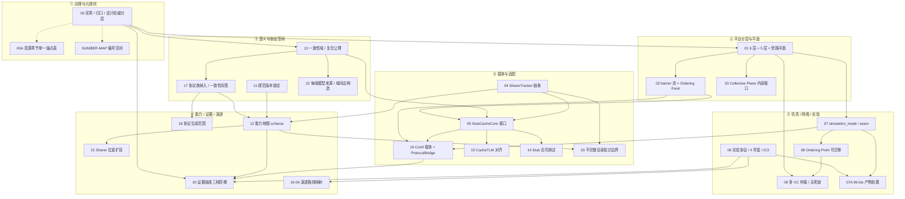

# CEP ADR 决策图（架构视角 · 导航面 · ⛔ 非真源）

> **定位**：**导航面**，不是真源。与 ADR 正文冲突之处，**以 ADR 正文为准**。
> **目标**：只读本文件，即可掌握 CEP 全部 26 份 ADR 的**背景 → 决策 → 依赖 → 内容**；需要判据细节时按行号跳读原文，**读完即止**。
> **解决的问题**：`docs/adr/ADR-CEP-*.md` 全量 **11,871 行**中 **4,922 行（41.5%）** 是 `## Status Update`，主体为台账 `Entry #` / 评审轮次 / 取证表。决策本身只占 **约 6,949 行正文**。
> **行号口径**：行号为 **2026-11-24 快照**（较 11-23 补入 `22` / `23` 两份 ADR；`13` 的**正文区间不变**，仅 SU 占比随 SU(2026-11-24) 追加而上移）。ADR 签发后正文不可变 ⇒ **正文区间不漂移**；SU 仅在文件末尾追加。

## 0. 阅读路径

| 想知道 | 去 |
|---|---|
| CEP 到底是什么、26 份 ADR 怎么组织 | §1 · §2.1 |
| 决策之间谁依赖谁 | §2.2 图 + §4 依赖表 |
| 某份 ADR 的背景 / 决策 / 上下游 | §3 决策卡 |
| 关键主线怎么串起来（含 E2E 证据链） | §5 |
| 只想看一句话结论 | §6 速查表 |
| 不想被 SU 淹没 | §7 跳读指引 |
| 新增 SU 该怎么写才不制造噪音 | §8 |

---

## 1. CEP 是什么（一页背景）

- **CEP = Coherence Exploration Platform**：支持 **CHI / CXL 3.0 / TileLink-C / NVLink / UALink** 五种协议作为**可插拔插件**的一致性互联探索平台（`ADR-CEP-00:32`）。
- **基本矛盾**：CEP 要「协议中立地探索一致性」，而**协议语义的设计权威在 ArchForge**、**代码归口在 CppTLM**（`ADR-CEP-00` 决策 1）⇒ 整套 ADR 都在回答同一个问题：**在本仓能把证据做到多强、边界在哪**。
- **真源分工**（冲突时的裁决顺序）：
  | 层 | 路径 | 性质 |
  |---|---|---|
  | 真源 3 | `docs/adr/ADR-CEP-*.md` | **不可变决策**（签发后只追加 SU） |
  | 真源 1 | `docs/architecture/07-*.md` + `docs/architecture/cep/*.md` | **当前态**（可演进） |
  | 契约面 | `openspec/specs/cep-*/spec.md` | 机器可判契约 |
- **26 份 ADR 的结构**：3 份治理元规则 + 3 份平台分层 + 4 份语义/协议空间 + 6 份载体适配 + 5 份仿真实验 + 5 份能力证据演进。

---

## 2. 架构视角：六层决策视图

### 2.1 分层表

| 层 | 职责 | ADR | 该层的「不可动」边界 |
|:--:|---|---|---|
| **① 治理与元规则** | 归口 / 设计权威 / 真源引用 / 编号空间 | `00` `00A` `NUMBER-MAP` | 代码归 CppTLM、**设计**权威归 ArchForge（单向门） |
| **② 平台分层与平面** | 6 层架构、旁路平面、流语义 | `01` `02` `03` | canonical **10 条流**不得增删（`02` 决策 1） |
| **③ 一致性语义与协议空间** | 一致性域、协议族、版本、每域模型来源 | `13` `17` `11` `22` | ⛔ **平台不提供无违例保证**（`13` 决策 5） |
| **④ 载体与适配** | Tracker / Stub / CohIf+桥 / CacheTLM / 合同测试 / 目录知识边界 | `04` `05` `19` `15` `14` `23` | `CacheTLM` **0 diff**；`StubCacheCore` 不动（`19` 决策 9 显式延期） |
| **⑤ 仿真 / 网络 / 实验** | mode / Ordering / 多 VC / 实验协议 / 产物 | `07` `08` `09` `06` `07A` | **4 件套 + 13 必纳 metric**；`not-collected` 禁写 0 / −1 |
| **⑥ 能力 / 证据 / 演进** | schema / 证据强度 / 路线 / 生成 / 扩容 | `12` `20` `16` `18` `21` | ⛔ **禁止跨档比较强度**（`20` 决策 6(i)）；组合能力不进 DoD（`12` 决策 8） |

### 2.2 决策依赖图

**约定**：箭头 `A --> B` = **A 是 B 的上游**（B 依赖 / 受约束于 A）；`-.->` = 元规则服务于。

### 2.3 三种「依赖」的区别（⛔ 别混）

| 类型 | 含义 | 例 |
|---|---|---|
| **前置** | 上游没定，下游无法实施 | `02` 的 10 条流清单 → `05` 的折叠映射表 |
| **约束** | 上游限制下游的**可用形态** | `19` 决策 9（Stub 不动）→ `20` 决策 4（⛔ 拒绝拓扑级承载语义） |
| **对齐** | 两处判据必须一致，任一处变更须同步 | `13` 决策 5 ↔ `17` 决策 9（组合承诺边界） |

---

## 3. 决策卡（26 份 · 按层）

> 每张卡：**背景** → **决策核心** → **上下游** → **正文区间**。⛔ 卡内是摘要，判据细节以原文为准；**「显式排除」类决策（划定不做什么）通常略去**，需要时按区间跳读。

### 3.1 治理与元规则

#### `00` 平台宪章与治理 · `:32-274`（SU 46%）
- **背景**：CEP 要做五协议可插拔平台，但「谁定协议语义、谁写代码」从未写死。
- **决策**：① **代码归口 CppTLM**、设计权威按**定性分层**（协议语义设计 → ArchForge，实施 → 本仓）② CEP ↔ 06-bis 走 **supersede** ③ 单 DRI + 准入门 + KPI 排队 ④「建模框架」豁免论证。
- **下游**：`01`（分层）、`13`（语义边界）、`20`（设计权威是拒绝拓扑级承载语义的第 2 条理由）。

#### `00A` 真源章节锚点表 · `:43-233`（SU 11%）
- **背景**：CEP-00~05 起草时对真源章节引用**系统性失锚**（引了不存在的 `06 §15.1` 等）。
- **决策**：① 本 ADR = CEP 真源引用**单一真源** ② 不变量 `CEP-00A-IC1`（机器可查）③ 章节标题必须 **grep 提取**，⛔ 禁凭记忆。
- **约束**：**引用任何 CEP 章节前必查 §3 映射表**；映射表无该章节 ⇒ 判伪引。

#### `NUMBER-MAP` 编号空间 · `:39-192`（SU 19%）
- **背景**：6 份 v0.2 ADR + 9 议题之间存在**隐式依赖环**（A14 编号未定 ⇒ 无法起草）。
- **决策**：① `CEP-NN` 编号预分配表 ② **不变量 id 与 ADR 编号命名空间分离** ③ A14 映射先冻结为常量破环 ④ 起草顺序。

### 3.2 平台分层与平面

#### `01` Fabric Collective Plane 作为旁路平面 · `:88-222`（SU **71%**）
- **背景**：06 号 L1-L6 只锁**仿真层 payload/port**，而 CEP 需要的是**跨层完成域**。
- **决策**：① **6 层 = 5 层 + 1 旁路平面** ② 完成域判别规则（单规则推导同类争议）③ barrier 流钉为 Ordering Point。
- **下游**：`02` / `03`（平面内部）、`07` / `09`（集成与仲裁）。

#### `02` barrier 语义澄清 · `:88-254`（SU 47%）
- **背景**：旧讨论引以为据的「10 条抽象事务流」经实证**并不存在于** 06 / 06-bis。
- **决策**：① **零流数变更**（守 canonical 10 条）② CXL Fence 走 barrier 流 ③ barrier 流 = **Ordering Point 语义**。
- **下游**：`05`（Stub 的 **5 条 net-side 接口**按 10 流命名对齐，另 **5 条**在 ProtocolEngine 内折叠）、`13`（barrier_domain 语义）。

#### `03` Collective Plane 内部接口 · `:33-249`（SU 48%）
- **背景**：`01` 锁定旁路平面与完成域判别，但内部接口与跨平面契约未定。
- **决策**：① 3 个**生效条件** ② 抽象接口 ③ `NullCollectivePlane` 作「启停干净」验收件。
- **上游**：`01`。

### 3.3 一致性语义与协议空间

#### `13` 一致性域所有权 · `:60-262`（SU 31%）
- **背景**：07 号 §2.2 提到 `barrier_domain` / 一致性域，但 CEP 从未定义。
- **决策**：① 一致性域定义 ② **复合一致性公理** `acyclic(ppo_com ∪ rfe ∪ fr ∪ ws)` ③ 跨域写传播触发 ④ 桥接并发粒度 ⑤ 组合承诺边界 —— **⛔ 平台不提供无违例保证**（只证伪）。
- **对齐**：`17` 决策 9（组合能力不承诺自动化）。
- **下游**：`17`（语义标签）、`05`（Stub 投影）。

#### `17` Ruby-SLICC 协议族 · `:46-454`（SU 13%）
- **背景**：宪章用 gem5 Ruby 类比只论证了「框架归口」，没回答「CEP 能不能实现 Ruby 能探索的协议空间」。
- **决策**：① §5.1 改「族 → 实例列表」② Ruby-SLICC 纳入 ③ token 类 tracker 归属 ④ 协议私有状态边界 ⑤ HTM 排除 ⑥ atomic 归属（`perm` **不扩展**）⑦ 学术族纳入 + 标签维度 ⑧ **每实例须声明「排序假设 + 一致性标签」** ⑨ **分层 + 异构组合可做，但不承诺自动化** ⑩ 与 *Gen 族互补。
- **下游**：`12`（第 ⑧ 条变成 schema 必填）、`18`（生成路线）。

#### `11` 规范版本锁定 · `:49-330`（SU 26%）
- **背景**：每个 adapter 对应一个**外部规范**，而规范会演进（CHI 各版差异大）。
- **决策**：① `protocol_version` 只记**规范版本**（与实现版本分离）② 规范版本**锁定表 = 唯一真源** ③ **装配期**校验（⛔ 不靠人工核对）④ 规范升级三条路径。
- **下游**：`12`（schema 的版本字段）、`18`（生成路线一致性）。

#### `22` 每域模型来源与域间边构造 · `:41-285`（SU 7%）
- **背景**：`13` 的复合一致性公理 `acyclic(ppo_com ∪ rfe ∪ fr ∪ ws)` 判定面**不可得**（`V-13-4` 登记为 ⭭-unmodelled）⇒ 缺「每域模型从哪来」「域间边怎么构造」的可判定前置。
- **决策**：① 域身份 = 操作迹侧的域标识（⛔ 不进 schema）② 每域模型来源 = 域绑定实例的 `consistency_labels`（`read`/`write` 二元组）③ `ppo_i` = 标签 → 访问模式 → 保留程序序边（v1 覆盖 SC / RC-acquire / RC-release / RC-data / PLO；⛔ **TSO 不登记** ⇒ `undecided`）④ `rfe`/`fr`/`ws` **全部派生**（⛔ 不得作输入）⑤ 候选 = 同地址写序候选 + 静态图判环 + ∃/∀ 聚合语义 + 截断 ⇒ `undecided` ⑥ **双图折衷**（公理面不含域内 `rf`，观测面报告）⑦ 判定面**四态** + 原因码闭集（10 码）⑧ `V-13-4` 退场 = 显式 Out-of-Scope ⑨ 登记与冻结纪律（三件套 + 五步链）。
- **上游**：`13`（决策 1/2/5）、`12`（决策 3/4）、`08` 决策 1、`20` 决策 6、`17` 决策 7、`02`（10 流）。
- **下游**：`backlog: cep-memory-model-operational-trace`（**开工前置**）；运行期轨迹采集另立 backlog。

### 3.4 载体与适配

#### `04` SharerTracker 抽象重构 · `:44-447`（SU 56%）
- **背景**：06-bis 全文 grep `sharer` / `D-5` **零匹配** ⇒ 不存在可沿用接口。
- **决策**：① α′ = α + γ′ + D-5 重构（**三件套缺一不可**）② **DCOH 完备性契约**（正确性命门）③ `caps` descriptor struct 替代 bool，**第一天就位**。
- **下游**：`05`（Stub 依赖）、`12`（tracker 选型与 caps 声明）。

#### `05` StubCacheCore 接口 · `:47-385`（SU 5%）
- **背景**：06 号 §15.4 的 P3 范围**无 Stub Cache**，需在本仓定义。
- **决策**：① RN 侧投影 + 复用 canonical 10 流 ② **三明治挂载**（Stub 双端口）③ **折叠映射表 = 正确性的唯一审计点** ④ bypass 作 testbench 选项。
- **上游**：`02`（10 流）、`04`（tracker）、`13`（投影语义）。
- **下游**：`14`（合同测试）、`15`（与 `CacheTLM` 划界）、`19`（CohIf 之上）。

#### `19` CohIf 载体与 ProtocolBridge · `:60-227`（SU **67%**）
- **背景**：6 层里 CohIf 层（10 流）之下是协议引擎、之上是 Stub Cache Core，中间载体未定。
- **决策**：① 新立 **CohIf 载体队列** ② `CohIfBundle` **单一类型**，只覆盖 **5 条 RN-side 流** ③ 归业务语义但按网络级纪律演进 ④ `ProtocolBridge` **双层 + 钩子**（显式偏离 06 §11.2 P3）⑤ 装配走 **JSON 链** ⑥ Bundle 路径 ⑦ 06 §11.2/11.3 时间线转隶 CEP ⑧ 不引新抽象层 ⑨ **⛔ 不动 `StubCacheCore`（显式延期）**。
- **上游**：`02`（5 条 RN-side 流）、`07`（装配 seam）。
- **下游**：`20`（**决策 9 是「拒绝拓扑级承载语义」的第 1 条理由**）。

#### `14` Stub 合同测试 · `:38-182`（SU 26%）
- **背景**：`05` 定义了 6 接口 / 折叠表 / 7 条不变量，但**没有合同测试**。
- **决策**：① 测**投影契约**、⛔ 不测缓存行为 ② 10 条合同测试清单 ③ **双向**（C9 负向断言）④ C10 两阶段 ⑤ 用**协议替身**而非真协议。
- **上游**：`05`。

#### `15` CacheTLM 对齐 · `:50-200`（SU 34%）
- **背景**：仓内已有 `CacheTLM`，CEP 又要引入 Stub Cache Core，二者都叫「缓存」⇒ 易被误认为同类。
- **决策**：① **共存不替换** ② `CacheTLM` **0 diff**（冻结面）③ 术语共享、实现不共享 ④ 未来「真实缓存 + CEP 协议」= **加 adapter，不改 `CacheTLM`**。
- **上游**：`05`｜**下游**：`18`（长期生成路线）。

#### `23` 不完整目录知识的表达边界 · `:33-153`（SU 0%）
- **背景**：`Completeness` 枚举有 `PARTIAL`，但实例 schema 只允许 `EXACT`/`CONSERVATIVE`；J2 把 `PARTIAL`+兜底当「合法组合」保留（合法声明上 vacuous），deferral 又把它当「待实现」⇒ 同一取值**三重身份错位**，而平台无 belief 模型 ⇒ 声明语义无定义。
- **决策**：① 可声明域 = {`EXACT`, `CONSERVATIVE`}；`PARTIAL` 降为**不可声明的合成值**（收窄 `04` 决策 2 的**声明面**，⛔ 不取代其行为禁令）② 本仓**声明面不承载** belief 模型（范围限定本仓，⛔ 不预否决 ArchForge 域内决策）③ 不完整知识的唯一合法形态（**行为语义层面**）= `CONSERVATIVE` + `broadcast_fallback` ④ 若需真 belief ⇒ 新 ADR + 新 caps 维度（⛔ 禁复用 `PARTIAL` 偷渡）⑤ J2 的 `PARTIAL` 分支降为**合成声明专用反向判据**（`V-04-7` 须改判）⑥ ⛔ **零新造 invariant**（复用 `INV-CEP-04-IC1` / `V-04-7`）。
- **上游**：`04`（决策 2/3 · DCOH 完备性契约 + caps descriptor）、`12`（schema 的 caps 字段）。
- **下游**：`13` SU(2026-11-24)（G4-c 登记 fence 派生规则 + G4-b 裁决）；builder：`NO_INV` 登记 + 冻结五步链；planner：`V-23-1/3/5` 判据载体化。

### 3.5 仿真 / 网络 / 实验

#### `07` 仿真与集成语义 · `:36-267`（SU 24%）
- **背景**：长期断言「CEP 与 `simulation_mode` 正交」，但从未定义 mode 下完成域如何推进、如何注册进 ModuleFactory。
- **决策**：① `simulation_mode` **单维** ② functional / timing 对 coherence plane 的影响 ③ ModuleFactory seam ④ `NullProtocolEngine` 作默认 ⑤ 复用 `NullCollectivePlane` ⑥ 与 DGpuBoard / frozen headers 边界 ⑦ mode ↔ 插件能力映射 ⑧ 06-bis 既有产物**明示不处置、移交 `07A`** ⑨ 插件**可组合性**要求。
- **上游**：`01` / `03` / `06` / `13` / `17`。

#### `08` Ordering Point 可迁移性 · `:58-246`（SU 8%）
- **背景**：07 号 §2.2 的 Directory & Ordering Plane 声明了 Ordering Point，但定义与可迁移性从未写。
- **决策**：① Ordering Point 定义 ② **唯一序列化点**不变量 ③ 可迁移性三判据 ④ E 态静默升级检查 ⑤ ⛔ 不绑物理实体 ⑥ 排序假设面边界。
- **上游**：`01` / `05` / `07` / `12`。

#### `09` 多 VC 仲裁与无死锁 · `:50-247`（SU 53%）
- **背景**：`01 §3.3` 已立跨平面 VC 隔离，并注明「路由器侧多 VC 仲裁待 CEP-09」。
- **决策**：① **两段式**：Decision A（装配期静态论证）+ Decision B（运行时仲裁）② 通道依赖图 ③ 三方联合契约 ④ 仲裁策略 ⑤ `INV-09-IC1` 装配期无环必过 ⑥ `INV-09-IC2` 策略与依赖图一致 ⑦ `INV-09-IC3` 依赖传播契约。
- **上游**：`01` / `08` / `12` / `17`。

#### `06` 实验协议 · `:36-228`（SU **79%**）
- **背景**：00~05 全是**接口管道**，没有实验协议 ⇒ 无法判定「跑一次实验意味着什么」。
- **决策**：① **1 run = 4 件套** ② 必纳 metric **13** 个（+4 可选）③ A/B 报表 ④ **`not-collected` + per-metric 原因**（⛔ 禁省 / 禁 0 / 禁 −1）⑤ 输出与 `simulation_mode` 关系。
- **下游**：`07A`（产物处置）、`16`（演进映射）、`20`（IC3 口径 = 决策 2 的事实前提）。

#### `07A` 06-bis 产物处置 · `:43-152`（SU 36%）
- **背景**：06-bis v0.3 §3.4 / §4 规划了一组 Coherence 产物，CEP 承接了 scope 但**逐项处置未定义**。
- **决策**：① 逐项处置表 ② 时间分期 ③ **协议泄漏通用禁令** ④ 显式排除。

### 3.6 能力 / 证据 / 演进

#### `12` 协议引擎能力地图 · `:43-489`（SU 58%）
- **背景**：`08` / `09` / `11` / `13` 都要引用「某实例能做什么」，而当时只有**人工维护的 Markdown 表格**。
- **决策**：① schema 全量（实例为 key）② `perm` **4 值锁** + atomic 独立 ③ 一致性标签读写两级 ④ 请求级标签 ⑤ `ordering_assumption` 逐网络/VC 且 key 可解析 ⑥ `vc_binding` ⑦ `sharer_tracker` 逐实例 + caps ⑧ **`combination_capabilities` 正交于族**（不计 DoD，per SU `:1023`）⑨ `status` = 计数唯一依据。
- **下游**：`20`（档位载体）、`21`（schema 无节点数位 ⇒ 触发判据受限）。

#### `20` 拓扑级 IC3 证据强度 · `:56-235`（SU 14%）
- **背景**：拓扑级 E2E run 已达成 IC3 = `✓ 通过`（两违例类实测为 0），但**这个 0 的语义强度存疑**。
- **决策**：① 拓扑级装置 = **框架级观测面**（⛔ 不承载一致性语义）② 违例类唯一合法语义 = **样本通路活性** ③ ⛔ 拒绝装置语义级升级 · ✅ 采纳 B′（检测力见证增量）④ ⛔ 拒绝拓扑级承载真实语义 ⑤ 判别力载体在**本仓协议引擎面** ⑥ **三档阶梯 + 档位声明义务 + 跨档聚合禁令**。
- **上游**：`06`（IC3 口径）、`19`（决策 9）、`12`（实例面）、`00`（设计权威）。
- **约束**：⛔ **禁止跨档比较强度**；按 `hypothesis_id` 聚合 verdict 的消费方**必须同读** `evidence_scope`。

#### `16` 06 演进路线映射 · `:41-152`（SU 21%）
- **决策**：① 逐项映射表 ② 处置词严格含义 ③ **协议语义建模统一归 ArchForge** ④ `P6` 口径排除。
- **上游**：`00` / `06` / `13`。

#### `18` 协议生成范围 · `:48-195`（SU 12%）
- **决策**：① Stage 1-3 **纯手写插件**（⛔ 不引 DSL / 代码生成）② ⛔ 不复刻 *Gen ③ **互补非替代** ④ 长期位 = SSP 描述 → 插件生成 ⑤ **切换判据**（何时才允许引入生成）。
- **上游**：`17` / `07` / `14`。

#### `21` Sharer 位宽扩容 · `:65-194`（SU 0%）
- **背景**：mesif 的装配期硬断言只覆盖**一族**，且 responder 位宽 4 是硬编码。
- **决策**：① **阶段 1 机制化**（成立即生效：三处硬编码全消 + 满射判据）② **阶段 2 触发式扩容**到 `W`（默认 8，⛔ 不得预先执行）③ **触发判据** = 机判 2a/2c + **人裁** 2b。
- **上游**：`04`（tracker 抽象，不改）、`12`（13 键无节点数位 ⇒ 2a 受限）。

---

## 4. 决策级依赖表

### 4.1 ADR 级（跨文档）

| 上游 → 下游 | 类型 | 证据 |
|---|---|---|
| `00` → `01` | 前置（归口） | `00:36`/`:102` |
| `00A` → `00` | 服务（引用纪律） | `00A:159` |
| `NUMBER-MAP` → `00` / `00A` | 服务（编号空间） | `NM:102`/`:19` |
| `01` → `02` / `03` | 前置（分层定才谈流/内部） | `02:132,184` · `03:28,40` |
| `01` → `07` / `09` | 前置 | `07:104` · `09:25,98` |
| `02` → `05` | 前置（10 流清单） | `05:19,49,66` |
| `02` → `19` | 前置（5 条 RN-side 流） | `19:48,51,192` |
| `13` → `17` | 前置（域语义 → 标签） | `13:52,117,131,179` |
| `13` → `22` | 前置（域语义 → 每域模型来源 / 域间边构造） | `22:43,53,78` |
| `17` → `12` | 约束（每实例须声明） | `17:14,312,408,436` |
| `11` → `12` | 前置（版本字段） | `12:271,293,296,378` |
| `04` → `05` / `12` | 前置（Tracker / 选型） | `05:17` · `12:127,441` |
| `04` → `23` | 约束（收窄 `04` 决策 2 的**声明面**取值域） | `23:35,43,67` |
| `05` → `14` / `15` / `19` | 前置 | `14:30,44,79` · `15:38,65` |
| `07` → `08` / `19` | 前置（seam 定才装配） | `08:125,173` · `19:45,67,138` |
| `08` → `09` | 前置（Ordering 假设） | `09:44,92` |
| `06` → `07A` / `16` / `20` | 前置 | `07A:52` · `16:48` · `20:10,20,69,96` |
| `19` → `20` | **约束（强）** | `20:79`（决策 4 主理由 1） |
| `12` → `20` / `21` | 约束 | `20:172` · `21:10,181` |
| `17` → `18` | 前置 | `18:71,114,154` |

### 4.2 决策点级（跨 ADR 的具体引用）

| 下游决策 | 依赖的上游决策 | 类型 | 证据 |
|---|---|---|---|
| `20` 决策 4（⛔ 拒绝拓扑级承载语义） | `19` **决策 9**（StubCacheCore 不动）+ `00` **决策 1**（设计权威分层） | **约束 · 强** | `20:79`、`20:80` |
| `20` 决策 2（唯一合法语义 = 样本通路活性） | `06` SU 2026-11-13 ①（IC3 口径逐句取代） | 前置 | `06:1087` 对照 `20:60` |
| `20` 决策 6(i)(ii)（禁跨档比较 / 聚合） | `12` 决策 8（组合能力不进 DoD）+ `17` 决策 9（不承诺自动化） | **概念**（未互引） | `12:1023`、`17` 决策 9 |
| `21` 触发判据 2a | `12` `INV-CEP-12-IC1`（13 键锁、无节点数位） | **约束** | `21:94`、`21:10` |
| `12` 决策 8 / 9 | `17` 决策 9（组合承诺边界） | 对齐 | `12:130`、`17` 决策 9 |
| `13` 决策 5（无违例保证） | `17` 决策 9 | **对齐** | `13:117` |
| `09`  Decisions A/B | `01 §3.3` 抓取点 3（跨平面 VC 隔离） | 前置 | `09:25` |
| `15` 决策 4（加 adapter） | `18` 决策 4（长期生成位） | 对齐 | `15:94,99,145` |
| `05` 决策 1（复用 10 流） | `02` 决策 1（零流数变更） | **约束 · 强** | `05:19,49` |
| `07A` 的全部处置范围 | `07` **决策 8**（明示「本 ADR 不处置」、移交 07A） | **移交** | `07:123` |

---

## 5. 关键依赖链

### 链 A · 骨架：宪章 → 分层 → 流语义 → 载体 → 测试
`00`（归口）→ `01`（6 层 + 旁路平面）→ `02`（10 流 + barrier）→ `05`（Stub 接口 + 折叠表）→ `14`（合同测试）
> 读法：**任何「Stub 该怎么表现」的问题，答案不在 `05` 里，而在 `02` 的 10 流清单** —— 但注意**边界**：Stub 只感知其中 **5 条**（流 1/2/3/4/5），另 5 条（6/7/8/9/10）在 ProtocolEngine 内消化（`05` 的折叠映射表 = 正确性唯一审计点）。

### 链 B · 语义与声明：域 → 协议族 → schema → 版本
`13`（一致性域 / 复合公理）→ `17`（协议族 + 排序假设/标签）→ `12`（schema 化）← `11`（版本锁定）；**旁支**：`22`（`13` 的可判定前置：每域模型来源 / 域间边构造）、`23`（`04` 的声明面收窄：目录知识取值域）
> 读法：**「某协议在 CEP 里能做什么」= `12` 的实例声明；其语义合法性由 `13`/`17` 决定。**

### 链 C · 仿真到证据：mode/排序/仲裁 → 实验协议 → 证据强度
`07` / `08` / `09` → `06`（4 件套 + 13 metric + IC3）→ `20`（三档阶梯 + 跨档聚合禁令）
> 读法：**E2E 证据只到 `20` 的阶梯为止，⛔ 不存在「跨三档的一次性总判定」。**

### 链 D · 载体落地：Tracker → Stub → CohIf/桥 → 相容
`04` → `05` → `19`（CohIf + ProtocolBridge，**决策 9 = Stub 不动**）→ `15`（与 CacheTLM 划界）
> 读法：**`19` 决策 9 是整条链的「不动点」** —— `20` 决策 4 拒绝拓扑级承载语义，理由就是它。

### 专链 · E2E 证据（当前争议焦点）
`06`（IC3 口径）→ `19` 决策 9（装置定位）→ `20` 决策 1/2（观测面 + 样本活性）→ `20` 决策 3c/6（三档阶梯）
> 三条硬约束：
> 1. ⛔ 档 0 **不承载**一致性语义（`20` 决策 1，理由是 `19` 决策 9 + `00` 决策 1）；
> 2. ⛔ **禁止跨档比较强度**（`20` 决策 6(i)），排序轴 = **装置归属层级**（见 `openspec/specs/cep-evidence-tier2-observation/spec.md:77` 的 SHALL）；
> 3. ⛔ **平台不提供无违例保证**（`13` 决策 5）⇒ 档 0 的 `0` 只能读作「本装置无该形态」。

---

## 6. 速查表（26 份 · 对账命令 `ls docs/adr/ADR-CEP-*.md | wc -l`）

| ADR | 决策方向（一句话） | 决策数 | 决策正文 | SU 占比 |
|:--:|---|:--:|:--:|:--:|
| **00** | 代码归 CppTLM · 设计权威按定性分层归 ArchForge；supersede 路径；单 DRI + KPI 排队 | 4 | `:32-274` | 46% |
| **00A** | 真源章节引用**单一真源**；须 grep 提取，禁凭记忆 | 3 | `:43-233` | 11% |
| **01** | 6 层 = 5 层 + 旁路平面；完成域判别；barrier = Ordering Point | 3 | `:88-222` | **71%** |
| **02** | 零流数变更（守 10 流）；CXL Fence 走 barrier；barrier = Ordering Point | 3 | `:88-254` | 47% |
| **03** | Collective Plane 3 生效条件 + 抽象接口 + Null 实现验收 | 3 | `:33-249` | 48% |
| **04** | α′ 三件套；DCOH 完备性契约；caps struct 第一天就位 | 3 | `:44-447` | 56% |
| **05** | RN 侧投影 + 复用 10 流；三明治挂载；折叠表 = 唯一审计点 | 4 | `:47-385` | 5% |
| **06** | 1 run = 4 件套；13 必纳 metric；`not-collected` + 原因 | 7 | `:36-228` | **79%** |
| **07** | `simulation_mode` 单维；seam；Null 引擎默认；插件可组合性 | 9 | `:36-267` | 24% |
| **07A** | 06-bis 产物逐项处置；分期；协议泄漏禁令 | 4 | `:43-152` | 36% |
| **08** | Ordering Point 定义；唯一序列化点；可迁移三判据；不绑物理实体 | 7 | `:58-246` | 8% |
| **09** | 两段式；通道依赖图；三方契约；IC1/IC2/IC3 | 8 | `:50-247` | **53%** |
| **11** | `protocol_version` 只记规范版本；锁定表唯一真源；装配期校验 | 6 | `:49-330` | 26% |
| **12** | schema 全量；`perm` 4 值锁；标签两级；组合能力正交于族（不计 DoD） | 10 | `:43-489` | 58% |
| **13** | 一致性域；复合公理；跨域传播；**不提供无违例保证** | 6 | `:60-262` | 31% |
| **14** | 测投影契约；10 条合同测试；双向 C9；C10 两阶段 | 6 | `:38-182` | 26% |
| **15** | 与 CacheTLM 共存；`CacheTLM` 0 diff；未来加 adapter | 5 | `:50-200` | 34% |
| **16** | 06 演进逐项映射；处置词严格；语义建模归 ArchForge | 5 | `:41-152` | 21% |
| **17** | 协议族纳入；每实例须声明排序假设 + 标签；异构可做但不承诺自动化 | 10 | `:46-454` | 13% |
| **18** | 纯手写插件（不引 DSL/生成）；互补非替代；切换判据 | 6 | `:48-195` | 12% |
| **19** | CohIf 载体队列；`CohIfBundle` 只覆盖 5 条 RN-side 流；桥双层；**Stub 不动** | 9 | `:60-227` | **67%** |
| **20** | 拓扑级 = 观测面；唯一合法语义 = 样本活性；**三档阶梯 + 禁跨档聚合** | 6 | `:56-235` | 14% |
| **21** | 阶段 1 机制化；阶段 2 触发式扩到 `W`（默认 8） | 2 | `:65-194` | 0% |
| **22** | 域身份 = 迹侧域标识；每域模型 = 实例标签；`rfe`/`fr`/`ws` 全派生；判定面四态 | 9 | `:41-285` | 7% |
| **23** | 可声明域 = {EXACT, CONSERVATIVE}；不完整知识 = CONSERVATIVE + 兜底 | 5 | `:33-153` | 0% |
| **NUMBER-MAP** | 编号预分配；id 与 ADR 编号命名空间分离；破依赖环 | 4 | `:39-192` | 19% |

## 7. 高噪音 ADR 的跳读指引（SU 占比 ≥ 50%）

这 6 份的 SU 已超过正文，**先读正文区间，⛔ 不要从头顺读**：

| ADR | 正文区间 | SU 行数 | 说明 |
|:--:|:--:|:--:|---|
| **06** | `:36-228` | **886**（79%） | 实验协议；SU 主要是逐句取代与取证 |
| **01** | `:88-222` | **570**（71%） | Collective Plane；SU 为 Phase 落地回执 |
| **19** | `:60-227` | **462**（67%） | CohIf 载体；SU 为决策 9 延期解除与 ASM 决策 |
| **12** | `:43-489` | **688**（58%） | 能力地图；SU 为实例面扩充 |
| **04** | `:44-447` | **582**（56%） | SharerTracker；SU 为分阶段落地 |
| **09** | `:50-247` | **288**（53%） | 多 VC 仲裁；SU 为 invariant 建模 |

> 临界（46~48%）：`00` / `02` / `03`；`05` / `08` / `21` 可忽略（≤ 8%）。

## 8. SU 书写纪律（前瞻 · 适用于新增 SU）

1. **SU 只写两类**：① **口径 / 判据变更的结论**（属决策面，必须留）② **指针**（台账 `Entry #N` 或 `.rddf/reviews/<report>.md`）。
2. **⛔ 不再进 SU**（改落 `.rddf/reviews/` 或台账）：评审轮次与 BLOCKER 清单 · 逐条取证表 / 变异清单 · commit 哈希 · 文件级 diff 摘要 · 逐步排查过程。
3. **判定界线**：删掉后「读者能否据此正确引用该 ADR」—— 能 ⇒ 过程日志（外移）；不能 ⇒ 决策面（保留）。
4. ⚠️ **例外**：逐句「取代 / 保留」对照表属**决策面**（它定义哪句还生效）⇒ 必须留；其依据与过程仍外移。

## 9. 维护

- **新增 ADR**：§3 加决策卡、§4 加依赖边、§6 加行；未加 ⇒ 本表腐化，以 `ls docs/adr/ADR-CEP-*.md | wc -l` 对账。
- **新增 SU**：正文行号不变（SU 只在末尾追加）⇒ §6 的区间无需更新。
- ⛔ 本文件**不承载**判据；⛔ 不得被闸消费；⛔ 不得作为「决策已达成」的证据面。
